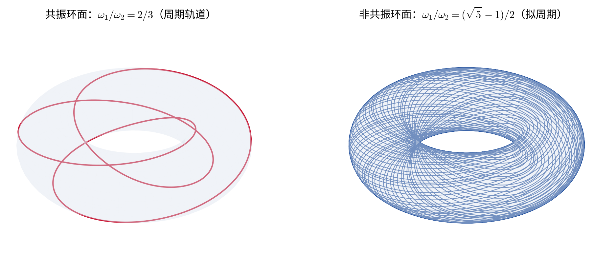
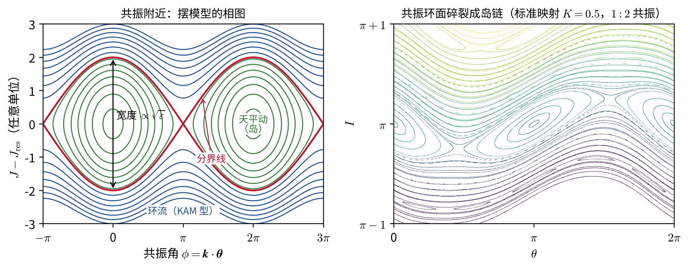
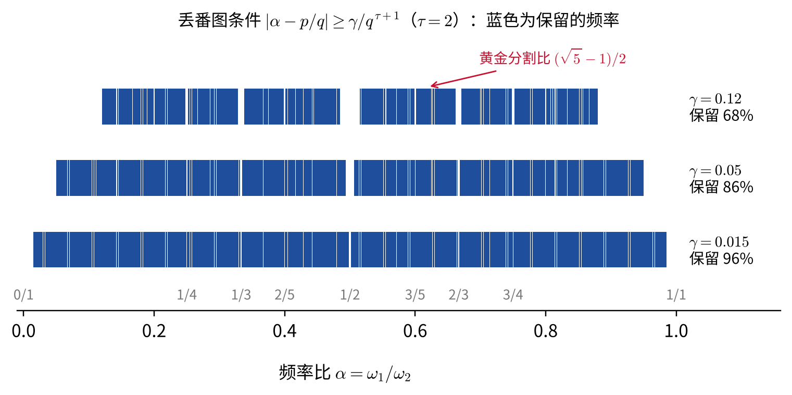
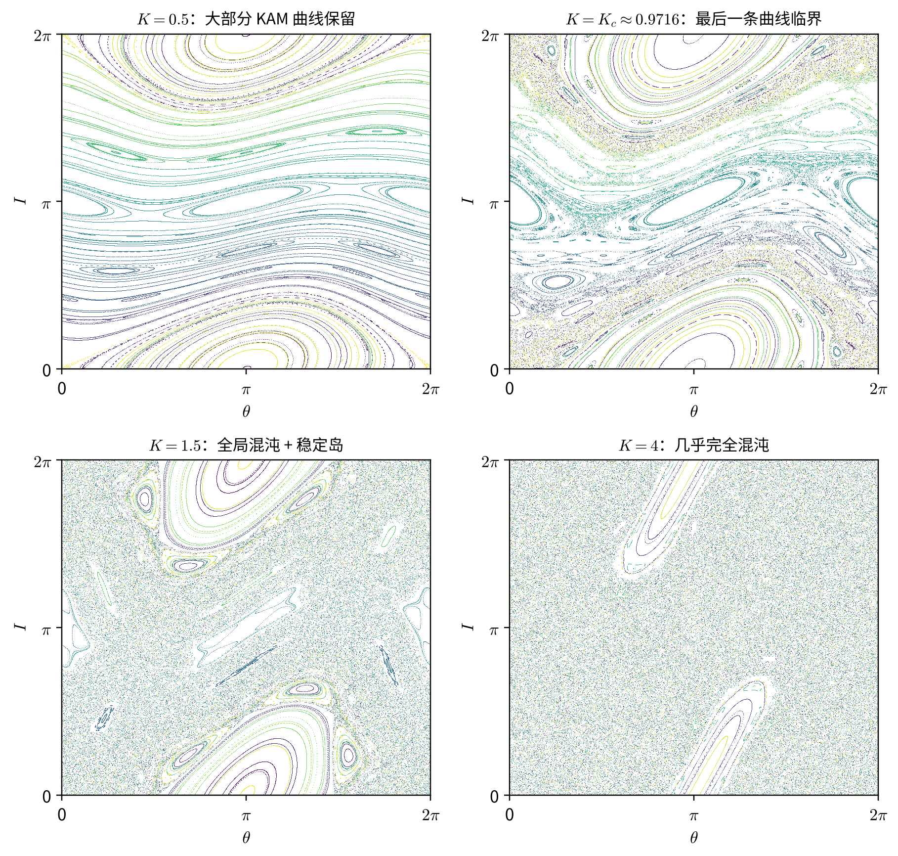
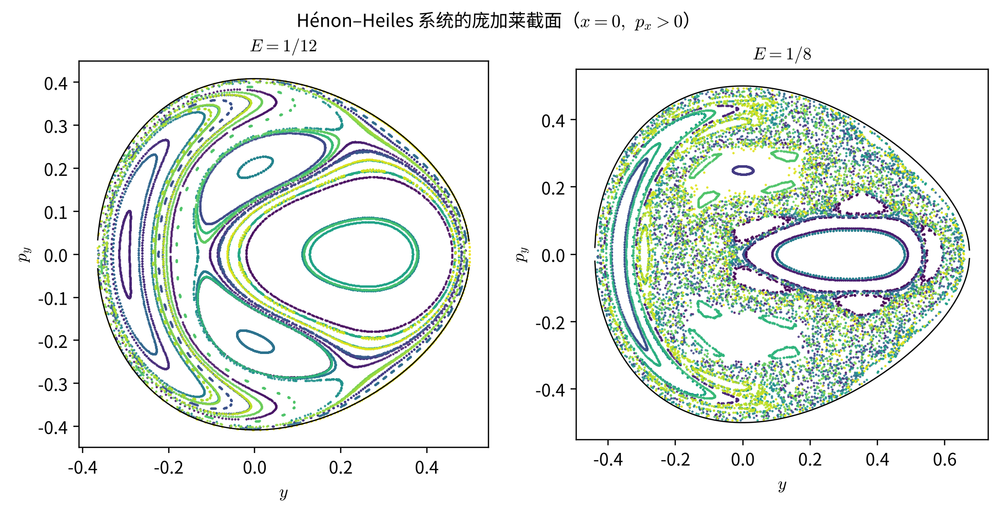

# KAM 定理

**——近可积系统中的稳定与混沌**

> 本章建立在“哈密顿力学”一章的基础上，用到其中的正则变换与生成函数、作用量－角变量、刘维尔定理和泊松括号；“微扰和摄动理论”中的共振、久期项和柯克伍德空隙会在这里得到更深一层的解释。为了与 KAM 理论的文献一致，本章把角变量记为 $\theta$（“哈密顿力学”中记为 $W$），作用量变量仍记为 $I$；粗体表示 $n$ 维矢量，例如 $\boldsymbol I=(I_1,\ldots,I_n)$。

“哈密顿力学”一章最后，我们看到：只要能找到作用量－角变量，运动就被“拉直”成守恒的作用量加上匀速转动的相位。可惜，这种完美的情形只对**可积系统**成立。真实的天体力学问题——太阳系、小行星带、星系中的恒星、黑洞周围的致密天体——几乎都是“一个可积系统加上一点小扰动”。于是一个看似朴素的问题变得至关重要：

> 一个可积系统受到小扰动以后，它的规则运动还在吗？

这个问题困扰了拉普拉斯、拉格朗日和庞加莱，直到 1954 年才由柯尔莫哥洛夫（A. N. Kolmogorov）给出答案，再由阿诺德（V. I. Arnold，1963）和莫泽（J. Moser，1962）完成严格证明。这就是 **KAM 定理**。它的结论可以先用一句话概括：

> **在足够小的扰动下，大多数（按相体积计）不变环面只是轻微变形而保留下来；被破坏的是那些频率“接近共振”的环面，在它们的位置上出现了稳定岛和混沌层。**

本章的逻辑是：先回顾可积系统与不变环面（第 1 节）；用正则变换去消除扰动，看到“小分母”这个核心困难（第 2 节）；陈述 KAM 定理并解释其条件和证明思路（第 3 节）；讨论定理没有覆盖的区域——共振、岛链与混沌（第 4 节）；最后看它在天文学中的应用（第 5 节）。

## 1. 可积系统与不变环面

### 刘维尔－阿诺德定理

在“泊松定理”一节中我们讲过，$s$ 个自由度的系统至多有 $2s-1$ 个函数独立的运动积分。可积性要求的是另一种更特殊的结构。对 $n$ 个自由度的自治哈密顿系统，若存在 $n$ 个函数独立的运动积分 $F_1=H,F_2,\ldots,F_n$，并且它们两两**对合**（in involution），即

$$
\begin{equation}
[F_i,F_j]=0,\qquad i,j=1,\ldots,n,
\end{equation}
$$

这里“函数独立”的准确含义是：在所考察的区域内，除去可能的奇异点，

$$
\begin{equation}
dF_1\wedge dF_2\wedge\cdots\wedge dF_n\ne0.
\end{equation}
$$

等价地，$F_1,\ldots,F_n$ 对 $2n$ 个相空间坐标的雅可比矩阵秩为 $n$。例如 $F_2=H^2$ 虽然也守恒，却不能算作独立的第二个运动积分。

为什么恰好需要 $n$ 个运动积分？$2n$ 维相空间中的 $n$ 个独立条件 $F_i=c_i$ 通常留下一个 $n$ 维公共等值集；两两对合还保证由这些运动积分生成的哈密顿流彼此可交换，并且始终切于这个等值集。因此，这里需要的不仅是“守恒量的数目足够”，还要求它们之间相容。

满足上述条件时，称系统是（刘维尔意义下）**可积的**。刘维尔－阿诺德定理断言：若 $\boldsymbol c=(c_1,\ldots,c_n)$ 是正则值，且由 $F_i=c_i$ 确定的公共等值集的一个连通分支是紧致的，则该分支微分同胚于一个 $n$ 维环面

$$
\begin{equation}
\mathbb T^n=\underbrace{S^1\times S^1\times\cdots\times S^1}_{n\ \text{个}},
\end{equation}
$$

并且在它附近可以引入作用量－角变量 $(\boldsymbol\theta,\boldsymbol I)$，使哈密顿量只依赖作用量：

$$
\begin{equation}
H=H_0(\boldsymbol I).
\end{equation}
$$

作用量变量是“哈密顿力学”中一维定义 $I=\frac{1}{2\pi}\oint p\,dq$ 的直接推广：在环面上取 $n$ 条彼此独立、不能连续缩成一点的闭合回路 $\gamma_1,\ldots,\gamma_n$，令

$$
\begin{equation}
I_i=\frac{1}{2\pi}\oint_{\gamma_i}\sum_{j=1}^{n}p_j\,dq_j.
\end{equation}
$$

哈密顿方程于是给出

$$
\begin{equation}
\dot{\boldsymbol I}=-\frac{\partial H_0}{\partial\boldsymbol\theta}=0,
\qquad
\dot{\boldsymbol\theta}=\frac{\partial H_0}{\partial\boldsymbol I}\equiv\boldsymbol\omega(\boldsymbol I),
\end{equation}
$$

即

$$
\begin{equation}
\boldsymbol I=\text{常数},\qquad
\boldsymbol\theta(t)=\boldsymbol\omega(\boldsymbol I)\,t+\boldsymbol\theta_0.
\end{equation}
$$

于是，在满足上述正则性和紧致性的可积区域内，$2n$ 维相空间被一族 $n$ 维**不变环面**“叶状”填满：每个环面由作用量 $\boldsymbol I$ 标记，系统一旦处在某个环面上，就永远留在那里，并在上面以固定的频率矢量 $\boldsymbol\omega(\boldsymbol I)$ 转动。不变环面的存在，正是规则运动、长期可预言性的几何表现。奇异等值集或非紧致运动需要另行分析，不在这一环面结论的直接适用范围内。

本课程见过的可积系统包括：任意一维保守系统、中心力场（守恒量 $H$、$M_z$、$M^2$ 两两对合，三个自由度）、对称陀螺，以及“球对称黑洞中的粒子运动”一章中的史瓦西测地线。

### 周期运动与拟周期运动

以 $n=2$ 为例，环面上的运动由两个频率 $\omega_1,\omega_2$ 描述。

- 若 $\omega_1/\omega_2=p/q$ 是有理数，轨道在转过若干圈后精确闭合，是**周期轨道**，整个环面由一族周期轨道构成。这样的环面称为**共振环面**（resonant torus）。
- 若 $\omega_1/\omega_2$ 是无理数，轨道永不闭合，并且会**稠密**地覆盖整个环面，称为**拟周期运动**（quasi-periodic motion）。此时，任一函数沿轨道的时间平均等于它在环面上的空间平均。

一般地，若存在非零整数矢量 $\boldsymbol k=(k_1,\ldots,k_n)\in\mathbb Z^n$ 使

$$
\begin{equation}
\boldsymbol k\cdot\boldsymbol\omega=k_1\omega_1+\cdots+k_n\omega_n=0,
\end{equation}
$$

则称频率 $\boldsymbol\omega$ 是**共振的**（resonant），$|\boldsymbol k|\equiv|k_1|+\cdots+|k_n|$ 称为共振的阶。“微扰和摄动理论”中的平运动共振 $n_{\rm ast}:n_{\rm J}=2{:}1$、$3{:}1$，以及拉普拉斯共振 $n_{\rm I}-3n_{\rm E}+2n_{\rm G}=0$，都是这一条件的具体例子。

一个重要的事实是：**共振频率在频率空间中是稠密的**（就像有理数在实数轴上稠密一样），但只占零测度（就像有理数在实数轴上测度为零一样）。KAM 理论的全部微妙之处，都来自这一“稠密但测度为零”的结构。

因此，**可积不等于所有轨道都是闭合的**，也不等于解一定能用初等函数写出；它表示运动在原则上可化为求积，并在正则环面附近化为作用量守恒、角变量线性增长。若一个 $n$ 自由度系统还有超过 $n$ 个函数独立的守恒量，则称为**超可积系统**；独立守恒量最多可有 $2n-1$ 个，多出的守恒量不必全部两两对合。开普勒问题由于还有拉普拉斯－龙格－楞次矢量，是最大超可积的；这个额外对称性正是其有界轨道全部闭合的根源。

### 近可积系统

现在给可积系统加上一个小扰动：

$$
\begin{equation}
H(\boldsymbol\theta,\boldsymbol I)=H_0(\boldsymbol I)+\varepsilon H_1(\boldsymbol\theta,\boldsymbol I),
\qquad \varepsilon\ll1.
\end{equation}
$$

扰动 $H_1$ 依赖角变量，它是角变量的周期函数，可以展开为傅里叶级数

$$
\begin{equation}
H_1(\boldsymbol\theta,\boldsymbol I)=\sum_{\boldsymbol k\in\mathbb Z^n}h_{\boldsymbol k}(\boldsymbol I)\,e^{i\boldsymbol k\cdot\boldsymbol\theta}.
\end{equation}
$$

由于 $H_1$ 依赖角变量，作用量不再守恒：$\dot{\boldsymbol I}=-\varepsilon\,\partial H_1/\partial\boldsymbol\theta\ne0$。天文学中的例子比比皆是：

| 系统 | 可积部分 $H_0$ | 扰动 $\varepsilon H_1$ | 小参数 $\varepsilon$ |
| --- | --- | --- | --- |
| 太阳系 | 各行星绕太阳的开普勒运动 | 行星之间的引力 | 木星/太阳质量比 $\approx10^{-3}$ |
| 小行星 | 绕太阳的开普勒运动 | 木星的引力 | $\approx10^{-3}$ |
| 层级三体 | 内、外两个开普勒轨道 | 四极、八极潮汐项 | $(a_1/a_2)^2$ 等 |
| 星系中的恒星 | 轴对称势中的运动 | 旋臂、棒、非轴对称成分 | 非轴对称势的相对强度 |
| 黑洞周围的致密天体 | 克尔测地线（可积） | 自引力、第三体、对克尔度规的偏离 | 质量比 $\mu/M\sim10^{-5}$ 等 |

问题是：$H_0$ 的不变环面在扰动下还存在吗？

历史上有两种截然相反的直觉。

**直觉一：环面都还在。** 18–19 世纪的天体力学家用级数展开逐阶求解行星运动，似乎每一阶都能把扰动“吸收”进新的作用量－角变量中。如果这种级数收敛，扰动后的系统就仍然可积，太阳系将永远稳定。拉普拉斯和拉格朗日关于“行星半长轴没有久期变化”的著名结论，就是这条路线的成果。

**直觉二：环面都不在了。** 庞加莱在 1890 年前后证明了一个令人震惊的定理：对一般的扰动，近可积系统**不存在**除 $H$ 以外的其他解析运动积分。统计力学的奠基者们由此推测，一般的扰动会使轨道遍历整个等能面（各态历经假设）。费米在 1923 年就试图沿这一思路证明“一般的力学系统是准各态历经的”。然而 1955 年，费米、帕斯塔和乌拉姆（FPU）在洛斯阿拉莫斯的计算机上模拟一串弱非线性耦合的振子，原本期待能量会很快均分到各个模式，结果却看到能量在少数几个模式之间来回交换，几乎回到初始状态。

这里的“不可积”只表示不存在覆盖整个考察区域的完整对合运动积分，并不意味着每一条轨道都是混沌的。KAM 定理表明，真相介于两种极端直觉之间，而且比两者都更有趣。

## 2. 小分母问题

### 用正则变换消去扰动

最直接的想法是：寻找一个接近恒等的正则变换 $(\boldsymbol\theta,\boldsymbol I)\to(\boldsymbol\varphi,\boldsymbol J)$，使新哈密顿量在 $\varepsilon$ 的一阶上不再依赖角变量。按照“正则变换的生成函数”一节，取以旧坐标 $\boldsymbol\theta$ 和新动量 $\boldsymbol J$ 为自变量的第二类生成函数

$$
\begin{equation}
F_2(\boldsymbol\theta,\boldsymbol J)=\boldsymbol\theta\cdot\boldsymbol J+\varepsilon S(\boldsymbol\theta,\boldsymbol J),
\end{equation}
$$

其中第一项给出恒等变换，第二项是待定的小修正。由生成函数关系，

$$
\begin{equation}
\boldsymbol I=\frac{\partial F_2}{\partial\boldsymbol\theta}=\boldsymbol J+\varepsilon\frac{\partial S}{\partial\boldsymbol\theta},
\qquad
\boldsymbol\varphi=\frac{\partial F_2}{\partial\boldsymbol J}=\boldsymbol\theta+\varepsilon\frac{\partial S}{\partial\boldsymbol J}.
\end{equation}
$$

由于 $F_2$ 不显含时间，新哈密顿量就是用新变量表示的旧哈密顿量。把 $\boldsymbol I$ 代入并对 $\varepsilon$ 展开：

$$
\begin{align}
H'&=H_0\!\left(\boldsymbol J+\varepsilon\frac{\partial S}{\partial\boldsymbol\theta}\right)
+\varepsilon H_1(\boldsymbol\theta,\boldsymbol J)+O(\varepsilon^2)\\
&=H_0(\boldsymbol J)+\varepsilon\left[\boldsymbol\omega(\boldsymbol J)\cdot\frac{\partial S}{\partial\boldsymbol\theta}+H_1(\boldsymbol\theta,\boldsymbol J)\right]+O(\varepsilon^2).
\end{align}
$$

我们希望方括号与角变量无关。$H_1$ 中与角变量无关的部分是它在环面上的平均

$$
\begin{equation}
\langle H_1\rangle(\boldsymbol J)=\frac{1}{(2\pi)^n}\oint H_1\,d^n\theta=h_{\boldsymbol 0}(\boldsymbol J),
\end{equation}
$$

它无法被消去，只能保留。于是要求 $S$ 满足

$$
\begin{equation}
\boldsymbol\omega\cdot\frac{\partial S}{\partial\boldsymbol\theta}=-\bigl(H_1-\langle H_1\rangle\bigr).
\end{equation}
$$

这个方程在 KAM 文献中称为**同调方程**（homological equation）。把 $S$ 也展开成傅里叶级数 $S=\sum_{\boldsymbol k\ne\boldsymbol0}s_{\boldsymbol k}e^{i\boldsymbol k\cdot\boldsymbol\theta}$，逐项比较得到 $i(\boldsymbol k\cdot\boldsymbol\omega)s_{\boldsymbol k}=-h_{\boldsymbol k}$，即

$$
\begin{equation}
S(\boldsymbol\theta,\boldsymbol J)=\sum_{\boldsymbol k\ne\boldsymbol 0}\frac{i\,h_{\boldsymbol k}(\boldsymbol J)}{\boldsymbol k\cdot\boldsymbol\omega(\boldsymbol J)}\,e^{i\boldsymbol k\cdot\boldsymbol\theta}.
\end{equation}
$$

若这个级数有意义，那么到一阶，

$$
\begin{equation}
H'=H_0(\boldsymbol J)+\varepsilon\langle H_1\rangle(\boldsymbol J)+O(\varepsilon^2),
\end{equation}
$$

新作用量 $\boldsymbol J$ 在一阶上守恒，频率只是被修正为 $\boldsymbol\omega+\varepsilon\,\partial\langle H_1\rangle/\partial\boldsymbol J$。这就是天体力学中的**平均法**：快变的角变量被“平均掉”，只留下长期效应。“脉冲星三体系统与层级三体问题”中对内、外轨道的两次平均，本质上就是这个操作。

### 小分母

问题出在分母 $\boldsymbol k\cdot\boldsymbol\omega$ 上。

1. **若 $\boldsymbol\omega$ 共振**，存在某个 $\boldsymbol k$ 使 $\boldsymbol k\cdot\boldsymbol\omega=0$，只要相应的 $h_{\boldsymbol k}\ne0$，这一项就无法消去。这正是“微扰和摄动理论”中久期项的来源：在那里，受迫振子在共振时出现 $t\sin\omega t$ 型的增长；在这里，共振项使作用量随时间持续变化。
2. **即使 $\boldsymbol\omega$ 不共振**，由于共振频率是稠密的，总有一些 $\boldsymbol k$ 使 $\boldsymbol k\cdot\boldsymbol\omega$ 任意地小。以 $n=2$ 为例，令 $\alpha=\omega_1/\omega_2$，取 $\boldsymbol k=(q,-p)$，则

$$
\begin{equation}
\boldsymbol k\cdot\boldsymbol\omega=\omega_2(q\alpha-p).
\end{equation}
$$

数论中的狄利克雷定理告诉我们：对任意无理数 $\alpha$，都有无穷多个分数 $p/q$ 满足 $|\alpha-p/q|<1/q^2$，即 $|q\alpha-p|<1/q$。所以分母可以任意小，级数中有无穷多项被“放大”。

这就是著名的**小分母问题**（small divisor problem）。它使逐阶的摄动级数（天体力学中的林德斯泰特级数）的收敛性变得极其可疑。庞加莱已经意识到这一点，并倾向于认为这些级数一般是发散的。

不过，事情还有挽救的余地。分子 $h_{\boldsymbol k}$ 也在变小：若 $H_1$ 对角变量是解析的（光滑性越好，傅里叶系数衰减越快），则

$$
\begin{equation}
|h_{\boldsymbol k}|\le C\,e^{-\rho|\boldsymbol k|},
\end{equation}
$$

其中 $\rho>0$ 与 $H_1$ 在复角变量方向上的解析区域宽度有关。于是问题变成了一场“比赛”：分母变小的速度，是否能被分子的指数衰减压住？这取决于 $\boldsymbol\omega$ 的数论性质。

### 共振附近发生了什么：摆模型

在进入定理之前，先看清共振附近的物理图像。设 $\boldsymbol I_r$ 处有共振 $\boldsymbol k\cdot\boldsymbol\omega(\boldsymbol I_r)=0$。在其附近，非共振的傅里叶项快速振荡、平均为零，起主要作用的只有共振项 $h_{\boldsymbol k}e^{i\boldsymbol k\cdot\boldsymbol\theta}+h_{-\boldsymbol k}e^{-i\boldsymbol k\cdot\boldsymbol\theta}$。引入**共振角**

$$
\begin{equation}
\phi=\boldsymbol k\cdot\boldsymbol\theta,
\end{equation}
$$

它的变化率 $\dot\phi=\boldsymbol k\cdot\boldsymbol\omega$ 在共振处为零，是一个“慢变量”。令作用量沿 $\boldsymbol k$ 方向偏离共振，$\boldsymbol I=\boldsymbol I_r+J\boldsymbol k$，则 $J$ 与 $\phi$ 互为共轭（这可以用一个线性正则变换实现），并把 $H_0$ 在 $\boldsymbol I_r$ 处展开到二阶：

$$
\begin{equation}
H_0(\boldsymbol I_r+J\boldsymbol k)\approx H_0(\boldsymbol I_r)+\underbrace{(\boldsymbol k\cdot\boldsymbol\omega_r)}_{=0}J+\frac12 G J^2,
\qquad
G\equiv\sum_{i,j}k_i\frac{\partial^2H_0}{\partial I_i\partial I_j}k_j.
\end{equation}
$$

再适当选取 $\phi$ 的零点，共振项可写成 $\varepsilon V\cos\phi$（$V=2|h_{\boldsymbol k}|$）。于是共振附近的约化哈密顿量为

$$
\begin{equation}
H_{\rm res}=\frac12GJ^2+\varepsilon V\cos\phi.
\end{equation}
$$

这正是**单摆**的哈密顿量！$J$ 相当于角动量，$\phi$ 相当于摆角。它的相图有两类轨道（下图左）：

- 能量较高时，$\phi$ 单调增加，是**环流**（circulation）运动，它们是原来不变环面的连续变形；
- 能量较低时，$\phi$ 在某个值附近来回振荡，是**天平动**（libration），在相图中形成一个“岛”。

两类运动由**分界线**（separatrix）隔开。由单摆能量守恒，分界线在 $J$ 方向的半宽度为

$$
\begin{equation}
\Delta J=2\sqrt{\varepsilon\left|\frac{V}{G}\right|}\ \propto\ \sqrt{\varepsilon}.
\end{equation}
$$

这个简单的模型包含了三条重要信息。

第一，**共振区的宽度正比于 $\sqrt\varepsilon$，而不是 $\varepsilon$**。一阶小的扰动在共振处造成的是“半阶”大的效应。这解释了为什么共振对长期动力学如此重要。

第二，**在孤立共振的摆模型近似内，共振区是有限的，作用量不会无限增长**。线性理论（“微扰和摄动理论”中的受迫振子）说共振时振幅线性增长；这里的摆模型说，作用量偏离共振以后，频率也随之改变（$\dot\phi=GJ\ne0$），系统自动“失谐”，于是 $J$ 只在 $\pm\Delta J$ 范围内振荡。这正是柯克伍德空隙一节中所说的“振动频率开始依赖于振幅，线性理论失效”。在多个共振重叠或高维共振网中，这一局部结论不能排除更大尺度的漂移。

第三，**失谐靠的是 $G\ne0$**，即频率必须随作用量变化。如果 $H_0$ 是线性的（例如一组谐振子 $H_0=\boldsymbol\omega\cdot\boldsymbol I$），则 $G=0$，共振项无法被失谐压住，作用量可以在共振时一直漂移。这就是下面 KAM 定理中“非退化条件”的物理含义。

## 3. KAM 定理

### 丢番图条件

为了控制小分母，柯尔莫哥洛夫的关键想法是：**放弃那些“太接近共振”的频率，只追踪“足够无理”的频率**。具体地，给定常数 $\gamma>0$ 和 $\tau>0$，称频率矢量 $\boldsymbol\omega$ 满足**丢番图条件**（Diophantine condition），若

$$
\begin{equation}
|\boldsymbol k\cdot\boldsymbol\omega|\ \ge\ \frac{\gamma}{|\boldsymbol k|^{\tau}},
\qquad\text{对所有}\ \boldsymbol k\in\mathbb Z^n\setminus\{\boldsymbol0\}.
\end{equation}
$$

满足这一条件的频率构成集合 $\Omega_{\gamma,\tau}$。它说的是：$\boldsymbol\omega$ 可以接近共振，但接近的程度受到控制——$\boldsymbol k$ 的阶越高，允许的接近程度越大，但只是按幂次 $|\boldsymbol k|^{-\tau}$ 放宽。

在这个条件下，同调方程的解满足

$$
\begin{equation}
|s_{\boldsymbol k}|=\frac{|h_{\boldsymbol k}|}{|\boldsymbol k\cdot\boldsymbol\omega|}\le\frac{C}{\gamma}\,|\boldsymbol k|^{\tau}e^{-\rho|\boldsymbol k|},
\end{equation}
$$

幂次增长被指数衰减压住，$S$ 的傅里叶级数收敛（代价是解析区域要稍微缩小一点，下面会看到这一点的重要性）。

**丢番图频率有多少？** 以 $n=2$ 为例。令 $\alpha=\omega_1/\omega_2\in[0,1]$，条件 $|q\alpha-p|\ge\gamma'/q^{\tau}$ 等价于 $\alpha$ 不落在以每个有理数 $p/q$ 为中心、半宽 $\gamma'/q^{\tau+1}$ 的小区间内。对每个 $q$，这样的 $p$ 不超过 $q+1$ 个，所以被挖掉的总长度不超过

$$
\begin{equation}
\sum_{q=1}^{\infty}(q+1)\cdot\frac{2\gamma'}{q^{\tau+1}}
=2\gamma'\sum_{q=1}^\infty\left(\frac{1}{q^{\tau}}+\frac{1}{q^{\tau+1}}\right).
\end{equation}
$$

当 $\tau>1$ 时级数收敛，挖掉的总长度为 $O(\gamma')$。一般维数中，当

$$
\begin{equation}
\tau>n-1
\end{equation}
$$

时，频率空间有界区域内不满足丢番图条件的部分，其测度为 $O(\gamma)$。因此当 $\gamma\to0$ 时，丢番图频率几乎占满全部频率空间。

上图显示了这个集合的奇特结构：每个有理数附近都被挖去一小段，有理数是稠密的，所以剩下的集合中**不含任何区间**（处处有“洞”），却占有正的测度——这样的集合称为“胖康托集”（fat Cantor set）。

数论中，最难用有理数逼近的无理数是黄金分割比 $(\sqrt5-1)/2=[0;1,1,1,\ldots]$，它的连分数展开全部由 $1$ 组成。胡尔维茨定理指出，对任何无理数 $\alpha$，都有无穷多个 $p/q$ 满足 $|\alpha-p/q|<1/(\sqrt5\,q^2)$，而常数 $\sqrt5$ 不能再改大，“最坏”的情形正是黄金分割比及与之等价的数。在这个意义上，黄金分割比是“最无理的数”。下面会看到，在扰动增大时，频率比为黄金分割比的环面往往是最后被破坏的。

### 定理的表述

**KAM 定理**（Kolmogorov 1954；Arnold 1963；Moser 1962）。设

$$
\begin{equation}
H(\boldsymbol\theta,\boldsymbol I)=H_0(\boldsymbol I)+\varepsilon H_1(\boldsymbol\theta,\boldsymbol I)
\end{equation}
$$

在 $\mathbb T^n\times D$ 上实解析（$D\subset\mathbb R^n$ 为有界区域），并且 $H_0$ **非退化**：

$$
\begin{equation}
\det\left(\frac{\partial^2H_0}{\partial I_i\partial I_j}\right)=\det\left(\frac{\partial\omega_i}{\partial I_j}\right)\ne0
\qquad\text{在 }D\text{ 上}.
\end{equation}
$$

取定 $\tau>n-1$。则存在常数 $\varepsilon_0>0$（与 $\gamma^2$ 成正比，并依赖于 $H_0,H_1$ 及 $\tau$），使得当 $|\varepsilon|<\varepsilon_0$ 时：

1. **环面保持**：对每个满足 $\boldsymbol\omega(\boldsymbol I^*)\in\Omega_{\gamma,\tau}$ 的未扰环面 $\{\boldsymbol I=\boldsymbol I^*\}$（离区域边界不太近），扰动后的系统仍有一个不变环面 $\mathcal T_{\boldsymbol\omega}$，它是原环面的光滑变形，偏离量为 $O(\varepsilon/\gamma)$；
2. **频率不变**：$\mathcal T_{\boldsymbol\omega}$ 上的运动仍是拟周期的，频率矢量恰好仍是 $\boldsymbol\omega$；
3. **测度估计**：取 $\gamma\propto\sqrt\varepsilon$，则保留下来的环面的并集占据相空间（在 $\mathbb T^n\times D$ 中）的比例为 $1-O(\sqrt\varepsilon)$。

用一句话说：**扰动足够小时，绝大多数不变环面只是轻微变形，没有被破坏。**

注意第 3 条中的 $\sqrt\varepsilon$ 与摆模型中共振区宽度 $\Delta J\propto\sqrt\varepsilon$ 互相呼应：被破坏的正是各个共振附近宽度约为 $\sqrt\varepsilon$ 的区域。

这一定理有一个等能面上的版本（阿诺德的**等能 KAM 定理**）：把非退化条件换成“加边”的海森矩阵

$$
\begin{equation}
\det\begin{pmatrix}\partial^2H_0/\partial\boldsymbol I^2 & \boldsymbol\omega\\ \boldsymbol\omega^{\rm T} & 0\end{pmatrix}\ne0,
\end{equation}
$$

结论是：在**每一个给定能量的等能面上**，大多数环面保留。这一版本对讨论稳定性更有用，因为能量是严格守恒的。

### 条件逐条解读

**（1）小扰动。** $\varepsilon_0$ 的存在是定理的核心，但原始证明给出的显式小性上界往往远小于真实天体系统的参数，因而无法直接用来判定真实太阳系是否稳定。后来经过几十年的改进，借助更精细的正规形和计算机辅助证明，才在一些具体问题中把严格结果推进到接近真实参数的程度（见第 5 节）。这是数学严格性与物理现实之间的一个重要差距：数值实验往往显示，KAM 环面在比严格上界大得多的扰动下仍然存在。

**（2）非退化（扭转）条件。** 摆模型已经说明，它保证频率随作用量变化，使共振被局域在 $\sqrt\varepsilon$ 宽的区域内。它还保证映射 $\boldsymbol I\mapsto\boldsymbol\omega(\boldsymbol I)$ 是局部一一的，于是“频率满足丢番图条件”这一频率空间的命题，可以翻译成“作用量落在一个大测度集合中”这一相空间的命题。

一个反例是**开普勒问题**。对单位质量的试验粒子，在德洛奈（Delaunay）作用量－角变量中

$$
\begin{equation}
H_0=-\frac{(GM)^2}{2L^2},\qquad L=\sqrt{GMa},
\end{equation}
$$

它只依赖三个作用量中的一个，其他两个频率（近日点和升交点的进动频率）为零，所以海森矩阵是退化的。这正是开普勒轨道封闭的代数表述（“中心力场”中的拉普拉斯－龙格－楞次矢量守恒），也正是行星问题无法直接套用 KAM 定理的原因：阿诺德在 1963 年专门处理了这种“固有退化”，证明了平面、小偏心率、小质量的行星系统中存在大量 KAM 环面。

**（3）解析性（光滑性）。** 柯尔莫哥洛夫和阿诺德要求解析。莫泽把它推广到有限阶光滑，但他最初的证明需要 $333$ 阶连续导数；后人把这一要求大大降低。光滑性不能完全去掉：光滑性越差，傅里叶系数衰减越慢，就越压不住小分母，已知存在光滑性不足而所有环面都被破坏的反例。

**（4）丢番图条件。** 它挑选出被保留的环面。共振环面和过于接近共振的环面被排除在外，它们的命运由第 4 节讨论。

### 证明思路：牛顿迭代与超收敛

KAM 定理的严格证明很长，但核心思想可以用一个大家熟悉的例子说明：用牛顿法求方程 $f(x)=0$ 的根，

$$
\begin{equation}
x_{j+1}=x_j-\frac{f(x_j)}{f'(x_j)}.
\end{equation}
$$

若第 $j$ 步的误差为 $e_j$，则 $e_{j+1}\approx Ce_j^2$，误差**平方式**地减小：$10^{-2},10^{-4},10^{-8},10^{-16},\ldots$，每一步有效数字翻倍。这称为**二次收敛**或超收敛，比普通的逐阶展开（误差 $\varepsilon,\varepsilon^2,\varepsilon^3,\ldots$）快得多。

KAM 证明就是在函数空间里做牛顿迭代：

1. 第 $0$ 步，哈密顿量为 $H^{(0)}=h_0(\boldsymbol I)+\varepsilon_0f_0(\boldsymbol\theta,\boldsymbol I)$。
2. 用上一节的生成函数 $S$ 做正则变换，消去一阶扰动（并用非退化条件微调作用量，使目标频率 $\boldsymbol\omega$ 保持不变）。剩下的误差是二阶的，但由于小分母，它被放大：

$$
\begin{equation}
\varepsilon_1\sim\frac{\varepsilon_0^2}{\gamma^2\,\delta_0^{\,\nu}},
\end{equation}
$$

其中 $\delta_0$ 是为了让 $S$ 的傅里叶级数收敛而在复角变量方向上牺牲的解析宽度，$\nu$ 是与 $\tau,n$ 有关的正数。

3. 对新哈密顿量 $H^{(1)}=h_1+\varepsilon_1f_1$ 重复上述步骤，每一步牺牲 $\delta_j=\delta_0/2^j$ 的解析宽度（总共只牺牲 $2\delta_0$，有限）。

误差的递推关系是

$$
\begin{equation}
\varepsilon_{j+1}\sim\frac{\varepsilon_j^{\,2}}{\gamma^2}\,(2^{\nu})^{j}\,\delta_0^{-\nu}.
\end{equation}
$$

小分母使每一步多出一个**几何增长**的因子 $2^{\nu j}$，而牛顿法使误差**平方式**减小。平方式减小远远快于几何增长：只要初始误差 $\varepsilon_0/\gamma^2$ 足够小，$\varepsilon_j$ 就像 $(\varepsilon_0/\gamma^2)^{2^j}$ 一样趋于零。无穷多次变换的复合收敛到一个正则变换，把 $H$ 在环面 $\mathcal T_{\boldsymbol\omega}$ 附近变成只依赖新作用量的形式。这也说明了为什么 $\varepsilon_0\propto\gamma^2$。

普通的逐阶摄动级数为什么会失败？因为它每一阶只把误差降低一个 $\varepsilon$ 的因子，而小分母在高阶上积累的放大效应（类似 $m!$ 的增长）最终会压过 $\varepsilon^m$。牛顿迭代的超收敛正是战胜小分母的关键。

这一思想后来被纳什（J. Nash）和莫泽发展成处理“每步迭代都损失光滑性”问题的一般方法（纳什－莫泽隐函数定理），在偏微分方程和几何中有广泛应用。

### 二自由度：庞加莱截面与扭转映射

对二自由度系统，KAM 定理有一个特别直观的几何形式。等能面 $H=E$ 是三维的。选取一个截面，例如 $\theta_2=0$（或在实际坐标中取 $x=0$、$p_x>0$），记录轨道每次穿过截面时的位置，就得到一个二维平面上的映射，称为**庞加莱映射**，相应的点图称为**庞加莱截面**。

- 一个不变环面与截面相交成一条闭合曲线，相点在这条曲线上一点一点地跳动；
- 周期轨道在截面上表现为有限个点；
- 混沌轨道的交点则散布在一块二维区域中。

由刘维尔定理（以及庞加莱–嘉当积分不变量），庞加莱映射**保持面积**。对可积系统，它在作用量－角变量中的形式为

$$
\begin{equation}
I'=I,\qquad \theta'=\theta+2\pi\alpha(I),
\end{equation}
$$

即每个圆周 $I=\text{常数}$ 被转动一个依赖于半径的角度 $2\pi\alpha(I)$，称为**扭转映射**（twist map），$\alpha$ 称为旋转数，相当于频率比 $\omega_1/\omega_2$。扭转条件 $d\alpha/dI\ne0$ 就是非退化条件。

**莫泽扭转定理**（1962）：对保面积的扭转映射施加足够小、足够光滑的扰动后，旋转数满足丢番图条件的不变曲线仍然存在。

保面积是关键条件：如果映射收缩面积（即存在耗散），轨道会落向吸引子，不变曲线的概念就失去了意义。这再次说明，KAM 理论是哈密顿力学特有的现象。

## 4. KAM 环面之间：共振、岛链与混沌

KAM 定理只告诉我们“丢番图环面保留”，没有说共振环面变成了什么。这一部分恰恰是动力学最丰富的地方。

### 庞加莱–伯克霍夫定理：岛链

考虑扭转映射中旋转数为有理数 $p/q$ 的不变圆周。在未扰时，圆周上的每一点都是周期为 $q$ 的周期点（转 $q$ 次后回到原处）。**庞加莱–伯克霍夫定理**指出：在保面积的扰动下，这个圆周一般会破碎，只留下**偶数个**（一般为 $2q$ 个）周期为 $q$ 的周期点，其中一半是**椭圆点**（周围是闭合曲线，即稳定岛的中心），一半是**双曲点**（X 形的鞍点）。于是一个共振圆周变成一条由 $q$ 个岛组成的**岛链**，岛与岛之间由双曲点相连。这正是摆模型的离散版本：椭圆点对应摆的稳定平衡，双曲点对应倒立摆。前面的右图展示了标准映射中 $1{:}2$ 共振（$I=\pi$）处的两个岛。

### 同宿缠结与混沌层

在单摆中，从双曲点出发的不稳定流形和回到它的稳定流形恰好重合，构成光滑的分界线。但这是可积系统的特殊情形。庞加莱在 1890 年发现，扰动后这两条流形一般会**横截相交**；而一旦相交一次，由于映射的不变性，它们就必须相交无穷多次，并在双曲点附近剧烈地来回折叠，形成极其复杂的网状结构，称为**同宿缠结**（homoclinic tangle）。庞加莱在《天体力学新方法》中写道，这个图形复杂到他甚至不打算去画它。

同宿缠结附近的运动对初始条件极端敏感，这就是**混沌**。所以分界线不再是一条曲线，而是变成了一条有一定宽度的**混沌层**。

### 自相似结构

更奇妙的是，每个稳定岛内部又是一个“小的近可积系统”：岛中心的椭圆点周围有自己的 KAM 曲线，也有自己的共振岛链和混沌层，而这些次级岛内部又有更次级的结构……如此无穷嵌套。近可积系统的相空间因此是规则运动与混沌运动在所有尺度上交织的复杂图案。

### 标准映射

研究这一切的“标准模型”是**标准映射**（又称 Chirikov–Taylor 映射）。考虑一个只在整数时刻受到冲击的转子（kicked rotor）：

$$
\begin{equation}
H=\frac{I^2}{2}+K\cos\theta\sum_{m=-\infty}^{\infty}\delta(t-m).
\end{equation}
$$

两次冲击之间是自由转动 $\dot\theta=I$；每次冲击使 $\dot I=-\partial H/\partial\theta$ 积分出一个跳变。从紧接第 $m$ 次冲击之前到紧接第 $m+1$ 次冲击之前，得到

$$
\begin{equation}
I'=I+K\sin\theta,\qquad
\theta'=\theta+I'\quad(\mathrm{mod}\ 2\pi).
\end{equation}
$$

其雅可比行列式

$$
\begin{equation}
\frac{\partial(\theta',I')}{\partial(\theta,I)}
=\det\begin{pmatrix}1+K\cos\theta & 1\\ K\cos\theta & 1\end{pmatrix}=1,
\end{equation}
$$

所以它保持面积，正是刘维尔定理的离散版本。$K=0$ 时它就是扭转映射 $\theta'=\theta+I$，每条水平线 $I=\text{常数}$ 都是不变曲线，旋转数为 $I/2\pi$；$K$ 是扰动强度。标准映射近似地描述了大量物理系统的局部行为，从加速器中的粒子、托卡马克中的磁力线，到受木星周期性摄动的彗星。

上图展示了标准映射随 $K$ 增大的演化。

- $K=0.5$：大部分横贯的曲线（KAM 曲线）都还在，只是变得弯曲；在 $I=0$（即 $2\pi$）和 $I=\pi$ 附近出现了主共振和 $1{:}2$ 共振的岛，更高阶的共振岛很小。
- $K\approx0.9716$：格林（J. M. Greene，1979）用数值方法精确确定，在 $K_c=0.971635\ldots$ 处，最后一条横贯整个 $\theta$ 方向的 KAM 曲线被破坏，它的旋转数正是黄金分割比（或其补数）——“最无理”的环面活到了最后。
- $K>K_c$：上下不再有 KAM 曲线阻挡，混沌轨道可以在 $I$ 方向上无界扩散；只剩下嵌在“混沌海”中的稳定岛。
- $K=4$：几乎整个相空间都是混沌的。

**奇里科夫共振重叠判据。** 一个估计 $K_c$ 的简单物理方法是看相邻共振区何时重叠。把冲击序列展开成傅里叶级数 $\sum_m\delta(t-m)=\sum_{l}\cos(2\pi lt)$，标准映射中的主共振位于 $I=2\pi l$，每个都是一个“摆”，由摆模型半宽为 $2\sqrt K$。相邻主共振相距 $2\pi$，当两个半宽之和等于间距，

$$
\begin{equation}
2\times2\sqrt K=2\pi
\quad\Longrightarrow\quad
K=\frac{\pi^2}{4}\approx2.47
\end{equation}
$$

时，共振区相互重叠，分界线附近的混沌层连成一片，大范围混沌出现。这个估计比真实值 $0.97$ 大，因为它忽略了次级共振（例如 $1{:}2$ 共振）和混沌层本身的宽度；把这些考虑进去，估计会大幅改善。共振重叠判据虽然粗糙，却非常实用：它只需要知道共振的位置和宽度，因此在天体力学中被广泛用于估计混沌区的边界（例如行星附近“混沌带”的宽度）。

### 自由度与长期稳定性

KAM 定理说大多数环面保留，那么落在环面之间的混沌轨道会怎样？答案强烈地依赖于自由度。

**二自由度。** 等能面是三维的，二维的 KAM 环面在等能面内的余维为 $1$，因而可以把它分隔成“内”和“外”（就像二维的球面把三维空间分成内外）。夹在两个 KAM 环面之间的混沌轨道永远无法穿越它们；在单个孤立共振的近可积情形下，被限制的作用量变化典型地为 $O(\sqrt\varepsilon)$。这给出了**永久稳定性**，阿诺德正是用这个论证证明了平面圆型限制性三体问题中某些轨道的永久稳定性。

**三个及以上自由度。** 等能面是 $2n-1$ 维的，而 KAM 环面是 $n$ 维的，所以它在等能面内的余维为 $n-1$。当 $n\ge3$ 时余维至少为 $2$，环面一般不足以分割等能面（就像一条曲线不能把三维空间分成两部分）。各个共振的混沌层可以相互连通，形成一张遍布相空间的网（“阿诺德网”），混沌轨道可以沿着它缓慢地漂移到很远的地方。阿诺德在 1964 年构造了第一个这样的例子，这一现象称为**阿诺德扩散**。

**涅霍罗舍夫定理（1977）。** 阿诺德扩散虽然存在，但一般极其缓慢。若 $H_0$ 满足一定的“陡峭”条件（例如凸函数）、扰动足够小，且初始作用量位于所考察区域的内部，则对这一受控区域内的所有初始条件都有

$$
\begin{equation}
|\boldsymbol I(t)-\boldsymbol I(0)|\le C\,\varepsilon^{b}
\qquad\text{当}\quad|t|\le T_0\exp\!\left[\left(\frac{\varepsilon_0}{\varepsilon}\right)^{a}\right],
\end{equation}
$$

其中 $a,b>0$ 是与自由度和陡峭性质有关的常数。KAM 定理保证的是**大测度集合中的轨道永远留在不变环面上**；涅霍罗舍夫定理保证的是**受控区域内的所有轨道在指数长时间内只有小的作用量漂移**。在天文学中，后者往往更有用：只要这个时间远超系统的实际寿命，系统在实际意义上就是稳定的，称为**有效稳定性**。

## 5. 天文应用

### 5.1 Hénon–Heiles 系统与星系中的“第三积分”

KAM 理论在天文学中最早、最著名的数值体现来自星系动力学。在轴对称星系中，恒星的运动有两个显然的运动积分：能量 $E$ 和绕对称轴的角动量 $L_z$。按照金斯定理，稳态星系的分布函数只能依赖运动积分。若只有 $E$ 和 $L_z$，则在子午面内两个方向的速度弥散应当相等，$\sigma_R=\sigma_z$。但太阳附近恒星的观测表明 $\sigma_R\ne\sigma_z$。这说明大多数恒星轨道还遵守某个“第三积分”。孔托普洛斯（G. Contopoulos）在 1960 年前后的数值研究支持了第三积分的存在，但它没有解析表达式，它究竟是什么、是否严格存在，成了一个谜。

1964 年，埃农（M. Hénon）和海尔斯（C. Heiles）提出了一个最简单的模型来检验这一问题：

$$
\begin{equation}
H=\frac12\left(p_x^2+p_y^2\right)+\frac12\left(x^2+y^2\right)+x^2y-\frac13y^3.
\end{equation}
$$

它是两个相同的谐振子加上一个三次非线性耦合，势能具有三重对称性，当 $E<1/6$ 时运动有界。下图是在 $x=0$、$p_x>0$ 截面上的庞加莱截面。

- $E=1/12$ 时，几乎所有轨道都落在闭合曲线上：它们是 KAM 环面的截面，第三积分（近似地）存在。只有在分界线附近有极薄的混沌层。
- $E=1/8$ 时，大片区域被混沌轨道的散点占据，只剩下一些稳定岛；在这些区域，第三积分不存在。

能量越低，非线性项越弱（相当于 $\varepsilon$ 越小），这正是 KAM 定理的预言。所以“第三积分之谜”的答案是：它对大多数恒星轨道近似存在，因为真实星系的势场接近可积，大多数恒星轨道落在 KAM 环面上；但它不是一个处处存在的严格积分。这一图像至今仍是星系动力学的基本出发点，例如星系棒和旋臂的共振（共转共振、林德布拉德共振）附近的混沌轨道，以及银河系盘中恒星的径向迁移。

### 5.2 太阳系稳定吗？

太阳系的稳定性是 KAM 理论最初的动机之一，也是它最微妙的应用。

**理想化的答案。** 阿诺德在 1963 年证明：对质量和偏心率、倾角都足够小的平面行星系统，相空间中有大量（正测度）的 KAM 环面，它们上面的行星运动永远是拟周期的，半长轴、偏心率和倾角只做有界的振荡。后来，赫尔曼（M. Herman）和费若兹（J. Féjoz）在 2004 年把这一结论推广到一般的空间 $N$ 行星系统。

**现实的答案。** 但这些定理要求的行星质量远小于真实值，不能直接应用于太阳系；而且太阳系有很多自由度，不受二自由度“环面分割”论证的保护。从 1980 年代末起，数值积分给出了令人吃惊的结果：

- 拉斯卡尔（J. Laskar）在 1989 年对行星的长期（平均）方程积分了 2 亿年，发现内太阳系是**混沌的**，李雅普诺夫时间（两条相邻轨道的距离增大 $e$ 倍所需的时间）约为 500 万年。萨斯曼（G. J. Sussman）和威兹德姆（J. Wisdom）在 1992 年用直接数值积分证实了这一结论。这意味着，我们原则上无法预言超过约 1 亿年后地球轨道的具体相位。
- 拉斯卡尔和加斯蒂诺（M. Gastineau）在 2009 年对 2501 个初始条件略有不同的太阳系模型积分了 50 亿年，发现约 **1%** 的情形中水星的偏心率会大幅增长，以至于可能与金星相撞或落入太阳。

水星的不稳定来自一个**长期共振**：水星近日点的进动频率（记为 $g_1$）与木星主导的近日点进动频率（$g_5$）很接近。一旦二者进入共振，木星就能像推秋千一样持续地抬高水星的偏心率。这里出现了与“微扰和摄动理论”中水星近日点进动一章的漂亮联系：广义相对论使水星近日点每世纪额外进动约 $43''$，这使 $g_1$ 远离 $g_5$，起到了“失谐”的作用。在纯牛顿引力下，水星失稳的概率会高达约 60%；加入广义相对论修正后才降到约 1%。

**KAM 视角下的图像。** 太阳系既不是“落在一个 KAM 环面上”的完美钟表，也不是一个迅速瓦解的混沌系统。它更像是处在共振网络中的一条缓慢漂移的混沌轨道：轨道的相位在几千万年后无法预言，但轨道的形状（半长轴、偏心率）的变化极为缓慢，在太阳的寿命内大概率不会出现灾难性事件。这与涅霍罗舍夫型的“有效稳定性”精神一致，只不过太阳系的实际参数远远超出了严格定理所能覆盖的范围，目前的结论主要来自数值实验。

### 5.3 小行星：柯克伍德空隙、希尔达群与特洛伊群

“微扰和摄动理论”中讨论过柯克伍德空隙：在与木星平运动成简单整数比的位置上几乎没有小行星。现在可以用相空间的语言重新理解它。

- 每个平运动共振在小行星的相空间中都对应一个共振区，宽度 $\propto\sqrt{\mu_{\rm J}}$（$\mu_{\rm J}$ 为木星与太阳的质量比），共振区的分界线附近是混沌层。
- 威兹德姆在 1982 年把 $3{:}1$ 共振附近的运动约化成一个映射（这在思想上与标准映射相同），发现那里的混沌轨道会让小行星的偏心率间歇性地跃升到 $0.3$ 以上，从而与火星乃至地球轨道相交，被近距离交会清除。所以 **$3{:}1$ 空隙是一个混沌区**。
- 在 $3{:}2$ 共振处，相空间的主要结构是一个大的稳定岛（天平动区），小行星的共振角在其中来回振荡，与木星的会合总是发生在最安全的相位，于是形成**希尔达群**。冥王星与海王星的 $3{:}2$ 共振也是同样的情形。

共振是“清除”还是“保护”，取决于小行星落在共振岛的内部（规则运动）还是落在分界线附近的混沌层中。

**特洛伊小行星**位于太阳–木星系统的 $L_4$、$L_5$ 拉格朗日点附近。“中心力场”一章中，我们用线性稳定性分析证明，当质量比足够小时 $L_4$、$L_5$ 是线性稳定的。但线性稳定并不等于非线性稳定：非线性项可能引起缓慢的漂移。对二自由度的平面圆型限制性三体问题，KAM 定理（在验证适当的非退化条件后）保证了 $L_4$、$L_5$ 附近存在大量不变环面，从而这些点在非线性意义下也是稳定的（Deprit 等人，1967）。对真实的三维问题，乔吉利（A. Giorgilli）和斯科科斯（C. Skokos）在 1997 年利用涅霍罗舍夫型估计，证明了一部分真实特洛伊小行星的轨道在太阳系年龄内是有效稳定的。

更进一步，切莱蒂（A. Celletti）和基耶尔基亚（L. Chierchia）借助计算机辅助证明，在 2007 年对平面圆型限制性三体问题、在太阳–木星的**真实**质量比下，证明了小行星 12 号 Victoria 所在的等能面上存在把它的轨道“困住”的 KAM 环面。这是 KAM 理论在真实天体参数下的一个严格应用，距柯尔莫哥洛夫的原始定理已过去半个多世纪。

### 5.4 系外行星与层级三体

对质量较小、轨道分离充分的多行星系统，可以从若干独立的开普勒轨道出发，把行星间相互作用视为扰动。KAM 理论说明了为什么远离低阶共振的许多轨道能保持长期拟周期，也提示我们重点检查哪些整数频率组合接近零。实际研究中常用**频率图分析**：从数值轨道的不同时段提取基本频率，拟周期轨道的频率基本不变，混沌轨道则表现出频率漂移。这是有用的有限时间诊断，但长时间黏滞在共振结构附近的混沌轨道也可能暂时显得很规则，因而它本身不是严格证明。KAM 定理同样只给出结构性指导；对某个实际观测到的系外行星系统，仍需要用具体质量、轨道参数和长时间数值积分判定它是否位于幸存的 KAM 区域。

对层级三体，对内、外轨道的快角变量平均后，某些四极近似和对称极限是可积的。加入八极阶项、广义相对论近星点进动或外部天体扰动后，相空间中一般可以同时出现幸存的规则环面、共振岛和混沌层。这为理解规则的 ZLK 振荡、混沌的偏心率激发和轨道翻转提供了统一语言。若潮汐或引力辐射等耗散已在考察时标上不可忽略，则系统不再是这里假设的自治保守哈密顿系统，不能直接套用本章的 KAM 结论。

### 5.5 黑洞周围的轨道与引力波

最后看一个与当前引力波天文学直接相关的应用。

“球对称黑洞中的粒子运动”一章中，史瓦西黑洞周围的测地线是可积的：能量 $E$ 和角动量 $\boldsymbol L$ 守恒。对旋转的克尔黑洞，球对称被破坏，只剩下能量 $E$ 和角动量的 $z$ 分量 $L_z$；但卡特（B. Carter）在 1968 年发现了一个额外的守恒量——卡特常数 $Q$。连同粒子质量（或 $H$ 本身），克尔测地线恰好有四个对合的运动积分，因而是可积的。这件事被认为是一个“奇迹”。于是，绕克尔黑洞的束缚轨道落在三维不变环面上，有三个基本频率：径向频率 $\Omega_r$、极向频率 $\Omega_\theta$ 和方位角频率 $\Omega_\phi$。

**极端质量比旋近**（EMRI）——一颗恒星质量的致密天体旋入一个超大质量黑洞——是空间引力波探测器 LISA 的主要目标之一。小天体的质量比 $\mu/M\sim10^{-5}$ 就是扰动参数。它通过引力辐射缓慢地从一个环面“滑”到另一个环面，而引力波信号相位精确地记录着这一过程中的频率 $\Omega_r,\Omega_\theta,\Omega_\phi$。KAM 理论的语言在这里自然出现：

- **瞬态共振。** 旋近过程中，频率比 $\Omega_r/\Omega_\theta$ 连续变化，必然穿过 $2/3$、$1/2$ 等有理数。弗拉纳根（É. Flanagan）和欣德勒（T. Hinderer）在 2012 年指出，在这些共振处，小天体自身的引力（自力）的作用不再被平均掉——正是第 2 节中“$\boldsymbol k\cdot\boldsymbol\omega=0$ 的项无法消去”的情形——导致轨道参数发生一次突跳，并在引力波相位中留下可观测的痕迹。在 LISA 的数据分析中，准确建模这些共振是必需的。
- **检验无毛定理。** 若中心天体不是克尔黑洞（例如它的四极矩偏离了克尔值），测地线一般不再可积。按照 KAM 定理，大多数环面保留，但在共振处会出现伯克霍夫岛链。阿波斯托拉托斯（T. Apostolatos）、卢克斯－格拉科普洛斯（G. Lukes-Gerakopoulos）和孔托普洛斯在 2009 年指出：当旋近轨道穿过这样一个岛时，轨道被共振“锁住”，频率比 $\Omega_r/\Omega_\theta$ 会在一段时间内保持为一个有理数常数（形成“平台”），而在克尔时空中频率比总是单调变化的。对 LISA 能够探测的 EMRI，这个平台可以持续数小时到数周。因此，在引力波数据中寻找这种平台，就成了检验“黑洞只由质量和自旋决定”的一种方式。

在这个例子中，可积性、共振、KAM 环面和岛链不再是抽象的数学概念，而是可以在引力波信号中“听到”的物理效应。

## 6. 小结

1. 可积系统的相空间被不变环面叶状填满，运动是“守恒的作用量 + 匀速转动的角变量”，频率可以是共振的（周期运动）或非共振的（拟周期运动）。
2. 用正则变换消除扰动时，会遇到分母 $\boldsymbol k\cdot\boldsymbol\omega$。共振时它为零，产生久期效应；非共振时它也可以任意小，这就是小分母问题。
3. 共振附近的运动可以约化为单摆，共振区宽度 $\propto\sqrt\varepsilon$，频率随作用量变化（非退化）使共振被局域化。
4. **KAM 定理**：在非退化、足够光滑、扰动足够小的条件下，频率满足丢番图条件的不变环面保留下来，频率不变，只是轻微变形，它们占据相空间的 $1-O(\sqrt\varepsilon)$。证明的关键是牛顿迭代的超收敛压过了小分母的放大。
5. 环面之间，共振环面碎裂成椭圆点和双曲点交替排列的岛链，双曲点附近的同宿缠结产生混沌层；相空间是规则与混沌在所有尺度上的交织。扰动增大时，共振重叠导致大范围混沌。
6. 二自由度时，KAM 环面把混沌轨道困住，给出永久稳定性；三个及以上自由度时，可能出现极其缓慢的阿诺德扩散，涅霍罗舍夫定理保证指数长时间的有效稳定性。
7. 天文应用：星系中的第三积分、太阳系的混沌与有效稳定性、柯克伍德空隙与希尔达群、特洛伊小行星的稳定性、系外行星和层级三体的长期动力学，以及极端质量比旋近中的共振与无毛定理检验。

### 与本课程其他章节的联系

| 本章内容 | 相关章节 |
| --- | --- |
| 作用量－角变量、生成函数、刘维尔定理 | 哈密顿力学 |
| 运动积分的数目与可积性 | 哈密顿力学（泊松定理）、中心力场（两体问题） |
| 共振、久期项、柯克伍德空隙、木卫共振 | 微扰和摄动理论 |
| 水星近日点进动与长期共振的失谐 | 微扰和摄动理论 |
| 拉格朗日点的稳定性 | 中心力场 |
| 平均法与层级三体的长期演化 | 脉冲星三体系统与层级三体问题 |
| 可积测地线与轨道频率 | 球对称黑洞中的粒子运动 |
| 绝热不变量（相面积守恒） | 哈密顿力学 |

## 思考题

1. **标准映射。** (a) 验证标准映射保持面积。(b) 求它在 $I=0$ 处的不动点 $\theta=0$ 和 $\theta=\pi$，写出线性化矩阵，利用迹 $\operatorname{tr}M$ 判断稳定性（提示：对保面积的二维映射，$|\operatorname{tr}M|<2$ 时为椭圆点，$|\operatorname{tr}M|>2$ 时为双曲点），并说明 $\theta=\pi$ 处的椭圆点在 $K>4$ 时失稳。(c) 用 Python 复现正文中的标准映射相图，并在 $K=0.95$ 和 $K=1.0$ 时分别从 $I$ 很小的初始条件出发迭代 $10^5$ 次，观察 $I$ 能否越过 $\pi$。
2. **最无理的数。** 黄金分割比的连分数渐近分数是相邻斐波那契数之比 $F_{m}/F_{m+1}$。(a) 数值计算 $q|q\alpha-p|$，其中 $\alpha=(\sqrt5-1)/2$，$p/q=F_m/F_{m+1}$，验证它趋于 $1/\sqrt5$。(b) 对 $\alpha=\sqrt2-1$ 和 $\alpha=\pi-3$ 做同样的计算，比较哪个数“更容易”被有理数逼近。
3. **丢番图集合的测度。** 对 $n=2$，证明 $[0,1]$ 中不满足 $|\alpha-p/q|\ge\gamma/q^{\tau+1}$（对所有 $p/q$）的 $\alpha$ 的总长度不超过 $2\gamma[\zeta(\tau)+\zeta(\tau+1)]$，其中 $\zeta$ 为黎曼 $\zeta$ 函数；并说明为什么需要 $\tau>1$。
4. **共振宽度。** (a) 从 $H_{\rm res}=\frac12GJ^2+\varepsilon V\cos\phi$ 出发，求分界线方程，并证明其半宽度为 $2\sqrt{\varepsilon|V/G|}$。(b) 求小振幅天平动的频率，说明它 $\propto\sqrt\varepsilon$。(c) 把这些结果应用于标准映射的主共振，推导奇里科夫判据 $K\approx\pi^2/4$。
5. **退化与非退化。** 比较 $H_0=\omega_1I_1+\omega_2I_2$（两个谐振子）和 $H_0=\frac12(I_1^2+I_2^2)$。在同样的扰动 $\varepsilon\cos(\theta_1-\theta_2)$ 下，分别求作用量的运动，说明哪一个系统的作用量可以发生大幅变化，并与非退化条件联系起来。
6. **Hénon–Heiles 系统。** (a) 求势能 $V(x,y)=\frac12(x^2+y^2)+x^2y-\frac13y^3$ 的所有平衡点及其能量，说明为什么 $E<1/6$ 时运动有界。(b) 用数值积分复现正文中的庞加莱截面，并在 $E=1/24,1/12,1/10,1/8,1/6$ 下估计混沌区所占的面积比例随能量的变化。
7. **开普勒问题的退化。** 从开普勒问题 $E=-GM/(2a)$ 和 $L=\sqrt{GMa}$ 出发，写出 $H_0(L)$，计算三个作用量对应的频率，说明为什么它的海森矩阵是退化的，以及这与轨道封闭、拉普拉斯－龙格－楞次矢量守恒有什么关系。若加入广义相对论修正（“微扰和摄动理论”中的近日点进动），退化是否被解除？

## 参考文献与延伸阅读

**原始文献**

1. A. N. Kolmogorov, “On conservation of conditionally periodic motions for a small change in Hamilton's function,” *Dokl. Akad. Nauk SSSR* **98**, 527–530 (1954)（俄文）。KAM 定理的原始陈述与证明思路。
2. V. I. Arnold, “Proof of a theorem of A. N. Kolmogorov on the preservation of conditionally periodic motions under a small perturbation of the Hamiltonian,” *Russ. Math. Surveys* **18**(5), 9–36 (1963)。
3. V. I. Arnold, “Small denominators and problems of stability of motion in classical and celestial mechanics,” *Russ. Math. Surveys* **18**(6), 85–191 (1963)。处理行星问题的固有退化。
4. J. Moser, “On invariant curves of area-preserving mappings of an annulus,” *Nachr. Akad. Wiss. Göttingen, Math.-Phys. Kl. II*, 1–20 (1962)。扭转定理。
5. H. Poincaré, “Sur le problème des trois corps et les équations de la dynamique,” *Acta Math.* **13**, 1–270 (1890)；*Les Méthodes nouvelles de la mécanique céleste*, 3 vols. (Gauthier-Villars, 1892–1899)。不可积性定理与同宿缠结。
6. V. I. Arnold, “Instability of dynamical systems with several degrees of freedom,” *Sov. Math. Dokl.* **5**, 581–585 (1964)。阿诺德扩散。
7. N. N. Nekhoroshev, “An exponential estimate of the time of stability of nearly-integrable Hamiltonian systems,” *Russ. Math. Surveys* **32**(6), 1–65 (1977)。
8. E. Fermi, J. Pasta, S. Ulam, “Studies of nonlinear problems,” Los Alamos Report LA-1940 (1955)。

**标准映射、共振重叠与数值实验**

9. B. V. Chirikov, “A universal instability of many-dimensional oscillator systems,” *Phys. Rep.* **52**, 263–379 (1979)。共振重叠判据与标准映射。
10. J. M. Greene, “A method for determining a stochastic transition,” *J. Math. Phys.* **20**, 1183–1201 (1979)。$K_c\approx0.9716$ 与黄金分割环面。
11. M. Hénon, C. Heiles, “The applicability of the third integral of motion: Some numerical experiments,” *Astron. J.* **69**, 73–79 (1964)。
12. G. Contopoulos, “A third integral of motion in a galaxy,” *Z. Astrophys.* **49**, 273 (1960)。

**天体力学应用**

13. J. Laskar, “A numerical experiment on the chaotic behaviour of the Solar System,” *Nature* **338**, 237–238 (1989)。
14. G. J. Sussman, J. Wisdom, “Chaotic evolution of the Solar System,” *Science* **257**, 56–62 (1992)。
15. J. Laskar, M. Gastineau, “Existence of collisional trajectories of Mercury, Mars and Venus with the Earth,” *Nature* **459**, 817–819 (2009)。
16. J. Laskar, “Is the Solar System stable?” *Prog. Math. Phys.* **66**, 239–270 (2013)，[arXiv:1209.5996](https://arxiv.org/abs/1209.5996)。对太阳系稳定性问题从拉普拉斯到 KAM 再到数值积分的通俗而全面的综述，强烈推荐。
17. J. Wisdom, “The origin of the Kirkwood gaps: A mapping for asteroidal motion near the 3/1 commensurability,” *Astron. J.* **87**, 577 (1982)。
18. A. Deprit, A. Deprit-Bartholomé, “Stability of the triangular Lagrangian points,” *Astron. J.* **72**, 173 (1967)；A. Giorgilli, Ch. Skokos, “On the stability of the Trojan asteroids,” *Astron. Astrophys.* **317**, 254–261 (1997)。
19. A. Celletti, L. Chierchia, “On the stability of realistic three-body problems,” *Commun. Math. Phys.* **186**, 413–449 (1997)；“KAM stability and celestial mechanics,” *Mem. Amer. Math. Soc.* **187**, no. 878 (2007)。
20. J. Féjoz, “Démonstration du ‘théorème d'Arnold’ sur la stabilité du système planétaire (d'après Herman),” *Ergodic Theory Dynam. Systems* **24**, 1521–1582 (2004)。

**黑洞轨道与引力波**

21. B. Carter, “Global structure of the Kerr family of gravitational fields,” *Phys. Rev.* **174**, 1559 (1968)。卡特常数。
22. É. É. Flanagan, T. Hinderer, “Transient resonances in the inspirals of point particles into black holes,” *Phys. Rev. Lett.* **109**, 071102 (2012)。
23. T. A. Apostolatos, G. Lukes-Gerakopoulos, G. Contopoulos, “How to observe a non-Kerr spacetime using gravitational waves,” *Phys. Rev. Lett.* **103**, 111101 (2009)，[arXiv:0906.0093](https://arxiv.org/abs/0906.0093)。
24. G. Lukes-Gerakopoulos, T. A. Apostolatos, G. Contopoulos, “Observable signature of a background deviating from the Kerr metric,” *Phys. Rev. D* **81**, 124005 (2010)。

**教材与综述**

25. V. I. Arnold, *Mathematical Methods of Classical Mechanics*, 2nd ed. (Springer, 1989)。第 10 章及附录 8 介绍刘维尔－阿诺德定理、作用量－角变量与 KAM 理论。
26. A. J. Lichtenberg, M. A. Lieberman, *Regular and Chaotic Dynamics*, 2nd ed. (Springer, 1992)。面向物理学家的标准参考书，包含标准映射、共振重叠和阿诺德扩散的详细讨论。
27. J. Pöschel, “A lecture on the classical KAM theorem,” *Proc. Symp. Pure Math.* **69**, 707–732 (2001)，[arXiv:0908.2234](https://arxiv.org/abs/0908.2234)。简洁完整的现代证明，适合想看严格证明的读者。
28. H. S. Dumas, *The KAM Story* (World Scientific, 2014)。KAM 理论的历史与思想，几乎不用公式。
29. A. Celletti, *Stability and Chaos in Celestial Mechanics* (Springer-Praxis, 2010)；A. Morbidelli, *Modern Celestial Mechanics* (Taylor & Francis, 2002)。天体力学中的 KAM 与涅霍罗舍夫理论。
30. C. D. Murray, S. F. Dermott, *Solar System Dynamics* (Cambridge, 1999)。第 8–9 章讨论共振与混沌。
31. J. Binney, S. Tremaine, *Galactic Dynamics*, 2nd ed. (Princeton, 2008)。第 3 章讨论星系中的规则轨道、第三积分与混沌。
