# 中心力场

> 阅读提示：文中蓝色边框的“推导”“例”“提示”等块默认折叠，点击标题展开。

<!-- 原 PDF 第 1 页 -->

中心力场是物理世界中一种非常普遍的系统。典型例子包括：

- 引力系统
- 库仑力场

这两个例子有一个共同点：相互作用势能只依赖于两个粒子之间的距离 $r$，而与方向无关（即势能具有球对称性）。正是这种对称性，使得中心力场问题在理论力学中占有特殊地位——上一章讲到，空间转动不变性对应角动量守恒（诺特定理），而中心力场恰好具有绕力心的转动不变性，因此角动量守恒是自动成立的，这会大大简化问题的求解，把一个原则上很复杂的三维运动问题化简为一维问题。

## 两体问题
> Two-body Problem

考虑两个质量分别为 $m_1$ 和 $m_2$ 的粒子，通过一个有心势相互作用。两者相互作用的势能仅仅依赖两粒子之间的距离；相应的保守力构成中心力场（有心力场）。
$$
\begin{equation}
V\bigl(|\vec r_1-\vec r_2|\bigr),
\qquad
\vec r=\vec r_1-\vec r_2,
\qquad
r=|\vec r|.
\end{equation}
$$

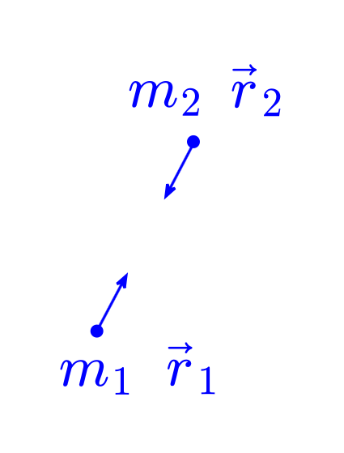

本节的核心任务是：把“两个相互作用的粒子”这一问题，转化为“一个虚拟粒子在给定势场中运动”这一更简单的问题。这一转化依赖于两条我们在上一章已经证明过的守恒律——总动量守恒（对应空间平移不变性）和总角动量守恒（对应空间转动不变性）——下面会看到它们分别把六个自由度（两个粒子各三个坐标）中的三个（质心运动）和一个（角动量方向）“消耗”掉，只剩下一个真正需要求解的自由度：粒子间的相对距离 $r$。

上图中两体系统的拉格朗日量可以写为

$$
\begin{equation}
L=\frac12m_1\vec v_1^2
+\frac12m_2\vec v_2^2
-V\bigl(|\vec r_1-\vec r_2|\bigr),
\end{equation}
$$

其中 $\vec v_1$ 和 $\vec v_2$ 分别是两个粒子的速度。

上面的拉格朗日量具有空间平移不变性，位矢平移任意矢量$\vec a$

$$
\begin{equation}
\vec r_i\rightarrow\vec r_i+\vec a \Rightarrow |\vec r_1-\vec r_2| \rightarrow |\vec r_1-\vec r_2|,\;\vec v_i \rightarrow \vec v_i,\; 
 L \rightarrow L.
\end{equation}
$$

这就意味着系统的总动量守恒。因此，两粒子系统质心的速度为常矢量。可以选择一个惯性参考系，使质心速度为零，即质心系：（这正是上一章[“质心”](最小作用量原理.md#质心)一节讨论过的结论：封闭系统的质心作匀速直线运动。）

$$
\begin{equation}
m_1 {\vec r}_1+m_2 {\vec r}_2=0 \Rightarrow m_1\dot {\vec r}_1+m_2\dot {\vec r}_2=0.
\end{equation}
$$

结合相对位移公式

$$
\begin{equation}
\vec r=\vec r_1-\vec r_2,
\end{equation}
$$

可以求解得到

$$
\begin{equation}
\vec r_1=\frac{m_2}{m_1+m_2}\vec r,
\qquad
\vec r_2=-\frac{m_1}{m_1+m_2}\vec r.
\end{equation}
$$

<!-- 原 PDF 第 2 页 -->

于是动能为

$$
\begin{align*}
\frac12m_1\vec v_1^2+\frac12m_2\vec v_2^2
&=\frac12m_1\left(\frac{d\vec r_1}{dt}\right)^2
+\frac12m_2\left(\frac{d\vec r_2}{dt}\right)^2\\
&=\frac12\left[
m_1\left(\frac{m_2}{m_1+m_2}\right)^2
+m_2\left(\frac{m_1}{m_1+m_2}\right)^2
\right]\dot{\vec r}^{2}\\
&=\frac12\frac{m_1m_2}{m_1+m_2}\dot{\vec r}^{2}.
\end{align*}
$$

可以看到质心系下（$\vec p_1+\vec p_2=0$）两个粒子的动能之和恰好可以写成一个等效质量为 $\cfrac{m_1m_2}{m_1+m_2}$、位置为相对坐标 $\vec r$ 的“虚拟粒子”的动能，这是整个约化过程的关键一步。

定义约化质量

$$
\begin{equation}
\mu=\frac{m_1m_2}{m_1+m_2},
\end{equation}
$$

则相对运动的拉格朗日量为

$$
\begin{equation}
L=\frac12\mu\dot{\vec r}^{2}-V(r).
\end{equation}
$$

约化质量 $\mu$ 有两个直观的极限：若 $m_2\gg m_1$（例如地球围绕太阳转动、卫星绕地球运动等），则 $\mu\approx m_1$，即较轻的一方近似决定相对运动，较重一方近似不动，这正是我们通常处理开普勒问题时默认的近似；若 $m_1=m_2=m$，则 $\mu=m/2$。

因此，两体问题可分离为：

$$
\begin{equation}
\text{质心运动}+\text{相对运动}.
\end{equation}
$$

等效地，它是“匀速运动的质心”加上“单粒子 $\mu$ 在中心力场 $V(r)$ 中的运动”。

这样，两体问题就被彻底转化为了单体问题：只需要求解一个质量为 $\mu$ 的虚拟粒子在固定势场 $V(r)$ 中的运动，再利用 $\vec r_1,\vec r_2$ 与 $\vec r$ 的关系换回原来两个粒子的轨迹即可。下面几节就以这个等效单体问题为对象，逐步利用角动量守恒和能量守恒，把它进一步化简为一维问题。

下面的动画把两种描述放在一起：左边是质心系中两个质点各自的运动，它们绕质心画出两个形状相同、大小与质量成反比的椭圆，连线始终通过质心；右边是质量为 $\mu$ 的等效粒子绕固定力心的运动，它的位置就是两质点的相对位矢 $\vec r=\vec r_1-\vec r_2$。

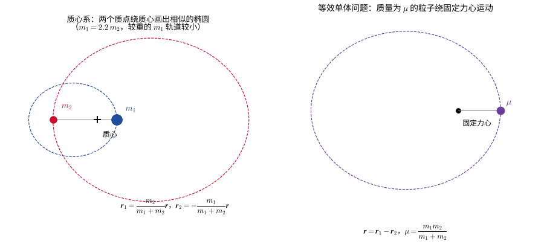

### 转动不变性与角动量守恒

不失一般性，可以将角动量方向选为 $z$ 轴方向，那么约化粒子的运动就局限在 $x$-$y$ 平面。采用平面极坐标 $(r,\varphi)$，（角动量 $\vec L=\mu\vec r\times\vec v$ 守恒，意味着 $\vec r$ 和 $\vec v$ 始终张成同一个平面——这就是为什么中心力场中的运动一定是平面运动，选取该平面为 $x$-$y$ 平面自然最方便。）

$$
\begin{equation}
L=\frac12\mu\left(\dot r^2+r^2\dot\varphi^2\right)-V(r).
\end{equation}
$$

由于 $L$ 不显含坐标 $\varphi$，相应的广义动量守恒：

$$
\begin{equation}
J=\frac{\partial L}{\partial\dot\varphi}
=\mu r^2\dot\varphi=\text{常数},
\end{equation}
$$

其中 $J$ 是角动量的大小。

这也给出开普勒第二定律。

$\varphi$ 是一个循环坐标（不显含在 $L$ 中），因此它对应的广义动量 $J$ 自动守恒——这正是上一章[“对称性和守恒定律”](最小作用量原理.md#对称性和守恒定律)一节中关于循环坐标的结论的直接应用。径矢在时间 $\Delta t$ 内扫过的面积为

$$
\begin{equation}
\Delta S=\frac12r^2\Delta\varphi,
\qquad
\Delta\varphi=\dot\varphi\,\Delta t,
\end{equation}
$$

所以面速度

$$
\begin{equation}
\frac{dS}{dt}=\frac12r^2\dot\varphi=\frac{J}{2\mu}=\text{常数}.
\end{equation}
$$

即行星与太阳之间的连线在单位时间内扫过的面积为常数。

这就是开普勒（Kepler）于 1609 年在《新天文学》中总结出的**开普勒第二定律**（面积定律）。值得注意的是，这一定律不需要知道势能 $V(r)$ 的具体形式，仅仅是角动量守恒（即中心力场的转动不变性）的直接推论，对任何有心力场都成立，而不仅限于引力。

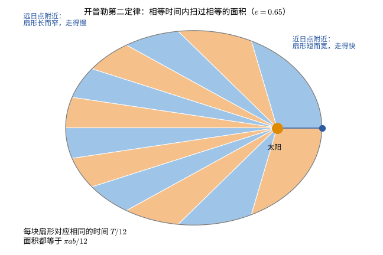

由于 $L$ 不显含时间，系统能量守恒：

$$
\begin{align}
E=T+V
&=\frac12\mu\left(\dot r^2+r^2\dot\varphi^2\right)+V(r)\\
&=\frac12\mu\dot r^2+\frac{J^2}{2\mu r^2}+V(r)\\
&=\frac12\mu\dot r^2+V_{\mathrm{eff}}(r),
\end{align}
$$

其中

$$
\begin{equation}
V_{\mathrm{eff}}(r)=\frac{J^2}{2\mu r^2}+V(r)
\end{equation}
$$

是有效势；$J^2/(2\mu r^2)$ 是离心势能。

引入有效势 $V_{\mathrm{eff}}(r)$ 是一个非常重要的技巧：它把原本二维的平面运动（$r$ 和 $\varphi$ 两个自由度）进一步化简为只含径向坐标 $r$ 的一维运动，代价是在真实势能 $V(r)$ 上多加了一项离心势能 $J^2/(2\mu r^2)$——这一项来自角向运动的“惯性”，并不是真实的力，但在只关心 $r$ 如何变化时，它的效果和一个真实的排斥势完全一样（类似于旋转参考系中出现的离心力）。

径向运动等效为一维运动：

$$
\begin{equation}
L_r=\frac12\mu\dot r^2-V_{\mathrm{eff}}(r).
\end{equation}
$$

<!-- 原 PDF 第 3 页 -->

## 一维运动的能量分析

上一节把中心力场中的径向运动化为了一维问题 $L_r=\frac12\mu\dot r^2-V_{\mathrm{eff}}(r)$。这一节先撇开“中心力场”这个具体背景，单独讨论一般的一维保守系统 $L=\frac12m\dot x^2-U(x)$ 的运动性质——这些结论具有普遍性，后面既会用于径向运动分析，也是分析任意势阱、势垒问题的标准方法。

考虑一般的一维运动

$$
\begin{equation}
L=\frac12m\dot x^2-U(x)=T-V.
\end{equation}
$$

由于 $L$ 不显含时间，能量 $E=T+V$ 守恒：

$$
\begin{equation}
E=\frac12m\dot x^2+U(x)=常数.
\end{equation}
$$

若取 $\dot x>0$，则

$$
\begin{equation}
\frac{dx}{dt}=\sqrt{\frac2m\left[E-U(x)\right]}\Rightarrow dt=\sqrt{\frac m2}\frac{dx}{\sqrt{E-U(x)}}.
\end{equation}
$$

从而

$$
\begin{equation}
t=\sqrt{\frac m2}\int\frac{dx}{\sqrt{E-U(x)}}+\text{常数}.
\end{equation}
$$

由于 $E=T+U$ 且动能非负，运动许可区满足

$$
\begin{equation}
E\ge U(x).
\end{equation}
$$

图示为势能曲线 $U(x)$ 与水平能量线 $U=E$ 相交于 $A,B,C$，在 $x_A,x_B,x_C$ 等满足

$$
\begin{equation}
U(x)=E
\end{equation}
$$

的点处，有 $dx/dt=0$，这些点称为**转折点**。那么 $A$ 与 $B$ 之间形成有限许可区，而 $C$ 右侧形成向无穷远延伸的许可区。

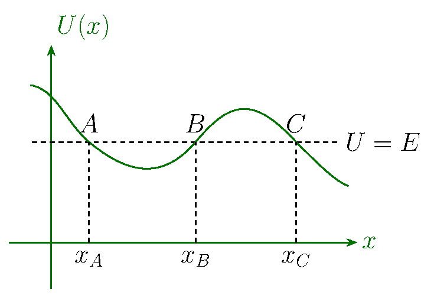

直观地说，转折点就是质点动能耗尽、速度瞬间为零、随后又被势能“推回来”（或者继续往前，取决于势能曲线的形状）的地方，好比过山车在最高点速度最小的道理。

- 如果运动区域由两个转折点限定，则运动局限于有限空间区域内，称为**有界运动**。
- 如果运动区域不受限制，或者只有单侧限制，则运动是无限的；质点可以运动到无穷远，称为**无界运动**。

一维有界运动是振动。质点在两个边界 $x_A,x_B$ 之间作往复运动；从 $x_A$ 到 $x_B$ 的时间为周期的一半，因此（因为质点在势阱中来回振荡，从 $x_A$ 到 $x_B$ 与从 $x_B$ 到 $x_A$ 所需时间相同，由时间反演对称性可知，一个完整周期是单程时间的两倍。）

$$
\begin{equation}
T=\sqrt{2m}\int_{x_A}^{x_B}\frac{dx}{\sqrt{E-U(x)}}.
\end{equation}
$$

### 一维谐振子

对于拉格朗日量为

$$
\begin{equation}
L=\frac12m\dot x^2-\frac12kx^2,
\qquad
U(x)=\frac12kx^2,
\end{equation}
$$
的谐振子，初始条件给出其总能量为 $E$。由能量守恒得到最大振幅为

$$
\begin{equation}
x_A=\sqrt{\frac{2E}{k}}，
\end{equation}
$$
即令动能为零时的 $x$ 值。

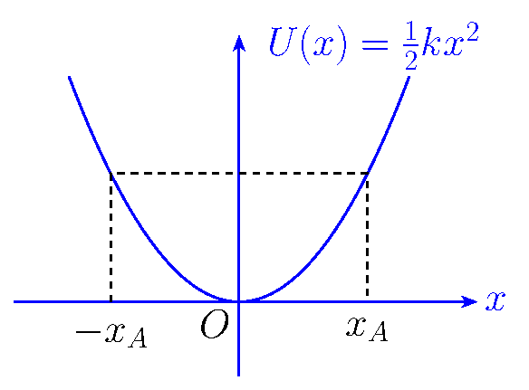

周期为

$$
\begin{align*}
T=2\sqrt{2m}\int_0^{x_A}\frac{dx}{\sqrt{E-\frac12kx^2}}
=4\sqrt{\frac mk}\int_0^1\frac{du}{\sqrt{1-u^2}}
=2\pi\sqrt{\frac mk},
\end{align*}
$$

其中 $u=x/x_A$。**思考**：若 $V\sim x^4$，周期将如何变化？

思考题解答：V ∝ x⁴ 时的周期

值得注意的是，谐振子周期与振幅无关这一结论（等时性）是 $U\propto x^2$ 这一特殊势能形式的产物，并不具有普遍性。对于 $U\propto x^4$ 这样更“陡峭”的势阱，振幅越大、势能上升得越快，质点被“推回”所需的时间反而更短，因此可以预期周期会随振幅增大而减小；这可以用前一章“力学相似性”一节介绍的标度分析方法定量验证：若 $U(x)=cx^k$，则周期满足 $T\propto x_A^{1-k/2}$，代入 $k=4$ 即得 $T\propto 1/x_A$。

<!-- 原 PDF 第 4 页 -->

## 两体问题的轨道方程

有了角动量和能量两个守恒量提供的一阶微分方程（分别给出 $\dot\varphi$ 和 $\dot r$），我们就可以不必求解二阶的运动方程，而是直接通过积分得到轨道形状 $r(\varphi)$——这是中心力场问题相比一般三维问题更容易求解的根本原因。

回到两体问题。由能量守恒和角动量守恒，

$$
\begin{equation}
\frac{dr}{dt}
=\sqrt{\frac2\mu\left[E-V(r)\right]-\frac{J^2}{\mu^2r^2}},
\end{equation}
$$

$$
\begin{equation}
\dot\varphi=\frac{d\varphi}{dt}=\frac{J}{\mu r^2}>0.
\end{equation}
$$

因此

$$
\begin{equation}
\frac{d\varphi}{dr}
=\frac{d\varphi/dt}{dr/dt},
\end{equation}
$$

并得到轨道方程

$$
\begin{equation}
\varphi=\varphi_0+
\int dr\,
\frac{J/r^2}{\sqrt{2\mu\left[E-V(r)\right]-J^2/r^2}}.
\end{equation}
$$

也可用有效势

$$
\begin{equation}
V_{\mathrm{eff}}(r)=\frac{J^2}{2\mu r^2}+V(r)
\end{equation}
$$

来表示径向许可区。

### 有界轨道与轨道封闭

考虑有界运动，其径向转折点为 $r_{\min}$ 和 $r_{\max}$。当 $r$ 从 $r_{\min}$ 运动到 $r_{\max}$ 再回到 $r_{\min}$ 时，径矢转过的角度为

$$
\begin{equation}
\Delta\varphi
=2\int_{r_{\min}}^{r_{\max}}dr\,
\frac{J/r^2}{\sqrt{2\mu\left[E-V_{\mathrm{eff}}(r)\right]}}.
\end{equation}
$$

轨道封闭的条件是该转角等于 $2\pi$ 的有理数倍：

$$
\begin{equation}
\Delta\varphi=2\pi\frac{m}{n},
\qquad m,n\in\mathbb Z.
\end{equation}
$$

在这种情况下，经过 $n$ 个径向周期，质点径矢转过 $m$ 圈后回到初始位置，轨道封闭。图示展示了 $r_{\min}$ 与 $r_{\max}$ 之间的进动花瓣形轨道；每个径向周期转过 $\Delta\varphi$。

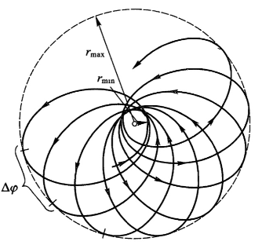

只有两类特殊中心势能保证所有有界轨道封闭：

1. 
$$
\begin{equation}
   V(r)\propto-\frac1r
\end{equation}
$$
   （万有引力势、库仑吸引势）；

2. 
$$
\begin{equation}
   V(r)\propto r^2
\end{equation}
$$
   （空间谐振子势）。

一般情况下 $V(r)$ 不满足上述条件，轨道并不封闭，而会出现近心点进动。

这一结论被称为**伯特朗定理**（Bertrand's theorem，1873 年证明）：在所有的中心势中，只有平方反比引力势 $V\propto -1/r$（开普勒问题）和各向同性谐振子势 $V\propto r^2$ 这两种情形，才能保证一切有界轨道都是封闭曲线；其余情形（哪怕只是很小的偏离，例如广义相对论对牛顿引力的修正）都会导致轨道缓慢进动，近心点的位置每一圈都会略微转动——水星近日点的进动正是这类效应的著名例子（其中大部分由其他行星的引力摄动引起，但有一小部分残余只能用广义相对论解释）。

下面的动画把有效势中的一维径向运动和平面轨道联系起来：上排是开普勒势，径向振动一次的同时 $\varphi$ 恰好转过 $2\pi$，轨道封闭；下排在势能中加了一个小的 $-\beta/r^2$ 项，径向振动一次时 $\varphi$ 转过的角度略大于 $2\pi$，近心点每圈前移，轨道变成花瓣形。

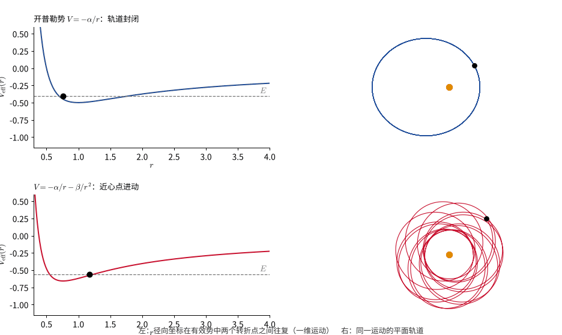

<!-- 原 PDF 第 5 页 -->

## 开普勒问题
> Kepler's Problem

开普勒问题是历史上第一个被完整求解的中心力场问题，也是伯特朗定理中两种“特殊”势之一。下面从有效势的角度出发，系统地推导出开普勒三大定律。

$$
\begin{equation}
V(r)=-\frac{\alpha}{r},
\qquad \alpha>0.
\end{equation}
$$

有效势为

$$
\begin{equation}
V_{\mathrm{eff}}(r)
=-\frac{\alpha}{r}+\frac{J^2}{2\mu r^2}.
\end{equation}
$$

当 $r\to\infty$ 时，$V_{\mathrm{eff}}\to0$。由

$$
\begin{equation}
\frac{dV_{\mathrm{eff}}}{dr}=0
\end{equation}
$$

得到有效势极小值的位置与数值：

$$
\begin{equation}
r=\frac{J^2}{\mu\alpha},
\qquad
\left(V_{\mathrm{eff}}\right)_{\min}
=-\frac{\mu\alpha^2}{2J^2}.
\end{equation}
$$

- 当
$$
\begin{equation}
  \left(V_{\mathrm{eff}}\right)_{\min}\le E<0
\end{equation}
$$
  时，为有界运动，径向范围为 $[r_{\min},r_{\max}]$。
- 当
$$
\begin{equation}
  E=\left(V_{\mathrm{eff}}\right)_{\min}
\end{equation}
$$
  时，为圆周运动。
- 当 $E\ge0$ 时，为无界运动。

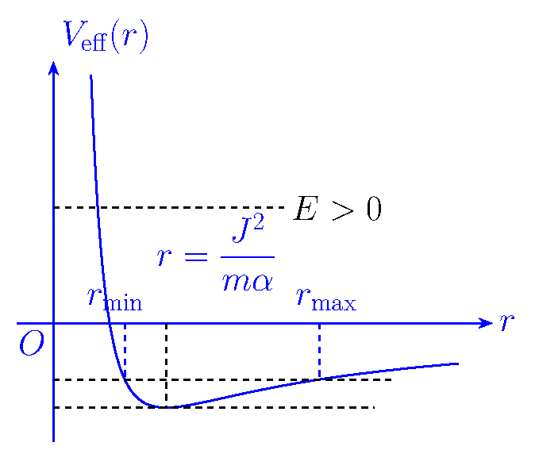

直观上看，有效势 $V_{\mathrm{eff}}(r)=-\alpha/r+J^2/(2\mu r^2)$ 是两项之和：$r\to0$ 时离心项 $J^2/(2\mu r^2)$ 占主导并发散到 $+\infty$（阻止粒子落入力心），$r\to\infty$ 时引力项 $-\alpha/r$ 占主导并趋于 $0$（阻止粒子被束缚在无穷远），因此中间必然存在一个极小值，对应上面讨论的三种运动类型。

对轨道方程积分可得

$$
\begin{equation}
\varphi
=\arccos\left(
\frac{J/r-\mu\alpha/J}
{\sqrt{2\mu E+\mu^2\alpha^2/J^2}}
\right)+\text{常数}.
\end{equation}
$$

推导：开普勒轨道的积分，以及另一种做法（Binet 方程）

**直接积分。** 把 $V=-\alpha/r$ 代入轨道方程，并令 $u=1/r$（$du=-dr/r^2$）：

$$
\begin{equation*}
\varphi=\int\frac{J\,dr/r^2}{\sqrt{2\mu E+2\mu\alpha/r-J^2/r^2}}
=-\int\frac{J\,du}{\sqrt{2\mu E+2\mu\alpha u-J^2u^2}} .
\end{equation*}
$$

把根号内配方：$2\mu E+2\mu\alpha u-J^2u^2=C^2-w^2$，其中 $w=Ju-\mu\alpha/J$，$C^2=2\mu E+\mu^2\alpha^2/J^2$。于是 $dw=J\,du$，

$$
\begin{equation*}
\varphi=-\int\frac{dw}{\sqrt{C^2-w^2}}=\arccos\frac{w}{C}+\text{常数},
\end{equation*}
$$

即正文的结果。取常数为零，$J/r-\mu\alpha/J=C\cos\varphi$，整理得 $r=p/(1+e\cos\varphi)$，其中 $p=J^2/(\mu\alpha)$，$e=JC/(\mu\alpha)=\sqrt{1+2EJ^2/(\mu\alpha^2)}$。

**Binet 方程。** 也可以不用能量积分，直接从径向运动方程 $\mu\ddot r-J^2/(\mu r^3)=-\alpha/r^2$ 出发。由 $\dot\varphi=J/(\mu r^2)$，对时间求导可以换成对角度求导：$\dot r=-\dfrac J\mu\dfrac{du}{d\varphi}$，$\ddot r=-\dfrac{J^2}{\mu^2}u^2\dfrac{d^2u}{d\varphi^2}$。代入得

$$
\begin{equation*}
\frac{d^2u}{d\varphi^2}+u=\frac{\mu\alpha}{J^2},
\end{equation*}
$$

这是一个“平移了的”谐振子方程，通解为 $u=\dfrac{\mu\alpha}{J^2}\bigl[1+e\cos(\varphi-\varphi_0)\bigr]$。$u(\varphi)$ 的振荡频率恰好为 1，所以每转一圈回到同一个近心点，轨道封闭。[“微扰和摄动理论”](微扰和摄动理论.md)一章计算水星近日点进动时，正是在这个方程右边加上广义相对论的修正项。

选择 $\varphi$ 的初始位置使常数为零，并定义

$$
\begin{equation}
p=l_0=\frac{J^2}{\mu\alpha},
\end{equation}
$$

$$
\begin{equation}
e=\sqrt{1+\frac{2EJ^2}{\mu\alpha^2}},
\end{equation}
$$

其中 $e$ 是偏心率（eccentricity），则轨道方程为

$$
\begin{equation}
r=\frac{p}{1+e\cos\varphi}.
\end{equation}
$$

这是焦点位于坐标原点的圆锥曲线方程，即其中一个焦点位于力心处：

这正是**开普勒第一定律**：行星绕太阳运动的轨道是以太阳为一个焦点的椭圆（对应 $0\le e<1$ 的情形）。而双曲线、抛物线轨道则对应能量 $E>0$ 或 $E=0$ 的非束缚轨道，常见于彗星或星际天体的飞掠轨迹。

- $e>1$：双曲线；
- $e=1$：抛物线；
- $0\le e<1$：椭圆；
- $e=0$：圆。

$2p$ 称为正焦弦（latus rectum）。

下图画出近心距相同、偏心率不同的几条轨道，可以看到由圆到椭圆、抛物线和双曲线的连续过渡。

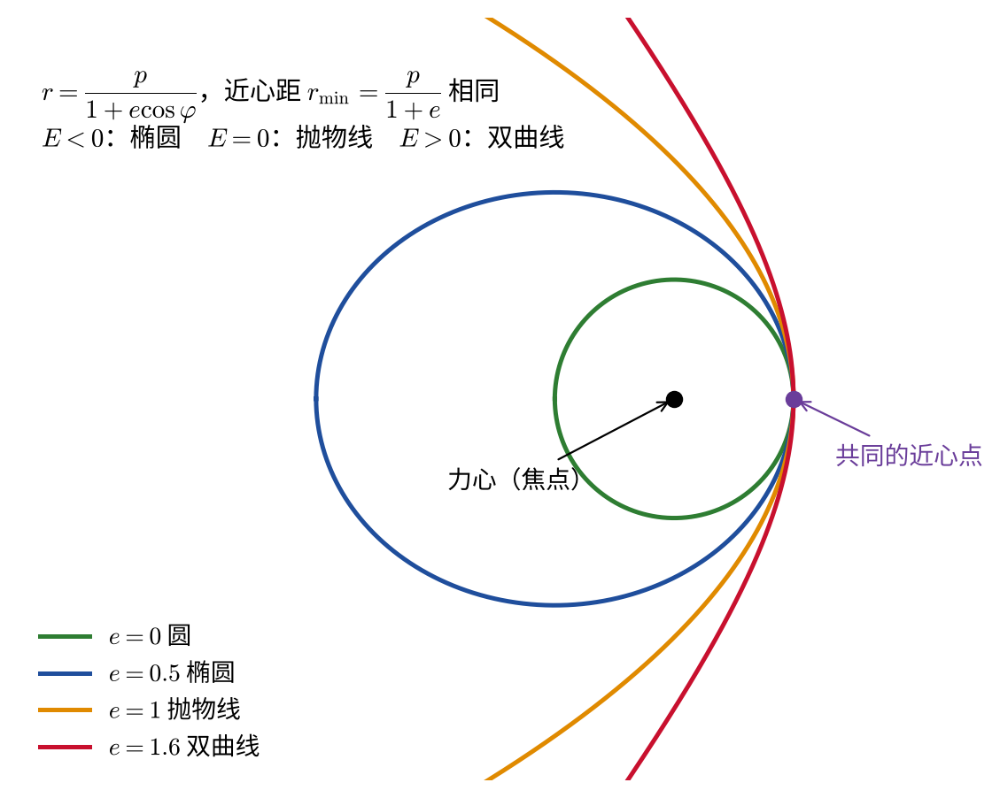

对椭圆轨道 $E<0$，半长轴 $a$ 和半短轴 $b$ 为

$$
\begin{equation}
a=\frac{p}{1-e^2}=\frac{\alpha}{2|E|},
\end{equation}
$$

$$
\begin{equation}
b=\frac{p}{\sqrt{1-e^2}}
=\frac{J}{\sqrt{2\mu|E|}}.
\end{equation}
$$

推导：半长轴只由能量决定，半短轴由能量和角动量决定

近心距和远心距分别为 $r_{\min}=p/(1+e)$，$r_{\max}=p/(1-e)$，所以

$$
\begin{equation*}
a=\frac{r_{\min}+r_{\max}}{2}=\frac{p}{1-e^2},\qquad b=a\sqrt{1-e^2}=\frac{p}{\sqrt{1-e^2}} .
\end{equation*}
$$

由 $e^2=1+2EJ^2/(\mu\alpha^2)$ 得 $1-e^2=2|E|J^2/(\mu\alpha^2)$（$E<0$），再代入 $p=J^2/(\mu\alpha)$：

$$
\begin{equation*}
a=\frac{J^2}{\mu\alpha}\cdot\frac{\mu\alpha^2}{2|E|J^2}=\frac{\alpha}{2|E|},\qquad
b=\frac{J^2/(\mu\alpha)}{\sqrt{2|E|J^2/(\mu\alpha^2)}}=\frac{J}{\sqrt{2\mu|E|}} .
\end{equation*}
$$

半长轴只依赖能量：能量相同、角动量不同的轨道，半长轴相同，因而周期也相同（开普勒第三定律）。角动量只改变轨道的“胖瘦”。

图示椭圆的长轴为 $2a$、短轴为 $2b$，焦点相对中心的距离为 $ae$，正焦弦半长为 $p$。

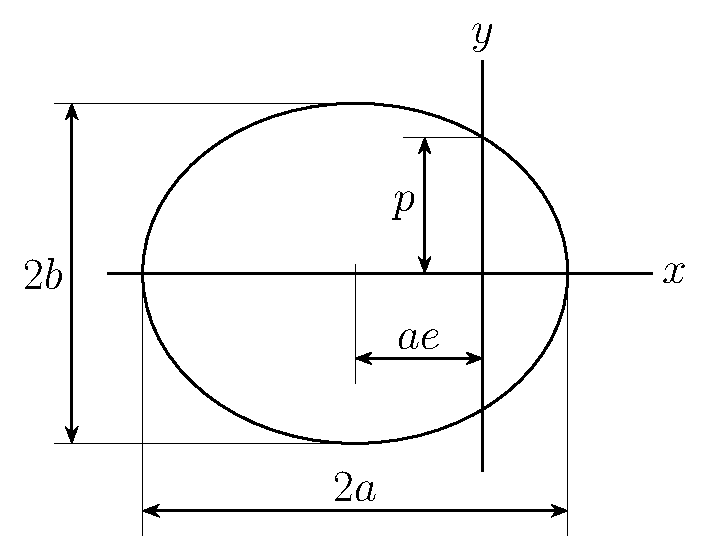

<!-- 原 PDF 第 6 页 -->

### 近心点、远心点与轨道周期

近心点（perihelion）与远心点（aphelion）分别为

$$
\begin{equation}
r_{\min}=\frac{p}{1+e}=a(1-e),
\end{equation}
$$

$$
\begin{equation}
r_{\max}=\frac{p}{1-e}=a(1+e).
\end{equation}
$$

椭圆轨道周期等于椭圆面积 $\pi ab$ 除以恒定面速度

$$
\begin{equation}
\frac12r^2\dot\varphi=\frac{J}{2\mu}.
\end{equation}
$$

因此

$$
\begin{equation}
T=\frac{2\pi\mu ab}{J}
=2\pi a^{3/2}\sqrt{\frac{\mu}{\alpha}}.
\end{equation}
$$

所以

$$
\begin{equation}
T^2\propto a^3,
\end{equation}
$$

即开普勒第三定律：行星周期的平方之比等于其对应半长轴立方之比。

这与上一章“力学相似性”一节用标度分析得到的结论 $T^2\propto a^3$（对应 $k=-1$ 次齐次势）完全一致——这里我们通过完整求解轨道方程，不仅重新得到了这个比例关系，还确定了比例系数 $4\pi^2\mu/\alpha$（或等价地 $4\pi^2/(GM)$），这是标度分析方法本身给不出的。

轨道上的位置如何随时间变化（偏近点角与开普勒方程），以及六个轨道根数的完整讨论，见[“卫星轨道与轨道确定”](卫星轨道与轨道确定.md)一章。

### 双曲线轨道

对吸引势 $V=-\alpha/r$，当 $E>0$ 时 $e>1$，轨道为双曲线，原点为内焦点。近心点为

$$
\begin{equation}
r_{\min}=\frac{p}{1+e}=a(e-1),
\end{equation}
$$

其中

$$
\begin{equation}
a=\frac{p}{e^2-1}=\frac{\alpha}{2E}.
\end{equation}
$$

对排斥势

$$
\begin{equation}
V(r)=\frac{\alpha}{r},
\qquad \alpha>0
\end{equation}
$$

（例如同号电荷），轨道同样为双曲线，但方程写成

$$
\begin{equation}
\frac{p}{r}=-1+e\cos\varphi,
\end{equation}
$$

其近心点为

$$
\begin{equation}
r_{\min}=\frac{p}{e-1}=a(e+1).
\end{equation}
$$

图中分别画出了吸引势和排斥势对应的双曲线分支，并标明力心、参数 $p$ 及近心距离。

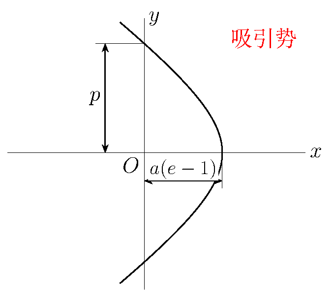

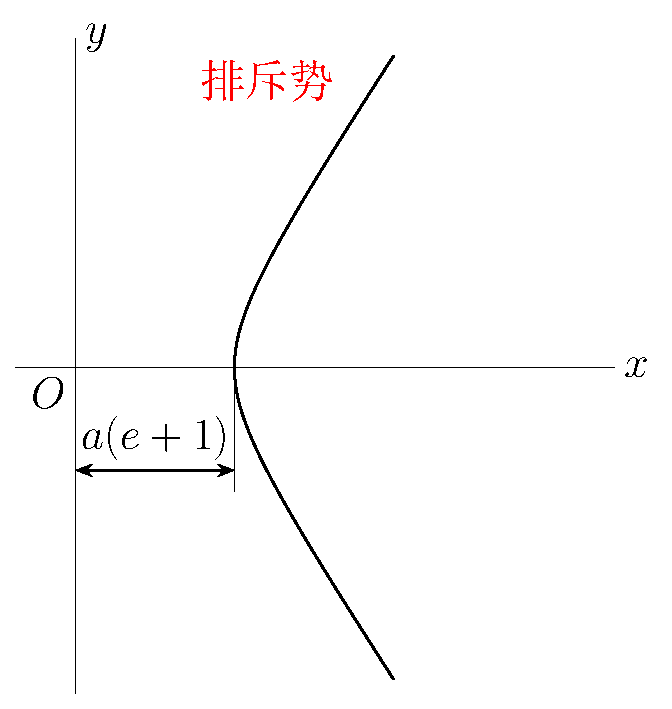

双曲线轨道对应 $E>0$ 的非束缚运动，粒子从无穷远来、又飞向无穷远，中途受到中心力场的偏转——这正是下面[“散射问题”](#散射问题)一节要系统研究的物理图像。

### 拉普拉斯-龙格-楞次矢量

拉普拉斯-龙格-楞次矢量（Laplace-Runge-Lenz vector，以下简称 LRL 矢量）体现了开普勒势的特殊性：它对应额外的对称性（动力学对称性），从而给出额外的守恒量。

对行星运动的吸引势 $V=-\alpha/r$，定义

$$
\begin{equation}
\vec A=\vec v\times\vec L-\alpha\frac{\vec r}{r},
\qquad
\vec L=\mu\vec r\times\vec v.
\end{equation}
$$

由运动方程

$$
\begin{equation}
\mu\dot{\vec v}=-\alpha\frac{\vec r}{r^3}
\end{equation}
$$

可以验证

$$
\begin{equation}
\frac{d\vec A}{dt}=0 ,
\end{equation}
$$

而且 $\vec A$ 位于轨道平面内、恒指向近心点，大小为 $|\vec A|=\alpha e$（推导见下面的折叠块）。对排斥势 $V=+\alpha/r$（例如后面的卢瑟福散射），只需把 $\alpha$ 换成 $-\alpha$，守恒矢量变为 $\vec v\times\vec L+\alpha\hat{\vec r}$。

回忆上一章讨论运动积分数目时提到，$s=3$ 个自由度的封闭系统最多有 $2s-1=5$ 个独立运动积分。对一般的中心力场，我们已经有能量 $E$ 和角动量矢量 $\vec L$ 的三个分量，它们彼此独立，共 4 个。LRL 矢量虽有三个分量，但满足两个约束：$\vec A\cdot\vec L=0$（$\vec A$ 在轨道平面内），以及 $A^2=\alpha^2+2EL^2/\mu$（大小由 $E$ 和 $L$ 决定），所以只提供 **1 个**新的独立运动积分，即近心点在轨道平面内的方向。加起来正好是 5 个，达到了上限，这样的系统称为“最大超可积”系统。$\vec A$ 的守恒正是“开普勒轨道不会进动、永远精确闭合”这一事实的代数体现。这是一种不直接对应任何简单几何变换（如空间平移、转动）的“隐藏对称性”，说明诺特定理的逆命题不总是显而易见：存在守恒量，不代表可以一眼看出对应的对称变换是什么。

推导：LRL 矢量守恒，并由它直接得到轨道方程

需要两个恒等式：

$$
\begin{equation*}
\frac{d}{dt}\left(\frac{\vec r}{r}\right)=\frac{\vec v}{r}-\frac{\vec r(\vec r\cdot\vec v)}{r^3},
\qquad
\vec r\times\vec L=\mu\,\vec r\times(\vec r\times\vec v)=\mu\left[\vec r(\vec r\cdot\vec v)-r^2\vec v\right].
\end{equation*}
$$

第一式由 $\dot r=\vec r\cdot\vec v/r$ 得到，第二式用了 $\vec a\times(\vec b\times\vec c)=\vec b(\vec a\cdot\vec c)-\vec c(\vec a\cdot\vec b)$。

**守恒。** $\vec L$ 守恒，所以

$$
\begin{equation*}
\frac{d}{dt}(\vec v\times\vec L)=\dot{\vec v}\times\vec L=-\frac{\alpha}{\mu r^3}\,\vec r\times\vec L
=\alpha\left[\frac{\vec v}{r}-\frac{\vec r(\vec r\cdot\vec v)}{r^3}\right]=\alpha\frac{d}{dt}\left(\frac{\vec r}{r}\right),
\end{equation*}
$$

即 $d\vec A/dt=0$。

**轨道方程。** 用 $(\vec v\times\vec L)\cdot\vec r=\vec L\cdot(\vec r\times\vec v)=L^2/\mu$，

$$
\begin{equation*}
\vec A\cdot\vec r=\frac{L^2}{\mu}-\alpha r .
\end{equation*}
$$

记 $\varphi$ 为 $\vec r$ 与 $\vec A$ 的夹角，左边等于 $Ar\cos\varphi$，于是

$$
\begin{equation*}
r=\frac{L^2/(\mu\alpha)}{1+(A/\alpha)\cos\varphi},
\end{equation*}
$$

这正是圆锥曲线，$e=A/\alpha$，近心点（$\varphi=0$）在 $\vec A$ 的方向上。完全不需要积分。

**大小。** $\vec v\perp\vec L$，$\hat{\vec r}\cdot(\vec v\times\vec L)=L^2/(\mu r)$，所以

$$
\begin{equation*}
A^2=v^2L^2-\frac{2\alpha L^2}{\mu r}+\alpha^2=\alpha^2+\frac{2L^2}{\mu}\left(\frac12\mu v^2-\frac\alpha r\right)=\alpha^2+\frac{2EL^2}{\mu},
\end{equation*}
$$

与 $e=\sqrt{1+2EL^2/(\mu\alpha^2)}$ 一致。

**速度图。** 由 $\vec v\times\vec L=\vec A+\alpha\hat{\vec r}$，$\vec v\times\vec L$ 的端点在一个以 $\vec A$ 的端点为圆心、半径为 $\alpha$ 的圆上运动。$\vec v$ 与 $\vec v\times\vec L$ 只差一个 $90^\circ$ 的转动和一个常数因子，所以开普勒运动中速度矢量的端点也在一个圆上运动，这就是哈密顿发现的“速度图是圆”。

下面的动画演示这一点：$\vec v\times\vec L$（蓝）和 $-\alpha\hat{\vec r}$（红）都随行星的位置不断变化，但它们的和 $\vec A$（绿）始终不变。

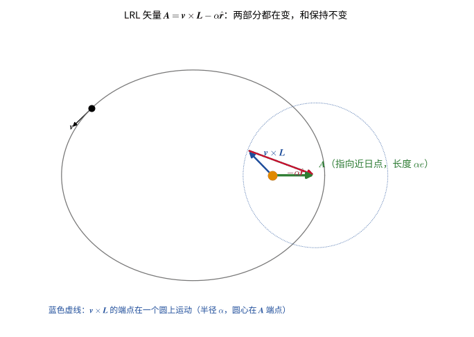

<!-- 原 PDF 第 7 页 -->

## 潮汐现象
> Tidal Effect

潮汐现象是中心力场理论的一个精彩应用：它既需要用到非惯性参考系中的惯性力，又需要对引力势做多极展开。物理图像是：地球上不同位置感受到的月球引力大小和方向并不完全相同（近月面受到的引力比远月面更强），这一“引力差”就是潮汐力的来源。

为方便后续讨论，先介绍旋转坐标系（非惯性参考系）中的一些基础。

### 平动非惯性参考系

在惯性系 $K_0$ 中，质点的拉格朗日量为

$$
\begin{equation}
L_0=\frac12m\vec v_0^2-V,
\end{equation}
$$

其中势能仅依赖于坐标。

假定另一参考系 $K'$ 相对于 $K_0$ 以给定速度 $\vec V(t)$ 平动，则

$$
\begin{equation}
\vec v_0=\vec v'+\vec V(t),
\end{equation}
$$

其中 $\vec v'$ 是粒子在 $K'$ 中的速度。于是

$$
\begin{equation}
L'=\frac12m\vec v'^2
+m\vec v'\cdot\vec V(t)
+\frac12m\vec V(t)^2-V.
\end{equation}
$$

因为

$$
\begin{equation}
m\vec v'\cdot\vec V
=\frac{d}{dt}\left(m\vec V\cdot\vec x'\right)
-m\dot{\vec V}\cdot\vec x',
\end{equation}
$$

而 $\frac12mV(t)^2$ 是给定的时间函数，也可以写成某个函数对时间的全导数，所以这些不改变运动方程的全导数项可以略去。得到等价拉格朗日量

$$
\begin{equation}
L'=\frac12m\vec v'^2-m\dot{\vec V}\cdot\vec x'-V.
\end{equation}
$$

运动方程为

$$
\begin{equation}
m\frac{d\vec v'}{dt}
=-\frac{\partial V}{\partial\vec x'}-m\dot{\vec V},
\end{equation}
$$

其中 $-m\dot{\vec V}$ 是惯性力。

这一小节的推导与[“牛顿力学与虚功原理”](牛顿力学与虚功原理.md)一章[“非惯性参考系”](牛顿力学与虚功原理.md#非惯性参考系)一节相对应，只是这里从拉格朗日量出发：先在惯性系中写出拉氏量，做参考系变换，再略去不影响运动方程的全导数项，最后用欧拉-拉格朗日方程得到运动方程——由此得到的惯性力 $-m\dot{\vec V}$ 正是牛顿力学中直接引入的“平动惯性力”。

### 转动非惯性参考系

再考虑参考系 $K$，其原点与 $K'$ 重合，但相对于 $K'$ 以给定角速度 $\vec\Omega(t)$ 转动。$K'$ 中粒子的速度可以写成

$$
\begin{equation}
\vec v'=\vec v+\vec\Omega\times\vec x,
\end{equation}
$$

其中 $\vec v$ 是粒子在 $K$ 中的速度，$\vec x$ 是其位矢。拉格朗日量为

$$
\begin{equation}
L=\frac12m\vec v^2
+m\vec v\cdot(\vec\Omega\times\vec x)
+\frac12m(\vec\Omega\times\vec x)^2
-m\dot{\vec V}\cdot\vec x-V.
\end{equation}
$$

相应运动方程为

$$
\begin{align}
m\frac{d\vec v}{dt}
={}&-\frac{\partial V}{\partial\vec x}
-m\dot{\vec V}
+m\vec x\times\dot{\vec\Omega}\\
&+2m\vec v\times\vec\Omega
+m\vec\Omega\times(\vec x\times\vec\Omega).
\end{align}
$$

右侧除真实力外的四项依次对应：

1. 非匀速平动造成的惯性力 $-m\dot{\vec V}$；
2. 非匀速转动造成的欧拉惯性力 $m\vec x\times\dot{\vec\Omega}$；
3. 科里奥利力（Coriolis force）$2m\vec v\times\vec\Omega$；
4. 离心惯性力 $m\vec\Omega\times(\vec x\times\vec\Omega)$。

它们与[“牛顿力学与虚功原理”](牛顿力学与虚功原理.md)一章[“非惯性参考系”](牛顿力学与虚功原理.md#非惯性参考系)一节中直接引入的惯性力完全对应，读者可以逐项核对。

推导：由拉格朗日量得到转动参照系中的运动方程

对 $L=\frac12m\vec v^2+m\vec v\cdot(\vec\Omega\times\vec x)+\frac12m(\vec\Omega\times\vec x)^2-m\dot{\vec V}\cdot\vec x-V$ 逐项求导。

**广义动量。**

$$
\begin{equation*}
\frac{\partial L}{\partial\vec v}=m\vec v+m\vec\Omega\times\vec x,
\qquad
\frac{d}{dt}\frac{\partial L}{\partial\vec v}=m\dot{\vec v}+m\dot{\vec\Omega}\times\vec x+m\vec\Omega\times\vec v .
\end{equation*}
$$

**对坐标求导。** 利用 $\vec v\cdot(\vec\Omega\times\vec x)=\vec x\cdot(\vec v\times\vec\Omega)$ 和 $(\vec\Omega\times\vec x)^2=\Omega^2x^2-(\vec\Omega\cdot\vec x)^2$，

$$
\begin{equation*}
\frac{\partial L}{\partial\vec x}=m\vec v\times\vec\Omega+m\left[\Omega^2\vec x-(\vec\Omega\cdot\vec x)\vec\Omega\right]-m\dot{\vec V}-\frac{\partial V}{\partial\vec x},
\end{equation*}
$$

其中方括号等于 $\vec\Omega\times(\vec x\times\vec\Omega)$。

**欧拉-拉格朗日方程。** 令二者相等，并把 $m\vec\Omega\times\vec v=-m\vec v\times\vec\Omega$ 移到右边，与已有的 $m\vec v\times\vec\Omega$ 合并成 $2m\vec v\times\vec\Omega$；$-m\dot{\vec\Omega}\times\vec x=m\vec x\times\dot{\vec\Omega}$。即得正文的方程。

科里奥利力来自拉格朗日量中与速度成线性的项 $m\vec v\cdot(\vec\Omega\times\vec x)$，它与带电粒子在磁场中的项 $q\vec v\cdot\vec A$ 结构相同（对应“矢势” $\vec A\propto\vec\Omega\times\vec x$，“磁场” $\propto2\vec\Omega$）。这就是为什么科里奥利力和洛伦兹力一样垂直于速度、不做功。

若

$$
\begin{equation}
\dot{\vec V}(t)=0,
\qquad
\dot{\vec\Omega}(t)=0,
\end{equation}
$$

即只有均匀转动，则

$$
\begin{equation}
L=\frac12m\vec v^2
+m\vec v\cdot(\vec\Omega\times\vec x)
+\frac12m(\vec\Omega\times\vec x)^2-V.
\end{equation}
$$

广义动量为

$$
\begin{equation}
\vec p=\frac{\partial L}{\partial\vec v}
=m\vec v+m\vec\Omega\times\vec x.
\end{equation}
$$

相应守恒能量为

$$
\begin{equation}
E=\vec p\cdot\vec v-L
=\frac12m\vec v^2
-\frac12m(\vec\Omega\times\vec x)^2+V,
\end{equation}
$$

其中后两项构成包含离心项的有效势能。

这个结果说明：在匀速转动参考系中，虽然拉氏量里出现了与速度耦合的科里奥利项 $m\vec v\cdot(\vec\Omega\times\vec x)$，但它不影响能量守恒的推导（因为它对 $L$ 不显含时间这一事实没有影响），只有离心项会以“有效势能”的形式出现在能量表达式中。

<!-- 原 PDF 第 8 页 -->

### 双星体系中的潮汐势

以星体 1（如地球）和星体 2（如月球）为例，取两者质心 $O$ 为原点。若两星体作圆周运动，公转角速度为 $\Omega$，则

$$
\begin{equation}
\Omega^2=\frac{G(m_1+m_2)}{R^3},
\end{equation}
$$

其中

$$
\begin{equation}
R=|\vec X|=|\vec x_2-\vec x_1|
\end{equation}
$$

是两星体之间的距离，并且

$$
\begin{equation}
\vec x_1=-\frac{m_2}{m_1+m_2}\vec X,
\qquad
\vec x_2=\frac{m_1}{m_1+m_2}\vec X.
\end{equation}
$$

考虑随双星共同旋转的非惯性系，以 $O$ 为原点，角速度为 $\vec\Omega$。星体 1 表面任意一点相对星体 1 的位置矢量为 $\vec x$，则该点单位质量的有效势能为

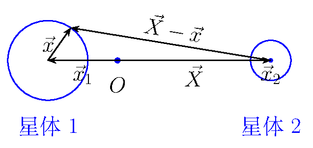

$$
\begin{equation}
\Phi(\vec x)
=-\frac{Gm_1}{|\vec x|}
-\frac{Gm_2}{|\vec X-\vec x|}
-\frac12\Omega^2|\vec x_1+\vec x|^2.
\end{equation}
$$

由于 $R=|\vec X|\gg|\vec x|$，可以展开这里用到的是多极展开（multipole expansion）的思想：把远处天体的引力势按照 $|\vec x|/R$ 的幂次展开

$$
\begin{equation}
\frac1{|\vec X-\vec x|}
\simeq\frac1R\left[
1+\frac{\hat{\vec X}\cdot\vec x}{R}
-\frac{x^2}{2R^2}
+\frac32\left(\frac{\hat{\vec X}\cdot\vec x}{R}\right)^2
+\cdots
\right].
\end{equation}
$$
第 0 阶（单极项）给出通常的“背景”引力，第 1 阶（偶极项）会与后面项的贡献抵消，真正描述“潮汐”这种位置依赖效应的是第 2 阶（四极项）——这也是为什么潮汐力有时被称为引力的“四极效应”。

利用圆周运动条件，可以计算关于 $\vec x$ 的线性项相互抵消，于是

$$
\begin{align}
\Phi(\vec x)\simeq{}&
-\frac{Gm_1}{|\vec x|}
-\frac{Gm_2}{R}
-\frac12\Omega^2x_1^2
-\frac12\Omega^2x^2 \\
&+\frac{Gm_2x^2}{2R^3}
-\frac{3Gm_2}{2R^3}(\hat{\vec X}\cdot\vec x)^2.
\end{align}
$$

其中常数项不依赖星体表面点的具体位置；位置依赖来自 $x$ 以及 $\vec x$ 与 $\vec X$ 的夹角。

推导：一次项为何抵消，以及洛希半径的量级

**一次项。** 第二项的展开中，一次项为 $-\dfrac{Gm_2}{R^2}\hat{\vec X}\cdot\vec x$。离心势 $-\frac12\Omega^2|\vec x_1+\vec x|^2$ 的一次项为 $-\Omega^2\vec x_1\cdot\vec x$，利用 $\vec x_1=-\dfrac{m_2}{m_1+m_2}\vec X$ 和 $\Omega^2=G(m_1+m_2)/R^3$，

$$
\begin{equation*}
-\Omega^2\vec x_1\cdot\vec x=\frac{G(m_1+m_2)}{R^3}\cdot\frac{m_2}{m_1+m_2}R\,\hat{\vec X}\cdot\vec x=\frac{Gm_2}{R^2}\hat{\vec X}\cdot\vec x ,
\end{equation*}
$$

恰好抵消。物理上，一次项对应一个均匀的力场，它使星体 1 作为整体绕质心公转；在随星体 1 运动的参照系中，这个均匀部分正好被惯性力抵消，只剩下随位置变化的部分，即潮汐。

**洛希半径的量级。** 质量为 $m$、半径为 $R_0$ 的小天体在距主星（质量 $M$）$d$ 处，其表面受到的潮汐加速度（沿连线方向）约为 $2GMR_0/d^3$，自身引力约为 $Gm/R_0^2$。前者超过后者时，表面物质不再受自身束缚：

$$
\begin{equation*}
\frac{2GMR_0}{d^3}\gtrsim\frac{Gm}{R_0^2}
\quad\Longleftrightarrow\quad
d\lesssim R_0\left(\frac{2M}{m}\right)^{1/3}.
\end{equation*}
$$

这就是正文中的估计。考虑流体的形变和自转后，系数会变大（经典的流体洛希极限约为 $2.44\,R_M(\rho_M/\rho_m)^{1/3}$，$R_M,\rho_M$ 为主星的半径和密度）。

- 当 $\vec x$ 与 $\vec X$ 平行或反平行时，$\Phi(\vec x)$ 最小，势能最低。
- 当 $\vec x$ 与 $\vec X$ 垂直时，$\Phi(\vec x)$ 最大，势能最高。

因此势能沿两星体中心连线方向比其他方向低。若星体表面为液体，液体将倾向于流向中心连线方向，形成潮汐。与这部分位置相关势能对应的力称为**引潮力**。

这也解释了为什么潮汐在一天之内会出现两次高潮：地球上任意一点由于自转，会依次经过“面向月球”和“背向月球”这两个势能极低的方向（图中沿连线的两侧是对称的两个极小点），因此大约每 12 小时左右就会经历一次涨潮。

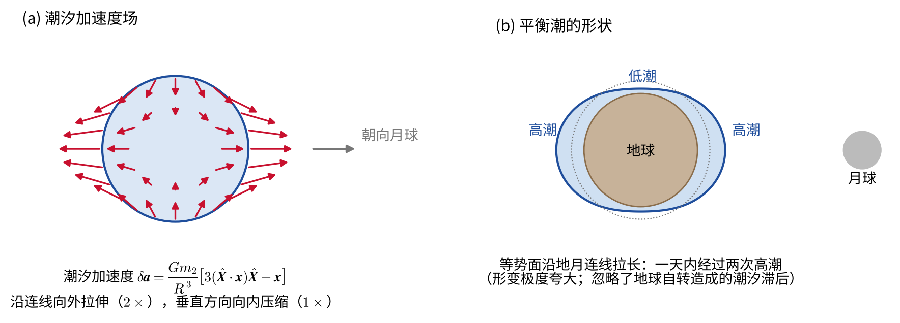

引潮效应的尺度与

$$
\begin{equation}
\frac{m_2}{R^3}
\end{equation}
$$

成正比，所以月球对地球潮汐的影响大于太阳。

- 地球自转时，某固定地点相隔半天经历两次引潮力极大值。
- 固体潮汐会导致地球与月球之间出现潮汐锁定。
- 潮汐力还给出天体的瓦解半径。量级估算为

$$
\begin{equation}
  r_{\mathrm{Roche}}\sim R_0\left(\frac{2M}{m}\right)^{1/3},
\end{equation}
$$

  其中 $M$ 是主星质量，$m$ 和 $R_0$ 是小天体的质量与尺度。

直观地说，当小天体离主星足够近（小于洛希半径 $r_{\mathrm{Roche}}$）时，潮汐力在小天体自身尺度上产生的“撕扯效应”会超过小天体自身引力把它束缚在一起的能力，导致其被瓦解——土星光环的物质分布、彗星在近距离掠过木星时被撕碎的现象，都与洛希极限密切相关。

<!-- 原 PDF 第 9 页 -->

## 三体问题与拉格朗日点
> Three-body Problem & Lagrange Point

两体问题之所以可以精确求解，本质上是因为角动量守恒、能量守恒等对称性提供的运动积分数目恰好够用（回忆前面的讨论：$2s-1$ 个独立运动积分）。一旦引入第三个天体，系统的自由度增加，已知的守恒量不再足以让方程完全可积，三体问题一般没有解析解（庞加莱在研究三体问题时发现的混沌现象，正是现代混沌理论的起点之一）。这里只讨论一种可解的特殊情形——受限三体问题。

牛顿引力框架下的两体问题可以化为

$$
\begin{equation}
\text{质心运动}+\text{相对运动},
\end{equation}
$$

并由开普勒问题得到圆锥曲线轨道。

三体问题则远比想象中复杂，一般不存在完整的解析解。考虑一类特殊情况：三个质量为 $m_1,m_2,m$，其中

$$
\begin{equation}
m_1\gg m,
\qquad
m_2\gg m.
\end{equation}
$$

忽略小质量 $m$ 对 $m_1,m_2$ 运动的影响。这种情况下，系统近似为：$m_1,m_2$ 的两体问题，加上 $m$ 在两者引力场影响下的运动。例如：

- 地球、月球和人造航天器；
- 太阳、地球和人造航天器。

这称为**受限三体问题**（restricted three-body problem）。

之所以说它“可解”，是因为小质量 $m$ 不影响 $m_1,m_2$ 的运动，于是 $m_1,m_2$ 之间仍然是一个标准的开普勒两体问题（圆轨道），可以先独立求解；剩下要做的只是求解质量为 $m$ 的粒子在这个已知的、随时间转动的引力场中的运动——这就是为什么下面要专门取一个跟随 $m_1,m_2$ 共同转动的非惯性系。

进一步考虑实际情形

$$
\begin{equation}
m_1\gg m_2\gg m,
\end{equation}
$$

并假定 $m_1,m_2$ 作圆轨道运动，即采用随双星共同转动的非惯性参考系。典型数量级为

$$
\begin{equation}
\frac{m_{\odot}}{m_{\oplus}}\approx3.3\times10^5,
\qquad
\frac{m_{\oplus}}{m_{\mathrm{Moon}}}\approx81.
\end{equation}
$$

以双星质心为坐标原点，假定两星体在 $x$-$y$ 平面内。取与星体一起作匀速转动的非惯性系，并令两星体连线方向为 $x$ 轴。可将两星体位置写成

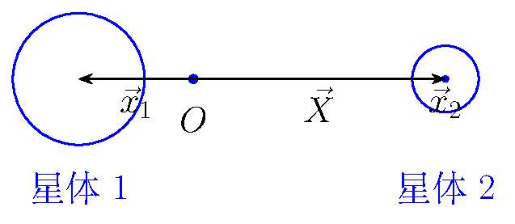

$$
\begin{equation}
\vec x_1=(r_1,0,0),
\qquad
\vec x_2=(-r_2,0,0),
\end{equation}
$$

其中

$$
\begin{equation}
r_1=\frac{m_2}{m_1+m_2}R,
\qquad
r_2=\frac{m_1}{m_1+m_2}R,
\end{equation}
$$

$R$ 是两星体之间的距离。

由于两星体作圆周运动，$R$ 固定不变。系统中所有长度均由 $R$ 决定，因此可以把长度重新标度为与 $R$ 的比值，并取

$$
\begin{equation}
R=1.
\end{equation}
$$

最后如需恢复物理长度，再乘以 $R$ 即可。

<!-- 原 PDF 第 10 页 -->

在 $R=1$ 的无量纲单位中，

$$
\begin{equation}
r_1=\frac{m_2}{m_1+m_2},
\qquad
r_2=\frac{m_1}{m_1+m_2}.
\end{equation}
$$

同理，也可以选择特征时间，例如一年。若公转周期取为 1，则公转角速度

$$
\begin{equation}
\Omega=2\pi,
\end{equation}
$$

而

$$
\begin{equation}
\Omega^2=\frac{G(m_1+m_2)}{R^3}
=G(m_1+m_2)=4\pi^2.
\end{equation}
$$

还可以将第三个质点的质量 $m$ 取为 1；此时结果与 $m$ 无关。

设第三个质点也在 $x$-$y$ 平面运动，$\vec x=(x,y)$。在旋转参考系下，质点的拉格朗日量为

$$
\begin{align}
L
&=\frac12\dot{\vec x}^{2}
+\dot{\vec x}\cdot(\vec\Omega\times\vec x)
+\frac12(\vec\Omega\times\vec x)^2
-V(\vec x)\\
&=\frac12\dot{\vec x}^{2}
+\dot{\vec x}\cdot(\vec\Omega\times\vec x)
-V_{\mathrm{eff}}(\vec x),
\end{align}
$$

其中 $V$ 为引力势能，而

$$
\begin{equation}
V_{\mathrm{eff}}(\vec x)
=V(\vec x)-\frac12(\vec\Omega\times\vec x)^2
\end{equation}
$$

包含离心势能。运动方程为

$$
\begin{equation}
\ddot{\vec x}+2\vec\Omega\times\dot{\vec x}
=-\frac{\partial V_{\mathrm{eff}}}{\partial\vec x}.
\end{equation}
$$

左侧第二项为科里奥利力的贡献；右侧有效势包含离心势与引力势。

这正是上面潮汐一节推导过的非惯性系运动方程（取 $\dot{\vec\Omega}=0$、$\dot{\vec V}=0$ 的匀速转动情形）在具体的受限三体问题中的应用。

在有效势的极值点，即

$$
\begin{equation}
\frac{\partial V_{\mathrm{eff}}}{\partial\vec x}=0,
\end{equation}
$$

如果质点在某时刻恰好静止于这些极值处，即 $\dot{\vec x}=0$，那么它将永远停留在该点。这些点称为**拉格朗日点** $(x_L,y_L)$，满足

$$
\begin{equation}
\dot x=\dot y=0.
\end{equation}
$$

有效势具体为

$$
\begin{equation*}
V_{\mathrm{eff}}(x,y)
=-\frac12\Omega^2(x^2+y^2)
-\frac{Gm_1}{\sqrt{(x-r_1)^2+y^2}}
-\frac{Gm_2}{\sqrt{(x+r_2)^2+y^2}}.
\end{equation*}
$$

极值条件为

$$
\begin{equation}
\Omega^2x_L
=\frac{Gm_1(x_L-r_1)}{\left[(x_L-r_1)^2+y_L^2\right]^{3/2}}
+\frac{Gm_2(x_L+r_2)}{\left[(x_L+r_2)^2+y_L^2\right]^{3/2}},
\end{equation}
$$

$$
\begin{equation}
\Omega^2y_L
=\frac{Gm_1y_L}{\left[(x_L-r_1)^2+y_L^2\right]^{3/2}}
+\frac{Gm_2y_L}{\left[(x_L+r_2)^2+y_L^2\right]^{3/2}}.
\end{equation}
$$

<!-- 原 PDF 第 11 页 -->

### 五个拉格朗日点

$L_1,L_2,L_3$ 位于两星体连线上，即

$$
\begin{equation}
y_L=0.
\end{equation}
$$

在 $m_1\gg m_2$ 的近似下，可给出的共线点位置为

$$
\begin{equation}
L_1:\quad -R+\left(\frac{m_2}{3m_1}\right)^{1/3}R,
\end{equation}
$$

$$
\begin{equation}
L_2:\quad -R-\left(\frac{m_2}{3m_1}\right)^{1/3}R.
\end{equation}
$$

定义希尔半径（Hill radius）

$$
\begin{equation}
r_H=R\left(\frac{m_2}{3m_1}\right)^{1/3}.
\end{equation}
$$

推导：希尔半径（L₁、L₂ 的位置）

$L_1$ 和 $L_2$ 的位置可以用泰勒展开求出。以 $L_1$ 为例，设它位于两星体连线上、距 $m_2$ 为 $\delta$（$\delta\ll R$）处。在共转参考系中，沿连线方向有三个力（单位质量）：$m_1$ 的引力 $Gm_1/(R-\delta)^2$ 指向 $m_1$；$m_2$ 的引力 $Gm_2/\delta^2$ 指向 $m_2$；离心力 $\Omega^2(R-r_1-\delta)$ 背离质心。平衡条件为

$$
\begin{equation*}
\frac{Gm_1}{(R-\delta)^2}
=\frac{Gm_2}{\delta^2}
+\Omega^2\left(R-r_1-\delta\right).
\end{equation*}
$$

利用 $\Omega^2=G(m_1+m_2)/R^3$ 和 $r_1=m_2R/(m_1+m_2)$，右端第二项为

$$
\begin{equation*}
\Omega^2\left(R-r_1-\delta\right)=\frac{Gm_1}{R^2}-\frac{G(m_1+m_2)}{R^3}\delta\simeq\frac{Gm_1}{R^2}-\frac{Gm_1}{R^3}\delta.
\end{equation*}
$$

左端展开到 $\delta$ 的一阶：

$$
\begin{equation*}
\frac{Gm_1}{(R-\delta)^2}\simeq\frac{Gm_1}{R^2}\left(1+\frac{2\delta}{R}\right).
\end{equation*}
$$

两边的零阶项 $Gm_1/R^2$ 恰好相消（这正是 $m_2$ 本身作圆周运动的条件），剩下

$$
\begin{equation*}
\frac{3Gm_1}{R^3}\delta=\frac{Gm_2}{\delta^2}
\quad\Longrightarrow\quad
\delta=R\left(\frac{m_2}{3m_1}\right)^{1/3}=r_H.
\end{equation*}
$$

对 $L_2$ 作同样的展开，得到相同的结果，只是位于 $m_2$ 的外侧。

这个推导的物理含义很清楚：左边的 $3Gm_1\delta/R^3$ 是 $m_1$ 的潮汐力（贡献系数 2）与离心力（贡献系数 1）之和，它随 $\delta$ 线性增大；右边 $m_2$ 的引力随 $\delta^{-2}$ 减小。因此，在 $r_H$ 以内 $m_2$ 的引力占主导，在 $r_H$ 以外 $m_1$ 的潮汐场占主导。以 $r_H$ 为半径、以 $m_2$ 为中心的区域称为**希尔球**，大致划定了 $m_2$ 能够“抓住”卫星的范围。数值计算表明，顺行卫星大约要在 $r_H/2$ 以内才能长期稳定，逆行卫星可以更远一些 [1]。几个例子：

- 地球：$m_\oplus/m_\odot\approx3.0\times10^{-6}$，$r_H\approx0.01\,\mathrm{AU}\approx1.5\times10^6\,\mathrm{km}$。月球距地球 $3.84\times10^5\,\mathrm{km}$，约为 $0.26\,r_H$，因此月球牢牢地被地球束缚，而不会被太阳“拉走”。这也是日–地 $L_1,L_2$ 距地球约 150 万公里的原因。
- 木星：$m_J/m_\odot\approx9.5\times10^{-4}$，$a\approx5.2\,\mathrm{AU}$，$r_H\approx0.35\,\mathrm{AU}\approx5\times10^7\,\mathrm{km}$。木星最外层的不规则卫星距木星约 $2\times10^7$–$3\times10^7\,\mathrm{km}$，恰好在希尔球的一半左右。

希尔半径和前面潮汐一节的洛希极限是同一类物理：两者都比较“潮汐力”与“自身引力”，因此都正比于质量比的 $1/3$ 次方。若小天体（质量 $m$、半径 $R_0$）离主星的距离 $d$ 使得它的希尔半径 $d\,(m/3M)^{1/3}$ 小于自身半径 $R_0$，即 $d<R_0(3M/m)^{1/3}$，它表面的物质就不再受自身束缚，这与洛希极限 $r_{\rm Roche}\sim R_0(2M/m)^{1/3}$ 只差一个数值系数。希尔在研究月球运动时最早引入了这一概念 [4]。

$L_3$ 位于 $m_1$ 的另一侧、距质心约为 $R$ 处。在那里 $m_2$ 离得很远（距离约 $2R$），只是一个弱扰动，因此 $L_3$ 偏离半径 $R$ 圆的修正正比于质量比的**一次方**，而不是 $1/3$ 次方。记 $\mu=m_2/(m_1+m_2)$，取 $R=1$、$G(m_1+m_2)=1$，令 $x_{L_3}=1+\varepsilon$，平衡条件为

$$
\begin{equation}
\frac{1-\mu}{(1+\varepsilon-\mu)^2}+\frac{\mu}{(2+\varepsilon-\mu)^2}=1+\varepsilon.
\end{equation}
$$

展开到 $\varepsilon,\mu$ 的一阶，得 $1+\mu-2\varepsilon+\mu/4=1+\varepsilon$，即

$$
\begin{equation}
L_3:\quad x_{L_3}\simeq R\left(1+\frac{5}{12}\mu\right)\simeq R\left(1+\frac{5}{12}\frac{m_2}{m_1}\right).
\end{equation}
$$

$L_1,L_2$ 的偏移是 $\mu^{1/3}$ 量级，是因为在小天体附近 $m_2$ 的引力与 $m_1$ 的潮汐力相互竞争；$L_3$ 则没有这样的竞争。

$L_4,L_5$ 满足

$$
\begin{cases}
(x_L-r_1)^2+y_L^2=1,\\
(x_L+r_2)^2+y_L^2=1,
\end{cases}
$$

即与 $m_1,m_2$ 构成等边三角形。图示中，$L_1$ 位于两星体之间，$L_2$ 位于小星体外侧，$L_3$ 位于大星体另一侧，而 $L_4,L_5$ 分别位于连线两侧的等边三角形顶点。

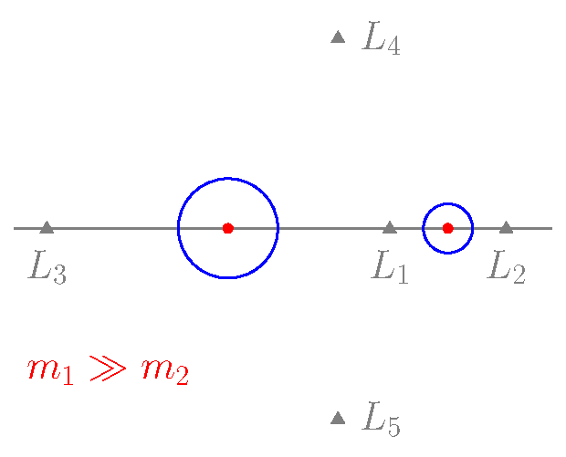

欧拉于 1765 年首先发现 $L_1,L_2,L_3$；拉格朗日于 1772 年发现 $L_4,L_5$。前三者称为共线拉格朗日点（collinear），后两者称为等边拉格朗日点（equilateral）。

拉格朗日点在现代空间探测中有重要应用：太阳-地球系统的 $L_1$ 点常用于放置太阳观测卫星（如 SOHO），因为那里可以不间断地观测太阳；$L_2$ 点因为背对太阳、温度稳定，是深空红外望远镜的理想位置（詹姆斯·韦伯空间望远镜即位于此处）；而木星-太阳系统的 $L_4,L_5$ 点则聚集着大量“特洛伊小行星”（Trojan asteroids），是等边拉格朗日点长期稳定性的天然证据。更多实例见本节末的“拉格朗日点的实际例子”。

### 雅可比积分与零速度曲线

拉格朗日点只回答了“质点可以静止在哪里”。要了解质点能够到达哪些区域，需要一个守恒量。在惯性系中，$m_1,m_2$ 在转动，引力势显含时间，所以质点的能量不守恒；势场也不是轴对称的，所以角动量也不守恒。但在共转参考系中势场是静止的，拉格朗日量不显含时间，于是存在一个守恒量。

把运动方程

$$
\begin{equation}
\ddot{\vec x}+2\vec\Omega\times\dot{\vec x}
=-\frac{\partial V_{\mathrm{eff}}}{\partial\vec x}
\end{equation}
$$

两边点乘 $\dot{\vec x}$。由于 $\dot{\vec x}\cdot(\vec\Omega\times\dot{\vec x})=0$，科里奥利力不做功，得到

$$
\begin{equation}
\frac{d}{dt}\left[\frac12\dot{\vec x}^{2}+V_{\mathrm{eff}}(\vec x)\right]=0.
\end{equation}
$$

即（单位质量）

$$
\begin{equation}
E_J\equiv\frac12\dot{\vec x}^{2}+V_{\mathrm{eff}}(\vec x)=\text{常数}.
\end{equation}
$$

这就是潮汐一节中匀速转动参考系的能量积分在受限三体问题中的形式，称为**雅可比积分**（Jacobi integral）[3]。天体力学文献中常用 $C_J=-2E_J$（在 $R=1$、$G(m_1+m_2)=1$ 的单位下），称为雅可比常数。利用 $\vec v_{\rm 惯性}=\dot{\vec x}+\vec\Omega\times\vec x$ 不难验证

$$
\begin{equation}
E_J=E-\vec\Omega\cdot\vec L,
\end{equation}
$$

其中 $E$ 和 $\vec L$ 分别是质点在惯性系中的单位质量能量和角动量。$E$ 和 $\vec L$ 单独都不守恒，但这一组合守恒。这正对应诺特定理：体系在“时间平移 $\Delta t$ 同时转动 $\Omega\Delta t$”的联合变换下不变。

验证：雅可比积分等于 E − Ω·L

惯性系中的速度为 $\vec u=\dot{\vec x}+\vec\Omega\times\vec x$，单位质量的能量和角动量为 $E=\frac12u^2+V$，$\vec L=\vec x\times\vec u$。利用 $\vec\Omega\cdot(\vec x\times\vec u)=\vec u\cdot(\vec\Omega\times\vec x)$，

$$
\begin{align*}
E-\vec\Omega\cdot\vec L&=\frac12u^2-\vec u\cdot(\vec\Omega\times\vec x)+V\\
&=\frac12\left|\vec u-\vec\Omega\times\vec x\right|^2-\frac12(\vec\Omega\times\vec x)^2+V
=\frac12\dot{\vec x}^{2}+V_{\rm eff}=E_J .
\end{align*}
$$

这与刚体一章“转动参照系中的能量”是同一个结构：在匀速转动的参照系中守恒的不是能量，而是 $E-\vec\Omega\cdot\vec L$。

雅可比积分在受限三体问题中的作用，类似于一维运动中的能量积分。由于 $\frac12\dot{\vec x}^2\ge0$，运动许可区必须满足

$$
\begin{equation}
V_{\mathrm{eff}}(x,y)\le E_J.
\end{equation}
$$

等式 $V_{\mathrm{eff}}(x,y)=E_J$ 定义的曲线上质点速度为零，称为**零速度曲线**，它是一维运动中“转折点”在二维中的推广。下图画出了 $V_{\mathrm{eff}}$ 的若干等值线（为了看清楚，取 $m_2/(m_1+m_2)=0.1$，坐标与正文一致，$m_2$ 在左）。三条粗线分别通过 $L_1,L_2,L_3$；灰色区域是 $E_J$ 介于 $V_{\mathrm{eff}}(L_1)$ 与 $V_{\mathrm{eff}}(L_2)$ 之间时的禁区。

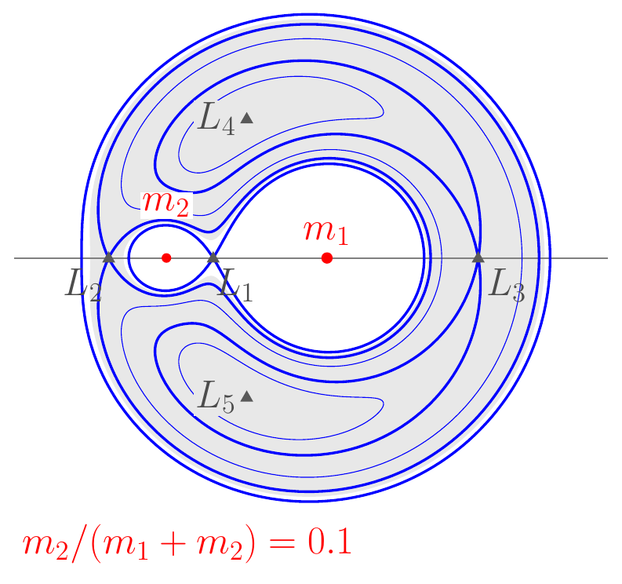

当 $m_2<m_1$ 时，五个拉格朗日点的有效势满足

$$
\begin{equation}
V_{\mathrm{eff}}(L_1)<V_{\mathrm{eff}}(L_2)<V_{\mathrm{eff}}(L_3)<V_{\mathrm{eff}}(L_4)=V_{\mathrm{eff}}(L_5).
\end{equation}
$$

随着 $E_J$ 增大，许可区的连通性依次改变：

1. $E_J<V_{\mathrm{eff}}(L_1)$：许可区分成三块，即 $m_1$ 附近、$m_2$ 附近和远处外区，互不连通。在 $m_2$ 附近的质点永远被束缚在 $m_2$ 周围。
2. $V_{\mathrm{eff}}(L_1)<E_J<V_{\mathrm{eff}}(L_2)$：$L_1$ 处的“颈口”打开，$m_1$ 与 $m_2$ 附近的区域连通（图中灰色禁区的情形）。航天器必须至少具有这一 $E_J$，才能从地球附近飞到月球附近。
3. $V_{\mathrm{eff}}(L_2)<E_J<V_{\mathrm{eff}}(L_3)$：$L_2$ 处也打开，质点可以从 $m_2$ 附近逃逸到外区。
4. $V_{\mathrm{eff}}(L_3)<E_J<V_{\mathrm{eff}}(L_4)$：禁区只剩下 $L_4,L_5$ 周围两块“蝌蚪形”区域。
5. $E_J>V_{\mathrm{eff}}(L_4)$：没有禁区。

下面的动画让 $E_J$ 从小到大连续变化，灰色禁区依次在 $L_1$、$L_2$、$L_3$ 处打开，最后只剩 $L_4,L_5$ 附近两块，直至完全消失（第一帧是五个阶段的总览）。

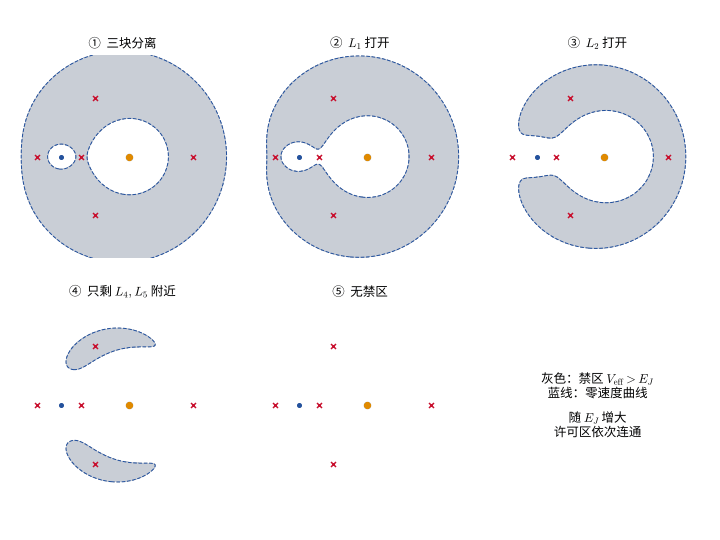

需要强调，零速度曲线给出的是“能到达的必要条件”：落在许可区内的点不一定真能到达，具体轨道仍要由运动方程决定。但这种分析不需要求解任何微分方程，却给出了严格的结论，例如情形 1 中质点永远不可能从 $m_2$ 附近逃逸。这是 1878 年希尔证明月球轨道长期稳定性的思路 [4]。航天任务中利用颈口附近的动力学设计“低能转移轨道”，也正是基于这一图像 [1, 2]。

通过 $L_1$ 的那条“8 字形”临界等势线，把 $m_1$ 和 $m_2$ 周围的区域分别围起来，称为**洛希瓣**（Roche lobe）。在密近双星中，若一颗恒星膨胀到充满自己的洛希瓣，其表面物质就会经由 $L_1$ 流向伴星，形成吸积盘。激变变星、X 射线双星和 Ia 型超新星的单简并前身星模型都与这一过程有关。洛希瓣的等效半径（与洛希瓣体积相同的球的半径）有一个精度优于 1% 的常用拟合公式 [5]：

$$
\begin{equation}
\frac{r_L}{a}=\frac{0.49\,q^{2/3}}{0.6\,q^{2/3}+\ln\left(1+q^{1/3}\right)},
\qquad
q=\frac{M_{\rm 该星}}{M_{\rm 伴星}},
\end{equation}
$$

其中 $a$ 为双星间距。严格地说，这里要求双星同步自转、物质处于流体静力平衡，与受限三体问题中试验粒子的条件略有不同，但几何图像是相同的。

### 拉格朗日点的稳定性

稳定性可通过对有效势在平衡点附近作二阶展开，即考察

$$
\begin{equation}
\frac{\partial^2V_{\mathrm{eff}}}{\partial x^2}
\end{equation}
$$

等二阶导数并进行微扰分析。

- $L_1,L_2,L_3$ 是有效势的**鞍点**：沿两星体连线方向是极大，垂直方向是极小（从上面的等值线图中可以看到等值线在这三点交叉）。它们都不稳定。$L_1,L_2$ 附近的航天器需要定期修正轨道，但由于偏离增长得不算太快、每次所需的速度改变很小，实践中仍然容易维持，Planck、JWST 等任务都是如此（见后文“拉格朗日点的实际例子”）。
- $L_4,L_5$ 是有效势的**极大值点**（等值线图中被闭合的蝌蚪形等值线包围），但当 $m_2/(m_1+m_2)<0.0385$ 时它们是稳定的，因此可以有其他天体长期停留在其附近。

这里“稳定”与“不稳定”指的是：把天体在平衡点附近作微小扰动后，扰动是围绕平衡点振荡（稳定）还是随时间指数增长、远离平衡点（不稳定）。

$L_4,L_5$ 的稳定性非常反直觉：一个处在势能“山顶”的质点，若只受势能力作用，必然滚下山去。这里起作用的是科里奥利力 $-2\vec\Omega\times\dot{\vec x}$。它总是垂直于速度、不做功，只使质点转弯：质点一旦开始往下滚，就被偏转成绕山顶的运动，而无法远离。这和带电粒子在磁场中被约束、或大气中气流绕高压中心旋转（反气旋）而不直接流出的道理相同。

这种“稳定化”需要科里奥利力足够强，相对于势能曲率而言。在 $L_4$ 附近把运动方程线性化，可以得到扰动的特征方程（以 $\Omega$ 为单位）

$$
\begin{equation}
\lambda^4+\lambda^2+\frac{27}{4}\mu(1-\mu)=0,
\qquad
\mu=\frac{m_2}{m_1+m_2}.
\end{equation}
$$

只有当 $\lambda^2$ 的两个根都是负实数时，扰动才是纯振荡，这要求判别式 $1-27\mu(1-\mu)>0$，即

$$
\begin{equation}
\mu<\frac12\left(1-\sqrt{\frac{23}{27}}\right)\approx0.0385.
\end{equation}
$$

这就是劳斯（Routh）判据 [6]。日–木星（$\mu\approx9.5\times10^{-4}$）和地–月（$\mu\approx0.012$）都满足这一条件；冥王星–卡戎（$\mu\approx0.11$）则不满足，因此不能有长期停留在其 $L_4,L_5$ 的天体。对 $L_1,L_2,L_3$，同样的线性化总会给出一个正实根 $\lambda$，扰动按 $e^{\lambda t}$ 指数增长，科里奥利力无法挽救。

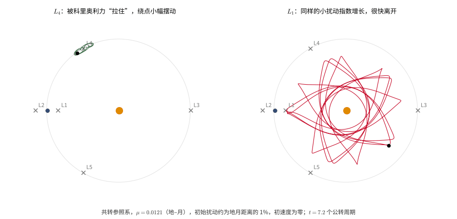

进阶推导：L₄ 附近的线性化与劳斯判据

取 $R=1$、$G(m_1+m_2)=1$、$\Omega=1$，记 $U=-V_{\rm eff}=\frac12(x^2+y^2)+(1-\mu)/r_1+\mu/r_2$。运动方程写成分量为

$$
\begin{equation*}
\ddot x-2\dot y=\frac{\partial U}{\partial x},\qquad \ddot y+2\dot x=\frac{\partial U}{\partial y}.
\end{equation*}
$$

在平衡点附近令 $x=x_L+\xi$，$y=y_L+\eta$，把 $\partial U$ 展开到一阶：

$$
\begin{equation*}
\ddot\xi-2\dot\eta=U_{xx}\xi+U_{xy}\eta,\qquad \ddot\eta+2\dot\xi=U_{xy}\xi+U_{yy}\eta .
\end{equation*}
$$

在 $L_4$ 处 $r_1=r_2=1$，到两个天体的位移分量为 $(\mp\tfrac12,\tfrac{\sqrt3}{2})$，直接求二阶导数得

$$
\begin{equation*}
U_{xx}=\frac34,\qquad U_{yy}=\frac94,\qquad U_{xy}^2=\frac{27}{16}(1-2\mu)^2 .
\end{equation*}
$$

设 $\xi,\eta\propto e^{\lambda t}$，非零解要求

$$
\begin{align*}
&\det\begin{pmatrix}\lambda^2-U_{xx}&-2\lambda-U_{xy}\\ 2\lambda-U_{xy}&\lambda^2-U_{yy}\end{pmatrix}\\
&\qquad=\lambda^4+(4-U_{xx}-U_{yy})\lambda^2+U_{xx}U_{yy}-U_{xy}^2=0 .
\end{align*}
$$

代入数值，$4-U_{xx}-U_{yy}=1$，$U_{xx}U_{yy}-U_{xy}^2=\frac{27}{16}\bigl[1-(1-2\mu)^2\bigr]=\frac{27}{4}\mu(1-\mu)$，即正文的特征方程。两个 $\lambda^2$ 根为

$$
\begin{equation*}
\lambda^2=\frac{-1\pm\sqrt{1-27\mu(1-\mu)}}{2}.
\end{equation*}
$$

判别式为正时两根都是负实数，$\lambda$ 为纯虚数，运动是两个频率的振动叠加，这就是劳斯判据。$\mu\ll1$ 时，一个根 $\lambda^2\approx-1$ 对应以公转频率进行的“本轮”小振动，另一个根 $\lambda^2\approx-\frac{27}{4}\mu$ 对应绕 $L_4$ 的缓慢摆动，频率为 $\sqrt{27\mu/4}\,\Omega$（作业第 4 题）。

$U_{xx}$ 和 $U_{yy}$ 都为正，说明 $L_4$ 是势能 $V_{\rm eff}=-U$ 的极大值点；稳定性完全来自方程中的科里奥利项 $\pm2\lambda$。若去掉这两项，特征方程变为 $(\lambda^2-U_{xx})(\lambda^2-U_{yy})-U_{xy}^2=0$，必有正实根，平衡点不稳定。

### 拉格朗日点的实际例子

**日–地 $L_1$（距地球约 150 万公里，朝向太阳）。** 这里可以不受地球和月球遮挡地连续观测太阳，代表任务有 SOHO、DSCOVR 和印度的 Aditya-L1。太阳风以约 $400\,\mathrm{km\,s^{-1}}$ 的速度经过 $L_1$ 后，大约还需 1 小时才到达地球，因此这里的探测器还承担空间天气预警的作用。

**日–地 $L_2$（距地球约 150 万公里，背向太阳）。** 太阳、地球和月球都位于同一个方向，一面遮光罩就能挡住全部热源，探测器可以长期保持在低温和稳定的热环境中。因此这里成为天文观测卫星的首选位置：WMAP 和 Planck（宇宙微波背景）、Herschel（远红外）、Gaia（天体测量）、JWST（红外）和 Euclid（暗能量巡天）。不过航天器并不停在 $L_2$ 点本身：从 $L_2$ 看，地球的视直径约 $0.49^\circ$，太阳约 $0.53^\circ$，地球几乎完全挡住太阳，探测器会处在接近日环食的阴影中，无法用太阳能供电。因此实际采用绕 $L_2$ 运动、幅度达数十万公里的晕轨道（halo orbit）或利萨如轨道。由于 $L_2$ 不稳定（日–地系统中扰动的 $e$ 倍增长时间约 23 天），这些轨道需要每隔数周作一次很小的修正。

**地–月 $L_2$（月球背面方向，距月球约 6.5 万公里）。** 月球背面始终背向地球，在那里着陆的探测器无法直接与地面通信。2018 年发射的“鹊桥”中继卫星运行在地–月 $L_2$ 附近的晕轨道上，既能看到月球背面，又能看到地球，为 2019 年嫦娥四号首次在月球背面软着陆提供了通信中继。同样，如果停在 $L_2$ 点本身，月球会挡住地球，所以必须采用晕轨道。地–月系统的特征时间是一个月而不是一年，扰动增长时间只有几天的量级，轨道维持也更加频繁。

**特洛伊天体。** 木星的 $L_4,L_5$ 附近已发现上万颗小行星，传统上 $L_4$ 群以希腊英雄命名，$L_5$ 群以特洛伊英雄命名。2021 年发射的 NASA Lucy 探测器将依次飞掠这两个群的多颗小行星。海王星和火星也有特洛伊小行星。地球的特洛伊小行星直到 2011 年才被确认（2010 TK7）[7]，第二颗（2020 XL5）于 2022 年被确认 [8]。它们的轨道绕 $L_4$ 摆动的幅度很大，在等值线图中对应包围 $L_4$ 的蝌蚪形区域，而且只能维持数千年。

**卫星系统中的共轨天体。** 土星的卫星特提斯（Tethys）的 $L_4,L_5$ 附近分别有小卫星 Telesto 和 Calypso；狄俄涅（Dione）的 $L_4,L_5$ 附近分别有 Helene 和 Polydeuces。

**马蹄形轨道。** 土星的两颗卫星 Janus 和 Epimetheus 的轨道半径只差约 50 km。内侧的卫星较快，追上外侧卫星时，两者的引力交换使内侧的升到外侧、外侧的降到内侧，大约每 4 年交换一次。在共转参考系中，每颗卫星的轨迹绕过 $L_4$、$L_3$、$L_5$，形如马蹄，对应等值线图中围住这三点的粗线所示的形状。

下面的动画在共转参照系中直接数值积分受限三体问题的运动方程（$\mu=0.001$，接近日–木系统），给出这两类轨道：蝌蚪形轨道只在 $L_4$ 一侧来回摆动，马蹄形轨道则绕过 $L_4$、$L_3$、$L_5$，在接近 $m_2$ 时掉头。

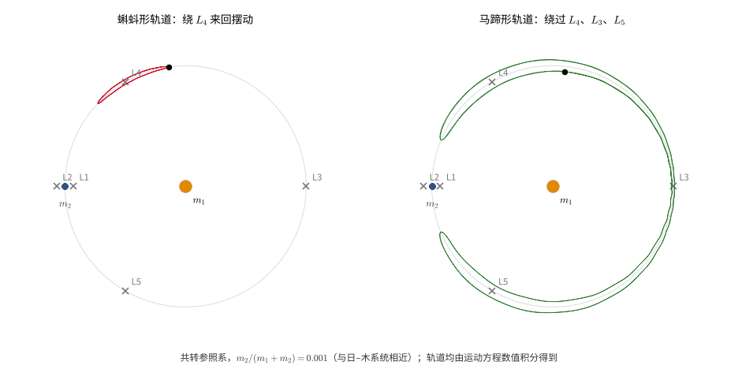

<!-- 原 PDF 第 12 页 -->

## 有心力场的散射问题
> Scattering

前面几节讨论的都是束缚轨道（行星绕太阳），这一节转向非束缚轨道（$E>0$）——粒子从无穷远来，被中心力场偏转后又飞向无穷远，这类过程称为散射。散射实验是探测微观世界最重要的手段之一：我们无法直接“看到”原子核，但可以通过分析粒子被原子散射后的角度分布，反推出原子内部的电荷分布——这正是下面卢瑟福散射一节要讲的经典范例。

散射问题经常出现在物理系统中，例如经典力学、电动力学、量子力学等。

如图所示，粒子从无穷远入射，在原点附近被中心力场散射，运动方向发生偏转，最后飞向无穷远。图中绿色曲线为实际轨道，红色直线为入射与出射渐近线，原点为力心。

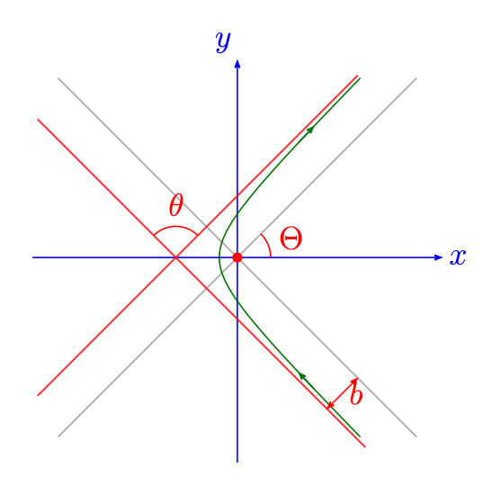

### 散射截面的含义

散射截面是力心相对于入射粒子看起来的“有效面积”：

- 在这个面积以内，入射粒子能够被散射，动量方向发生偏离；
- 超出这个面积，则不发生散射，动量方向不发生偏离。

需要注意，这个“有一块边界清楚的靶子”的图像严格说只适用于**有限力程**的势，例如下面的硬球势：碰撞参数大于球半径的粒子完全不受影响。对库仑势和引力势这样的长程势，无论碰撞参数多大，粒子总会受到一点偏转，“靶子”没有边缘，总截面会发散（见后文“总截面的发散与屏蔽”）。此时有物理意义的是微分截面，或者“偏转角大于某个值”的截面。

下面对这一过程作定量描述。考虑有心势 $V(r)$，并假定（这一假设排除了长程势在无穷远处仍然“显著”的病态情形，例如未经屏蔽的库仑势在推导散射截面时需要额外小心处理发散问题，这里先假设 $V(r)$ 衰减得足够快。）

$$
\begin{equation}
r\to\infty\quad\text{时}\quad V(r)\to0.
\end{equation}
$$

初始状态为

$$
\begin{equation}
t\to-\infty,
\qquad r\to+\infty,
\end{equation}
$$

散射末态为

$$
\begin{equation}
t\to+\infty,
\qquad r\to+\infty.
\end{equation}
$$

由能量守恒，初态与末态的能量和动量大小相同，因而速率相同。

初始速度矢量与中心力场原点构成的平面就是轨道平面。入射粒子初始速度矢量的延长线与原点之间的距离称为**碰撞参数** $b$。

**散射角** $\theta$ 是末态速度与初始速度之间的夹角。粒子在无穷远处的极角分别为 $\pm\Theta$，图中的偏折几何关系为

$$
\begin{equation}
\theta+2\Theta=\pi.
\end{equation}
$$

由于体系具有时间反演不变性，轨道具有一定的对称性。可以选择粒子距离力心最近的时刻为

$$
\begin{equation}
t=0,
\end{equation}
$$

此时轨道关于 $x$ 轴对称，轨道方程满足

$$
\begin{equation}
r(\pm\Theta)=+\infty.
\end{equation}
$$

散射角 $\theta$ 与碰撞参数 $b$ 有关，也与中心力场的强弱及入射速度有关。

直观上，碰撞参数 $b$ 越小，粒子越接近力心，感受到的偏转力越强，散射角 $\theta$ 也就越大；$b\to\infty$ 对应几乎不偏转（$\theta\to0$），$b\to0$（对吸引势，正对力心入射）对应最大程度的偏转。下面几节的目标就是把这个定性的单粒子图像，转化为可以与实验测量对比的定量的“散射截面”。

<!-- 原 PDF 第 13 页 -->

### 总散射截面与微分散射截面

现在考虑不止一个粒子入射，而是粒子束。设束流强为 $I$。流强代表单位时间通过单位面积的粒子数目：

$$
\begin{equation}
I=nv,
\end{equation}
$$

其量纲例如为

$$
\begin{equation}
[I]=\mathrm{cm}^{-2}\mathrm{s}^{-1}.
\end{equation}
$$

粒子束中的粒子被散射到无穷远。单位时间内发生的散射事件数目称为散射率 $S$。定义

$$
\begin{equation}
S=I\sigma,
\end{equation}
$$

其中 $\sigma$ 的量纲为面积（如 $\mathrm{cm}^2$），反映系统的散射能力，称为**总散射截面**（total scattering cross section）。

可以把总散射截面想象成力心对入射粒子束“张开”的一个虚拟靶子：靶子越大（$\sigma$ 越大），单位时间内被散射的粒子数目就越多。虽然这里用“面积”这个几何图像来帮助理解，但截面的大小其实完全由相互作用势 $V(r)$ 的强弱决定，与力心的实际几何尺寸未必有直接关系。

如果要考虑入射粒子被散射到不同方向的几率，需要引入**微分散射截面**（differential scattering cross section）：

$$
\begin{equation}
dS=I\left(\frac{d\sigma(\theta,\phi)}{d\Omega}\right)d\Omega.
\end{equation}
$$

其中 $d\Omega$ 为立体角元，$\theta$ 是极角，$\phi$ 是方位角。微分散射截面体现了把入射粒子散射到某个特定方位角范围的能力。总截面为

$$
\begin{equation}
\sigma=\int\frac{d\sigma(\theta,\phi)}{d\Omega}\,d\Omega.
\end{equation}
$$

由于这里考虑的有心势具有球对称性，散射具有轴对称性，因此微分散射截面不依赖于 $\phi$，只是 $\theta$ 的函数：

$$
\begin{equation}
\frac{d\sigma(\theta,\phi)}{d\Omega}
=\frac{d\sigma(\theta)}{d\Omega}.
\end{equation}
$$

散射角 $\theta$ 由碰撞参数 $b$ 确定：

$$
\begin{equation}
b=b(\theta),
\qquad\text{或}\qquad
\theta=\theta(b).
\end{equation}
$$

考虑 $b$ 附近宽度为 $db$ 的圆环，单位时间内通过面积 $2\pi b\,db$ 的粒子数为

$$
\begin{equation}
dS=I(2\pi b\,db).
\end{equation}
$$

这些粒子都被散射到 $\theta$ 附近立体角

$$
\begin{equation}
d\Omega=2\pi\sin\theta\,d\theta
\end{equation}
$$

所构成的圆锥环中。因此

$$
\begin{equation}
-d\sigma(\theta)
=2\pi b\,db
=-2\pi\left(\frac{d\sigma}{d\Omega}\right)
\sin\theta\,d\theta.
\end{equation}
$$

负号表示：当 $b$ 减小时，粒子会更接近力心，因而散射角 $\theta$ 增大，即

$$
\begin{equation}
\frac{db}{d\theta}<0.
\end{equation}
$$

于是

$$
\begin{equation}
\frac{d\sigma(\theta)}{d\Omega}
=-\frac{b(\theta)}{\sin\theta}\frac{db}{d\theta}
=\frac{b(\theta)}{\sin\theta}
\left|\frac{db}{d\theta}\right|.
\end{equation}
$$

余下的问题是：给定中心势 $V(r)$，如何确定 $\theta$ 与 $b$ 的关系？

<!-- 原 PDF 第 14 页 -->

### 由轨道方程确定散射角

粒子的轨道方程为

$$
\begin{equation}
\varphi=\varphi_0+ \int^rdr'\,
\frac{J/r'^2}{\sqrt{2m\left[E-V(r')\right]-J^2/r'^2}},
\end{equation}
$$

并满足

$$
\begin{equation}
r(\varphi=\pm\Theta)=+\infty,
\qquad
\theta+2\Theta=\pi.
\end{equation}
$$

对于能量

$$
\begin{equation}
E=\frac12mv_0^2
\end{equation}
$$

且碰撞参数为 $b$ 的粒子，角动量为

$$
\begin{equation}
J=mv_0b.
\end{equation}
$$

若 $r_0$ 是最近距离，则散射角为

$$
\begin{equation}
\theta
=\pi-2b\int_{r_0}^{\infty}
\frac{dr}{r\sqrt{r^2\left[1-V(r)/E\right]-b^2}}.
\end{equation}
$$

所以给定中心势 $V(r)$，即可求得 $\theta(b)$，进而得到 $d\sigma/d\Omega$。

这就是求解任意中心力场散射问题的一般流程：给定 $V(r)$，先通过上面的积分求出 $\theta(b)$，再反解出 $b(\theta)$，最后代入微分截面公式 $d\sigma/d\Omega=\dfrac{b}{\sin\theta}\left|\dfrac{db}{d\theta}\right|$。下面先用最简单的硬球势，再用库仑势完整走一遍这个流程。

### 例：硬球散射

设力心是半径为 $a$ 的刚性球，即

$$
\begin{equation}
V(r)=\begin{cases}\infty,&r<a,\\0,&r>a.\end{cases}
\end{equation}
$$

$b>a$ 的粒子不受任何作用，$\theta=0$。$b<a$ 的粒子在球面上发生镜面反射：入射角 $\psi$ 满足 $\sin\psi=b/a$，反射后速度方向转过 $\theta=\pi-2\psi$。于是

$$
\begin{equation}
b=a\sin\left(\frac{\pi-\theta}{2}\right)=a\cos\frac\theta2.
\end{equation}
$$

（也可以直接代入上面的一般积分：$r_0=a$，$\int_a^\infty b\,dr/\bigl(r\sqrt{r^2-b^2}\bigr)=\arcsin(b/a)$，得到同样的结果。）代入微分截面公式，

$$
\begin{equation}
\frac{d\sigma}{d\Omega}
=\frac{b}{\sin\theta}\left|\frac{db}{d\theta}\right|
=\frac{a\cos(\theta/2)}{2\sin(\theta/2)\cos(\theta/2)}\cdot\frac a2\sin\frac\theta2
=\frac{a^2}{4},
\end{equation}
$$

$$
\begin{equation}
\sigma=\int\frac{d\sigma}{d\Omega}\,d\Omega=4\pi\cdot\frac{a^2}{4}=\pi a^2.
\end{equation}
$$

硬球散射有三个特点：微分截面各向同性，即粒子被均匀地散射到各个方向；截面与入射速度无关；总截面恰好等于球的几何截面 $\pi a^2$。这正是前面“有效面积”图像最直接的实现。气体分子运动论中的平均自由程 $\lambda=1/(n\sigma)$，最简单的模型就是把分子看作硬球。

### 卢瑟福散射
> Rutherford Scattering

考虑 $\alpha$ 粒子轰击金箔。在排斥库仑势

$$
\begin{equation}
V(r)=\frac{\alpha}{r},
\qquad \alpha>0
\end{equation}
$$

下，轨道方程为

$$
\begin{equation}
\frac{p}{r}=-1+e\cos\varphi.
\end{equation}
$$

近心点为

$$
\begin{equation}
r_{\min}=\frac{p}{e-1}.
\end{equation}
$$

当 $r\to\infty$ 时，渐近角度 $\pm\Theta$ 满足

$$
\begin{equation}
\cos\Theta=\frac1e.
\end{equation}
$$

由

$$
\begin{equation}
E=\frac12mv_0^2,
\qquad
J=mv_0b,
\end{equation}
$$

得到

$$
\begin{equation}
e^2
=1+\frac{2EJ^2}{m\alpha^2}
=1+\left(\frac{mbv_0^2}{\alpha}\right)^2.
\end{equation}
$$

因此

$$
\begin{equation}
\left(\frac{mbv_0^2}{\alpha}\right)^2
=\sec^2\Theta-1
=\tan^2\Theta.
\end{equation}
$$

再利用

$$
\begin{equation}
\frac\theta2+\Theta=\frac\pi2,
\end{equation}
$$

可得碰撞参数和散射角的关系：

$$
\begin{equation}
b(\theta)=\frac{\alpha}{mv_0^2}\cot\frac\theta2
=k\cot\frac\theta2,
\qquad
k=\frac{\alpha}{mv_0^2}.
\end{equation}
$$

代入一般公式，得到

$$
\begin{align}
\frac{d\sigma(\theta)}{d\Omega}
=-\frac{b}{\sin\theta}\frac{db}{d\theta}=\frac{k^2}{4}\csc^4\left(\frac\theta2\right).
\end{align}
$$

这就是卢瑟福微分散射截面公式，并成为卢瑟福原子模型的重要依据。

推导：由 b(θ) 求卢瑟福截面

由 $b=k\cot(\theta/2)$，

$$
\begin{equation*}
\frac{db}{d\theta}=-\frac k2\csc^2\frac\theta2 ,
\end{equation*}
$$

再用 $\sin\theta=2\sin(\theta/2)\cos(\theta/2)$：

$$
\begin{equation*}
\frac{d\sigma}{d\Omega}=\frac{b}{\sin\theta}\left|\frac{db}{d\theta}\right|
=\frac{k\cos(\theta/2)/\sin(\theta/2)}{2\sin(\theta/2)\cos(\theta/2)}\cdot\frac{k}{2\sin^2(\theta/2)}
=\frac{k^2}{4\sin^4(\theta/2)} .
\end{equation*}
$$

截面对 $\theta$ 的依赖完全来自几何：$\csc^4(\theta/2)$ 在小角度时按 $\theta^{-4}$ 发散，这是库仑势长程性的反映（见后文“总截面的发散与屏蔽”）。

下面的动画画出一束平行粒子在排斥库仑势中的轨迹。碰撞参数小的粒子被大角度散射甚至弹回，碰撞参数大的只偏转一点；所有轨迹的包络在力心后方围出一个粒子到不了的“阴影”区。

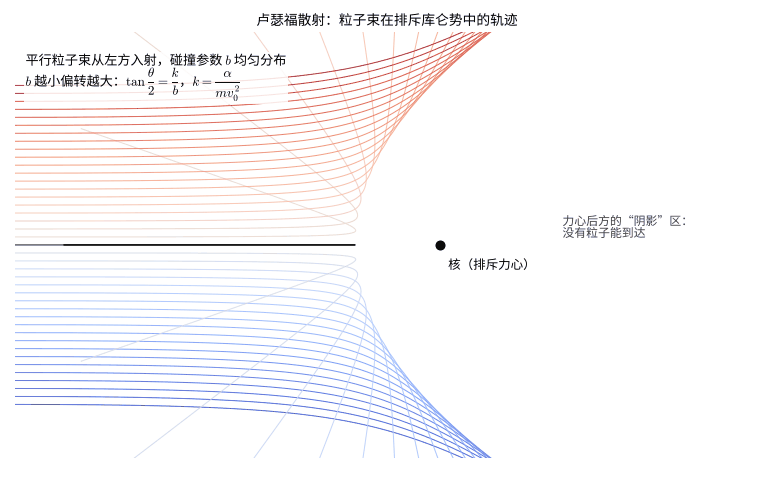

1909 年，盖革（Geiger）和马斯登（Marsden）在卢瑟福（Rutherford）指导下用 $\alpha$ 粒子轰击金箔，发现绝大多数 $\alpha$ 粒子几乎不偏转地穿过金箔，但极少数（约 1/8000）偏转角超过 $90^\circ$，甚至被“弹回” [11]。这一现象无法用当时流行的“葡萄干布丁模型”（正电荷均匀分布在原子中）解释，却与上面推导的公式（假设原子正电荷集中在一个很小的中心，即原子核）精确吻合——这正是原子核被发现的实验证据 [12]，也是这条公式在物理学史上的重要地位所在。值得一提的是，对库仑势，经典计算、量子力学的玻恩近似以及库仑问题的精确量子解给出完全相同的微分截面，而且在任意能量下都成立（对全同粒子还需另计交换效应）。这是库仑势特有的“巧合”。对其他势，经典与量子结果一般并不相同。这也是卢瑟福在 1911 年用经典力学就能正确解释实验的原因之一。

### 质心系与实验室系

前面的推导都是在质心系中完成的：散射角 $\theta$ 是相对坐标 $\vec r$ 的偏转角，公式中的 $m$ 应理解为约化质量 $\mu=m_1m_2/(m_1+m_2)$，$E=\frac12\mu v_0^2$ 是质心系能量（$v_0$ 为相对速度）。这正是本章开头“两体问题化为单体问题”的直接应用。但实验中靶粒子 $m_2$ 起初静止，探测器测量的是实验室系中入射粒子 $m_1$ 的偏转角 $\theta_{\rm lab}$。

设 $m_1$ 以速度 $v_0$ 入射。质心速度为 $V=m_1v_0/(m_1+m_2)$，在质心系中 $m_1$ 的速度为

$$
\begin{equation}
u=v_0-V=\frac{m_2v_0}{m_1+m_2}.
\end{equation}
$$

弹性散射后，质心系中 $m_1$ 的速率仍为 $u$，方向转过 $\theta$。再加上质心速度 $V$，回到实验室系：

$$
\begin{equation}
\vec v_1'=\bigl(u\cos\theta+V,\ u\sin\theta\bigr),
\;
\tan\theta_{\rm lab}=\frac{\sin\theta}{\cos\theta+m_1/m_2}.
\end{equation}
$$

几个极限情形：

- $m_1\ll m_2$（$\alpha$ 粒子打金核，$m_1/m_2\approx0.02$）：$\theta_{\rm lab}\approx\theta$，质心系与实验室系几乎没有差别，所以卢瑟福可以直接用固定力心处理。
- $m_1=m_2$（例如台球、质子打质子）：$\tan\theta_{\rm lab}=\tan(\theta/2)$，即 $\theta_{\rm lab}=\theta/2$，实验室系中的散射角不超过 $90^\circ$。
- $m_1>m_2$：$\vec v_1'$ 的端点落在以 $(V,0)$ 为圆心、半径 $u<V$ 的圆上，因此存在最大散射角 $\sin\theta_{\rm lab,max}=m_2/m_1$。例如 $\alpha$ 粒子打氢核，$\theta_{\rm lab}\le14.5^\circ$，重粒子不可能被轻粒子“弹回”。

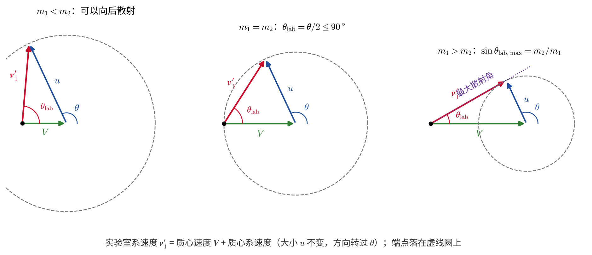

由于 $\theta\to\theta_{\rm lab}$ 改变了立体角，截面也要相应换算。由 $d\sigma$ 不变（同一批粒子）可得

$$
\begin{equation}
\left(\frac{d\sigma}{d\Omega}\right)_{\rm lab}
=\left(\frac{d\sigma}{d\Omega}\right)_{\rm CM}
\frac{\left(1+2\gamma\cos\theta+\gamma^2\right)^{3/2}}{\left|1+\gamma\cos\theta\right|},
\;
\gamma=\frac{m_1}{m_2}.
\end{equation}
$$

推导：实验室系的截面换算

同一批粒子在两个参照系中被计数一次，所以 $d\sigma$ 不变：$\left(\frac{d\sigma}{d\Omega}\right)_{\rm lab}d\Omega_{\rm lab}=\left(\frac{d\sigma}{d\Omega}\right)_{\rm CM}d\Omega_{\rm CM}$。绕入射方向轴对称，$d\Omega=2\pi\,d(\cos\theta)$，于是

$$
\begin{equation*}
\left(\frac{d\sigma}{d\Omega}\right)_{\rm lab}=\left(\frac{d\sigma}{d\Omega}\right)_{\rm CM}\left|\frac{d\cos\theta}{d\cos\theta_{\rm lab}}\right| .
\end{equation*}
$$

由 $\tan\theta_{\rm lab}=\sin\theta/(\cos\theta+\gamma)$，

$$
\begin{equation*}
\cos\theta_{\rm lab}=\frac{\cos\theta+\gamma}{\sqrt{1+2\gamma\cos\theta+\gamma^2}} .
\end{equation*}
$$

记 $c=\cos\theta$，$D=1+2\gamma c+\gamma^2$，求导：

$$
\begin{equation*}
\frac{d\cos\theta_{\rm lab}}{dc}=\frac{\sqrt D-(c+\gamma)\gamma/\sqrt D}{D}=\frac{D-\gamma(c+\gamma)}{D^{3/2}}=\frac{1+\gamma c}{D^{3/2}} ,
\end{equation*}
$$

取倒数即得正文的换算公式。$\gamma>1$ 时，同一个 $\theta_{\rm lab}$ 对应两个 $\theta$，实验室截面要把两支相加。

更多细节可参见 [9, 10]。

### 总截面的发散与屏蔽

下图比较了硬球与库仑势的 $\theta(b)$（图中取 $k=a$）。硬球的 $\theta(b)$ 在 $b=a$ 处截止；库仑势的 $\theta(b)=2\arctan(k/b)$ 则在 $b\to\infty$ 时只缓慢地按 $2k/b$ 趋于零。

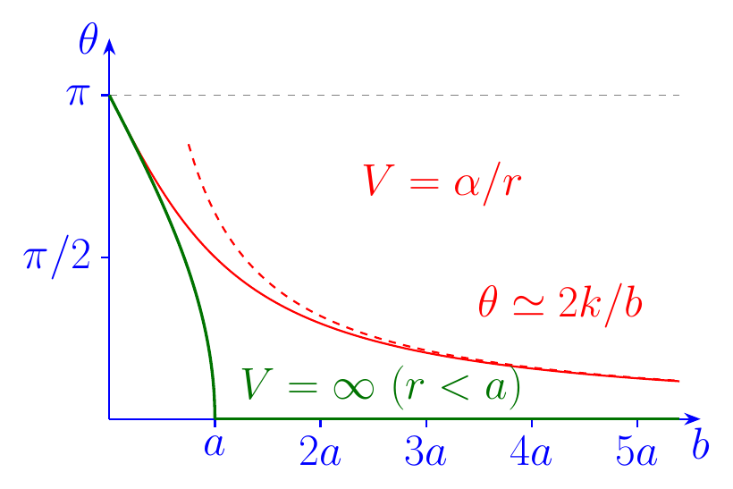

这个“长尾巴”的后果是：小角度时卢瑟福截面 $d\sigma/d\Omega\simeq4k^2/\theta^4$，偏转角大于 $\theta_{\min}$ 的截面为

$$
\begin{equation}
\sigma(\theta>\theta_{\min})\simeq\int_{\theta_{\min}}\frac{4k^2}{\theta^4}\,2\pi\theta\,d\theta=\frac{4\pi k^2}{\theta_{\min}^2}=\pi b^2(\theta_{\min}),
\end{equation}
$$

当 $\theta_{\min}\to0$ 时发散。物理上这很好理解：库仑势是长程的，任意远处经过的粒子都会被偏转一点，所以“被散射”的粒子数没有上限。

真实原子中，原子核的电场在原子半径 $a_{\rm at}$ 之外被核外电子屏蔽，可近似为 $V=(\alpha/r)e^{-r/a_{\rm at}}$。$b\gg a_{\rm at}$ 的粒子几乎不受作用，有效的 $b_{\max}\sim a_{\rm at}$，总截面变为有限值，量级为 $\pi a_{\rm at}^2$。引力无法屏蔽，在恒星体系中只能用体系本身的尺寸作为 $b_{\max}$ 的截断；弛豫时间公式中的库仑对数 $\ln\Lambda=\ln(b_{\max}/b_{\min})$，正是这种发散在天体物理中的体现。

### 小角度散射与冲量近似

当 $\theta\ll1$ 时，可以不解轨道方程，而直接计算冲量。由于偏转很小，可以把粒子轨迹近似为直线 $\vec r(t)=(vt,b)$（下图左中的虚线），沿这条直线对力做时间积分。力沿运动方向的分量 $F_\parallel$ 在 $t$ 与 $-t$ 时刻大小相等、方向相反，积分为零；垂直分量 $F_\perp$ 始终指向同一侧，主要集中在 $|t|\lesssim b/v$ 这段时间内作用（下图右），它的积分就是横向冲量。图中画的是吸引的情形，偏转角做了夸大。

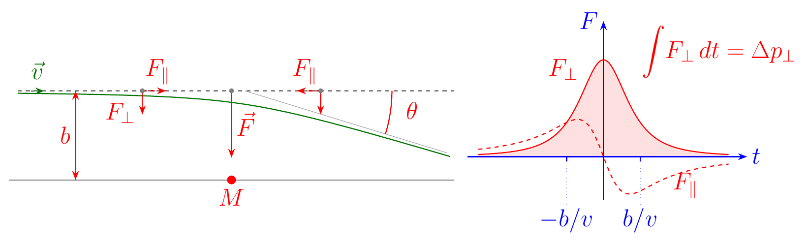

垂直方向的力为 $F_\perp=\alpha b/r^3$，于是

$$
\begin{equation*}
\Delta p_\perp=\int\frac{\alpha b\,dt}{\left(b^2+v^2t^2\right)^{3/2}}=\frac{2\alpha}{bv},
\;
\theta\simeq\frac{\Delta p_\perp}{mv}=\frac{2\alpha}{mv^2b}=\frac{2k}{b}.
\end{equation*}
$$

这与卢瑟福公式 $\tan(\theta/2)=k/b$ 的小角度极限一致（前面 $\theta(b)$ 图中的虚线），适用条件为 $b\gg k$。$b=k$ 对应偏转约 $90^\circ$，常记为 $b_{90}$。对引力，令 $\alpha\to-GMm$，得到速度改变

$$
\begin{equation}
\Delta v_\perp\simeq\frac{2GM}{bv},
\end{equation}
$$

这正是天体物理中估算二体弛豫时间的出发点 [15]。冲量近似的价值在于它不依赖轨道的细节，对任意形式的弱相互作用都可以先算冲量，再判断偏转大小。

#### 动力学摩擦

冲量近似还能解释天体物理中一个重要的效应。一个大质量天体（球状星团、卫星星系、大质量黑洞）在由大量小质量天体（恒星、暗物质粒子）组成的背景中运动时，会受到一个与速度方向相反的阻力而逐渐减速，这称为**动力学摩擦**（dynamical friction），由钱德拉塞卡（S. Chandrasekhar）在 1943 年提出 [18]。

只看一阶的横向冲量，似乎不会产生阻力：在质量为 $M$ 的天体的参考系中，背景星（质量 $m\ll M$）以速度 $-\vec v$ 飞来，得到的横向冲量随碰撞参数方位角的不同指向各个方向，平均后为零。在 $M$ 的参考系中（$M\gg m$，可近似为不动），引力不做净功，背景星飞离时速率仍为 $v$；但它已获得横向速度 $\Delta v_\perp=2GM/(bv)$，因此沿原方向的速度分量必须减小。用能量守恒可以得到

$$
\begin{equation}
\frac{1}{2}v^2 = \frac{1}{2}(v-v_\parallel)^2 +\frac{1}{2}(\Delta v_\perp)^2 \Rightarrow
\delta v_\parallel\simeq\frac{(\Delta v_\perp)^2}{2v}=\frac{2G^2M^2}{b^2v^3}.
\end{equation}
$$

这个改变与方位角无关，总是同号的，不会被平均掉。背景星沿 $-\vec v$ 方向的动量减少了 $m\,\delta v_\parallel$，由动量守恒，$M$ 获得沿 $-\vec v$ 方向的动量 $m\,\delta v_\parallel$，也就是被减速了 $m\,\delta v_\parallel/M$。

设背景的数密度为 $n$，质量密度为 $\rho=nm$。单位时间内碰撞参数在 $b\sim b+db$ 之间的相遇次数为 $nv\cdot2\pi b\,db$，累加所有相遇，

$$
\begin{equation}
\frac{dv}{dt}=-\int_{b_{\min}}^{b_{\max}}nv\,2\pi b\,db\;\frac{m}{M}\,\frac{2G^2M^2}{b^2v^3}
=-\frac{4\pi G^2M\rho\ln\Lambda}{v^2},
\qquad
\ln\Lambda=\ln\frac{b_{\max}}{b_{\min}}.
\end{equation}
$$

这里又出现了库仑对数：$b_{\min}$ 取冲量近似失效的 $b_{90}\sim GM/v^2$（或天体自身的尺寸，取两者中较大的），$b_{\max}$ 取背景体系的尺度。这个结果与精确的双曲线轨道计算在 $\ln\Lambda\gg1$ 时一致。若背景星的速度服从弥散度为 $\sigma$ 的麦克斯韦分布，可以证明只有比 $M$ 慢的背景星贡献阻力（在 $\ln\Lambda$ 的主导阶），结果为钱德拉塞卡公式 [15, 18]

$$
\begin{equation}
\frac{d\vec v}{dt}=-\frac{4\pi G^2M\rho\ln\Lambda}{v^3}\left[\mathrm{erf}(X)-\frac{2X}{\sqrt\pi}e^{-X^2}\right]\vec v,
\qquad
X=\frac{v}{\sqrt2\,\sigma}.
\end{equation}
$$

方括号是速度小于 $v$ 的背景星所占的比例，$v\gg\sigma$ 时趋于 1，回到上面的结果。

动力学摩擦有几个值得注意的特点：

- **重的减速更快**：减速度正比于 $M$（阻力正比于 $M^2$），只依赖背景的质量密度 $\rho$，与背景个体的质量 $m$ 无关。无论背景由恒星还是由暗物质粒子组成，结果相同。
- **物理图像是“尾迹”**：背景星被 $M$ 偏折后在它身后汇聚（即下文的引力聚焦），形成一条密度较高的尾迹，尾迹的引力把 $M$ 往后拉。没有任何接触，动量通过长程引力交换。
- **速度依赖与流体阻力相反**：$v\gg\sigma$ 时阻力 $\propto1/v^2$，越快阻力越小，因为相遇时间短、偏折弱；$v\ll\sigma$ 时阻力 $\propto v$，类似粘滞阻力；阻力在 $v\sim\sigma$ 附近最大。
- **与弛豫是同一过程的两面**：在同一组相遇中，背景星获得随机的横向速度而被“加热”，重天体损失有序运动的动能而被“冷却”。在星团中，这使重的恒星逐渐沉向中心，即质量分层。

下面的动画用不相互作用的试验粒子演示“尾迹”的形成：粒子流过大质量天体时被引力偏折，在它的下游汇聚，形成一条密度较高的尾迹（右图为相对于平均密度的数密度）。

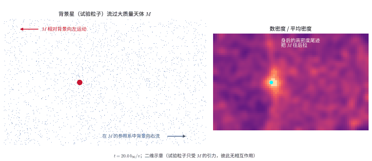

**轨道衰减的时间尺度**：设星系的旋转曲线是平的，圆轨道速度 $v_c$ 为常数，对应密度 $\rho=v_c^2/(4\pi Gr^2)$、$\sigma=v_c/\sqrt2$（$X=1$，方括号约为 0.43）。在半径 $r$ 处做圆周运动的天体受到切向阻力，角动量 $L=Mrv_c$ 减小，

$$
\begin{equation}
\frac{dL}{dt}=Mv_c\frac{dr}{dt}=-0.43\,\frac{GM^2\ln\Lambda}{r}
\;\Longrightarrow\;
t_{\rm fric}=\frac{1.17}{\ln\Lambda}\,\frac{r_i^2v_c}{GM}.
\end{equation}
$$

几个例子：

- **球状星团**：$M=10^6\,M_\odot$、$v_c=200\ \mathrm{km\,s^{-1}}$、$\ln\Lambda\approx8$，从 $r_i=2\ \mathrm{kpc}$ 沉到中心需约 $3\times10^{10}$ 年，从 $1\ \mathrm{kpc}$ 则约 $7\times10^9$ 年。因为 $t_{\rm fric}\propto r_i^2$，只有靠近星系中心的星团能在宇宙年龄内沉入中心，这被认为是星系核星团的一种来源。
- **卫星星系**：卫星星系在宿主的暗物质晕中运动时轨道不断衰减，最终被潮汐瓦解并入宿主（“星系吞噬”）。由于 $t_{\rm fric}\propto1/M$，这一效应对大麦哲伦云这样的大质量卫星最显著。
- **大质量黑洞双星**：星系并合后，两个中心黑洞各自通过动力学摩擦沉向新星系的中心。$M=10^8\,M_\odot$ 的黑洞在 $v_c\approx280\ \mathrm{km\,s^{-1}}$ 的星系中从 $1\ \mathrm{kpc}$ 处下沉只需约 $1.5\times10^8$ 年（取 $\ln\Lambda\approx5$）。两个黑洞靠近到秒差距量级、形成束缚的双星后，周围恒星的密度不足以继续提供有效的摩擦，此后需依靠与恒星的三体弹弓作用、气体等机制继续收缩，直到引力辐射接管，即所谓“最后秒差距问题”[19]。这一演化链条决定了 LISA 等空间引力波探测器能看到的大质量黑洞并合率。

在气体介质中运动的天体也会受到类似的引力尾迹阻力（气体动力学摩擦），超音速运动时阻力同样按 $M^2\rho/v^2$ 变化，只是对数因子不同；亚音速时阻力则比无碰撞背景中弱得多。

### 光线的引力偏折

在牛顿力学中，引力加速度与被吸引物体的质量无关，因此可以把光当作以速度 $c$ 运动的粒子，直接套用上面的结果。对吸引的引力势，双曲线轨道同样满足 $\tan(\theta/2)=GM/(v^2b)$。取 $v=c$，小角度时

$$
\begin{equation}
\theta_{\rm N}\simeq\frac{2GM}{c^2b}.
\end{equation}
$$

对掠过太阳边缘的光线，$b=R_\odot$，得 $\theta_{\rm N}\approx4.2\times10^{-6}\ \mathrm{rad}\approx0.87''$。索尔德纳（J. G. von Soldner）在 1804 年就发表了这一结果 [16]。

广义相对论的预言是它的两倍：

$$
\begin{equation}
\theta_{\rm GR}=\frac{4GM}{c^2b}\approx1.75''.
\end{equation}
$$

多出的一半来自太阳附近空间本身的弯曲，牛顿理论中没有这一项。1919 年，爱丁顿等人利用日全食观测太阳附近恒星的视位置偏移，结果支持了广义相对论的预言 [13]；现代甚长基线射电干涉测量已在约 $10^{-4}$ 的相对精度上验证了这一预言。光线偏折也是引力透镜的物理基础：大质量天体（星系、星系团）偏折背景光源的光线，产生多重像、爱因斯坦环和弧。

### 引力聚焦与俘获截面

考虑小天体以无穷远速度 $v_\infty$ 射向一个半径为 $R$、质量为 $M$ 的天体。若没有引力，只有 $b<R$ 的小天体会撞上它，截面为几何截面 $\pi R^2$。有引力时，轨道向天体弯曲，$b$ 稍大于 $R$ 的小天体也会被“吸”过来撞上（图中两条虚线之间为几何截面）。

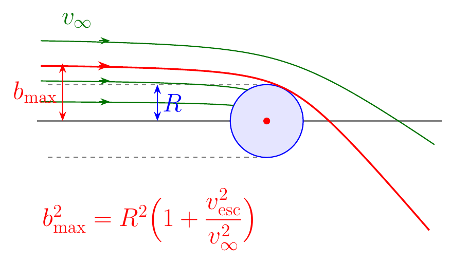

临界轨道（图中红线）恰好在近心点处擦过天体表面，此时速度 $v_p$ 与半径垂直。由角动量守恒和能量守恒，

$$
\begin{equation}
b_{\max}v_\infty=Rv_p,
\qquad
\frac12v_\infty^2=\frac12v_p^2-\frac{GM}{R}.
\end{equation}
$$

消去 $v_p$，并记逃逸速度 $v_{\rm esc}^2=2GM/R$，得到俘获截面

$$
\begin{equation}
\sigma_{\rm cap}=\pi b_{\max}^2=\pi R^2\left(1+\frac{v_{\rm esc}^2}{v_\infty^2}\right).
\end{equation}
$$

括号中的因子称为**引力聚焦因子**。入射速度越慢，聚焦越强。几个例子：

- **小天体撞击地球**：$v_{\rm esc}=11.2\ \mathrm{km\,s^{-1}}$，对 $v_\infty\sim10\ \mathrm{km\,s^{-1}}$ 的近地小行星，聚焦因子约为 2.3，地球的有效“靶面积”是几何截面的两倍多。
- **行星形成中的失控增长**：在原行星盘中，星子间的相对速度很小，聚焦因子可以很大。由于 $v_{\rm esc}^2\propto M/R\propto R^2$，当聚焦主导时 $\sigma_{\rm cap}\propto R^4$，较大的星子吸积得更快、长得更大，即“失控增长”。行星形成理论中常把这一因子写成 $1+2\Theta$，$\Theta$ 称为 Safronov 数 [14]。
- **恒星碰撞**：碰撞率为 $\Gamma=n\sigma v$，平均自由程为 $\lambda=1/(n\sigma)$。在太阳附近，$n\sim0.1\ \mathrm{pc^{-3}}$，$v\sim30\ \mathrm{km\,s^{-1}}$，太阳的 $v_{\rm esc}=618\ \mathrm{km\,s^{-1}}$ 给出聚焦因子约 400，即便如此，太阳与其他恒星相撞的时间仍约为 $5\times10^{17}$ 年，远长于宇宙年龄。但在球状星团核心，$n\sim10^5\ \mathrm{pc^{-3}}$、$v\sim10\ \mathrm{km\,s^{-1}}$，聚焦因子约 4000，每颗恒星的碰撞时间降到约 $10^{11}$ 年；核心中有大量恒星，在星团一生中会发生许多次碰撞。恒星碰撞并合被认为是球状星团中“蓝离散星”的一种形成途径。

### 引力弹弓（借力飞行）

散射的思想也可以用于航天器。航天器飞掠行星的时间远短于行星的公转周期，在此期间可以把行星看作匀速运动，这就成为在行星参考系中的一次散射：航天器沿双曲线轨道运动，进出时的速率都是 $v_\infty$，只是方向转过偏转角 $\delta$。由双曲线几何（与卢瑟福散射中 $\cos\Theta=1/e$ 相同的推导），

$$
\begin{equation}
\sin\frac\delta2=\frac1e,
\qquad
e=1+\frac{r_pv_\infty^2}{GM},
\end{equation}
$$

其中 $r_p$ 为近心距。行星参考系中速度矢量的改变为 $|\Delta\vec v|=2v_\infty\sin(\delta/2)=2v_\infty/e$。

推导：偏转角公式 sin(δ/2) = 1/e

在行星参照系中轨道为 $r=p/(1+e\cos\varphi)$。$r\to\infty$ 时 $\cos\varphi_\infty=-1/e$，入射和出射渐近线的方向角为 $\pm\varphi_\infty$，速度方向转过的角度为 $\delta=2\varphi_\infty-\pi$，所以

$$
\begin{equation*}
\sin\frac\delta2=\sin\left(\varphi_\infty-\frac\pi2\right)=-\cos\varphi_\infty=\frac1e .
\end{equation*}
$$

这与卢瑟福散射中 $\cos\Theta=1/e$ 是同一个关系。偏心率可由近心距表示：吸引势的双曲线满足 $r_p=a(e-1)$，$a=GM/v_\infty^2$，于是 $e=1+r_pv_\infty^2/(GM)$。飞得越近（$r_p$ 越小）、来得越慢（$v_\infty$ 越小），$e$ 越接近 1，偏转越大。

换到太阳参考系，航天器速度为 $\vec v=\vec V_p+\vec v_\infty$，其中 $\vec V_p$ 是行星的公转速度。由于 $|\vec v_\infty|$ 不变，单位质量的动能改变为

$$
\begin{equation}
\Delta\left(\frac12v^2\right)=\vec V_p\cdot\Delta\vec v_\infty.
\end{equation}
$$

所以航天器在太阳系中的能量可以增加，也可以减少：从行星后方（行星运动方向的后侧）飞过，$\Delta\vec v_\infty$ 与 $\vec V_p$ 同向，航天器加速；从前方飞过则减速。能量当然守恒，航天器获得的能量来自行星的公转动能，但由于行星质量巨大，其轨道的变化完全可以忽略。这和网球被迎面而来的球拍弹回后速度大增是同一个道理：在球拍参考系中只是弹性反弹，在地面参考系中却获得了能量。

**数值例子**：木星 $GM_J=1.27\times10^{17}\ \mathrm{m^3\,s^{-2}}$，公转速度 $V_p\approx13\ \mathrm{km\,s^{-1}}$。若航天器以 $v_\infty=10\ \mathrm{km\,s^{-1}}$、在 $r_p=5R_J\approx3.6\times10^5\ \mathrm{km}$ 处飞掠，则 $e\approx1.28$，$\delta\approx103^\circ$，$|\Delta\vec v|\approx16\ \mathrm{km\,s^{-1}}$。这是任何化学火箭都难以直接提供的速度增量。

下面的动画用无量纲参数（$v_\infty=1$，$V_p=1.3$，$e=1.28$，与上面的数值例子相同）同时展示两个参照系：在行星参照系中，航天器沿对称的双曲线进出，速率不变；换到太阳参照系，速度合成后，航天器的速率从 $0.81$ 增加到 $2.17$。

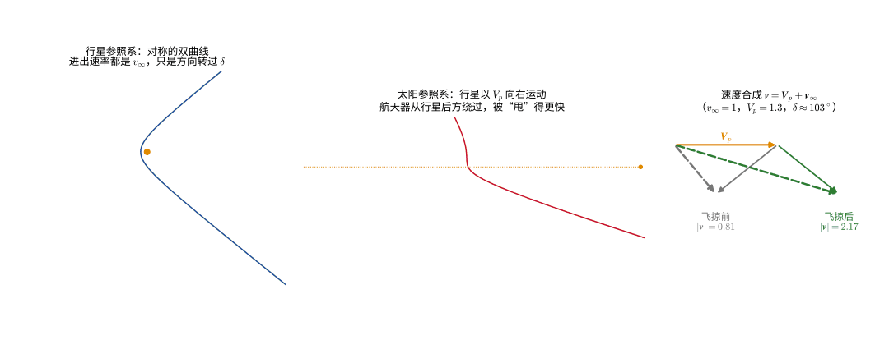

实际任务大量使用这一技术：旅行者 2 号依次借力木星、土星、天王星和海王星；卡西尼号先后借力金星（两次）、地球和木星才到达土星；朱诺号借力地球飞往木星。借力也可以用来减速：帕克太阳探测器通过多次飞掠金星不断降低轨道能量，从而一步步接近太阳 [17]。

<!-- 原 PDF 第 15 页 -->

## 作业

每道题后面有折叠的提示，建议先独立尝试，再展开查看。

1. 考虑两个质量分别为 $m_1$ 和 $m_2$ 的物体，通过牛顿万有引力相互作用，其坐标分别为 $\vec x_1,\vec x_2$，速度分别为 $\vec v_1,\vec v_2$。

   1. 试写出体系的拉格朗日量。
   2. 试推导在两粒子质心系下的拉格朗日量。
   3. 试利用体系的对称性和守恒量，推导出等效单体问题的拉格朗日量和运动方程。
   4. 试求解体系能量 $E<0$ 时的运动方程。

   

   
提示

   这道题是把正文中“两体问题化为单体问题”的完整推导过程重新走一遍：拉格朗日量、质心系变换、有效势、运动方程。可以对照正文中约化质量和有效势的推导检查每一步；第 4 问可以用正文折叠块中的积分，也可以用 Binet 方程。

   

2. 试简述拉格朗日点的物理背景和性质，并标识出太阳-地球系统的拉格朗日点。

   

   
提示

   先估算太阳–地球系统的质量比 $m_\oplus/m_\odot\sim3\times10^{-6}$，代入正文中共线拉格朗日点的近似公式，估算 $L_1,L_2$ 与地球的距离（约为日地距离的 1%）；$L_3$ 用正文的一阶公式，$L_4,L_5$ 与日、地构成等边三角形。再结合“拉格朗日点的实际例子”说明各点的用途。

   

3. **LRL 矢量。** 对吸引势 $V=-\alpha/r$：

   1. 证明 $\vec A=\vec v\times\vec L-\alpha\hat{\vec r}$ 守恒；
   2. 利用 $\vec A\cdot\vec r$ 推出轨道方程，并说明 $\vec A$ 指向近心点、$|\vec A|=\alpha e$；
   3. 证明速度矢量 $\vec v$ 的端点在一个圆上运动（速度图），求圆心和半径；
   4. 若势能再加上一个小的修正 $\delta V=-\beta/r^2$，$\vec A$ 不再守恒。利用[“微扰和摄动理论”](微扰和摄动理论.md)一章的一阶进动公式，求近心点每圈前移的角度。

   

   
提示

   前两问按正文折叠块的思路；第 3 问从 $\vec v\times\vec L=\vec A+\alpha\hat{\vec r}$ 出发，两边再与 $\vec L$ 作叉乘。第 4 问中 $r^2\delta V=-\beta$ 是常数，积分非常简单；结果为正，说明近心点沿运动方向前移。

   

4. **特洛伊小行星的摆动周期。** 利用正文（及折叠推导）中 $L_4$ 附近的特征方程：

   1. 在 $\mu\ll1$ 的条件下求两个振动频率，说明哪一个对应绕 $L_4$ 的缓慢摆动；
   2. 对太阳–木星系统（$\mu\approx9.5\times10^{-4}$，木星公转周期 11.86 年）估算特洛伊小行星绕 $L_4$ 摆动的周期，并与观测值（约 150 年）比较；
   3. 对地–月系统（$\mu\approx0.012$）作同样的估算。

   

   
提示

   $\lambda^2$ 的两个根中，小的那个满足 $\lambda^2\approx-\frac{27}{4}\mu$，摆动周期为公转周期除以 $\sqrt{27\mu/4}$。注意这是小振幅近似，真实的蝌蚪形轨道振幅较大时周期会略有变化。

   

## 参考文献与延伸阅读

### 三体问题与拉格朗日点

1. C. D. Murray and S. F. Dermott, *Solar System Dynamics*, Cambridge University Press, 1999。第 3 章系统讨论受限三体问题、雅可比积分、零速度曲线、希尔球、拉格朗日点的稳定性以及蝌蚪形与马蹄形轨道，最适合天文专业学生阅读。
2. V. Szebehely, *Theory of Orbits: The Restricted Problem of Three Bodies*, Academic Press, 1967。受限三体问题的经典专著。
3. C. G. J. Jacobi, “Sur le mouvement d'un point et sur un cas particulier du problème des trois corps,” *Comptes Rendus de l'Académie des Sciences* **3**, 59–61 (1836)。雅可比积分的原始文献。
4. G. W. Hill, “Researches in the Lunar Theory,” *American Journal of Mathematics* **1**, 5–26 (1878)。引入零速度曲线与希尔问题，并据此讨论月球轨道的稳定性。
5. P. P. Eggleton, “Approximations to the Radii of Roche Lobes,” *The Astrophysical Journal* **268**, 368–369 (1983)，[NASA ADS](https://ui.adsabs.harvard.edu/abs/1983ApJ...268..368E)。洛希瓣等效半径的拟合公式。
6. E. J. Routh, “On Laplace's Three Particles, with a Supplement on the Stability of Steady Motion,” *Proceedings of the London Mathematical Society* **s1-6**, 86–97 (1875)。给出 $L_4,L_5$ 稳定的质量比条件。
7. M. Connors, P. Wiegert and C. Veillet, “Earth's Trojan Asteroid,” *Nature* **475**, 481–483 (2011)。第一颗地球特洛伊小行星 2010 TK7 的确认。
8. T. Santana-Ros et al., “Orbital Stability Analysis and Photometric Characterization of the Second Earth Trojan Asteroid 2020 XL5,” *Nature Communications* **13**, 447 (2022)。第二颗地球特洛伊小行星的确认。

### 散射问题

9. H. Goldstein, C. Poole and J. Safko, *Classical Mechanics*, 3rd ed., Addison-Wesley, 2002，第 3.10–3.11 节。散射截面、卢瑟福散射以及质心系与实验室系的换算。
10. L. D. Landau and E. M. Lifshitz, *Mechanics*, 3rd ed., Butterworth-Heinemann, 1976，§17–20。弹性碰撞、散射截面、卢瑟福公式和小角度散射，推导简洁。
11. H. Geiger and E. Marsden, “On a Diffuse Reflection of the α-Particles,” *Proceedings of the Royal Society A* **82**, 495–500 (1909)。发现 α 粒子的大角度散射。
12. E. Rutherford, “The Scattering of α and β Particles by Matter and the Structure of the Atom,” *Philosophical Magazine* **21**, 669–688 (1911)。卢瑟福散射公式与原子核模型的原始文献。
13. F. W. Dyson, A. S. Eddington and C. Davidson, “A Determination of the Deflection of Light by the Sun's Gravitational Field, from Observations Made at the Total Eclipse of May 29, 1919,” *Philosophical Transactions of the Royal Society A* **220**, 291–333 (1920)。
14. V. S. Safronov, *Evolution of the Protoplanetary Cloud and Formation of the Earth and the Planets*, Nauka, Moscow, 1969；英译本 NASA TT F-677, 1972。引力聚焦与星子吸积理论的经典著作。
15. J. Binney and S. Tremaine, *Galactic Dynamics*, 2nd ed., Princeton University Press, 2008，第 1.2 节、第 7 章与第 8.1 节。冲量近似、二体弛豫、库仑对数和动力学摩擦（式 8.13 给出轨道衰减时间）。
16. J. G. von Soldner, “Über die Ablenkung eines Lichtstrals von seiner geradlinigen Bewegung, durch die Attraktion eines Weltkörpers, an welchem er nahe vorbei geht,” *Berliner Astronomisches Jahrbuch*, 161–172 (1804)。牛顿力学框架下光线引力偏折的最早计算。
17. H. D. Curtis, *Orbital Mechanics for Engineering Students*, 4th ed., Butterworth-Heinemann, 2020，第 8 章。行星际轨道与行星借力飞行的工程处理。
18. S. Chandrasekhar, “Dynamical Friction. I. General Considerations: the Coefficient of Dynamical Friction,” *The Astrophysical Journal* **97**, 255–262 (1943)，[NASA ADS](https://ui.adsabs.harvard.edu/abs/1943ApJ....97..255C)。动力学摩擦的原始文献。
19. M. C. Begelman, R. D. Blandford and M. J. Rees, “Massive Black Hole Binaries in Active Galactic Nuclei,” *Nature* **287**, 307–309 (1980)。大质量黑洞双星从动力学摩擦到引力辐射的演化阶段。
