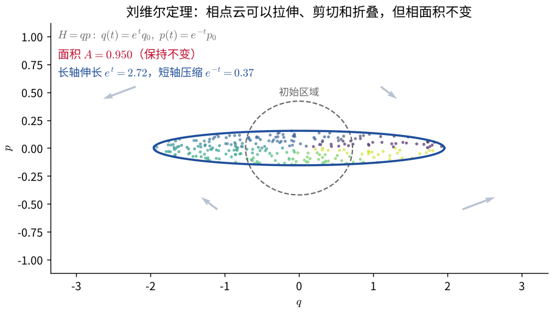

<!--
草稿（2026-11-13，第一版）：新专题《从哈密顿力学到统计力学》，与《辛几何与哈密顿力学》《哈密顿约束与自由度》并列，接在《哈密顿力学》之后。
定位：不是统计力学教材，只讲“力学为统计力学准备了什么、没有准备什么”。刘维尔定理、时间反演对称性的证明留在《哈密顿力学》，相混合留在《无碰撞粒子体系》，本章只引用。
记号：泊松括号 [f,g]、求和约定、自由度数 s 同《哈密顿力学》；dΓ 为相体积元，𝒱(E) 为等能面所围相体积，g(E)=d𝒱/dE；
k_B 为玻尔兹曼常数，β=1/(k_B T)；本章 S 表示熵（不是作用量），T 表示温度（不是周期），动能记作 K；
φ^t 为哈密顿流（同《动力学系统与混沌》），𝒯 为时间反演 (q,p)→(q,−p)；π_A 为宏观态 A 的平衡概率，W 为转移概率。
待办：(1) 只借用了《哈密顿力学》的一幅现有动画，文中用注释标出了三处建议新配图的位置；(2) 参考文献凭记忆列出，定稿前需逐条核对；
(3) 定稿后在《哈密顿力学》（刘维尔定理、绝热不变量、时间反演三处）、《无碰撞粒子体系》《辛几何与哈密顿力学》中加回引。
-->

# 从哈密顿力学到统计力学

**——从一条轨道到一团相点**

> 本章是选读专题，建立在[“哈密顿力学”](哈密顿力学.md)一章的基础上，用到其中的相空间、泊松括号、时间反演对称性、绝热不变量、作用量–角变量和刘维尔定理（包括刘维尔方程）。[“无碰撞粒子体系”](无碰撞粒子体系.md)一章的分布函数、金斯定理和相混合，[“辛几何与哈密顿力学”](辛几何与哈密顿力学.md)一章的相格和蛙跳法，[“动力学系统与混沌”](动力学系统与混沌.md)与[“KAM 定理”](KAM定理.md)两章关于混沌和不变环面的结论，也会在这里汇合。本章不是统计力学的教材，它只回答一个问题：力学为统计力学准备了什么，又有什么是力学给不了的。
>
> 本章中 $S$ 表示熵，$T$ 表示温度，动能记作 $K$。

力学的理想是：给定初始条件，算出此后的全部运动。对一颗行星，这做得到。对一升空气里的 $10^{22}$ 个分子，或者一个星系里的 $10^{11}$ 颗恒星，这既做不到，也没有必要：我们关心的是温度、压强、速度弥散这样的量，而不是每个粒子在哪里。

统计力学换了一个问题。它不再追踪相空间中的一个点，而是研究一团相点的分布。这一步跨越看似很大，但需要的几乎所有工具，哈密顿力学都已经准备好了：

| 哈密顿力学中的结论 | 在统计力学中的角色 |
| --- | --- |
| 相空间、正则变量 | 概率分布定义在哪里 |
| 刘维尔定理 | 相体积可以用来度量“状态的多少”，且不随时间改变 |
| 运动积分、泊松括号 | 平衡分布只能依赖哪些量 |
| 绝热不变量 | 熵，以及准静态过程 |
| 时间反演对称性 | 细致平衡 |
| 可积与混沌 | 系统能否、以及如何趋向平衡 |

同样重要的是力学给不了的东西。力学不包含概率，“每个微观状态等可能”是一条附加的假设；力学方程在时间反演下不变，宏观世界却有明确的时间方向。本章会明确指出这些地方。

本章的逻辑是：先把“一团相点”的演化写成刘维尔方程；问平衡分布是什么样的，得到微正则系综和正则系综；说明相体积就是熵，绝热不变量就是准静态过程中熵的守恒；讨论系统为什么会趋向平衡，以及为什么这与可逆的力学不矛盾；由时间反演对称性导出细致平衡，并看它在天体物理中的各种面目；最后看一个现代的应用：哈密顿蒙特卡罗。

## 系综与刘维尔方程

### 两种相空间

对 $N$ 个粒子组成的系统，有两种相空间可用。

- **$\Gamma$ 空间**：整个系统的 $2s$ 维相空间（$s=3N$）。系统在某一时刻的完整状态是其中的**一个点**。本章主要在这里工作。
- **$\mu$ 空间**：单个粒子的 6 维相空间 $(\boldsymbol x,\boldsymbol v)$。系统是其中的 $N$ 个点，用分布函数 $f(\boldsymbol x,\boldsymbol v,t)$ 描述。[“无碰撞粒子体系”](无碰撞粒子体系.md)一章用的就是它。

两者的关系是：$f$ 是把 $\Gamma$ 空间中的分布对其余 $N-1$ 个粒子的坐标和动量积分后得到的。如果粒子之间没有关联，每个粒子只感受到其余粒子产生的平滑平均场，这样积分的结果就是无碰撞玻尔兹曼方程；粒子之间的近距离遭遇则带来碰撞项。

### 系综

我们永远无法确切知道一个宏观系统的微观状态。吉布斯（J. W. Gibbs）的办法是：设想大量宏观条件相同、微观状态各异的系统副本，称为**系综**（ensemble）。它们在 $\Gamma$ 空间中是一团相点，用密度 $\rho(q,p,t)$ 描述，归一化为

$$
\begin{equation}
\int\rho(q,p,t)\,d\Gamma=1,\qquad d\Gamma=dq_1\cdots dq_s\,dp_1\cdots dp_s .
\end{equation}
$$

$\rho\,d\Gamma$ 是系统处在相体积元 $d\Gamma$ 内的概率。任何力学量 $A(q,p)$ 的宏观观测值，取为它的**系综平均**

$$
\begin{equation}
\langle A\rangle=\int A(q,p)\,\rho(q,p,t)\,d\Gamma .
\end{equation}
$$

由于正则变换保持 $d\Gamma$（见[“哈密顿力学”](哈密顿力学.md#刘维尔定理)一章），这些定义与正则变量的选取无关。这一点并不平凡：如果换用 $(q,\dot q)$ 作变量，“体积元”在不同坐标系中一般并不相同。

### 刘维尔方程

每个副本都按哈密顿方程运动。[“哈密顿力学”](哈密顿力学.md#刘维尔定理)一章已经证明，哈密顿流不可压缩，相密度沿每条轨道不变，即**刘维尔方程**

$$
\begin{equation}
\frac{\partial\rho}{\partial t}=-[\rho,H]=[H,\rho].
\end{equation}
$$

这是统计力学的基本运动方程，地位相当于量子统计中密度矩阵的方程 $i\hbar\,\partial\hat\rho/\partial t=[\hat H,\hat\rho]$；二者通过泊松括号与对易子的对应联系起来。

由它可以得到平均值的演化：

$$
\begin{equation}
\frac{d\langle A\rangle}{dt}=\bigl\langle[A,H]\bigr\rangle ,
\end{equation}
$$

即“先求力学量的变化率再平均”与“先平均再求变化率”是一回事。

推导：平均值的演化

设 $A$ 不显含时间，

$$
\begin{equation*}
\frac{d\langle A\rangle}{dt}=\int A\,\frac{\partial\rho}{\partial t}\,d\Gamma=-\int A\,[\rho,H]\,d\Gamma .
\end{equation*}
$$

由莱布尼茨法则，$[A\rho,H]=A[\rho,H]+\rho[A,H]$。而任何函数 $F$ 与 $H$ 的泊松括号 $[F,H]$ 是 $F$ 沿相空间速度场的方向导数，由于速度场的散度为零，它可以写成散度的形式，对整个相空间的积分为零（设 $\rho$ 在无穷远处足够快地趋于零）。所以 $\int A[\rho,H]\,d\Gamma=-\int\rho\,[A,H]\,d\Gamma$，代入即得结论。

## 平衡系综

### 定态分布只能依赖运动积分

平衡态的宏观性质不随时间变化，所以 $\partial\rho/\partial t=0$，即

$$
\begin{equation}
[\rho,H]=0 .
\end{equation}
$$

这正是“$\rho$ 是运动积分”的条件。于是**定态分布只能是运动积分的函数**。[“无碰撞粒子体系”](无碰撞粒子体系.md#稳态分布与金斯定理)一章的金斯定理是同一个结论在 $\mu$ 空间中的版本。

但运动积分可以有很多，平衡分布究竟依赖其中哪些？这里要用到一个力学之外的论据。把一个宏观系统分成两个宏观的部分，它们之间的相互作用只发生在界面附近，在短时间内可以忽略，两部分在统计上近似独立：$\rho_{12}=\rho_1\rho_2$，即

$$
\begin{equation}
\ln\rho_{12}=\ln\rho_1+\ln\rho_2 .
\end{equation}
$$

所以 $\ln\rho$ 不仅是运动积分，而且是**可加的**运动积分。一般的力学系统只有七个可加的运动积分：能量、动量的三个分量和角动量的三个分量（见[“最小作用量原理”](最小作用量原理.md#对称性和守恒定律)一章）。对装在静止容器中的系统，动量和角动量不守恒，只剩下能量：

$$
\begin{equation}
\rho=\rho(H).
\end{equation}
$$

这是一个很强的结论：平衡态的统计性质只通过能量依赖于微观状态。（对孤立的转动天体，角动量也必须保留，分布依赖 $H-\boldsymbol\Omega\cdot\boldsymbol L$，正是[“哈密顿力学”](哈密顿力学.md#例电磁场中的带电粒子)一章中转动参考系的哈密顿量。）

### 微正则系综

对能量为 $E$ 的孤立系统，相点只能在等能面 $H=E$ 上。最简单的定态分布是在等能面上“均匀”：

$$
\begin{equation}
\rho(q,p)=\frac{\delta\bigl(H(q,p)-E\bigr)}{g(E)},
\qquad
g(E)=\int\delta(H-E)\,d\Gamma=\frac{d\mathcal V}{dE},
\end{equation}
$$

其中 $\mathcal V(E)=\int_{H<E}d\Gamma$ 是等能面所围的相体积，$g(E)$ 称为**态密度**。这称为**微正则系综**。它背后是统计力学的基本假设：

> **等概率假设**：孤立系统处于平衡态时，等能面附近相体积相等的区域有相等的概率。

力学为这个假设做了两件事。第一，它使假设有确切的含义：相体积在正则变换下不变，所以“相体积相等”不依赖坐标的选取。第二，它保证假设前后自洽：由刘维尔定理，今天按相体积均匀的分布，明天仍然按相体积均匀。但力学**不能证明**这个假设；为什么真实系统会呈现这种分布，是[“趋向平衡”](#趋向平衡粗粒化混合与各态历经)一节的话题。

**例：一个自由度。** 由[“哈密顿力学”](哈密顿力学.md#绝热不变量)一章，等能线所围的面积是 $\mathcal V=2\pi I$，而 $\partial I/\partial E=1/\omega$，所以

$$
\begin{equation}
g(E)=\frac{d\mathcal V}{dE}=\frac{2\pi}{\omega(E)}=\text{运动周期} .
\end{equation}
$$

态密度就是周期。进一步，微正则分布在 $q$ 附近 $dq$ 内的概率正比于相点经过这一段所用的时间 $dq/|\dot q|$：相点在走得慢的地方出现的概率大。对一个自由度，“按相体积均匀”与“按停留时间加权”完全一致，系综平均等于时间平均。

### 正则系综

实际的系统很少是孤立的，更常见的情形是它与一个大得多的环境（热库）交换能量。把系统和热库合起来看作一个孤立的整体，对它用微正则系综，就得到系统本身的分布：

$$
\begin{equation}
\rho(q,p)=\frac{e^{-\beta H(q,p)}}{Z},
\qquad
Z=\int e^{-\beta H}\,d\Gamma,
\qquad
\beta=\frac{1}{k_{\rm B}T}.
\end{equation}
$$

这称为**正则系综**，$Z$ 称为配分函数，$T$ 是热库的温度。

推导：从微正则系综到正则系综

设系统的哈密顿量为 $H$，热库的态密度为 $g_{\rm R}$，总能量为 $E_0$，系统与热库之间的相互作用能可以忽略。整体按微正则分布，所以系统处在相点 $(q,p)$ 附近的概率，正比于此时热库可以占据的相体积：

$$
\begin{equation*}
\rho(q,p)\propto g_{\rm R}\bigl(E_0-H(q,p)\bigr).
\end{equation*}
$$

热库远大于系统，$H\ll E_0$。把 $\ln g_{\rm R}$（而不是 $g_{\rm R}$ 本身，因为它随能量变化极快）展开到一阶：

$$
\begin{equation*}
\ln g_{\rm R}(E_0-H)\approx\ln g_{\rm R}(E_0)-\beta H,
\qquad
\beta\equiv\frac{d\ln g_{\rm R}}{dE}\bigg|_{E_0}.
\end{equation*}
$$

于是 $\rho\propto e^{-\beta H}$。$\beta$ 只由热库决定，与系统是什么无关；两个系统与同一个热库接触时有相同的 $\beta$，这正是“温度相等”的含义。下一节会看到 $\beta=1/k_{\rm B}T$ 与热力学温度一致。

正则分布也可以直接从上一小节的论证读出：$\ln\rho$ 是可加运动积分的线性函数，$\ln\rho=-\ln Z-\beta H$。

**例：麦克斯韦分布。** 对理想气体，$H=\sum p^2/2m$，每个动量分量的分布是独立的高斯分布 $\propto e^{-p_x^2/2mk_{\rm B}T}$，这就是麦克斯韦速度分布，$\langle p_x^2/2m\rangle=\frac12k_{\rm B}T$。

**例：作用量–角变量中的谐振子。** [“哈密顿力学”](哈密顿力学.md#例几个正则变换)一章把谐振子变换到 $H=\omega I$。由于正则变换保持面积，$dq\,dp=d\theta\,dI$，正则分布成为

$$
\begin{equation}
\rho(\theta,I)=\frac{\beta\omega}{2\pi}\,e^{-\beta\omega I}.
\end{equation}
$$

它对角变量是均匀的，对作用量是指数分布，$\langle I\rangle=k_{\rm B}T/\omega$，即 $\langle E\rangle=k_{\rm B}T$。“相位完全随机，作用量按玻尔兹曼因子分布”：这是作用量–角变量在统计力学中的典型用法。

### 能均分定理与位力定理

正则系综下有一个一般的恒等式。记 $x_a$ 为任意一个正则变量（某个 $q_i$ 或 $p_i$），则

$$
\begin{equation}
\left\langle x_a\frac{\partial H}{\partial x_b}\right\rangle=\delta_{ab}\,k_{\rm B}T .
\end{equation}
$$

推导：分部积分

利用 $\dfrac{\partial H}{\partial x_b}e^{-\beta H}=-\dfrac1\beta\dfrac{\partial}{\partial x_b}e^{-\beta H}$，对 $x_b$ 分部积分：

$$
\begin{equation*}
\int x_a\frac{\partial H}{\partial x_b}\,e^{-\beta H}\,d\Gamma
=-\frac1\beta\int x_a\frac{\partial e^{-\beta H}}{\partial x_b}\,d\Gamma
=\frac1\beta\int\frac{\partial x_a}{\partial x_b}\,e^{-\beta H}\,d\Gamma
=\frac{\delta_{ab}}{\beta}\,Z .
\end{equation*}
$$

边界项为零的条件是 $e^{-\beta H}$ 在 $x_b$ 的取值范围两端为零：对动量，动能在 $|p|\to\infty$ 时趋于无穷；对坐标，需要有容器壁或束缚势。除以 $Z$ 即得结论。

取 $x_a=x_b=p_i$：$\langle p_i\,\partial H/\partial p_i\rangle=\langle p_i\dot q_i\rangle=k_{\rm B}T$（不对 $i$ 求和）。对通常的动能，这是说每个自由度的平均动能为 $\frac12k_{\rm B}T$，即**能均分定理**。取 $x_a=x_b=q_i$：$\langle q_i\,\partial H/\partial q_i\rangle=k_{\rm B}T$。两式对所有自由度求和后相等：

$$
\begin{equation}
2\langle K\rangle=\left\langle\sum_iq_i\frac{\partial V}{\partial q_i}\right\rangle .
\end{equation}
$$

这正是[“最小作用量原理”](最小作用量原理.md#位力定理维里定理)一章的位力定理，只是那里的平均是对时间的平均，这里是对系综的平均。对这个特定关系，两种平均给出同样的结果；要把等价性推广到一般可观测量，还要考察[后面](#趋向平衡粗粒化混合与各态历经)要讨论的各态历经条件。

天文学中，这两个定理合起来给出“位力温度”：气体在质量为 $M$、半径为 $R$ 的引力势阱中达到平衡时，$k_{\rm B}T\sim GMm_{\rm p}/R$。星系团中温度高达 $10^7$–$10^8\,\mathrm K$ 的 X 射线气体就是这样被加热的，它的温度与星系的速度弥散 $\sigma$ 之间有 $k_{\rm B}T\sim m_{\rm p}\sigma^2$。

### 自引力系统是例外

上面的推导有一个不显眼的前提：系统可以分成近似独立的部分，$e^{-\beta H}$ 可以归一化。引力是长程力，两条都不满足。

对处于位力平衡的自引力系统，$2K+W=0$（$W$ 为引力势能），总能量 $E=K+W=-K$。若把 $K=\frac32Nk_{\rm B}T$ 当作温度的定义，则

$$
\begin{equation}
E=-\frac32Nk_{\rm B}T,\qquad C=\frac{dE}{dT}=-\frac32Nk_{\rm B}<0 .
\end{equation}
$$

**自引力系统的热容是负的**：失去能量，反而变热。恒星向外辐射能量时收缩升温，直到点燃核反应；人造卫星受到大气阻力，轨道下降，速度反而增大；球状星团的核心把能量传给外层，自己越缩越密、越来越“热”（称为引力热灾变）。热容为负的系统无法与热库达到稳定的平衡，所以不存在正则系综；[“无碰撞粒子体系”](无碰撞粒子体系.md#例等温球与平坦旋转曲线)一章中等温球质量发散，是同一个困难的另一种表现。

因此，星系和暗物质晕的稳态不是热平衡态。它们是金斯定理意义下的定态 $f(E,L,\ldots)$，具体形式由形成历史（相混合与剧烈弛豫）决定，而不是由一个温度决定；此后再由二体弛豫极其缓慢地演化。这是引力系统的统计力学与普通气体最根本的区别。

## 相体积、熵与绝热不变量

### 熵就是相体积的对数

[“辛几何与哈密顿力学”](辛几何与哈密顿力学.md#面积与量子相格)一章指出，每个量子态占据相体积 $h^s$。所以能量不超过 $E$ 的微观状态数是 $\mathcal V(E)/h^s$。玻尔兹曼把熵定义为状态数的对数：

$$
\begin{equation}
S(E,\lambda)=k_{\rm B}\ln\frac{\mathcal V(E,\lambda)}{h^s},
\end{equation}
$$

其中 $\lambda$ 代表体积等外部参数。（对宏观系统，用等能面所围的体积 $\mathcal V$，还是用等能面附近一薄层的体积 $g\,\delta E$，得到的熵只差可以忽略的项。）温度和压强由它的偏导数定义：

$$
\begin{equation}
\frac1T=\frac{\partial S}{\partial E},\qquad\frac PT=\frac{\partial S}{\partial V}.
\end{equation}
$$

例：由相体积得到理想气体的状态方程

$N$ 个质量为 $m$ 的自由粒子装在体积为 $V$ 的容器中，$H=\sum_{i=1}^{3N}p_i^2/2m$。条件 $H<E$ 对坐标没有限制，每个粒子贡献因子 $V$；对动量，它是 $3N$ 维空间中半径为 $\sqrt{2mE}$ 的球，体积正比于半径的 $3N$ 次方。所以

$$
\begin{equation*}
\mathcal V(E,V)=C_N\,V^N\,(2mE)^{3N/2},
\qquad
S=Nk_{\rm B}\ln V+\frac32Nk_{\rm B}\ln E+\text{常数},
\end{equation*}
$$

$C_N$ 是只依赖 $N$ 的常数。求偏导：

$$
\begin{equation*}
\frac1T=\frac{\partial S}{\partial E}=\frac{3Nk_{\rm B}}{2E}\ \Longrightarrow\ E=\frac32Nk_{\rm B}T,
\qquad
\frac PT=\frac{\partial S}{\partial V}=\frac{Nk_{\rm B}}{V}\ \Longrightarrow\ PV=Nk_{\rm B}T .
\end{equation*}
$$

理想气体的内能和状态方程，完全由相体积如何随 $E$ 和 $V$ 变化决定。同时可见 $\beta=d\ln g/dE\approx3N/2E=1/k_{\rm B}T$，与上一节正则系综中的 $\beta$ 一致。

### 绝热不变量：准静态过程中熵不变

[“哈密顿力学”](哈密顿力学.md#绝热不变量)一章证明：一个自由度的系统，参数缓慢变化时，作用量 $I$——也就是等能线所围的面积 $\mathcal V=2\pi I$——保持不变。这个结论可以推广到多自由度：只要运动能够遍及整个等能面，参数缓慢变化时，等能面所围的相体积 $\mathcal V(E,\lambda)$ 是绝热不变量（赫兹，1910）。

用熵的语言说：

> **参数无限缓慢地变化（准静态绝热过程）时，熵不变。**

热力学中“可逆绝热过程是等熵过程”的力学根源就在这里。那一章推导的出发点

$$
\begin{equation}
\frac{dE}{dt}=\left\langle\frac{\partial H}{\partial\lambda}\right\rangle\dot\lambda
\end{equation}
$$

则是绝热过程的热力学第一定律：能量的改变等于外界通过改变参数所做的功，$\langle\partial H/\partial\lambda\rangle$ 是与 $\lambda$ 共轭的广义力。取 $\lambda$ 为体积，$P=-\langle\partial H/\partial V\rangle=-(\partial E/\partial V)_S$。

反过来，若参数变化得不够慢，绝热不变性被破坏，相点云会扩散到更大的相体积中。熵只增不减，等号仅在准静态时成立。

例：盒子里的粒子与绝热方程

质量为 $m$ 的粒子在长度为 $L$ 的一维盒子里来回运动，动量大小为 $p$。相轨道是矩形，作用量

$$
\begin{equation*}
I=\frac{1}{2\pi}\oint p\,dq=\frac{pL}{\pi},
\qquad
E=\frac{p^2}{2m}=\frac{\pi^2I^2}{2mL^2}.
\end{equation*}
$$

缓慢移动器壁时 $I$ 不变，所以 $p\propto1/L$，$E\propto L^{-2}$。粒子对器壁的平均作用力为

$$
\begin{equation*}
F=-\left(\frac{\partial E}{\partial L}\right)_I=\frac{2E}{L}.
\end{equation*}
$$

对 $N$ 个这样的粒子，$E=\frac12Nk_{\rm B}T$，于是 $FL=Nk_{\rm B}T$，这是一维理想气体的状态方程；而绝热过程中 $F\propto E/L\propto L^{-3}$，即 $FL^3=$ 常数。三维立方盒子中每个方向各有 $p_iL$ 不变，$E\propto L^{-2}=V^{-2/3}$，$P\propto E/V$，得到

$$
\begin{equation*}
PV^{5/3}=\text{常数},
\end{equation*}
$$

正是单原子理想气体的绝热方程。顺便指出，令 $I=n\hbar$ 就得到 $E_n=n^2\pi^2\hbar^2/(2mL^2)$，是无限深方势阱的精确能级。

**例：膨胀的宇宙。** 上面的例子可以粗略地搬到宇宙学：把宇宙想象成一个尺度随标度因子 $a(t)$ 缓慢增大的盒子，粒子的动量满足 $p\propto1/a$。对非相对论气体，温度正比于 $\langle p^2\rangle$，所以 $T\propto a^{-2}$；对光子，能量 $E=pc$，所以辐射温度 $T\propto a^{-1}$。这个图像虽然粗略，给出的标度是正确的：它们正是宇宙微波背景辐射和（退耦之后的）重子气体的冷却规律。

绝热不变量在星系动力学中也有直接的应用。若星系中心的质量缓慢增长（重子气体冷却沉降，或中心黑洞生长），暗物质和恒星轨道的作用量保持不变，由此可以算出晕的“绝热收缩”。带电粒子的磁矩守恒（“哈密顿力学”一章的磁镜）是另一个例子。

## 趋向平衡：粗粒化、混合与各态历经

到这里，我们只描述了平衡态是什么样的，还没有回答系统为什么会走向平衡态。这是力学与统计力学之间最微妙的地方。

### 一个困难：细粒化的熵不变

吉布斯把非平衡分布的熵定义为

$$
\begin{equation}
S_{\rm G}[\rho]=-k_{\rm B}\int\rho\ln\rho\,d\Gamma .
\end{equation}
$$

对平衡分布，它与上一节的熵一致。但刘维尔方程立刻给出一个令人不安的结论：

$$
\begin{equation}
\frac{dS_{\rm G}}{dt}=0 .
\end{equation}
$$

推导：吉布斯熵守恒

$$
\begin{equation*}
\frac{d}{dt}\int\rho\ln\rho\,d\Gamma=\int(\ln\rho+1)\frac{\partial\rho}{\partial t}\,d\Gamma=-\int(\ln\rho+1)\,[\rho,H]\,d\Gamma=-\int[\rho\ln\rho,\,H]\,d\Gamma=0 .
\end{equation*}
$$

第三个等号用了泊松括号的链式法则 $[F(\rho),H]=F'(\rho)[\rho,H]$，取 $F=\rho\ln\rho$；最后一步与前面“平均值的演化”中的理由相同，$[F,H]$ 对全相空间的积分为零。事实上，由于 $\rho$ 沿轨道不变、相体积守恒，$\rho$ 的任何函数的积分都不随时间改变。

严格按照力学，熵永远不会增加。

### 出路：粗粒化与混合

出路在[“哈密顿力学”](哈密顿力学.md#刘维尔定理)一章已经埋下：刘维尔定理只保证相体积不变，不保证形状不变。

一团初始时很紧凑的相点，会被拉伸、卷绕成越来越细的丝。它占据的相体积没有变，但这些细丝逐渐伸展到等能面上各处。任何实际的观测都只有有限的分辨率，只能看到相空间小格子内的平均密度，称为**粗粒化**分布 $\bar\rho$。细丝的宽度一旦小于格子的尺寸，$\bar\rho$ 就与均匀分布无从区分。用 $\bar\rho$ 计算的熵确实增加了：

$$
\begin{equation}
S_{\rm G}[\bar\rho(t)]\ \ge\ S_{\rm G}[\rho(t)]=S_{\rm G}[\rho(0)] .
\end{equation}
$$

（不等号来自 $-\rho\ln\rho$ 是凹函数：取平均只会使熵增大。）

<!-- 建议配图 1：粗粒化熵随时间的增长。数值实验：单摆的一团相点（可沿用《辛几何》图 2 的设置），用固定网格统计 −Σ P ln P 随时间的变化，趋于饱和。 -->

[“无碰撞粒子体系”](无碰撞粒子体系.md#无碰撞情形)一章的**相混合**就是这一机制最简单的形式：不同轨道频率不同，相点云被卷成螺旋，粗粒化分布趋于平滑，细粒化分布函数却始终守恒。那里细丝的宽度随时间按 $1/t$ 变细。若运动是混沌的（[“动力学系统与混沌”](动力学系统与混沌.md#拉伸与折叠伯努利移位)一章的拉伸与折叠），细丝按 $e^{-\lambda_1t}$ 指数变细，混合要快得多，李雅普诺夫时间给出了趋向平衡的最短时间尺度。

### 各态历经假设

考虑两个互不耦合的谐振子，固定总能量 $E=E_1+E_2$。在这个能量壳上取微正则系综，哈密顿流保持该分布。可是任选一条轨道，$E_1$ 和 $E_2$ 分别守恒，它不会访问另一种能量分配。由此可见，系综随时间不变，还不足以用单条轨道的时间平均代替系综平均。**各态历经假设**（ergodic hypothesis）说：对几乎所有初始条件，力学量沿一条轨道的长时间平均等于它在等能面上的微正则平均，

$$
\begin{equation}
\lim_{\tau\to\infty}\frac1\tau\int_0^\tau A\bigl(q(t),p(t)\bigr)\,dt=\langle A\rangle_{\text{微正则}} .
\end{equation}
$$

本课程已有的结论，正好给出这个假设成立与否的两个极端：

- **可积系统不是各态历经的。** 轨道被限制在不变环面上，只能到达等能面的一小部分；时间平均等于环面上的平均（[“KAM 定理”](KAM定理.md#周期运动与准周期运动)一章），而不是等能面上的平均。这时定态分布依赖全部作用量，$\rho=\rho(I_1,\ldots,I_s)$，而不只是 $H$。
- **近可积系统一般也不是。** KAM 定理说，小扰动下大多数环面保留下来。费米等人 1955 年的数值实验（FPUT）原本想观察能量均分，看到的却是近乎周期的回归，原因就在这里。

那么统计力学为什么对普通气体如此成功？粗略地说：KAM 定理所要求的扰动上限随自由度数增加而急剧减小，对宏观系统已经没有实际意义；分子之间的碰撞使运动高度混沌，李雅普诺夫时间只有碰撞间隔的量级。严格的证明只对少数模型（如西奈台球）做到了，对一般系统，这至今仍是一条假设。星系则是另一种情形：恒星轨道大多是规则的，所以星系动力学必须保留第三积分，而不能直接使用 $\rho(H)$。

### 回归与可逆：两个佯谬

力学的两个基本性质，似乎都与熵增加相矛盾。

**庞加莱回归定理。** 设运动限制在相空间的一个有限体积的区域内（例如能量有限的容器中的气体）。则对几乎所有初始条件，系统在足够长的时间之后会回到任意接近初始状态的地方，并且这样的回归会发生无穷多次。

证明：只用到相体积守恒

记 $D$ 为运动所在的有限体积区域，$\phi$ 为经过固定时间 $\tau$ 的演化映射，它把 $D$ 映到自身并保持体积。任取 $D$ 中体积不为零的小区域 $A$，记 $B$ 为 $A$ 中“离开后再也不回到 $A$”的点的集合。

考虑 $B$ 的各次原像 $B,\ \phi^{-1}(B),\ \phi^{-2}(B),\ldots$ 它们两两不相交：若某点 $x$ 同时属于 $\phi^{-m}(B)$ 和 $\phi^{-n}(B)$（$m<n$），则 $y=\phi^m(x)\in B$，而 $\phi^{n-m}(y)=\phi^n(x)\in B\subset A$，这与 $y$ 永不返回 $A$ 矛盾。

这些集合体积都等于 $B$ 的体积（体积守恒），又两两不相交，且都在体积有限的 $D$ 内。无穷多个体积相同、互不重叠的集合要装进有限的体积，只能是体积为零。所以 $A$ 中几乎所有的点都会返回 $A$。

策梅洛（E. Zermelo）在 1896 年据此质疑：如果气体迟早会回到初始状态，熵怎么可能单调增加？玻尔兹曼的回答是时间尺度。让 $N$ 个分子全部回到容器左半边的概率是 $2^{-N}$，等待时间约为碰撞间隔的 $2^N$ 倍。$N=100$ 时已经是 $10^{20}$ 秒的量级，远超宇宙年龄（约 $4\times10^{17}$ 秒）；对 $10^{22}$ 个分子，这个时间没有任何物理意义。回归是存在的，但永远观察不到。

**洛施密特佯谬。** 由[时间反演对称性](哈密顿力学.md#时间反演对称性)，把一个熵增加过程末态所有的动量反向，系统就会原路返回，熵随之减小。既然每一个熵增加的运动都对应一个熵减小的运动，为什么我们只看到前者？

回答在于初始条件。那些会使熵减小的状态极其特殊：它们的粗粒化分布看起来是均匀的，细丝之间却藏着精确的关联，恰好能让细丝重新聚拢。这样的状态在相空间中占的体积微乎其微，任何微小的扰动都会破坏它们。从一个低熵的初态出发，绝大多数微观状态都走向熵增加。所以**时间的方向不来自运动方程，而来自初始条件**；归根结底，来自宇宙早期处于一个熵极低的状态。

## 时间反演与细致平衡

### 微观可逆性的统计表述

[“哈密顿力学”](哈密顿力学.md#时间反演对称性)一章证明：若 $H(q,-p)=H(q,p)$，则把一个解的时间倒转、动量反向，得到的仍是解。记时间反演变换为 $\mathcal T(q,p)=(q,-p)$，哈密顿流为 $\phi^t$，这个结论可以写成

$$
\begin{equation}
\mathcal T\,\phi^{t}\,\mathcal T=\phi^{-t} :
\end{equation}
$$

先反演动量，演化时间 $t$，再反演动量，等于倒退时间 $t$。

现在把相空间划分成许多小区域，每个区域代表一个可以在宏观上分辨的状态，记作 $A,B,\ldots$。设系统处于平衡态，分布为 $\rho_{\rm eq}$（微正则或正则），区域 $A$ 的概率为

$$
\begin{equation}
\pi_A=\int_A\rho_{\rm eq}\,d\Gamma .
\end{equation}
$$

考虑“现在在 $A$ 中、时间 $\tau$ 之后在 $B$ 中”这个事件的概率 $P(A\to B)$。它由两条性质决定：平衡分布在时间演化下不变（刘维尔定理），在 $\mathcal T$ 下也不变（$H$ 是 $p$ 的偶函数，$\mathcal T$ 保持相体积）。由此可以证明

$$
\begin{equation}
P(A\to B)=P(\mathcal TB\to\mathcal TA),
\end{equation}
$$

其中 $\mathcal TA$ 是把 $A$ 中各点动量反向后得到的区域。

证明

事件“现在在 $A$、$\tau$ 之后在 $B$”对应的相点集合是 $\{x:\ x\in A,\ \phi^\tau(x)\in B\}$。对其中每个点 $x$，定义 $y=\mathcal T\phi^\tau(x)$，即演化 $\tau$ 之后再把动量反向。则

- $y\in\mathcal TB$，因为 $\phi^\tau(x)\in B$；
- $\phi^\tau(y)=\phi^\tau\mathcal T\phi^\tau(x)=\mathcal T x\in\mathcal TA$，这里用了 $\phi^\tau\mathcal T\phi^\tau=\mathcal T$，它是 $\mathcal T\phi^\tau\mathcal T=\phi^{-\tau}$ 的另一种写法。

所以 $x\mapsto y$ 把集合 $\{x\in A,\ \phi^\tau(x)\in B\}$ 一一对应地映到集合 $\{y\in\mathcal TB,\ \phi^\tau(y)\in\mathcal TA\}$。这个映射由 $\phi^\tau$ 和 $\mathcal T$ 复合而成，两者都保持平衡分布，所以两个集合的概率相等。

这个等式就是“电影正放和倒放一样可能”的定量表述。若宏观态的划分本身不区分动量的方向（例如只按位置、能量或速率划分），则 $\mathcal TA=A$。定义从 $A$ 到 $B$ 的转移概率 $W_{A\to B}=P(A\to B)/\pi_A$，就得到

$$
\begin{equation}
\pi_A\,W_{A\to B}=\pi_B\,W_{B\to A}.
\end{equation}
$$

> **细致平衡**：平衡态中，任何一对状态之间，正过程与逆过程发生的频率相等。

<!-- 建议配图 2：相空间中的两个格子 A、B，一束从 A 到 B 的轨道管，以及动量反向后从 B 回到 A 的轨道管，上下对称。 -->

有三点需要强调。

1. **它比“定态”强得多。** 定态只要求每个状态的总流入等于总流出，原则上允许 $A\to B\to C\to A$ 这样的环流存在。细致平衡排除了任何环流：每一条通道各自平衡。
2. **它只用到了两件事**：时间演化保持相体积，以及时间反演对称性。两者缺一不可。
3. **磁场和转动的情形。** 此时时间反演必须连同 $\boldsymbol B$ 或 $\boldsymbol\Omega$ 一起反向，结论变为 $P_{\boldsymbol B}(A\to B)=P_{-\boldsymbol B}(\mathcal TB\to\mathcal TA)$：正过程与**反向磁场中**的逆过程平衡。输运理论中的昂萨格倒易关系在有磁场时需要修正（昂萨格–卡西米尔关系），根源就在这里。

### 从细致平衡到速率之比

细致平衡最常见的用法，是把它倒过来读。平衡概率 $\pi_A$ 是已知的：若状态 $A$ 的能量为 $E_A$、包含 $g_A$ 个微观态（统计权重），则 $\pi_A\propto g_Ae^{-E_A/k_{\rm B}T}$。于是

$$
\begin{equation}
\frac{W_{A\to B}}{W_{B\to A}}=\frac{\pi_B}{\pi_A}=\frac{g_B}{g_A}\,e^{-(E_B-E_A)/k_{\rm B}T}.
\end{equation}
$$

**正、逆过程的速率之比完全由热力学量决定，与过程的微观细节无关。** 只要算出或测出其中一个方向的速率，另一个方向就自动知道了。

更重要的是，这些速率（或截面、跃迁系数）是微观过程本身的性质，并不依赖系统是否处于平衡。所以在平衡条件下导出的关系，可以原封不动地用于远离平衡的情形。天体物理中的气体大多远离热平衡（星云、星冕、星际介质），计算其中原子的能级布居和电离度时，正是这样使用细致平衡的。

### 天体物理中的细致平衡

**爱因斯坦系数。** 原子的两个能级 $l$（下）和 $u$（上）之间有三种辐射过程：吸收（系数 $B_{lu}$）、受激发射（$B_{ul}$）和自发发射（$A_{ul}$）。在温度为 $T$ 的热平衡中，上行与下行的速率必须相等，由此得到

$$
\begin{equation}
g_lB_{lu}=g_uB_{ul},\qquad A_{ul}=\frac{2h\nu^3}{c^2}\,B_{ul}.
\end{equation}
$$

三个系数中只有一个是独立的。爱因斯坦在 1917 年正是通过这个论证发现，必须存在受激发射，否则得不到普朗克公式。

推导：爱因斯坦关系

设两个能级的粒子数密度为 $n_l,n_u$，辐射场的平均强度为 $\bar J$。单位体积、单位时间内：

$$
\begin{equation*}
\text{上行：}\ n_lB_{lu}\bar J,
\qquad
\text{下行：}\ n_u\left(A_{ul}+B_{ul}\bar J\right).
\end{equation*}
$$

令二者相等，解出

$$
\begin{equation*}
\bar J=\frac{A_{ul}/B_{ul}}{\dfrac{n_l}{n_u}\dfrac{B_{lu}}{B_{ul}}-1}.
\end{equation*}
$$

热平衡时，粒子数服从玻尔兹曼分布 $n_l/n_u=(g_l/g_u)\,e^{h\nu/k_{\rm B}T}$，辐射场是普朗克函数 $\bar J=\dfrac{2h\nu^3/c^2}{e^{h\nu/k_{\rm B}T}-1}$。要使两式对所有温度都一致，必须有 $g_lB_{lu}=g_uB_{ul}$ 和 $A_{ul}/B_{ul}=2h\nu^3/c^2$。

如果没有受激发射（$B_{ul}=0$），分母中的 $-1$ 不会出现，得到的是维恩公式而不是普朗克公式。

同一思路给出一系列在天体物理中天天使用的关系：

- **碰撞激发与退激发。** 电子碰撞使原子在两个能级间跃迁，速率系数满足 $\dfrac{C_{lu}}{C_{ul}}=\dfrac{g_u}{g_l}\,e^{-\Delta E/k_{\rm B}T}$。只需要计算（通常较容易的）退激发速率。
- **基尔霍夫定律。** 热辐射体的发射系数与吸收系数之比是普朗克函数：$j_\nu/\alpha_\nu=B_\nu(T)$。好的吸收体必然是好的发射体。
- **电离与复合。** 光致电离与辐射复合互为逆过程，它们的截面由米尔恩关系联系；平衡时的电离度由萨哈方程给出。
- **核反应。** 恒星内部一个核反应的逆反应速率，可以由正反应速率和各粒子的统计权重、结合能直接算出。

## 一个现代的回声：哈密顿蒙特卡罗

细致平衡的两个力学条件——保持相体积、时间可逆——在一个看似无关的地方再次出现：数值采样。

天文数据分析中经常需要从一个高维概率分布 $\pi(q)\propto e^{-U(q)}$ 中抽样，例如贝叶斯参数估计中的后验分布（$q$ 是模型参数，$U$ 是负的对数后验）。**哈密顿蒙特卡罗**（HMC）的想法是给每个参数配一个虚构的“动量” $p$，把问题变成一个力学问题：

$$
\begin{equation}
H(q,p)=U(q)+\frac12\,p\cdot p,
\qquad
\rho(q,p)\propto e^{-H(q,p)} .
\end{equation}
$$

这正是 $\beta=1$ 的正则分布。它对 $q$ 和 $p$ 是分离的，只看 $q$ 就是所要的 $\pi(q)$。算法的每一轮是：

1. 从高斯分布中重新抽取动量 $p$；
2. 从 $(q,p)$ 出发，用[蛙跳法](辛几何与哈密顿力学.md#蛙跳法)积分哈密顿方程若干步，到达 $(q',p')$；
3. 以概率 $\min\bigl(1,\,e^{-[H(q',p')-H(q,p)]}\bigr)$ 接受新的 $q'$，否则保留原来的 $q$。

如果哈密顿方程能被精确求解，$H$ 守恒，第 3 步总是接受；相点沿等能面走出很远，再靠第 1 步换到另一个等能面上。第 1 步相当于让系统与热库“碰撞”一次。

实际的数值积分有误差，第 3 步用来修正它。这个修正之所以如此简单，全靠蛙跳法的两个性质（见[“辛几何与哈密顿力学”](辛几何与哈密顿力学.md#蛙跳法)一章）：

- **它是辛的**，因而严格保持相体积；
- **它是时间可逆的**：走若干步，把动量反向，再走同样的步数，精确回到出发点。

这与上一节推导细致平衡时用到的两条性质一一对应，只是把精确的流 $\phi^\tau$ 换成了数值映射。于是同样的论证表明，上述算法对分布 $e^{-H}$ 严格满足细致平衡，尽管每一步积分都有误差。此外，辛积分器的能量误差长期有界（[“为什么辛积分器适合长期积分”](辛几何与哈密顿力学.md#为什么辛积分器适合长期积分)），所以即使积分很长的轨道，接受概率仍然很高。

反过来，如果换成不保辛的积分器（例如显式欧拉法，它对谐振子每步把相面积放大 $1+h^2$ 倍，$h$ 为步长），相体积不再守恒，接受概率中必须补上映射的雅可比行列式；它也不可逆，上面的论证整个失效。一般的马尔可夫链蒙特卡罗方法中，凡是用确定性映射产生候选点的，接受概率里都要出现这个雅可比行列式；保体积的映射只是它等于 1 的特例。

力学中“相体积守恒”和“时间反演对称”这两条看似抽象的性质，在这里成了一个实用算法能够成立的全部理由。

## 小结

1. 统计力学研究相空间中一团相点的密度 $\rho$。它按**刘维尔方程** $\partial\rho/\partial t=[H,\rho]$ 演化；正则变换保持相体积，使概率的定义不依赖坐标。
2. **定态分布只能是运动积分的函数**；加上宏观子系统的统计独立性，只能依赖可加的运动积分，通常就是能量。孤立系统用**微正则系综**（等能面上按相体积均匀），与热库接触的系统用**正则系综** $\rho\propto e^{-\beta H}$。等概率假设是力学之外的假设，力学只保证它有意义并且自洽。
3. 正则系综给出**能均分定理**，它与位力定理是同一个恒等式。**自引力系统**热容为负，没有正则平衡态；星系的稳态是金斯定理意义下的定态，不是热平衡态。
4. **熵是相体积的对数**。绝热不变量的统计含义是：准静态绝热过程中熵不变；$\langle\partial H/\partial\lambda\rangle$ 是广义力。
5. 刘维尔定理使细粒化的熵严格不变。熵的增加来自**粗粒化**加上相点云的拉伸与混合。**各态历经假设**对可积和近可积系统不成立（KAM 环面），对高度混沌的多粒子系统是合理的假设。
6. **庞加莱回归**（相体积守恒的推论）与**微观可逆性**并不与熵增加矛盾：回归时间长得没有意义，而时间的方向来自低熵的初始条件。
7. 时间反演对称性加上相体积守恒给出**细致平衡**：平衡态中每一对状态之间正、逆过程频率相等。由此，正、逆过程的速率之比只由统计权重和玻尔兹曼因子决定；爱因斯坦系数关系、碰撞激发与退激发、基尔霍夫定律、电离与复合都是它的例子。
8. **哈密顿蒙特卡罗**利用蛙跳法保体积、时间可逆这两个性质，使数值采样严格满足细致平衡。

### 与本课程其他章节的联系

| 本章内容 | 相关章节 |
| --- | --- |
| 相体积守恒、刘维尔方程 | [哈密顿力学](哈密顿力学.md)（刘维尔定理） |
| 时间反演对称性，磁场与转动系的反例 | [哈密顿力学](哈密顿力学.md)（时间反演对称性） |
| 绝热不变量、$dE/dt=\langle\partial H/\partial\lambda\rangle\dot\lambda$、磁镜 | [哈密顿力学](哈密顿力学.md)（绝热不变量） |
| 谐振子的作用量–角变量 | [哈密顿力学](哈密顿力学.md)（正则变换） |
| 可加的运动积分；位力定理 | [最小作用量原理](最小作用量原理.md) |
| 分布函数、金斯定理、相混合、弛豫时间、等温球 | [无碰撞粒子体系](无碰撞粒子体系.md) |
| 相格与状态计数；蛙跳法的保辛性与可逆性 | [辛几何与哈密顿力学](辛几何与哈密顿力学.md) |
| 拉伸与折叠、李雅普诺夫时间 | [动力学系统与混沌](动力学系统与混沌.md) |
| 不变环面、近可积系统、FPUT 实验 | [KAM 定理](KAM定理.md) |
| 无限深方势阱的能级与经典极限 | [量子谐振子与经典极限](量子谐振子与经典极限.md) |

## 思考题

1. **自由粒子的相点云。** 一维自由粒子的系综在 $t=0$ 时为 $\rho_0(q,p)\propto\exp\bigl(-q^2/2\sigma_q^2-p^2/2\sigma_p^2\bigr)$。(a) 利用“$\rho$ 沿轨道不变”写出 $\rho(q,p,t)$，说明等密度线是被剪切的椭圆。(b) 证明椭圆的面积不随时间改变。(c) 求 $q$ 的分布宽度随时间的变化，说明为什么只看位置时这团相点“扩散”了。这与[“无碰撞粒子体系”](无碰撞粒子体系.md#无碰撞情形)一章的相混合有什么异同？
2. **微正则分布与停留时间。** 对谐振子，由微正则系综证明位置的概率密度为 $P(q)=\dfrac{1}{\pi\sqrt{a^2-q^2}}$（$a$ 为振幅），并验证它正比于 $1/|\dot q|$。在哪里找到振子的概率最大？
3. **非简谐振子的能均分。** 对 $H=\dfrac{p^2}{2m}+\alpha q^4$，用正文的恒等式求 $\langle K\rangle$ 和 $\langle V\rangle$，并与[“最小作用量原理”](最小作用量原理.md#位力定理维里定理)一章幂律势的位力定理相比较。这个振子的热容是多少？
4. **缓慢膨胀与突然膨胀。** $N$ 个无相互作用的粒子装在长度为 $L$ 的一维盒子里，相体积 $\mathcal V\propto L^NE^{N/2}$。(a) 把盒子缓慢拉长到 $2L$，求末态的能量，验证相体积（熵）不变。(b) 突然撤去隔板让气体自由膨胀到 $2L$，能量不变，证明熵增加 $Nk_{\rm B}\ln2$。(c) 两个过程的末态有何不同？哪一个可以反向进行？
5. **粗粒化熵的数值实验。** 取单摆 $H=\frac12p^2-\cos q$，在相平面上以 $(q,p)=(1.5,0)$ 为中心、半径 $0.2$ 的圆盘内均匀撒 $10^5$ 个相点，用蛙跳法演化。把相平面划分成 $50\times50$ 的网格，统计每格中的点数比例 $P_k$，计算 $-\sum_kP_k\ln P_k$ 随时间的变化。它趋于饱和吗？把网格加密到 $200\times200$，结果有什么变化？对谐振子重复这个实验，解释差别。
6. **负热容。** (a) 卫星在稀薄大气中沿近圆轨道运行，受到很小的阻力。证明阻力使卫星的速率**增大**，并求动能的增加与机械能的损失之比。(b) 把恒星看作处于位力平衡的理想气体球，说明它辐射能量时温度如何变化，以及为什么这使恒星内部的核燃烧是稳定的。
7. **定态不等于细致平衡。** 三个状态 $1,2,3$ 排成一圈，顺时针方向的转移速率都是 $a$，逆时针方向都是 $b$。(a) 证明均匀分布 $\pi_1=\pi_2=\pi_3=\frac13$ 对任何 $a,b$ 都是定态。(b) 证明细致平衡当且仅当 $a=b$ 时成立，并求 $a\neq b$ 时沿圈的净概率流。(c) 力学中什么样的条件会破坏正文的推导，从而允许这样的环流？
8. **临界密度。** 一个二能级原子受电子碰撞激发和退激发（速率系数 $C_{lu},C_{ul}$，电子数密度 $n_{\rm e}$），并可自发发射（$A_{ul}$），辐射场可以忽略。(a) 写出稳态条件，利用细致平衡给出的 $C_{lu}/C_{ul}$ 证明
   $$
   \begin{equation}
   \frac{n_u}{n_l}=\frac{g_u}{g_l}\,e^{-\Delta E/k_{\rm B}T}\cdot\frac{1}{1+n_{\rm crit}/n_{\rm e}},
   \qquad n_{\rm crit}=\frac{A_{ul}}{C_{ul}}.
   \end{equation}
   $$
   (b) 说明 $n_{\rm e}\gg n_{\rm crit}$ 和 $n_{\rm e}\ll n_{\rm crit}$ 两种极限的物理含义。这里气体并不处于热平衡，为什么仍然可以使用细致平衡的结论？
9. **（选做）哈密顿蒙特卡罗。** 对 $U(q)=\frac12q^2$ 和双阱势 $U(q)=(q^2-1)^2$ 实现正文的算法，检验样本的分布是否正确。然后把蛙跳法换成显式欧拉法（不加任何修正），观察样本分布如何偏离，并用相体积的变化解释。

## 参考文献与延伸阅读

**教材**

1. L. D. Landau, E. M. Lifshitz, *Statistical Physics, Part 1*, 3rd ed. (Pergamon, 1980)。第 1 章从刘维尔定理、统计独立性和可加运动积分出发建立统计分布，与本章的思路最接近。
2. R. K. Pathria, P. D. Beale, *Statistical Mechanics*, 3rd ed. (Academic Press, 2011)。第 2–3 章：相空间、刘维尔定理、微正则与正则系综、能均分与位力定理。
3. M. Kardar, *Statistical Physics of Particles* (Cambridge University Press, 2007)。第 3–4 章：从刘维尔方程到玻尔兹曼方程，以及经典统计力学。
4. J. P. Sethna, *Statistical Mechanics: Entropy, Order Parameters, and Complexity* (Oxford University Press, 2006)。第 3–5 章对各态历经、熵和时间箭头的讨论很有启发性。
5. J. Binney, S. Tremaine, *Galactic Dynamics*, 2nd ed. (Princeton University Press, 2008)。第 4 章和第 7 章：相混合、剧烈弛豫、自引力系统的热力学与引力热灾变。
6. G. B. Rybicki, A. P. Lightman, *Radiative Processes in Astrophysics* (Wiley, 1979)。第 1 章：基尔霍夫定律与爱因斯坦系数；第 10 章：碰撞激发与细致平衡。

**原始文献与综述**

7. J. W. Gibbs, *Elementary Principles in Statistical Mechanics* (Yale University Press, 1902)。系综理论的奠基之作。
8. P. Hertz, “Über die mechanischen Grundlagen der Thermodynamik,” *Annalen der Physik* **33**, 225–274 (1910)。相体积的绝热不变性。
9. H. Poincaré, “Sur le problème des trois corps et les équations de la dynamique,” *Acta Mathematica* **13**, 1–270 (1890)；E. Zermelo, “Über einen Satz der Dynamik und die mechanische Wärmetheorie,” *Annalen der Physik* **57**, 485–494 (1896)。回归定理与回归佯谬。
10. A. Einstein, “Zur Quantentheorie der Strahlung,” *Physikalische Zeitschrift* **18**, 121–128 (1917)。由细致平衡论证引入受激发射。
11. L. Onsager, “Reciprocal relations in irreversible processes. I,” *Physical Review* **37**, 405–426 (1931)；H. B. G. Casimir, “On Onsager's principle of microscopic reversibility,” *Reviews of Modern Physics* **17**, 343–350 (1945)。微观可逆性与倒易关系，以及有磁场时的修正。
12. D. Lynden-Bell, “Statistical mechanics of violent relaxation in stellar systems,” *Monthly Notices of the Royal Astronomical Society* **136**, 101–121 (1967)；D. Lynden-Bell, R. Wood, “The gravo-thermal catastrophe in isothermal spheres and the onset of red-giant structure for stellar systems,” *ibid.* **138**, 495–525 (1968)。
13. G. R. Blumenthal, S. M. Faber, R. Flores, J. R. Primack, “Contraction of dark matter galactic halos due to baryonic infall,” *Astrophysical Journal* **301**, 27–34 (1986)。用绝热不变量计算暗晕的绝热收缩。
14. J. L. Lebowitz, “Boltzmann's entropy and time's arrow,” *Physics Today* **46**(9), 32–38 (1993)。对不可逆性问题清晰而简短的讨论，强烈推荐。
15. S. Duane, A. D. Kennedy, B. J. Pendleton, D. Roweth, “Hybrid Monte Carlo,” *Physics Letters B* **195**, 216–222 (1987)；R. M. Neal, “MCMC using Hamiltonian dynamics,” in *Handbook of Markov Chain Monte Carlo* (CRC Press, 2011)，[arXiv:1206.1901](https://arxiv.org/abs/1206.1901)。哈密顿蒙特卡罗的原始论文与标准综述。
