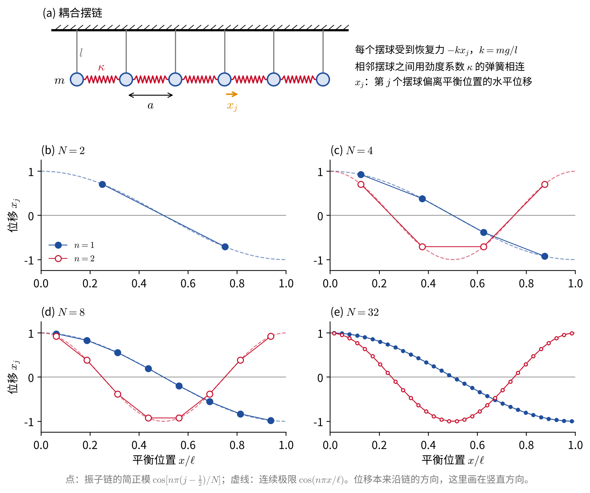
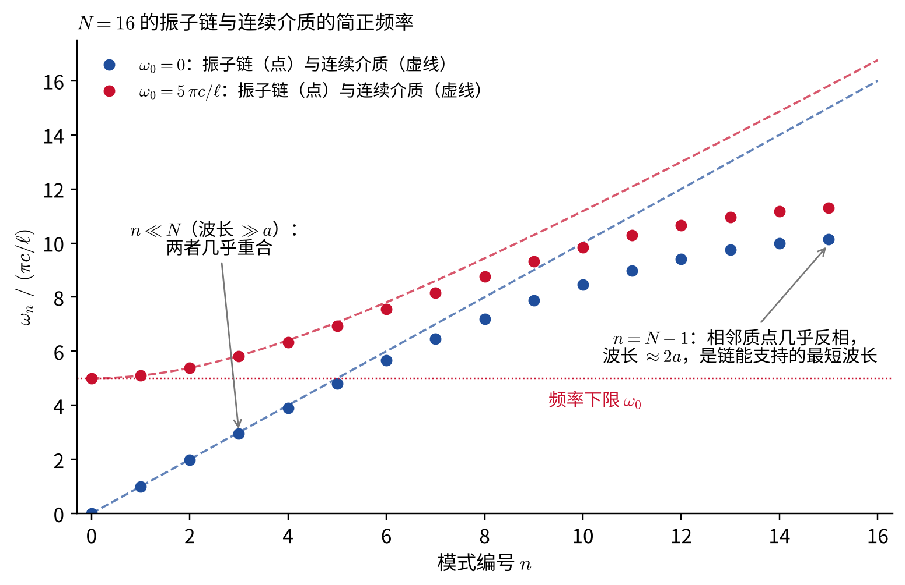
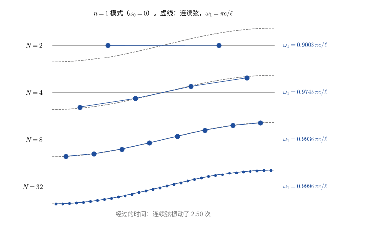
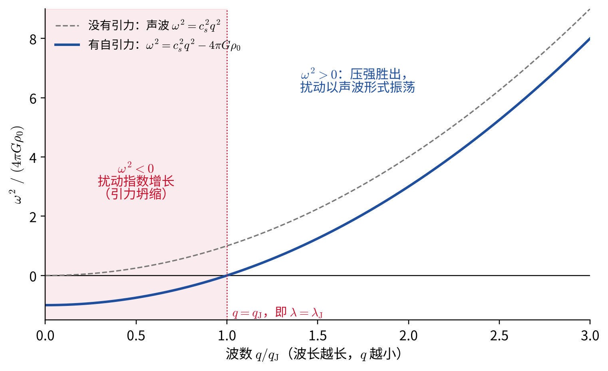

# 从振子链到连续介质

**——从多自由度小振动走向场**

> 本文是[“微扰和摄动理论”](微扰和摄动理论.md)一章“多自由度系统的简谐振动”一节的拓展材料，建议在学完该节之后阅读。正文把有限个自由度的小振动分解为彼此独立的简正模；这里把自由度的数目推向无穷，得到连续介质和场。用变分推导场方程的部分用到[“最小作用量原理”](最小作用量原理.md)一章的泛函导数；最后一节的推导用到流体力学的基本方程，不熟悉的读者可以只看结论。

> 阅读提示：文中蓝色边框的“推导”块默认折叠，点击标题展开；打印或导出 PDF 时会自动展开。

把两个耦合振子推广到 $N$ 个，再令 $N\to\infty$，就从质点系过渡到了连续介质，例如一根弹性棒、一段空气柱或一根弦。连续介质的状态由位移 $u(x,t)$ 描述，它在每个空间点 $x$ 都有一个值，这是物理学中**场**（field）最简单的例子。下面会看到，场的运动仍然可以分解为彼此独立的简正模，只是模式有无穷多个。

## 振子链的简正模

$N$ 个质量为 $m$ 的质点排成一行，平衡时相邻间距为 $a$，相邻质点之间用劲度系数为 $\kappa$ 的弹簧相连。此外，每个质点还受到一个把它拉回自身平衡位置的恢复力 $-kx_j$，例如把每个质点挂成摆长为 $l$ 的单摆，则 $k=mg/l$（见下图 (a)）。记第 $j$ 个质点偏离平衡位置的位移为 $x_j$，则

$$
\begin{equation}
L=\sum_{j=1}^{N}\left(\frac12m\dot x_j^2-\frac12kx_j^2\right)-\sum_{j=1}^{N-1}\frac12\kappa\left(x_{j+1}-x_j\right)^2 .
\end{equation}
$$

$N=2$ 时这正是正文中的“例：两个耦合振子”：恢复力 $-kx_j$ 由墙上的弹簧提供还是由摆提供，方程完全相同。运动方程为

$$
\begin{equation}
m\ddot x_j=-kx_j+\kappa\left(x_{j+1}-x_j\right)-\kappa\left(x_j-x_{j-1}\right),
\end{equation}
$$

右边后两项分别是右侧和左侧弹簧的作用力。两端的质点只有一侧有弹簧，只要约定 $x_0\equiv x_1$、$x_{N+1}\equiv x_N$（让“不存在的弹簧”没有伸缩），两端的方程也可以写成同样的形式。

这是 $N$ 个联立方程，久期方程是一个 $N$ 阶行列式。好在链上每个质点所处的环境都一样，可以猜出简正模的形状（推导见下方）：

$$
\begin{equation}
x_j^{(n)}\propto\cos\frac{n\pi\left(j-\frac12\right)}{N},
\qquad
\omega_n^2=\frac km+\frac{4\kappa}{m}\sin^2\frac{n\pi}{2N},
\qquad n=0,1,\ldots,N-1 .
\end{equation}
$$

取 $N=2$：$n=0$ 给出 $(1,1)$ 和 $\omega^2=k/m$，$n=1$ 给出 $\propto(1,-1)$ 和 $\omega^2=(k+2\kappa)/m$，与正文的结果一致。

模式 $n$ 的位移沿链分布成余弦形状，在链的总长度 $\ell=Na$（这里不用 $L$，以免与拉格朗日量混淆）上恰好有 $n$ 个半波长，即波长 $\lambda_n=2\ell/n$。$n$ 越大，相邻质点的位移相差越大，弹簧伸缩越厉害，频率也越高。最高的模式 $n=N-1$ 中，相邻质点几乎反相振动，波长约为 $2a$：这是链能够表示的最短波长，因为质点之间没有别的东西可以振动。$N$ 个自由度恰好对应 $N$ 个简正模。

推导：振子链的简正模

试探解 $x_j=C\cos\left[q\left(j-\tfrac12\right)a\right]\cos(\omega t+\varphi)$，其中 $q$ 待定。由和差化积公式，

$$
\begin{equation*}
x_{j+1}+x_{j-1}=2\cos(qa)\,x_j ,
\end{equation*}
$$

代入运动方程 $-m\omega^2x_j=-kx_j-\kappa\left(2x_j-x_{j+1}-x_{j-1}\right)$，得

$$
\begin{equation*}
m\omega^2=k+2\kappa\left(1-\cos qa\right)=k+4\kappa\sin^2\frac{qa}{2}.
\end{equation*}
$$

这对任何 $q$ 都满足中间各质点的方程。剩下的是两端的约定：

- 左端要求 $x_0=x_1$，即 $\cos\left(-\tfrac12qa\right)=\cos\left(\tfrac12qa\right)$，自动成立（这正是在余弦中取 $j-\tfrac12$ 的原因）；
- 右端要求 $x_{N+1}=x_N$，即 $\cos\left[\left(N+\tfrac12\right)qa\right]=\cos\left[\left(N-\tfrac12\right)qa\right]$，化简为 $\sin(Nqa)\sin\tfrac{qa}{2}=0$，所以 $q=\dfrac{n\pi}{Na}$，$n$ 为整数。

$n=0,1,\ldots,N-1$ 给出 $N$ 个不同的模式。$n=N$ 时所有 $x_j=0$；而 $n$ 与 $2N-n$ 给出的位移只差一个符号，是同一个模式。所以恰好有 $N$ 个简正模，与自由度的数目相同。

## 连续极限

把第 $j$ 个质点的平衡位置记为 $x=\left(j-\tfrac12\right)a$，链的总长度为 $\ell=Na$。现在保持 $\ell$ 不变，令 $N\to\infty$、$a=\ell/N\to0$。为了得到有意义的极限，各参数要按下面的方式变化：

- 质点越分越小，$m\to0$，但**线密度** $\mu\equiv m/a$ 保持不变；
- 弹簧越截越短。一根弹簧截成两半，每半的劲度系数加倍，劲度系数与长度成反比，所以 $\kappa\to\infty$，而 $T\equiv\kappa a$ 保持不变。$T$ 具有力的量纲，对弹性棒来说就是杨氏模量乘以截面积；
- $\omega_0^2\equiv k/m$ 保持不变。对单摆来说 $k/m=g/l$，本来就与质量无关。

于是拉格朗日量可以写成

$$
\begin{equation}
L=\sum_ja\left[\frac12\mu\dot x_j^2-\frac12\mu\omega_0^2x_j^2\right]-\sum_ja\,\frac12T\left(\frac{x_{j+1}-x_j}{a}\right)^2 .
\end{equation}
$$

当 $a\to0$ 时，$x_j(t)$ 变成连续函数 $u(x,t)$，差商 $(x_{j+1}-x_j)/a$ 变成偏导数 $\partial u/\partial x$，而 $\sum_ja(\cdots)$ 正是定积分定义中的黎曼和，变成 $\int_0^\ell(\cdots)\,dx$：

$$
\begin{equation}
L=\int_0^\ell\mathcal L\,dx,
\qquad
\mathcal L=\frac12\mu\left(\frac{\partial u}{\partial t}\right)^2-\frac12T\left(\frac{\partial u}{\partial x}\right)^2-\frac12\mu\omega_0^2u^2 .
\end{equation}
$$

$\mathcal L$ 称为**拉格朗日密度**，即单位长度上的拉格朗日量。三项依次是单位长度的动能、弹簧伸缩的势能（只与相邻点的位移差，也就是 $\partial u/\partial x$ 有关）和恢复力的势能。离散与连续的对应关系如下：

| 振子链 | 连续介质 |
|---|---|
| 质点编号 $j$ | 位置 $x$ |
| 位移 $x_j(t)$ | 场 $u(x,t)$ |
| $\sum_j$ | $\int dx/a$ |
| $x_{j+1}-x_j$ | $a\,\partial u/\partial x$ |
| 简正模 $\cos\left[n\pi\left(j-\frac12\right)/N\right]$ | $\cos(n\pi x/\ell)$ |
| $N$ 个简正模 | 无穷多个简正模 |

运动方程也可以直接从离散方程得到。把振子链的运动方程除以 $a$：

$$
\begin{equation}
\mu\ddot x_j=-\mu\omega_0^2x_j+T\,\frac{x_{j+1}-2x_j+x_{j-1}}{a^2}.
\end{equation}
$$

由泰勒展开 $u(x\pm a)=u\pm au'+\tfrac12a^2u''\pm\cdots$，得 $u(x+a)-2u(x)+u(x-a)=a^2u''+O(a^4)$，即“二阶差分”变成二阶导数。于是

$$
\begin{equation}
\frac{\partial^2u}{\partial t^2}=c^2\frac{\partial^2u}{\partial x^2}-\omega_0^2u,
\qquad c\equiv\sqrt{\frac T\mu}.
\end{equation}
$$

两端的约定 $x_0\equiv x_1$、$x_{N+1}\equiv x_N$ 变成 $\partial u/\partial x=0$（$x=0,\ell$），即两端没有受到拉伸或压缩，称为**自由端**。

$\omega_0=0$ 时，上式就是**波动方程**。它描述弹性棒的纵向振动和空气柱中的声波；拉紧的弦作横向振动时满足同样的方程，那里 $T$ 就是弦的张力。容易验证，对任意函数 $f$ 和 $g$，

$$
\begin{equation}
u(x,t)=f(x-ct)+g(x+ct)
\end{equation}
$$

都是波动方程的解：由链式法则，$\partial_t^2f(x-ct)=c^2f''$，$\partial_x^2f(x-ct)=f''$。$f(x-ct)$ 是一个形状不变、以速度 $c$ 向右传播的波形，$g(x+ct)$ 则向左传播，所以 $c$ 是**波速**。用振子链的参数表示，$c=a\sqrt{\kappa/m}$：扰动是一个质点接一个质点传过去的。从振子链到连续介质的更多讨论见 [1, 第 5–6 章] 和 [2, §13.1]。

推导：用最小作用量原理得到场方程

作用量是对时间和空间的双重积分 $S=\int dt\int_0^\ell dx\,\mathcal L$。令 $u\to u+\delta u$，保留到一阶，

$$
\begin{equation*}
\delta S=\int dt\int_0^\ell dx\left[\mu\,\frac{\partial u}{\partial t}\frac{\partial\delta u}{\partial t}-T\,\frac{\partial u}{\partial x}\frac{\partial\delta u}{\partial x}-\mu\omega_0^2u\,\delta u\right].
\end{equation*}
$$

第一项对 $t$ 分部积分（两端时刻 $\delta u=0$），第二项对 $x$ 分部积分：

$$
\begin{equation*}
\delta S=\int dt\int_0^\ell dx\left[-\mu\frac{\partial^2u}{\partial t^2}+T\frac{\partial^2u}{\partial x^2}-\mu\omega_0^2u\right]\delta u
-\int dt\left[T\,\frac{\partial u}{\partial x}\,\delta u\right]_{x=0}^{x=\ell}.
\end{equation*}
$$

对内部任意的 $\delta u$ 都有 $\delta S=0$，方括号必须为零，这就是上面的场方程；方括号正是[“最小作用量原理”](最小作用量原理.md)一章中的泛函导数 $\delta S/\delta u(x,t)$。

再看边界项。若两端可以自由移动，$\delta u$ 在端点处也是任意的，于是必须 $\partial u/\partial x=0$：自由端条件从变分中自动得出，不必另外假设。若两端固定（如吉他弦），$u=0$，$\delta u=0$，边界项自动为零。

## 连续介质的简正模

寻找所有点以同一频率振动的解 $u=A\cos(qx)\cos(\omega t+\varphi)$，代入场方程得

$$
\begin{equation}
\omega^2=\omega_0^2+c^2q^2 .
\end{equation}
$$

$\cos(qx)$ 在 $x=0$ 处导数为零，自动满足自由端条件；$x=\ell$ 处要求 $\sin(q\ell)=0$，所以 $q=n\pi/\ell$：

$$
\begin{equation}
u_n\propto\cos\frac{n\pi x}{\ell},
\qquad
\omega_n^2=\omega_0^2+\left(\frac{n\pi c}{\ell}\right)^2,
\qquad n=0,1,2,\ldots
\end{equation}
$$

与振子链比较：用 $\mu$、$T$、$c$ 表示，$4\kappa/m=4c^2/a^2$，振子链的频率为

$$
\begin{equation}
\omega_n^2=\omega_0^2+\frac{4c^2}{a^2}\sin^2\frac{n\pi a}{2\ell}.
\end{equation}
$$

当 $n\ll N$ 时，$\sin\theta\approx\theta$，上式回到连续介质的结果。条件 $n\ll N$ 等价于波长 $\lambda_n=2\ell/n\gg a$：**只有当波长远大于质点间距时，才能把介质看成连续的**。在接近最短波长 $2a$ 时，两者明显不同（见下图）。对真实固体，$a$ 是原子间距（约 $10^{-10}\ \text{m}$），所以连续近似对通常的声波极好，但在原子尺度上会失效。这与正文[“微小振动近似的适用范围”](微扰和摄动理论.md#微小振动近似的适用范围)一节的思路相同：每个近似都有它的适用范围，而这个范围可以从更精细的模型中算出来。

先看 $\omega_0=0$ 的情形。此时 $\omega_n=n\pi c/\ell=n\,\omega_1$，各简正频率是基频的整数倍，称为**泛音列**，这就是弦乐器和管乐器能发出确定音高的原因。$n=0$ 的模式 $\omega=0$，对应整个介质一起平移，正是正文所说的“$\omega_\alpha=0$ 对应系统的连续对称性”。若两端固定（如吉他弦，$u(0)=u(\ell)=0$），简正模变为 $\sin(n\pi x/\ell)$，$n=1,2,\ldots$，频率公式不变。

下面的动画中，$N=2,4,8,32$ 的振子链都以 $n=1$ 模式振动（$\omega_0=0$）。$N$ 越大，频率越接近连续弦的 $\pi c/\ell$；$N=2$ 时频率低了约 $10\%$，几个周期后就明显落后。

一般的运动是各简正模的叠加：

$$
\begin{equation}
u(x,t)=\sum_{n=0}^{\infty}\Theta_n(t)\cos\frac{n\pi x}{\ell},
\qquad
\Theta_n(t)=a_n\cos\omega_nt+b_n\sin\omega_nt .
\end{equation}
$$

不同的简正模相互“正交”：$n\neq n'$ 时 $\int_0^\ell\cos\frac{n\pi x}{\ell}\cos\frac{n'\pi x}{\ell}\,dx=0$。这是“本征矢关于质量矩阵正交”的连续版本。利用它，可以由初始形状求出系数，例如 $a_n=\dfrac{2}{\ell}\displaystyle\int_0^\ell u(x,0)\cos\frac{n\pi x}{\ell}\,dx$（$n\geq1$；$n=0$ 时把 $2/\ell$ 换成 $1/\ell$）；$b_n$ 则由初始速度求出。把这个展开代入拉格朗日量，交叉项全部消失（推导见下方）：

$$
\begin{equation}
L=\sum_{n=0}^{\infty}\frac12M_n\left(\dot\Theta_n^2-\omega_n^2\Theta_n^2\right),
\qquad M_0=\mu \ell,\quad M_n=\frac12\mu \ell\ (n\geq1).
\end{equation}
$$

这与正文中简正坐标下的拉格朗日量形式完全相同，只是 $s\to\infty$：**一个场等价于无穷多个彼此独立的谐振子**，每个简正模 $\Theta_n$ 就是其中一个。这是从力学通向场论的关键一步。量子化以后，每个模式都是一个量子谐振子（见[“量子谐振子与经典极限”](量子谐振子与经典极限.md)一章），模式 $n$ 的一个能量量子 $\hbar\omega_n$，在场论中就叫做一个“粒子”。

推导：模式展开下拉格朗日量的解耦

把 $u=\sum_n\Theta_n(t)\cos(n\pi x/\ell)$ 代入 $L=\int_0^\ell\mathcal L\,dx$，要用到

$$
\begin{equation*}
\int_0^\ell\cos\frac{n\pi x}{\ell}\cos\frac{n'\pi x}{\ell}\,dx=\int_0^\ell\sin\frac{n\pi x}{\ell}\sin\frac{n'\pi x}{\ell}\,dx=\frac{\ell}{2}\,\delta_{nn'}\qquad(n,n'\geq1),
\end{equation*}
$$

以及 $n=n'=0$ 时余弦积分等于 $\ell$。记 $\eta_0=\ell$，$\eta_n=\ell/2$（$n\geq1$）。动能项为

$$
\begin{equation*}
\int_0^\ell\frac12\mu\left(\frac{\partial u}{\partial t}\right)^2dx=\frac12\mu\sum_{n,n'}\dot\Theta_n\dot\Theta_{n'}\int_0^\ell\cos\frac{n\pi x}{\ell}\cos\frac{n'\pi x}{\ell}\,dx=\sum_n\frac12\mu\eta_n\dot\Theta_n^2 .
\end{equation*}
$$

同理，$\partial u/\partial x=-\sum_n(n\pi/\ell)\Theta_n\sin(n\pi x/\ell)$，所以

$$
\begin{equation*}
\int_0^\ell\frac12T\left(\frac{\partial u}{\partial x}\right)^2dx=\sum_n\frac12T\eta_n\left(\frac{n\pi}{\ell}\right)^2\Theta_n^2,
\qquad
\int_0^\ell\frac12\mu\omega_0^2u^2dx=\sum_n\frac12\mu\eta_n\omega_0^2\Theta_n^2 .
\end{equation*}
$$

合起来，并利用 $T/\mu=c^2$：

$$
\begin{equation*}
L=\sum_n\frac12\mu\eta_n\left[\dot\Theta_n^2-\left(\omega_0^2+\frac{n^2\pi^2c^2}{\ell^2}\right)\Theta_n^2\right]=\sum_n\frac12M_n\left(\dot\Theta_n^2-\omega_n^2\Theta_n^2\right),
\end{equation*}
$$

其中 $M_n=\mu\eta_n$。不同模式之间没有交叉项，正交性起的作用与有限自由度时“同时对角化 $\mathbf m$ 与 $\mathbf k$”完全相同。

## 频率下限 $\omega_0$

当 $\omega_0\neq0$ 时，所有模式都满足 $\omega_n\geq\omega_0$：即使整个介质一起运动（$n=0$），每个质点仍受到恢复力。$\omega_0\neq0$ 的场方程称为 **Klein–Gordon 方程**。在量子理论中 $E=\hbar\omega$、$p=\hbar q$，色散关系 $\omega^2=\omega_0^2+c^2q^2$ 变成

$$
\begin{equation}
E^2=\left(\hbar\omega_0\right)^2+p^2c^2 ,
\end{equation}
$$

这正是相对论的能量–动量关系，其中 $\hbar\omega_0$ 相当于粒子的静能 $mc^2$（这里 $m$ 指粒子的质量）。所以 $\omega_0$ 扮演“质量”的角色：$\omega_0\neq0$ 的场描述有质量的粒子，$\omega_0=0$ 的场（如电磁波、引力波）描述无质量的粒子。

正文中已经出现过这样的场：

- 正文[“阻尼振动”](微扰和摄动理论.md#阻尼振动)一节例 2 的“哈勃摩擦”中，空间中处处相同的场 $\phi(t)$ 正是 $n=0$（$q=0$）的模式，$\omega_0=m$（取 $c=1$）。如果 $\phi$ 还随空间变化，那么每个空间模式都是一个频率为 $\sqrt{m^2+q^2}$ 的振子；
- 正文[“参数共振在宇宙学中的应用”](微扰和摄动理论.md#参数共振在宇宙学中的应用)中，$\chi_k$ 的方程 $\ddot\chi_k+\left(k^2+g^2\Phi^2\cos^2mt\right)\chi_k=0$ 也是这个形式，只是“质量项”被暴胀子周期性地调制，于是每个模式各自成为一个 Mathieu 振子。

如果在一端以低于 $\omega_0$ 的频率驱动，会发生什么？此时 $q^2=(\omega^2-\omega_0^2)/c^2<0$，场方程的解不再是余弦，而是指数衰减：

$$
\begin{equation}
u\propto e^{-x/d}\cos\omega t,
\qquad
d=\frac{c}{\sqrt{\omega_0^2-\omega^2}} .
\end{equation}
$$

扰动只能深入约 $d$ 的距离，无法传播出去。对耦合摆链来说，缓慢地来回推第一个摆，每个摆自身的恢复力起主导作用，运动传不远。

电磁波在等离子体（电离气体）中满足同样形式的色散关系，其中 $c$ 是光速，$\omega_0$ 换成**等离子体频率** $\omega_{\rm p}=\sqrt{n_ee^2/(\varepsilon_0m_e)}$，对应 $f_{\rm p}\approx9\ \text{kHz}\times\sqrt{n_e/\text{cm}^{-3}}$。这有两个天文后果：

- 地球电离层的电子数密度最高约 $10^6\ \text{cm}^{-3}$，$f_{\rm p}\sim10\ \text{MHz}$。低于这个频率的宇宙射电波无法穿过电离层，所以地面射电望远镜观测不到约 $10\ \text{MHz}$ 以下的天空，更低频的观测要到太空或月球背面进行；
- 星际介质中 $n_e\sim0.03\ \text{cm}^{-3}$，$f_{\rm p}$ 只有约 $1.5\ \text{kHz}$，远低于射电观测频率，电波可以传播，但 $\omega_0$ 项使低频成分到达得更晚。脉冲星的每个脉冲都从高频“扫”到低频，延迟正比于 $f^{-2}$ 和视线方向上电子的柱密度（**色散量**），天文学家据此估计脉冲星的距离 [5]。

## 天体物理应用：金斯不稳定性

如果 $k<0$ 会怎样？把每个摆倒过来（倒立摆），每个质点都受到一个**把它推离**平衡位置的力，$\omega_0^2=k/m<0$。由

$$
\begin{equation}
\omega_n^2=\omega_0^2+\left(\frac{n\pi c}{\ell}\right)^2
\end{equation}
$$

可知，长波（小 $n$）的模式 $\omega_n^2<0$，按正文中简正模的稳定性判据，这些模式不稳定，振幅指数增长；短波的模式仍然稳定，因为相邻质点之间的弹簧会阻止剧烈的短程形变。

均匀的自引力气体正是这样一个系统。设平衡密度为 $\rho_0$，声速为 $c_s$。在一维情形下，密度扰动 $\delta\rho(x,t)$ 满足（推导见下方）

$$
\begin{equation}
\frac{\partial^2\delta\rho}{\partial t^2}=c_s^2\frac{\partial^2\delta\rho}{\partial x^2}+4\pi G\rho_0\,\delta\rho .
\end{equation}
$$

与场方程比较：$u\to\delta\rho$，$c\to c_s$，而 $\omega_0^2\to-4\pi G\rho_0<0$。压强扮演弹簧 $\kappa$ 的角色，抵抗压缩；自引力扮演“倒立摆”的角色：密度稍高的地方吸引更多物质，变得更密。色散关系为

$$
\begin{equation}
\omega^2=c_s^2q^2-4\pi G\rho_0 .
\end{equation}
$$

$q$ 大（波长短）时 $\omega^2>0$，扰动以声波形式振荡；当 $q<q_{\rm J}\equiv\sqrt{4\pi G\rho_0}/c_s$ 时 $\omega^2<0$，扰动以增长率 $\sqrt{4\pi G\rho_0-c_s^2q^2}$ 指数增长，即引力坍缩。临界波长称为**金斯长度**：

$$
\begin{equation}
\lambda_{\rm J}=\frac{2\pi}{q_{\rm J}}=c_s\sqrt{\frac{\pi}{G\rho_0}} .
\end{equation}
$$

物理图像是：压缩一个尺度为 $\lambda$ 的区域，压强产生的恢复作用 $\sim c_s^2/\lambda^2$，尺度越大越弱；而引力的作用 $\sim G\rho_0$ 与尺度无关。所以足够大的区域，引力总会胜出。

**数值估计。** 分子云中的致密云核，温度约 $10\ \text{K}$，分子数密度约 $10^4\ \text{cm}^{-3}$（平均分子质量 $2.33\,m_{\rm H}$），则 $\rho_0\approx4\times10^{-20}\ \text{g/cm}^3$，$c_s=\sqrt{k_BT/(2.33\,m_{\rm H})}\approx0.19\ \text{km/s}$，于是

$$
\begin{equation}
\lambda_{\rm J}\approx0.2\ \text{pc},\qquad M_{\rm J}\sim\rho_0\lambda_{\rm J}^3\approx5\,M_\odot ,
\end{equation}
$$

增长时间 $1/\sqrt{4\pi G\rho_0}\approx2\times10^5$ 年。比金斯长度大的区域会在几十万年内坍缩，这是恒星形成的起点。金斯在 1902 年得到这一判据 [3]。对恒星系统和暗物质这类无碰撞系统，速度弥散 $\sigma$ 起着声速的作用，相应的讨论见 [4]。（[“无碰撞粒子体系”](无碰撞粒子体系.md)一章中的金斯方程描述的是这类系统的平衡，与这里的金斯不稳定性是不同的问题。）

推导：自引力气体中密度扰动的方程

一维情形下，气体满足连续性方程、欧拉方程（流体的牛顿第二定律）和泊松方程：

$$
\begin{equation*}
\frac{\partial\rho}{\partial t}+\frac{\partial(\rho v)}{\partial x}=0,\qquad
\rho\left(\frac{\partial v}{\partial t}+v\frac{\partial v}{\partial x}\right)=-\frac{\partial p}{\partial x}-\rho\frac{\partial\Phi}{\partial x},\qquad
\frac{\partial^2\Phi}{\partial x^2}=4\pi G\rho ,
\end{equation*}
$$

等温气体 $p=c_s^2\rho$。在静止的均匀状态 $\rho=\rho_0$、$v=0$ 附近，令 $\rho=\rho_0+\delta\rho$，$\Phi=\Phi_0+\delta\Phi$，只保留一阶小量：

$$
\begin{equation*}
\frac{\partial\delta\rho}{\partial t}+\rho_0\frac{\partial v}{\partial x}=0,\qquad
\rho_0\frac{\partial v}{\partial t}=-c_s^2\frac{\partial\delta\rho}{\partial x}-\rho_0\frac{\partial\delta\Phi}{\partial x},\qquad
\frac{\partial^2\delta\Phi}{\partial x^2}=4\pi G\,\delta\rho .
\end{equation*}
$$

第一式对 $t$ 求导，第二式对 $x$ 求导，消去 $v$，再用第三式：

$$
\begin{equation*}
\frac{\partial^2\delta\rho}{\partial t^2}=c_s^2\frac{\partial^2\delta\rho}{\partial x^2}+\rho_0\frac{\partial^2\delta\Phi}{\partial x^2}=c_s^2\frac{\partial^2\delta\rho}{\partial x^2}+4\pi G\rho_0\,\delta\rho .
\end{equation*}
$$

三维的平面波扰动给出同样的结果。

**注意。** 严格地说，无穷大的静止均匀介质并不是平衡态：泊松方程要求 $\nabla^2\Phi_0=4\pi G\rho_0\neq0$，引力场不可能处处为零。金斯直接忽略了 $\Phi_0$，这一做法被戏称为“金斯诈术”（Jeans swindle）。更仔细的处理（例如在膨胀宇宙或转动盘中）给出的判据与上面基本相同，所以结论是可靠的 [4]。

## 参考文献与延伸阅读

1. A. P. French, *Vibrations and Waves* (W. W. Norton, 1971). 第 5 章（耦合振子与简正模）、第 6 章（连续体系的简正模与傅里叶分析）。
2. H. Goldstein, C. Poole, J. Safko, *Classical Mechanics*, 3rd ed. (Addison-Wesley, 2002). §13.1（从离散体系到连续体系的过渡）。
3. J. H. Jeans, “The Stability of a Spherical Nebula,” *Phil. Trans. R. Soc. Lond. A* **199**, 1 (1902).
4. J. Binney, S. Tremaine, *Galactic Dynamics*, 2nd ed. (Princeton University Press, 2008). 关于金斯不稳定性与“金斯诈术”的章节。
5. D. R. Lorimer, M. Kramer, *Handbook of Pulsar Astronomy* (Cambridge University Press, 2005). 关于星际色散与色散量的章节。
