# 刚体运动

> 阅读提示：文中蓝色边框的“推导”“例”“提示”等块默认折叠，点击标题展开。

<!-- 原 PDF 第 1 页 -->

刚体力学研究的是物体的整体平动与空间取向如何随时间变化。它比质点力学多出的核心内容，是有限大小物体的质量分布会影响转动：同样的外力矩作用在不同形状的物体上，可以产生完全不同的角加速度。本章将依次建立“运动学分解—转动惯量—角动量—欧拉方程—自由转动及其稳定性—外力矩下的陀螺”这条逻辑链，并穿插地球、中子星和小天体等天体物理中的实例。除特别说明外，以下讨论采用牛顿力学、绝对刚体和惯性参考系的近似；这些内容的标准教材表述可参见文末参考文献 [1–4]。

**符号说明。** 本章基本沿用 Landau–Lifshitz [2] 的记法：$\boldsymbol\tau$ 表示质元在惯性系中的位置矢量（不是力矩，也不是固有时），$\mu$ 表示刚体的总质量（不是“中心力场”一章中的约化质量），$\boldsymbol M$ 和 $\boldsymbol K$ 分别表示角动量和力矩，$\boldsymbol\Omega$ 表示角速度，$I_1,I_2,I_3$ 表示主转动惯量。

## 刚体的运动学

此前主要讨论质点或有限个质点组成的系统。刚体可以看作连续分布的质点系，并满足任意两点之间的距离保持不变。若刚体上任意两点 $A,B$ 的位置分别为 $\boldsymbol\tau_A$ 与 $\boldsymbol\tau_B$，刚性约束可写为

$$
\begin{equation}
\left|\boldsymbol\tau_A-\boldsymbol\tau_B\right|=\text{常数}.
\end{equation}
$$

实际物体都会发生形变，因此刚体是一种理想化近似。当物体的形变尺度远小于整体尺寸，且形变时间尺度不影响所研究的运动时，这一近似通常有效；声波、弹性振动或高速碰撞问题则不能忽略形变。

刚体运动可以分为两部分：

1. 质心的平动；
2. 刚体绕质心的转动。

一般刚体共有六个自由度：三个坐标确定一个参考点的位置，另外三个参数确定刚体的空间取向。刚性约束意味着，一旦参考点与取向已知，刚体上所有点的位置就都被确定。以惯性参考系的坐标轴记作 $X,Y,Z$，以固定在刚体上的坐标轴记作 $x_1,x_2,x_3$。设刚体参考点（以后通常选为质心）的位置矢量为 $\boldsymbol R$，刚体上一点 $P$ 相对该点的位置矢量为 $\boldsymbol r$。在无穷小时间内，点 $P$ 的位移为

$$
\begin{equation}
d\boldsymbol\tau=d\boldsymbol R+d\boldsymbol\varphi\times\boldsymbol r.
\end{equation}
$$

除以 $dt$，得到

$$
\begin{equation}
\boldsymbol v=\boldsymbol V+\boldsymbol\Omega\times\boldsymbol r,
\end{equation}
$$

其中

$$
\begin{equation}
\boldsymbol V=\dot{\boldsymbol R},
\qquad
\boldsymbol\Omega=\dot{\boldsymbol\varphi}.
\end{equation}
$$

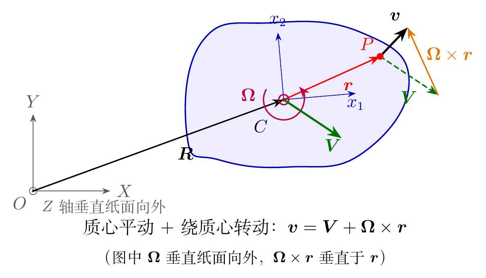

这里 $\boldsymbol r$ 的分量固定在刚体坐标系中，但它在惯性系中的方向会随刚体转动而改变。还应注意，有限转动一般不可交换，因此 $\boldsymbol\varphi$ 不能像普通位移那样在三维空间中任意相加；上式中的 $d\boldsymbol\varphi$ 是瞬时无穷小转动，而角速度 $\boldsymbol\Omega$ 是定义良好的瞬时矢量。

下图用一本书演示有限转动不可交换：同样是绕两条固定坐标轴各转 $90^\circ$，先绕 $X$ 后绕 $Y$，与先绕 $Y$ 后绕 $X$，书最后的朝向明显不同。对无穷小转动，两种顺序的差别是二阶小量，所以 $d\boldsymbol\varphi$ 和角速度仍可以像矢量一样相加。

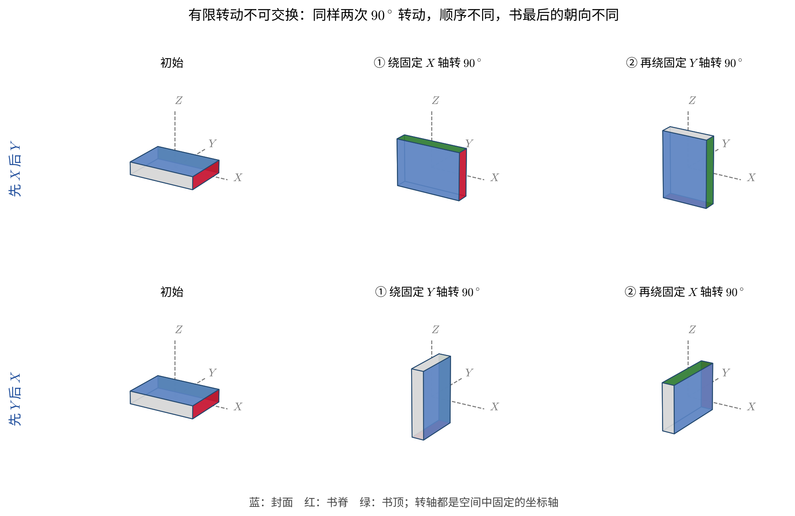

速度分解的物理含义很直接：同一时刻，刚体上所有点共享参考点的平动速度 $\boldsymbol V$，不同点之间的速度差则完全由 $\boldsymbol\Omega\times\boldsymbol r$ 决定。特别地，位于瞬时转轴上的点满足 $\boldsymbol\Omega\times\boldsymbol r=0$。

<!-- 原 PDF 第 2 页 -->

若刚体坐标系的原点不取在质心，而改取另一点 $C'$，两原点之间的固定矢量为 $\boldsymbol a$，则

$$
\begin{equation}
\boldsymbol r=\boldsymbol r'+\boldsymbol a.
\end{equation}
$$

于是

$$
\begin{equation}
\begin{aligned}
\boldsymbol v
&=\boldsymbol V+\boldsymbol\Omega\times\boldsymbol r\\
&=\boldsymbol V+\boldsymbol\Omega\times\boldsymbol a
 +\boldsymbol\Omega\times\boldsymbol r'\\
&=\boldsymbol V'+\boldsymbol\Omega'\times\boldsymbol r'.
\end{aligned}
\end{equation}
$$

因此

$$
\begin{equation}
\boldsymbol V'=\boldsymbol V+\boldsymbol\Omega\times\boldsymbol a,
\qquad
\boldsymbol\Omega'=\boldsymbol\Omega.
\end{equation}
$$

角速度与刚体坐标系原点的选择无关，而平动速度会随参考点改变。为了让平动与转动的动能自动分离，以下通常把刚体坐标系的原点取在质心。这里并不要求实际瞬时转轴总通过质心；真正需要的是用质心作为分解运动和定义相对坐标的参考点。

### 例：纯滚动与瞬时转轴

参考点可以任意改取这一事实，在滚动问题中特别有用。半径为 $R$ 的轮子（或球）在地面上**纯滚动**，意思是与地面接触的点 $P$ 相对地面没有滑动，即 $\boldsymbol v_P=0$。取 $\boldsymbol a$ 为从质心 $C$ 指向 $P$ 的矢量，由上式得

$$
\begin{equation}
\boldsymbol v_P=\boldsymbol V+\boldsymbol\Omega\times\boldsymbol a=0
\quad\Longrightarrow\quad
V=\Omega R\qquad(\text{在平面上直线滚动}).
\end{equation}
$$

既然 $P$ 点瞬时静止，就可以把参考点改取在 $P$：此时 $\boldsymbol V'=0$，刚体上任一点的速度为

$$
\begin{equation}
\boldsymbol v=\boldsymbol\Omega\times(\boldsymbol r-\boldsymbol r_P),
\end{equation}
$$

即在这一瞬间，整个刚体在绕一条过 $P$ 的轴转动，这条轴称为**瞬时转轴**。由此立即可以读出：轮子最高点的速度为 $2V$；各点速度都垂直于该点到 $P$ 的连线，大小正比于到 $P$ 的距离（下图）。瞬时转轴相对地面和相对轮子都在不断移动：$P$ 下一瞬间就离开了地面，轮缘上一点画出的是摆线，它在接触地面的瞬间速度为零，形成尖点。

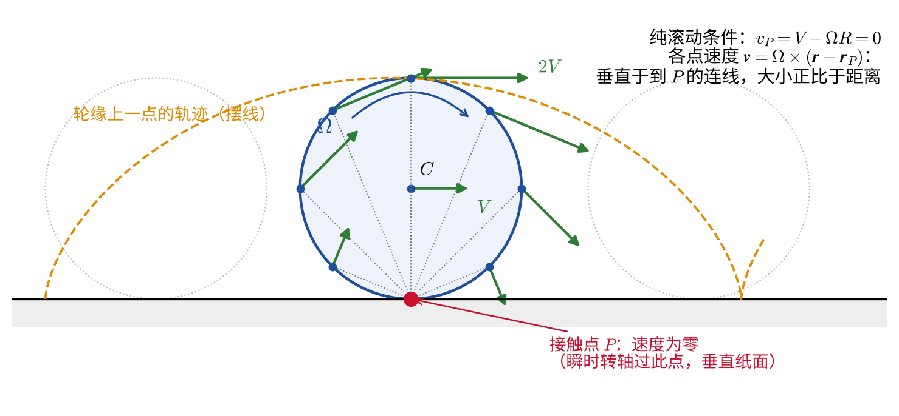

例：台球从滑动到纯滚动，以及“缩杆”

质量为 $\mu$、半径为 $R$ 的均匀球，$I=\tfrac25\mu R^2$。球杆在球心上方 $h$ 处水平击球，冲量为 $J$。由动量定理和对质心的角动量定理，

$$
\begin{equation*}
V_0=\frac{J}{\mu},\qquad
I\Omega_0=Jh\quad\Longrightarrow\quad R\Omega_0=\frac52\,\frac hR\,V_0 ,
\end{equation*}
$$

这里 $\Omega_0>0$ 表示向前滚动的转向。接触点的速度为 $v_P=V_0-R\Omega_0$。只有当 $h=\tfrac25R$（即离台面 $\tfrac75R$ 的高度）时 $v_P=0$，球一开始就纯滚动；否则接触点滑动，台面的滑动摩擦力作用一段时间，直到 $v_P=0$。

摩擦力的大小在滑动过程中不易精确描述，但可以绕开它：摩擦力和支持力都作用在接触点上，重力与支持力大小相等、作用线平行。取台面上、沿运动方向的一条直线上的任一固定点为参考点，这三个力的力矩之和为零，所以对该点的角动量守恒：

$$
\begin{equation*}
\mu VR+I\Omega=\text{常数}.
\end{equation*}
$$

到达纯滚动时 $\Omega=V/R$，于是末速度

$$
\begin{equation*}
V_{\rm f}=\frac57\left(V_0+\frac25R\Omega_0\right).
\end{equation*}
$$

- 击中球心（$h=0$）：$V_{\rm f}=\tfrac57V_0$，初动能的 $\tfrac27$ 被摩擦耗散。
- **缩杆与跟杆。** 若母球在仍然滑动时正面撞上一颗静止的同质量目标球，弹性碰撞会把 $V$ 全部交给目标球，而母球的自转 $\Omega$ 几乎不变。母球此后从 $V=0$ 开始，按上式末速度为 $V_{\rm f}=\tfrac27R\Omega$：击球点低于球心（$h<0$，下旋）时 $V_{\rm f}<0$，母球被“拉”回来，这就是缩杆；击球点高于球心（上旋）时母球跟着目标球前进，这就是跟杆。

## 转动惯量张量

设刚体由质量为 $m_i$ 的质点组成，总质量为

$$
\begin{equation}
\mu=\sum_i m_i.
\end{equation}
$$

推导：从速度分解得到转动动能

刚体的动能为

$$
\begin{equation*}
T=\frac12\sum_i m_i
\left(\boldsymbol V+\boldsymbol\Omega\times\boldsymbol r_i\right)^2.
\end{equation*}
$$

展开后，第一项为质心平动动能

$$
\begin{equation*}
\frac12\mu V^2.
\end{equation*}
$$

交叉项由于质心条件

$$
\begin{equation*}
\sum_i m_i\boldsymbol r_i=0
\end{equation*}
$$

而消失。利用恒等式

$$
\begin{equation*}
(\boldsymbol\Omega\times\boldsymbol r_i)^2
=\Omega^2r_i^2-(\boldsymbol\Omega\cdot\boldsymbol r_i)^2,
\end{equation*}
$$

可以写出转动动能。

<!-- 原 PDF 第 3 页 -->

总动能为

$$
\begin{equation*}
T=\frac12\mu V^2
+\frac12\Omega_m\Omega_n
\sum_i m_i\left(r_i^2\delta_{mn}-r_{im}r_{in}\right).
\end{equation*}
$$

推导中最关键的一步是把参考点取在质心，使平动—转动交叉项严格为零。若参考点不是质心，两部分动能一般不能这样直接分开。

定义转动惯量张量

$$
\begin{equation}
I_{mn}=\sum_i m_i\left(r_i^2\delta_{mn}-r_{im}r_{in}\right)
,
\end{equation}
$$

则

$$
\begin{equation}
T=\frac12\mu V^2+\frac12I_{mn}\Omega_m\Omega_n,
\end{equation}
$$

拉格朗日量为

$$
\begin{equation}
L=\frac12\mu V^2+\frac12I_{mn}\Omega_m\Omega_n-U.
\end{equation}
$$

在直角坐标系中，转动惯量张量写成

$$
\begin{equation}
\boldsymbol I=
\begin{pmatrix}
\sum_i m_i(y_i^2+z_i^2)&-\sum_i m_ix_iy_i&-\sum_i m_ix_iz_i\\
-\sum_i m_ix_iy_i&\sum_i m_i(x_i^2+z_i^2)&-\sum_i m_iy_iz_i\\
-\sum_i m_ix_iz_i&-\sum_i m_iy_iz_i&\sum_i m_i(x_i^2+y_i^2)
\end{pmatrix}.
\end{equation}
$$

对连续质量分布，求和改为积分：

$$
\begin{equation}
I_{mn}=\int \rho(\boldsymbol r)
\left(r^2\delta_{mn}-r_mr_n\right)d^3r.
\end{equation}
$$

若已知相对质心 $C$ 的惯量张量，而希望改用与之相距 $\boldsymbol a$ 的平行坐标轴，则平行轴定理给出

$$
\begin{equation}
I^{(O)}_{mn}=I^{(C)}_{mn}
+\mu\left(a^2\delta_{mn}-a_ma_n\right).
\end{equation}
$$

它说明质心轴在所有同方向平行轴中给出最小的转动惯量。标量形式 $I_O=I_C+\mu d^2$ 是上式在给定转轴上的投影，其中 $d$ 是两条平行轴之间的垂直距离。

推导：平行轴定理的张量形式

令质元相对质心的位置为 $\boldsymbol r'$，相对新原点 $O$ 的位置为 $\boldsymbol r=\boldsymbol r'+\boldsymbol a$。代入惯量张量定义后，含 $\boldsymbol r'$ 的一次项正比于

$$
\begin{equation*}
\int\rho(\boldsymbol r')\boldsymbol r'\,d^3r'=0,
\end{equation*}
$$

因为质心坐标的一阶质量矩为零。余下各项为

$$
\begin{equation*}
\begin{aligned}
I^{(O)}_{mn}
&=\int\rho\left[(\boldsymbol r'+\boldsymbol a)^2\delta_{mn}
-(r'_m+a_m)(r'_n+a_n)\right]d^3r'\\
&=I^{(C)}_{mn}+\mu\left(a^2\delta_{mn}-a_ma_n\right).
\end{aligned}
\end{equation*}
$$

沿某一单位转轴 $\boldsymbol n$ 投影，并记质心到该轴的垂直距离为 $d$，即可得到熟悉的标量关系 $I_O=I_C+\mu d^2$。

$I_{mn}$ 是实对称张量，因此总可以通过正交变换将其对角化。使其对角化的三个相互正交方向称为刚体的主轴。惯量张量不是一个与方向无关的“转动质量”：给定单位转轴 $\boldsymbol n$，绕该轴的转动惯量为

$$
\begin{equation}
I_{\boldsymbol n}=\boldsymbol n\cdot\boldsymbol I\boldsymbol n
=\int \rho(\boldsymbol r)\left[r^2-(\boldsymbol n\cdot\boldsymbol r)^2\right]d^3r.
\end{equation}
$$

因此，离转轴越远的质量元贡献越大。非对角元则描述不同转动方向之间的耦合；选取主轴后这些耦合项消失，这是主轴坐标系最重要的计算优势。

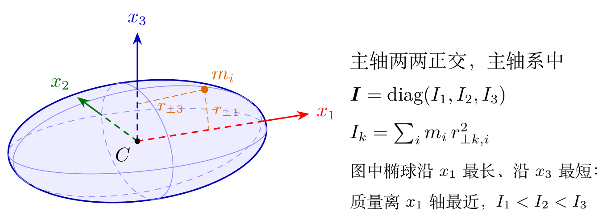

<!-- 原 PDF 第 4 页 -->

在主轴坐标系中，三个本征值 $I_1,I_2,I_3$ 称为主转动惯量，转动动能为

$$
\begin{equation}
T_{\rm rot}=\frac12I_1\Omega_1^2
+\frac12I_2\Omega_2^2
+\frac12I_3\Omega_3^2
.
\end{equation}
$$

由定义可得三个主转动惯量满足三角不等式，例如

$$
\begin{equation}
I_1+I_2\geq I_3,
\end{equation}
$$

其余关系由指标轮换得到。例如在主轴坐标系中，$I_1+I_2-I_3=2\int \rho z^2d^3r\geq0$。这个关系反映了三个主转动惯量并非任意三个正数，而是受同一质量分布约束。

按照主转动惯量的简并情况，可将刚体分为：

- $I_1,I_2,I_3$ 互不相等：非对称陀螺（asymmetric top）；
- $I_1=I_2\ne I_3$：对称陀螺（symmetric top）；
- $I_1=I_2=I_3$：球形陀螺（spherical top）。

### 直线分子

若各原子位于 $x_3$ 轴上，则

$$
\begin{equation}
I_1=I_2=\frac{1}{\mu}
\sum_{a<b}m_am_b\,l_{ab}^2,
\qquad
I_3=0,
\end{equation}
$$

其中 $l_{ab}$ 是第 $a,b$ 个原子间的距离，求和只对每一对原子计数一次。$I_3=0$ 是把原子视为轴线上质点后的理想结果；真实分子还存在电子云分布与振动修正。

推导：直线分子的转动惯量

设各原子位于 $x_3$ 轴上的 $z_a$ 处，质心条件为 $\sum_am_az_a=0$，则 $I_1=I_2=\sum_am_az_a^2$。利用恒等式

$$
\begin{equation*}
\sum_{a<b}m_am_b(z_a-z_b)^2
=\frac12\sum_{a,b}m_am_b\left(z_a^2+z_b^2-2z_az_b\right)
=\mu\sum_am_az_a^2-\Bigl(\sum_am_az_a\Bigr)^2
=\mu I_1 ,
\end{equation*}
$$

即得正文的公式。它的好处是只用到原子间距 $l_{ab}=|z_a-z_b|$，不必先求质心位置。对双原子分子只有一对原子，立即给出约化质量乘以 $l^2$。

对双原子分子，

$$
\begin{equation}
I_1=I_2=\frac{m_1m_2}{m_1+m_2}l^2,
\qquad I_3=0.
\end{equation}
$$

### 例：几种常见刚体的主转动惯量

利用对称性往往可以绕开直接积分。以均匀实心球（质量 $\mu$、半径 $R$）为例，三个主转动惯量相等，而由定义

$$
\begin{equation}
I_1+I_2+I_3=2\int\rho r^2\,d^3r,
\end{equation}
$$

所以

$$
\begin{equation}
I=\frac23\int\rho r^2\,d^3r
=\frac23\cdot\frac{3\mu}{4\pi R^3}\int_0^R4\pi r^4\,dr
=\frac25\mu R^2.
\end{equation}
$$

类似地，可得到以下常用结果（均对质心主轴）：

- 长为 $l$ 的均匀细杆：$I_1=I_2=\mu l^2/12$，$I_3=0$；
- 边长为 $a,b,c$ 的均匀长方体：$I_1=\mu(b^2+c^2)/12$，其余由轮换得到；
- 半径为 $R$ 的均匀薄圆盘：$I_3=\mu R^2/2$，由垂直轴定理 $I_1=I_2=I_3/2=\mu R^2/4$。

这些结果在量纲上都是“质量 $\times$ 长度$^2$”乘一个纯数，纯数的大小反映质量离转轴有多远：同样质量、同样半径时，实心球（$2/5$）比薄球壳（$2/3$）更容易转动起来，因为前者有更多质量靠近中心。

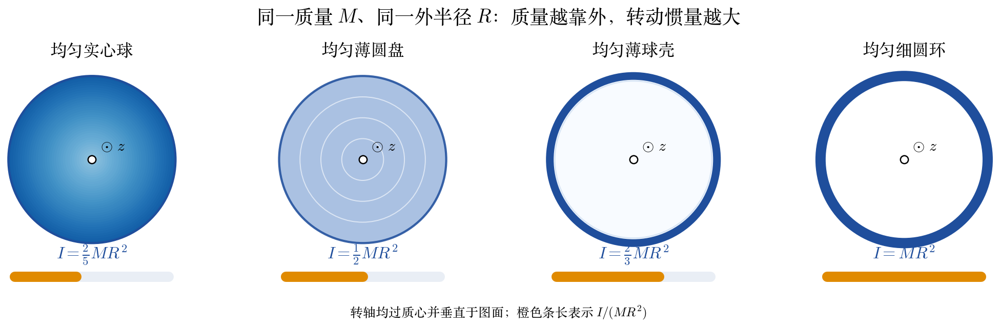

图中四个物体的质量均为 $M$、外半径均为 $R$，转轴均过质心并垂直于图面。从实心球到细圆环，质量逐渐向外移，$I/(MR^2)$ 从 $2/5$ 增大到 $1$。因此“形状”并不是单独起作用，真正决定 $I$ 的是质量到所选转轴的距离平方加权。

<!-- 原 PDF 第 5 页 -->

## 刚体的角动量

刚体相对质心的角动量为

$$
\begin{equation}
\begin{aligned}
\boldsymbol M
&=\sum_i m_i\boldsymbol r_i\times
(\boldsymbol\Omega\times\boldsymbol r_i)\\
&=\sum_i m_i\left[
r_i^2\boldsymbol\Omega
-\boldsymbol r_i(\boldsymbol\Omega\cdot\boldsymbol r_i)
\right].
\end{aligned}
\end{equation}
$$

因此其分量满足

$$
\begin{equation}
M_n=I_{nk}\Omega_k.
\end{equation}
$$

在主轴坐标系中，

$$
\begin{equation}
M_1=I_1\Omega_1,
\qquad
M_2=I_2\Omega_2,
\qquad
M_3=I_3\Omega_3.
\end{equation}
$$

对球形陀螺，$\boldsymbol M=I\boldsymbol\Omega$，所以 $\boldsymbol M$ 与 $\boldsymbol\Omega$ 平行。对一般刚体，二者通常并不平行；只有绕主轴转动时，它们才平行。这一点与质点情形很不相同：角速度描述的是物体此刻“怎样转”，角动量还要对各部分质量到转轴的距离加权。若不同方向的主转动惯量不同，惯量张量会改变矢量的方向，而不只是改变其长度。

还可由 $T_{\rm rot}=\tfrac12\boldsymbol\Omega\cdot\boldsymbol M$ 看出，给定角动量大小时，绕较大主转动惯量轴转动所需的能量较低。这个能量几何图像将在讨论自由非对称刚体的稳定性时再次出现。下图分别表示球形陀螺、绕对称轴转动的对称陀螺，以及一般刚体中 $\boldsymbol M$ 与 $\boldsymbol\Omega$ 不平行的情形；第三幅按 $I_1=2I_3$ 的比例画出，可以看到 $\boldsymbol M$ 偏向转动惯量较大的 $x_1$ 轴。

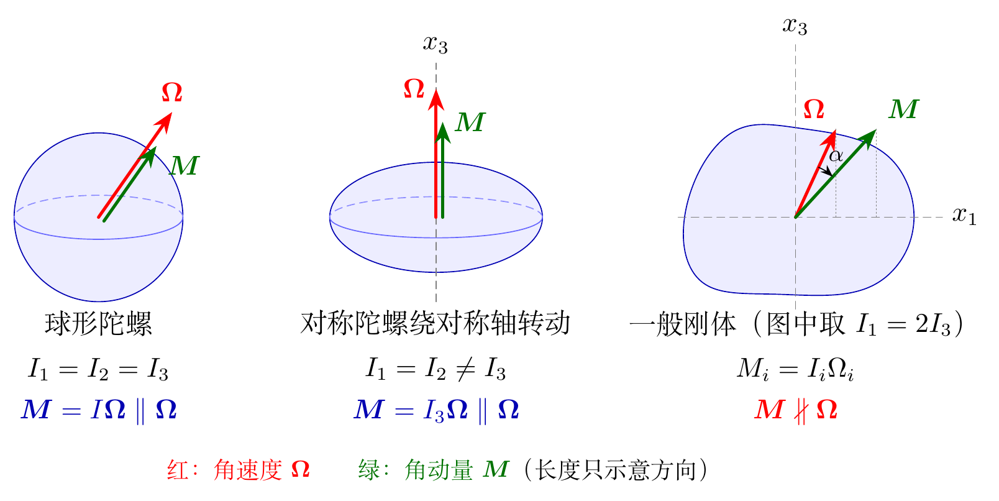

<!-- 原 PDF 第 6 页 -->

## 刚体的运动方程

刚体有六个自由度，相应地可以用总动量 $\boldsymbol P$ 和角动量 $\boldsymbol M$ 的六个一阶动力学方程描述；若要进一步得到位置与取向，还需同时积分速度关系与后文的姿态运动学关系。

对各质点，$\boldsymbol p_i=m_i\boldsymbol v_i$。总动量为

$$
\begin{equation}
\boldsymbol P=\sum_i\boldsymbol p_i=\mu\boldsymbol V.
\end{equation}
$$

若总外力为

$$
\begin{equation}
\boldsymbol F=\sum_i\boldsymbol f_i,
\end{equation}
$$

则

$$
\begin{equation}
\frac{d\boldsymbol P}{dt}=\boldsymbol F.
\end{equation}
$$

在通常的质点系模型中，内力满足牛顿第三定律并成对抵消，因此这里的 $\boldsymbol F$ 仅为外力。若 $\boldsymbol F=0$，总动量守恒。

若势能写作 $U(\boldsymbol R)$，则

$$
\begin{equation}
\boldsymbol F=-\frac{\partial U}{\partial\boldsymbol R}.
\end{equation}
$$

这一关系也可由虚位移看出：刚体作纯平移 $\delta\boldsymbol R$ 时，

$$
\begin{equation}
\delta U
=\sum_i\frac{\partial U}{\partial\boldsymbol\tau_i}
\cdot\delta\boldsymbol\tau_i
=-\boldsymbol F\cdot\delta\boldsymbol R.
\end{equation}
$$

由

$$
\begin{equation}
L=\frac12\mu V^2+\frac12I_{ik}\Omega_i\Omega_k-U
\end{equation}
$$

得到平动的拉格朗日方程

$$
\begin{equation}
\frac{d}{dt}\frac{\partial L}{\partial\boldsymbol V}
=\frac{\partial L}{\partial\boldsymbol R},
\end{equation}
$$

其中

$$
\begin{equation}
\frac{\partial L}{\partial\boldsymbol V}=\mu\boldsymbol V=\boldsymbol P,
\qquad
\frac{\partial L}{\partial\boldsymbol R}
=-\frac{\partial U}{\partial\boldsymbol R}=\boldsymbol F.
\end{equation}
$$

为了导出角动量方程，可以选取一个惯性系，使质心在所考虑的瞬间静止（每一时刻都可以这样选取一个惯性系）。下面会看到，即使质心有加速度，所得的方程对质心仍然成立。

<!-- 原 PDF 第 7 页 -->

相对质心的角动量满足

$$
\begin{equation}
\begin{aligned}
\frac{d\boldsymbol M}{dt}
&=\sum_i\dot{\boldsymbol r}_i\times\boldsymbol p_i
+\sum_i\boldsymbol r_i\times\dot{\boldsymbol p}_i\\
&=\sum_i\boldsymbol r_i\times\boldsymbol f_i
=\boldsymbol K,
\end{aligned}
\end{equation}
$$

即

$$
\begin{equation}
\frac{d\boldsymbol M}{dt}=\boldsymbol K,
\end{equation}
$$

其中 $\boldsymbol K$ 是相对质心的外力矩。对于满足强形式牛顿第三定律的中心内力，内力矩也成对抵消；在连续介质表述中，相应条件体现为应力张量的对称性。相对质心定义的内禀角动量在伽利略变换下不变。

推导：质心有加速度时，对质心的转动方程仍然成立

在惯性系中写 $\boldsymbol\tau_i=\boldsymbol R+\boldsymbol r_i$，$\boldsymbol R$ 为质心位置，质心条件为 $\sum_im_i\boldsymbol r_i=0$。定义相对质心的角动量 $\boldsymbol M=\sum_im_i\boldsymbol r_i\times\dot{\boldsymbol r}_i$（用 $\dot{\boldsymbol\tau}_i$ 代替 $\dot{\boldsymbol r}_i$ 结果相同，因为多出的项正比于 $\sum_im_i\boldsymbol r_i=0$）。求导，并用 $m_i\ddot{\boldsymbol r}_i=m_i\ddot{\boldsymbol\tau}_i-m_i\ddot{\boldsymbol R}=\boldsymbol f_i-m_i\ddot{\boldsymbol R}$：

$$
\begin{equation*}
\frac{d\boldsymbol M}{dt}=\sum_i\boldsymbol r_i\times m_i\ddot{\boldsymbol r}_i
=\sum_i\boldsymbol r_i\times\boldsymbol f_i-\Bigl(\sum_im_i\boldsymbol r_i\Bigr)\times\ddot{\boldsymbol R}
=\boldsymbol K .
\end{equation*}
$$

在随质心平动的（非惯性）参照系中看，$-m_i\ddot{\boldsymbol R}$ 是一个与质量成正比的惯性力，就像一个均匀的“重力场”，它对质心的力矩为零。若改取一个有加速度 $\ddot{\boldsymbol A}$ 的一般参考点 $A$，同样的计算给出

$$
\begin{equation*}
\frac{d\boldsymbol M_A}{dt}=\boldsymbol K_A-\mu\,(\boldsymbol R-\boldsymbol A)\times\ddot{\boldsymbol A},
\end{equation*}
$$

多出的一项只在 $A$ 为质心或 $\ddot{\boldsymbol A}=0$（固定点或匀速运动的点）时消失。这就是为什么转动方程通常对质心或固定支点来写；滚动问题中的接触点是瞬时静止但有加速度的点，不能直接套用。

若把力矩的参考原点移动 $\boldsymbol a$，即 $\boldsymbol r_i=\boldsymbol r_i'+\boldsymbol a$，则

$$
\begin{equation}
\boldsymbol K=\boldsymbol K'+\boldsymbol a\times\boldsymbol F.
\end{equation}
$$

因此当 $\boldsymbol F=0$ 时，力矩与参考原点的选择无关。若参考点取质心，即使合外力不为零，关于质心的转动方程仍可与质心平动方程分别处理。

在无穷小转动 $\delta\boldsymbol\varphi$ 下，

$$
\begin{equation}
\begin{aligned}
\delta U
&=-\sum_i\boldsymbol f_i\cdot\delta\boldsymbol\tau_i\\
&=-\delta\boldsymbol\varphi\cdot
\sum_i\boldsymbol r_i\times\boldsymbol f_i\\
&=-\boldsymbol K\cdot\delta\boldsymbol\varphi.
\end{aligned}
\end{equation}
$$

故势能对无穷小取向变化的响应定义了广义力矩：

$$
\begin{equation}
\delta U=-\boldsymbol K\cdot\delta\boldsymbol\varphi.
\end{equation}
$$

这里需要一个重要的技术提醒：三个 $\Omega_i$ 是角速度分量，却一般不是三个彼此独立的广义坐标对时间的导数，因为有限转动不交换。因此不能把 $\Omega_i$ 直接当作普通的 $\dot q_i$ 写入三条朴素的欧拉—拉格朗日方程。可以改用下一节的三个欧拉角作为广义坐标；也可以使用刚体系中的约化形式

$$
\begin{equation}
\frac{d'}{dt}\frac{\partial L}{\partial\boldsymbol\Omega}
+\boldsymbol\Omega\times\frac{\partial L}{\partial\boldsymbol\Omega}
=\boldsymbol K,
\end{equation}
$$

其中 $d'/dt$ 表示在随体坐标系中对分量求导。因为 $\partial L/\partial\boldsymbol\Omega=\boldsymbol M$，这正是后文欧拉方程的紧凑形式。

<!-- 原 PDF 第 8 页 -->

## 欧拉角（Eulerian Angles）

质心的三个坐标描述刚体的平动；还需三个角来描述刚体坐标轴 $x_1,x_2,x_3$ 相对惯性系 $X,Y,Z$ 的取向。欧拉角有多种约定，本章采用 $Z$—节线—$x_3$ 的内禀转动约定，也等价于下面被动坐标变换中的 $z$-$x$-$z$ 顺序。阅读不同教材时，应先核对旋转次序、主动或被动变换以及角的符号，否则相应公式可能看起来只差若干负号，却描述了不同约定。

令刚体坐标系与惯性坐标系原点重合。平面 $x_1x_2$ 与 $XY$ 的交线称为节线（line of nodes），记作 $ON$。三个欧拉角定义为：

- $\theta$：$Z$ 轴与 $x_3$ 轴之间的夹角，$0\leq\theta\leq\pi$；
- $\varphi$：$X$ 轴到节线 $ON$ 的夹角，$0\leq\varphi<2\pi$；
- $\psi$：节线 $ON$ 到 $x_1$ 轴的夹角，$0\leq\psi<2\pi$。

下图给出了欧拉角的几何定义（图中取 $\varphi=50^\circ$、$\theta=38^\circ$、$\psi=40^\circ$，各轴方向由下面的旋转矩阵精确算出）。等价的操作性描述是：先绕 $Z$ 轴转动 $\varphi$，使中间坐标轴与节线对齐；再绕节线转动 $\theta$；最后绕刚体的 $x_3$ 轴转动 $\psi$。

在陀螺问题中，$\varphi$ 常称为进动角，$\theta$ 为章动角，$\psi$ 为自转角。当 $\theta=0$ 或 $\pi$ 时节线无法唯一确定，$\varphi$ 与 $\psi$ 也分别失去独立意义；这是欧拉角坐标的奇点，并不是刚体的物理运动发生奇异。

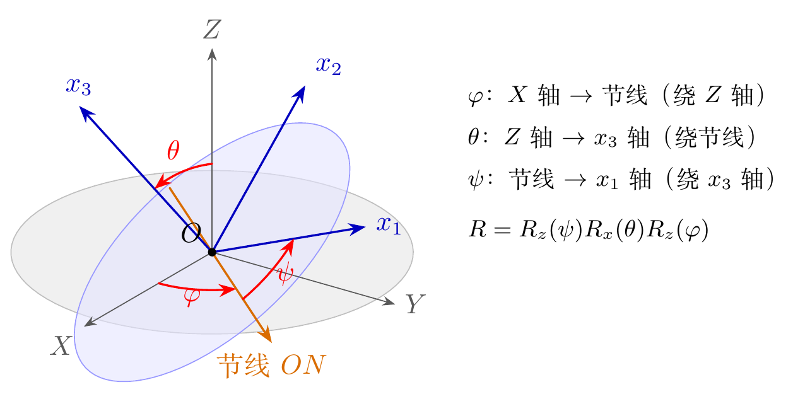

**观察动画前先预测：**三次转动的终轴分别是哪一条？如果交换前两步，刚体是否仍会到达同一取向？

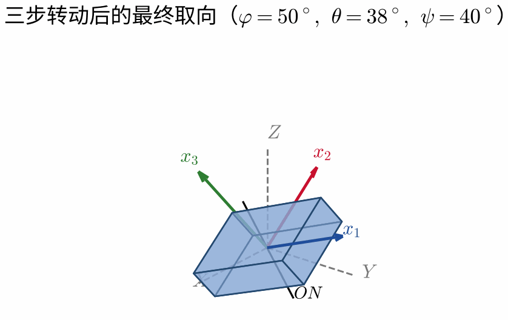

动画按照本章的内禀 $z$-$x$-$z$ 顺序逐步改变 $\varphi,\theta,\psi$。注意每一步的转轴都会影响下一步所说的“轴”在空间中的方向；这正是有限转动一般不可交换的几何原因。导出 PDF 时只显示动画的第一帧，即三步转动后的最终取向；完整的几何定义见上面的静态图。

<!-- 原 PDF 第 9 页 -->

### 坐标旋转矩阵

二维平面内，若坐标轴逆时针旋转 $\theta$，坐标分量作被动变换

$$
\begin{equation}
\begin{pmatrix}x_1\\y_1\end{pmatrix}
=
\begin{pmatrix}
\cos\theta&\sin\theta\\
-\sin\theta&\cos\theta
\end{pmatrix}
\begin{pmatrix}x\\y\end{pmatrix}
\equiv R_\theta
\begin{pmatrix}x\\y\end{pmatrix}.
\end{equation}
$$

这里旋转的是坐标轴，而几何矢量本身不动，因此称为被动变换。若改为固定坐标轴、主动旋转矢量，矩阵应取逆矩阵。对正交旋转矩阵有 $R^{-1}=R^{\mathsf T}$，这也是不同资料中正弦项符号相反的常见原因。

再旋转 $\phi$，则

$$
\begin{equation}
\begin{pmatrix}x_2\\y_2\end{pmatrix}
=R_\phi R_\theta
\begin{pmatrix}x\\y\end{pmatrix}
=R_{\phi+\theta}
\begin{pmatrix}x\\y\end{pmatrix}.
\end{equation}
$$

三维情形相同。采用上述被动变换约定，绕 $z$、$x$、$y$ 轴的矩阵可写为

$$
\begin{equation}
R_z(\alpha)=
\begin{pmatrix}
\cos\alpha&\sin\alpha&0\\
-\sin\alpha&\cos\alpha&0\\
0&0&1
\end{pmatrix},
\end{equation}
$$

$$
\begin{equation}
R_x(\alpha)=
\begin{pmatrix}
1&0&0\\
0&\cos\alpha&\sin\alpha\\
0&-\sin\alpha&\cos\alpha
\end{pmatrix},
\end{equation}
$$

$$
\begin{equation}
R_y(\alpha)=
\begin{pmatrix}
\cos\alpha&0&-\sin\alpha\\
0&1&0\\
\sin\alpha&0&\cos\alpha
\end{pmatrix}.
\end{equation}
$$

欧拉角对应的总旋转矩阵为

$$
\begin{equation}
R=R_z(\psi)R_x(\theta)R_z(\varphi).
\end{equation}
$$

矩阵乘法从右向左作用，因此最右侧的 $R_z(\varphi)$ 最先作用。该矩阵把惯性系中的矢量分量变换为本章约定的随体系分量；反向变换由 $R^{\mathsf T}$ 给出。欧拉关于有限刚体位移的经典工作说明，保持一个点不动的三维刚体位移总可等效为绕某一轴的一次有限转动 [5]；欧拉角则是参数化这一取向的常用方式之一。

<!-- 原 PDF 第 10 页 -->

### 角速度的欧拉角表示

推导：把三个瞬时转动率投影到随体主轴

把三个连续转动的角速度都投影到刚体坐标轴上。用上一节的被动旋转矩阵最方便：一个矢量在惯性系中的分量左乘 $R=R_z(\psi)R_x(\theta)R_z(\varphi)$，就得到它的随体分量。

- $\dot\varphi$ 沿惯性系的 $Z$ 轴。$R_z(\varphi)$ 不改变 $(0,0,1)^{\mathsf T}$，于是 $Z$ 轴的随体分量为 $R_z(\psi)R_x(\theta)(0,0,1)^{\mathsf T}=R_z(\psi)(0,\sin\theta,\cos\theta)^{\mathsf T}=(\sin\theta\sin\psi,\ \sin\theta\cos\psi,\ \cos\theta)^{\mathsf T}$。
- $\dot\theta$ 沿节线。节线是第一步转动后的中间 $x$ 轴，在中间坐标中为 $(1,0,0)^{\mathsf T}$；$R_x(\theta)$ 不改变它，再经 $R_z(\psi)$ 得 $(\cos\psi,\ -\sin\psi,\ 0)^{\mathsf T}$。
- $\dot\psi$ 已沿随体系的 $x_3$ 轴，分量为 $(0,0,1)^{\mathsf T}$。

逐项写出即为：$\dot\theta$ 沿节线，其分量为

$$
\begin{equation*}
(\dot\theta\cos\psi,-\dot\theta\sin\psi,0).
\end{equation*}
$$

$\dot\varphi$ 沿惯性系的 $Z$ 轴，在刚体系中的分量为

$$
\begin{equation*}
(\dot\varphi\sin\theta\sin\psi,
\dot\varphi\sin\theta\cos\psi,
\dot\varphi\cos\theta).
\end{equation*}
$$

$\dot\psi$ 已沿随体系的 $x_3$ 轴，所以其分量为 $(0,0,\dot\psi)$。把以上三个瞬时角速度矢量相加，即得到正文中的三个分量。

因此

$$
\begin{equation}
\begin{aligned}
\Omega_1&=\dot\varphi\sin\theta\sin\psi
+\dot\theta\cos\psi,\\
\Omega_2&=\dot\varphi\sin\theta\cos\psi
-\dot\theta\sin\psi,\\
\Omega_3&=\dot\varphi\cos\theta+\dot\psi.
\end{aligned}
\end{equation}
$$

这组三式体现了“角速度可以相加，但欧拉角本身不能简单相加”：三个瞬时转动率分别沿不同的轴，必须先投影到同一随体基底后才能求和。也正因为如此，通常并没有 $\boldsymbol\Omega=(\dot\varphi,\dot\theta,\dot\psi)$。

对对称陀螺 $I_1=I_2\ne I_3$，转动动能化为

$$
\begin{equation}
T_{\rm rot}
=\frac{I_1}{2}\left(
\dot\varphi^2\sin^2\theta+\dot\theta^2
\right)
+\frac{I_3}{2}
\left(\dot\varphi\cos\theta+\dot\psi\right)^2
.
\end{equation}
$$

其中 $\varphi$ 与 $\psi$ 不显含于自由对称陀螺的拉格朗日量，因此它们是循环坐标，对应的两个共轭动量守恒。这两个守恒量分别与惯性系 $Z$ 轴方向的角动量和随体系对称轴方向的角动量有关，使对称陀螺问题能够进一步约化为关于 $\theta$ 的一维有效势问题；这一点将在后文“重力场中的对称陀螺”一节中具体实现。

<!-- 原 PDF 第 11 页 -->

## 欧拉方程

在惯性参考系中，刚体的运动方程为

$$
\begin{equation}
\frac{d\boldsymbol P}{dt}=\boldsymbol F,
\qquad
\frac{d\boldsymbol M}{dt}=\boldsymbol K.
\end{equation}
$$

若矢量 $\boldsymbol A$ 固定在刚体上，它在惯性系中的变化率为

$$
\begin{equation}
\frac{d\boldsymbol A}{dt}=\boldsymbol\Omega\times\boldsymbol A.
\end{equation}
$$

对一般随时间变化的矢量，惯性系导数与刚体系导数之间满足输运定理

$$
\begin{equation}
\frac{d\boldsymbol A}{dt}
=\frac{d'\boldsymbol A}{dt}
+\boldsymbol\Omega\times\boldsymbol A
.
\end{equation}
$$

等式左边表示惯性观察者看到的变化率，第一项表示随刚体一起转动的观察者看到的分量变化率，第二项则来自基矢本身的转动。即使 $\boldsymbol A$ 在随体系中的分量不变，惯性观察者仍会看到它以 $\boldsymbol\Omega\times\boldsymbol A$ 的速率改变方向。

于是

$$
\begin{equation}
\frac{d'\boldsymbol P}{dt}
+\boldsymbol\Omega\times\boldsymbol P=\boldsymbol F,
\qquad
\frac{d'\boldsymbol M}{dt}
+\boldsymbol\Omega\times\boldsymbol M=\boldsymbol K.
\end{equation}
$$

由于 $\boldsymbol P=\mu\boldsymbol V$，平动方程的分量形式为

$$
\begin{equation}
\begin{aligned}
\mu(\dot V_1+\Omega_2V_3-\Omega_3V_2)&=F_1,\\
\mu(\dot V_2+\Omega_3V_1-\Omega_1V_3)&=F_2,\\
\mu(\dot V_3+\Omega_1V_2-\Omega_2V_1)&=F_3.
\end{aligned}
\end{equation}
$$

<!-- 原 PDF 第 12 页 -->

在主轴坐标系中 $M_i=I_i\Omega_i$，角动量方程给出欧拉方程。

推导：由输运定理得到欧拉方程

因为随体主轴上的 $I_i$ 是常数，随体系观察到的角动量变化率为

$$
\begin{equation*}
\frac{d'\boldsymbol M}{dt}
=I_1\dot\Omega_1\hat{\boldsymbol e}_1
+I_2\dot\Omega_2\hat{\boldsymbol e}_2
+I_3\dot\Omega_3\hat{\boldsymbol e}_3.
\end{equation*}
$$

输运项为

$$
\begin{equation*}
\boldsymbol\Omega\times\boldsymbol M
=\begin{pmatrix}
(I_3-I_2)\Omega_2\Omega_3\\
(I_1-I_3)\Omega_3\Omega_1\\
(I_2-I_1)\Omega_1\Omega_2
\end{pmatrix}_{\!\rm body}.
\end{equation*}
$$

把二者相加并逐分量令其等于 $\boldsymbol K$，便得到下面三式。非线性乘积项不是额外的力矩，而是随体基矢本身正在转动的结果。

其分量形式为

$$
\begin{equation}
\begin{aligned}
I_1\dot\Omega_1+(I_3-I_2)\Omega_2\Omega_3&=K_1,\\
I_2\dot\Omega_2+(I_1-I_3)\Omega_3\Omega_1&=K_2,\\
I_3\dot\Omega_3+(I_2-I_1)\Omega_1\Omega_2&=K_3.
\end{aligned}
\end{equation}
$$

这些方程中的点表示随体系分量对时间求导，而 $K_i$ 也必须是外力矩在同一组随体主轴上的分量。非线性乘积项来自 $\boldsymbol\Omega\times\boldsymbol M$：即使惯性系中的角动量保持不变，它在旋转的随体系中仍会改变分量。MIT 的刚体动力学讲义给出了相同的输运定理与欧拉方程推导，可作为本节的开放课程来源 [4]。

对自由转动，$\boldsymbol K=0$。若又是对称陀螺，$I_1=I_2$，第三式给出

$$
\begin{equation}
\Omega_3=\text{常数}.
\end{equation}
$$

前两式可写为

$$
\begin{equation}
\dot\Omega_1=-\omega\Omega_2,
\qquad
\dot\Omega_2=\omega\Omega_1,
\end{equation}
$$

其中

$$
\begin{equation}
\omega=\frac{I_3-I_1}{I_1}\Omega_3.
\end{equation}
$$

于是

$$
\begin{equation}
\frac{d}{dt}(\Omega_1+i\Omega_2)
=i\omega(\Omega_1+i\Omega_2),
\end{equation}
$$

其解为

$$
\begin{equation}
\Omega_1+i\Omega_2=Ae^{i\omega t}.
\end{equation}
$$

取 $A$ 为实数，则

$$
\begin{equation}
\Omega_1=A\cos\omega t,
\qquad
\Omega_2=A\sin\omega t.
\end{equation}
$$

所以角速度在垂直于对称轴方向的分量大小不变，并以角速度 $\omega$ 绕对称轴转动。这里描述的是随体系中 $\boldsymbol\Omega$ 分量的变化。换到惯性系观察，无外力矩意味着 $\boldsymbol M$ 的方向固定，而刚体的对称轴以固定夹角绕 $\boldsymbol M$ 进动。若以 $\boldsymbol M$ 方向作为惯性系 $Z$ 轴，则

$$
\begin{equation}
\dot\theta=0,
\qquad
\dot\varphi=\frac{M}{I_1},
\qquad
\dot\psi=-\omega.
\end{equation}
$$

因此，“角动量在空间中不动”和“角速度分量在刚体系中转动”并不矛盾，它们只是同一运动在不同参考系中的描述。在刚体系中，$\boldsymbol M=(I_1\Omega_1,I_1\Omega_2,I_3\Omega_3)$ 与 $\boldsymbol\Omega$、对称轴始终位于同一平面内，二者一起绕对称轴转动（下图）。

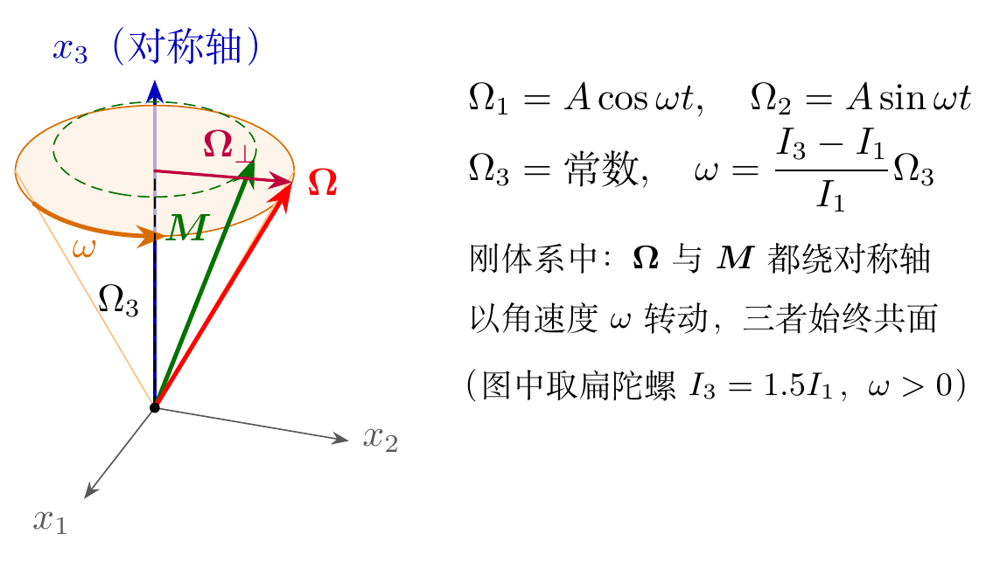

换到惯性系，这一运动有一个漂亮的几何图像。$\boldsymbol\Omega$ 与对称轴 $x_3$ 的夹角不变，所以在刚体上 $\boldsymbol\Omega$ 扫出一个以 $x_3$ 为轴的圆锥，称为**本体锥**；$\boldsymbol\Omega$ 与固定的 $\boldsymbol M$ 的夹角也不变，所以在空间中 $\boldsymbol\Omega$ 扫出一个以 $\boldsymbol M$ 为轴的圆锥，称为**空间锥**。两个锥沿 $\boldsymbol\Omega$ 相切，而 $\boldsymbol\Omega$ 方向上的刚体点此刻瞬时静止，所以本体锥在空间锥上**无滑动地滚动**，这和上面“纯滚动”的例子是同一回事。对扁的物体（$I_3>I_1$），$\boldsymbol M$ 位于 $x_3$ 与 $\boldsymbol\Omega$ 之间，空间锥在本体锥之内；对长的物体（$I_3<I_1$），$\boldsymbol\Omega$ 位于 $x_3$ 与 $\boldsymbol M$ 之间，两锥外切（下面的动画）。地球的两个锥都极窄：自转轴与形状轴只相差十分之几角秒，在地面上对应几米的极移。

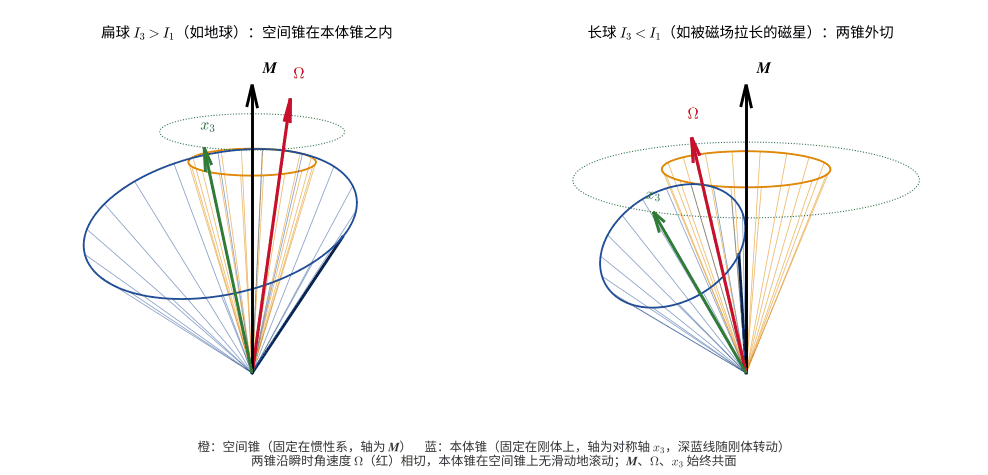

### 物理实例：地球的自由章动

地球近似是一个略扁的对称陀螺：赤道方向的质量稍多，因而 $I_3>I_1=I_2$。由天文测量得到的动力学扁率约为

$$
\begin{equation}
\frac{I_3-I_1}{I_1}\approx\frac{1}{305}.
\end{equation}
$$

若地球的自转轴与形状对称轴之间有一个小夹角，上面的结果表明，从地球上看，自转轴将绕对称轴转动，周期为

$$
\begin{equation}
T_{\rm E}=\frac{2\pi}{\omega}
=\frac{I_1}{I_3-I_1}\cdot\frac{2\pi}{\Omega_3}
\approx305\ \text{天}.
\end{equation}
$$

这是欧拉在 18 世纪基于刚体模型给出的预言。它在地面上表现为地理纬度的微小周期变化，即“极移”。1891 年钱德勒（S. C. Chandler）分析纬度观测资料，确实发现了这种运动，但周期约为 430 天，而不是 305 天 [6]。差异主要来自地球并非绝对刚体：地幔的弹性形变和海洋的响应会部分“追随”自转轴，使有效的回复作用变弱、周期变长 [7]。这个例子很好地说明了刚体模型的价值与边界：它正确给出了现象的存在与量级，而精确的数值需要引入形变等更细致的物理。

还应把这种无外力矩的自由章动，与周期约 2.6 万年的岁差区分开来：后者来自太阳和月球对地球赤道隆起施加的引力矩，属于有外力矩的受迫进动，其机制与下文重力场中陀螺的慢进动相同（见后文“地球的岁差”）。

阅读：中子星——宇宙中最精确的转子

自由对称陀螺的结果 $\omega=\dfrac{I_3-I_1}{I_1}\Omega_3$ 不仅适用于地球，也是当今脉冲星天文学和引力波天文学中的一个基本工具。

中子星的质量约为 $1.4\,M_\odot$，半径约 $12$ km，转动惯量约为 $10^{38}\ \mathrm{kg\,m^2}$（即天体物理文献中常用的 $10^{45}\ \mathrm{g\,cm^2}$）。射电脉冲星就是一个转动的中子星，它的辐射束每转一圈扫过地球一次，相当于一座以自转为摆的“钟”。有些毫秒脉冲星的自转周期已经测到了十五六位有效数字，所以中子星可以说是宇宙中最精确的转子。转子越精确，就越能从它的转动中读出微小的物理效应。

**自由进动**

中子星非常接近球形，但并不完美：固态外壳的弹性应变和内部的强磁场都可以使它略为扁或略为长。把它近似为对称陀螺，定义**椭率**

$$
\begin{equation*}
\epsilon\equiv\frac{I_3-I_1}{I_1}.
\end{equation*}
$$

若自转轴与对称轴之间有一个小夹角，那么在刚体系中 $\boldsymbol\Omega$ 以角速度 $\omega=\epsilon\Omega_3$ 绕对称轴转动；在惯性系中，对称轴以 $\dot\varphi=M/I_1\approx(1+\epsilon)\Omega_3$ 绕固定的 $\boldsymbol M$ 进动，同时绕自身以 $\dot\psi=-\omega$ 转动。辐射束固定在星体上，所以观测者看到的脉冲到达时间和脉冲轮廓会以

$$
\begin{equation*}
P_{\rm fp}=\frac{2\pi}{|\omega|}=\frac{P}{|\epsilon|}
\end{equation*}
$$

为周期发生调制，其中 $P$ 是自转周期。这与前面地球的自由章动是同一个公式：地球 $\epsilon\approx1/305$，$P=1$ 天，所以 $P_{\rm fp}\approx305$ 天。

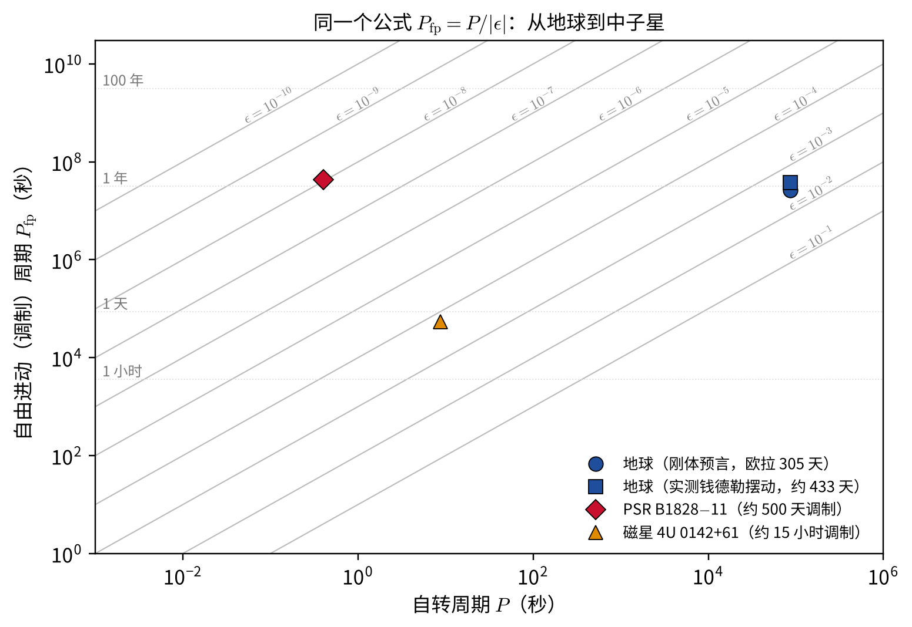

- **PSR B1828-11**。这颗脉冲星的自转周期为 $0.405$ s，它的自转减慢率和脉冲轮廓都以约 500 天的周期变化。Stairs、Lyne 和 Shemar 在 2000 年把它解释为自由进动 [15]，相应的椭率只有 $\epsilon\approx0.405\ \mathrm{s}/(500\times86400\ \mathrm{s})\approx10^{-8}$。后来，Lyne 等人发现许多脉冲星的自转减慢率会在两个离散状态之间切换，提出了“磁层切换”的另一种解释 [16]；2025 年对二十多年计时数据的分析又发现，调制周期在缓慢变短（从约 490 天降到约 435 天），并伴有突然的跳变 [17]。这颗脉冲星究竟是否在自由进动，目前仍有争议。
- **磁星 4U 0142+61**。磁星是表面磁场高达 $10^{10}$–$10^{11}$ T 的中子星。日本“朱雀”卫星发现，这颗自转周期为 $8.69$ s 的磁星，其硬 X 射线脉冲的相位以约 15 小时的周期来回漂移 [18]。若解释为自由进动，则 $\epsilon\approx8.69\ \mathrm{s}/(15\times3600\ \mathrm{s})\approx1.6\times10^{-4}$，比普通脉冲星大四个数量级。如此大的形变需要星体内部有约 $10^{12}$ T 的环向磁场，它会把中子星沿磁轴拉长成长椭球（$I_3<I_1$）。按照后文“最大轴规则”，有内部耗散的长椭球最终会绕垂直于对称轴的方向转动，这为磁星磁轴与自转轴的相对取向提供了一种演化机制。

自由进动还是窥探中子星内部的一扇窗。中子星内部有超流体，超流体以量子化涡旋的形式携带角动量。如果这些涡旋被“钉扎”在外壳的晶格上，它们会像一个附加在星体上的陀螺仪，使进动变得极快、极难观测 [19]。所以，若能确认一颗脉冲星在缓慢地自由进动，就意味着涡旋钉扎必须很弱，这对致密核物质的性质给出了约束。

**连续引力波**

现在设中子星绕主轴 $x_3$ 转动，但赤道面内两个主转动惯量略有不同，$I_1\ne I_2$。这样一个转动的“略扁的土豆”，其质量四极矩在惯性系中随转动而周期变化。由于转过半圈后质量分布恢复原样，它以**两倍自转频率** $f=2f_{\rm rot}$ 持续辐射引力波。在距离 $d$ 处，引力波振幅为 [20]

$$
\begin{equation*}
h_0=\frac{16\pi^2G}{c^4}\,\frac{I_3\,\epsilon_{\rm eq}\,f_{\rm rot}^2}{d},
\qquad
\epsilon_{\rm eq}\equiv\frac{|I_1-I_2|}{I_3}.
\end{equation*}
$$

进阶推导：连续引力波的振幅从哪里来

引力波的领头阶来自质量四极矩的变化（四极公式）：在距离 $d$ 处，

$$
\begin{equation*}
h_{jk}\approx\frac{2G}{c^4d}\,\ddot Q_{jk},\qquad
Q_{jk}=\int\rho\left(x_jx_k-\tfrac13\delta_{jk}r^2\right)d^3x=-I_{jk}+\tfrac13\delta_{jk}\operatorname{tr}\boldsymbol I .
\end{equation*}
$$

星体绕主轴 $x_3$（与惯性系 $Z$ 轴重合）以 $\Omega$ 转动，赤道面内的主转动惯量为 $I_1\ne I_2$。转到惯性系，惯量张量在 $XY$ 平面内的分量为

$$
\begin{equation*}
I_{XX}=\frac{I_1+I_2}{2}+\frac{I_1-I_2}{2}\cos2\Omega t,\qquad
I_{XY}=\frac{I_1-I_2}{2}\sin2\Omega t ,
\end{equation*}
$$

以 $2\Omega$ 变化，因为转过半圈后质量分布复原。求两次导数，$|\ddot Q_{XX}|$ 的振幅为 $(2\Omega)^2\cdot\tfrac12|I_1-I_2|=2\Omega^2|I_1-I_2|$。对沿转轴方向的观测者，

$$
\begin{equation*}
h_0=\frac{2G}{c^4d}\cdot2\Omega^2|I_1-I_2|=\frac{4G\Omega^2}{c^4d}\,\epsilon_{\rm eq}I_3
=\frac{16\pi^2G}{c^4}\frac{I_3\,\epsilon_{\rm eq}f_{\rm rot}^2}{d},
\end{equation*}
$$

即正文的公式。同理，由四极辐射功率 $P=\dfrac{G}{5c^5}\langle\dddot Q_{jk}\dddot Q_{jk}\rangle$ 可得 $P=\dfrac{32G}{5c^5}I_3^2\epsilon_{\rm eq}^2\Omega^6$，作业第 4 题要用到。

$\epsilon_{\rm eq}$ 称为赤道椭率。如果把脉冲星观测到的转动能损失 $-\dot E=-I_3\Omega\dot\Omega$ 全部归于引力辐射，就得到椭率和振幅的上限，称为**自转减慢上限**。

LIGO 和 Virgo 利用第二、三期观测数据，搜索了 236 颗已知脉冲星的连续引力波 [20]。虽然没有探测到信号，但对其中 23 颗脉冲星的限制已经低于自转减慢上限。例如，蟹状星云脉冲星的引力辐射至多只占其转动能损失的 $0.009\%$，船帆座脉冲星至多占 $0.27\%$；最严格的椭率上限来自毫秒脉冲星 J0711-6830，$\epsilon_{\rm eq}<5.3\times10^{-9}$。按 $\Delta h\sim\epsilon R$ 粗略换算，这相当于一个半径 12 km 的星体上不到 0.1 毫米高的“山”。理论估计中子星外壳最多能支撑 $\epsilon\sim10^{-6}$ – $10^{-5}$ 的形变 [21]，所以现在的观测已经在检验这些理论。下一代地面引力波探测器（如爱因斯坦望远镜、宇宙探索者）有望第一次探测到这种来自转动刚体的引力波。

**自转突变：角动量在内部重新分配**

脉冲星的自转在长期减慢的背景上，偶尔会在极短时间内突然加快，称为**自转突变**（glitch）。例如船帆座脉冲星大约每三年发生一次，每次 $\Delta\Omega/\Omega\sim10^{-6}$。2016 年的一次突变被射电望远镜逐个脉冲地完整记录下来，自转在不到十几秒内就完成了跳变 [22]。

用本章的语言，可以把中子星简化成两个部分：转动惯量为 $I_{\rm c}$ 的外壳（连同与之紧密耦合的部分），以及转动惯量为 $I_{\rm s}$ 的超流体。电磁力矩只作用在外壳上，使它逐渐转慢；而涡旋被钉扎的超流体转不慢，于是两者之间积累了角速度差。突变时涡旋集体脱钉，超流体把角动量交给外壳。这是内力的作用，总角动量守恒：

$$
\begin{equation*}
I_{\rm c}\,\Delta\Omega_{\rm c}=-I_{\rm s}\,\Delta\Omega_{\rm s}.
\end{equation*}
$$

把船帆座脉冲星几十年来所有突变转移的角动量加起来，就可以估计参与突变的超流体至少占总转动惯量的约 $1.4\%$ [23]。这就是从刚体角动量守恒出发，读出中子星内部结构的一个例子。

<!-- 原 PDF 第 13 页 -->

## 非对称刚体的自由转动

设

$$
\begin{equation}
I_3>I_2>I_1.
\end{equation}
$$

无外力矩时，欧拉方程为

$$
\begin{equation}
\begin{aligned}
I_1\dot\Omega_1&=(I_2-I_3)\Omega_2\Omega_3,\\
I_2\dot\Omega_2&=(I_3-I_1)\Omega_3\Omega_1,\\
I_3\dot\Omega_3&=(I_1-I_2)\Omega_1\Omega_2.
\end{aligned}
\end{equation}
$$

系统有两个守恒量：转动能量与角动量大小，

$$
\begin{equation}
I_1\Omega_1^2+I_2\Omega_2^2+I_3\Omega_3^2=2E,
\end{equation}
$$

$$
\begin{equation}
M_1^2+M_2^2+M_3^2=M^2,
\qquad M_i=I_i\Omega_i.
\end{equation}
$$

在 $\boldsymbol M$ 空间中，能量面为椭球

$$
\begin{equation}
\frac{M_1^2}{2EI_1}
+\frac{M_2^2}{2EI_2}
+\frac{M_3^2}{2EI_3}=1,
\end{equation}
$$

而角动量守恒对应半径为 $M$ 的球面。实际运动位于二者的交线上。存在交线要求

$$
\begin{equation}
2EI_1\leq M^2\leq2EI_3.
\end{equation}
$$

等号分别对应绕 $x_1$ 或 $x_3$ 主轴的纯转动。能量椭球面与角动量球面的交线就是 $\boldsymbol M$ 相对刚体的运动轨迹（见本节末的图）。球面来自角动量大小守恒，椭球面来自能量守恒，两者的交线同时满足全部守恒约束。它与泊安索（Poinsot）构图所表达的无力矩刚体几何结构密切相关，但这里画的是角动量空间中的能量—动量交线。

<!-- 原 PDF 第 14 页 -->

随着 $M^2$ 的取值改变，交线的拓扑发生变化：

- 当 $M^2\to2EI_1$ 时，闭合曲线收缩到 $x_1$ 轴上的两个极点；
- 当 $M^2=2EI_2$ 时，得到经过 $x_2$ 轴极点的分离轨道；
- 当 $M^2\to2EI_3$ 时，闭合曲线收缩到 $x_3$ 轴上的两个极点。

因此，绕最小主转动惯量轴 $x_1$ 和最大主转动惯量轴 $x_3$ 的自由转动是稳定的，而绕中间主转动惯量轴 $x_2$ 的转动是不稳定的。这个结论也可直接从欧拉方程的线性化看出。设刚体主要绕 $x_2$ 轴转动，令 $\Omega_2\simeq\Omega_0$，而 $\Omega_1,\Omega_3$ 是小扰动，则

$$
\begin{equation}
\ddot\Omega_1
=\frac{(I_3-I_2)(I_2-I_1)}{I_1I_3}\Omega_0^2\Omega_1.
\end{equation}
$$

由于右侧系数为正，微小扰动按指数增长，所以中间轴转动不稳定。若对 $x_1$ 或 $x_3$ 轴作同样分析，右侧系数为负，扰动只会振荡而不会持续增长。这就是**中间轴定理**，下一小节将详细讨论。除分离轨道外，交线是闭合曲线，所以 $\boldsymbol M$ 相对刚体的运动是周期性的。

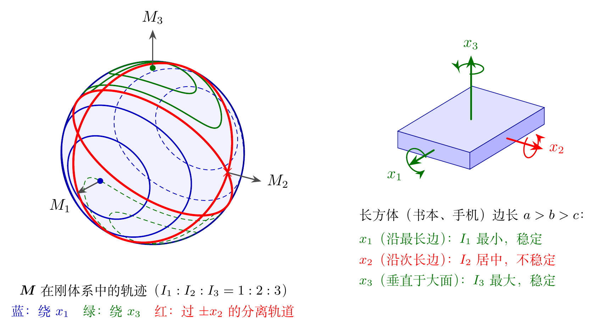

上图左侧是按 $I_1:I_2:I_3=1:2:3$ 精确画出的角动量球面上的交线（实线为球面正面，虚线为背面）：绕 $\pm x_1$ 和 $\pm x_3$ 的都是小闭合圈，红色的分离轨道则是经过 $\pm x_2$ 的两个大圆。右侧以一本书为例：绕最长边和绕垂直于封面的轴抛起旋转都很平稳，绕次长边旋转则会翻转。

**观察动画前先预测：**三个物体都没有受到外力矩，哪一个会翻转？翻转时保持不变的是刚体的哪一个量？

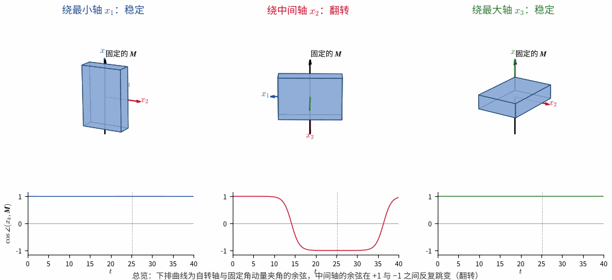

动画由欧拉方程数值积分得到，黑色箭头表示惯性系中固定不动的角动量 $\boldsymbol M$；下排曲线是各物体的自转轴与 $\boldsymbol M$ 夹角的余弦。最小轴和最大轴附近的微小偏差只产生有界摆动；中间轴附近的偏差则不断放大，使刚体相对固定的 $\boldsymbol M$ 周期性翻转。

### 进阶几何图像：泊安索构图

前面的图画的是 $\boldsymbol M$ 空间中能量椭球与角动量球面的交线。泊安索构图则采用另一个等价几何图像：在随体坐标 $\boldsymbol\xi=(\xi_1,\xi_2,\xi_3)$ 中定义惯量椭球，并令它在一个垂直于固定角动量的平面上滚动 [1, 2, 9]。一组方便的归一化是

$$
\begin{equation}
I_1\xi_1^2+I_2\xi_2^2+I_3\xi_3^2=1,
\qquad
\boldsymbol\xi_P=\frac{\boldsymbol\Omega}{\sqrt{2E}},
\qquad
\boldsymbol M\cdot\boldsymbol r=\sqrt{2E}.
\end{equation}
$$

其中 $\boldsymbol\xi_P$ 是接触点在随体系中的位置，$\boldsymbol r$ 是同一点在惯性系中的位置。接触点在惯量椭球上画出的红色轨迹称为 **polhode**；它在空间不变平面上画出的橙色轨迹称为 **herpolhode**。

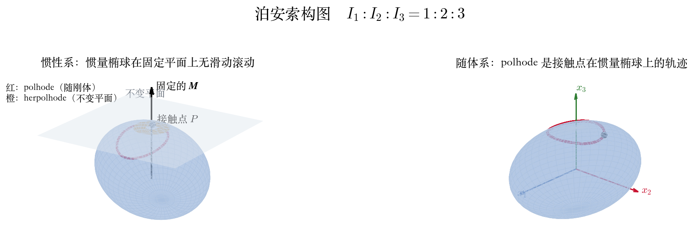

这个“滚动”不是把刚体真的放在一张平面上，而是对无外力矩转动的几何表述。惯量椭球的取向始终与刚体绑定，而不变平面的法向始终是空间中固定的 $\boldsymbol M$。因此，同一个自由刚体运动可以同时被看成欧拉方程的解、两个守恒曲面的交线，或惯量椭球在不变平面上的无滑动滚动。

下面的动画按 $I_1:I_2:I_3=1:2:3$ 数值积分欧拉方程，把 $\boldsymbol M$ 取为竖直向下，不变平面就像一张水平的桌面，惯量椭球在上面滚动。红色的 polhode 画在椭球上、随椭球转动，是一条闭合曲线；橙色的 herpolhode 画在桌面上，一般不闭合。

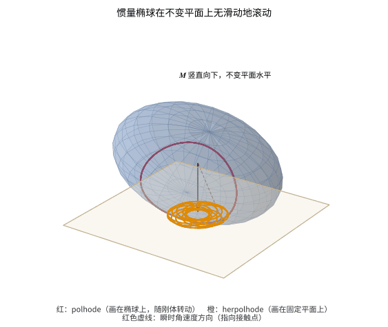

推导：为什么惯量椭球与不变平面相切且无滑动？

对惯量椭球 $F(\boldsymbol\xi)=\sum_i I_i\xi_i^2=1$，接触点处的法向为

$$
\begin{equation*}
\left.\boldsymbol\nabla_{\!\xi}F\right|_P
=2\boldsymbol I\boldsymbol\xi_P
=\frac{2\boldsymbol M}{\sqrt{2E}},
\end{equation*}
$$

所以切平面的法向与 $\boldsymbol M$ 平行。又因为 $\boldsymbol M\cdot\boldsymbol\Omega=2E$，该切平面到椭球中心的距离恒为 $\sqrt{2E}/M$，因而它在惯性系中是固定的。

接触点的空间位置矢量与瞬时角速度平行，因此该刚体点的瞬时速度为

$$
\begin{equation*}
\boldsymbol v_P
=\boldsymbol\Omega\times\boldsymbol r_P=0.
\end{equation*}
$$

接触点相对不变平面瞬时静止，这就是“无滑动滚动”的含义。

### 中间轴定理与贾尼别科夫效应

上面的结论有一个响亮的名字：**中间轴定理**（intermediate axis theorem），也称**网球拍定理**。拿一支网球拍做实验：它绕手柄方向的转动惯量最小（$I_1$），绕垂直于拍面方向的转动惯量最大（$I_3$），绕拍面内与手柄垂直的方向的转动惯量居中（$I_2$）。分别绕这三条轴把它抛起旋转，前两种情形下球拍平稳地转动；绕中间轴抛出时，球拍在空中转一两圈后几乎总会把拍面“翻”过来，接住时拍面朝向与抛出时相反。手机、书本、长方形的橡皮都能做同样的实验。

在失重环境中，这个现象表现得更为惊人。1985 年，苏联宇航员贾尼别科夫（В. А. Джанибеков）随“联盟 T-13”号飞船执行“礼炮 7 号”空间站的抢修任务。他在拧下一个 T 形把手的螺母时注意到：螺母离开螺杆后一边快速旋转一边飘向前方，每隔几秒钟就突然调转 $180^\circ$，然后继续旋转，再过几秒又转回来，如此周而复始。这一现象后来被称为**贾尼别科夫效应**（Dzhanibekov effect），在国际空间站上拍摄的类似视频也广为流传。

它并不是什么新的物理。欧拉方程早就包含了全部答案，泊安索（L. Poinsot）在 1834 年也给出了相应的几何图像 [9]。它之所以令人惊讶，是因为看起来违反直觉：**没有任何外力矩，物体却会周期性地翻转。** 下面利用本课程已有的工具，把这个现象从四个角度讲清楚。

#### 没有力矩，为什么能翻转？

在惯性系中，$\boldsymbol K=0$ 意味着 $\boldsymbol M$ 的方向和大小都严格不变；转动能 $E$ 也守恒。在“最小作用量原理”一章中我们看到，这两个守恒量分别来自时间平移不变性和空间转动不变性。所以“翻转”不可能是 $\boldsymbol M$ 的翻转。

翻转的是**刚体相对于 $\boldsymbol M$ 的取向**。设开始时刚体几乎绕 $x_2$ 轴转动，$\boldsymbol M\approx I_2\Omega_0\hat{\boldsymbol e}_2$，即 $x_2$ 轴几乎与 $\boldsymbol M$ 平行。若某一时刻 $\Omega_2$ 变为 $-\Omega_0$，则 $M_2=I_2\Omega_2<0$，说明 $x_2$ 轴此时与 $\boldsymbol M$ **反平行**。$\boldsymbol M$ 在空间中没有动，刚体却已经“倒转”过来了。所以只需研究 $\boldsymbol M$ 在刚体系中的轨迹（即前面能量椭球与角动量球面的交线），就能完全理解翻转。

#### 能量地形图

固定 $M$ 的大小，把 $\boldsymbol M$ 写成 $\boldsymbol M=M\boldsymbol n$，其中 $\boldsymbol n=(n_1,n_2,n_3)$ 是刚体系中的单位矢量。转动能可以写成 $\boldsymbol n$ 在单位球面上的函数：

$$
\begin{equation}
E(\boldsymbol n)=\frac{M^2}{2}\left(\frac{n_1^2}{I_1}+\frac{n_2^2}{I_2}+\frac{n_3^2}{I_3}\right),
\qquad n_1^2+n_2^2+n_3^2=1 .
\end{equation}
$$

由于 $I_1<I_2<I_3$，这个函数在 $\pm x_3$ 处取极小值 $M^2/(2I_3)$，在 $\pm x_1$ 处取极大值 $M^2/(2I_1)$，而 $\pm x_2$ 是**鞍点**：从 $x_2$ 出发向 $x_1$ 方向走，$E$ 增大；向 $x_3$ 方向走，$E$ 减小。

把 $E(\boldsymbol n)$ 想象成单位球面上的地形，能量守恒意味着 $\boldsymbol n$ **只能沿着等高线运动**。与“中心力场”中一维运动的能量分析类似，系统的运动范围完全由守恒量限定，但这里不是“小球沿坡滚下”，而是沿着等高线绕行。于是：

- 极小点和极大点附近的等高线是围绕它们的小闭合圈，$\boldsymbol n$ 始终停留在 $\pm x_3$ 或 $\pm x_1$ 附近，转动是**稳定的**；
- 经过鞍点 $\pm x_2$ 的等高线 $E=M^2/(2I_2)$ 是一条**分离线**。代入上式，它满足

$$
\begin{equation}
n_1^2\left(\frac1{I_1}-\frac1{I_2}\right)=n_3^2\left(\frac1{I_2}-\frac1{I_3}\right),
\qquad\text{即}\qquad
n_3=\pm\sqrt{\frac{I_3(I_2-I_1)}{I_1(I_3-I_2)}}\;n_1 ,
\end{equation}
$$

这是两个过 $x_2$ 轴的平面，它们与球面相交成**两个大圆**，交于 $\pm x_2$。鞍点附近的任何一条等高线都沿着这两个大圆，从 $+x_2$ 附近一直走到 $-x_2$ 附近，再走回来。这就是翻转。

这里的“地形”只取决于三个主转动惯量的大小顺序，因此中间轴定理对任何三个主转动惯量互不相等的刚体都成立，与物体的具体形状无关。它与单摆十分相似：单摆的最低点是稳定平衡，倒立点是不稳定平衡，经过倒立点的分离线把摆动和转圈两类运动分开；在这里，$\pm x_2$ 扮演倒立点的角色。

推导：三个主轴附近的线性稳定性

用“微扰和摄动理论”中分析平衡位置附近微小振动的方法，可以把上面的定性图像变成定量结论。设刚体主要绕某一主轴以 $\Omega_0$ 转动，另外两个分量是小量。对 $x_2$ 轴，前面已经得到

$$
\begin{equation*}
\ddot\Omega_1=\lambda^2\Omega_1,
\qquad
\lambda\equiv\Omega_0\sqrt{\frac{(I_3-I_2)(I_2-I_1)}{I_1I_3}} .
\end{equation*}
$$

对 $x_3$ 轴和 $x_1$ 轴作同样的线性化（例如绕 $x_3$ 轴时取 $\Omega_3\simeq\Omega_0$，由欧拉方程的前两式消去 $\Omega_2$），得到

$$
\begin{align*}
& \ddot\Omega_1=-\omega_3^2\Omega_1,\;
\omega_3=\Omega_0\sqrt{\frac{(I_3-I_1)(I_3-I_2)}{I_1I_2}}; \\
& \ddot\Omega_2=-\omega_1^2\Omega_2,\;
\omega_1=\Omega_0\sqrt{\frac{(I_2-I_1)(I_3-I_1)}{I_2I_3}} .
\end{align*}
$$

方程 $\ddot x=-\omega^2x$ 是稳定平衡附近的简谐振动；$\ddot x=+\lambda^2x$ 则相当于“负的劲度系数”，即势能的极大点（倒立摆），扰动按 $e^{\lambda t}$ 增长。绕 $x_1$、$x_3$ 轴转动时，角速度在刚体系中作小幅的周期性摆动，即自由章动；绕 $x_2$ 轴转动时，扰动指数增长。

作为检验，令 $I_1=I_2$（对称陀螺），则 $\omega_3=\Omega_0(I_3-I_1)/I_1$，恰好是前面自由对称陀螺的章动频率 $\omega$，即地球自由章动的结果；同时 $\lambda=0$，“中间轴”不再存在。只有当三个主转动惯量**互不相等**时，才有中间轴不稳定性。

进阶推导：翻转的一维约化、分离轨道与椭圆积分

线性化只描述了翻转的开始。要看清完整的翻转，可以用两个守恒量消去 $\Omega_1$ 和 $\Omega_3$，把问题化为关于 $\Omega_2$ 的一维问题。由能量和角动量守恒，

$$
\begin{equation*}
\begin{aligned}
I_1(I_3-I_1)\Omega_1^2&=(2EI_3-M^2)-I_2(I_3-I_2)\Omega_2^2,\\
I_3(I_3-I_1)\Omega_3^2&=(M^2-2EI_1)-I_2(I_2-I_1)\Omega_2^2 .
\end{aligned}
\end{equation*}
$$

把欧拉方程的第二式 $I_2\dot\Omega_2=(I_3-I_1)\Omega_3\Omega_1$ 平方，代入上两式，得到

$$
\begin{equation*}
\dot\Omega_2^2=\frac{\bigl[(2EI_3-M^2)-I_2(I_3-I_2)\Omega_2^2\bigr]\bigl[(M^2-2EI_1)-I_2(I_2-I_1)\Omega_2^2\bigr]}{I_1I_2^2I_3}.
\end{equation*}
$$

这与“中心力场”中一维运动的能量方程 $\frac12m\dot x^2+U(x)=E$ 形式完全相同：右边相当于 $\frac2m[E-U]$，$\Omega_2$ 在两个“转折点”之间往复运动，运动时间可以由积分 $t=\int d\Omega_2/\sqrt{\cdots}$ 求出。

**分离轨道上的解。** 取 $M^2=2EI_2$，并记 $\Omega_0=M/I_2$，则 $2EI_3-M^2=I_2(I_3-I_2)\Omega_0^2$，$M^2-2EI_1=I_2(I_2-I_1)\Omega_0^2$，上式化为

$$
\begin{equation*}
\dot\Omega_2=\frac{\lambda}{\Omega_0}\left(\Omega_0^2-\Omega_2^2\right),
\end{equation*}
$$

其解为

$$
\begin{align*}
&\Omega_2=\Omega_0\tanh\lambda t, \\
&\Omega_1=\pm\Omega_0\sqrt{\frac{I_2(I_3-I_2)}{I_1(I_3-I_1)}}\,\operatorname{sech}\lambda t, \\
&\Omega_3=\pm\Omega_0\sqrt{\frac{I_2(I_2-I_1)}{I_3(I_3-I_1)}}\,\operatorname{sech}\lambda t .
\end{align*}
$$

（$\Omega_1$ 与 $\Omega_3$ 取相同的符号。）这个解把翻转刻画得清清楚楚：$t\to-\infty$ 时 $\Omega_2\to-\Omega_0$，$t\to+\infty$ 时 $\Omega_2\to+\Omega_0$，$x_2$ 轴相对 $\boldsymbol M$ 从反平行变为平行；翻转集中发生在 $|t|\lesssim2/\lambda$ 的一段时间内，此时 $\Omega_1$、$\Omega_3$ 像一个脉冲那样先增大再消失。由于 $\lambda$ 与 $\Omega_0$ 同一量级（对 $I_1:I_2:I_3=1:2:3$，$\lambda\approx0.58\,\Omega_0$），翻转本身只持续大约一圈，所以看起来非常“突然”。

**翻转的间隔。** 实际抛出的物体不可能恰好在分离轨道上，而是在它附近的一条闭合等高线上，所以翻转会周期性地重复。完整的解可以用雅可比椭圆函数写出 [2, §37]。设 $M^2>2EI_2$（若 $M^2<2EI_2$，把下式中的 $I_1$ 与 $I_3$ 互换），相邻两次翻转（$\Omega_2$ 相继两次过零）之间的时间为

$$
\begin{equation*}
\Delta t=2K(k)\sqrt{\frac{I_1I_2I_3}{(I_3-I_2)(M^2-2EI_1)}},\;
k'^2\equiv1-k^2=\frac{(I_3-I_1)(M^2-2EI_2)}{(I_3-I_2)(M^2-2EI_1)},
\end{equation*}
$$

其中 $K(k)$ 是第一类完全椭圆积分。$k'$ 衡量轨道离分离轨道有多近。靠近分离轨道时 $k'\to0$，$K(k)\approx\ln(4/k')$，于是

$$
\begin{equation*}
\Delta t\approx\frac{2}{\lambda}\ln\frac{4}{k'} .
\end{equation*}
$$

对数的出现有一个简单的解释：刚体大部分时间停留在鞍点 $\pm x_2$ 附近，在那里偏离量按 $e^{\lambda t}$ 增长；若初始偏离为 $\epsilon$（$k'$ 与 $\epsilon$ 同量级），从 $\epsilon$ 长到 $1$ 的量级需要约 $\lambda^{-1}\ln(1/\epsilon)$ 的时间，离开鞍点和到达下一个鞍点各需一次，合计约 $(2/\lambda)\ln(1/\epsilon)$。这与“中心力场”中质点趋近势能极大点时运动时间对数发散，是同一个数学结构。

下图是对 $I_1:I_2:I_3=1:2:3$ 的刚体数值积分欧拉方程的结果。

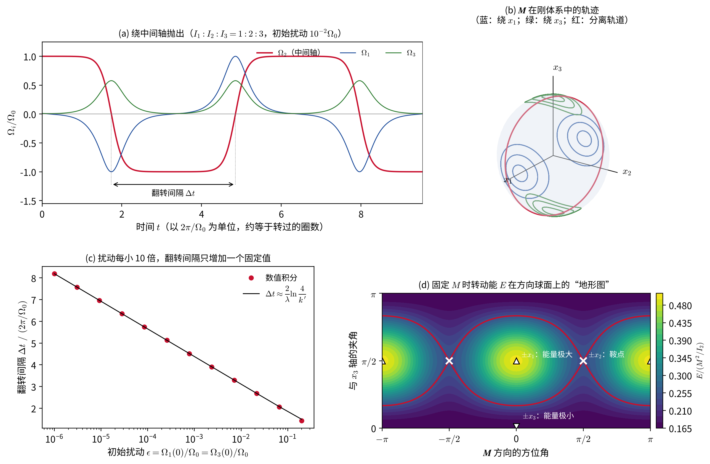

- 图 (a)：初始扰动为 $\Omega_1=\Omega_3=10^{-2}\Omega_0$。$\Omega_2$ 在 $+\Omega_0$ 和 $-\Omega_0$ 之间反复跳变，每次跳变时 $\Omega_1$、$\Omega_3$ 出现一个脉冲，大小与上面的 $\operatorname{sech}$ 解一致。这正是贾尼别科夫看到的情景：物体平稳地转上几圈，突然翻转，再转几圈，又翻转回来。
- 图 (b)：$\boldsymbol M$ 在刚体系中的轨迹，绕 $x_1$（蓝）和 $x_3$（绿）的小圈是稳定转动，红色是经过 $\pm x_2$ 的分离轨道（两个大圆）。
- 图 (c)：翻转间隔随初始扰动的变化。数值结果与 $\Delta t\approx(2/\lambda)\ln(4/k')$ 符合得很好：扰动每减小 10 倍，翻转间隔只增加 $(2\ln10)/\lambda$，对这个刚体约为 1.3 圈。所以，无论抛得多么“准”，翻转都只是被推迟了一点，而不会消失。
- 图 (d)：固定 $M$ 时转动能在方向球面上的“地形图”。三角形是极大点（$\pm x_1$）和极小点（$\pm x_3$），叉号是鞍点（$\pm x_2$），红线是分离线。

Ashbaugh 等人 [8] 还发现，网球拍每完成一次“翻转—翻回”的循环后，除了回到原来的转动状态外，还会绕 $\boldsymbol M$ 多转过一个与路径几何有关的角度（一种几何相位）。这一细节在正文中不再展开，更细致的分析见 [8, 14]。

#### 能量耗散与“最大轴规则”

以上讨论假设物体是绝对刚体。真实物体总有一定的弹性，转动时内部会发生微小的周期性形变，并通过内摩擦把动能转化为热。内力不产生外力矩，所以 $\boldsymbol M$ 仍然守恒，但 $E$ 会缓慢减小。在能量地形图上，这意味着 $\boldsymbol n$ 会缓慢地“下坡”，跨过一条条等高线，最终停在能量最低的 $\pm x_3$ 处。因此，对有耗散的物体，**只有绕最大主转动惯量轴的转动才是真正稳定的**；绕最小轴的转动在理想刚体中是稳定的，但在有耗散时会逐渐失稳。这称为**最大轴规则**。

下面的动画用一个唯象模型演示这一过程：在随体系的欧拉方程中加入一个很小的耗散项，

$$
\begin{equation*}
\frac{d'\boldsymbol M}{dt}=\boldsymbol M\times\boldsymbol\Omega-\gamma\,\boldsymbol\Omega_\perp ,
\end{equation*}
$$

其中 $\boldsymbol\Omega_\perp$ 是 $\boldsymbol\Omega$ 垂直于 $\boldsymbol M$ 的分量。附加项与 $\boldsymbol M$ 垂直，所以 $M$ 严格守恒；又有 $dE/dt=\boldsymbol\Omega\cdot d'\boldsymbol M/dt=-\gamma\Omega_\perp^2\le0$，所以能量单调减小。刚体起初几乎绕最小轴 $x_1$ 转动，$\boldsymbol n$ 一圈圈地“下坡”，越过分离线后最终停在 $\pm x_3$。

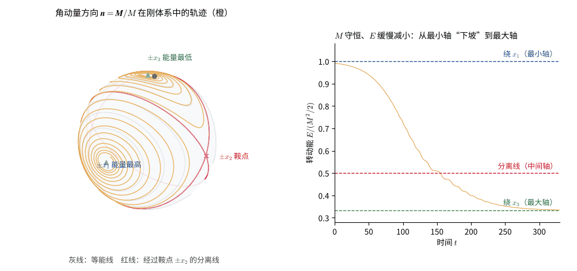

这一点在航天史上有过深刻的教训。1958 年发射的美国第一颗人造卫星“探险者 1 号”是一个细长的圆柱体，设计为绕长轴（最小转动惯量轴）以每分钟约 750 转自旋来稳定姿态。但卫星入轨后不久，它的自旋轴就开始偏离并发生进动，摆动越来越大，最终趋向绕横轴的翻滚。原因正是卫星上柔性部件的能量耗散：它在保持 $M$ 不变的同时降低了 $E$，把转动推向最大轴 [10]。此后，自旋稳定的航天器在设计时都必须考虑这一规则。

天文学中也处处可见最大轴规则：

- **地球**绕最大主转动惯量轴自转（$I_3>I_1\approx I_2$），这正是前面讨论的稳定情形。地球内部的耗散会使钱德勒摆动逐渐衰减，它之所以一直存在，是因为大气和海洋的质量重新分布不断地重新激发它。
- **小行星和彗星**：大多数小行星绕最大主轴自转。如果碰撞使它进入非主轴转动（俗称“翻滚”），内部耗散会使其逐渐回到最大主轴转动，所需的时间随天体尺寸减小、自转变慢而迅速变长 [11]。所以那些自转缓慢的小天体可以长期保持翻滚状态，例如近地小行星 4179 Toutatis [12]。2017 年发现的第一颗星际天体 1I/'Oumuamua 的光变曲线无法用单一的自转周期解释，它也在翻滚，估计这种状态需要至少 10 亿年才能被耗散掉 [13]。在翻滚的天体中，$\boldsymbol M$ 在刚体系中的轨迹就是图 (b) 中绕 $x_1$ 或 $x_3$ 的闭合曲线，测光观测中会出现两个不可公约的周期。
- **双小行星 Didymos–Dimorphos**：2022 年 NASA 的 DART 探测器撞击了小卫星 Dimorphos，使它绕主星的轨道周期缩短了约 33 分钟，并很可能改变了它的形状。动力学模拟表明，撞击后 Dimorphos 至少会有大幅的天平动，甚至可能进入翻滚状态 [26]。欧洲空间局的 Hera 探测器于 2024 年 10 月发射，按欧洲空间局的计划将于 2026 年 11 月抵达 Didymos 系统 [27]，届时将直接测定 Dimorphos 的转动状态，检验这里的刚体动力学预言。
- 土卫七 Hyperion 的自转则更为复杂：它受到土星引力矩的周期性驱动，形状又极不规则，自转是混沌的（见“动力学系统与混沌”一章）。

## 重力场中的对称陀螺（拉格朗日陀螺）

前面讨论的都是无外力矩的自由转动。现在考虑一个最经典的有外力矩问题：对称陀螺的尖端固定在支点 $O$，质心位于对称轴上、距支点 $l$，在均匀重力场中运动。这正是日常生活中玩具陀螺和陀螺仪的模型，相关的系统处理见 [1, 2]。

**观察动画前先预测：**陀螺转得更快时，重力引起的进动会变快还是变慢？对称轴与竖直方向的夹角是否必须保持不变？

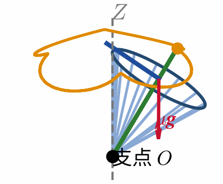

动画由下文的两个守恒广义动量和一维有效势方程数值积分得到。蓝色短线显示绕对称轴的快速自转，橙色曲线是对称轴端点在单位球面上的轨迹：它一面绕竖直轴进动，一面在两个倾角转折点之间章动。

以支点为原点，取惯性系 $Z$ 轴竖直向上。由平行轴定理，相对支点的横向主转动惯量为 $I_1'=I_1+\mu l^2$，而 $I_3$ 不变。利用前面得到的欧拉角动能公式，拉格朗日量为

$$
\begin{equation}
L=\frac{I_1'}{2}\left(\dot\varphi^2\sin^2\theta+\dot\theta^2\right)
+\frac{I_3}{2}\left(\dot\varphi\cos\theta+\dot\psi\right)^2
-\mu gl\cos\theta.
\end{equation}
$$

重力只依赖 $\theta$，所以 $\varphi$ 和 $\psi$ 仍是循环坐标，相应的广义动量守恒：

$$
\begin{equation}
p_\psi=I_3\left(\dot\varphi\cos\theta+\dot\psi\right)=I_3\Omega_3\equiv M_3,
\end{equation}
$$

$$
\begin{equation}
p_\varphi=I_1'\dot\varphi\sin^2\theta+M_3\cos\theta\equiv M_Z.
\end{equation}
$$

$M_3$ 是角动量沿陀螺对称轴的分量，$M_Z$ 是沿竖直方向的分量。前者守恒是因为重力矩总垂直于对称轴，后者守恒是因为重力矩总在水平面内。由第二式解出

$$
\begin{equation}
\dot\varphi=\frac{M_Z-M_3\cos\theta}{I_1'\sin^2\theta}.
\end{equation}
$$

拉格朗日量不显含时间，能量守恒。扣除常数 $M_3^2/(2I_3)$ 后，

$$
\begin{equation}
E'=\frac{I_1'}{2}\dot\theta^2+U_{\rm eff}(\theta),
\qquad
U_{\rm eff}(\theta)=\frac{\left(M_Z-M_3\cos\theta\right)^2}{2I_1'\sin^2\theta}+\mu gl\cos\theta.
\end{equation}
$$

这与中心力场中“角动量守恒＋能量守恒 $\Rightarrow$ 一维有效势”的处理完全平行：两个循环坐标被消去，只剩下倾角 $\theta$ 在有效势中作一维运动。$U_{\rm eff}$ 在 $\theta\to0,\pi$ 时一般发散，因此 $\theta$ 在两个转折点 $\theta_1,\theta_2$ 之间往复摆动，称为**章动**；与此同时，对称轴绕竖直轴转动，称为**进动**。根据 $M_Z-M_3\cos\theta$ 在 $[\theta_1,\theta_2]$ 内是否变号，对称轴端点在单位球面上描出波浪形、尖点形或打圈形的曲线。

下图取与动画相同的参数，只改变初始的进动角速度 $\dot\varphi_0$（从而改变 $M_Z$），俯视对称轴端点的轨迹。尖点形对应最常见的实验：把陀螺转起来后，让它的轴在某一倾角从静止释放，轴先下落，再在进动中周期性地停顿。

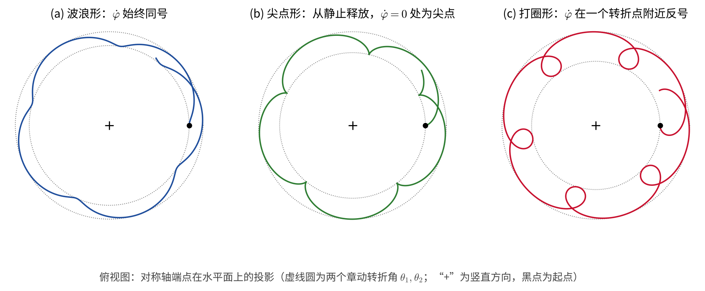

下图使用与前面动画相同的无量纲参数。左图显示 $U_{\rm eff}$ 在两端的发散使陀螺轴一般不能穿过竖直方向；右图放大势阱底部。当 $E'$ 略高于极小值时，倾角只能在 $E'=U_{\rm eff}$ 决定的两个转折点之间运动；当 $E'$ 恰好等于极小值且 $\dot\theta=0$ 时，$\theta$ 保持不变，对应稳定进动。

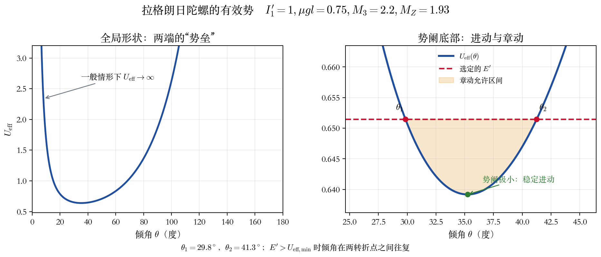

### 快速陀螺的慢进动

当陀螺转得很快、$M_3$ 很大时，章动幅度很小，可以近似认为 $\theta$ 不变。此时角动量几乎沿对称轴，$\boldsymbol M\approx M_3\hat{\boldsymbol e}_3$。重力矩

$$
\begin{equation}
\boldsymbol K=\mu gl\,\hat{\boldsymbol e}_3\times(-\hat{\boldsymbol Z})
\end{equation}
$$

大小为 $\mu gl\sin\theta$，方向水平且垂直于 $\boldsymbol M$ 的水平分量。由 $d\boldsymbol M/dt=\boldsymbol K$，力矩只改变角动量的方向而不改变其大小，于是 $\boldsymbol M$ 的水平分量 $M_3\sin\theta$ 以角速度 $\dot\varphi$ 绕竖直轴转动：

$$
\begin{equation}
\dot\varphi\,M_3\sin\theta=\mu gl\sin\theta
\quad\Longrightarrow\quad
\dot\varphi\simeq\frac{\mu gl}{I_3\Omega_3}.
\end{equation}
$$

这就是陀螺“不倒”的原因：重力并没有消失，它产生的力矩使角动量矢量在水平方向上转动，而不是使陀螺倒下。转得越快，进动越慢。

若陀螺竖直旋转（$\theta=0$，俗称“睡眠陀螺”），其稳定性可以通过 $U_{\rm eff}$ 在 $\theta=0$ 附近的小角展开判断。

推导：“睡眠陀螺”的临界自转角速度

要使 $\theta=0$ 处的有效势有限，必须有 $M_Z=M_3$。利用

$$
\begin{equation*}
1-\cos\theta=\frac{\theta^2}{2}+O(\theta^4),
\qquad
\sin^2\theta=\theta^2+O(\theta^4),
\end{equation*}
$$

可得

$$
\begin{equation*}
U_{\rm eff}(\theta)
=\mu gl+\frac{M_3^2-4I_1'\mu gl}{8I_1'}\theta^2+O(\theta^4).
\end{equation*}
$$

二次项系数为正时，竖直方向是有效势的极小点，微小倾斜只会产生有界振荡；系数为负时，竖直转动不稳定。

因此竖直转动稳定的条件为

$$
\begin{equation}
M_3^2>4I_1'\mu gl,
\qquad\text{即}\qquad
\Omega_3^2>\frac{4I_1'\mu gl}{I_3^2}.
\end{equation}
$$

当摩擦使 $\Omega_3$ 逐渐减小到低于这一临界值时，陀螺开始明显摇摆并最终倒下，这与日常经验相符。

### 物理实例：地球的岁差

前面提到，地球自转轴以约 2.6 万年的周期绕黄道面法线转动，这就是**岁差**。现在可以用快速陀螺的慢进动定量地解释它。

取惯性系 $Z$ 轴为黄道面的法线，地球的自转轴 $x_3$ 与之成 $\theta\approx23.44^\circ$（黄赤交角）。地球是一个扁的对称陀螺，$I_3>I_1=I_2$，转得极快，所以 $\boldsymbol M\approx I_3\Omega_3\hat{\boldsymbol e}_3$。太阳对地球赤道隆起的引力不经过地心，产生一个力矩；对地球公转一周取平均，相当于把太阳的质量均匀地摊在半径为 $a$ 的圆环上。利用“中心力场”一章潮汐势的四极展开（麦卡拉格公式），可以证明这个平均力矩的大小为

$$
\begin{equation}
K=\frac{3GM_\odot}{2a^3}\,(I_3-I_1)\sin\theta\cos\theta ,
\end{equation}
$$

方向沿节线，即总垂直于 $\boldsymbol M$ 和 $Z$ 轴。它和重力对拉格朗日陀螺的作用一样：只改变 $\boldsymbol M$ 的方向，不改变其大小，使 $\boldsymbol M$ 的水平分量 $I_3\Omega_3\sin\theta$ 以角速度 $\Omega_{\rm p}$ 绕 $Z$ 轴转动。由 $\Omega_{\rm p}\,I_3\Omega_3\sin\theta=K$，并利用 $GM_\odot/a^3=n^2$（$n$ 为地球的公转角速度），得到

$$
\begin{equation}
\Omega_{\rm p}=\frac32\,\frac{n^2}{\Omega_3}\,\frac{I_3-I_1}{I_3}\cos\theta .
\end{equation}
$$

推导：太阳对地球的平均力矩（麦卡拉格公式）

**四极展开。** 地球（质量 $m_{\rm E}$）在太阳引力场中的势能为 $U=-GM_\odot\int dm/|\boldsymbol r-\boldsymbol\rho|$，其中 $\boldsymbol r=r\hat{\boldsymbol s}$ 是地心相对太阳的位置，$\boldsymbol\rho$ 是质元相对地心的位置。把 $1/|\boldsymbol r-\boldsymbol\rho|$ 展开到 $\rho^2$ 阶（与“中心力场”一章的潮汐展开相同），一次项因 $\int\boldsymbol\rho\,dm=0$ 而消失：

$$
\begin{equation*}
U\approx-\frac{GM_\odot m_{\rm E}}{r}-\frac{GM_\odot}{2r^3}\int\left[3(\hat{\boldsymbol s}\cdot\boldsymbol\rho)^2-\rho^2\right]dm
=-\frac{GM_\odot m_{\rm E}}{r}-\frac{GM_\odot}{2r^3}\left(I_1+I_2+I_3-3I_s\right),
\end{equation*}
$$

其中 $I_s=\hat{\boldsymbol s}\cdot\boldsymbol I\hat{\boldsymbol s}$ 是绕日地连线的转动惯量；第二个等号用了 $\int\rho^2dm=\tfrac12(I_1+I_2+I_3)$ 和 $\int(\hat{\boldsymbol s}\cdot\boldsymbol\rho)^2dm=\int\rho^2dm-I_s$。这就是**麦卡拉格公式**。

**取向能。** 对称陀螺 $I_s=I_1+(I_3-I_1)\cos^2\gamma$，$\gamma$ 是对称轴与日地连线的夹角，所以与取向有关的部分为

$$
\begin{equation*}
U_{\rm or}=\frac{3GM_\odot}{2r^3}(I_3-I_1)\cos^2\gamma .
\end{equation*}
$$

**对一年取平均。** 在黄道坐标中 $\hat{\boldsymbol s}=(\cos\lambda,\sin\lambda,0)$。按本章的欧拉角约定，对称轴为 $\hat{\boldsymbol e}_3=(\sin\theta\sin\varphi,-\sin\theta\cos\varphi,\cos\theta)$，于是 $\cos\gamma=\sin\theta\sin(\varphi-\lambda)$。岁差远慢于公转，对 $\lambda$ 平均时 $\theta,\varphi$ 可视为不变，$\langle\cos^2\gamma\rangle=\tfrac12\sin^2\theta$，因此

$$
\begin{equation*}
\langle U_{\rm or}\rangle=\frac{3GM_\odot}{4a^3}(I_3-I_1)\sin^2\theta .
\end{equation*}
$$

**力矩。** 对应 $\theta$ 的广义力是绕节线的力矩：

$$
\begin{equation*}
K_\theta=-\frac{\partial\langle U_{\rm or}\rangle}{\partial\theta}=-\frac{3GM_\odot}{2a^3}(I_3-I_1)\sin\theta\cos\theta ,
\end{equation*}
$$

大小即正文的 $K$。负号表示力矩倾向于减小 $\theta$，即把赤道拉向黄道面；但由于地球在快速自转，结果不是倾角减小，而是自转轴绕 $Z$ 轴进动，这与重力使陀螺进动而不倒下是同一回事。月球的贡献形式完全相同，只需把 $M_\odot/a^3$ 换成 $M_{\rm Moon}/a_{\rm Moon}^3$（此处忽略月球轨道约 $5^\circ$ 的倾角）。

注意它的方向：赤道隆起被拉向黄道面，力矩使自转轴向西缓慢转动，所以岁差是**逆行**的，春分点每年沿黄道向西移动约 $50''$。

下图（a）是力矩的示意；（b）给出北天极在恒星间画出的圆（以黄极为中心、半径等于黄赤交角）。现在的北极星是勾陈一（Polaris），约公元前 3000 年时是右枢（Thuban），约一万两千年后织女星（Vega）将在北天极附近约 $5^\circ$ 处。

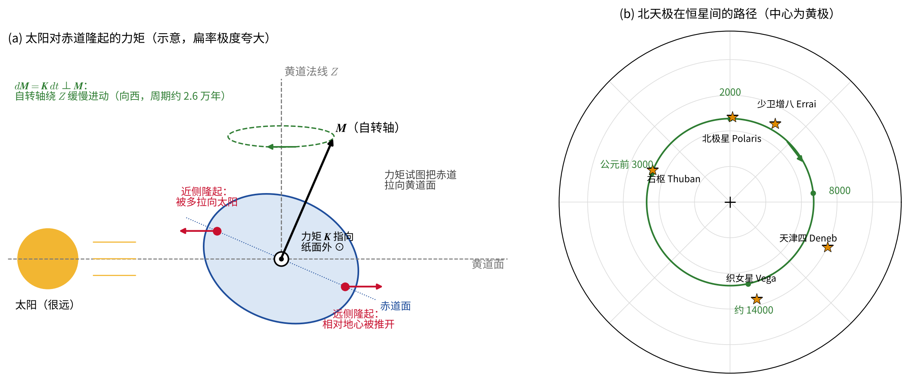

代入 $n/\Omega_3=1$ 恒星日$/365.25$ 天$\approx1/366.26$，$(I_3-I_1)/I_3\approx1/305$，$\cos\theta\approx0.917$，得到

$$
\begin{equation}
\frac{\Omega_{\rm p}}{n}\approx\frac32\times\frac{1}{366.26}\times\frac{1}{305}\times0.917\approx1.23\times10^{-5},
\end{equation}
$$

即太阳单独引起的岁差周期约为 $1/(1.23\times10^{-5})$ 年 $\approx8.1$ 万年。月球的质量虽小，却近得多。由于力矩正比于 $GM/a^3$，月球的贡献与太阳之比为

$$
\begin{equation}
\frac{M_{\rm Moon}}{M_\odot}\left(\frac{a_\odot}{a_{\rm Moon}}\right)^3\approx\frac{1}{2.71\times10^{7}}\times(389)^3\approx2.2 .
\end{equation}
$$

两者相加，总的岁差速率是太阳单独贡献的约 3.2 倍，周期约 $8.1$ 万年$/3.2\approx2.6$ 万年，与观测值 25 770 年符合得很好。反过来，天文学家正是用精确测得的岁差速率来确定地球的动力学扁率 $(I_3-I_1)/I_3$。

月球轨道面相对黄道倾斜约 $5^\circ$，并以 18.6 年的周期进动，使月球的力矩带有周期性的变化，在岁差之上叠加了周期 18.6 年的小幅摆动（黄经方向振幅约 $17''$，黄赤交角方向约 $9''$），称为**章动**（它与前面讨论的自由章动不同，是有外力矩的受迫运动）。

**行星自转轴的长期稳定性。** 岁差频率 $\Omega_{\rm p}$ 正比于 $n^2/\Omega_3$，对地球约为每年 $50''$。行星的轨道面本身也在其他行星的摄动下缓慢摆动，有一系列长周期频率。如果某个轨道摆动的频率与自转轴的岁差频率接近，就会发生共振（参见“微扰和摄动理论”），自转轴的倾角可能发生大幅变化。拉斯卡尔等人在 1993 年发现，火星正处于这样的共振区，它的自转轴倾角在 0° 到 60° 之间混沌地变化 [24]；地球则因为月球的存在，岁差比没有月球时快得多，被推离了这些共振，倾角只在约 $22^\circ$–$24.5^\circ$ 之间小幅变化 [25]。从这个意义上说，月球通过刚体的岁差稳定了地球的气候。这也是当前研究系外行星宜居性时要考虑的一个问题。

<!-- 原 PDF 第 15 页 -->

## 概念检查

下面的问题用来检查对物理图像的理解。建议先在心中作答，再展开查看解释。

1. 保持总质量和外半径不变，把质量从转轴附近移向外缘，相同力矩产生的角加速度如何变化？

转动惯量 $I=\int r_\perp^2dm$ 增大。在给定转轴的简单情形下，$\alpha=K/I$，所以相同力矩产生的角加速度减小。这是圆环比实心球更“难转动起来”的原因。

2. 刚体的角动量 M 是否一定与角速度 Ω 平行？

不一定。一般有 $\boldsymbol M=\boldsymbol I\boldsymbol\Omega$，惯量张量会改变方向。只有当 $\boldsymbol\Omega$ 恰好沿一条主轴，或刚体是 $I_1=I_2=I_3$ 的球形陀螺时，两者才必然平行。

3. 交换欧拉角三步转动中的前两步，最终取向会不会改变？

一般会改变。有限三维转动不可交换，并且第一步旋转会改变第二步所说的转轴在空间中的方向。只在小角度的一阶近似中，交换顺序造成的差异才是更高阶小量。“刚体的运动学”一节中两种顺序转动一本书的图就是一个例子。

4. 无外力矩对称陀螺中，哪些矢量在惯性系中固定，哪些量在随体系中周期变化？

总角动量 $\boldsymbol M$ 在惯性系中的大小和方向都固定，转动能也守恒。刚体的对称轴在惯性系中绕 $\boldsymbol M$ 进动；从随体系看，$\boldsymbol M$ 和 $\boldsymbol\Omega$ 的横向分量围绕对称轴周期转动。

5. 无外力矩时角动量不变，中间轴转动为什么仍然会“翻转”？

翻转的不是空间中的 $\boldsymbol M$，而是刚体相对 $\boldsymbol M$ 的取向。中间主轴附近的纯转动对应固定 $M$ 能量地形上的鞍点，微小偏差会按指数放大；整个过程中 $E$ 和 $M$ 仍然守恒。

6. polhode 和 herpolhode 是同一条曲线吗？

它们是同一接触点的两种轨迹，但不在同一个参考系中。polhode 画在与刚体一起转动的惯量椭球上；herpolhode 画在惯性系中固定的不变平面上。

7. 如何从有效势 U_eff(θ) 的图上读出章动转折点和稳定进动？

允许运动必须满足 $E'\geq U_{\rm eff}(\theta)$，与水平能量线的交点 $E'=U_{\rm eff}$ 就是 $\dot\theta=0$ 的转折点。若同时有 $dU_{\rm eff}/d\theta=0$，则倾角可以保持不变；在有效势极小点上对应稳定进动。

8. 为什么陀螺自转越快，重力引起的慢进动反而越慢？

在快速陀螺近似下，$\dot\varphi\simeq\mu gl/(I_3\Omega_3)$。重力矩给定时，自转越快意味着角动量越大；同样的力矩每单位时间只能使它的方向改变更小的角度，因而进动更慢。

## 作业

每道题后面有折叠的提示，建议先独立尝试，再展开查看。

### 1. 均匀实心圆柱

一个均匀实心圆柱，半径为 $R$，高度为 $h$，质量为 $m$。取原点在质心，$z$ 轴沿圆柱轴线并通过两底面的中心。求该圆柱的转动惯量张量。

提示

先判断圆柱属于哪一类陀螺，利用对称性减少需要计算的积分数目：非对角元为零，$I_1=I_2$。$I_3$ 可以把圆柱看成一叠薄圆盘直接得到；$I_1$ 可以利用 $I_1+I_2+I_3=2\int\rho r^2d^3r$，或把圆柱看成一叠薄圆盘，对每片用垂直轴定理和平行轴定理再积分。结果可以用 $h\to0$（薄圆盘，$I_1=\mu R^2/4$）和 $R\to0$（细杆，$I_1=\mu h^2/12$）两个极限检验。

### 2. 竖直平面内的双质点刚性杆

质量为 $m_1,m_2$ 的两个质点固定在一根质量可忽略的刚性杆上，分别位于固定支点两侧，至支点的距离为 $l_1,l_2$。杆只能在竖直平面内绕该支点转动，以 $\theta$ 描述杆相对竖直方向的夹角。求：

1. 系统相对支点的角动量，用 $\theta,\dot\theta,m_1,m_2,l_1,l_2$ 表示；
2. $\theta$ 所满足的运动方程；
3. 系统的拉格朗日量，并由欧拉－拉格朗日方程重新导出运动方程；
4. 判断平衡位置附近是否存在微小振动。若存在，求相应的有效势或小振动频率；若不存在，说明原因。

提示

建议同时用 $d\boldsymbol M/dt=\boldsymbol K$ 和拉格朗日方程两种方法求运动方程，并互相对照。判断小振动是否存在时，关键是看系统的质心位于支点的上方还是下方：可对 $m_1l_1$ 与 $m_2l_2$ 的大小关系分三种情形讨论，并说明 $m_1l_1=m_2l_2$ 时为什么没有回复力。

### 3. 手机的中间轴翻转

把手机近似为边长 $a>b>c$ 的均匀长方体，质量为 $\mu$。

1. 求三个主转动惯量，指出哪一条轴是中间轴。绕哪条轴把手机抛起旋转时会发生翻转？
2. 证明在 $\boldsymbol M$ 空间中，经过 $\pm x_2$ 的分离轨道是两个大圆，并求出它们所在平面的方程。
3. 验证分离轨道上的解 $\Omega_2=\Omega_0\tanh\lambda t$ 及相应的 $\Omega_1,\Omega_3$ 满足全部三个欧拉方程以及能量、角动量守恒。
4. 取 $a=15$ cm，$b=7$ cm，$c=0.8$ cm，绕中间轴以每秒 2 转抛出，初始时角速度偏离中间轴约 $3^\circ$。估计 $\lambda$ 和翻转间隔，并判断在大约 0.5 秒的空中飞行时间内能否看到翻转。
5. 若手机内部有微小的能量耗散，长时间后它会绕哪条轴转动？说明理由。

提示

第 1 问用正文长方体的结果，注意哪条棱对应哪条主轴。第 2、3 问回到正文“能量地形图”一段和进阶推导“翻转的一维约化、分离轨道与椭圆积分”。第 4 问先算 $\lambda=\Omega_0\sqrt{(I_3-I_2)(I_2-I_1)/(I_1I_3)}$，再把初始偏离角（以弧度计）当作 $k'$ 的量级，代入 $\Delta t\approx(2/\lambda)\ln(4/k')$ 作量级估计，不必计算椭圆积分。第 5 问联系“最大轴规则”和本章的动画。

### 4. 估算题：从地球到中子星

1. **地球的岁差。** 利用正文给出的平均力矩 $K$，分别计算太阳和月球引起的岁差速率（以每年角秒为单位），并与观测值每年约 $50.3''$ 比较。已知 $(I_3-I_1)/I_3=1/305$，黄赤交角 $23.44^\circ$，月球质量 $7.35\times10^{22}$ kg，地月距离 $3.84\times10^8$ m。
2. **脉冲星的自由进动。** 若把 PSR B1828-11 约 500 天的调制解释为自由进动，求其椭率 $\epsilon$。若中子星半径取 12 km，用 $\Delta h\sim\epsilon R$ 估算相应的“山”有多高。
3. **蟹状星云脉冲星的引力波。** 已知其自转周期 $P=33.8$ ms，$\dot P=4.2\times10^{-13}$，距离约 2 kpc，取 $I_3=10^{38}\ \mathrm{kg\,m^2}$。(a) 计算转动能的损失率 $-\dot E=4\pi^2I_3\dot P/P^3$。(b) 若这些能量全部以引力波辐射，引力波功率为 $\dfrac{32G}{5c^5}I_3^2\epsilon_{\rm eq}^2\Omega^6$，求相应的椭率上限，并由正文的 $h_0$ 公式求振幅上限（自转减慢上限）。(c) LIGO–Virgo 的观测表明引力辐射至多占 $-\dot E$ 的 $0.009\%$，相应的 $\epsilon_{\rm eq}$ 上限是多少？

提示

这是数量级估算，重点是看清每个公式中各物理量的量级。第 1 问可以先算太阳的贡献，再用正文的比值 $2.2$ 得到月球的贡献；注意 $n^2=GM_\odot/a^3$ 只对太阳成立，对月球要直接用 $GM_{\rm Moon}/a_{\rm Moon}^3$。第 2 问用 $\epsilon=P/P_{\rm fp}$。第 3 问注意 $\Omega=2\pi/P$，$f_{\rm rot}=1/P$；(c) 中功率与 $\epsilon_{\rm eq}^2$ 成正比，所以椭率上限按 $\sqrt{9\times10^{-5}}$ 缩小。

## 参考文献与资料来源

1. H. Goldstein, C. Poole and J. Safko, *Classical Mechanics*, 3rd ed., Chapters 4–5, Pearson. [出版社页面](https://www.pearson.com/en-gb/subject-catalog/p/Goldstein-Classical-Mechanics-Pearson-New-International-Edition-3rd-Edition/P200000004309?view=educator)。本章关于有限转动、欧拉角与刚体运动方程的主要结构可与此书对照。
2. L. D. Landau and E. M. Lifshitz, *Mechanics*, 3rd ed., Course of Theoretical Physics, Vol. 1, “Motion of a Rigid Body,” Butterworth-Heinemann. [Elsevier 教材页面](https://www.educate.elsevier.com/book/details/9780080503479)。该书适合进一步理解主轴、欧拉方程与自由刚体运动的简洁推导。
3. J. R. Taylor, *Classical Mechanics*, Chapter 10, University Science Books, 2005. [MIT Press 图书页面](https://mitpress.mit.edu/9781891389221/classical-mechanics/)。该书的物理解释和例题适合本科阶段补充阅读。
4. MIT OpenCourseWare, 8.09 *Classical Mechanics III*, Chapter 2, “Rigid Body Dynamics.” [课程讲义与下载页面](https://ocw.mit.edu/courses/8-09-classical-mechanics-iii-fall-2014/resources/mit8_09f14_chapter_2/)。讲义覆盖旋转坐标系、惯量张量、欧拉方程和有固定点的对称陀螺，可用于核对本章公式与符号。
5. L. Euler, “Formulae generales pro translatione quacunque corporum rigidorum,” *Novi Commentarii Academiae Scientiarum Petropolitanae* **20** (1776), 189–207, Eneström E478. [Euler Archive 条目与原文](https://scholarlycommons.pacific.edu/euler-works/478/)。其中包含有限刚体转动可等效为绕某一轴转动的经典结果，是欧拉转动定理的原始来源。

6. S. C. Chandler, “On the Variation of Latitude, I,” *The Astronomical Journal* **11**, 59–61 (1891)，[NASA ADS](https://ui.adsabs.harvard.edu/abs/1891AJ.....11...59C)。地球自由章动（钱德勒摆动）的发现文献。
7. K. Lambeck, *The Earth's Variable Rotation: Geophysical Causes and Consequences*, Cambridge University Press, 1980。系统讨论地球自转变化、极移以及地球非刚性对自由章动周期的影响。
8. M. S. Ashbaugh, C. C. Chicone and R. H. Cushman, “The Twisting Tennis Racket,” *Journal of Dynamics and Differential Equations* **3**, 67–85 (1991)。对中间轴不稳定性（网球拍效应）及翻转时附带的几何相位作了严格分析。

9. L. Poinsot, *Théorie nouvelle de la rotation des corps*, Bachelier, Paris, 1834。无力矩刚体转动的几何图像（泊安索构图）的原始来源。
10. R. N. Bracewell and O. K. Garriott, “Rotation of Artificial Earth Satellites,” *Nature* **182**, 760–762 (1958)。对“探险者 1 号”自旋失稳的解释：能量耗散使转动趋向最大主转动惯量轴。
11. J. A. Burns and V. S. Safronov, “Asteroid Nutation Angles,” *Monthly Notices of the Royal Astronomical Society* **165**, 403–411 (1973)。小行星非主轴转动的耗散阻尼时间估计。
12. R. S. Hudson and S. J. Ostro, “Shape and Non-Principal Axis Spin State of Asteroid 4179 Toutatis,” *Science* **270**, 84–86 (1995)。
13. W. C. Fraser, P. Pravec, A. Fitzsimmons, *et al.*, “The Tumbling Rotational State of 1I/‘Oumuamua,” *Nature Astronomy* **2**, 383–386 (2018)。
14. L. Van Damme, P. Mardešić and D. Sugny, “The Tennis Racket Effect in a Three-Dimensional Rigid Body,” *Physica D* **338**, 17–25 (2017)。网球拍效应的现代分析，包括手柄的翻转与附带的几何相位。

15. I. H. Stairs, A. G. Lyne and S. L. Shemar, “Evidence for Free Precession in a Pulsar,” *Nature* **406**, 484–486 (2000)。
16. A. Lyne, G. Hobbs, M. Kramer, I. Stairs and B. Stappers, “Switched Magnetospheric Regulation of Pulsar Spin-Down,” *Science* **329**, 408–412 (2010)。
17. A. Dias, G. Ashton, J. Ostrovska, D. I. Jones and M. Keith, “Observation of Discontinuities in the Periodic Modulation of PSR B1828−11,” *Monthly Notices of the Royal Astronomical Society* **538**, 2923–2936 (2025)。
18. K. Makishima, T. Enoto, J. S. Hiraga, *et al.*, “Possible Evidence for Free Precession of a Strongly Magnetized Neutron Star in the Magnetar 4U 0142+61,” *Physical Review Letters* **112**, 171102 (2014)。
19. J. Shaham, “Free Precession of Neutron Stars: Role of Possible Vortex Pinning,” *The Astrophysical Journal* **214**, 251–260 (1977)；B. Link, “Constraining Hadronic Superfluidity with Neutron Star Precession,” *Physical Review Letters* **91**, 101101 (2003)。
20. R. Abbott *et al.*（LIGO Scientific Collaboration, Virgo Collaboration and KAGRA Collaboration）, “Searches for Gravitational Waves from Known Pulsars at Two Harmonics in the Second and Third LIGO-Virgo Observing Runs,” *The Astrophysical Journal* **935**, 1 (2022)，[arXiv:2111.13106](https://arxiv.org/abs/2111.13106)。
21. G. Ushomirsky, C. Cutler and L. Bildsten, “Deformations of Accreting Neutron Star Crusts and Gravitational Wave Emission,” *Monthly Notices of the Royal Astronomical Society* **319**, 902–932 (2000)；N. K. Johnson-McDaniel and B. J. Owen, “Maximum Elastic Deformations of Relativistic Stars,” *Physical Review D* **88**, 044004 (2013)。
22. J. Palfreyman, J. M. Dickey, A. Hotan, S. Ellingsen and W. van Straten, “Alteration of the Magnetosphere of the Vela Pulsar during a Glitch,” *Nature* **556**, 219–222 (2018)。
23. B. Link, R. I. Epstein and J. M. Lattimer, “Pulsar Constraints on Neutron Star Structure and Equation of State,” *Physical Review Letters* **83**, 3362–3365 (1999)。
24. J. Laskar and P. Robutel, “The Chaotic Obliquity of the Planets,” *Nature* **361**, 608–612 (1993)。
25. J. Laskar, F. Joutel and P. Robutel, “Stabilization of the Earth's Obliquity by the Moon,” *Nature* **361**, 615–617 (1993)。
26. D. C. Richardson, H. F. Agrusa, *et al.*, “The Dynamical State of the Didymos System Before and After the DART Impact,” *The Planetary Science Journal* **5**, 182 (2024)，doi:10.3847/PSJ/ad62f5，[arXiv:2502.14990](https://arxiv.org/abs/2502.14990)。
27. European Space Agency, “ESA’s Hera targets early arrival at Didymos asteroids,” [ESA 新闻页面](https://www.esa.int/Space_Safety/Hera/ESA_s_Hera_targets_early_arrival_at_Didymos_asteroids)。Hera 的发射时间与抵达计划。

以上参考资料使用的欧拉角顺序与主动／被动旋转约定不完全相同。比较公式时应先统一约定，再比较矩阵次序和正弦项符号；本章自身始终采用正文“坐标旋转矩阵”一节给出的被动 $z$-$x$-$z$ 约定。
