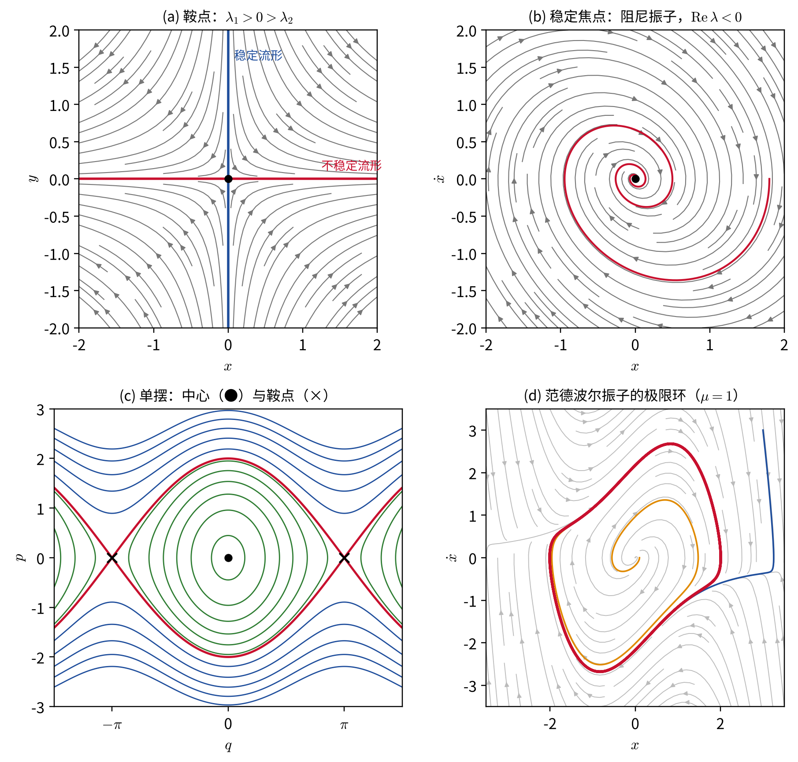
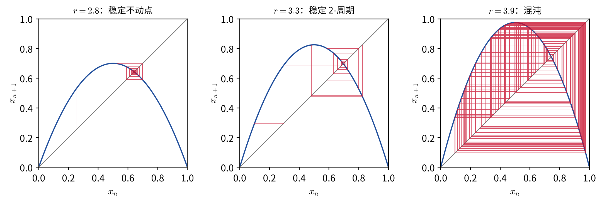
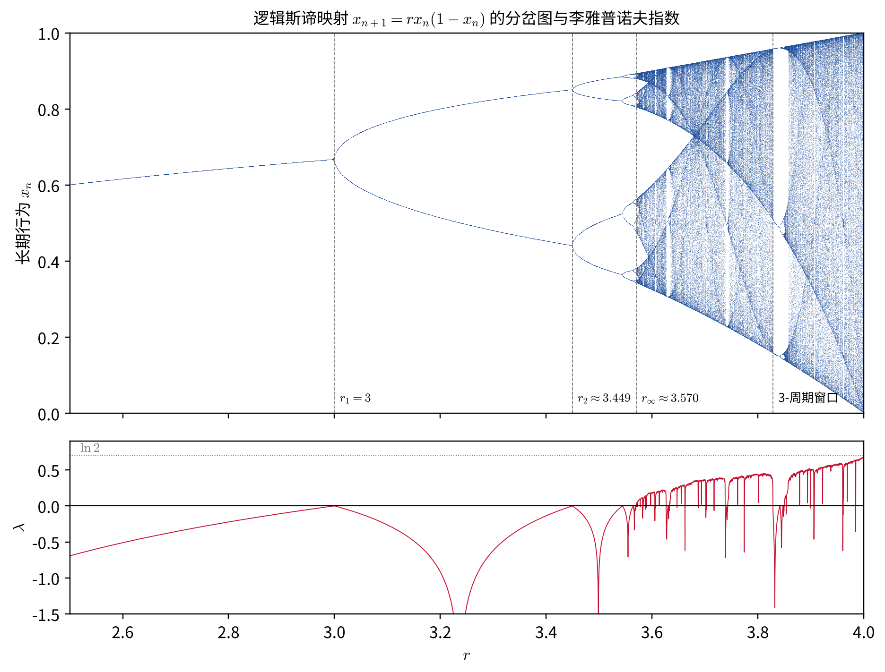
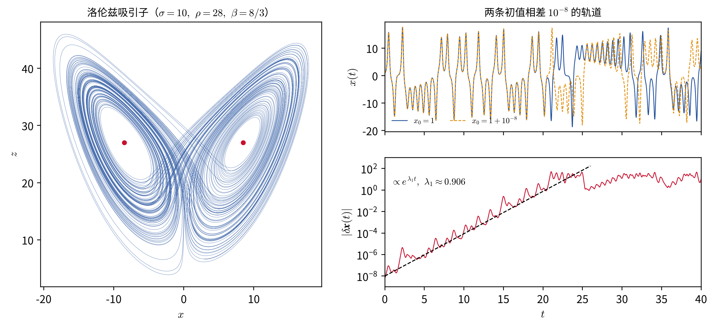
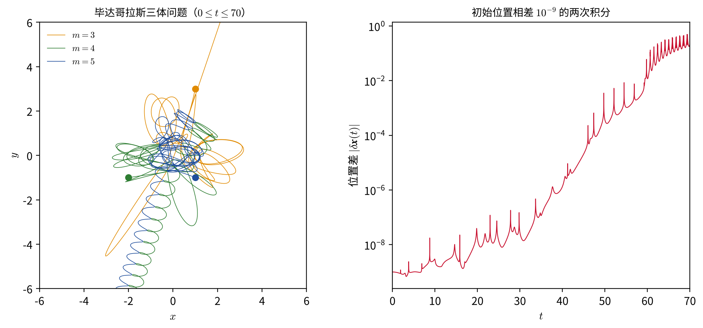
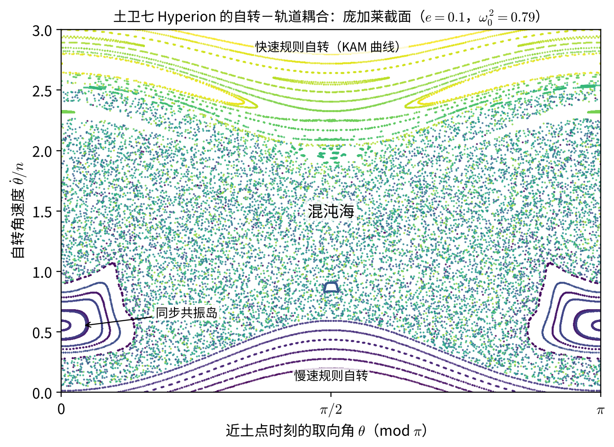

# 动力学系统与混沌

**——确定性中的不可预测**

> 本章建立在“哈密顿力学”一章的基础上，用到其中的相空间、哈密顿流、刘维尔定理和作用量－角变量；“微扰和摄动理论”中的阻尼振动、共振与 Floquet 理论，以及“中心力场”中拉格朗日点的稳定性，也会在这里以更一般的语言重新出现。“KAM 定理”一章专门讨论近可积哈密顿系统中规则运动与混沌如何共存，与本章互为补充：本章讲动力学系统与混沌的**一般框架**（包括有耗散的系统），哈密顿系统的细节则留给那一章。两章的阅读顺序可以互换。

1814 年，拉普拉斯在《概率的哲学论》中写道：一个智者若能知道某一时刻所有物体的位置和所受的力，并且有足够的能力分析这些数据，那么“对它来说，没有什么是不确定的，未来和过去一样，都会呈现在它的眼前”。这就是“拉普拉斯妖”，牛顿力学决定论的终极表述。

不到一百年后，庞加莱在《科学与方法》（1908）中写下了几乎相反的话：

> 一个我们觉察不到的极小的原因，有时会决定一个我们不能不看到的显著的结果……初始条件的微小差别可能在最后的现象中产生极大的差别。前者的微小误差将导致后者的巨大误差。预言变得不可能。

两段话并不矛盾。运动方程完全确定，给定初始条件就有唯一的解——这一点没有变。变的是：对某些系统，初始条件中无法避免的微小误差会以**指数**速度放大，使长期预言在实践上成为不可能。这种“确定性系统中的不可预测行为”就是**混沌**（chaos）。

本章的逻辑是：先把力学系统抽象为一般的**动力学系统**，区分保守与耗散（第 1 节）；用线性化分析不动点的稳定性（第 2 节）；看耗散系统特有的极限环、吸引子和分岔（第 3 节）；给出混沌的数学定义与刻画工具——李雅普诺夫指数（第 4 节）；用逻辑斯谛映射展示“通往混沌的道路”（第 5 节）；用洛伦兹系统介绍奇怪吸引子（第 6 节）；简述哈密顿混沌的特点（第 7 节）；最后看天文学中的混沌（第 8 节）。

## 1. 动力学系统：状态空间与流

### 定义

一个**动力学系统**由两部分组成：

1. **状态空间**（相空间）$\mathcal M$：它的每一个点 $\boldsymbol x$ 完整地描述系统在某一时刻的状态；
2. **演化规则**：给定当前状态，唯一地确定未来的状态。

对连续时间，演化规则通常是一组一阶常微分方程

$$
\begin{equation}
\dot{\boldsymbol x}=\boldsymbol f(\boldsymbol x),\qquad \boldsymbol x\in\mathcal M\subset\mathbb R^N,
\end{equation}
$$

$\boldsymbol f$ 称为**向量场**。记从初始点 $\boldsymbol x_0$ 出发、经过时间 $t$ 到达的点为 $\phi^t(\boldsymbol x_0)$，映射 $\phi^t:\mathcal M\to\mathcal M$ 称为**流**（flow）。由于方程不显含时间，流满足

$$
\begin{equation}
\phi^0=\mathrm{id},\qquad \phi^{t+s}=\phi^t\circ\phi^s .
\end{equation}
$$

对离散时间，演化规则是一个**映射**

$$
\begin{equation}
\boldsymbol x_{n+1}=\boldsymbol F(\boldsymbol x_n).
\end{equation}
$$

几乎所有力学问题都可以写成这种形式：

- **高阶方程化为一阶方程组。** 牛顿方程 $m\ddot x=F(x,\dot x)$ 令 $v=\dot x$，即得 $\dot x=v$、$\dot v=F/m$，状态空间是 $(x,v)$ 平面。哈密顿方程本身就是一阶的，状态空间就是 $2s$ 维相空间，$\boldsymbol f=(\partial H/\partial\boldsymbol p,\ -\partial H/\partial\boldsymbol q)$。
- **非自治系统化为自治系统。** 若方程显含时间，例如受周期外力的振子 $\ddot x+2\lambda\dot x+\omega_0^2x=f\cos\gamma t$，可以把相位 $\psi=\gamma t$ 当作新的状态变量，$\dot\psi=\gamma$，状态空间变为三维的 $(x,v,\psi)$。
- **流化为映射。** 在状态空间中取一个截面，记录轨道每次穿过截面的位置，得到**庞加莱映射**（“KAM 定理”一章已经用过）。对周期驱动的系统，最自然的选择是每隔一个驱动周期记录一次状态，称为**频闪映射**。流中的周期轨道对应映射的不动点（或周期点），这把对流的研究化为对映射的研究，降低了一维。

### 确定性与轨道不相交

若 $\boldsymbol f$ 足够光滑（满足利普希茨条件），常微分方程的存在唯一性定理保证：过状态空间的每一点有且只有一条轨道。因此**自治系统的轨道在状态空间中不能相交**（否则从交点出发就有两种未来）。这条看似平凡的结论有深远的后果：在二维状态空间中，轨道像平面上互不相交的曲线一样被严格限制，复杂的行为没有容身之地（第 3 节的庞加莱–本迪克松定理）；要让轨道“缠绕而不相交”，至少需要三维。

### 相体积的演化：保守与耗散

在“哈密顿力学”的刘维尔定理一节中，我们把哈密顿流看作相空间中的速度场，证明了它的散度为零。对一般的动力学系统，同样的计算给出：状态空间中一个小区域的体积 $V$ 满足

$$
\begin{equation}
\frac{dV}{dt}=\int_V\nabla\cdot\boldsymbol f\,d^Nx .
\end{equation}
$$

据此可以把动力学系统分成两大类：

- **保守系统**（哈密顿系统）：$\nabla\cdot\boldsymbol f=0$，相体积守恒；
- **耗散系统**：$\nabla\cdot\boldsymbol f<0$（至少平均意义下），相体积收缩。

例如“微扰和摄动理论”中的阻尼振子 $\dot x=v$，$\dot v=-\omega_0^2x-2\lambda v$，

$$
\begin{equation}
\nabla\cdot\boldsymbol f=\frac{\partial\dot x}{\partial x}+\frac{\partial\dot v}{\partial v}=-2\lambda ,
\end{equation}
$$

相面积按 $e^{-2\lambda t}$ 收缩。一团初始条件最终全部被压缩到原点。

这一区分在本章中处处起作用。**耗散系统可以有吸引子**：状态空间中的一个低维集合，周围的轨道最终都被吸引到它上面，初始条件的细节被“遗忘”。**哈密顿系统没有吸引子**：相体积守恒，一团初始条件只能被拉伸和折叠，不能被压缩到一个更小的集合上。天体力学中的轨道问题大多是（近似）哈密顿的；而恒星脉动、吸积、对流、气候等问题则是耗散的。

## 2. 不动点与线性稳定性

### 线性化

满足 $\boldsymbol f(\boldsymbol x^*)=0$ 的点称为**不动点**（平衡点）。令 $\boldsymbol x=\boldsymbol x^*+\boldsymbol\xi$，把 $\boldsymbol f$ 在不动点附近展开到一阶，得到线性化方程

$$
\begin{equation}
\dot{\boldsymbol\xi}=A\boldsymbol\xi,\qquad A_{ij}=\left.\frac{\partial f_i}{\partial x_j}\right|_{\boldsymbol x^*}.
\end{equation}
$$

它的解由矩阵 $A$ 的本征值 $\lambda_k$ 决定：每个本征方向上的扰动按 $e^{\lambda_kt}$ 演化。若所有 $\mathrm{Re}\,\lambda_k<0$，不动点**渐近稳定**；若有某个 $\mathrm{Re}\,\lambda_k>0$，不动点**不稳定**。这正是“微扰和摄动理论”中分析稳定平衡附近微小振动时做的事情，只是那里的 $A$ 来自势能的二阶导数。

### 二维不动点的分类

对二维系统，本征值满足 $\lambda^2-\tau\lambda+\Delta=0$，其中 $\tau=\operatorname{tr}A$，$\Delta=\det A$。于是

- $\Delta<0$：两个实本征值异号，**鞍点**（不稳定）；
- $\Delta>0$、$\tau<0$：稳定。$\tau^2>4\Delta$ 时为**稳定结点**（实本征值），$\tau^2<4\Delta$ 时为**稳定焦点**（复本征值，轨道螺旋地趋近）；
- $\Delta>0$、$\tau>0$：相应的不稳定结点或不稳定焦点；
- $\Delta>0$、$\tau=0$：纯虚本征值，**中心**，周围是闭合轨道。

**线性化什么时候可信？** 哈特曼–格罗布曼定理指出：若不动点是**双曲的**（所有本征值的实部都不为零），则在不动点附近，非线性系统的相图与线性化系统的相图在拓扑上相同。鞍点、结点、焦点都是双曲的，线性分析的结论可靠。**中心不是双曲的**，非线性项可以改变它的性质：同一个中心，加一点阻尼就变成稳定焦点（上图 b），加一点“负阻尼”就变成不稳定焦点。

### 哈密顿系统的约束

对哈密顿系统，$A=\mathsf J\,\partial^2H$（$\mathsf J$ 是辛矩阵 $\begin{pmatrix}0&I\\-I&0\end{pmatrix}$），可以证明：若 $\lambda$ 是本征值，则 $-\lambda$、$\lambda^*$、$-\lambda^*$ 也是。本征值成对出现、实部正负对称，因此：

- **哈密顿系统的不动点不可能渐近稳定**（这与刘维尔定理一致：相体积不能收缩到一点）；
- 一个自由度时，不动点只能是鞍点（$\pm\lambda$ 为实数）或中心（$\pm i\omega$），正如上图 (c) 中的单摆。

“中心力场”一章中拉格朗日点的稳定性就是例子：$L_1$、$L_2$、$L_3$ 的线性化有一对实本征值，是鞍点型的不稳定点；$L_4$、$L_5$ 在质量比 $\mu<0.0385$ 时本征值全部为纯虚数，是线性稳定的“中心”。但正如上面所说，中心的线性稳定性不能保证非线性稳定，这正是“KAM 定理”一章 5.3 节要用 KAM 理论回答的问题。

### 稳定流形与不稳定流形

鞍点附近，沿着负本征值方向趋近鞍点的轨道组成**稳定流形** $W^s$，沿着正本征值方向离开（即时间倒流时趋近）鞍点的轨道组成**不稳定流形** $W^u$（上图 a）。在单摆中，从倒立位置出发又回到倒立位置的分界线，就是鞍点的不稳定流形与稳定流形重合而成的曲线（上图 c 中的红线）。

稳定、不稳定流形是组织相空间的“骨架”。在天体力学中，它们有一个很实用的应用：日–地或地–月系统 $L_1$、$L_2$ 附近的周期轨道（如晕轨道）是不稳定的，与之相连的稳定流形是一族“自动通往”该周期轨道的轨道管道。沿着这些管道设计转移轨道，可以用很少的燃料把航天器送入 $L_2$ 附近的轨道，这一思想在近二十多年的空间任务设计中得到了广泛应用（参见本课程的“JWST 的 L2 之旅”）。

### 映射的不动点

对映射 $\boldsymbol x_{n+1}=\boldsymbol F(\boldsymbol x_n)$，不动点 $\boldsymbol x^*=\boldsymbol F(\boldsymbol x^*)$ 附近的扰动满足 $\boldsymbol\xi_{n+1}=M\boldsymbol\xi_n$，$M=D\boldsymbol F(\boldsymbol x^*)$。扰动按 $\mu_k^n$ 演化，所以稳定条件是所有本征值（乘子）$|\mu_k|<1$。对保面积的二维映射，$\det M=\mu_1\mu_2=1$，于是

$$
\begin{equation}
|\operatorname{tr}M|<2\ \Rightarrow\ \text{椭圆点（中心型，稳定）},\qquad
|\operatorname{tr}M|>2\ \Rightarrow\ \text{双曲点（鞍点型，不稳定）}.
\end{equation}
$$

流的周期轨道对应庞加莱映射的不动点，它的乘子就是“微扰和摄动理论”中参数共振一节的 **Floquet 乘子**；Mathieu 方程的不稳定区，正是 $|\operatorname{tr}M|>2$ 的区域。

## 3. 极限环、吸引子与分岔

### 极限环

耗散系统可以有一种哈密顿系统中不存在的周期运动：**极限环**，即一条孤立的闭合轨道，邻近的轨道螺旋地趋近（稳定极限环）或远离它。经典例子是**范德波尔振子**

$$
\begin{equation}
\ddot x-\mu(1-x^2)\dot x+x=0,\qquad\mu>0 .
\end{equation}
$$

阻尼项的系数 $-\mu(1-x^2)$ 在 $|x|<1$ 时为负（“负阻尼”，向系统输入能量），在 $|x|>1$ 时为正（耗散能量）。小振幅时振幅增长，大振幅时振幅衰减，于是系统最终落在一个能量输入与耗散在一个周期内恰好平衡的周期运动上（上图 d）。这个周期运动的振幅和周期由系统本身决定，**与初始条件无关**，称为**自激振荡**。

这与哈密顿系统中的周期运动截然不同：谐振子的振幅由初始能量决定，能量稍有不同，轨道就是另一个椭圆，二者之间没有“吸引”。

天文学中最重要的极限环是**造父变星的脉动**。恒星包层中电离氢和电离氦区的不透明度随压缩而增大（$\kappa$ 机制），使包层在压缩时“堵住”辐射、积蓄热量，膨胀时释放，起到负阻尼的作用；而包层的其他部分提供正阻尼。最终恒星稳定在一个振幅和周期都确定的脉动上，这正是造父变星可以用作“标准烛光”的物理基础：周期由恒星的结构决定，而不由偶然的初始扰动决定。

### 吸引子

**吸引子**是状态空间中一个闭的不变集合，它附近一个开区域（**吸引盆**）中的所有轨道在 $t\to\infty$ 时都趋近它。稳定不动点（零维）和稳定极限环（一维）是最简单的吸引子；二维环面上的拟周期运动也可以是吸引子。第 6 节会看到，还有一种结构复杂得多的吸引子：**奇怪吸引子**。

### 庞加莱–本迪克松定理：二维中没有混沌

**庞加莱–本迪克松定理**：设平面上的自治系统有一条轨道始终停留在一个有界区域内，且该区域内不含不动点，则这条轨道趋近一个周期轨道。

换言之，二维自治流的长期行为只能是：趋向不动点、趋向周期轨道，或者（在哈密顿情形）本身就在闭合轨道上。**二维自治流不可能有混沌。** 原因正是“轨道不能相交”：平面上的一条闭合曲线把平面分成内外两部分，轨道无法穿越，也就无法做出混沌所需的“缠绕”。

因此，混沌至少需要：

- 三维（或更高维）的自治流，例如第 6 节的洛伦兹系统；
- 或者二维的周期驱动系统（加上相位变量后是三维），例如受迫摆、第 8.2 节的土卫七自转；
- 或者二自由度以上的哈密顿系统（相空间四维，等能面三维），例如三体问题、Hénon–Heiles 系统；
- 或者离散映射：二维可逆映射（如 Hénon 映射、标准映射），甚至一维不可逆映射（如第 5 节的逻辑斯谛映射）。

### 分岔

当系统的参数连续变化时，相图可能在某个临界值发生**定性**的改变，称为**分岔**（bifurcation）。几种基本的分岔是：

- **鞍结分岔**：$\dot x=r+x^2$。$r<0$ 时有一对不动点（一个稳定、一个不稳定），$r=0$ 时二者合并，$r>0$ 时都消失。
- **叉式分岔**：$\dot x=rx-x^3$。$r<0$ 时只有稳定不动点 $x=0$；$r>0$ 时 $x=0$ 失稳，分出两个对称的稳定不动点 $x=\pm\sqrt r$。这是对称性自发破缺的最简单模型。
- **霍普夫分岔**：在极坐标中 $\dot\rho=\mu\rho-\rho^3$，$\dot\varphi=\omega$。$\mu<0$ 时原点是稳定焦点；$\mu>0$ 时原点变成不稳定焦点，外面出现半径 $\sqrt\mu$ 的稳定极限环。不动点通过一对复本征值穿过虚轴“生出”一个极限环，恒星脉动的起振就可以这样理解。
- **倍周期分岔**：对映射，当某个乘子穿过 $-1$ 时，不动点失稳，出现一个周期为 2 的轨道。第 5 节会看到，无穷多次倍周期分岔的级联是通往混沌的一条典型道路。

## 4. 混沌的定义

### 对初始条件的敏感依赖：李雅普诺夫指数

考虑两条初始时相距 $\delta\boldsymbol x_0$ 的轨道。只要距离很小，它的演化就由线性化方程决定：

$$
\begin{equation}
\delta\dot{\boldsymbol x}=D\boldsymbol f\bigl(\boldsymbol x(t)\bigr)\,\delta\boldsymbol x .
\end{equation}
$$

这与第 2 节不同：线性化矩阵沿着轨道随时间变化。定义**（最大）李雅普诺夫指数**

$$
\begin{equation}
\lambda_1=\lim_{t\to\infty}\frac1t\ln\frac{|\delta\boldsymbol x(t)|}{|\delta\boldsymbol x_0|}.
\end{equation}
$$

对几乎所有的初始扰动方向，这个极限都给出同一个值。若 $\lambda_1>0$，相邻轨道的距离平均按 $e^{\lambda_1t}$ 指数分离。

更一般地，一个 $N$ 维系统有 $N$ 个李雅普诺夫指数 $\lambda_1\ge\lambda_2\ge\cdots\ge\lambda_N$，描述一个无穷小球在演化中各个主轴的平均伸缩率。它们满足几条一般性质：

- **指数之和等于相体积的平均变化率**：$\sum_k\lambda_k=\langle\nabla\cdot\boldsymbol f\rangle$。耗散系统的和为负，哈密顿系统的和为零。
- 对不收敛到不动点的有界流，沿轨道方向的扰动既不增长也不衰减，因此**总有一个指数为零**。
- 对哈密顿系统，指数成对出现：$\lambda$ 与 $-\lambda$。可积系统（KAM 环面上的运动）的所有指数都为零：相邻轨道的频率略有不同，距离只随时间**线性**增长，而不是指数增长。

**一维映射**的李雅普诺夫指数特别简单。由链式法则，$\delta x_n=\prod_{k=0}^{n-1}F'(x_k)\,\delta x_0$，所以

$$
\begin{equation}
\lambda=\lim_{n\to\infty}\frac1n\sum_{k=0}^{n-1}\ln\bigl|F'(x_k)\bigr| .
\end{equation}
$$

### 可预言性的视界

$1/\lambda_1$ 称为**李雅普诺夫时间** $T_{\rm L}$。若初始条件的误差为 $\delta_0$，可以容忍的预报误差为 $\Delta$，则可预言的时间约为

$$
\begin{equation}
t_{\rm pred}\approx T_{\rm L}\ln\frac{\Delta}{\delta_0}.
\end{equation}
$$

关键在于对数：把初始测量精度提高一百万倍，可预言的时间只增加 $\ln10^6\approx14$ 个李雅普诺夫时间。对指数增长的误差，精度的提高只能换来时间的**线性**延长。这就是天气预报只能做到一两周的根本原因，也是“确定性”与“可预言性”分离的数学表述。

### 拉伸与折叠：伯努利移位

$\lambda_1>0$ 本身还不等于混沌：$\dot x=x$ 的李雅普诺夫指数是 $1$，但它只是简单地跑到无穷远。混沌的本质是**有界的**指数分离，这要求状态空间被反复地**拉伸**（产生分离）和**折叠**（保持有界）。

最简单的例子是**倍增映射**（伯努利移位）

$$
\begin{equation}
x_{n+1}=2x_n\ \ (\mathrm{mod}\ 1),\qquad x\in[0,1).
\end{equation}
$$

“乘以 2”是拉伸，“取模 1”是折叠（把伸出去的部分剪下来叠回去）。由于 $F'=2$，$\lambda=\ln2$。把 $x$ 写成二进制小数 $x=0.b_1b_2b_3\ldots$，映射的作用就是**把小数点右移一位并扔掉整数部分**：

$$
\begin{equation}
0.b_1b_2b_3b_4\ldots\ \longmapsto\ 0.b_2b_3b_4\ldots
\end{equation}
$$

这个例子把混沌的本质展示得一清二楚：

- **确定性**：规则简单而明确。
- **不可预言性**：第 $n$ 步时 $x_n$ 落在左半区间还是右半区间，完全由初始条件的第 $n+1$ 位二进制数字决定。任何有限精度的测量只知道有限位，因此有限步之后的行为就完全不可知——每一步都把初始条件中更深一位的“信息”提升到宏观尺度。
- **周期轨道稠密**：二进制展开循环的数（如 $0.\overline{01}=1/3$）给出周期轨道，它们在 $[0,1)$ 中稠密。
- **存在稠密轨道**：把所有长度为 1、2、3……的二进制串依次连起来作为初始条件，它的轨道会任意接近区间中的每一点。

斯梅尔（S. Smale）在 1960 年代提出的**马蹄映射**是这一机制在二维中的版本：把一个正方形在一个方向上拉长、另一个方向上压扁，再弯成马蹄形放回原处。反复操作后，留在正方形中的点构成一个康托集，其上的动力学等价于对符号序列的移位。斯梅尔–伯克霍夫定理指出，只要稳定流形与不稳定流形横截相交（“KAM 定理”一章中的同宿缠结），附近就一定藏着马蹄。这是庞加莱在三体问题中看到的“复杂到无法画出”的结构背后的数学机制。

### 混沌的数学定义

数学上常用的是德瓦尼（R. Devaney）给出的定义。设 $F:X\to X$ 是度量空间上的连续映射，若

1. **对初始条件敏感依赖**：存在 $\delta>0$，使得对任意 $x\in X$ 及其任意邻域 $U$，都存在 $y\in U$ 和 $n\ge0$，使 $d\bigl(F^n(x),F^n(y)\bigr)>\delta$；
2. **拓扑传递**：对任意两个非空开集 $U,V$，存在 $n$ 使 $F^n(U)\cap V\ne\varnothing$（系统不能被分解成两个互不相干的部分）；
3. **周期点稠密**：周期轨道在 $X$ 中稠密（混沌中隐藏着无穷多的秩序），

则称 $F$ 在 $X$ 上是**混沌的**。后来人们证明，条件 2 和 3 合起来就能推出条件 1。倍增映射在 $[0,1)$ 上满足全部三个条件。

物理学家通常采用一个更便于操作的说法：**混沌是确定性系统中有界的、非周期的长期行为，并且至少有一个正的李雅普诺夫指数。**

## 5. 通往混沌之路：逻辑斯谛映射

1976 年，生态学家梅（R. May）在《自然》上发表了一篇题为《行为极其复杂的简单数学模型》的综述，介绍了**逻辑斯谛映射**

$$
\begin{equation}
x_{n+1}=rx_n(1-x_n),\qquad x\in[0,1],\ 0<r\le4 .
\end{equation}
$$

它最初是一个种群模型：$x_n$ 是第 $n$ 代的种群数量（归一化），$r$ 是增长率，$(1-x_n)$ 描述资源有限造成的抑制。这个二次映射是“抛物线”这样简单的函数，却包含了混沌理论的几乎全部核心现象。

### 不动点与倍周期分岔

不动点满足 $x=rx(1-x)$，即 $x=0$ 或 $x^*=1-1/r$。由 $F'(x)=r(1-2x)$，

$$
\begin{equation}
F'(x^*)=2-r .
\end{equation}
$$

所以 $1<r<3$ 时 $|F'(x^*)|<1$，非零不动点稳定，种群趋于平衡。在 $r=3$ 时 $F'(x^*)=-1$，发生倍周期分岔：不动点失稳，出现一个稳定的 2-周期轨道，种群在高低两个值之间交替。继续增大 $r$，2-周期在 $r_2=1+\sqrt6\approx3.449$ 处又失稳，变成 4-周期，然后是 8-周期、16-周期……下图的“蛛网图”直观地展示了迭代过程。

倍周期分岔发生的参数值 $r_1=3$，$r_2\approx3.449$，$r_3\approx3.544$，$r_4\approx3.564$，……越来越密，并收敛到

$$
\begin{equation}
r_\infty\approx3.5699456 .
\end{equation}
$$

费根鲍姆（M. Feigenbaum）在 1978 年发现，相邻分岔间隔之比趋于一个常数：

$$
\begin{equation}
\delta=\lim_{n\to\infty}\frac{r_n-r_{n-1}}{r_{n+1}-r_n}=4.669201609\ldots
\end{equation}
$$

更令人惊讶的是，$\delta$ 是**普适的**：对任何一个具有二次极大值的单峰映射（例如 $x_{n+1}=r\sin\pi x_n$），倍周期级联都以同一个 $\delta$ 收敛。它与映射的具体形式无关，就像临界现象中的临界指数与物质的微观细节无关一样。后来，在流体对流、非线性电路、激光等实验中都观察到了倍周期级联，测得的比值与 $4.669$ 相近。

### 混沌区与周期窗口

$r>r_\infty$ 后，对大部分 $r$，长期行为不再是周期的，$x_n$ 在一个区间内无规则地跳动，李雅普诺夫指数为正：这就是混沌。下图是**分岔图**（每个 $r$ 下画出迭代足够多次之后 $x_n$ 的取值）和对应的李雅普诺夫指数。

可以看到：

- 在周期区，$\lambda<0$；在每个分岔点，$\lambda=0$（乘子的绝对值恰为 1）。
- 在混沌区，$\lambda>0$，但其中夹杂着许多**周期窗口**（$\lambda<0$ 的“白色竖条”）。最显著的是 $r=1+\sqrt8\approx3.828$ 处出现的 3-周期窗口；每个窗口内又有自己的倍周期级联和混沌，呈现自相似结构。
- 李天岩和约克（J. Yorke）在 1975 年证明了著名的“**周期 3 意味着混沌**”：一维连续映射只要有一个周期为 3 的轨道，就有所有周期的轨道，以及不可数多个非周期轨道。“混沌”（chaos）一词正是从这篇文章开始进入数学和物理的。
- 在 $r=4$ 时，令 $x=\sin^2(\pi u)$，映射化为 $u_{n+1}=2u_n\ (\mathrm{mod}\ 1)$，正是上一节的倍增映射，所以 $\lambda=\ln2$ 精确成立。逻辑斯谛映射的“抛物线”同样在做拉伸（斜率大的两侧）和折叠（顶点处把区间对折）。

除了倍周期级联，人们还发现了另外几条典型的通往混沌的道路，例如经由二维、三维环面上的拟周期运动失稳而进入混沌的**吕埃勒–塔肯斯道路**，以及规则运动被间歇性的混沌爆发打断的**阵发性道路**。

## 6. 奇怪吸引子：洛伦兹系统

### 洛伦兹的发现

1961 年，麻省理工学院的气象学家洛伦兹（E. Lorenz）在一台早期计算机上模拟一个简化的大气对流模型。为了重复一段计算，他从打印输出中抄下中间结果重新开始；打印机只保留了三位小数（$0.506$），而机器内部存储的是 $0.506127$。一个小时后回来，他发现新的计算结果起初与原来的几乎一样，随后逐渐偏离，最后完全不同。千分之一的初始差别最终产生了完全不同的“天气”。

1963 年，洛伦兹把模型进一步简化为三个方程，发表了《确定性的非周期流》：

$$
\begin{equation}
\dot x=\sigma(y-x),\qquad
\dot y=x(\rho-z)-y,\qquad
\dot z=xy-\beta z .
\end{equation}
$$

这里 $x$ 描述对流环流的强度，$y,z$ 描述温度分布的偏离，$\sigma$ 是普朗特数，$\rho$ 是归一化的瑞利数（加热的强度），$\beta$ 是几何因子。洛伦兹取 $\sigma=10$，$\beta=8/3$，$\rho=28$。

### 体积收缩与不动点

向量场的散度为常数：

$$
\begin{equation}
\nabla\cdot\boldsymbol f=-\sigma-1-\beta=-\frac{41}{3}\approx-13.67 .
\end{equation}
$$

所以状态空间中任何体积都按 $e^{-13.67t}$ 迅速收缩，长期运动最终落在一个**体积为零**的集合上。

不动点有三个：原点，以及

$$
\begin{equation}
C_\pm=\left(\pm\sqrt{\beta(\rho-1)},\ \pm\sqrt{\beta(\rho-1)},\ \rho-1\right),
\end{equation}
$$

它们代表顺时针和逆时针的稳定对流。$\rho<1$ 时原点稳定（热传导，无对流）；$\rho>1$ 时原点失稳（叉式分岔），出现 $C_\pm$；当

$$
\begin{equation}
\rho>\rho_{\rm H}=\frac{\sigma(\sigma+\beta+3)}{\sigma-\beta-1}\approx24.74
\end{equation}
$$

时，$C_\pm$ 也通过霍普夫分岔失稳。于是在 $\rho=28$ 时，所有不动点都不稳定，又可以证明轨道最终进入一个有界区域。轨道既不能停在不动点上，也不收敛到周期轨道，体积却在不断收缩——它会去哪里？

### 洛伦兹吸引子

数值积分给出了答案（下图左）：轨道围绕 $C_+$ 和 $C_-$（红点）转圈，在两个“翅膀”之间不规则地来回切换，转几圈之后换边，完全没有规律可循。这个形如蝴蝶的集合就是**洛伦兹吸引子**。

右图展示了两条初值仅相差 $10^{-8}$ 的轨道。到 $t\approx20$ 之前二者几乎重合，之后迅速分道扬镳；它们的距离（右下，对数坐标）平均按 $e^{\lambda_1t}$ 增长，$\lambda_1\approx0.906$，直到距离达到吸引子本身的尺度后饱和。洛伦兹系统的三个李雅普诺夫指数约为

$$
\begin{equation}
(\lambda_1,\lambda_2,\lambda_3)\approx(0.906,\ 0,\ -14.57),
\end{equation}
$$

其和 $-13.67$ 正等于散度。一个方向拉伸，一个方向（沿轨道）中性，一个方向强烈收缩。

1972 年，洛伦兹在一次学术会议上作了题为《可预言性：巴西的一只蝴蝶扇动翅膀，会在得克萨斯引起龙卷风吗？》的报告，“蝴蝶效应”一词由此流传开来。

### 奇怪吸引子与分形维数

洛伦兹吸引子既有体积为零，又不是一条曲线或一个曲面。拉伸使轨道分离，折叠使吸引子保持有界，而体积收缩又把它压扁。反复拉伸、折叠、压扁的结果，是吸引子的横截面呈现出类似康托集的无穷层状结构：放大任何一“片”，都会看到它由更多更薄的“片”组成。具有这种结构、并且在其上运动对初始条件敏感依赖的吸引子，称为**奇怪吸引子**。

描述这种结构需要**分形维数**。用边长为 $\varepsilon$ 的小盒子覆盖一个集合，若所需盒子数 $N(\varepsilon)\propto\varepsilon^{-D}$，则 $D$ 称为**盒维数**：

$$
\begin{equation}
D=\lim_{\varepsilon\to0}\frac{\ln N(\varepsilon)}{\ln(1/\varepsilon)} .
\end{equation}
$$

对线段 $D=1$，对正方形 $D=2$。对康托三分集（反复去掉中间三分之一），每把尺度缩小到 $1/3$，盒子数变为 2 倍，所以 $D=\ln2/\ln3\approx0.63$，不是整数。

卡普兰（J. Kaplan）和约克提出可以用李雅普诺夫指数估计吸引子的维数：设 $j$ 是使 $\lambda_1+\cdots+\lambda_j\ge0$ 的最大整数，则

$$
\begin{equation}
D_{\rm KY}=j+\frac{\lambda_1+\cdots+\lambda_j}{|\lambda_{j+1}|}.
\end{equation}
$$

对洛伦兹吸引子，$D_{\rm KY}=2+0.906/14.57\approx2.06$：它比曲面“多一点点”。

洛伦兹吸引子还有一个离散的“表亲”。1976 年，天文学家埃农（M. Hénon，即 Hénon–Heiles 系统的作者之一）为了得到一个便于研究的洛伦兹系统的庞加莱映射模型，提出了 **Hénon 映射**

$$
\begin{equation}
x_{n+1}=1-ax_n^2+y_n,\qquad y_{n+1}=bx_n .
\end{equation}
$$

其雅可比行列式为 $-b$，每迭代一次面积缩小为 $|b|$ 倍。在 $a=1.4$、$b=0.3$ 时，它有一个分形维数约为 $1.26$ 的奇怪吸引子。

## 7. 哈密顿系统中的混沌

哈密顿系统中的混沌与耗散系统有几点本质不同，这里作一个简要的对比，细节见“KAM 定理”一章。

- **没有吸引子。** 相体积守恒，混沌轨道不会落到一个低维的奇怪吸引子上，而是在等能面上的一块正体积区域（“混沌海”）中游荡。
- **规则与混沌共存。** 典型的近可积系统中，KAM 环面（规则运动）、共振岛链和混沌层在所有尺度上交织在一起，相空间是“混合”的。同一个系统中，有的初始条件给出规则运动，有的给出混沌运动；Hénon–Heiles 系统和标准映射的相图就是例子。
- **自由度要求。** 一个自由度的保守系统总是可积的；混沌至少需要两个自由度，或者一个自由度加上周期性的时间依赖（相当于一个半自由度）。
- **李雅普诺夫时间与“不稳定时间”可以相差很远。** 正的李雅普诺夫指数说明轨道的细节不可预言，却不一定意味着宏观的轨道参数会发生大的变化。混沌轨道可能被困在 KAM 环面之间的一个窄层中（二自由度时），或者只能极其缓慢地扩散（三个及以上自由度时，见涅霍罗舍夫定理）。米拉尼（A. Milani）和诺比利（A. M. Nobili）在 1992 年发现，小行星 522 Helga 的李雅普诺夫时间只有约 7000 年，但它的轨道根数在远长于此的时间内几乎不变。他们称之为“**稳定的混沌**”。

## 8. 天文应用

### 8.1 三体问题：混沌的发源地

混沌理论诞生于天体力学。1887 年，瑞典国王奥斯卡二世设立奖金，征求 $N$ 体问题的解。庞加莱的参赛论文研究了限制性三体问题，获得了奖金。但在论文付印前，编辑部的弗拉格曼（E. Phragmén）对其中一处论证提出疑问。庞加莱随后发现自己犯了一个关键错误：他原以为稳定流形和不稳定流形会光滑地连接在一起，实际上它们会横截相交，形成无穷复杂的同宿缠结。已印好的期刊被收回销毁，庞加莱自费重印，费用超过了奖金。修正后的论文（1890）成为混沌理论的开端。

**毕达哥拉斯三体问题。** 一个直观展示三体混沌的例子，是 1913 年布劳（C. Burrau）提出的问题：质量为 3、4、5 的三个质点，初始时静止地位于边长为 3、4、5 的直角三角形的顶点上，每个质点对着与其质量相同长度的边（$G=1$）。

三个星体在引力作用下相互靠近，经历一系列复杂的近距离交会，不停地交换能量和伙伴。直到 1967 年，塞贝赫伊（V. Szebehely）和彼得斯（C. F. Peters）才用计算机完整地积分出它的结局：在 $t\approx60$ 左右，最轻的星体（$m=3$）被抛出，另外两个形成一个紧密的双星，向相反方向飞去（上图左，我们的数值积分重现了这一结局，能量的相对误差约为 $10^{-9}$）。右图显示了把一个星体的初始位置移动 $10^{-9}$ 后两次积分之间的位置差：每次近距离交会（图中的尖峰）都使差别放大一次，到 $t=70$ 时已放大约 $10^8$ 倍。

**$N$ 体系统。** 米勒（R. H. Miller）在 1964 年就发现，星团的 $N$ 体数值模拟中相邻轨道按指数分离，增长时间与星团的穿越时间相当，甚至更短。这意味着任何 $N$ 体模拟都不可能在长时间内准确地跟踪每一颗星的轨道。但这并不意味着模拟没有用：人们相信（并在一些情形下证明），数值轨道虽然偏离了“真实”轨道，却总是靠近**某一条**真实的轨道（称为“影子”轨道），因而星团的统计性质（密度分布、演化时间尺度等）仍是可靠的。

**双星–单星散射。** 星团中一颗单星与一对双星的引力散射也是混沌的：初始条件的微小变化可能完全改变“谁被抛出、谁留下来”，结局对初始条件的依赖呈分形结构。因此天体物理学家只能用大量数值实验统计地给出各种结局的截面。这类散射正是致密双星在星团中“硬化”、合并成引力波源的主要动力学途径之一。

### 8.2 土卫七 Hyperion 的混沌自转

“刚体运动”一章讨论了自由刚体的转动。当刚体在引力场中沿偏心轨道运动时，引力潮汐力矩会使它的自转与轨道运动耦合。考虑一个三个主转动惯量为 $A<B<C$ 的天体，绕行星作偏心轨道运动，自转轴垂直于轨道面。设 $\theta$ 是长轴与某固定方向的夹角，$f$ 是真近点角，$r$ 是到行星的距离。对行星引力势作多极展开（四极项，即麦卡拉格公式），可得自转方程

$$
\begin{equation}
\ddot\theta+\frac{\omega_0^2n^2}{2}\left(\frac ar\right)^3\sin2(\theta-f)=0,
\qquad
\omega_0^2=\frac{3(B-A)}{C},
\end{equation}
$$

其中 $n$ 是轨道平运动。$r(t)$ 和 $f(t)$ 由开普勒运动给出，是周期为 $2\pi/n$ 的已知函数，所以这是一个**周期驱动的一自由度哈密顿系统**，可以有混沌。当 $e=0$ 时，$r=a$、$f=nt$，令 $\gamma=\theta-nt$，方程化为 $\ddot\gamma+\frac12\omega_0^2n^2\sin2\gamma=0$，即单摆方程：同步自转（月球那样始终以同一面朝向行星）对应摆的稳定平衡，小幅天平动的频率为 $\omega_0n$。偏心率 $e$ 引入周期性的驱动，使这个“摆”变成一个受迫摆。

土卫七 Hyperion 是一颗形状极不规则的卫星（约 $360\times266\times205$ km），轨道周期约 21.3 天，由于与土卫六 Titan 的 $4{:}3$ 平运动共振，轨道偏心率被维持在约 $0.1$。对它，$\omega_0^2\approx0.79$，耦合非常强。威兹德姆（J. Wisdom）、皮尔（S. Peale）和米尼亚尔（F. Mignard）在 1984 年计算了它的庞加莱截面：每当 Hyperion 经过近土点，记录一次它的取向角 $\theta$ 和自转角速度 $\dot\theta$。

截面中央是一大片混沌海，覆盖了自转角速度约为轨道角速度 $0.5$ 到 $2.3$ 倍的范围，把通常的 $1{:}2$、$1{:}1$、$3{:}2$、$2{:}1$ 等自转－轨道共振都吞没了；同步共振的稳定岛被挤到了一边。上下两端是规则的 KAM 曲线，分别对应很快和很慢的自转。

**物理图像。** 卫星形成时一般自转很快（截面上方的规则区）。潮汐耗散使自转逐渐变慢，轨道沿截面向下移动。对月球这样形状接近球形、轨道近圆的卫星，混沌区很窄，它可以平稳地落入同步共振岛中，被潮汐锁定。但对 Hyperion，自转在减慢的过程中会进入巨大的混沌海。威兹德姆等人进一步证明，在三维中，即使处在同步共振岛内，自转轴的取向也是不稳定的：轴会偏离轨道法线，使卫星开始三维翻滚。因此他们预言：**Hyperion 正在混沌地翻滚**，它的自转速率和自转轴方向都不规则地变化，李雅普诺夫时间只有几个轨道周期。地面光变曲线的观测以及“卡西尼号”拍摄的图像都显示，Hyperion 的自转状态复杂而不规则，与混沌翻滚的图像一致。它是第一个被理论预言处于混沌自转状态的天体。

2015 年，肖沃尔特（M. Showalter）和汉密尔顿（D. Hamilton）利用哈勃空间望远镜的观测发现，冥王星的两颗小卫星 Nix 和 Hydra 的自转也是混沌的。在那里，周期性驱动来自冥王星–卡戎这对双星绕共同质心的旋转。

### 8.3 太阳系的混沌与地质年代

“KAM 定理”一章介绍过，拉斯卡尔在 1989 年发现内太阳系是混沌的，李雅普诺夫时间约为 500 万年。用本章的语言可以估计它的后果。由 $t_{\rm pred}\approx T_{\rm L}\ln(\Delta/\delta_0)$，误差每 1 亿年放大 $e^{20}\approx5\times10^8$ 倍：今天地球位置 1 厘米的误差，1 亿年后会变成约 5000 千米；1 米的误差会变成约 50 万千米，超过地月距离。所以，无论观测多么精确，都不可能确定地预言或回推地球在 1 亿年尺度上的轨道细节。

这一点对地球科学有直接的影响。地球轨道偏心率、地轴倾角和岁差的周期性变化（米兰科维奇周期，主要周期约为 2 万、4 万、10 万和 40.5 万年）调制着日照量，在沉积岩中留下了有规律的地层旋回。地质学家把这些旋回与天文计算的轨道解相匹配，从而为地层精确定年，这称为**天文年代学**。但由于太阳系的混沌，各种天文解在大约 5000 万年以前就开始相互偏离，无法给出唯一的结果。

泽贝（R. Zeebe）和洛伦斯（L. Lourens）在 2019 年把问题反过来：用 5800 万年前到 5300 万年前的高质量沉积记录，**从多个天文解中挑选**与地质数据最一致的一个。他们选出的解显示，大约 5000 万年前，内太阳系发生了一次混沌的共振转变：与地球和火星近日点进动频率之差 $g_4-g_3$ 相关的长周期从约 150 万年变为约 240 万年。他们据此把古新世–始新世界线的年龄定为 $56.01\pm0.05$ 百万年。这是一个漂亮的例子：天体力学的混沌限制了我们对地质历史的推算，而地质记录反过来又成为探测太阳系混沌历史的“化石”。

### 8.4 耗散混沌：变星的光变曲线

前面说过，造父变星的规则脉动是一个极限环。但并非所有脉动变星都如此规则。盾牌座 R 星（R Scuti）是一颗 RV 金牛型变星，周期约 140 天，它的光变曲线极不规则：深浅极小交替，振幅忽大忽小，偶尔还会出现一段近乎停止的低幅变化。业余天文学家（美国变星观测者协会，AAVSO）为它积累了数十年连续的目视观测数据。

不规则的光变曲线可能来自随机噪声，也可能来自低维的确定性混沌。区分二者的工具是**延迟嵌入**：只观测到一个标量时间序列 $s(t)$，就用

$$
\begin{equation}
\boldsymbol X(t)=\bigl(s(t),\ s(t-\tau),\ s(t-2\tau),\ \ldots,\ s(t-(m-1)\tau)\bigr)
\end{equation}
$$

构造一个 $m$ 维向量。塔肯斯（F. Takens）在 1981 年证明：只要嵌入维数 $m$ 足够大（大于吸引子维数的两倍即可），这样重建出来的轨道与真实状态空间中的吸引子在拓扑上等价。于是可以从一条光变曲线中“重建”恒星的相空间，并计算其维数和李雅普诺夫指数。

比克勒（J. R. Buchler）等人在 1995–1996 年用这种方法分析了 R Scuti 的 AAVSO 光变曲线，发现它可以用一个四维的确定性映射很好地描述，吸引子维数大于 3，并有一个正的李雅普诺夫指数。他们的结论是：R Scuti 的不规则脉动是**低维混沌**，物理上来自恒星的两个径向脉动模式之间的非线性共振耦合。后来，他们在若干半规则变星中也找到了类似的低维混沌证据。这是混沌概念在恒星物理中的一个直接应用：看起来随机的光变，背后可能只是少数几个自由度的确定性动力学。

### 8.5 引力波源中的混沌？

一个与引力波天文学有关的例子：两个自旋的致密天体组成的双星，在后牛顿近似下自旋与轨道角动量相互耦合进动，自由度足够多，原则上可以出现混沌。2000 年前后，莱文（J. Levin）指出这种混沌可能会影响引力波模板的构造，引起了一番讨论。后续研究（例如 Schnittman & Rasio 2001；Hartl & Buonanno 2005）发现，对地面探测器所关心的旋近阶段，引力辐射使轨道收缩得比混沌发展所需的时间更快，混沌对波形的影响可以忽略。这里的关键正是比较两个时间尺度：李雅普诺夫时间与系统演化（耗散）的时间。对极端质量比旋近中的共振和可积性破缺，见“KAM 定理”一章 5.4 节。

## 9. 小结

1. **动力学系统**由状态空间和演化规则（流或映射）组成。自治系统的轨道不相交；相体积守恒的是保守（哈密顿）系统，相体积收缩的是耗散系统。只有耗散系统才有吸引子。
2. **不动点**的稳定性由线性化矩阵的本征值决定；双曲不动点的线性分析可靠，中心则要由非线性项决定。哈密顿系统的不动点只能是鞍点型或中心型，不可能渐近稳定。稳定与不稳定流形是相空间的骨架。
3. 耗散系统有**极限环**（如范德波尔振子、造父变星的脉动）和**分岔**。由**庞加莱–本迪克松定理**，二维自治流中没有混沌，混沌至少需要三维流、周期驱动的二维系统、二自由度的哈密顿系统，或者映射。
4. **混沌**是确定性系统中有界的、非周期的、对初始条件敏感依赖的长期行为，由正的**李雅普诺夫指数**刻画。其机制是**拉伸与折叠**（伯努利移位、斯梅尔马蹄）。可预言的时间只随初始精度对数地增长。
5. **逻辑斯谛映射**展示了经倍周期级联通往混沌的道路，以及普适的费根鲍姆常数 $\delta=4.669\ldots$。
6. **洛伦兹系统**有一个**奇怪吸引子**：体积为零、分形维数约 $2.06$、其上的运动是混沌的。
7. **哈密顿混沌**没有吸引子，规则与混沌共存；正的李雅普诺夫指数不一定意味着宏观的不稳定（“稳定的混沌”）。
8. **天文应用**：三体与 $N$ 体问题的混沌、土卫七的混沌翻滚、太阳系混沌对天文年代学的限制，以及变星光变曲线中的低维混沌。

### 与本课程其他章节的联系

| 本章内容 | 相关章节 |
| --- | --- |
| 相空间、哈密顿流、刘维尔定理 | 哈密顿力学 |
| 阻尼振动、受迫振动、参数共振与 Floquet 乘子 | 微扰和摄动理论 |
| 拉格朗日点的稳定性、三体问题 | 中心力场 |
| 近可积系统、KAM 环面、同宿缠结、标准映射 | KAM 定理 |
| 刚体的转动与转动惯量 | 刚体运动 |
| 层级三体的长期演化 | 脉冲星三体系统与层级三体问题 |
| 稳定流形与 $L_2$ 转移轨道 | JWST 的 L2 之旅 |

## 思考题

1. **二维不动点。** (a) 对阻尼振子 $\ddot x+2\lambda\dot x+\omega_0^2x=0$，写出线性化矩阵 $A$，求 $\tau$、$\Delta$，并说明 $\lambda<\omega_0$、$\lambda>\omega_0$ 时原点分别是哪种不动点，与“微扰和摄动理论”中的欠阻尼、过阻尼对照。(b) 对单摆 $\ddot q+\sin q=0$，求所有不动点并判断其类型。
2. **洛伦兹系统。** (a) 验证 $\nabla\cdot\boldsymbol f=-(\sigma+1+\beta)$。(b) 求 $C_\pm$ 的坐标，证明在 $C_\pm$ 处线性化矩阵的特征多项式为 $\lambda^3+(\sigma+\beta+1)\lambda^2+\beta(\sigma+\rho)\lambda+2\sigma\beta(\rho-1)=0$。(c) 设特征多项式有一对纯虚根 $\lambda=\pm i\Omega$，推导霍普夫分岔点 $\rho_{\rm H}=\sigma(\sigma+\beta+3)/(\sigma-\beta-1)$，并代入数值。(d) 用 Python 复现正文中的洛伦兹吸引子，并通过数值方法估计最大李雅普诺夫指数（提示：每隔一段时间把两条轨道的距离重新缩放回 $10^{-8}$，累计对数增长率）。
3. **逻辑斯谛映射。** (a) 证明 2-周期轨道满足 $r^2x^2-r(r+1)x+(r+1)=0$，并由 2-周期的乘子 $F'(x_1)F'(x_2)=-1$ 推出 $r_2=1+\sqrt6$。(b) 证明 $r=4$ 时代换 $x=\sin^2(\pi u)$ 把它化为倍增映射，从而 $\lambda=\ln2$。(c) 数值求出前五六个倍周期分岔点，估计费根鲍姆常数 $\delta$。
4. **倍增映射。** (a) 证明倍增映射周期为 $n$ 的点（包括周期为 $n$ 的约数的点）共有 $2^n-1$ 个，并写出它们。(b) 说明为什么在计算机上用浮点数迭代倍增映射，大约 50 多步后结果总是变成 0。这对数值计算混沌系统有什么启示？
5. **自转－轨道耦合。** (a) 由刚体在点质量 $M$ 引力场中的势能（麦卡拉格公式）$V=-\dfrac{GMm}{r}-\dfrac{GM(A+B+C-3I)}{2r^3}$（$I$ 为绕指向行星方向的轴的转动惯量）出发，推导正文中的自转方程。(b) 证明 $e=0$ 时同步自转附近小幅天平动的频率为 $\omega_0n$。(c) 用 Python 复现 Hyperion 的庞加莱截面，并把 $\omega_0^2$ 从 $0.79$ 逐渐减小到 $0.04$（月球的量级），观察混沌区如何收缩、各个共振岛如何分离。
6. **毕达哥拉斯三体问题。** 用高精度积分器复现正文的结果，检查能量和角动量守恒的精度。把初始扰动从 $10^{-9}$ 增大到 $10^{-6}$、$10^{-4}$，最终被抛出的星体会改变吗？
7. **可预言性。** (a) 若天气系统的李雅普诺夫时间约为 2 天，初始测量误差为宏观尺度的 $10^{-3}$，可预报的时间大约是多久？把测量精度提高 100 倍，能多预报几天？(b) 用太阳系的李雅普诺夫时间 500 万年，估算要把地球轨道相位准确地回推到 1 亿年前，今天的位置需要测得多准。

## 参考文献与延伸阅读

**经典文献**

1. H. Poincaré, “Sur le problème des trois corps et les équations de la dynamique,” *Acta Math.* **13**, 1–270 (1890)；*Science et méthode* (Flammarion, 1908)。
2. E. N. Lorenz, “Deterministic nonperiodic flow,” *J. Atmos. Sci.* **20**, 130–141 (1963)。
3. S. Smale, “Differentiable dynamical systems,” *Bull. Amer. Math. Soc.* **73**, 747–817 (1967)。马蹄映射。
4. D. Ruelle, F. Takens, “On the nature of turbulence,” *Commun. Math. Phys.* **20**, 167–192 (1971)。
5. T.-Y. Li, J. A. Yorke, “Period three implies chaos,” *Amer. Math. Monthly* **82**, 985–992 (1975)。
6. R. M. May, “Simple mathematical models with very complicated dynamics,” *Nature* **261**, 459–467 (1976)。
7. M. Hénon, “A two-dimensional mapping with a strange attractor,” *Commun. Math. Phys.* **50**, 69–77 (1976)。
8. M. J. Feigenbaum, “Quantitative universality for a class of nonlinear transformations,” *J. Stat. Phys.* **19**, 25–52 (1978)。
9. J. L. Kaplan, J. A. Yorke, “Chaotic behavior of multidimensional difference equations,” in *Functional Differential Equations and Approximation of Fixed Points*, Lecture Notes in Math. **730**, 204–227 (Springer, 1979)。
10. F. Takens, “Detecting strange attractors in turbulence,” in *Dynamical Systems and Turbulence*, Lecture Notes in Math. **898**, 366–381 (Springer, 1981)。
11. J. Banks, J. Brooks, G. Cairns, G. Davis, P. Stacey, “On Devaney's definition of chaos,” *Amer. Math. Monthly* **99**, 332–334 (1992)。

**天文应用**

12. C. Burrau, “Numerische Berechnung eines Spezialfalles des Dreikörperproblems,” *Astron. Nachr.* **195**, 113 (1913)；V. Szebehely, C. F. Peters, “Complete solution of a general problem of three bodies,” *Astron. J.* **72**, 876 (1967)。毕达哥拉斯三体问题。
13. R. H. Miller, “Irreversibility in small stellar dynamical systems,” *Astrophys. J.* **140**, 250 (1964)；J. Goodman, D. C. Heggie, P. Hut, “On the exponential instability of $N$-body systems,” *Astrophys. J.* **415**, 715 (1993)。
14. P. Hut, J. N. Bahcall, “Binary-single star scattering. I. Numerical experiments for equal masses,” *Astrophys. J.* **268**, 319 (1983)。
15. J. Wisdom, S. J. Peale, F. Mignard, “The chaotic rotation of Hyperion,” *Icarus* **58**, 137–152 (1984)；J. Wisdom, “Chaotic behaviour in the Solar System,” *Proc. R. Soc. Lond. A* **413**, 109–129 (1987)。
16. P. C. Thomas, “Sizes, shapes, and derived properties of the saturnian satellites after the Cassini nominal mission,” *Icarus* **208**, 395–401 (2010)。
17. M. R. Showalter, D. P. Hamilton, “Resonant interactions and chaotic rotation of Pluto's small moons,” *Nature* **522**, 45–49 (2015)。
18. J. Laskar, “A numerical experiment on the chaotic behaviour of the Solar System,” *Nature* **338**, 237–238 (1989)；G. J. Sussman, J. Wisdom, “Numerical evidence that the motion of Pluto is chaotic,” *Science* **241**, 433–437 (1988)。
19. A. Milani, A. M. Nobili, “An example of stable chaos in the Solar System,” *Nature* **357**, 569–571 (1992)。
20. J. Laskar, A. Fienga, M. Gastineau, H. Manche, “La2010: a new orbital solution for the long-term motion of the Earth,” *Astron. Astrophys.* **532**, A89 (2011)。
21. R. E. Zeebe, L. J. Lourens, “Solar System chaos and the Paleocene–Eocene boundary age constrained by geology and astronomy,” *Science* **365**, 926–929 (2019)，[doi:10.1126/science.aax0612](https://doi.org/10.1126/science.aax0612)。
22. J. R. Buchler, T. Serre, Z. Kolláth, J. Mattei, “A chaotic pulsating star: The case of R Scuti,” *Phys. Rev. Lett.* **74**, 842 (1995)；J. R. Buchler, Z. Kolláth, T. Serre, J. Mattei, “Nonlinear analysis of the light curve of the variable star R Scuti,” *Astrophys. J.* **462**, 489 (1996)，[arXiv:astro-ph/9707116](https://arxiv.org/abs/astro-ph/9707116)。
23. J. R. Buchler, Z. Kolláth, R. R. Cadmus, “Evidence for low-dimensional chaos in semiregular variable stars,” *Astrophys. J.* **613**, 532 (2004)，[arXiv:astro-ph/0406109](https://arxiv.org/abs/astro-ph/0406109)。
24. J. Levin, “Gravity waves, chaos, and spinning compact binaries,” *Phys. Rev. Lett.* **84**, 3515 (2000)；J. D. Schnittman, F. A. Rasio, “Ruling out chaos in compact binary systems,” *Phys. Rev. Lett.* **87**, 121101 (2001)；M. D. Hartl, A. Buonanno, “Dynamics of precessing binary black holes using the post-Newtonian approximation,” *Phys. Rev. D* **71**, 024027 (2005)。

**教材与读物**

25. S. H. Strogatz, *Nonlinear Dynamics and Chaos*, 2nd ed. (Westview, 2015)。最好的入门教材，第 2–10 章覆盖本章的大部分内容，物理直观强，适合本科生自学。
26. E. Ott, *Chaos in Dynamical Systems*, 2nd ed. (Cambridge, 2002)。更系统、更深入，包括分形维数、李雅普诺夫指数和哈密顿混沌。
27. R. L. Devaney, *An Introduction to Chaotic Dynamical Systems*, 3rd ed. (CRC Press, 2021)。偏数学的入门书，混沌的严格定义、符号动力学与一维映射。
28. C. D. Murray, S. F. Dermott, *Solar System Dynamics* (Cambridge, 1999)。第 5 章讨论自转－轨道耦合（包括 Hyperion），第 9 章讨论太阳系中的混沌。
29. A. J. Lichtenberg, M. A. Lieberman, *Regular and Chaotic Dynamics*, 2nd ed. (Springer, 1992)。哈密顿与耗散混沌的物理学参考书。
30. J. Gleick, *Chaos: Making a New Science* (Viking, 1987)。混沌理论发展史的通俗读物，有中译本《混沌：开创新科学》。
