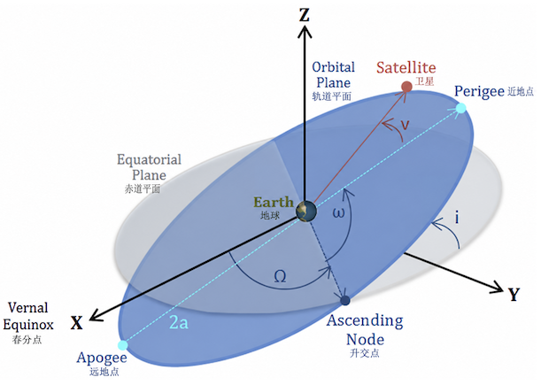

# 卫星轨道、六个运动积分与轨道确定

本章把《中心力场》一章中关于开普勒问题的一般理论，具体化为卫星轨道计算中最常用的一套语言和公式：如何用六个数描述一条轨道、这六个数与物理上的守恒量是什么关系、如何在"某一时刻的位置和速度"与"六个轨道根数"之间来回转换，以及在只有观测数据、没有现成状态矢量时如何反推出轨道。这些内容既是航天工程中轨道计算的基础，也是对前面中心力场理论的一次具体应用和检验。

## 从两体问题到卫星轨道

考虑质量分别为 $m_1$ 和 $m_2$ 的两个天体，沿用《中心力场》中的约定：

$$
\begin{equation}
\vec r=\vec r_1-\vec r_2,
\qquad
r=|\vec r|,
\qquad
\mu=\frac{m_1m_2}{m_1+m_2}.
\end{equation}
$$

在质心系中，相对运动等价于约化质量为 $\mu$ 的粒子在引力势

$$
\begin{equation}
V(r)=-\frac{\alpha}{r},
\qquad
\alpha=Gm_1m_2
\end{equation}
$$

中运动。相对运动方程为

$$
\begin{equation}
\mu\ddot{\vec r}=-\frac{\alpha}{r^3}\vec r.
\end{equation}
$$

为了书写卫星轨道公式，引入引力参数

$$
\begin{equation}
\kappa=\frac{\alpha}{\mu}=G(m_1+m_2).
\end{equation}
$$

于是

$$
\begin{equation}
\ddot{\vec r}=-\frac{\kappa}{r^3}\vec r.
\end{equation}
$$

若 $m_2\gg m_1$，并取 $m_2$ 为中心天体，则

$$
\begin{equation}
\mu\simeq m_1,
\qquad
\kappa\simeq Gm_2.
\end{equation}
$$

对地球卫星，常取地心惯性坐标系，$\vec r$ 是卫星相对于地心的位置，$\vec v=\dot{\vec r}$ 是相对速度。以下首先讨论理想二体模型，即中心天体为球对称、卫星质量可忽略，并暂不计大气阻力、地球非球形、第三体引力、太阳光压和推力。

需要强调的是，这里没有出现新的物理：方程 $(5)$ 与《中心力场》一章中吸引力 $V=-\alpha/r$ 情形的运动方程完全一致，只是把约化质量 $\mu$ 换成了引力参数 $\kappa$。卫星轨道理论的特殊之处在于，工程中通常不关心卫星本身的质量，而关心它相对中心天体的几何轨迹，因此习惯用 $\kappa$ 而不是 $\mu$、$\alpha$ 来写公式。

## 状态矢量为什么需要六个数

二阶矢量方程 $\ddot{\vec r}=-\kappa\vec r/r^3$ 等价于六个一阶常微分方程。给定某个历元 $t_0$ 的状态矢量

$$
\begin{equation}
\vec X_0=(\vec r_0,\vec v_0),
\end{equation}
$$

即三个位置分量和三个速度分量，理想二体轨道就被唯一确定。因此，完整轨道解需要六个独立的积分常数。

这与更简单的例子是同一回事：一维自由落体 $\ddot x=-g$ 需要两个初始条件（位置和速度）才能完全确定运动；三维空间中的自由质点则需要六个数（三个位置、三个速度）。卫星运动同样是三维空间中的二阶微分方程组，所以也需要六个独立常数，只是这里的"运动"是沿一条圆锥曲线，而不是抛物线弹道。

这六个常数通常重新组织为六个经典轨道根数：

| 根数 | 名称 | 决定的性质 |
|---|---|---|
| $a$ | 半长轴 | 轨道尺度与能量 |
| $e$ | 偏心率 | 轨道形状 |
| $i$ | 轨道倾角 | 轨道平面的倾斜程度 |
| $\Omega$ | 升交点赤经 | 轨道平面在参考平面内的朝向 |
| $\omega$ | 近地点幅角 | 近地点在轨道平面内的方向 |
| $M_0$ | 历元平近点角 | 卫星在轨道上的相位 |

也可以用过近地点时刻 $\nu$ 代替 $M_0$。前五个根数描述轨道圆锥曲线本身，第六个根数说明卫星在指定历元位于轨道的什么位置。

把这六个量分成三组来记忆会更直观：$(a,e)$ 两个数固定了轨道椭圆（或双曲线）本身的大小和形状，与它在空间中怎么摆放无关；$(i,\Omega,\omega)$ 三个角度像刚体转动中的欧拉角一样，把这个已经确定形状的圆锥曲线"安装"到惯性空间里的具体朝向；最后 $M_0$（或 $\tau$）只回答一个问题——在参考历元 $t_0$，卫星具体处在这条轨道的哪个相位上。事实上，$(\Omega,i,\omega)$ 的作用与《刚体运动》一章中把本体系转到空间系所用的欧拉角完全类似，两者都是依次绕不同轴的三次转动。

### "六个运动积分"的准确含义

理想开普勒问题有三个常值矢量或标量：能量 $E$、角动量 $\vec L$ 和拉普拉斯—龙格—楞次矢量。采用《中心力场》中的符号，

$$
\begin{equation}
E=\frac12\mu v^2-\frac{\alpha}{r},
\end{equation}
$$

$$
\begin{equation}
\vec L=\mu\vec r\times\vec v,
\end{equation}
$$

$$
\begin{equation}
\vec u=\vec v\times\vec L-\alpha\frac{\vec r}{r}.
\end{equation}
$$

对于吸引势 $V=-\alpha/r$，$\vec u$ 指向近地点，且

$$
\begin{equation}
|\vec u|=\alpha e.
\end{equation}
$$

这三个量各自有清楚的物理含义：$E$ 的正负决定轨道是束缚（椭圆）还是非束缚（抛物线、双曲线）；$\vec L$ 的方向给出轨道平面的法线方向，其大小由开普勒第二定律与掠面速度联系在一起；$\vec u$ 则同时编码了轨道形状（大小 $\propto e$）和取向（方向指向近地点），是逆平方力场特有的、额外的守恒量——正因为如此，一旦引力场偏离严格的 $1/r^2$（例如后面会讲到的 $J_2$ 摄动），$\vec u$ 就不再守恒，近地点方向会随时间进动，这也是后文"密切根数"随时间漂移的根本原因。

表面上，$E$、$\vec L$ 和 $\vec u$ 一共有七个分量，但它们满足

$$
\begin{equation}
\vec L\cdot\vec u=0,
\end{equation}
$$

以及

$$
\begin{equation}
u^2=\alpha^2+\frac{2E L^2}{\mu}.
\end{equation}
$$

（这两个恒等式的推导见《中心力场》一章，这里直接引用结论。）所以只有五个彼此独立的、与时间无显式关系的守恒积分。这五个积分确定轨道的大小、形状和空间取向，却不能说明卫星何时经过轨道上的某一点。

第六个积分常数是轨道相位，例如 $\tau$ 或 $M_0$。它可以写成含有时间的第一积分，在运动过程中保持不变，但不是只由瞬时相空间变量构成的额外独立守恒量。因此，"六个运动积分"在轨道力学中通常是指六个积分常数或六个轨道根数，不应理解为六个彼此独立的自治守恒量——这是初学者最容易混淆的一点：哈密顿力学意义上的"运动积分"（不显含时间的守恒量）在这里只有五个，第六个必须靠显含时间的表达式才能补齐。

使用单位质量的量可以简化卫星计算：卫星本身的质量在工程上往往未知或不重要，真正有意义的是轨道的几何性质，因此定义比角动量和比机械能

$$
\begin{equation}
\vec h=\frac{\vec L}{\mu}=\vec r\times\vec v,
\qquad
\varepsilon=\frac{E}{\mu}=\frac{v^2}{2}-\frac{\kappa}{r},
\end{equation}
$$

以及偏心率矢量

$$
\begin{equation}

\vec e=\frac{\vec u}{\alpha}
=\frac{\vec v\times\vec h}{\kappa}-\frac{\vec r}{r}.

\end{equation}
$$

这里 $|\vec e|=e$。一组很方便的六个积分常数是 $\vec h$、$\vec e$ 和 $\tau$：它们共有七个分量，但满足 $\vec h\cdot\vec e=0$，因此恰好有六个独立分量。

## 守恒量怎样决定轨道

比角动量矢量 $\vec h$ 垂直于轨道平面，因此它确定轨道平面的法向；偏心率矢量 $\vec e$ 位于轨道平面内并指向近地点，因此它确定近地点方向；$h=|\vec h|$ 和 $e=|\vec e|$ 决定圆锥曲线的尺度与形状。

半通径为

$$
\begin{equation}
p=l_0=\frac{h^2}{\kappa}=\frac{L^2}{\mu\alpha}.
\end{equation}
$$

半通径 $p$ 有一个直观含义：它就是当真近点角 $\nu=90^\circ$（即卫星与中心天体、近地点三点连线成直角）时的向径 $r$，因此有时也用它来代替 $a$，尤其是在偏心率接近 $1$、半长轴发散或变号的抛物线、双曲线情形。若以近地点方向为极轴，用 $\nu$ 表示真近点角，则轨道方程为

$$
\begin{equation}
r=\frac{p}{1+e\cos\nu}.
\end{equation}
$$

能量与半长轴的关系为

$$
\begin{equation}
\varepsilon=-\frac{\kappa}{2a},
\end{equation}
$$

其中对椭圆 $a>0$，对双曲线按有符号半长轴约定取 $a<0$。轨道类型由 $\varepsilon$ 或 $e$ 判断：

| 条件 | 轨道类型 |
|---|---|
| $\varepsilon<0$，$0\le e<1$ | 椭圆 |
| $\varepsilon=0$，$e=1$ | 抛物线 |
| $\varepsilon>0$，$e>1$ | 双曲线 |

椭圆轨道的近地点和远地点半径为

$$
\begin{equation}
r_{\min}=a(1-e)=\frac{p}{1+e},
\qquad
r_{\max}=a(1+e)=\frac{p}{1-e}.
\end{equation}
$$

轨道周期为

$$
\begin{equation}
T=2\pi\sqrt{\frac{a^3}{\kappa}}.
\end{equation}
$$

这正是开普勒第三定律：周期的平方正比于半长轴的立方，比例系数只依赖于中心天体（通过 $\kappa$），与卫星自身质量、偏心率、轨道朝向都无关。

任意位置的速度大小满足活力公式（vis-viva equation）

$$
\begin{equation}
v^2=\kappa\left(\frac{2}{r}-\frac{1}{a}\right).
\end{equation}
$$

这个公式其实就是能量守恒 $\varepsilon=v^2/2-\kappa/r=-\kappa/(2a)$ 的另一种写法：把 $\varepsilon=-\kappa/(2a)$ 代入 $v^2=2(\varepsilon+\kappa/r)$ 即得，因此它对轨道上任意一点、任意时刻都成立，是从状态矢量估算速度大小最常用的公式之一。

对抛物线，$a\to\infty$（对应 $\varepsilon=0$，卫星恰好能到达无穷远且到达时速度趋于零），上式给出逃逸速度

$$
\begin{equation}
v_{\mathrm{esc}}=\sqrt{\frac{2\kappa}{r}}.
\end{equation}
$$

同一半径处的圆轨道速度为

$$
\begin{equation}
v_{\mathrm c}=\sqrt{\frac{\kappa}{r}},
\end{equation}
$$

因此 $v_{\mathrm{esc}}=\sqrt{2}\,v_{\mathrm c}$——这是一个值得记住的简单数值关系：在同一高度上，逃逸速度总是圆轨道速度的 $\sqrt2\approx1.414$ 倍。

## 从位置和速度确定六个轨道根数

设在历元 $t_0$ 已知惯性系状态 $\vec r$、$\vec v$ 和引力参数 $\kappa$。这一节要解决的是"正问题"：已知某一瞬间的状态矢量，把它翻译成六个轨道根数。定义参考平面的法向单位矢量

$$
\begin{equation}
\vec k=(0,0,1).
\end{equation}
$$

首先计算

$$
\begin{equation}
\vec h=\vec r\times\vec v,
\qquad
h=|\vec h|,
\end{equation}
$$

$$
\begin{equation}
\vec n=\vec k\times\vec h,
\qquad
n=|\vec n|,
\end{equation}
$$

$$
\begin{equation}
\vec e=\frac{\vec v\times\vec h}{\kappa}-\frac{\vec r}{r},
\qquad
e=|\vec e|,
\end{equation}
$$

$$
\begin{equation}
\varepsilon=\frac{v^2}{2}-\frac{\kappa}{r}.
\end{equation}
$$

其中 $\vec n$ 指向升交点：因为 $\vec h$ 垂直于轨道平面、$\vec k$ 垂直于参考平面，$\vec n=\vec k\times\vec h$ 同时垂直于这两个法向，所以它必然沿着两个平面的交线方向——这条交线正是升交点所在的方向，$\vec n$ 由此得名"升交点矢量"。若 $\varepsilon\ne0$，半长轴为

$$
\begin{equation}
a=-\frac{\kappa}{2\varepsilon}.
\end{equation}
$$

半通径始终可由

$$
\begin{equation}
p=\frac{h^2}{\kappa}
\end{equation}
$$

求得，这一点即使在 $\varepsilon=0$ 的抛物线情形（此时 $a$ 无意义）也依然成立。轨道倾角为

$$
\begin{equation}
i=\arccos\frac{h_z}{h}.
\end{equation}
$$

$i$ 就是轨道平面与参考平面（如地球赤道面）之间的二面角，取值范围 $[0,\pi]$：$i<90^\circ$ 时卫星与参考平面自转方向同向运行（顺行轨道），$i>90^\circ$ 时反向运行（逆行轨道）。

为正确确定角度象限，使用二参数反正切函数 $\operatorname{atan2}(y,x)$，而不是普通的 $\arctan$——单靠 $\arctan$ 无法区分角度落在哪个象限，容易在编程中产生 $180^\circ$ 的符号错误。对非赤道、非圆轨道，

$$
\begin{equation}
\Omega=\operatorname{atan2}(n_y,n_x),
\end{equation}
$$

$$
\begin{equation}

\omega=\operatorname{atan2}\left(
\frac{\vec h\cdot(\vec n\times\vec e)}{hne},
\frac{\vec n\cdot\vec e}{ne}
\right),

\end{equation}
$$

$$
\begin{equation}

\nu=\operatorname{atan2}\left(
\frac{\vec h\cdot(\vec e\times\vec r)}{her},
\frac{\vec e\cdot\vec r}{er}
\right).

\end{equation}
$$

这三个角各自的几何意义是：$\Omega$ 是在参考平面内，从参考方向（例如春分点方向）转到升交点方向所转过的角度；$\omega$ 是在轨道平面内，从升交点转到近地点方向所转过的角度；$\nu$ 则是在轨道平面内，从近地点转到卫星当前位置所转过的角度，三者都按卫星运动方向为正方向度量。之所以能用 $\vec h\cdot(\vec n\times\vec e)$ 这样的组合当作"正弦项"，是因为 $\vec n$、$\vec e$ 都位于轨道平面内，它们的叉乘必然沿着轨道法向 $\vec h$，从而 $\vec h\cdot(\vec n\times\vec e)/h$ 就等于 $n e\sin\omega$，与分母中的 $\vec n\cdot\vec e=ne\cos\omega$ 恰好构成一对可以直接喂给 $\operatorname{atan2}$ 的正弦、余弦分量；$\nu$ 的公式是完全类似的构造。

将所得角度映射到 $[0,2\pi)$ 即可。真近点角 $\nu$ 给出卫星在历元 $t_0$ 的位置，但它不是常数，会随时间不均匀地变化（在近地点附近变化快，在远地点附近变化慢）。为了得到常用的第六根数 $M_0$，对椭圆轨道引入偏近点角 $\mathcal E$：

$$
\begin{equation}
\cos\mathcal E=\frac{e+\cos\nu}{1+e\cos\nu},
\qquad
\sin\mathcal E=\frac{\sqrt{1-e^2}\sin\nu}{1+e\cos\nu}.
\end{equation}
$$

$\mathcal E$ 的几何定义是：以椭圆长轴为直径作一个辅助圆，把卫星沿垂直于长轴的方向投影到这个辅助圆上，投影点相对椭圆中心（不是焦点）所张的角度就是 $\mathcal E$。这个几何图像有助于理解为什么 $\mathcal E$ 与 $\nu$ 不同——$\nu$ 是以焦点（中心天体所在处）为原点度量的角度，而 $\mathcal E$ 是以椭圆几何中心为原点度量的角度。

再由

$$
\begin{equation}
M_0=\mathcal E-e\sin\mathcal E
\end{equation}
$$

得到历元平近点角。这里也应使用正弦和余弦共同确定 $\mathcal E$ 的象限，不能只用 $\cos\mathcal E$ 求反余弦。

平均近点角 $M$ 本身没有直接的几何图像，它是一个人为构造的、随时间线性增长的角度，专门用来标记"卫星在轨道上运行到第几分之几个周期"，与真实位置的关系需要通过开普勒方程联系。相应地，平均运动为

$$
\begin{equation}
n_0=\sqrt{\frac{\kappa}{a^3}},
\end{equation}
$$

它就是使 $M$ 每过一个周期 $T$ 恰好增加 $2\pi$ 所要求的角速度，即 $n_0=2\pi/T$。所以过近地点时刻可以写成

$$
\begin{equation}
\tau=t_0-\frac{M_0}{n_0},
\end{equation}
$$

其中 $M_0$ 必须采用与所选轨道周次一致的连续值；若只把 $M_0$ 限制在 $[0,2\pi)$，则 $\tau$ 只确定到整数个周期——也就是说，仅凭 $[0,2\pi)$ 内的 $M_0$，你只能知道卫星"在这个周期里的哪个位置"，却不知道它是第几圈经过近地点。

### 退化轨道的角度问题

当 $e=0$ 时，圆轨道没有唯一近地点，$\omega$ 和 $\nu$ 分别失去定义（因为"近地点"这个参考方向本身不存在），可改用纬度幅角

$$
\begin{equation}
u=\omega+\nu.
\end{equation}
$$

这个组合角虽然把 $\omega$、$\nu$ 各自的定义都破坏了，但 $\omega+\nu$（从升交点量到卫星当前位置）本身是良好定义的，因为升交点方向不依赖于偏心率是否为零。

当 $i=0$ 或 $i=\pi$ 时，轨道平面与参考平面重合，升交点不唯一（两个平面重合，交线可以是平面内任意方向），$\Omega$ 失去定义，可改用近地点经度

$$
\begin{equation}
\varpi=\Omega+\omega.
\end{equation}
$$

对圆形赤道轨道（$e=0$ 且 $i=0$ 或 $\pi$），$\Omega$、$\omega$、$\nu$ 三者同时失去定义，通常改用真经度

$$
\begin{equation}
\lambda=\Omega+\omega+\nu.
\end{equation}
$$

因此，经典六根数在圆轨道和赤道轨道附近存在坐标奇异性：根数本身对状态矢量的微小扰动会变得极其敏感，甚至发散。数值轨道确定常改用赤道根数、修正等角根数或直接使用笛卡尔状态矢量，以避免在积分或滤波过程中穿过这些奇异区域时出现数值问题。

## 从轨道根数恢复位置和速度

这一节做的是上一节的逆运算："反问题"：已知六个轨道根数，重构出某一时刻的状态矢量。已知 $a,e,i,\Omega,\omega$ 及某时刻的真近点角 $\nu$，先计算

$$
\begin{equation}
p=a(1-e^2)
\end{equation}
$$

和两个位于轨道平面内的单位矢量

$$
\begin{equation}
\begin{aligned}
\vec P={}&(
\cos\Omega\cos\omega-\sin\Omega\sin\omega\cos i,\\
&\sin\Omega\cos\omega+\cos\Omega\sin\omega\cos i,
\sin\omega\sin i),
\end{aligned}
\end{equation}
$$

$$
\begin{equation}
\begin{aligned}
\vec Q={}&(
-\cos\Omega\sin\omega-\sin\Omega\cos\omega\cos i,\\
&-\sin\Omega\sin\omega+\cos\Omega\cos\omega\cos i,
\cos\omega\sin i).
\end{aligned}
\end{equation}
$$

这两个矢量并不是凭空写出来的，而是把轨道平面内固定的、以近地点为 $x$ 轴的"近焦点坐标系"，依次绕 $Z$ 轴转 $\Omega$、绕新的 $X$ 轴转 $i$、再绕新的 $Z$ 轴转 $\omega$，变换到惯性坐标系中得到的——这正是一个 $3$-$1$-$3$（Z-X-Z）型欧拉角转动，与《刚体运动》一章中用欧拉角描述刚体姿态的转动序列完全是同一种数学结构，只是这里转动的对象是轨道平面而不是刚体本身。$\vec P$ 指向近地点，$\vec Q$ 是轨道平面内沿运动方向旋转 $90^\circ$ 的单位矢量。于是

$$
\begin{equation}

\vec r=\frac{p}{1+e\cos\nu}
(\cos\nu\,\vec P+\sin\nu\,\vec Q),

\end{equation}
$$

$$
\begin{equation}

\vec v=\sqrt{\frac{\kappa}{p}}
[-\sin\nu\,\vec P+(e+\cos\nu)\vec Q].

\end{equation}
$$

这两式给出了轨道根数到笛卡尔状态矢量的直接转换。注意 $\vec r$ 的系数就是轨道方程 $(15)$，而 $\vec v$ 的形式可以通过对 $\vec r$ 求时间导数、并利用 $h=r^2\dot\nu$（角动量守恒的另一种写法）化简得到。

## 已知历元根数后如何推进轨道

有了历元 $t_0$ 的六个根数，下一步自然是问：任意时刻 $t$ 的状态是什么？对于椭圆轨道，已知 $t_0$ 时的 $M_0$ 后，任意时刻的平近点角为

$$
\begin{equation}
M(t)=M_0+n_0(t-t_0).
\end{equation}
$$

这一步是简单的，因为 $M$ 按定义随时间线性增长。真正的困难在于把 $M$ 转换回真近点角 $\nu$（从而得到实际位置），这需要求解开普勒方程

$$
\begin{equation}
M=\mathcal E-e\sin\mathcal E.
\end{equation}
$$

这是一个超越方程，$\mathcal E$ 无法用初等函数从 $M$ 中解出，因此必须数值求解。该方程通常通过牛顿迭代求解：

$$
\begin{equation}
\mathcal E_{j+1}
=\mathcal E_j-
\frac{\mathcal E_j-e\sin\mathcal E_j-M}
{1-e\cos\mathcal E_j}.
\end{equation}
$$

以 $\mathcal E_0=M$ 作为初始猜测，对大多数偏心率不太接近 $1$ 的轨道，这个迭代通常只需三到五步就能收敛到机器精度；但当 $e$ 很接近 $1$ 或 $M$ 接近 $0,\pi$ 附近的极端相位时，收敛会变慢，实用程序中常改用更好的初始猜测或专门的高偏心率算法。

得到 $\mathcal E$ 后，真近点角满足

$$
\begin{equation}
\cos\nu=\frac{\cos\mathcal E-e}{1-e\cos\mathcal E},
\qquad
\sin\nu=\frac{\sqrt{1-e^2}\sin\mathcal E}{1-e\cos\mathcal E}.
\end{equation}
$$

最后代入上一节的 $\vec r$ 和 $\vec v$ 公式，即可得到时刻 $t$ 的完整状态矢量。对双曲线轨道需要使用双曲偏近点角及其开普勒方程（形式与椭圆情形类似，但三角函数换成双曲函数）；在同时处理椭圆、抛物线和双曲线的程序中，常使用通用变量（universal variable）方法，用一套统一的公式覆盖所有轨道类型，避免在 $e=1$ 附近切换公式造成数值问题。

## 轨道确定：从观测恢复状态与根数

前面几节都假定状态矢量或轨道根数是"已知"的。但实际情况往往相反：我们只有地面站或传感器在若干时刻测到的数据，需要反推出轨道——这就是轨道确定（orbit determination）问题，其难度取决于观测的类型和数量。

### 状态已知时

如果同一历元的 $\vec r$ 和 $\vec v$ 已知，轨道确定就是前述状态矢量到六根数的代数转换，没有额外的困难。在理想二体模型下，一个完整状态足以确定唯一轨道。

只有一个位置 $\vec r$ 时不能唯一确定轨道，因为通过该点可以有无穷多条速度不同的开普勒轨道：位置只提供了六个未知数中的三个，另外三个（速度的大小和方向）完全没有约束。必须补充速度信息，或利用多个时刻的观测及动力学模型推断速度，这正是后面几种方法要解决的问题。

### 两个位置与飞行时间

给定 $t_1$、$t_2$ 时的两个位置 $\vec r(t_1)$、$\vec r(t_2)$ 以及飞行时间 $\Delta t=t_2-t_1$，求连接它们的开普勒轨道称为 Lambert 问题。它是轨道转移设计的核心工具：例如设计一次交会或转移任务时，出发点、目标点和飞行时间往往是给定的，需要反过来求出满足这些条件的转移轨道及其所需速度。

Lambert 问题可能存在短路径、长路径以及不同绕行圈数的多个解：给定的转移角（两位置矢量之间的夹角）若小于 $180^\circ$，一般走"短程"；若大于 $180^\circ$，则走"长程"；此外飞行时间若远大于一个轨道周期，卫星还可能在到达目标点之前绕中心天体转过若干整圈。因此，"两个位置加飞行时间"并不总意味着只有一个几何分支，还需要指定转移方向、绕行圈数和其他约束才能唯一确定解。

### 三个位置或角度观测

若已知三个相邻时刻的位置矢量，可用 Gibbs 方法或 Herrick–Gibbs 方法估计中间时刻速度，再转换为轨道根数。这类方法的基本思路是：三个共面（严格说是近似共面）的位置矢量按特定的线性组合，可以消去未知的速度而只留下位置项，从而反过来解出中间时刻的速度矢量。前者适合位置矢量较准确且三点张角足够大的情形，后者更适合短时间间隔（此时张角很小，Gibbs 方法的数值稳定性变差，需要用泰勒展开改进的 Herrick–Gibbs 公式）。

地面站常直接测得方位角、仰角、距离、距离率或多普勒频移。仅有角度观测时，每次观测只给出视线方向（两个角度），卫星沿视线的距离仍未知——这正是"角度观测"比"位置观测"更困难的地方：三个位置观测共有九个数据，而三次角度观测只有六个数据，缺少的距离信息必须靠动力学约束（卫星必须沿一条开普勒轨道运动）来补足，可用 Gauss 初轨法等方法从多个历元获得初始状态。

### 多次观测与最小二乘

真实轨道确定通常从一个初轨 $\vec X_0$（可以是由上述方法得到的粗略估计）出发，用动力学模型把状态推进到每个观测时刻，再由观测模型预测测量值。若观测向量为 $\vec y_j$，预测值为 $\vec g_j(\vec X_0)$，残差为

$$
\begin{equation}
\vec \rho_j=\vec y_j-\vec g_j(\vec X_0).
\end{equation}
$$

批处理加权最小二乘求解

$$
\begin{equation}

\min_{\vec X_0}
\sum_j\vec\rho_j^{\,T}W_j\vec\rho_j,

\end{equation}
$$

其中 $W_j$ 是观测权矩阵，通常取观测噪声协方差的逆，以便让噪声更小的观测在拟合中占更大权重。线性化后需计算观测对初始状态的敏感度（即状态转移矩阵与观测矩阵的乘积），并迭代修正 $\vec X_0$，直至残差收敛到某个容许范围内。轨道确定的结果不仅应给出最优状态，还应给出协方差或其他不确定度描述，因为有限精度观测不可能确定完全精确的轨道；这也是空间态势感知、碰撞预警等实际应用中不可或缺的一环。

## 一个状态矢量确定轨道的例子

采用地心惯性坐标系，取

$$
\begin{equation}
\kappa=398600.4418\ \mathrm{km^3\,s^{-2}},
\end{equation}
$$

并在某历元给定

$$
\begin{equation}
\vec r=(7000,0,0)\ \mathrm{km},
\qquad
\vec v=(0,7.5,1.0)\ \mathrm{km\,s^{-1}}.
\end{equation}
$$

计算得到

$$
\begin{equation}
\vec h=\vec r\times\vec v
=(0,-7000,52500)\ \mathrm{km^2\,s^{-1}},
\end{equation}
$$

$$
\begin{equation}
h=52964.61\ \mathrm{km^2\,s^{-1}},
\end{equation}
$$

$$
\begin{equation}
\varepsilon=-28.3179\ \mathrm{km^2\,s^{-2}},
\end{equation}
$$

$$
\begin{equation}
\vec e=(0.0053928,0,0),
\qquad
e=0.0053928.
\end{equation}
$$

同时可以算出升交点矢量

$$
\begin{equation}
\vec n=\vec k\times\vec h=(7000,0,0)\ \mathrm{km^2\,s^{-1}},
\end{equation}
$$

它与 $\vec e$ 都沿 $x$ 轴正方向，这一点在后面判断 $\Omega,\omega,\nu$ 时会用到。由能量得半长轴、由角动量得半通径：

$$
\begin{equation}
a=-\frac{\kappa}{2\varepsilon}=7037.95\ \mathrm{km},
\end{equation}
$$

$$
\begin{equation}
p=\frac{h^2}{\kappa}=7037.75\ \mathrm{km},
\end{equation}
$$

$$
\begin{equation}
i=\arccos\frac{h_z}{h}=7.595^\circ.
\end{equation}
$$

该例中 $\vec n$ 和 $\vec e$ 都沿 $x$ 轴正方向，所以三者之间的夹角都为零：

$$
\begin{equation}
\Omega=0,
\qquad
\omega=0,
\qquad
\nu=0.
\end{equation}
$$

也就是说，升交点、近地点和卫星当前位置恰好重合在同一个方向上——卫星在历元恰好位于近地点。近、远地点半径和周期为

$$
\begin{equation}
r_{\min}=7000.00\ \mathrm{km},
\qquad
r_{\max}=7075.91\ \mathrm{km},
\end{equation}
$$

$$
\begin{equation}
T=5875.98\ \mathrm{s}=97.93\ \mathrm{min}.
\end{equation}
$$

由于偏心率很小（$e\approx0.0054$，接近圆轨道），近地点方向对微小状态误差较敏感；这也说明近圆轨道使用 $\omega$ 和 $\nu$ 往往不如使用非奇异根数（如前面提到的纬度幅角 $u$）稳定：状态矢量只要有一点点数值噪声，算出来的近地点方向就可能大幅摆动，而卫星实际的物理运动几乎不受影响。

## 常用卫星轨道设计公式

### 霍曼转移

在同一轨道平面内，从半径 $r_1$ 的圆轨道转移到半径 $r_2>r_1$ 的圆轨道，理想霍曼转移由两个切向瞬时脉冲组成：第一次脉冲把卫星从初始圆轨道送入一条与两个圆都相切的转移椭圆，第二次脉冲在到达目标半径时把转移椭圆调整为目标圆轨道。转移椭圆半长轴为

$$
\begin{equation}
a_t=\frac{r_1+r_2}{2}.
\end{equation}
$$

第一次脉冲为

$$
\begin{equation}

\Delta v_1=\sqrt{\frac{\kappa}{r_1}}
\left(\sqrt{\frac{2r_2}{r_1+r_2}}-1\right),

\end{equation}
$$

第二次脉冲为

$$
\begin{equation}

\Delta v_2=\sqrt{\frac{\kappa}{r_2}}
\left(1-\sqrt{\frac{2r_1}{r_1+r_2}}\right).

\end{equation}
$$

转移时间为转移椭圆周期的一半：

$$
\begin{equation}
\Delta t=\pi\sqrt{\frac{a_t^3}{\kappa}}.
\end{equation}
$$

这些公式假设脉冲瞬时完成、两个圆轨道共面，并忽略转移期间的摄动。

作为数值例子，取地球引力参数 $\kappa=398600.4418\ \mathrm{km^3\,s^{-2}}$，把高度 $300\ \mathrm{km}$ 的近地圆轨道（$r_1=6678\ \mathrm{km}$）转移到地球静止轨道半径（$r_2=42164\ \mathrm{km}$）。代入上式可得

$$
\begin{equation}
a_t=24421\ \mathrm{km},
\qquad
\Delta v_1\approx2.426\ \mathrm{km\,s^{-1}},
\qquad
\Delta v_2\approx1.467\ \mathrm{km\,s^{-1}},
\end{equation}
$$

总速度增量约为 $3.89\ \mathrm{km\,s^{-1}}$，转移时间约为

$$
\begin{equation}
\Delta t\approx18990\ \mathrm{s}\approx5.28\ \mathrm{h},
\end{equation}
$$

这与航天工程中常见的"近地轨道到地球静止轨道约需五个多小时、消耗约 $3.9\ \mathrm{km/s}$ 速度增量"的经验数值吻合，可以作为检验计算是否正确的参考量级。

### 轨道平面改变

在速度大小保持为 $v$ 的位置，把速度方向瞬时转过 $\Delta i$，所需速度增量为

$$
\begin{equation}
\Delta v=2v\sin\frac{\Delta i}{2}.
\end{equation}
$$

因此平面改变通常安排在速度较低的位置，例如椭圆轨道的远地点，这样可以用更小的 $\Delta v$ 完成同样角度的转向。若一次脉冲同时改变速度大小和方向（例如把平面改变和高度改变合并为一次燃烧），应对脉冲前后的速度矢量作矢量相减，不能把两个标量速度增量简单相加：矢量相减往往能给出比两次分开机动更小的总 $\Delta v$，这是实际任务设计中常用的省燃料技巧。

### 地球同步与地球静止轨道

若圆轨道周期等于地球恒星自转周期 $T_\oplus\approx86164.1\ \mathrm{s}$，则轨道半径为

$$
\begin{equation}
r_{\mathrm{syn}}=\left(\frac{\kappa T_\oplus^2}{4\pi^2}\right)^{1/3}\approx42164\ \mathrm{km},
\end{equation}
$$

这恰好就是前面霍曼转移例子中取的目标半径 $r_2$。地球静止轨道还要求

$$
\begin{equation}
e=0,
\qquad
i=0,
\end{equation}
$$

并且运动方向与地球自转方向相同。只满足周期相同而轨道偏心或倾斜时，卫星相对于地面仍会画出一个"8"字形或南北摆动的轨迹，不能称为地球静止卫星，而只是"地球同步卫星"。

## 理想六根数在真实任务中的变化

在严格二体问题中，$a,e,i,\Omega,\omega$ 为常数，$M$ 按时间线性增长。真实卫星受到摄动时，可在每一时刻用瞬时 $\vec r$ 和 $\vec v$ 定义一组与状态相切的开普勒轨道，称为密切轨道（osculating orbit）；相应六根数称为密切根数。可以这样理解密切根数：设想在某一时刻突然关闭所有摄动力，卫星此后将严格沿一条固定的开普勒椭圆运动，这条"假想的"椭圆的六个根数，就是该时刻真实轨道的密切根数——由于摄动持续存在，这组根数会随时间缓慢或周期性地变化，而不是真正的常数。

地球扁率的 $J_2$ 项通常是近地卫星最重要的长期摄动之一。在一阶平均近似下，升交点和近地点的主要长期变化率为

$$
\begin{equation}

\dot\Omega=-\frac32J_2n_0
\left(\frac{R_\oplus}{p}\right)^2\cos i,

\end{equation}
$$

$$
\begin{equation}

\dot\omega=\frac34J_2n_0
\left(\frac{R_\oplus}{p}\right)^2(5\cos^2i-1).

\end{equation}
$$

其中 $R_\oplus$ 为地球参考半径，$p=a(1-e^2)$。太阳同步轨道正是利用 $\dot\Omega$ 的长期进动：适当选取高度和倾角（通常 $i$ 略大于 $90^\circ$，即逆行轨道），使 $\dot\Omega\approx0.9856^\circ/\mathrm{day}$，恰好等于地球绕太阳公转的平均角速度，从而让轨道平面相对于太阳保持所需的几何关系（例如始终在同一地方时经过同一纬度）。

大气阻力通常使低轨卫星的机械能下降，导致半长轴和轨道寿命减小；第三体引力（太阳、月球）和太阳光压对高轨、深空轨道更重要；推力和姿态变化也可能主动改变根数。因而实际任务中的"轨道确定"与"轨道预报"必须采用与精度要求匹配的力模型，不能把一次求得的六个二体根数永久视为常数。

## 应用时的检查清单

- 先明确 $\vec r$ 和 $\vec v$ 所属的参考系、历元和时间标准。
- 不要把约化质量 $\mu$ 与航天中常用的引力参数混用；本文把后者记为 $\kappa=G(m_1+m_2)$。
- 角度计算使用 $\operatorname{atan2}$，避免象限错误。
- 圆轨道或赤道轨道附近改用非奇异根数（纬度幅角 $u$、近地点经度 $\varpi$、真经度 $\lambda$ 等）。
- 先判断 $\varepsilon$ 的符号，再选择椭圆、抛物线或双曲线公式。
- 检查量纲：$\kappa$ 的量纲为 $L^3T^{-2}$，$h$ 的量纲为 $L^2T^{-1}$，$\varepsilon$ 的量纲为 $L^2T^{-2}$。
- 用 $\vec h\cdot\vec e=0$、$p=h^2/\kappa$ 和活力公式交叉检查计算结果。
- 在圆轨道（$e\to0$）或赤道轨道（$i\to0$）等极限情形下，检验公式是否退化为预期的简单结果，这是排查程序错误的有效手段。
- 观测数据有误差时，同时报告状态估计及其不确定度。
- 当要求高精度或长时间预报时，加入 $J_2$、大气阻力、第三体引力、太阳光压等摄动，并说明采用的模型与参数。
