# 哈密顿力学

> 阅读提示：文中蓝色边框的“推导”“例”“提示”等块默认折叠，点击标题展开；打印或导出 PDF 时会自动展开。动画（GIF）在 PDF 中显示第一帧，即总览画面。

<!-- 原 PDF 第 1 页 -->

## 哈密顿量（Hamiltonian）

在牛顿的矢量力学体系和拉格朗日的分析力学体系之外，为什么还需要哈密顿力学？虽然这些表述在经典力学范围内彼此等价，但哈密顿力学在超出经典力学的领域（例如量子力学）中更能显示其优点，并且与几何光学、统计力学等学科有密切联系。

哈密顿力学的关键变化并不是引入一套新的物理定律，而是改变描述系统状态的方式：拉格朗日力学使用配置空间中的 $(q_i,\dot q_i)$，哈密顿力学则使用相空间中的 $(q_i,p_i)$。对具有 $s$ 个自由度的系统，相空间有 $2s$ 维；给定某一时刻的 $(q_i,p_i)$，就给出了一个完整的力学状态。此后，哈密顿方程把该状态沿相空间中的一条轨道向前推进。

本章的逻辑可以概括为：先用勒让德变换从 $L$ 构造 $H$，再用哈密顿方程描述相空间中的演化；泊松括号把演化、守恒量和对称性统一起来；正则变换则帮助寻找更合适的相空间坐标。绝热不变量、作用量－角变量、刘维尔定理和哈密顿－雅可比方程都是这一结构的自然结果。

对于由广义坐标 $q_i$、广义速度 $\dot q_i$ 和时间 $t$ 描述的系统，拉格朗日量为

$$
\begin{equation}
L=L(q_i,\dot q_i,t).
\end{equation}
$$

定义广义动量

$$
\begin{equation}
p_i\equiv\frac{\partial L}{\partial\dot q_i},
\end{equation}
$$

并定义哈密顿量

$$
\begin{equation}
H(q_i,p_i,t)=p_i\dot q_i-L(q_i,\dot q_i,t).
\end{equation}
$$

这里和本章其余部分都采用爱因斯坦求和约定：同一项中重复出现的指标表示对该指标求和，例如 $p_i\dot q_i\equiv\sum_{i=1}^{s}p_i\dot q_i$。

在能够把 $\dot q_i$ 反解为 $q_i,p_i,t$ 的函数时，$H$ 是广义坐标、广义动量和时间的函数。

推导：为什么勒让德变换后 H 的独立变量是 q、p 和 t

其全微分为

$$
\begin{align*}
dH
&=d(p_i\dot q_i-L)\\
&=\dot q_i\,dp_i+p_i\,d\dot q_i
-\frac{\partial L}{\partial q_i}dq_i
-\frac{\partial L}{\partial\dot q_i}d\dot q_i
-\frac{\partial L}{\partial t}dt\\
&=-\frac{\partial L}{\partial q_i}dq_i
+\dot q_i\,dp_i
-\frac{\partial L}{\partial t}dt.
\end{align*}
$$

其中使用了 $p_i=\partial L/\partial\dot q_i$。因此 $H$ 的独立变量正是 $q_i,p_i,t$。

这里要特别注意：$H$ 的定义式中虽然暂时还出现 $\dot q_i$，但勒让德变换完成后必须把所有 $\dot q_i$ 消去。换言之，$H$ 不是把 $L$ 简单地“改一个符号”，而是用动量取代速度后得到的新函数。

哈密顿量常常等于总机械能，但这不是定义本身保证的。对于动能是速度的齐次二次函数、势能与速度无关且约束不显含时间的常见系统，由欧拉齐次函数定理可得 $p_i\dot q_i=2T$，于是 $H=T+V$。若存在速度依赖势、显含时间的坐标变换或更一般的约束，$H$ 仍是时间演化的生成函数，却未必等于通常意义下的 $T+V$。

### 例：一维谐振子

$$
\begin{equation}
L=\frac12m\dot x^2-\frac12kx^2,
\qquad
p=m\dot x,
\end{equation}
$$

从而

$$
\begin{equation}
H=p\dot x-L
=\frac{p^2}{2m}+\frac12kx^2.
\end{equation}
$$

<!-- 原 PDF 第 2 页 -->

### 一般二次型动能

考虑

$$
\begin{equation}
L=\frac12a_{ij}(q)\dot q_i\dot q_j-V(q).
\end{equation}
$$

广义动量为

$$
\begin{equation}
p_i=\frac{\partial L}{\partial\dot q_i}
=a_{ij}(q)\dot q_j.
\end{equation}
$$

若矩阵 $a_{ij}$ 可逆，记其逆矩阵为 $a^{ij}$，则

$$
\begin{equation}
\dot q_i=a^{ij}(q)p_j.
\end{equation}
$$

哈密顿量为

$$
\begin{equation}
H=\frac12a^{ij}(q)p_ip_j+V(q)
.
\end{equation}
$$

## 勒让德变换（Legendre Transformation）

从 $L(q_i,\dot q_i,t)$ 到 $H(q_i,p_i,t)$ 的变换称为勒让德变换。它用新变量 $p_i$ 取代 $\dot q_i$；$q_i$ 与 $p_i$ 构成共轭变量对（conjugate variable pair），也称正则变量对。

能否从

$$
\begin{equation}
p_i=\frac{\partial L}{\partial\dot q_i}
\end{equation}
$$

反解出所有 $\dot q_i$，取决于拉格朗日量关于广义速度的海森矩阵（Hessian matrix）

$$
\begin{equation}
W_{ij}=\frac{\partial^2L}
{\partial\dot q_i\partial\dot q_j}.
\end{equation}
$$

若

$$
\begin{equation}
\det W_{ij}\ne0,
\end{equation}
$$

则 $L$ 称为正则或非奇异（regular/non-singular）的拉格朗日量，可以反解全部广义速度。若

$$
\begin{equation}
\det W_{ij}=0,
\end{equation}
$$

则系统是奇异的，不能由动量唯一反解所有速度。

海森矩阵非奇异的物理意义是：每组 $(q_i,p_i)$ 都能唯一对应一组速度，因此相空间坐标确实能够独立标记系统状态。海森矩阵奇异通常不是计算上的偶然，而是在提示拉格朗日量含有约束或规范冗余；这时需要使用约束哈密顿体系（如 Dirac–Bergmann 方法），不能直接套用本章针对正则系统的勒让德变换。

<!-- 原 PDF 第 3 页 -->

勒让德变换一般写作

$$
\begin{equation}
H=p_i\dot q_i-L.
\end{equation}
$$

### 正则与奇异的例子

对两个自由质点，

$$
\begin{equation}
L=\frac12m_1\dot x_1^2+\frac12m_2\dot x_2^2,
\end{equation}
$$

海森矩阵为 $\operatorname{diag}(m_1,m_2)$，行列式 $m_1m_2\ne0$。因此

$$
\begin{equation}
p_1=m_1\dot x_1,
\qquad
p_2=m_2\dot x_2,
\end{equation}
$$

并有

$$
\begin{equation}
H=\frac{p_1^2}{2m_1}+\frac{p_2^2}{2m_2}.
\end{equation}
$$

另考虑只依赖相对速度的拉格朗日量

$$
\begin{equation}
L=\frac12m(\dot x_1-\dot x_2)^2.
\end{equation}
$$

其海森矩阵为

$$
\begin{equation}
m\begin{pmatrix}1&-1\\-1&1\end{pmatrix},
\end{equation}
$$

行列式为零。相应动量

$$
\begin{equation}
p_1=m(\dot x_1-\dot x_2),
\qquad
p_2=-m(\dot x_1-\dot x_2)=-p_1
\end{equation}
$$

只确定相对速度，不能分别确定 $\dot x_1$ 与 $\dot x_2$。

### 几何意义

先考虑单变量凸函数 $L(\dot q)$。曲线在 $\dot q=\dot q_*$ 处的斜率为

$$
\begin{equation}
p=L'(\dot q_*).
\end{equation}
$$

切线方程为

$$
\begin{equation}
y-L(\dot q_*)=p(\dot q-\dot q_*).
\end{equation}
$$

切线在纵轴上的截距为 $L-p\dot q=-H$。因此勒让德变换可理解为用切线斜率 $p$ 代替切点横坐标 $\dot q$，而 $H=p\dot q-L$ 是相应截距的相反数。若 $L$ 严格凸，则斜率与切点之间一一对应。

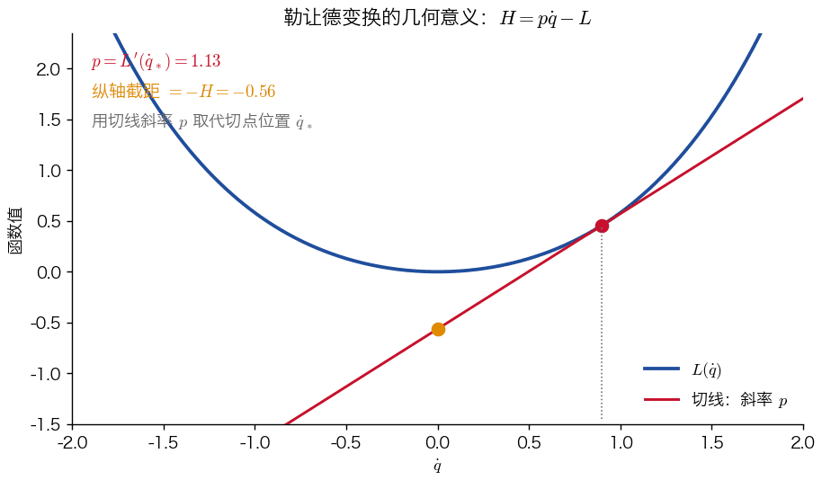

动画中切点位置代表速度 $\dot q_*$，切线斜率代表共轭动量 $p$。严格凸性保证斜率与切点一一对应；若曲线出现平坦方向，这种对应就会失效，与前面海森矩阵的奇异性相呼应。

<!-- 原 PDF 第 4 页 -->

## 哈密顿正则方程

以下只考虑正则系统，即能够由 $p_i$ 反解出 $\dot q_i$。由前面折叠块中的全微分式，并利用欧拉－拉格朗日方程

$$
\begin{equation}
\frac{d}{dt}\frac{\partial L}{\partial\dot q_i}
=\frac{\partial L}{\partial q_i},
\end{equation}
$$

可得

$$
\begin{equation}
dH=-\dot p_i\,dq_i+\dot q_i\,dp_i
-\frac{\partial L}{\partial t}dt.
\end{equation}
$$

另一方面，直接把 $H$ 看作 $H(q_i,p_i,t)$，则

$$
\begin{equation}
dH=\frac{\partial H}{\partial q_i}dq_i
+\frac{\partial H}{\partial p_i}dp_i
+\frac{\partial H}{\partial t}dt.
\end{equation}
$$

比较系数得到

$$
\begin{equation}
\dot q_i=\frac{\partial H}{\partial p_i},
\qquad
\dot p_i=-\frac{\partial H}{\partial q_i}
,
\end{equation}
$$

以及

$$
\begin{equation}
\frac{\partial H}{\partial t}
=-\frac{\partial L}{\partial t}.
\end{equation}
$$

这就是哈密顿正则方程。它与欧拉－拉格朗日方程等价：后者是关于 $s$ 个广义坐标的二阶常微分方程，前者则是关于 $s$ 个广义坐标和 $s$ 个广义动量的 $2s$ 个一阶常微分方程。给定初始 $q_i,p_i$ 后，系统的演化即被确定。

两组方程的形式还有一层重要含义：$H$ 对动量方向的“坡度”决定坐标如何变化，而 $H$ 对坐标方向的“坡度”决定动量如何变化，且二者相差一个负号。因此哈密顿流通常沿等能面运动，而不是像耗散系统那样朝能量最低点流动。这个反对称结构正是后面泊松括号、正则变换和相体积守恒的共同来源。

把 $2s$ 个正则变量合写成一个矢量 $z=(q_1,\ldots,q_s,p_1,\ldots,p_s)$，哈密顿方程可以紧凑地写成

$$
\begin{equation}
\dot z=J\,\nabla_zH,
\qquad
J=\begin{pmatrix}0&\mathbb 1_s\\-\mathbb 1_s&0\end{pmatrix}.
\end{equation}
$$

$J$ 称为辛矩阵，它反对称（$J^{\mathsf T}=-J$），且 $J^2=-\mathbb 1$。由反对称性，$\nabla_zH\cdot\dot z=(\nabla_zH)^{\mathsf T}J\,\nabla_zH=0$：相点速度总与能量梯度垂直，这就是相点沿等能面运动的代数原因。后面会看到，泊松括号和正则变换的条件都可以用这个矩阵写出。

沿满足正则方程的运动，

$$
\begin{align}
\frac{dH}{dt}
&=\frac{\partial H}{\partial q_i}\dot q_i
+\frac{\partial H}{\partial p_i}\dot p_i
+\frac{\partial H}{\partial t}\\
&=-\dot p_i\dot q_i+\dot q_i\dot p_i
+\frac{\partial H}{\partial t}\\
&={\frac{\partial H}{\partial t}}.
\end{align}
$$

<!-- 原 PDF 第 5 页 -->

对时间的全导数描述物理量随实际运动的真实演化；对时间的偏导数则只描述该物理量在形式上对时间的显含关系。因此，若

$$
\begin{equation}
\frac{\partial H}{\partial t}=0,
\end{equation}
$$

则

$$
\begin{equation}
\frac{dH}{dt}=0,
\end{equation}
$$

$H$ 是运动常数。

### 建立哈密顿方程的一般步骤

1. 由 $L(q_i,\dot q_i,t)$ 计算共轭动量 $p_i=\partial L/\partial\dot q_i$；
2. 从动量表达式反解 $\dot q_i=\dot q_i(q_j,p_j,t)$；
3. 代入 $H=p_i\dot q_i-L$，把所有广义速度消去，得到 $H(q_i,p_i,t)$；
4. 对 $H$ 求偏导，写出哈密顿正则方程。

### 例：一维谐振子

$$
\begin{equation}
L=\frac12m\dot x^2-\frac12kx^2,
\qquad p=m\dot x,
\end{equation}
$$

$$
\begin{equation}
H=\frac{p^2}{2m}+\frac12kx^2.
\end{equation}
$$

哈密顿方程为

$$
\begin{equation}
\dot x=\frac{\partial H}{\partial p}=\frac{p}{m},
\qquad
\dot p=-\frac{\partial H}{\partial x}=-kx.
\end{equation}
$$

联立即得

$$
\begin{equation}
m\ddot x+kx=0,
\end{equation}
$$

与欧拉－拉格朗日方程完全相同。

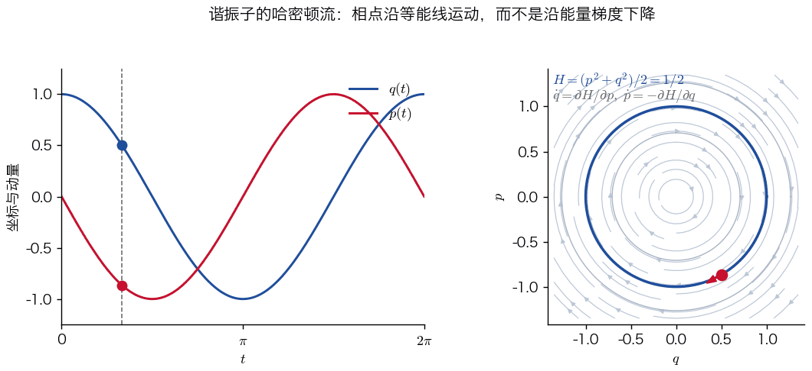

注意相点速度与等能线相切，而能量梯度垂直于等能线。正是哈密顿方程中的反对称结构把“梯度”旋转成了沿等能线的流。

对三维直角坐标中的普通质点，若

$$
\begin{equation}
L=\frac12m(\dot x^2+\dot y^2+\dot z^2)-V(x,y,z),
\end{equation}
$$

则

$$
\begin{equation}
H=\frac{p_x^2+p_y^2+p_z^2}{2m}+V(x,y,z).
\end{equation}
$$

<!-- 原 PDF 第 6 页 -->

### 例：相对论自由粒子

相对论自由粒子的拉格朗日量为

$$
\begin{equation}
L=-mc^2\sqrt{1-\frac{v^2}{c^2}}.
\end{equation}
$$

其动量为

$$
\begin{equation}
\boldsymbol p=\frac{\partial L}{\partial\boldsymbol v}
=\frac{m\boldsymbol v}{\sqrt{1-v^2/c^2}}.
\end{equation}
$$

哈密顿量为

$$
\begin{equation}
H=\boldsymbol p\cdot\boldsymbol v-L
=\sqrt{m^2c^4+p^2c^2}=E
.
\end{equation}
$$

哈密顿方程给出

$$
\begin{equation}
\dot{\boldsymbol x}
=\frac{\partial H}{\partial\boldsymbol p}
=\frac{c^2\boldsymbol p}{E},
\qquad
\dot{\boldsymbol p}
=-\frac{\partial H}{\partial\boldsymbol x}=0.
\end{equation}
$$

所以自由粒子静止或作匀速直线运动。若 $\boldsymbol p=0$，则

$$
\begin{equation}
E=mc^2,
\end{equation}
$$

即爱因斯坦质能关系。

这个例子也说明，正则动量不必等于牛顿形式的 $m\boldsymbol v$；在相对论中它是 $\gamma m\boldsymbol v$。哈密顿量对动量求偏导仍然给出真实速度，因此哈密顿方程自动包含相对论能量－动量关系，并保证有质量粒子的速度小于 $c$。

### 例：电磁场中的带电粒子

前面提到，存在速度依赖势时，正则动量和哈密顿量都可能与熟悉的形式不同。最重要的例子是电磁场中电荷为 $q$ 的粒子：

$$
\begin{equation}
L=\frac12m\boldsymbol v^2-q\phi(\boldsymbol x,t)+q\,\boldsymbol v\cdot\boldsymbol A(\boldsymbol x,t).
\end{equation}
$$

正则动量为

$$
\begin{equation}
\boldsymbol p=\frac{\partial L}{\partial\boldsymbol v}=m\boldsymbol v+q\boldsymbol A ,
\end{equation}
$$

它不等于机械动量 $m\boldsymbol v$。消去速度后，

$$
\begin{equation}
H=\boldsymbol p\cdot\boldsymbol v-L=\frac{(\boldsymbol p-q\boldsymbol A)^2}{2m}+q\phi .
\end{equation}
$$

数值上 $H=\frac12mv^2+q\phi$，仍是动能加静电势能：磁场不做功，所以不出现在能量中，但它通过 $\boldsymbol p-q\boldsymbol A$ 改变了 $H$ 对正则变量的依赖。

推导：由哈密顿方程得到洛伦兹力

由 $H$ 的形式，

$$
\begin{equation*}
\dot x_i=\frac{\partial H}{\partial p_i}=\frac{p_i-qA_i}{m},
\qquad
\dot p_i=-\frac{\partial H}{\partial x_i}=q\,\dot x_j\,\partial_iA_j-q\,\partial_i\phi .
\end{equation*}
$$

第一式即 $m\dot{\boldsymbol x}=\boldsymbol p-q\boldsymbol A$。对时间求导，注意 $\boldsymbol A$ 沿轨道的全导数为 $dA_i/dt=\partial_tA_i+\dot x_j\partial_jA_i$：

$$
\begin{equation*}
m\ddot x_i=\dot p_i-q\frac{dA_i}{dt}
=q\left(-\partial_i\phi-\partial_tA_i\right)+q\,\dot x_j\left(\partial_iA_j-\partial_jA_i\right).
\end{equation*}
$$

第一个括号是电场 $E_i$；利用 $\boldsymbol B=\nabla\times\boldsymbol A$，第二项等于 $q(\dot{\boldsymbol x}\times\boldsymbol B)_i$。于是 $m\ddot{\boldsymbol x}=q(\boldsymbol E+\dot{\boldsymbol x}\times\boldsymbol B)$。

在规范变换 $\boldsymbol A\to\boldsymbol A+\nabla\chi$，$\phi\to\phi-\partial_t\chi$ 下，$L$ 改变一个全导数 $q\,d\chi/dt$，运动方程不变，但正则动量改变 $q\nabla\chi$。所以正则动量不是规范不变的，机械动量 $m\boldsymbol v=\boldsymbol p-q\boldsymbol A$ 才是。量子力学中的“最小耦合”$\hat{\boldsymbol p}\to\hat{\boldsymbol p}-q\boldsymbol A$ 正来源于此。

另一个例子是匀速转动参照系。以角速度 $\boldsymbol\Omega$ 转动的参照系中，$L=\frac12m(\boldsymbol v+\boldsymbol\Omega\times\boldsymbol r)^2-V$，正则动量 $\boldsymbol p=m(\boldsymbol v+\boldsymbol\Omega\times\boldsymbol r)$ 恰好是惯性系中的动量，而

$$
\begin{equation}
H=\frac{\boldsymbol p^2}{2m}-\boldsymbol\Omega\cdot(\boldsymbol r\times\boldsymbol p)+V=E-\boldsymbol\Omega\cdot\boldsymbol L .
\end{equation}
$$

$H$ 不显含时间，因而守恒，但它不是能量。这正是“中心力场”一章受限三体问题中的雅可比积分。

### 例：球坐标下的中心力场

$$
\begin{equation}
L=\frac12m\left(
\dot r^2+r^2\dot\theta^2
+r^2\sin^2\theta\,\dot\varphi^2
\right)-V(r).
\end{equation}
$$

广义动量为

$$
\begin{equation}
p_r=m\dot r,
\qquad
p_\theta=mr^2\dot\theta,
\qquad
p_\varphi=mr^2\sin^2\theta\,\dot\varphi.
\end{equation}
$$

因此

$$
\begin{equation}
H=\frac{p_r^2}{2m}
+\frac{p_\theta^2}{2mr^2}
+\frac{p_\varphi^2}{2mr^2\sin^2\theta}
+V(r)
.
\end{equation}
$$

由于 $\varphi$ 是循环坐标，

$$
\begin{equation}
\dot p_\varphi=-\frac{\partial H}{\partial\varphi}=0,
\end{equation}
$$

故 $p_\varphi$ 守恒。

<!-- 原 PDF 第 7 页 -->

## 泊松括号（Poisson Bracket）

考虑任意力学量 $f(q_i,p_i,t)$。其沿运动的时间演化为

$$
\begin{equation}
\frac{df}{dt}
=\frac{\partial f}{\partial t}
+\frac{\partial f}{\partial q_i}\dot q_i
+\frac{\partial f}{\partial p_i}\dot p_i.
\end{equation}
$$

代入哈密顿方程，得到

$$
\begin{equation}
\frac{df}{dt}
=\frac{\partial f}{\partial t}
+\frac{\partial f}{\partial q_i}
\frac{\partial H}{\partial p_i}
-\frac{\partial f}{\partial p_i}
\frac{\partial H}{\partial q_i}.
\end{equation}
$$

定义任意两个力学量 $f,g$ 的泊松括号

$$
\begin{equation}
[f,g]\equiv
\frac{\partial f}{\partial q_i}
\frac{\partial g}{\partial p_i}
-\frac{\partial f}{\partial p_i}
\frac{\partial g}{\partial q_i}
.
\end{equation}
$$

于是

$$
\begin{equation}
\frac{df}{dt}=\frac{\partial f}{\partial t}+[f,H]
.
\end{equation}
$$

若 $f$ 是守恒量，则

$$
\begin{equation}
\frac{\partial f}{\partial t}+[f,H]=0.
\end{equation}
$$

特别地，若 $f$ 不显含时间，则它守恒的充要条件为

$$
\begin{equation}
[f,H]=0.
\end{equation}
$$

因此，哈密顿量不仅是一个守恒量候选者，更是时间平移的生成元：任意力学量沿轨道的变化都由它与 $H$ 的泊松括号决定。更一般地，一个函数 $G(q,p)$ 通过无穷小变换 $\delta f=\varepsilon[f,G]$ 生成相空间变换；例如动量生成空间平移，角动量生成空间转动。这样，对称性、生成元和守恒量在哈密顿语言中被统一为同一个泊松括号结构。

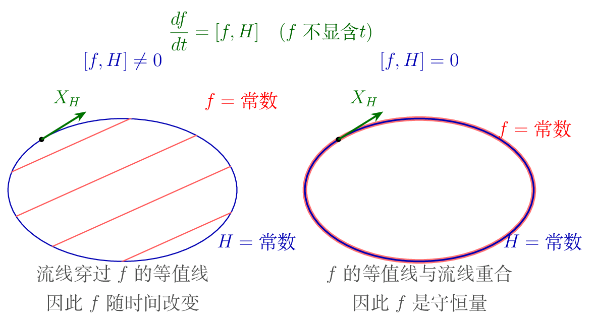

泊松括号满足：

$$
\begin{equation}
[f,g]=-[g,f]
\qquad\text{（反对称性）},
\end{equation}
$$

$$
\begin{equation}
[af_1+bf_2,g]=a[f_1,g]+b[f_2,g]
\qquad\text{（线性）},
\end{equation}
$$

$$
\begin{equation}
[f_1f_2,g]=f_1[f_2,g]+f_2[f_1,g]
\qquad\text{（莱布尼茨法则）},
\end{equation}
$$

$$
\begin{equation}
[f,[g,h]]+[g,[h,f]]+[h,[f,g]]=0
\qquad\text{（雅可比恒等式）}.
\end{equation}
$$

<!-- 原 PDF 第 8 页 -->

正则变量的基本泊松括号为

$$
\begin{equation}
[q_i,q_j]=0,
\qquad
[p_i,p_j]=0,
\qquad
[q_i,p_j]=\delta_{ij}.
\end{equation}
$$

### 例：角动量的泊松括号

令

$$
\begin{equation}
\boldsymbol M=\boldsymbol r\times\boldsymbol p,
\qquad
M_i=\epsilon_{ijk}x_jp_k.
\end{equation}
$$

推导：逐项计算角动量的泊松括号

以 $[M_1,M_2]$ 为例，其中 $M_1=x_2p_3-x_3p_2$，$M_2=x_3p_1-x_1p_3$。按线性展开为四项：

$$
\begin{equation*}
[M_1,M_2]=[x_2p_3,x_3p_1]-[x_2p_3,x_1p_3]-[x_3p_2,x_3p_1]+[x_3p_2,x_1p_3].
\end{equation*}
$$

由莱布尼茨法则，$[ab,cd]$ 展开后只有含 $[x_k,p_k]$ 或 $[p_k,x_k]$ 的项不为零。第二、三项中没有这样的共轭对，等于零；其余两项为

$$
\begin{equation*}
[x_2p_3,x_3p_1]=x_2p_1[p_3,x_3]=-x_2p_1,
\qquad
[x_3p_2,x_1p_3]=p_2x_1[x_3,p_3]=x_1p_2 .
\end{equation*}
$$

所以 $[M_1,M_2]=x_1p_2-x_2p_1=M_3$。把指标按 $1\to2\to3\to1$ 轮换，就得到另外两式：

$$
\begin{equation*}
[M_1,M_2]=M_3,
\qquad
[M_2,M_3]=M_1,
\qquad
[M_3,M_1]=M_2 .
\end{equation*}
$$

更系统的算法是先求 $[M_i,x_j]$ 和 $[M_i,p_j]$，再用莱布尼茨法则，见作业第三题。

即

$$
\begin{equation}
[M_i,M_j]=\epsilon_{ijk}M_k.
\end{equation}
$$

泊松括号的这种代数结构在量子力学中被完整保留下来。狄拉克在 1925 年指出，只要把经典泊松括号替换为算符对易子，

$$
\begin{equation}
[f,g]\longrightarrow\frac{1}{i\hbar}\bigl(\hat f\hat g-\hat g\hat f\bigr),
\end{equation}
$$

就可以从经典力学的正则结构得到量子力学的基本关系 [9]。例如 $[q_i,p_j]=\delta_{ij}$ 对应 $\hat q_i\hat p_j-\hat p_j\hat q_i=i\hbar\delta_{ij}$，而 $[M_i,M_j]=\epsilon_{ijk}M_k$ 正是量子角动量对易关系的经典对应。这是本章开头所说“哈密顿力学在量子力学中更能显示其优点”的一个具体体现。

## 泊松定理

若 $f$ 与 $g$ 都是运动积分，则 $[f,g]$ 也是运动积分。对于不显含时间的 $f,g$，证明可直接使用雅可比恒等式：

$$
\begin{equation}
[[f,g],H]=-[ [g,H],f]-[[H,f],g].
\end{equation}
$$

当 $[f,H]=[g,H]=0$ 时，右端为零，因此 $[[f,g],H]=0$。

若 $f$ 或 $g$ 显含时间，则不能简单地把“运动积分”写成与 $H$ 的泊松括号为零。不过结论仍然成立，因为

$$
\begin{equation}
\frac{d}{dt}[f,g]
=\left[\frac{df}{dt},g\right]
+\left[f,\frac{dg}{dt}\right].
\end{equation}
$$

当 $df/dt=dg/dt=0$ 时，仍有 $d[f,g]/dt=0$。这说明泊松定理适用于一般的、允许显含时间的运动积分。

证明：d[f,g]/dt = [df/dt, g] + [f, dg/dt]

对任意 $f,g$，

$$
\begin{equation*}
\frac{d}{dt}[f,g]=\frac{\partial}{\partial t}[f,g]+\bigl[[f,g],H\bigr].
\end{equation*}
$$

偏导数 $\partial/\partial t$ 与对 $q,p$ 的偏导数可交换，故第一项为 $[\partial_tf,g]+[f,\partial_tg]$。第二项用雅可比恒等式改写：$[[f,g],H]=-[H,[f,g]]=[f,[g,H]]+[g,[H,f]]=[[f,H],g]+[f,[g,H]]$。合并得

$$
\begin{equation*}
\frac{d}{dt}[f,g]=\bigl[\partial_tf+[f,H],\,g\bigr]+\bigl[f,\,\partial_tg+[g,H]\bigr]
=\left[\frac{df}{dt},g\right]+\left[f,\frac{dg}{dt}\right].
\end{equation*}
$$

<!-- 原 PDF 第 9 页 -->

泊松定理可以用来产生新的运动积分。若 $f,g$ 是运动积分，而 $[f,g]$ 既不是常数，也不能写成 $f,g$ 的函数，那么它提供了与二者独立的新运动积分。

有限自由度系统的独立运动积分数目有限；对 $s$ 个自由度，至多有 $2s-1$ 个函数独立的运动积分。因此，反复取泊松括号最终得到一个有限集合

$$
\begin{equation}
\mathcal C=\{C_1,C_2,\ldots,C_N\},
\end{equation}
$$

并在泊松括号运算下封闭：

$$
\begin{equation}
[C_i,C_j]=f_{ij}{}^k C_k,
\end{equation}
$$

其中 $f_{ij}{}^k$ 为相应的结构系数（更一般时也可依赖于守恒量）。

### 例：二自由度系统

考虑

$$
\begin{equation}
H=q_1q_2+p_1p_2.
\end{equation}
$$

对

$$
\begin{equation}
f=p_1^2+q_2^2,
\end{equation}
$$

直接计算得到

$$
\begin{equation}
[f,H]=0,
\end{equation}
$$

故 $f$ 是运动积分。由系统的对称性，

$$
\begin{equation}
g=p_2^2+q_1^2
\end{equation}
$$

也满足 $[g,H]=0$。二者的泊松括号为

$$
\begin{equation}
h=[f,g]=4(q_2p_2-q_1p_1),
\end{equation}
$$

因此 $h$ 也是运动积分。进一步可以验证

$$
\begin{equation}
[f,h]=8f,
\qquad
[g,h]=-8g.
\end{equation}
$$

所以继续取括号不会产生新的独立运动积分，这一集合已经封闭。$H$ 本身也是运动积分，且这些量满足

$$
\begin{equation}
-fg+\frac{h^2}{16}+H^2=0,
\end{equation}
$$

故 $f,g,h,H$ 中只有三个函数独立的运动积分。

<!-- 原 PDF 第 10 页 -->

## 正则变换（Canonical Transformation）

### 作用量作为端点的函数

在最小作用量原理中，作用量为

$$
\begin{equation}
S=\int_{t_1}^{t_2}L(q_i,\dot q_i,t)\,dt.
\end{equation}
$$

推导欧拉－拉格朗日方程时，通常固定端点，令

$$
\begin{equation}
\delta q_i(t_1)=\delta q_i(t_2)=0.
\end{equation}
$$

真实运动轨迹是在所有具有相同固定端点的候选轨迹中使作用量取驻值的轨迹。

推导：改变真实轨迹的上端点，得到作用量的全微分

现在改为只考察已经满足运动方程的真实轨迹，并把下端点固定，让上端点改变。于是 $S$ 可看作真实轨迹上端点 $q_i(t)$ 与时刻 $t$ 的函数。比较终点相邻的两条真实轨迹，变分的体积分部分因运动方程而消失，只留下端点项：

$$
\begin{equation*}
\delta S
=\left.\frac{\partial L}{\partial\dot q_i}
\delta q_i\right|_{t_2}
=p_i\delta q_i(t_2).
\end{equation*}
$$

<!-- 原 PDF 第 11 页 -->

由此得到

$$
\begin{equation*}
p_i=\frac{\partial S}{\partial q_i}.
\end{equation*}
$$

另一方面，根据作用量定义，沿真实轨迹

$$
\begin{equation*}
\frac{dS}{dt}=L.
\end{equation*}
$$

把 $S$ 看作 $S(q_i,t)$，则

$$
\begin{equation*}
\frac{dS}{dt}
=\frac{\partial S}{\partial q_i}\dot q_i
+\frac{\partial S}{\partial t}
=p_i\dot q_i+\frac{\partial S}{\partial t}.
\end{equation*}
$$

与 $dS/dt=L$ 比较可得

$$
\begin{equation*}
\frac{\partial S}{\partial t}
=L-p_i\dot q_i=-H
.
\end{equation*}
$$

所以作用量的全微分为

$$
\begin{equation*}
dS=p_i\,dq_i-H\,dt.
\end{equation*}
$$

因此，真实轨迹的作用量作为上端点的函数时满足

$$
\begin{equation}
p_i=\frac{\partial S}{\partial q_i},
\qquad
\frac{\partial S}{\partial t}=-H,
\qquad
dS=p_i\,dq_i-H\,dt.
\end{equation}
$$

这也说明

$$
\begin{equation}
S=\int(p_i\,dq_i-H\,dt).
\end{equation}
$$

若把 $q_i,p_i$ 看作相互独立的函数，对相空间形式的作用量

$$
\begin{equation}
S=\int_{t_1}^{t_2}(p_i\dot q_i-H)\,dt
\end{equation}
$$

作变分，并固定端点坐标，则

$$
\begin{equation}
\delta S=\int_{t_1}^{t_2}\left[
(\dot q_i-\frac{\partial H}{\partial p_i})\delta p_i
-(\dot p_i+\frac{\partial H}{\partial q_i})\delta q_i
\right]dt.
\end{equation}
$$

由于 $\delta q_i,\delta p_i$ 任意，$\delta S=0$ 正好给出两组哈密顿正则方程。

对保守系统，若只比较能量都等于 $E$、端点坐标相同、但到达终点的时刻可以不同的候选路径，则简约作用量

$$
\begin{equation}
S_0=\int p_i\,dq_i
\end{equation}
$$

取驻值。这就是莫佩尔蒂原理（Maupertuis principle）。与哈密顿原理相比，这里固定的是能量，而不是运动所用的时间。

<!-- 原 PDF 第 12 页 -->

### 正则变换的生成函数

在拉格朗日力学中，广义坐标可以作任意可逆点变换

$$
\begin{equation}
Q_i=Q_i(q_j,t),
\end{equation}
$$

而欧拉－拉格朗日方程的形式保持不变。在哈密顿力学中，$q_i,p_i$ 是独立变量，可以考虑更一般的变换

$$
\begin{equation}
Q_i=Q_i(q,p,t),
\qquad
P_i=P_i(q,p,t).
\end{equation}
$$

若变换后仍有

$$
\begin{equation}
\dot Q_i=\frac{\partial H'}{\partial P_i},
\qquad
\dot P_i=-\frac{\partial H'}{\partial Q_i},
\end{equation}
$$

则称该变换为正则变换。

正则变换不是任意的变量替换。它必须保持坐标与动量之间的共轭关系，也就是保持基本泊松括号以及哈密顿方程的形式。其价值在于可以把复杂的轨道“拉直”：若能找到一组新变量使 $H'$ 只依赖新的动量，甚至使 $H'=0$，运动方程就可直接积分。哈密顿－雅可比方法正是系统地寻找这种变换的途径。

新旧作用量只要相差某个函数 $F$ 的全微分，就给出等价的变分原理：

$$
\begin{equation}
p_i\,dq_i-H\,dt
=P_i\,dQ_i-H'\,dt+dF
.
\end{equation}
$$

若取

$$
\begin{equation}
F=F(q_i,Q_i,t),
\end{equation}
$$

则

$$
\begin{equation}
dF=p_i\,dq_i-P_i\,dQ_i+(H'-H)\,dt.
\end{equation}
$$

比较系数得到

$$
\begin{equation}
p_i=\frac{\partial F}{\partial q_i},
\qquad
P_i=-\frac{\partial F}{\partial Q_i},
\qquad
H'=H+\frac{\partial F}{\partial t}
.
\end{equation}
$$

$F$ 称为生成函数。

<!-- 原 PDF 第 13 页 -->

整理：四类生成函数及其微分关系

生成函数不只有上述一种形式。通过对不同变量作勒让德变换，可以得到四类常用生成函数：

1. $F_1(q,Q,t)=F$，满足

   $$
   \begin{equation*}
   dF_1=p_i\,dq_i-P_i\,dQ_i+(H'-H)dt.
   \end{equation*}
   $$

2. 定义

   $$
   \begin{equation*}
   F_2(q,P,t)=F_1+P_iQ_i,
   \end{equation*}
   $$

   则

   $$
   \begin{equation*}
   dF_2=p_i\,dq_i+Q_i\,dP_i+(H'-H)dt.
   \end{equation*}
   $$

3. 定义

   $$
   \begin{equation*}
   F_3(p,Q,t)=F_1-p_iq_i,
   \end{equation*}
   $$

   则

   $$
   \begin{equation*}
   dF_3=-q_i\,dp_i-P_i\,dQ_i+(H'-H)dt.
   \end{equation*}
   $$

4. 定义

   $$
   \begin{equation*}
   F_4(p,P,t)=F_1-p_iq_i+P_iQ_i,
   \end{equation*}
   $$

   则

   $$
   \begin{equation*}
   dF_4=-q_i\,dp_i+Q_i\,dP_i+(H'-H)dt.
   \end{equation*}
   $$

选择哪一类生成函数，取决于问题中哪一组新旧变量最方便作为独立变量。四类函数并不代表四种不同的物理变换，而是同一个正则变换的不同勒让德表示。

### 例：几个正则变换

最简单的例子是 $F_2=q_iP_i$，它给出 $p_i=P_i$、$Q_i=q_i$，即恒等变换。更有启发性的是

$$
\begin{equation}
F_1=qQ
\quad\Longrightarrow\quad
p=\frac{\partial F_1}{\partial q}=Q,
\qquad
P=-\frac{\partial F_1}{\partial Q}=-q.
\end{equation}
$$

新的“坐标”是原来的动量，新的“动量”是原来坐标的相反数。这说明在哈密顿力学中，坐标与动量处于对等的地位，二者的区分只是正则共轭关系中的约定。

再看一维谐振子 $H=\dfrac{p^2}{2m}+\dfrac12m\omega^2q^2$。取第一类生成函数

$$
\begin{equation}
F_1(q,Q)=\frac{m\omega}{2}q^2\cot Q,
\end{equation}
$$

则

$$
\begin{equation}
p=\frac{\partial F_1}{\partial q}=m\omega q\cot Q,
\qquad
P=-\frac{\partial F_1}{\partial Q}=\frac{m\omega q^2}{2\sin^2Q}.
\end{equation}
$$

反解得到

$$
\begin{equation}
q=\sqrt{\frac{2P}{m\omega}}\sin Q,
\qquad
p=\sqrt{2m\omega P}\cos Q.
\end{equation}
$$

代入原哈密顿量，$\sin^2Q+\cos^2Q=1$ 使结果大为简化：

$$
\begin{equation}
H'=\omega P.
\end{equation}
$$

于是新的哈密顿方程为 $\dot P=-\partial H'/\partial Q=0$，$\dot Q=\partial H'/\partial P=\omega$，即 $P=E/\omega$ 为常数、$Q=\omega t+Q_0$ 线性增长。原来需要求解的二阶振动方程，在新变量中变成了“一个守恒量加一个匀速转动的相位”。这正是正则变换“把轨道拉直”的含义；后文会看到，这里的 $P$ 和 $Q$ 恰好就是谐振子的作用量变量与角变量。

正则变换保持哈密顿正则方程的形式，但变换后的变量可能是原坐标和原动量的混合，因此 $Q_i,P_i$ 未必仍具有通常“坐标”和“动量”的直接物理意义。更准确地说，它们都是正则共轭变量。

正则变换还有一个重要性质：泊松括号不变，

$$
\begin{equation}
[f,g]_{q,p}=[f,g]_{Q,P}.
\end{equation}
$$

因此新变量仍满足基本正则括号

$$
\begin{equation}
[Q_i,Q_j]=0,
\qquad
[P_i,P_j]=0,
\qquad
[Q_i,P_j]=\delta_{ij}.
\end{equation}
$$

反过来，这也给出检验一个变换是否正则的最方便的判据：只需验证新变量的基本泊松括号。用辛矩阵写，记雅可比矩阵 $M_{ab}=\partial Z_a/\partial z_b$（$Z=(Q,P)$，$z=(q,p)$），则 $[Z_a,Z_b]_{q,p}=(MJM^{\mathsf T})_{ab}$，于是正则变换的条件是

$$
\begin{equation}
MJM^{\mathsf T}=J
\quad\Longleftrightarrow\quad
M^{\mathsf T}JM=J .
\end{equation}
$$

满足这一条件的矩阵称为辛矩阵，正则变换也因此称为辛变换。

推导：泊松括号在正则变换下不变，以及一个检验例子

把 $f,g$ 看作新变量 $Z=(Q,P)$ 的函数，用链式法则：

$$
\begin{equation*}
[f,g]_{q,p}=\sum_{a,b}\frac{\partial f}{\partial Z_a}\frac{\partial g}{\partial Z_b}\,[Z_a,Z_b]_{q,p}.
\end{equation*}
$$

若新变量满足基本括号，即 $[Z_a,Z_b]_{q,p}=J_{ab}$，右边正是 $[f,g]_{Q,P}$ 的定义。所以“泊松括号不变”与“基本括号不变”等价，问题归结为后者；由生成函数给出的变换都满足它（证明可见 [1] 第 9 章）。

**例。** 谐振子的变换 $q=\sqrt{2P/m\omega}\sin Q$，$p=\sqrt{2m\omega P}\cos Q$ 的逆变换为

$$
\begin{equation*}
Q=\arctan\frac{m\omega q}{p},
\qquad
P=\frac{p^2+m^2\omega^2q^2}{2m\omega}.
\end{equation*}
$$

直接计算：

$$
\begin{align*}
[Q,P]&=\frac{\partial Q}{\partial q}\frac{\partial P}{\partial p}-\frac{\partial Q}{\partial p}\frac{\partial P}{\partial q}\\
&=\frac{m\omega p}{p^2+m^2\omega^2q^2}\cdot\frac{p}{m\omega}+\frac{m\omega q}{p^2+m^2\omega^2q^2}\cdot m\omega q=1 ,
\end{align*}
$$

所以它确实是正则变换，与前面由生成函数 $F_1=\frac{m\omega}{2}q^2\cot Q$ 得到的结论一致。

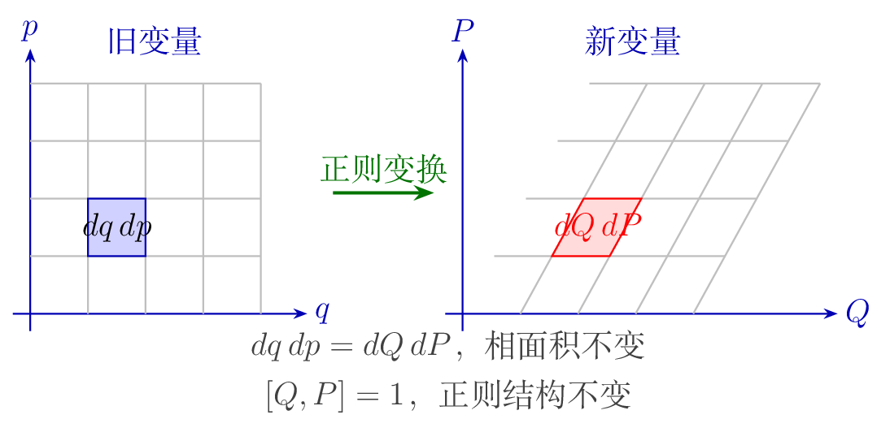

<!-- 原 PDF 第 14 页 -->

## 绝热不变量（Adiabatic Invariant）

考虑由参数 $\lambda$ 表征、并作有限周期运动的力学系统。当 $\lambda$ 相对运动周期变化得非常缓慢时，系统中某些量近似保持不变，这些量称为绝热不变量。

先考虑一自由度、周期为 $T$ 的系统。缓慢变化条件可写成

$$
\begin{equation}
T\left|\dot\lambda\right|\ll |\lambda|.
\end{equation}
$$

当 $\lambda$ 为常数时，系统封闭，能量 $E$ 守恒，并以周期 $T(E)$ 运动。当 $\lambda$ 缓慢随时间改变时，能量不再严格守恒，但也只缓慢改变。由

$$
\begin{equation}
H=H(q,p,\lambda)
\end{equation}
$$

可得

$$
\begin{equation}
\frac{dE}{dt}
=\frac{dH}{dt}
=\frac{\partial H}{\partial\lambda}\dot\lambda.
\end{equation}
$$

推导：周期平均如何给出绝热不变量

为了抽取能量的缓慢变化，对一整个运动周期取平均：

$$
\begin{equation*}
\left\langle\frac{dE}{dt}\right\rangle
=\frac1T\int_0^T
\frac{\partial H}{\partial\lambda}
\dot\lambda\,dt.
\end{equation*}
$$

在一个周期内，可把缓慢变化的 $\lambda$ 与 $\dot\lambda$ 近似视为常数。

<!-- 原 PDF 第 15 页 -->

由哈密顿方程

$$
\begin{equation*}
\dot q=\frac{\partial H}{\partial p}
\end{equation*}
$$

可将时间积分写成

$$
\begin{equation*}
dt=\frac{dq}{\partial H/\partial p},
\qquad
T=\oint\frac{dq}{\partial H/\partial p}.
\end{equation*}
$$

在给定 $E,\lambda$ 的轨道上，把动量写成 $p=p(q,E,\lambda)$。由

$$
\begin{equation*}
H(q,p(q,E,\lambda),\lambda)=E
\end{equation*}
$$

对 $\lambda$ 求偏导，得到

$$
\begin{equation*}
\frac{\partial H}{\partial\lambda}
+\frac{\partial H}{\partial p}
\frac{\partial p}{\partial\lambda}=0.
\end{equation*}
$$

由上式得到 $\partial H/\partial\lambda=-(\partial H/\partial p)(\partial p/\partial\lambda)_E$。代入周期平均，

$$
\begin{equation*}
\left\langle\frac{dE}{dt}\right\rangle
=\frac{\dot\lambda}{T}\oint\frac{\partial H}{\partial\lambda}\frac{dq}{\partial H/\partial p}
=-\frac{\dot\lambda}{T}\oint\left(\frac{\partial p}{\partial\lambda}\right)_E dq.
\end{equation*}
$$

另一方面，对 $H(q,p(q,E,\lambda),\lambda)=E$ 关于 $E$ 求导，得 $(\partial H/\partial p)(\partial p/\partial E)_\lambda=1$，所以周期可以写成

$$
\begin{equation*}
T=\oint\frac{dq}{\partial H/\partial p}=\oint\left(\frac{\partial p}{\partial E}\right)_\lambda dq.
\end{equation*}
$$

把 $T$ 乘到左边并移项，得到

$$
\begin{equation*}
\oint\left[
\left(\frac{\partial p}{\partial E}\right)_\lambda\left\langle\frac{dE}{dt}\right\rangle
+\left(\frac{\partial p}{\partial\lambda}\right)_E\dot\lambda
\right]dq=0.
\end{equation*}
$$

方括号恰好是 $p(q,E,\lambda)$ 随 $E,\lambda$ 缓慢变化时的时间变化率。因此，若定义作用量变量

$$
\begin{equation*}
I(E,\lambda)=\frac{1}{2\pi}\oint p(q,E,\lambda)\,dq
,
\end{equation*}
$$

则上面积分式的左边正是 $2\pi\langle dI/dt\rangle$，于是

$$
\begin{equation*}
\frac{dI}{dt}\simeq0.
\end{equation*}
$$

推导的结论是：闭合相轨道所围面积除以 $2\pi$，

$$
\begin{equation}
I(E,\lambda)=\frac{1}{2\pi}\oint p(q,E,\lambda)\,dq,
\qquad
\frac{dI}{dt}\simeq0,
\end{equation}
$$

在参数变化远慢于一个运动周期时近似守恒。

因此当参数 $\lambda$ 缓慢变化时，$I$ 是绝热不变量。这里的等号只在绝热近似阶次上成立；更高阶会出现小修正。

“缓慢”必须与系统自身的周期相比来理解，而不是指 $\dot\lambda$ 的绝对数值很小。若参数变化接近共振、轨道穿过可分运动与不可分运动的分界（分离曲线），或周期本身趋于无穷大，简单的绝热近似可能失效。因此绝热不变量是有明确适用条件的近似守恒量，而不是严格守恒律。

下面的动画以单摆 $H=\frac12p^2-\cos q$ 为例：在分离曲线（橙色）内侧是来回摆动的天平动，外侧是整圈转动。能量越接近分离曲线，相点在双曲点 $q=\pm\pi$ 附近停留得越久，周期按对数发散。在那里，任何有限的参数变化速率都不再“远慢于一个周期”，绝热近似必然失效。

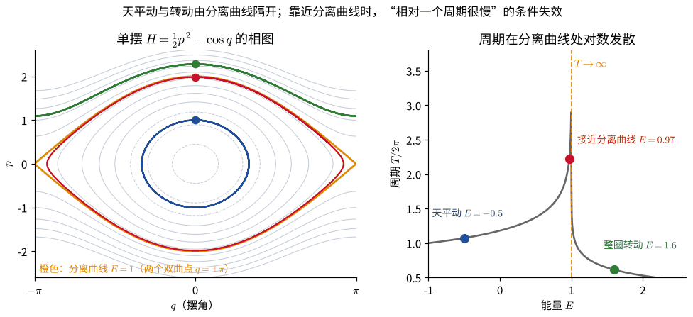

此外，沿给定 $\lambda$ 的闭合轨道对能量求导，

$$
\begin{equation}
\frac{\partial I}{\partial E}
=\frac{1}{2\pi}\oint
\frac{\partial p}{\partial E}\,dq
=\frac{T}{2\pi}
=\frac1\omega,
\end{equation}
$$

其中 $\omega=2\pi/T$。

<!-- 原 PDF 第 16 页 -->

### 几何意义与谐振子例子

对一自由度系统，$(q,p)$ 构成二维相空间。周期运动的相轨道是一条闭合曲线，而

$$
\begin{equation}
I=\frac{1}{2\pi}\oint p\,dq
\end{equation}
$$

等于该闭合曲线所包围面积的 $1/(2\pi)$。也可利用斯托克斯公式写成相应面积积分。

对一维谐振子

$$
\begin{equation}
H=\frac{p^2}{2m}+\frac12m\omega^2q^2=E,
\end{equation}
$$

相轨道是椭圆，其半轴分别为

$$
\begin{equation}
\sqrt{2mE},
\qquad
\sqrt{\frac{2E}{m\omega^2}}.
\end{equation}
$$

因此椭圆面积为 $2\pi E/\omega$，从而

$$
\begin{equation}
I=\frac{E}{\omega}.
\end{equation}
$$

其绝热不变性意味着：当振子的参数缓慢变化时，能量与频率之比近似保持不变。

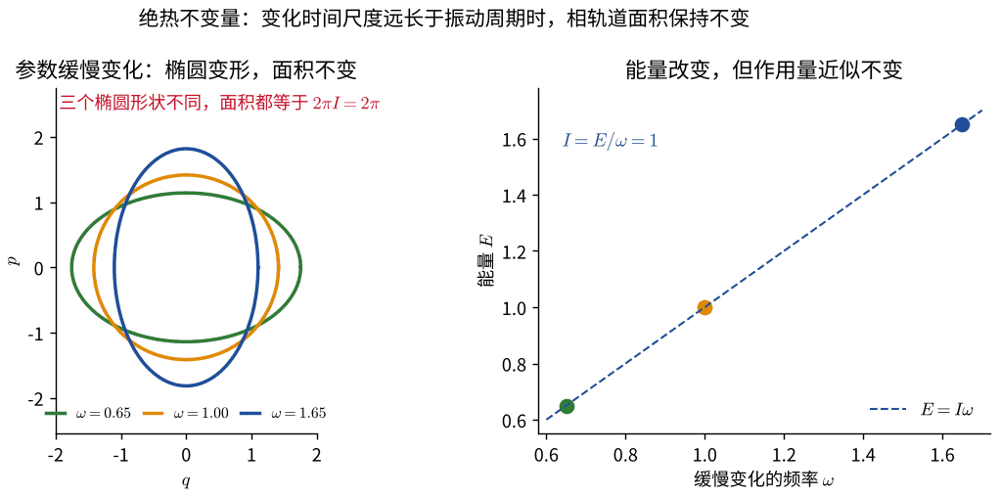

第一帧画出了三种频率下的相轨道：椭圆形状不同，所围面积相同。

**例：缓慢缩短摆长的单摆。** 小振幅单摆的频率为 $\omega=\sqrt{g/l}$，能量 $E\approx\frac12mgl\theta_0^2$，其中 $\theta_0$ 为角振幅。若缓慢地把摆线向上拉短，由 $E/\omega$ 不变可得

$$
\begin{equation}
\frac{E}{\omega}=\frac12m\sqrt g\,l^{3/2}\theta_0^2=\text{常数}
\quad\Longrightarrow\quad
\theta_0\propto l^{-3/4}.
\end{equation}
$$

摆长变短时，能量增加（拉线需要克服离心张力做功），角振幅也随之增大。注意这个结论与拉线的具体方式无关，只要求变化足够缓慢。

这个问题在物理学史上有特殊地位。1911 年第一届索尔维会议上，洛伦兹提出了“摆长缓慢变化时摆的能量如何变化”的问题，爱因斯坦立即指出 $E/\nu$ 是绝热不变量。这正是普朗克量子化条件 $E=nh\nu$ 能够自洽的原因：若参数缓慢变化，量子数 $n$ 不应发生跳变，因此被量子化的量必须是绝热不变量。埃伦费斯特把这一思想发展为“绝热假设” [10]，它进一步导向玻尔－索末菲量子化条件

$$
\begin{equation}
\oint p\,dq=nh.
\end{equation}
$$

绝热不变量在现代物理中仍然很重要。例如带电粒子在缓慢变化的磁场中回旋时，回旋运动的作用量正比于磁矩 $mv_\perp^2/(2B)$，它近似守恒；粒子进入强磁场区域时横向动能增大、纵向速度减小，直至被反射。这就是磁镜约束和地球范艾伦辐射带的基本原理。

下面的动画把这一过程画在磁镜中：磁力线在两端收拢，那里的磁场较强。投掷角较大的粒子在进入强场区之前 $v_\parallel$ 就减到零而被反射；投掷角太小的粒子（在“损失锥”内）则从端口逃逸。被俘获粒子的磁矩在整个运动中几乎不变。

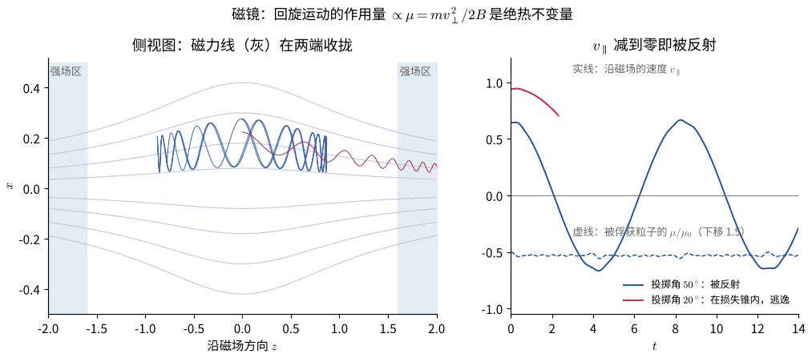

## 作用量－角变量（Action-Angle Variables）

先令 $\lambda$ 为常数。对封闭系统，能量 $E$ 为常数，且 $I$ 只能是 $E$ 的函数。取简约作用量

$$
\begin{equation}
S_0(q,E;\lambda)=\int p(q,E;\lambda)\,dq.
\end{equation}
$$

把能量反写为 $E=E(I)$，则也可将 $S_0$ 写成 $S_0(q,I;\lambda)$。以它作为生成函数，定义

$$
\begin{equation}
p=\frac{\partial S_0}{\partial q},
\qquad
w=\frac{\partial S_0}{\partial I}.
\end{equation}
$$

这里 $I$ 称为作用量变量，$w$ 称为角变量，二者构成一对正则变量。

推导：角变量每个周期恰好增加 2π

在一个周期内，$I$ 不变，而 $w=\partial S_0/\partial I$ 的改变为

$$
\begin{align*}
\Delta w&=\oint\frac{\partial w}{\partial q}\,dq=\oint\frac{\partial^2S_0}{\partial q\,\partial I}\,dq\\
&=\frac{d}{dI}\oint\frac{\partial S_0}{\partial q}\,dq=\frac{d}{dI}\oint p\,dq=\frac{d}{dI}(2\pi I)=2\pi .
\end{align*}
$$

所以 $w$ 确实是一个以 $2\pi$ 为周期的角度，相点绕闭合轨道一圈，$w$ 恰好增加 $2\pi$。这也是作用量定义中取 $1/(2\pi)$ 因子的原因。结合下面的 $\dot w=\omega$，得到 $\omega T=2\pi$，与前面的 $\partial I/\partial E=1/\omega$ 一致。

作用量变量标记相空间中“哪一条”闭合轨道，角变量则标记系统在该轨道上的相位位置。原来可能很不均匀的周期运动，在 $(w,I)$ 坐标中变成沿角方向的匀速运动，这就是作用量－角变量特别适合研究周期系统和微扰问题的原因。

<!-- 原 PDF 第 17 页 -->

由于生成函数 $S_0(q,I;\lambda)$ 不显含时间，新哈密顿量就是用新变量表示的原哈密顿量：

$$
\begin{equation}
H'=E(I).
\end{equation}
$$

相应的哈密顿方程为

$$
\begin{equation}
\dot I=-\frac{\partial H'}{\partial w}=0,
\qquad
\dot w=\frac{\partial H'}{\partial I}
=\frac{dE}{dI}=\omega(I)
.
\end{equation}
$$

所以作用量变量 $I$ 为常数，而角变量随时间线性增加：

$$
\begin{equation}
w(t)=\omega t+w_0.
\end{equation}
$$

这正是周期运动中“守恒作用量＋线性相位”的表述。

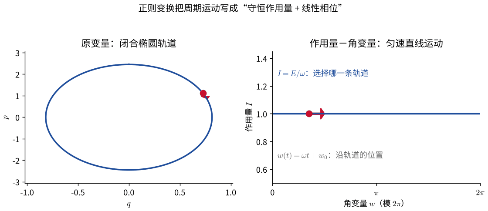

左图中的相点绕椭圆运动；右图中同一运动被写成 $I$ 不变、$w$ 匀速增加。所谓把轨道“拉直”，并不是改变物理运动，而是选择了更适合它的相空间坐标。

### 多自由度：不变环面

对 $s$ 个自由度的系统，若存在 $s$ 个彼此独立、两两泊松括号为零的运动积分，则称系统可积。刘维尔－阿诺德定理指出：这时有界运动的相轨道位于一个 $s$ 维环面上，可以引入 $s$ 对作用量－角变量 $(I_i,w_i)$，使 $H=H(I_1,\ldots,I_s)$，每个角变量以频率 $\omega_i=\partial H/\partial I_i$ 匀速增加。频率之比为有理数时，轨道在环面上闭合（周期运动）；为无理数时，轨道永不闭合，却会稠密地铺满整个环面（准周期运动）。

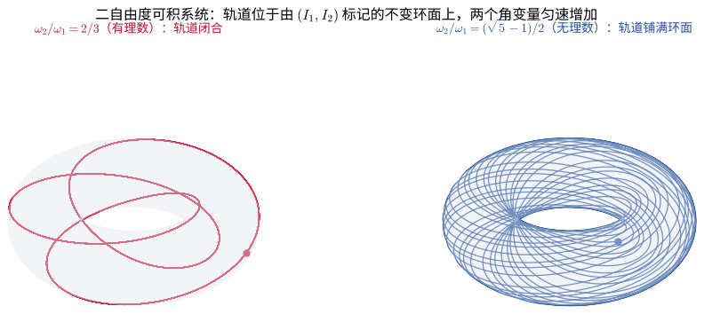

这些环面在小扰动下是否保留，是“KAM 定理”一章的主题；环面被破坏后出现的混沌，见“动力学系统与混沌”一章。

进阶：开普勒问题的作用量变量与轨道闭合

平面开普勒问题 $H=\dfrac{p_r^2}{2m}+\dfrac{p_\varphi^2}{2mr^2}-\dfrac{\alpha}{r}$ 有两个自由度。角向作用量就是角动量：

$$
\begin{equation*}
I_\varphi=\frac{1}{2\pi}\oint p_\varphi\,d\varphi=J .
\end{equation*}
$$

径向作用量为（$E<0$，积分可用围道积分或查表完成）

$$
\begin{equation*}
I_r=\frac{1}{2\pi}\oint p_r\,dr=\frac1\pi\int_{r_{\min}}^{r_{\max}}\sqrt{2m\left(E+\frac\alpha r\right)-\frac{J^2}{r^2}}\,dr
=-J+\alpha\sqrt{\frac{m}{2|E|}} .
\end{equation*}
$$

反解出能量：

$$
\begin{equation*}
H=E=-\frac{m\alpha^2}{2(I_r+I_\varphi)^2}.
\end{equation*}
$$

$H$ 只依赖 $I_r+I_\varphi$，所以两个频率相等：

$$
\begin{equation*}
\omega_r=\frac{\partial H}{\partial I_r}=\omega_\varphi=\frac{\partial H}{\partial I_\varphi}=\frac{m\alpha^2}{(I_r+I_\varphi)^3}.
\end{equation*}
$$

径向振动一次的时间恰好等于转一圈的时间，因此轨道闭合，这是开普勒问题“简并”的作用量－角变量表述，与“中心力场”一章的 LRL 矢量是同一事实。代入 $I_r+J=\alpha\sqrt{m/2|E|}$ 和 $a=\alpha/(2|E|)$，可得 $\omega=\sqrt{\alpha/(ma^3)}$，即开普勒第三定律。

任何偏离 $1/r$ 的微扰都会使 $\omega_\varphi\neq\omega_r$，两者之差就是近心点的进动速率，参见“微扰和摄动理论”一章的水星进动。

最后，若按玻尔－索末菲条件令 $I_r+I_\varphi=n\hbar$，立即得到氢原子能级 $E_n=-m\alpha^2/(2\hbar^2n^2)$。

<!-- 原 PDF 第 18 页 -->

## 刘维尔定理（Liouville's Theorem）

对具有 $s$ 个自由度的力学系统，相空间是以 $s$ 个广义坐标和 $s$ 个广义动量为坐标轴的 $2s$ 维空间。相空间中的每一点对应系统的一个确定状态；系统运动时，相点描出的曲线称为相轨道。

相空间体积元为

$$
\begin{equation}
d\Gamma=dq_1\cdots dq_s\,dp_1\cdots dp_s.
\end{equation}
$$

对相空间某一区域的积分

$$
\begin{equation}
\int d\Gamma
\end{equation}
$$

称为相体积。正则变换

$$
\begin{equation}
(q_i,p_i)\longrightarrow(Q_i,P_i)
\end{equation}
$$

保持相体积不变：

$$
\begin{equation}
\int dq_1\cdots dq_s\,dp_1\cdots dp_s
=\int dQ_1\cdots dQ_s\,dP_1\cdots dP_s.
\end{equation}
$$

推导：用正则变换的雅可比行列式证明相体积守恒

由多重积分的变量变换公式，只需证明雅可比行列式

$$
\begin{equation*}
D=\frac{\partial(Q_1,\ldots,Q_s,P_1,\ldots,P_s)}
{\partial(q_1,\ldots,q_s,p_1,\ldots,p_s)}
\end{equation*}
$$

满足 $|D|=1$。

<!-- 原 PDF 第 19 页 -->

利用第二类生成函数

$$
\begin{equation*}
F_2=F_2(q_i,P_i,t),
\end{equation*}
$$

有

$$
\begin{equation*}
dF_2=p_i\,dq_i+Q_i\,dP_i+(H'-H)dt,
\end{equation*}
$$

从而

$$
\begin{equation*}
p_i=\frac{\partial F_2}{\partial q_i},
\qquad
Q_i=\frac{\partial F_2}{\partial P_i}.
\end{equation*}
$$

为看清这一点，以 $(q,P)$ 为中间变量，利用雅可比行列式的链式法则：

$$
\begin{equation*}
D=\frac{\partial(Q,P)}{\partial(q,p)}
=\frac{\partial(Q,P)/\partial(q,P)}{\partial(q,p)/\partial(q,P)}
=\frac{\det\left(\partial Q_i/\partial q_k\right)_P}{\det\left(\partial p_i/\partial P_k\right)_q}.
\end{equation*}
$$

最后一步中，分子里 $P$ 保持不变、分母里 $q$ 保持不变，所以两个 $2s\times2s$ 行列式都约化为 $s\times s$ 行列式。由生成函数关系，

$$
\begin{equation*}
\frac{\partial Q_i}{\partial q_k}=\frac{\partial^2F_2}{\partial q_k\partial P_i},
\qquad
\frac{\partial p_i}{\partial P_k}=\frac{\partial^2F_2}{\partial q_i\partial P_k}.
\end{equation*}
$$

由于混合二阶偏导可交换，这两个矩阵互为转置，行列式相等，最终得到

$$
\begin{equation*}
|D|=1.
\end{equation*}
$$

关键的一步是：系统从时刻 $t$ 到 $t+dt$ 的哈密顿演化本身就是一个无穷小正则变换。取第二类生成函数

$$
\begin{equation}
F_2=q_iP_i+H(q,P,t)\,dt ,
\end{equation}
$$

则 $p_i=\partial F_2/\partial q_i=P_i+(\partial H/\partial q_i)\,dt$，$Q_i=\partial F_2/\partial P_i=q_i+(\partial H/\partial P_i)\,dt$，即 $Q_i=q_i+\dot q_i\,dt$，$P_i=p_i+\dot p_i\,dt$，这正是哈密顿方程给出的演化（它也是前面 $\delta f=\varepsilon[f,G]$ 取 $G=H$、$\varepsilon=dt$ 的情形）。有限时间的演化是无穷多个无穷小正则变换的复合，仍是正则变换。

因此，相空间中任一小区域随哈密顿流整体运动时，其形状可以改变，但总体积保持不变：

$$
\begin{equation}
\int d\Gamma=\text{常数}.
\end{equation}
$$

这就是刘维尔定理。

也可以把它理解为哈密顿流在相空间中不可压缩。若用相空间速度场

$$
\begin{equation}
\boldsymbol v_\Gamma=(\dot q_1,\ldots,\dot q_s,\dot p_1,\ldots,\dot p_s),
\end{equation}
$$

则哈密顿方程给出

$$
\begin{equation}
\nabla_\Gamma\cdot\boldsymbol v_\Gamma
=\sum_{i=1}^{s}\left(
\frac{\partial\dot q_i}{\partial q_i}
+\frac{\partial\dot p_i}{\partial p_i}
\right)
=\sum_{i=1}^{s}\left(
\frac{\partial^2H}{\partial q_i\partial p_i}
-\frac{\partial^2H}{\partial p_i\partial q_i}
\right)=0.
\end{equation}
$$

因此一团初始条件可以被拉伸、剪切和折叠，却不能在哈密顿演化下整体收缩成更小的相体积。这个结论是经典统计力学中相空间概率密度演化的基础。

设想大量相同的系统（系综）各自从不同初始条件出发，它们在相空间中的密度为 $\rho(q,p,t)$。相点既不产生也不消失，而且流动不可压缩，所以沿每条相轨道 $\rho$ 保持不变：

$$
\begin{equation}
\frac{d\rho}{dt}=\frac{\partial\rho}{\partial t}+[\rho,H]=0 .
\end{equation}
$$

这就是**刘维尔方程**。若 $\rho$ 只依赖于守恒量（例如 $\rho=\rho(H)$），则 $[\rho,H]=0$，分布不随时间变化，统计力学中的微正则系综和正则系综都是这样的定态。下一章的无碰撞玻尔兹曼方程，就是把这个方程用于单颗恒星的六维相空间，取 $H=\frac12v^2+\Phi$。

刘维尔定理最早由刘维尔在 1838 年以微分方程解的雅可比行列式守恒的形式给出 [8]。它有许多直接的物理推论：在加速器和光学系统中，粒子束在相空间中占据的面积（发射度）在保守的聚焦元件下不能被减小，因此不能只靠透镜和磁铁无限地把一束粒子“压缩”；在统计力学中，它保证了按相体积均匀分布的微正则系综在演化中保持不变。

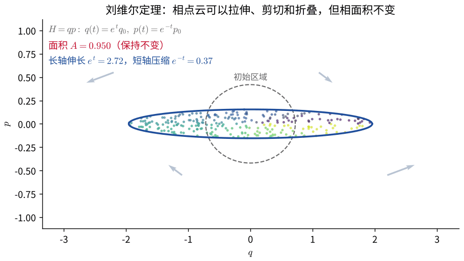

<!-- 原 PDF 第 20 页 -->

## 哈密顿－雅可比方程（Hamilton-Jacobi Equation）

前文已把作用量视为坐标与时间的函数 $S(q_i,t)$，并证明

$$
\begin{equation}
\frac{\partial S}{\partial t}+H(q_i,p_i,t)=0,
\end{equation}
$$

以及

$$
\begin{equation}
p_i=\frac{\partial S}{\partial q_i}.
\end{equation}
$$

将第二式代入第一式，得到

$$
\begin{equation}
\frac{\partial S}{\partial t}
+H\left(
q_i,
\frac{\partial S}{\partial q_i},
t
\right)=0
.
\end{equation}
$$

这就是作用量 $S(q_i,t)$ 所满足的哈密顿－雅可比方程。

哈密顿－雅可比方程把力学问题改写为一个一阶偏微分方程。若能求得包含足够多积分常数的完全积分 $S$，就可以通过求偏导把运动方程化为代数关系，并恢复全部轨迹。几何上，$S=\text{常数}$ 给出配置空间中的等作用量面，而 $\boldsymbol p=\nabla S$ 表明动量垂直于这些面；这与几何光学中程函的等相位面和波矢之间的关系完全平行，也是哈密顿力学与波动理论、量子力学发生联系的重要入口。

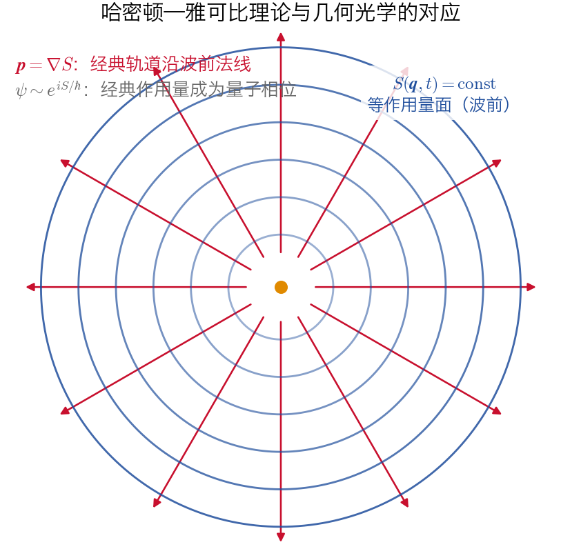

### 分离变量与完全积分

对不显含时间的保守系统，可令

$$
\begin{equation}
S(q_i,t)=W(q_i)-Et,
\end{equation}
$$

代入哈密顿－雅可比方程，得到不含时间的形式

$$
\begin{equation}
H\left(q_i,\frac{\partial W}{\partial q_i}\right)=E.
\end{equation}
$$

$W$ 就是前面莫佩尔蒂原理中的简约作用量 $S_0=\int p_i\,dq_i$。若 $S$ 含有 $s$ 个独立的积分常数 $\alpha_i$（例如 $E$ 本身），即为完全积分，则雅可比定理指出：

$$
\begin{equation}
\frac{\partial S}{\partial\alpha_i}=\beta_i=\text{常数}
\end{equation}
$$

给出 $s$ 个代数方程，由此可以直接解出 $q_i(t)$。从正则变换的角度看，$S$ 是一个第二类生成函数，它把系统变换到 $H'=0$ 的新变量 $(\beta_i,\alpha_i)$ 上，新变量全部是常数 [1, 7]。

例：用哈密顿－雅可比方程求一维谐振子

**例：一维谐振子。** 不含时间的方程为

$$
\begin{equation*}
\frac{1}{2m}\left(\frac{dW}{dq}\right)^2+\frac12m\omega^2q^2=E,
\qquad
W=\int\sqrt{2mE-m^2\omega^2q^2}\,dq.
\end{equation*}
$$

取 $\alpha=E$，则

$$
\begin{equation*}
\beta=\frac{\partial S}{\partial E}
=\int\frac{m\,dq}{\sqrt{2mE-m^2\omega^2q^2}}-t
=\frac1\omega\arcsin\left(q\sqrt{\frac{m\omega^2}{2E}}\right)-t,
\end{equation*}
$$

于是

$$
\begin{equation*}
q(t)=\sqrt{\frac{2E}{m\omega^2}}\sin\bigl[\omega(t+\beta)\bigr].
\end{equation*}
$$

我们没有求解任何运动方程，只通过对作用量求偏导就得到了完整的运动。对中心力场，可在球坐标中令 $S=-Et+p_\varphi\varphi+W_\theta(\theta)+W_r(r)$，方程逐个分离，三个分离常数分别对应能量、角动量的 $z$ 分量和总角动量大小。能否分离变量与守恒量的存在密切相关，这也是哈密顿－雅可比方法成为研究可积系统和微扰理论标准工具的原因。

推导：中心力场的分离变量，以及由雅可比定理直接得到轨道方程

代入 $S=-Et+p_\varphi\varphi+W_\theta(\theta)+W_r(r)$，不含时间的方程为

$$
\begin{equation*}
\frac{1}{2m}\left[\left(\frac{dW_r}{dr}\right)^2+\frac{1}{r^2}\left(\left(\frac{dW_\theta}{d\theta}\right)^2+\frac{p_\varphi^2}{\sin^2\theta}\right)\right]+V(r)=E .
\end{equation*}
$$

圆括号只依赖 $\theta$，其余部分只依赖 $r$，所以它必须是常数，记为 $J^2$：

$$
\begin{equation*}
\left(\frac{dW_\theta}{d\theta}\right)^2+\frac{p_\varphi^2}{\sin^2\theta}=J^2,
\qquad
\left(\frac{dW_r}{dr}\right)^2=2m\bigl(E-V(r)\bigr)-\frac{J^2}{r^2}.
\end{equation*}
$$

$J$ 就是总角动量的大小。取轨道平面为 $\theta=\pi/2$（$p_\varphi=J$，$W_\theta$ 为常数），

$$
\begin{equation*}
S=-Et+J\varphi+\int\sqrt{2m(E-V)-\frac{J^2}{r^2}}\,dr .
\end{equation*}
$$

由雅可比定理，对两个积分常数求偏导都得到常数：

$$
\begin{align*}
\frac{\partial S}{\partial J}&=\varphi-\int\frac{J\,dr}{r^2\sqrt{2m(E-V)-J^2/r^2}}=\text{常数},\\
\frac{\partial S}{\partial E}&=-t+\int\frac{m\,dr}{\sqrt{2m(E-V)-J^2/r^2}}=\text{常数}.
\end{align*}
$$

第一式正是“中心力场”一章的轨道方程（那里质量记为 $\mu$），第二式给出 $r(t)$。我们一次也没有写出运动方程。

再看一个能直接画出波前的例子。在均匀重力场中，从同一点以相同速率抛出的粒子具有相同的能量 $E$，不含时间的哈密顿－雅可比方程为 $\frac12|\nabla W|^2+y=E$（取 $m=g=1$）。下面的动画画出这族抛物线轨道（红）与等作用量面 $W=$ 常数（蓝）：波前一层层向外推进，轨道处处与之垂直。所有轨道的包络（虚线）是焦散线，波前在那里折叠，单值的 $W$ 不再存在。

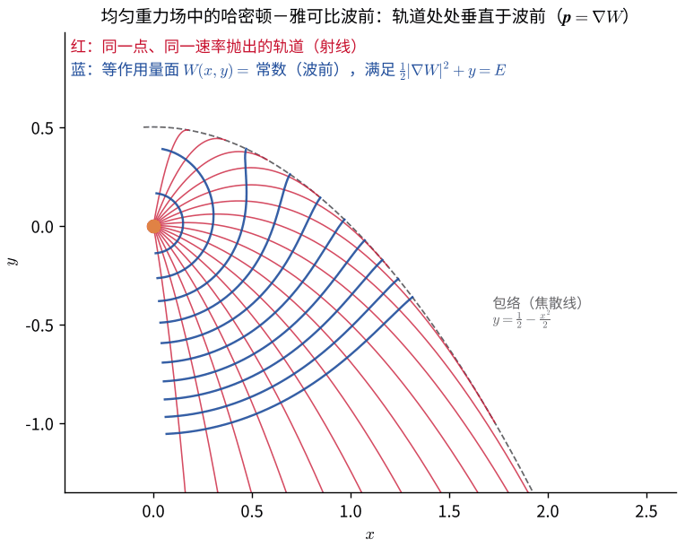

### 与量子力学的联系

哈密顿最初提出这套理论，正是受到几何光学中“光线垂直于波前”这一对应关系的启发 [6]。薛定谔在 1926 年反过来利用这一类比建立了波动力学 [11]。把

$$
\begin{equation}
\psi=e^{iS/\hbar}
\end{equation}
$$

（$S$ 允许为复数，以便吸收振幅）代入薛定谔方程

$$
\begin{equation}
i\hbar\frac{\partial\psi}{\partial t}=-\frac{\hbar^2}{2m}\nabla^2\psi+V\psi,
\end{equation}
$$

可得严格成立的

$$
\begin{equation}
\frac{\partial S}{\partial t}+\frac{(\nabla S)^2}{2m}+V=\frac{i\hbar}{2m}\nabla^2S.
\end{equation}
$$

当 $\hbar\to0$，即作用量远大于 $\hbar$ 时，右端可以忽略，上式化为经典的哈密顿－雅可比方程。因此，经典作用量就是量子波函数的相位，经典轨道就是波函数等相位面的法线。这就是半经典（WKB）近似的出发点，也说明经典力学可以看作量子力学在“短波长”极限下的几何光学。

## 概念检查

先尝试只用一句话回答，再展开查看解释。

1. 哈密顿量守恒，是否意味着每个正则动量都守恒？

不意味着。$H$ 守恒只要求它不显含时间；某个 $p_i$ 守恒则要求对应坐标 $q_i$ 是循环坐标，即 $\partial H/\partial q_i=0$。能量守恒与各分量动量守恒是不同的对称性陈述。

2. 哈密顿流为什么不沿着能量下降最快的方向运动？

因为相空间速度由 $J\nabla H$ 给出，其中 $J$ 是反对称的辛矩阵。它把能量梯度旋转到等能面的切向，因此 $\nabla H\cdot J\nabla H=0$，保守系统不会像梯度流那样自动滑向能量最低点。

3. 正则变换是否一定来自配置空间中的坐标变换？

不是。正则变换可以混合旧坐标与旧动量，例如 $Q=p$、$P=-q$。它必须保持的是泊松括号和辛结构，而不是“位置变量仍然只由旧位置组成”。

4. 生成函数的四种类型代表四种不同的物理变换吗？

不一定。它们常常只是同一正则变换选取不同独立变量后的勒让德表示。选哪一种，取决于哪些新旧变量最容易写成函数。

5. 相体积守恒是否意味着相点云的形状不变？

不意味着。相点云可以被拉伸、剪切甚至卷绕成细丝；刘维尔定理只保证完整的相体积不变。下一章的相混合正是“形状剧烈改变但细粒化相密度沿轨道不变”的例子。

6. 参数变化得很慢，绝热不变量就一定守恒吗？

还需要运动保持周期性并远离分离曲线和共振。靠近分离曲线时周期趋于无穷大，“相对一个周期而言很慢”的条件会失效；穿越共振时也可能发生有限的作用量跳变。

7. 在作用量－角变量中，系统为什么容易求解？

可积周期系统的哈密顿量只依赖作用量 $I_i$。于是 $\dot I_i=0$，而 $\dot w_i=\partial H/\partial I_i$ 为常数；复杂轨道被化成若干角变量的匀速运动。

8. 哈密顿－雅可比方程为什么与几何光学相似？

$S=\text{常数}$ 类似等相位面，而 $\boldsymbol p=\nabla S$ 类似垂直波前的波矢。经典轨迹是等作用量面的法线，就像几何光学中的光线是波前的法线。

<!-- 原 PDF 第 21 页 -->

## 作业

每道题后面有折叠的提示，建议先独立尝试，再展开查看。

### 一、一维谐振子

1. 根据哈密顿量与拉格朗日量的关系，推导哈密顿正则方程。
2. 一维谐振子的拉格朗日量为

   $$
   \begin{equation}
   L=\frac12m\dot x^2-\frac12kx^2.
   \end{equation}
   $$

   利用勒让德变换计算该系统的广义动量 $p$ 和哈密顿量 $H(x,p)$。
3. 写出该系统的哈密顿正则方程。
4. 在 $(x,p)$ 相空间中画出 $H=\text{常数}$ 的轨道。

提示

可对照正文“哈密顿正则方程”与“例：一维谐振子”两节检查。画相图时把 $H=E$ 改写成椭圆的标准形式 $x^2/a^2+p^2/b^2=1$，求出两个半轴，并由 $\dot x=p/m$ 的符号标出相点运动的方向（顺时针）。

### 二、二维极坐标中的自由粒子

1. 写出二维极坐标系下自由粒子的拉格朗日量，计算坐标 $(r,\theta)$ 对应的动量 $p_r,p_\theta$，并求系统的哈密顿量 $H$。
2. 计算 $p_r$、$p_\theta$ 分别与 $H$ 的泊松括号。

提示

$\theta$ 是循环坐标，可由泊松括号的结果直接判断哪个动量守恒；$[p_r,H]$ 不为零，它的形式就是离心项。

### 三、三维直角坐标中的角动量

三维直角坐标系下，角动量为

$$
\begin{equation}
M_i=\epsilon_{ijk}x_jp_k,
\end{equation}
$$

其中坐标 $\boldsymbol x=(x_1,x_2,x_3)$ 与动量 $\boldsymbol p=(p_1,p_2,p_3)$ 是正则变量，满足

$$
\begin{equation}
[x_i,x_j]=0,
\qquad
[p_i,p_j]=0,
\qquad
[x_i,p_j]=\delta_{ij}.
\end{equation}
$$

1. 证明

   $$
   \begin{equation}
   [M_i,M_j]=\epsilon_{ijk}M_k,
   \end{equation}
   $$

   并计算 $[M_i,p_j]$。
2. 计算

   $$
   \begin{equation}
   M^2=M_1^2+M_2^2+M_3^2
   \end{equation}
   $$

   与自由粒子哈密顿量

   $$
   \begin{equation}
   H=\frac{\boldsymbol p^2}{2m}
   \end{equation}
   $$

   的泊松括号。

提示

先用基本括号和莱布尼茨法则算出 $[M_i,x_j]$ 和 $[M_i,p_j]$，再由此推出 $[M_i,M_j]$（可与正文折叠块中逐项计算的结果对照）。$[M^2,H]$ 的结果反映了自由粒子哈密顿量的转动不变性。

### 四、均匀磁场中的带电粒子

取均匀磁场 $\boldsymbol B=B\hat{\boldsymbol z}$，矢势 $\boldsymbol A=\frac12\boldsymbol B\times\boldsymbol r$。

1. 写出质量为 $m$、电荷为 $q$ 的粒子的哈密顿量 $H(x,y,z,p_x,p_y,p_z)$，并由哈密顿方程证明粒子在 $xy$ 平面内以回旋频率 $\omega_c=qB/m$ 作圆周运动。
2. 比较正则动量 $\boldsymbol p$ 与机械动量 $m\boldsymbol v$，说明哪一个与矢势的规范选取有关。
3. 计算一个回旋周期的作用量 $\oint(\boldsymbol p_\perp\cdot d\boldsymbol q_\perp)$，证明它正比于磁矩 $\mu=mv_\perp^2/(2B)$，并据此解释正文中的磁镜。

提示

$H=\dfrac{(p_x+qBy/2)^2+(p_y-qBx/2)^2+p_z^2}{2m}$。第 3 问沿回旋圆积分 $(m\boldsymbol v+q\boldsymbol A)\cdot d\boldsymbol l$：第一部分给出 $2\pi m v_\perp r_L$，第二部分由斯托克斯定理给出 $-q B\pi r_L^2$（注意回旋方向），再用 $r_L=v_\perp/\omega_c$，结果为 $2\pi m\mu/q$。

### 五、判断正则变换

证明变换

$$
\begin{equation}
Q=\ln\left(\frac{\sin p}{q}\right),
\qquad
P=q\cot p
\end{equation}
$$

是正则变换。

提示

只需验证 $[Q,P]_{q,p}=1$。用 $\partial Q/\partial q=-1/q$、$\partial Q/\partial p=\cot p$、$\partial P/\partial q=\cot p$、$\partial P/\partial p=-q/\sin^2p$，最后用 $1/\sin^2p-\cot^2p=1$。

### 六、单摆的作用量变量

单摆的哈密顿量取为 $H=\frac12p^2-\cos q$（单位已选为使小振动频率为 1）。

1. 对天平动（$-1<E<1$），写出作用量 $I(E)=\frac{1}{2\pi}\oint p\,dq$ 的积分表达式，并验证小振幅时 $I\approx E+1$。
2. 利用 $dE/dI=\omega(E)$，说明当 $E\to1$（分离曲线）时 $\omega\to0$。
3. 结合正文的动画，解释为什么缓慢改变摆长时，接近分离曲线的轨道不再满足绝热不变性。

提示

$I(E)=\dfrac{2}{\pi}\int_{0}^{q_{\max}}\sqrt{2(E+\cos q)}\,dq$，$\cos q_{\max}=-E$。可证明 $I=\dfrac{8}{\pi}\left[\mathrm E(k^2)-(1-k^2)\mathrm K(k^2)\right]$，$k^2=(1+E)/2$，其中 $\mathrm K,\mathrm E$ 是完全椭圆积分。小振幅时直接把 $\cos q$ 展开到二阶，椭圆相轨道的面积即为 $2\pi(E+1)$。周期 $T=4\mathrm K(k^2)$ 在 $k\to1$ 时对数发散。

### 七、用哈密顿－雅可比方程求抛体运动

在均匀重力场中，$H=\dfrac{p_x^2+p_y^2}{2m}+mgy$。

1. 令 $S=-Et+\alpha x+W_y(y)$，求出 $W_y(y)$。
2. 利用雅可比定理 $\partial S/\partial E=\beta_1$、$\partial S/\partial\alpha=\beta_2$，求出轨道 $x(t)$、$y(t)$，并验证它是抛物线。

提示

$W_y=\int\sqrt{2m(E-mgy)-\alpha^2}\,dy$，积分结果是 $(\ldots)^{3/2}$ 的形式。$\partial S/\partial E$ 给出 $y(t)$，$\partial S/\partial\alpha$ 给出 $x$ 与 $y$ 的关系；$\alpha=p_x$ 是守恒的水平动量。

## 参考文献与延伸阅读

1. H. Goldstein, C. Poole, and J. Safko, *Classical Mechanics*, 3rd ed., Addison-Wesley, 2002。第 8–10 章系统讨论哈密顿方程、正则变换与哈密顿－雅可比理论，适合作为本章的主要教材来源。
2. L. D. Landau and E. M. Lifshitz, *Mechanics*, 3rd ed., Butterworth-Heinemann, 1976，[出版社页面](https://www.sciencedirect.com/book/9780750628969/mechanics)。第 7 章以非常凝练的方式讨论正则方程、泊松括号、作用量变量和绝热不变量。
3. V. I. Arnol'd, *Mathematical Methods of Classical Mechanics*, 2nd ed., Springer, 1989，[DOI: 10.1007/978-1-4757-2063-1](https://doi.org/10.1007/978-1-4757-2063-1)。适合进一步理解相空间、辛结构、哈密顿流和刘维尔定理的几何意义。
4. C. Lanczos, *The Variational Principles of Mechanics*, 4th ed., Dover, 1986。适合从变分原理和作用量的角度理解拉格朗日与哈密顿形式之间的联系。
5. I. W. Stewart, “Canonical Transformations, Hamilton-Jacobi Equations, and Action-Angle Variables,” MIT OpenCourseWare 8.09, Fall 2014，[课程讲义](https://ocw.mit.edu/courses/8-09-classical-mechanics-iii-fall-2014/resources/mit8_09f14_chapter_4/)。可作为正则变换、泊松括号和作用量－角变量的开放课程补充材料。
6. W. R. Hamilton, “On a General Method in Dynamics,” *Philosophical Transactions of the Royal Society of London* **124**, 247–308 (1834)；“Second Essay on a General Method in Dynamics,” *ibid.* **125**, 95–144 (1835)。哈密顿正则方程和特征函数（作用量）方法的原始文献。
7. C. G. J. Jacobi, *Vorlesungen über Dynamik*, ed. A. Clebsch, Reimer, Berlin, 1866。哈密顿－雅可比理论、完全积分与雅可比定理的经典来源。
8. J. Liouville, “Note sur la théorie de la variation des constantes arbitraires,” *Journal de Mathématiques Pures et Appliquées* **3**, 342–349 (1838)。刘维尔定理的原始文献。
9. P. A. M. Dirac, “The Fundamental Equations of Quantum Mechanics,” *Proceedings of the Royal Society A* **109**, 642–653 (1925)，[DOI: 10.1098/rspa.1925.0150](https://doi.org/10.1098/rspa.1925.0150)。提出泊松括号与量子对易子之间的对应。
10. P. Ehrenfest, “Adiabatic Invariants and the Theory of Quanta,” *Philosophical Magazine* **33**, 500–513 (1917)。系统阐述绝热不变量在早期量子论中的作用。
11. E. Schrödinger, “Quantisierung als Eigenwertproblem (Zweite Mitteilung),” *Annalen der Physik* **384**, 489–527 (1926)。利用力学与光学的类比，从哈密顿－雅可比方程出发建立波动力学。

关于泊松括号的约定：Goldstein 等教材记为 $\{f,g\}$，定义与本章相同。朗道《力学》也用方括号，但定义为 $[f,g]=\dfrac{\partial f}{\partial p_i}\dfrac{\partial g}{\partial q_i}-\dfrac{\partial f}{\partial q_i}\dfrac{\partial g}{\partial p_i}$，与本章**相差一个负号**，相应地写作 $df/dt=\partial f/\partial t+[H,f]$。对照阅读时请注意。
