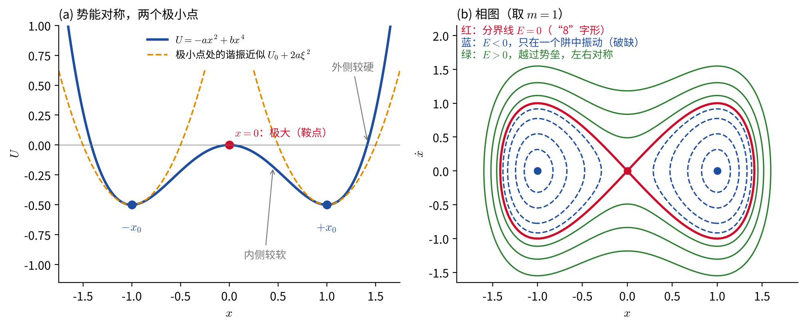
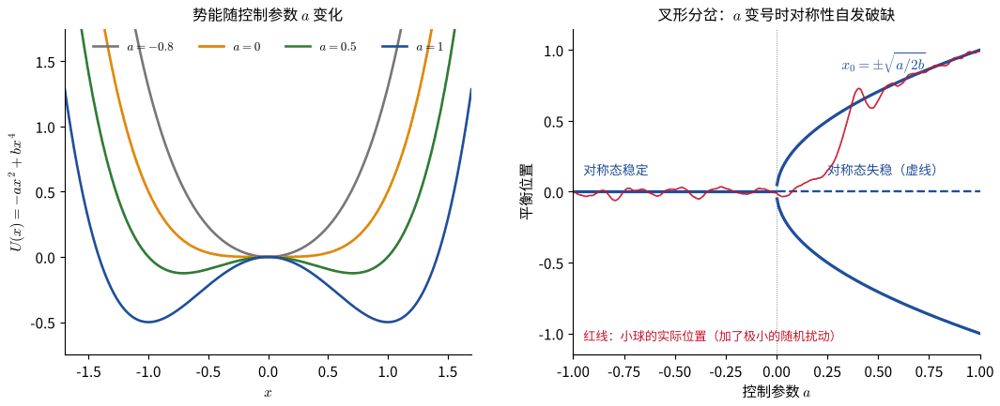
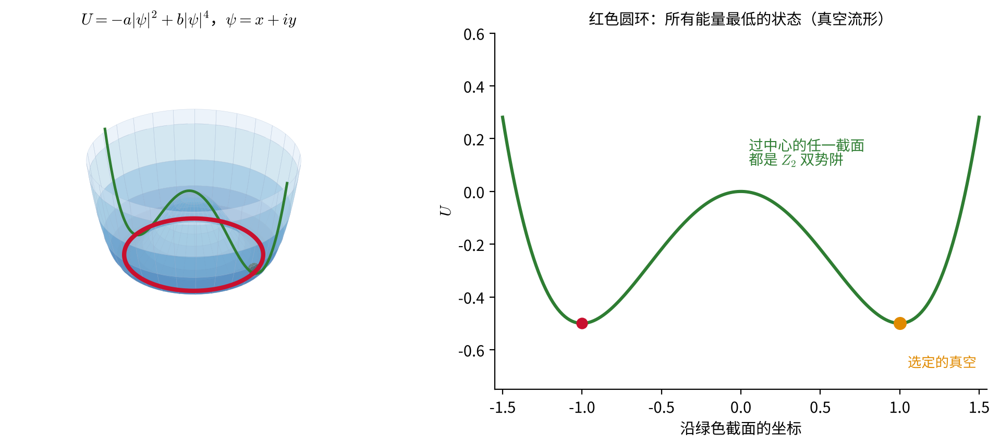
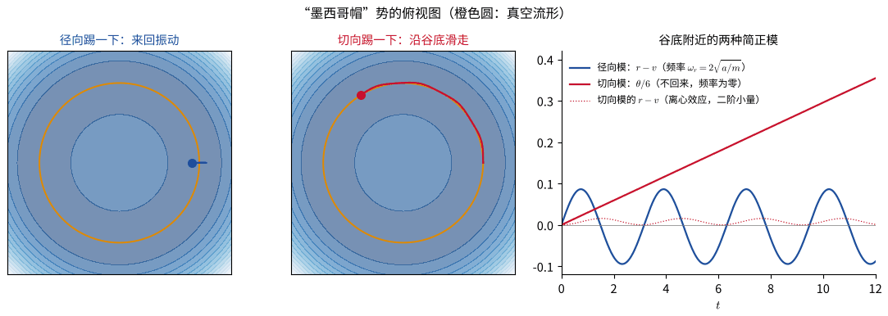
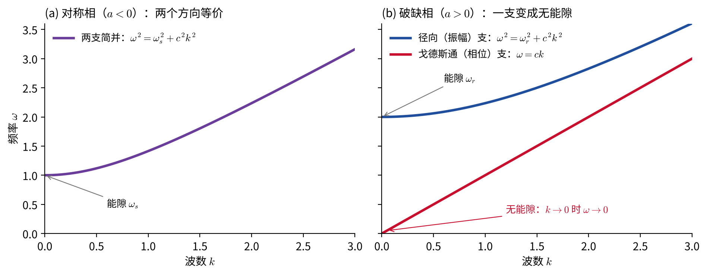
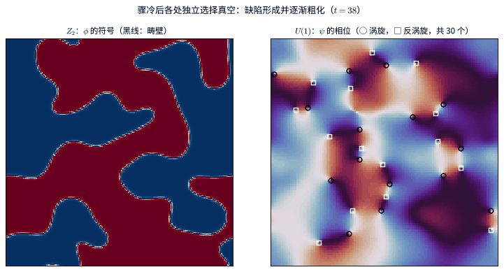

# 对称性自发破缺

> 阅读提示：文中蓝色边框的“推导”“例”“提示”等块默认折叠，点击标题展开。

## 引言

我们已经多次看到，对称性带来守恒量（诺特定理），也会约束运动方程的形式。但一个系统的方程具有某种对称性，并不意味着它实际所处的状态也具有这种对称性。一支竖直放置、受压的细杆在左右方向上是对称的，压力超过临界值后，它却必然弯向某一侧；一块铁的微观相互作用对空间中的各个方向一视同仁，冷却到居里温度以下后，它的磁化却指向一个特定的方向。

**拉格朗日量（或运动方程）具有某种对称性，而能量最低的状态（基态、真空）不具有这种对称性**，这种现象称为对称性的**自发破缺**（spontaneous symmetry breaking）。“自发”是指：没有任何外加的不对称因素，系统自己“选择”了一个不对称的状态。

本章沿三步展开：

1. **离散对称性 $Z_2$。** 用最简单的一维双势阱说明自发破缺的基本特征。这里用到的工具全部来自[“微扰和摄动理论”](微扰和摄动理论.md)一章：在平衡点附近作泰勒展开，用相图分析运动，用 Lindstedt 方法计算非谐修正。
2. **连续对称性 $U(1)$。** 把双势阱推广为二维的“墨西哥帽”，会出现一个频率为零的简正模，即戈德斯通模；推广到场，它变成无能隙的波。
3. **局域对称性与希格斯机制（科普）。** 当对称性是“局域”的，戈德斯通模被规范场“吃掉”，规范粒子因而获得质量。超导和粒子物理中的电弱理论都是这一机制的例子。

最后简要介绍对称性破缺在宇宙中留下的“痕迹”：拓扑缺陷。

## 一、离散对称性：$Z_2$

### 1.1 双势阱

考虑质量为 $m$ 的质点在势能

$$
\begin{equation}
U(x)=-a\,x^2+b\,x^4,\qquad a>0,\ b>0
\end{equation}
$$

中运动，运动方程为 $m\ddot x=2ax-4bx^3$。势能和运动方程在**反射** $x\to-x$ 下不变。这个变换做两次回到原样，构成只有两个元素的群，记为 $Z_2$。

**$x=0$ 是平衡点，但不稳定。** $U''(0)=-2a<0$，按“微扰和摄动理论”一章中 $k<0$ 的情形，小偏离按 $e^{\kappa t}$ 增长，

$$
\begin{equation}
\kappa=\sqrt{2a/m},
\end{equation}
$$

在相图上 $x=0$ 是一个鞍点。所以在对称点 $x=0$ 附近作“微小振动”展开是没有意义的。

**稳定平衡点不对称。** 由 $U'(x)=-2ax+4bx^3=0$，除 $x=0$ 外还有两个平衡点：

$$
\begin{equation}
x=\pm x_0,\qquad x_0=\sqrt{\frac{a}{2b}},\qquad U(\pm x_0)=-\frac{a^2}{4b},\qquad U''(\pm x_0)=4a>0 .
\end{equation}
$$

它们是两个极小点，在 $x\to-x$ 下互相交换。势能最低的状态有两个，彼此等价，但系统只能处在其中一个。方程是对称的，而系统实际所处的状态不是，这就是对称性的自发破缺。至于选择哪一个，取决于一个任意小的扰动（初始条件、微小的噪声等）。

### 1.2 在极小点附近展开：对称性被“隐藏”

按“稳定平衡附近的微小振动”的做法，应该在稳定平衡点 $x_0$ 附近展开。令 $x=x_0+\xi$，代入后一次项为零（$x_0$ 是平衡点），得到

$$
\begin{equation}
U=-\frac{a^2}{4b}+2a\,\xi^2+4bx_0\,\xi^3+b\,\xi^4 .
\end{equation}
$$

三点值得注意。

- **小振动频率**为 $\omega_0=\sqrt{U''(x_0)/m}=2\sqrt{a/m}$。比较 $\kappa$ 可知 $\omega_0^2=2\kappa^2$：极小点处的曲率是原点处曲率（的绝对值）的两倍。后面讲希格斯粒子的质量时会再次遇到这个“2”。
- **展开后的势能不再具有反射对称性。** 出现了奇次项 $4bx_0\,\xi^3$，$U(\xi)\neq U(-\xi)$：势阱内侧（朝向 $x=0$）较“软”，外侧较“硬”，见上图（a）中橙色虚线与真实势能的对比。原来的变换 $x\to-x$ 在新变量中是 $\xi\to-\xi-2x_0$，它把一个极小点映到另一个，只在 $x_0$ 附近作展开是看不到的。
- **对称性并没有丢失，只是被隐藏了。** 把展开式写成 $U=U_0+\frac12k\xi^2+c_3\xi^3+c_4\xi^4$，三个系数 $k=4a$、$c_3=4bx_0$、$c_4=b$ 并不独立，而是满足

$$
\begin{equation}
c_3^2=2\,k\,c_4 .
\end{equation}
$$

一个一般的、本来就不对称的势能没有理由满足这样的关系。它是原有对称性留下的“指纹”：只观察 $x_0$ 附近的小振动，也能通过检验这一关系推断出系统原本具有反射对称性。

### 1.3 破缺的定量后果：用 Lindstedt 公式计算

展开式中的 $\xi^3$ 项正是“微扰和摄动理论”一章中非谐振动的 $\alpha$ 项。由 $-dU/d\xi$，运动方程为

$$
\begin{equation}
\ddot\xi+\omega_0^2\xi=-\alpha\,\xi^2-\beta\,\xi^3,
\qquad
\alpha=\frac{3c_3}{m}=\frac{12bx_0}{m},\qquad \beta=\frac{4c_4}{m}=\frac{4b}{m}.
\end{equation}
$$

把它代入那里用 Lindstedt 方法得到的频率修正（振幅记为 $A$，以免与势能系数 $a$ 混淆），可以得到

$$
\begin{equation}
\frac{\Delta\omega}{\omega_0}=-\frac34\left(\frac{A}{x_0}\right)^2,
\qquad
\langle\xi\rangle=-\frac{3A^2}{4x_0}.
\end{equation}
$$

推导：频率修正与振动中心的偏移

“微扰和摄动理论”一章中，方程 $\ddot x+\omega_0^2x=-\alpha x^2-\beta x^3$ 的频率修正为

$$
\begin{equation*}
\Delta\omega=\left(\frac{3\beta}{8\omega_0}-\frac{5\alpha^2}{12\omega_0^3}\right)A^2 .
\end{equation*}
$$

代入 $\beta=4b/m$、$\alpha^2=144b^2x_0^2/m^2=72ab/m^2$ 和 $\omega_0^2=4a/m$：

$$
\begin{equation*}
\frac{3\beta}{8\omega_0}=\frac{3}{2}\,\frac{b}{m\omega_0},
\qquad
\frac{5\alpha^2}{12\omega_0^3}=\frac{5\cdot72ab}{12m^2\omega_0\cdot4a/m}=\frac{15}{2}\,\frac{b}{m\omega_0},
\end{equation*}
$$

所以

$$
\begin{align*}
\Delta\omega&=\left(\frac32-\frac{15}{2}\right)\frac{bA^2}{m\omega_0}=-\frac{6bA^2}{m\omega_0},\\
\frac{\Delta\omega}{\omega_0}&=-\frac{6bA^2}{m\omega_0^2}=-\frac{3b}{2a}A^2=-\frac34\left(\frac{A}{x_0}\right)^2,
\end{align*}
$$

最后一步用了 $b/a=1/(2x_0^2)$。

**振动中心。** 那一章的折叠块中指出，$\alpha x^2$ 项产生一个频率为零的“外力”。二阶解中的常数项为 $-\alpha A^2/(2\omega_0^2)$，即

$$
\begin{equation*}
\langle\xi\rangle=-\frac{\alpha A^2}{2\omega_0^2}=-\frac{12bx_0/m}{2\cdot4a/m}A^2=-\frac{3bx_0}{2a}A^2=-\frac{3A^2}{4x_0}.
\end{equation*}
$$

这两个结果都直接来自破缺：

- **频率随振幅降低。** 如果没有对称性破缺带来的 $\xi^3$ 项，只有四次项，频率会**升高**（上面推导中的 $+\tfrac32$）。立方项的贡献（$-\tfrac{15}{2}$）更大，结果是频率降低：振幅越大，越接近中间的势垒，周期越长。
- **振动中心偏向势垒。** $\langle\xi\rangle<0$，即平均位置向 $x=0$ 一侧移动，因为内侧较软。
- **展开的适用范围。** 要求立方项远小于二次项，$4bx_0A^3\ll2aA^2$，即 $A\ll x_0$：振幅必须远小于到势垒的距离。

### 1.4 相图与高能时的对称性恢复

上图（b）是双势阱的相图。过鞍点 $x=0$ 的分界线 $E=0$ 呈“8”字形：

- $E<0$ 时（蓝），质点只在一个阱中振动，运动是不对称的，这是“破缺”的运动；
- $E>0$ 时（绿），质点越过势垒，在两个阱之间来回运动，$\langle x\rangle=0$，运动重新具有反射对称性。

所以**对称性只在低能量下破缺，高能量下恢复**。在统计物理中，能量对应温度：高温下涨落使系统在两个状态之间不断跳跃，宏观上是对称的；低温下系统停留在一个状态中，对称性破缺。这就是铁磁体在居里温度以上不显磁性、以下自发磁化的图像。

### 1.5 控制参数与朗道理论

让势能中的系数 $a$ 随某个外部参数连续变化，并改变符号：

- $a<0$：$U=|a|x^2+bx^4$ 只有一个极小点 $x=0$，对称的状态稳定，小振动频率 $\omega^2=2|a|/m$；
- $a>0$：$x=0$ 失稳，出现两个极小点 $\pm x_0=\pm\sqrt{a/2b}$，小振动频率 $\omega^2=4a/m$。

平衡位置随 $a$ 的变化像一把叉子，称为**叉形分岔**。在 $a=0$ 附近，

$$
\begin{equation}
x_0\propto a^{1/2},\qquad \omega^2\propto|a| .
\end{equation}
$$

小振动频率在临界点两侧都趋于零，系统变得越来越“软”，这称为**软化**。临界点处 $U\approx bx^4$，谐振近似完全失效。

1937 年，朗道把这一图像用于相变：把序参量（例如磁化强度 $M$）看作 $x$，把自由能写成 $F=-a\,M^2+b\,M^4$，并令 $a\propto T_c-T$。于是 $M\propto(T_c-T)^{1/2}$，即“平均场”临界指数 $\beta=1/2$ [1]。

动画中 $a$ 从 $-1$ 缓慢增加到 $+1$，小球受到很小的阻尼和随机扰动。$a$ 变号后，小球随机地落向其中一侧，并在相应的极小点附近振动、逐渐停下来。由于参数一直在变化，小球离开 $x=0$ 比 $a=0$ 稍晚：扰动越小，这一延迟越明显。

例：旋转圆环上的小珠与压杆失稳

**旋转圆环上的小珠。** 半径为 $R$ 的光滑圆环绕竖直直径以恒定角速度 $\Omega$ 转动，小珠在环上滑动，$\theta$ 从最低点量起：

$$
\begin{equation*}
L=\frac12mR^2\dot\theta^2+\frac12mR^2\Omega^2\sin^2\theta+mgR\cos\theta\equiv\frac12mR^2\dot\theta^2-U_{\rm eff}(\theta).
\end{equation*}
$$

$L$ 在 $\theta\to-\theta$ 下不变，不显含时间，所以 $\frac12mR^2\dot\theta^2+U_{\rm eff}$ 守恒；它不是能量，而是转动参照系中的 $H=E-\Omega L_z$（见“哈密顿力学”一章）。记 $\omega_0^2=g/R$，在 $\theta=0$ 附近展开：

$$
\begin{equation*}
U_{\rm eff}\approx\text{常数}+\frac12mR^2\left(\omega_0^2-\Omega^2\right)\theta^2+\frac{1}{24}mR^2\left(4\Omega^2-\omega_0^2\right)\theta^4 .
\end{equation*}
$$

这正是双势阱的形式，$-a=\frac12mR^2(\omega_0^2-\Omega^2)$。

- $\Omega<\omega_0$：小珠停在最低点，振动频率 $\omega^2=\omega_0^2-\Omega^2$；
- $\Omega>\omega_0$：最低点失稳，小珠移到 $\cos\theta^*=\omega_0^2/\Omega^2$ 处，左右两侧任选其一，振动频率 $\omega^2=\Omega^2-\omega_0^4/\Omega^2$。

在 $\Omega=\omega_0$ 附近，后者约为 $2(\Omega^2-\omega_0^2)$，正好是前者绝对值的两倍，与正文 $\omega^2=4a/m$ 和 $2|a|/m$ 之比一致。

**压杆失稳（欧拉屈曲）。** 竖直细杆两端受轴向压力 $P$。压力较小时直立状态稳定；超过临界压力 $P_c=\pi^2EI/L^2$（$EI$ 为抗弯刚度，$L$ 为杆长）后，直立状态失稳，杆向左或向右弯曲。弯曲的幅度在 $P_c$ 附近按 $(P-P_c)^{1/2}$ 增长，也是叉形分岔。

### 1.6 显式破缺

若势能中再加上一项 $-hx$，

$$
\begin{equation}
U(x)=-a\,x^2+b\,x^4-h\,x ,
\end{equation}
$$

势能本身就不再对称，两个极小点不再等价：$h>0$ 时右边的极小点更低（能量差约为 $2hx_0$），系统总是落向右边。这称为对称性的**显式破缺**。它与自发破缺的区别在于：显式破缺时方程本身就不对称；自发破缺时方程对称，只有状态不对称。

在铁磁体中，$h$ 相当于外加磁场。$h$ 很小时，系统对 $h$ 的响应（“磁化率”）$\chi=dx/dh=1/U''$ 在对称相中为 $1/(2|a|)$，在破缺相中为 $1/(4a)$，两者都在 $a\to0$ 时发散。这与 1.5 节中频率的软化是同一件事：恢复力越弱，系统对外加的推动越敏感。

### 1.7 注释：经典与量子

以上讨论都是经典力学。在量子力学中，单个粒子可以**隧穿**有限高的势垒，双势阱的基态是左右两个阱中状态的对称叠加，能量比反对称叠加略低一点（隧穿劈裂）。所以单个粒子的量子基态仍然是对称的，并没有真正的自发破缺。

真正的自发破缺需要**无穷多个自由度**。若“翻转”涉及 $N$ 个粒子（例如一块磁铁中所有自旋同时翻转），隧穿振幅大约按 $e^{-cN}$ 减小，$N\to\infty$ 时严格为零，系统只能永远停留在它选定的状态中。这也是第二部分要从单个粒子过渡到“场”的原因。经典与量子图像的联系可参见“量子谐振子与经典极限”一章。

## 二、连续对称性：整体 $U(1)$

### 2.1 “墨西哥帽”势

把双势阱推广到二维。用复数 $\psi=x+iy=re^{i\theta}$ 表示平面上的位置，令

$$
\begin{equation}
L=\frac12m\left(\dot x^2+\dot y^2\right)-U,
\qquad
U=-a|\psi|^2+b|\psi|^4=-a\,r^2+b\,r^4 .
\end{equation}
$$

势能只依赖于 $r$，在任意角度 $\alpha$ 的转动

$$
\begin{equation}
\psi\to e^{i\alpha}\psi
\end{equation}
$$

下不变。这些转动构成连续的群 $U(1)$（也就是 $SO(2)$）。与离散的 $Z_2$ 不同，这里的对称变换可以连续地变化。由诺特定理，相应的守恒量是角动量 $L_z=mr^2\dot\theta$。

### 2.2 真空流形

势能在 $r=0$ 处有一个极大，在圆周

$$
\begin{equation}
r=v\equiv\sqrt{\frac{a}{2b}}
\end{equation}
$$

上处处取最小值。能量最低的状态不再是两个孤立的点，而是**一整个圆**，称为**真空流形**。系统选定其中一点 $\theta=\theta_0$，就破缺了 $U(1)$ 对称性；所有可能的真空彼此等价，可以由对称变换相互转换。

势能的形状像一顶墨西哥草帽（或酒瓶底），过中心的任一截面都是第一部分的 $Z_2$ 双势阱。

### 2.3 谷底附近的简正模

在选定的真空 $(x,y)=(v,0)$ 附近作小振动分析，方法与“微扰和摄动理论”一章“多自由度系统的简谐振动”相同：把势能展开到二阶，求出简正模。结果是

$$
\begin{equation}
\omega_r^2=\frac{4a}{m}\quad\text{（径向模）},\qquad
\omega_\theta^2=0\quad\text{（切向模）}.
\end{equation}
$$

推导：墨西哥帽势在谷底的简正模

对只依赖 $r$ 的势能 $U(r)$，在 $x$ 轴上的点 $(r,0)$ 处，二阶导数为

$$
\begin{equation*}
\frac{\partial^2U}{\partial x^2}=U''(r),\qquad
\frac{\partial^2U}{\partial y^2}=\frac{U'(r)}{r},\qquad
\frac{\partial^2U}{\partial x\,\partial y}=0 .
\end{equation*}
$$

在谷底 $r=v$，$U'(v)=0$，$U''(v)=-2a+12bv^2=4a$。所以势能矩阵是对角的，

$$
\begin{equation*}
\mathbf k=\begin{pmatrix}4a&0\\0&0\end{pmatrix},
\qquad
\omega_r^2=\frac{4a}{m},\qquad\omega_\theta^2=0 .
\end{equation*}
$$

也可以直接用极坐标：$L=\frac12m(\dot r^2+r^2\dot\theta^2)-U(r)$。$\theta$ 是循环坐标，不出现在势能中，所以沿 $\theta$ 方向没有任何回复力；令 $r=v+\rho$，径向方程线性化为 $m\ddot\rho=-U''(v)\rho$，即频率为 $\omega_r$ 的振动。

$\omega_r^2=4a/m$ 与第一部分 $\omega_0^2$ 相同：径向截面就是双势阱。

两个模式的物理意义完全不同：

- **径向模**：在谷底附近沿 $r$ 方向来回振动，频率有限（“有能隙”）。它就是第一部分中在极小点附近的振动；在粒子物理的语言中，频率对应质量，所以它是一个“有质量”的激发，后面会看到它对应希格斯粒子。
- **切向模**：沿谷底移动不改变势能，因此没有回复力，频率为零。被轻轻推一下后，质点不会回来，而是沿谷底滑走（单个质点时就是绕谷底的缓慢转动）。这个零频模称为**戈德斯通模**。

### 2.4 戈德斯通定理

零频模的出现不是这个例子的巧合，而是连续对称性被自发破缺的普遍结果：

> **戈德斯通定理**：每有一个连续对称性的生成元被真空破缺，就有一个零频（无能隙）的模式。[2, 3]

证明（经典小振动版本）

设势能 $U(\mathbf q)$ 在一族连续变换 $\mathbf q\to R(\alpha)\mathbf q$ 下不变，$R(\alpha)\approx\mathbf 1+\alpha T$。对任意 $\mathbf q$，$U(\mathbf q+\alpha T\mathbf q)=U(\mathbf q)$，所以

$$
\begin{equation*}
\frac{\partial U}{\partial q_i}\,(T\mathbf q)_i=0\qquad\text{对所有 }\mathbf q\text{ 成立}.
\end{equation*}
$$

把这个恒等式再对 $q_j$ 求导，并在真空 $\mathbf q_0$ 处取值（那里 $\partial U/\partial q_i=0$）：

$$
\begin{equation*}
\frac{\partial^2U}{\partial q_i\,\partial q_j}\bigg|_{\mathbf q_0}(T\mathbf q_0)_i=0 .
\end{equation*}
$$

即势能矩阵 $\mathbf k$ 有一个零本征矢 $T\mathbf q_0$，对应一个零频的简正模。只要 $T\mathbf q_0\neq0$，也就是真空在这个变换下确实改变（对称性被真空破缺），这个零模就存在。在墨西哥帽中，$T\mathbf q_0$ 就是谷底圆周的切线方向。若真空在变换下不变（$T\mathbf q_0=0$），则没有零模。

**为什么 $Z_2$ 破缺没有戈德斯通模？** 离散对称性不能“一点一点地”变换：从 $+x_0$ 到 $-x_0$ 必须越过势垒，中间没有一条能量不变的路径。只有连续对称性，真空才构成一条连续的“谷”，沿谷移动才不需要能量。

### 2.5 从粒子到场：无能隙的波

1.7 节说过，真正的自发破缺需要无穷多个自由度。设想一排相同的“墨西哥帽”振子，每个振子 $\psi_n$ 都与相邻的振子用弹簧耦合；取连续极限，就得到定义在空间每一点的场 $\psi(z,t)$：

$$
\begin{equation}
L=\int dz\left[\frac12\rho\,|\partial_t\psi|^2-\frac12\kappa_s\,|\partial_z\psi|^2-u(\psi)\right],
\qquad
u=-a|\psi|^2+b|\psi|^4 ,
\end{equation}
$$

其中 $\rho$ 是单位长度的“质量”，$\kappa_s$ 描述相邻点之间的耦合，$c=\sqrt{\kappa_s/\rho}$ 是波速。**整体**对称性指的是：每一点都转同一个角度，$\psi(z)\to e^{i\alpha}\psi(z)$。

在均匀真空 $\psi=v$ 附近，把场写成 $\psi=(v+h)e^{i\theta}$，并对小量 $h$、$\theta$ 线性化，得到两种波：

$$
\begin{equation}
\omega^2=\omega_r^2+c^2k^2\quad\text{（振幅波，}h\text{）},
\qquad
\omega=ck\quad\text{（相位波，}\theta\text{）}.
\end{equation}
$$

推导：两支色散关系

把 $\psi=(v+h)e^{i\theta}$ 代入，保留到二阶小量：

$$
\begin{equation*}
|\partial_t\psi|^2\approx\dot h^2+v^2\dot\theta^2,\qquad
|\partial_z\psi|^2\approx h'^2+v^2\theta'^2,\qquad
u\approx u(v)+\frac12u''(v)\,h^2 ,
\end{equation*}
$$

其中 $u''(v)=4a$，而 $u$ 与 $\theta$ 无关。于是 $h$ 和 $\theta$ 互相解耦：

$$
\begin{equation*}
\rho\,\ddot h=\kappa_s\,h''-4a\,h,
\qquad
\rho\,v^2\ddot\theta=\kappa_s\,v^2\theta'' .
\end{equation*}
$$

代入平面波 $e^{i(kz-\omega t)}$，第一式给出 $\omega^2=4a/\rho+c^2k^2$，第二式给出 $\omega=ck$。

**对称相作对比。** 若 $a<0$，真空是 $\psi=0$，在它附近 $u\approx|a|(x^2+y^2)$，$x$ 和 $y$ 两个方向等价，两支色散关系相同，都是 $\omega^2=2|a|/\rho+c^2k^2$，都有能隙。

单个质点的“零频模”在场中变成了一支**无能隙**的波：波长越长，频率越低，$k\to0$ 时 $\omega\to0$。长波的相位波只是让各处的相位缓慢地变化，几乎不消耗能量。量子化之后，无能隙的波对应**无质量**的粒子，有能隙的波对应有质量的粒子。

自然界中的例子：

- **超流体**（液氦、玻色－爱因斯坦凝聚）：凝聚体的宏观波函数 $\psi$ 选定了一个相位，破缺了 $U(1)$。戈德斯通模就是超流体中的声子（声波）。在光晶格中的冷原子体系里，振幅模（“希格斯模”）也已经在实验中观测到 [4]。
- **晶体**：原子的排列破缺了空间平移对称性，戈德斯通模是声学声子。
- **铁磁体**：磁化方向破缺了自旋转动对称性，戈德斯通模是自旋波（磁振子）。它的色散关系是 $\omega\propto k^2$ 而不是 $\omega\propto k$，模式的数目也比破缺生成元的数目少，这是非相对论系统中戈德斯通定理的一个微妙之处。

## 三、局域对称性与希格斯机制（科普）

> 这一部分是科普性质的介绍，只给出关键的公式和物理图像，可以跳过。采用粒子物理中常用的自然单位 $\hbar=c=1$，此时频率和质量是同一回事。

### 3.1 从整体对称性到局域对称性

整体对称性要求每一点的场**同时**转过**同一个**角度。更强的要求是：每一点可以独立地转一个不同的角度 $\alpha(x)$，

$$
\begin{equation}
\psi(x)\to e^{i\alpha(x)}\psi(x),
\end{equation}
$$

这称为**局域**（或规范）对称性。由于 $\partial_\mu\psi$ 会多出一项 $i(\partial_\mu\alpha)\psi$，只有引入一个新的场 $A_\mu$ 并把导数换成**协变导数**

$$
\begin{equation}
D_\mu=\partial_\mu-iqA_\mu,
\qquad
A_\mu\to A_\mu+\frac1q\partial_\mu\alpha ,
\end{equation}
$$

拉格朗日量才能保持不变。$A_\mu$ 就是规范场；对 $U(1)$ 来说，它就是电磁场的四维矢势，$q$ 是电荷。这与“哈密顿力学”一章中带电粒子的“最小耦合” $\boldsymbol p\to\boldsymbol p-q\boldsymbol A$ 是同一件事。在没有自发破缺时，规范对称性保证 $A_\mu$ 没有质量：光子是无质量的，电磁力是长程力。

### 3.2 阿贝尔希格斯模型

把墨西哥帽势和规范场放在一起（为与粒子物理的习惯一致，系数改记为 $\mu^2$ 和 $\lambda$）：

$$
\begin{equation}
\mathcal L=-\frac14F_{\mu\nu}F^{\mu\nu}+\bigl|D_\mu\phi\bigr|^2-V(\phi),
\qquad
V=-\mu^2|\phi|^2+\lambda|\phi|^4 .
\end{equation}
$$

第一项是电磁场自身的能量，$F_{\mu\nu}=\partial_\mu A_\nu-\partial_\nu A_\mu$。与第二部分一样，真空在 $|\phi|=v/\sqrt2$ 处，$v=\sqrt{\mu^2/\lambda}$。写成 $\phi=\frac{1}{\sqrt2}(v+h)e^{i\theta}$，会发生两件事：

1. **戈德斯通模“消失”了。** 相位 $\theta(x)$ 正好是一个局域规范变换的角度，可以通过选择 $\alpha(x)=-\theta(x)$ 把它从 $\phi$ 中完全去掉。它并没有凭空消失，而是转移到了 $A_\mu$ 中。
2. **规范场获得质量。** 把真空值代入 $|D_\mu\phi|^2$，出现一项 $\frac12(qv)^2A_\mu A^\mu$，这正是质量为

$$
\begin{equation}
m_A=q\,v
\end{equation}
$$

的矢量粒子的质量项。原来的无质量光子变成了有质量的矢量粒子，相互作用变成短程的，作用距离约为 $1/m_A$。

剩下的径向振动 $h$ 是一个有质量的标量粒子，即**希格斯粒子**，其质量

$$
\begin{equation}
m_h^2=V''\big|_{\text{真空}}=2\mu^2=2\lambda v^2 .
\end{equation}
$$

这里的“2”就是 1.2 节中“极小点处的曲率是原点处曲率绝对值的两倍”。

**数一数自由度。** 破缺前：无质量光子有 2 个偏振（横向），复标量场有 2 个实自由度，共 4 个。破缺后：有质量的矢量粒子有 3 个偏振（多了一个纵向偏振），希格斯粒子 1 个，仍然是 4 个。戈德斯通模变成了规范粒子的纵向偏振，这就是“被规范场吃掉”的确切含义。

### 3.3 超导：最早的例子

这一机制最早在超导中被认识到。超导体中电子两两结合成库珀对（电荷 $2e$），它们凝聚成一个宏观的量子态，其波函数 $\phi$ 选定了一个相位，破缺了与电磁规范对称性相联系的 $U(1)$。按上面的分析，超导体内部的光子获得了质量，电磁场只能深入表面一个很短的距离：

| 粒子物理 | 超导 |
|---|---|
| 希格斯场 $\phi$ | 库珀对的凝聚体波函数（金兹堡－朗道序参量） |
| 规范场 $A_\mu$ | 电磁场 |
| 规范粒子的质量 $m_A$ | 磁场穿透深度的倒数 $1/\lambda_L$ |
| 短程相互作用 | 迈斯纳效应：磁场被排出超导体 |
| 希格斯粒子 | 超导中的振幅模（希格斯模） |

穿透深度 $\lambda_L$ 的典型值在 50–500 nm 之间。南部阳一郎在 1960 年指出了超导与对称性破缺的联系 [5]，安德森在 1963 年明确指出，规范场可以“吃掉”戈德斯通模而获得质量 [6]。1964 年，恩格勒与布鲁、希格斯，以及古拉尼克、哈根与基布尔分别把这一机制推广到相对论性的场论 [7–9]。

### 3.4 电弱理论与希格斯粒子

粒子物理标准模型中，弱相互作用和电磁相互作用统一为 $SU(2)\times U(1)$ 规范理论。希格斯场是一个复二重态，有 4 个实自由度。它的势能具有墨西哥帽的形状（在四维的场空间中），真空破缺了四个生成元中的三个，只留下电磁的 $U(1)$：

- 3 个戈德斯通模被 $W^+$、$W^-$、$Z$ 三个规范粒子吃掉，它们获得质量：$m_W\approx80.36$ GeV，$m_Z\approx91.19$ GeV [18]。正因为它们很重，弱相互作用才是短程的，太阳中的核聚变才进行得如此缓慢。
- 未破缺的那个组合对应光子，它保持无质量。
- 剩下的 1 个自由度就是希格斯粒子。2012 年，欧洲核子研究中心大型强子对撞机上的 ATLAS 和 CMS 实验发现了质量约 125 GeV 的希格斯粒子 [10, 11]，目前的平均值为 $125.20\pm0.11$ GeV [18]。2013 年诺贝尔物理学奖授予恩格勒和希格斯（布鲁已于 2011 年去世）。

**一个数值联系。** 真空期望值由弱相互作用的强度（费米常数 $G_F$）定出，$v=(\sqrt2\,G_F)^{-1/2}\approx246.22$ GeV [18]。由 $m_h^2=2\lambda v^2$ 和 $m_h\approx125.2$ GeV，得到 $\lambda\approx0.129$。墨西哥帽的“形状参数”就这样被实验测定了。

夸克和带电轻子也通过与希格斯场的耦合（汤川耦合）获得质量，$m_f=y_fv/\sqrt2$，其中 $y_f$ 是耦合常数。顶夸克的 $y_t\approx1$，电子的 $y_e$ 只有约 $3\times10^{-6}$。为什么这些耦合常数的大小相差如此悬殊，至今仍是未解之谜。

### 3.5 几个常见的误解

- **“希格斯机制赋予了一切物质质量。”** 不对。质子、中子的质量约 0.94 GeV，其中三个价夸克的静止质量（由希格斯机制产生）加起来只占约 1%；即使把与夸克质量相关的“夸克凝聚”贡献（约 9%）也算上，也只有约十分之一。其余约九成来自强相互作用中夸克的动能和胶子场的能量 [17]。我们身体的质量绝大部分来自强相互作用。
- **“规范对称性被自发破缺了。”** 这是一种方便但不严格的说法。局域规范对称性本质上是描述中的冗余（同一个物理状态的不同写法），严格地说它不能被自发破缺（Elitzur 定理 [12]）。能被实验检验的是那些规范不变的事实：规范粒子有质量、相互作用是短程的、存在一个标量粒子等。
- **“希格斯粒子是质量的来源。”** 质量来自希格斯场不为零的真空期望值 $v$；希格斯粒子是这个场在真空附近的振动，相当于墨西哥帽中的径向模。

## 四、拓扑缺陷与宇宙学（简介）

自发破缺时，系统要“选择”一个真空。如果系统很大，而选择是在各处同时、独立地发生的（例如快速冷却），相距很远的区域来不及互相“沟通”，就会选出不同的真空。区域之间的交界处无法同时处于两个真空，于是留下能量较高的**拓扑缺陷**：

- **$Z_2$：畴壁。** 相邻区域分别选了 $+x_0$ 和 $-x_0$，交界处的场必须经过 $x=0$（势垒顶），形成一堵“墙”。铁磁体中的磁畴壁就是这样。
- **$U(1)$：涡旋（宇宙弦）。** 沿一个闭合回路走一圈，相位 $\theta$ 可以增加 $2\pi n$（$n$ 为整数，称为绕数）。$n\neq0$ 时，回路内部某处的场必须为零（墨西哥帽的顶部），形成一个涡旋核心；在三维空间中是一条线。整数 $n$ 不能连续地改变，所以涡旋是拓扑上稳定的。超流体和超导中的量子化涡旋就是这样。

动画模拟了一个二维系统从随机的小涨落开始的弛豫（采用过阻尼的金兹堡－朗道动力学 $\partial_t\phi=\nabla^2\phi+\phi-\phi^3$，对复场 $\psi$ 类似）。左图是 $Z_2$ 场的符号，红蓝两色是两个真空，黑线是畴壁；右图是 $U(1)$ 场的相位，○ 和 □ 标出绕数为 $+1$ 和 $-1$ 的涡旋。缺陷一旦形成，只能通过畴壁收缩、正反涡旋相遇湮灭而逐渐减少，畴的尺度随时间缓慢增大（粗化）。

这一机制最早由基布尔在宇宙学背景下提出 [13]：宇宙早期温度降低时经历的对称性破缺相变，可能留下畴壁、宇宙弦等缺陷。祖瑞克随后指出，可以在超流氦等凝聚态系统中检验同样的机制 [14]，并给出缺陷密度与冷却速度的关系（基布尔－祖瑞克机制）。宇宙学上，稳定的畴壁会很快主导宇宙的能量，与观测矛盾（“畴壁问题”）；宇宙弦则会持续辐射引力波，形成随机引力波背景，是脉冲星计时阵列和未来的空间引力波探测器（如 LISA）寻找的信号之一。

## 小结

| | $Z_2$ | 整体 $U(1)$ | 局域 $U(1)$ | 电弱理论 |
|---|---|---|---|---|
| 对称变换 | $x\to-x$ | $\psi\to e^{i\alpha}\psi$ | $\psi\to e^{i\alpha(x)}\psi$ | $SU(2)\times U(1)$ |
| 真空 | 两个点 $\pm x_0$ | 一个圆 $\lvert\psi\rvert=v$ | 一个圆（相位可被规范掉） | 三维球面 |
| 真空附近的激发 | 有能隙的振动 | 有能隙的径向模 + 无能隙的戈德斯通模 | 有质量的矢量粒子 + 希格斯粒子 | $W^\pm$、$Z$ + 希格斯粒子，光子无质量 |
| 拓扑缺陷 | 畴壁 | 涡旋（弦） | 磁通涡旋（超导） | |
| 例子 | 铁磁（易轴）、压杆失稳 | 超流、晶体 | 超导 | 粒子物理 |

贯穿全章的方法只有一条：**找到真正的稳定平衡点，在它附近展开，看小振动是什么样子**。对称性破缺的所有特征，包括展开中出现的奇次项、零频的戈德斯通模、规范粒子获得质量，都是在这个展开中读出来的。

## 概念检查

1. 在自发破缺中，什么是对称的，什么不是？

拉格朗日量（运动方程）是对称的；系统实际所处的能量最低状态不是。所有可能的基态合在一起仍然是对称的（它们由对称变换互相转换），只是系统只能处在其中一个。

2. 在极小点附近展开出现了 ξ³ 项，对称性到哪里去了？

对称性被隐藏而不是丢失：$x\to-x$ 把 $x_0$ 映到 $-x_0$，在单个极小点附近的展开中看不到。但展开系数满足 $c_3^2=2kc_4$，这是原有对称性留下的约束。

3. 为什么高能量（高温）时对称性会恢复？

能量高于势垒时，质点在两个阱之间来回运动，时间平均是对称的。统计物理中，高温下的热涨落使系统不断越过势垒，宏观上看不到偏向哪一侧。

4. 为什么 Z₂ 破缺没有戈德斯通模？

离散对称性的两个真空之间隔着势垒，没有一条能量不变的连续路径；只有连续对称性的真空才构成一条“谷”，沿谷移动不需要能量，才有零频模。

5. 戈德斯通模的频率为零，是否意味着质点静止不动？

不是。频率为零是指没有回复力：沿谷底的位移不会被拉回来。质点被推动后会沿谷底匀速滑动（单个质点时是绕谷底转动），而不是来回振动。

6. 单个粒子的双势阱，在量子力学中为什么没有真正的自发破缺？

粒子可以隧穿势垒，基态是两个阱中状态的对称叠加。只有当翻转涉及无穷多个自由度时，隧穿振幅才严格为零，系统才会永远停留在一个真空中。

7. 在希格斯机制中，戈德斯通模到哪里去了？

它可以通过局域规范变换从标量场中去掉，转移到规范场中，成为有质量矢量粒子的第三个（纵向）偏振。自由度的总数不变。

8. 希格斯机制是否产生了我们身体的大部分质量？

没有。原子的质量几乎全部来自质子和中子。夸克的静止质量只占核子质量的约 1%，连同与夸克质量相关的贡献也只有约 10%，其余来自强相互作用的能量。电子的质量确实来自希格斯机制，但电子很轻。

## 作业

每道题后面有折叠的提示，建议先独立尝试，再展开查看。

1. **横向压缩的弹簧。** 质量为 $m$ 的质点用两根相同的弹簧（劲度系数 $k$，原长 $L_0$）分别连到 $(-d,0)$ 和 $(d,0)$ 两个固定点，质点只能沿 $y$ 方向运动。

   1. 写出势能 $U(y)$，并展开到 $y^4$ 项。
   2. 求对称性开始破缺的临界距离 $d_c$。$d<d_c$ 时，求精确的平衡位置 $y^*$，并与由展开式得到的近似值比较。
   3. 分别求 $d>d_c$ 时 $y=0$ 处、$d<d_c$ 时 $y^*$ 处的小振动频率，说明它们在 $d\to d_c$ 时都趋于零。

   

   
提示

   $U=k\bigl(\sqrt{d^2+y^2}-L_0\bigr)^2$，展开得 $U\approx k(d-L_0)^2+k\left(1-\dfrac{L_0}{d}\right)y^2+\dfrac{kL_0}{4d^3}y^4$，所以 $d_c=L_0$。精确平衡位置由 $\sqrt{d^2+y^2}=L_0$ 给出，$y^*=\pm\sqrt{L_0^2-d^2}$；$d$ 接近 $L_0$ 时它约为 $\sqrt{2L_0(L_0-d)}$，与展开式给出的 $\sqrt{a/2b}$ 一致。

   

2. **旋转圆环上的小珠。** 利用 1.5 节折叠块中的拉格朗日量：

   1. 求出所有平衡位置，并判断它们的稳定性。
   2. 求 $\Omega<\omega_0$ 和 $\Omega>\omega_0$ 时稳定平衡附近的小振动频率，画出频率随 $\Omega$ 变化的草图。
   3. 若圆环的转轴稍微偏离竖直方向，分岔图会变成什么样子？这对应哪一类破缺？

   

   
提示

   $U_{\rm eff}'(\theta)=mR^2\sin\theta\,(\omega_0^2-\Omega^2\cos\theta)$。平衡位置为 $\theta=0$、$\theta=\pi$，以及 $\Omega>\omega_0$ 时的 $\cos\theta^*=\omega_0^2/\Omega^2$。第 3 问对应 1.6 节的显式破缺：两侧不再等价，叉形分岔变成“不完全分岔”。

   

3. **墨西哥帽中的转动。** 在 2.1 节的势能中，质点具有守恒的角动量 $L_z=\ell\neq0$。

   1. 写出径向的有效势 $U_{\rm eff}(r)=U(r)+\ell^2/(2mr^2)$（参见“中心力场”一章），求圆轨道半径 $r_c$ 到 $\ell^2$ 的一阶。
   2. 求圆轨道附近径向小振动的频率，并说明 $\ell\to0$ 时回到 $\omega_r$。
   3. 解释为什么这一匀速转动就是单个质点的“戈德斯通模”。

   

   
提示

   由 $U'(r_c)=\ell^2/(mr_c^3)$ 和 $U'(v+\delta)\approx U''(v)\delta=4a\delta$，得 $r_c\approx v+\dfrac{\ell^2}{4amv^3}$：离心效应使轨道略向外移，这是 $\ell^2$ 量级的效应。径向频率 $\omega^2=\bigl[U''(r_c)+3\ell^2/(mr_c^4)\bigr]/m$。$\ell\to0$ 时转动角速度 $\ell/(mr_c^2)\to0$，转动可以任意慢，对应零频率。

   

4. **自由度计数（科普题）。** 分别对阿贝尔希格斯模型和电弱理论，列出对称性破缺前后各种粒子的自由度（无质量矢量粒子 2 个，有质量矢量粒子 3 个，实标量 1 个），验证总数不变。电弱理论中，破缺前有 4 个无质量规范粒子和一个复二重态的希格斯场。

   

   
提示

   阿贝尔希格斯模型：$2+2=3+1$。电弱理论：破缺前 $4\times2+4=12$；破缺后 $W^\pm$、$Z$ 共 $3\times3=9$，光子 2，希格斯粒子 1，也是 12。

   

## 参考文献与延伸阅读

1. L. D. Landau and E. M. Lifshitz, *Statistical Physics, Part 1*, 3rd ed., Pergamon, 1980，第 14 章 “Phase Transitions of the Second Kind and Critical Phenomena”。朗道的二级相变理论；原始论文为 L. D. Landau, *Physikalische Zeitschrift der Sowjetunion* **11**, 26 和 545 (1937)，英译见 *Collected Papers of L. D. Landau*, Pergamon, 1965。
2. J. Goldstone, “Field Theories with ‘Superconductor’ Solutions,” *Il Nuovo Cimento* **19**, 154–164 (1961)。
3. J. Goldstone, A. Salam, and S. Weinberg, “Broken Symmetries,” *Physical Review* **127**, 965–970 (1962)。戈德斯通定理的一般证明。
4. M. Endres et al., “The ‘Higgs’ Amplitude Mode at the Two-Dimensional Superfluid/Mott Insulator Transition,” *Nature* **487**, 454–458 (2012)。
5. Y. Nambu, “Quasi-Particles and Gauge Invariance in the Theory of Superconductivity,” *Physical Review* **117**, 648–663 (1960)。
6. P. W. Anderson, “Plasmons, Gauge Invariance, and Mass,” *Physical Review* **130**, 439–442 (1963)。
7. F. Englert and R. Brout, “Broken Symmetry and the Mass of Gauge Vector Mesons,” *Physical Review Letters* **13**, 321–323 (1964)。
8. P. W. Higgs, “Broken Symmetries and the Masses of Gauge Bosons,” *Physical Review Letters* **13**, 508–509 (1964)。
9. G. S. Guralnik, C. R. Hagen, and T. W. B. Kibble, “Global Conservation Laws and Massless Particles,” *Physical Review Letters* **13**, 585–587 (1964)。
10. ATLAS Collaboration, “Observation of a New Particle in the Search for the Standard Model Higgs Boson with the ATLAS Detector at the LHC,” *Physics Letters B* **716**, 1–29 (2012)。
11. CMS Collaboration, “Observation of a New Boson at a Mass of 125 GeV with the CMS Experiment at the LHC,” *Physics Letters B* **716**, 30–61 (2012)。
12. S. Elitzur, “Impossibility of Spontaneously Breaking Local Symmetries,” *Physical Review D* **12**, 3978–3982 (1975)。
13. T. W. B. Kibble, “Topology of Cosmic Domains and Strings,” *Journal of Physics A* **9**, 1387–1398 (1976)。
14. W. H. Zurek, “Cosmological Experiments in Superfluid Helium?” *Nature* **317**, 505–508 (1985)。
15. S. Coleman, *Aspects of Symmetry*, Cambridge University Press, 1985，第 5 章 “Secret Symmetry”。对自发破缺与希格斯机制的经典讲解。
16. A. Zee, *Quantum Field Theory in a Nutshell*, 2nd ed., Princeton University Press, 2010，第 IV 部分 “Symmetry and Symmetry Breaking”。用直观的方式介绍对称性破缺与希格斯机制。
17. A. Walker-Loud, “Dissecting the Mass of the Proton,” *Physics* **11**, 118 (2018)，[APS Physics](https://physics.aps.org/articles/v11/118)；所评述的格点 QCD 计算：Y.-B. Yang et al., “Proton Mass Decomposition from the QCD Energy Momentum Tensor,” *Physical Review Letters* **121**, 212001 (2018)。质子质量的分解：夸克静止质量约 1%，夸克凝聚约 9%，其余来自夸克动能和胶子场能量。
18. Particle Data Group, *Review of Particle Physics*（2025、2026 版），[pdg.lbl.gov](https://pdg.lbl.gov)。$W$、$Z$ 与希格斯粒子的质量、真空期望值 $v$ 等数值。
