# 微扰和摄动理论

<style>
details.derivation { border-left: 3px solid #1f4e9c; background: #f6f8fb; padding: 0.35em 1em; margin: 1em 0; border-radius: 4px; }
details.derivation > summary { cursor: pointer; font-weight: 600; color: #1f4e9c; }
details.derivation[open] > summary { margin-bottom: 0.5em; }
@media print {
  details.derivation::details-content { content-visibility: visible; display: block; }
  details.derivation > summary { list-style: none; margin-bottom: 0.5em; }
  details.derivation > summary::-webkit-details-marker { display: none; }
}
</style>

> 阅读提示：文中蓝色边框的“推导”“例”“提示”等块默认折叠，点击标题展开。

理论力学中能够严格求解的系统屈指可数：自由粒子、谐振子、开普勒问题……而真实系统几乎都不能严格求解。但物理上很多系统都“离一个可解系统不远”：偏离是一个小量。**微扰（perturbation）方法**的思想就是：以可解系统作为零阶近似，把偏离按小参数逐阶展开，一阶一阶地求修正。

本章的各节其实都是这一思想的不同实例：

- 在稳定平衡点附近，势能展开到二阶，非线性项是小量，得到**线性化的小振动**；
- 在小振动上再叠加一个弱的外力、摩擦或参数的周期调制，得到**强迫振动、阻尼振动和参数共振**；
- 在开普勒轨道上叠加第三个天体的引力或广义相对论修正，得到**天体摄动与近日点进动**。

为了看清它们的共同结构，先写出最一般的形式。设运动方程为

$$
\begin{equation}
\ddot x+\omega^2x=\varepsilon\,g(x,\dot x,t),
\qquad |\varepsilon|\ll1,
\end{equation}
$$

其中左边是可解的谐振子（零阶问题），右边是小的“扰动”。把解按 $\varepsilon$ 展开

$$
\begin{equation}
x(t)=x^{(0)}(t)+\varepsilon x^{(1)}(t)+\varepsilon^2x^{(2)}(t)+\cdots,
\end{equation}
$$

代入方程并按 $\varepsilon$ 的幂次分别令系数相等，得到逐阶的方程：

$$
\begin{align}
\ddot x^{(0)}+\omega^2x^{(0)}&=0,\\
\ddot x^{(1)}+\omega^2x^{(1)}&=g\bigl(x^{(0)},\dot x^{(0)},t\bigr).
\end{align}
$$

注意第二个方程的结构：**一阶修正满足的是一个受迫谐振子方程，而“外力”由零阶解给出**。如果 $g\bigl(x^{(0)},\dot x^{(0)},t\bigr)$ 中含有频率为 $\omega$ 的成分，就会像下面“强迫振动”一节看到的那样发生共振，一阶修正中出现随时间线性增长的项（如 $t\sin\omega t$）。这类项称为**久期项**（secular term；天文学中 secular 指“以世纪计的长期变化”），它意味着“修正小”这一前提最终会被破坏。后面讨论共振、参数共振与水星近日点进动时，会反复看到这一现象及其物理含义。

<details class="derivation">
<summary>例：Duffing 方程的朴素展开如何产生久期项</summary>

取 $\ddot x+x=-\varepsilon x^3$（即 $\omega=1$，$g=-x^3$），初始条件 $x(0)=a$，$\dot x(0)=0$。零阶解为 $x^{(0)}=a\cos t$。一阶方程右端的“外力”为

$$
\begin{equation*}
g\bigl(x^{(0)}\bigr)=-a^3\cos^3t=-\frac{3a^3}{4}\cos t-\frac{a^3}{4}\cos3t ,
\end{equation*}
$$

这里用了 $\cos^3t=\tfrac34\cos t+\tfrac14\cos3t$。第一项的频率恰好等于固有频率 $1$，是共振项；第二项频率为 $3$，不共振。$\ddot y+y=\cos t$ 的特解是 $\tfrac12t\sin t$，$\ddot y+y=\cos3t$ 的特解是 $-\tfrac18\cos3t$；再加上齐次解，使 $x^{(1)}(0)=\dot x^{(1)}(0)=0$，得

$$
\begin{equation*}
x^{(1)}=-\frac{3a^3}{8}\,t\sin t+\frac{a^3}{32}\bigl(\cos3t-\cos t\bigr).
\end{equation*}
$$

于是 $x\approx a\cos t-\dfrac{3\varepsilon a^3}{8}\,t\sin t+\cdots$。当 $\varepsilon a^2t\sim1$ 时，“修正”已与零阶解一样大，展开失效。但能量守恒保证真实振幅不会增长。与

$$
\begin{equation*}
a\cos\omega t\approx a\cos t-a(\omega-1)\,t\sin t
\end{equation*}
$$

对照可知，久期项其实是频率修正 $\omega=1+\tfrac38\varepsilon a^2$ 按 $t$ 展开的结果。把它“重新求和”回 $\cos\omega t$（Lindstedt 方法），近似解就在长时间内保持准确，见下图。这正是下一节非谐频移公式中 $\beta$ 项的来源（取 $\beta=\varepsilon$），也是后面水星近日点进动中处理久期项的同一个思想。

</details>

<div style="text-align:center">
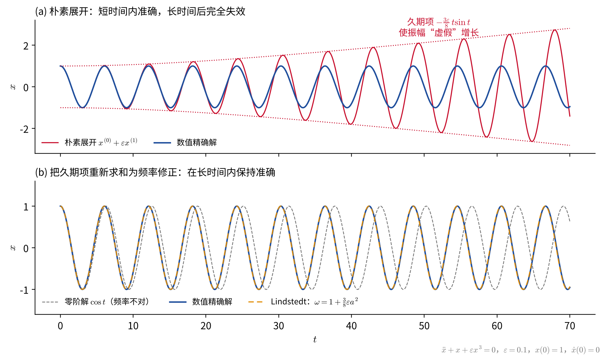
</div>

微扰方法的更系统论述见 Bender–Orszag [11] 与 Nayfeh [12]；经典力学中的小振动理论见 Landau–Lifshitz [1] 第五章、Goldstein [2] 第六章和 Arnold [3] 第五章。

<!-- 原 PDF 第 1 页 -->

## 稳定平衡附近的微小振动

本章主要考虑稳定平衡位置附近的运动，尤其是平衡位置处的微小振动。

考虑一维势能 $U(x)$ 中的质点。由牛顿第二定律，

$$
\begin{equation}
m\ddot x=-\frac{\partial U}{\partial x}.
\end{equation}
$$

平衡位置 $x_E$ 满足受力为零，即

$$
\begin{equation}
\left.\frac{\partial U}{\partial x}\right|_{x=x_E}=0.
\end{equation}
$$

在 $x_E$ 附近作泰勒展开：

$$
\begin{equation}
m\ddot x=-\left[
\left.\frac{\partial U}{\partial x}\right|_{x_E}
+(x-x_E)\left.\frac{\partial^2U}{\partial x^2}\right|_{x_E}
+\cdots
\right].
\end{equation}
$$

方括号中第一项由平衡条件为零，所以**线性项是最低阶的非零项**。这正是“微小振动一定是简谐的”这一结论的根源：任何光滑势能在极小值附近都近似为抛物线。

令

$$
\begin{equation}
\bar x=x-x_E,
\qquad
k=\left.\frac{\partial^2U}{\partial x^2}\right|_{x_E}>0,
\end{equation}
$$

则在线性近似下

$$
\begin{equation}
m\ddot{\bar x}+k\bar x=0,
\end{equation}
$$

或

$$
\begin{equation}
\ddot{\bar x}+\omega^2\bar x=0,
\qquad
\omega=\sqrt{\frac{k}{m}}.
\end{equation}
$$

相应的拉格朗日量为

$$
\begin{equation}
L=\frac12m\dot{\bar x}^{2}-\frac12k\bar x^2.
\end{equation}
$$

方程的解为

$$
\begin{equation}
\bar x=C_1\cos\omega t+C_2\sin\omega t
=a\cos(\omega t+\alpha),
\end{equation}
$$

其中

$$
\begin{equation}
a=\sqrt{C_1^2+C_2^2},
\qquad
\tan\alpha=-\frac{C_2}{C_1}.
\end{equation}
$$

$a$ 是振幅，$\alpha$ 是初相位，二者由初始位置和初始速度这两个积分常数决定。

因此，系统在稳定平衡附近的微小运动是简谐振动（harmonic oscillation）。在非稳定平衡点附近（$k<0$），令 $\kappa=\sqrt{|k|/m}$，线性化方程的解为

$$
\begin{equation}
\bar x=C_1e^{\kappa t}+C_2e^{-\kappa t},
\end{equation}
$$

含指数增长的分支，运动不是简谐振动，平衡点不稳定，线性近似也只在 $\bar x$ 仍然很小的短时间内成立。若恰有 $k=0$，则需要保留更高阶的项，才能判断稳定性。

### 微小振动近似的适用范围

微小运动近似的核心是：泰勒展开成立，并且可以忽略高阶项。更完整的展开为

$$
\begin{equation}
U(x)=U(x_E)+\frac12k\bar x^2+\frac1{3!}U'''(x_E)\bar x^3+\frac1{4!}U''''(x_E)\bar x^4+\cdots,
\end{equation}
$$

可见近似成立的条件是振幅足够小，使得立方项远小于二次项，即 $|U'''(x_E)|\,a\ll k$。当振幅增大时，非谐项会使振动频率依赖于振幅。例如对 $\ddot x+\omega_0^2x=-\alpha x^2-\beta x^3$（取 $m=1$），逐阶微扰给出 [1, §28]

$$
\begin{equation}
\omega=\omega_0+\left(\frac{3\beta}{8\omega_0}-\frac{5\alpha^2}{12\omega_0^3}\right)a^2+\cdots.
\end{equation}
$$

这与“一维谐振子”一节中周期与振幅无关（等时性）的结论形成对比：等时性只是抛物线势这一特殊情形的性质。

<details class="derivation">
<summary>推导：非谐振动的频率修正（Lindstedt 方法）</summary>

方程为 $\ddot x+\omega_0^2x=-\alpha x^2-\beta x^3$。关键想法是：频率本身也要随振幅修正，否则会出现久期项。令 $\tau=\omega t$，其中 $\omega=\omega_0+\omega^{(1)}+\omega^{(2)}+\cdots$ 待定，方程化为

$$
\begin{equation*}
\omega^2x''+\omega_0^2x=-\alpha x^2-\beta x^3,\qquad '\equiv\frac{d}{d\tau},
\end{equation*}
$$

并展开 $x=x^{(1)}+x^{(2)}+x^{(3)}+\cdots$，$x^{(n)}\propto a^n$，$\omega^{(n)}\propto a^n$。

**一阶：** $x^{(1)}=a\cos\tau$。

**二阶：**

$$
\begin{equation*}
\omega_0^2\bigl(x^{(2)\prime\prime}+x^{(2)}\bigr)=2\omega_0\omega^{(1)}a\cos\tau-\frac{\alpha a^2}{2}\bigl(1+\cos2\tau\bigr).
\end{equation*}
$$

右端的 $\cos\tau$ 项会产生久期项，必须令其系数为零，所以 $\omega^{(1)}=0$。其余两项不共振，解得

$$
\begin{equation*}
x^{(2)}=-\frac{\alpha a^2}{2\omega_0^2}+\frac{\alpha a^2}{6\omega_0^2}\cos2\tau .
\end{equation*}
$$

常数项表示振动中心向势能较缓的一侧偏移。

**三阶：**

$$
\begin{equation*}
\omega_0^2\bigl(x^{(3)\prime\prime}+x^{(3)}\bigr)=2\omega_0\omega^{(2)}a\cos\tau-2\alpha x^{(1)}x^{(2)}-\beta\bigl(x^{(1)}\bigr)^3 .
\end{equation*}
$$

利用 $\cos\tau\cos2\tau=\tfrac12(\cos\tau+\cos3\tau)$ 和 $\cos^3\tau=\tfrac34\cos\tau+\tfrac14\cos3\tau$，右端 $\cos\tau$ 项的系数为

$$
\begin{equation*}
2\omega_0\omega^{(2)}a+\frac{\alpha^2a^3}{\omega_0^2}\left(1-\frac16\right)-\frac34\beta a^3 .
\end{equation*}
$$

令其为零，得 $\omega^{(2)}=\left(\dfrac{3\beta}{8\omega_0}-\dfrac{5\alpha^2}{12\omega_0^3}\right)a^2$，即正文的公式。

两点说明：

- $\alpha x^2$ 项单独作用时只产生频率为 $0$ 和 $2\omega_0$ 的“外力”，不共振，所以它要到二阶才通过 $x^{(1)}x^{(2)}$ 影响频率，且无论 $\alpha$ 的符号如何总是使频率**降低**。
- 单摆：$\sin\theta\approx\theta-\theta^3/6$，相当于 $\alpha=0$、$\beta=-\omega_0^2/6$，于是 $\omega\approx\omega_0(1-\theta_0^2/16)$，$T\approx T_0(1+\theta_0^2/16)$，见下面的图。

</details>

<div style="text-align:center">
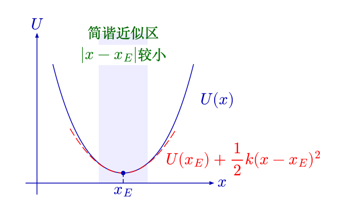
</div>

**相图。** 讨论单摆之前，先介绍一个后面会反复使用的工具。一个自由度的系统，某一时刻的位置和速度就完全确定了它此后的运动（这正对应解中的两个积分常数 $a$、$\alpha$）。因此可以把 $(\bar x,\dot{\bar x})$ 看作平面上一点的坐标，称为**相点**，这个平面称为**相平面**。随着时间推移，相点在平面上画出的曲线称为**相轨道**；把不同初始条件的相轨道画在一起，就得到**相图**。

对稳定平衡附近的谐振子，由 $\bar x=a\cos(\omega t+\alpha)$、$\dot{\bar x}=-a\omega\sin(\omega t+\alpha)$ 消去 $t$，得

$$
\begin{equation}
\frac{\bar x^2}{a^2}+\frac{\dot{\bar x}^2}{a^2\omega^2}=1 .
\end{equation}
$$

这正是能量守恒 $\frac12m\dot{\bar x}^2+\frac12k\bar x^2=E$ 的另一种写法：相轨道是以平衡点为中心、半轴为 $a$ 和 $a\omega$ 的椭圆（若纵轴改用 $\dot{\bar x}/\omega$，就是半径为 $a$ 的圆）。能量不同的运动对应一族同心椭圆，互不相交。相点沿椭圆顺时针运动：上半平面 $\dot{\bar x}>0$，$\bar x$ 增大。无论椭圆多大，相点转一圈的时间都是 $2\pi/\omega$，这就是等时性在相图上的体现。平衡点本身是一个不动的相点，周围被闭合轨道环绕，称为**中心**。

对非稳定平衡（$k<0$），能量守恒变为 $\frac12m\dot{\bar x}^2-\frac12|k|\bar x^2=E$，相轨道是以 $\dot{\bar x}=\pm\kappa\bar x$ 为渐近线的双曲线。除了恰好落在 $\dot{\bar x}=-\kappa\bar x$ 上、趋向平衡点的轨道之外，相点最终都沿 $\dot{\bar x}=\kappa\bar x$ 的方向远离平衡点，这样的平衡点称为**鞍点**。

<div style="text-align:center">
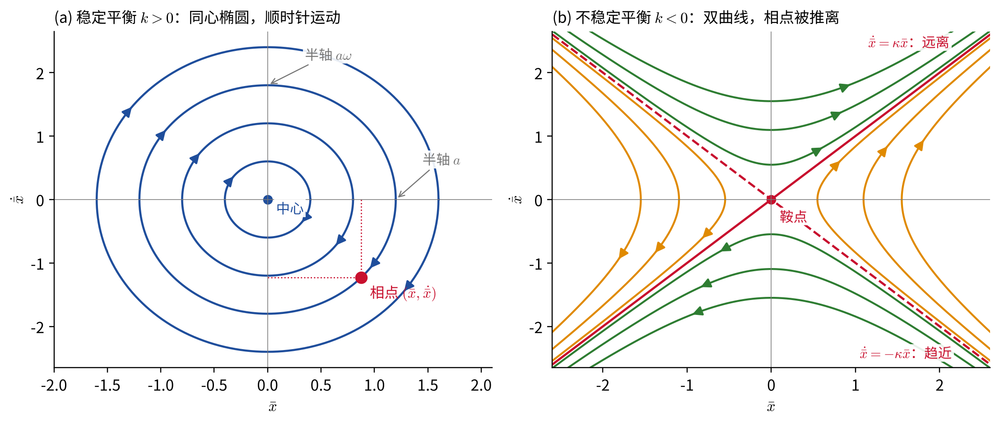
</div>

相图的好处是把一个系统所有可能的运动一次画出来，不必逐个求解 $x(t)$ 就能看出全局性质：哪些运动是周期的、哪些会远离平衡、不同类型的运动之间以什么为界。“哈密顿力学”一章会用坐标和动量 $(q,p)$ 系统地发展这一观点。

以单摆为例可以直观地看到微小振动近似的适用范围。下图（a）是单摆的相图：平衡点附近的相轨道几乎是椭圆，与谐振近似（橙色虚线）重合；振幅增大时轨道逐渐变形，到分界线处周期趋于无穷。图（b）给出周期随振幅的变化，$\theta_0\lesssim30^\circ$ 时一阶公式 $1+\theta_0^2/16$ 已相当准确。

<div style="text-align:center">
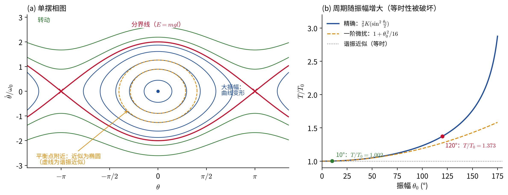
</div>

下面的动画把三个振幅不同的单摆同时释放：$10^\circ$ 的单摆几乎是等时的，$150^\circ$ 的单摆周期约为 $1.76\,T_0$，很快就与其他两个失去同步。

<div style="text-align:center">
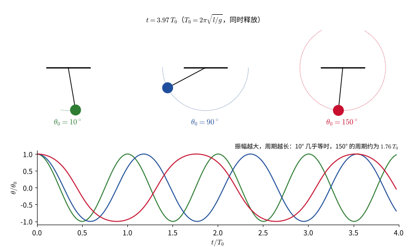
</div>

### 能量

把解 $\bar x=a\cos(\omega t+\alpha)$ 代入能量表达式，动能与势能分别为

$$
\begin{equation*}
T=\frac12m\dot{\bar x}^{2}=\frac12m\omega^2a^2\sin^2(\omega t+\alpha),
U=\frac12k\bar x^2=\frac12m\omega^2a^2\cos^2(\omega t+\alpha),
\end{equation*}
$$

二者此消彼长，但总和不随时间变化：

$$
\begin{equation}
E=T+U=\frac12m\dot{\bar x}^{2}+\frac12k\bar x^2
=\frac12m\omega^2a^2 .
\end{equation}
$$

所以能量与振幅平方成正比。振幅 $a$ 由初始条件决定，可以是任意非负实数：把弹簧多拉长 1 mm 或少拉 1 mm 都可以，因此**经典谐振子的能量可以取 $E\ge0$ 的任意值，是连续的**。在 $U(x)$ 的图上，水平线 $E$ 与抛物线的两个交点 $x=\pm a$ 就是折返点；这条水平线可以画在任意高度。

量子力学中谐振子的能量只能取分立值，经典结果是其高激发态（$n\gg1$）的极限，见补充材料《量子谐振子与经典极限》。

<!-- 原 PDF 第 2 页 -->

## 强迫振动（Forced Oscillations）

上一节讨论的是孤立系统的自由振动。现在考虑系统还受到随时间变化的外界作用，并假定这一作用很弱，因此系统仍然在平衡点附近作小幅运动。选择平衡点为坐标原点，外场的影响体现在有效势 $U_e(x,t)$ 中，对 $x$ 展开为

$$
\begin{equation}
U_e(x,t)=U_e(0,t)+x\left.\frac{\partial U_e}{\partial x}\right|_{x=0}+\cdots.
\end{equation}
$$

$U_e(0,t)$ 只依赖时间，不依赖坐标，它可以写成某个时间函数的全导数，在拉格朗日量中加上或去掉这样的项不改变运动方程，因此可以略去。展开式中第二项是外力对坐标的线性耦合，定义

$$
\begin{equation}
F(t)=-\left.\frac{\partial U_e}{\partial x}\right|_{x=0},
\end{equation}
$$

它就是平衡位置处所受的外力。于是

$$
\begin{equation}
L=\frac12m\dot x^2-\frac12kx^2+xF(t).
\end{equation}
$$

运动方程为

$$
\begin{equation}
m\ddot x+kx=F(t),
\qquad
\ddot x+\omega^2x=\frac1mF(t).
\end{equation}
$$

这是非齐次常系数线性微分方程，其通解为

$$
\begin{equation}
x=x_0+x_1,
\end{equation}
$$

其中

$$
\begin{equation}
\ddot x_0+\omega^2x_0=0
\end{equation}
$$

是齐次方程通解（自由振动，含两个积分常数），而

$$
\begin{equation}
\ddot x_1+\omega^2x_1=\frac1mF(t)
\end{equation}
$$

是非齐次方程的一个特解。对任意 $F(t)$，一个常用的特解可以由格林函数（Duhamel 积分）给出，它满足 $x_1(0)=\dot x_1(0)=0$：

$$
\begin{equation}
x_1(t)=\frac1{m\omega}\int_0^tF(t')\sin\omega(t-t')\,dt'.
\end{equation}
$$

其物理含义是：把外力看成一连串很短的“冲击”，$t'$ 时刻的冲量 $F(t')dt'$ 激发一个振幅正比于它、此后以固有频率自由振动的响应，各次冲击的响应线性叠加 [1, §22]。

<details class="derivation">
<summary>推导：Duhamel 积分的两种得法</summary>

**方法一：直接验证。** 对积分上限求导（莱布尼茨法则），由于被积函数在 $t'=t$ 处的 $\sin0=0$，

$$
\begin{equation*}
\dot x_1=\frac1m\int_0^tF(t')\cos\omega(t-t')\,dt',\qquad
\ddot x_1=\frac{F(t)}{m}-\frac{\omega}{m}\int_0^tF(t')\sin\omega(t-t')\,dt'=\frac{F(t)}{m}-\omega^2x_1 ,
\end{equation*}
$$

正是所需的方程，而且 $x_1(0)=\dot x_1(0)=0$。

**方法二：复变量（Landau 的做法）。** 令 $\xi=\dot x+i\omega x$，则

$$
\begin{equation*}
\dot\xi=\ddot x+i\omega\dot x=\frac Fm-\omega^2x+i\omega\dot x=\frac Fm+i\omega\xi ,
\end{equation*}
$$

二阶方程化为一阶方程。用积分因子 $e^{-i\omega t}$ 立即得到

$$
\begin{equation*}
\xi(t)=e^{i\omega t}\int_0^t\frac{F(t')}{m}e^{-i\omega t'}\,dt'\qquad(\xi(0)=0),
\end{equation*}
$$

取 $x=\operatorname{Im}\xi/\omega$ 即得正文的积分。$|\xi|^2=\dot x^2+\omega^2x^2=2E/m$，所以外力作用结束后系统获得的能量为

$$
\begin{equation*}
E=\frac{1}{2m}\left|\int F(t')e^{-i\omega t'}\,dt'\right|^2 ,
\end{equation*}
$$

即外力在固有频率 $\omega$ 处的傅里叶分量的模方。缓慢变化的力（傅里叶分量集中在低频）几乎不能激发振动，这就是“绝热”的含义。

</details>

下图把一个持续时间有限的外力切成一串冲击，逐一画出每个冲击激发的自由振动，它们的和与直接数值求解的结果完全一致。

<div style="text-align:center">
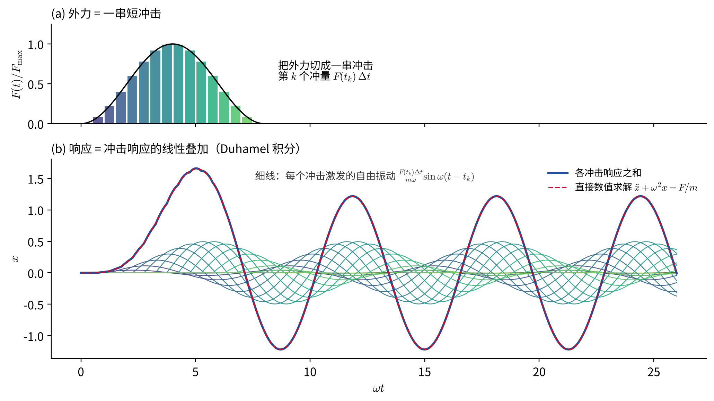
</div>

若强迫力是频率为 $\gamma$ 的周期函数

$$
\begin{equation}
F(t)=f\cos(\gamma t+\beta),
\end{equation}
$$

尝试特解

$$
\begin{equation}
x_1=b\cos(\gamma t+\beta),
\end{equation}
$$

代入得 $m(\omega^2-\gamma^2)b=f$，即

$$
\begin{equation}
b=\frac{f}{m(\omega^2-\gamma^2)}.
\end{equation}
$$

因此

$$
\begin{equation}
x=a\cos(\omega t+\alpha)
+\frac{f}{m(\omega^2-\gamma^2)}
\cos(\gamma t+\beta).
\end{equation}
$$

积分常数 $a,\alpha$ 由初始条件决定。周期性强迫力下，运动是两个振动的叠加：频率分别为系统固有频率 $\omega$ 与外力频率 $\gamma$。

这个结果有两点值得注意。第一，当 $\gamma<\omega$ 时 $b>0$，系统跟随外力同相运动；当 $\gamma>\omega$ 时 $b<0$，响应与外力反相。第二，$b$ 的大小随 $\gamma\to\omega$ 而增大，趋于发散，这就是共振的前兆。

### 共振

当

$$
\begin{equation}
\gamma=\omega
\end{equation}
$$

时，上述表达式失效，发生**共振**（resonance）。这时试探解 $b\cos(\gamma t+\beta)$ 本身就是齐次方程的解，不可能再平衡外力，必须改取含时间因子的试探解 $x_1=At\sin(\omega t+\beta)$。代入后

$$
\begin{equation}
\ddot x_1+\omega^2x_1=2A\omega\cos(\omega t+\beta),
\end{equation}
$$

与右端比较得 $A=f/(2m\omega)$，因此

$$
\begin{equation}
x=a\cos(\omega t+\alpha)
+\frac{f}{2m\omega}t\sin(\omega t+\beta).
\end{equation}
$$

振幅随时间线性增长，直至微小振动近似不再成立（此时非谐项、阻尼等被忽略的效应开始起作用）。由于 $L$ 显含时间，系统能量不再守恒；系统不断从外力获得能量，能量 $E\propto a^2\propto t^2$。

共振解可以看作 $\gamma\to\omega$ 的极限。取初始条件 $x(0)=\dot x(0)=0$、$\beta=0$，非共振的解为

$$
\begin{equation}
x=\frac{f\left(\cos\gamma t-\cos\omega t\right)}{m(\omega^2-\gamma^2)}
=\frac{2f}{m(\omega^2-\gamma^2)}\sin\frac{(\omega+\gamma)t}{2}\sin\frac{(\omega-\gamma)t}{2}.
\end{equation}
$$

当 $\gamma$ 与 $\omega$ 接近时，这是一个频率约为 $\omega$ 的快振荡乘以一个缓慢变化的包络，即**拍**（beat），拍的频率为 $|\omega-\gamma|$。令 $\gamma\to\omega$，用 $\sin\frac{(\omega-\gamma)t}{2}\approx\frac{(\omega-\gamma)t}{2}$，就得到 $x\to\dfrac{f}{2m\omega}\,t\sin\omega t$，与上面的共振解一致。也就是说，共振时拍的“半个周期”被拉长到无穷，振幅便一直增长下去。下面的动画让失谐量 $\omega-\gamma$ 从 $0.1\,\omega$ 逐渐减小到零，可以看到拍的包络越来越高、越来越慢，最后变成线性增长。

<div style="text-align:center">
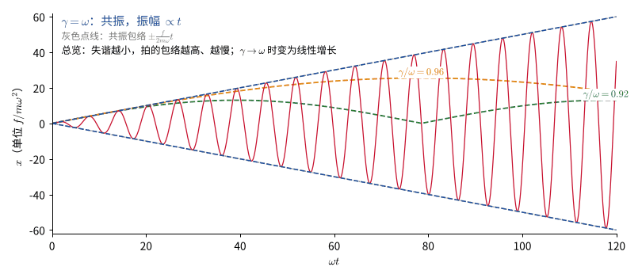
</div>

<div style="text-align:center">
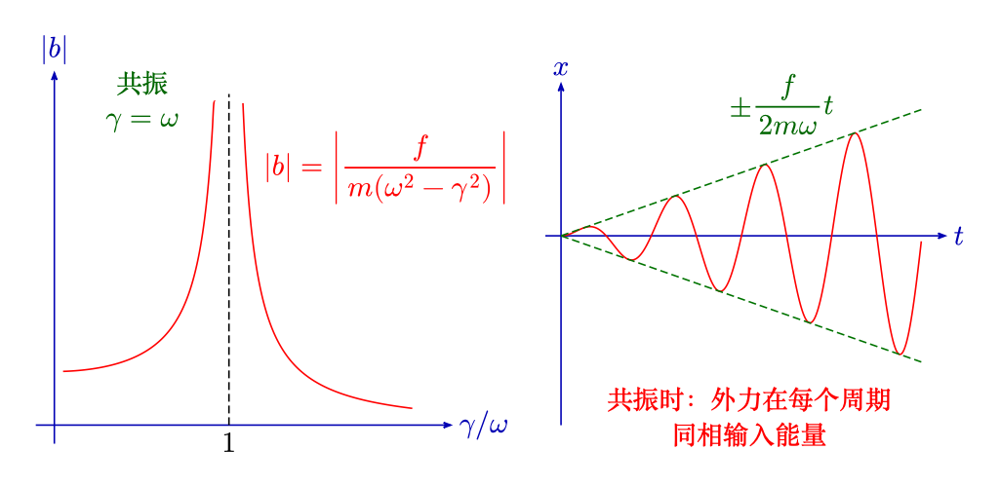
</div>

### 天体物理应用：小行星带的柯克伍德空隙

火星与木星轨道之间分布着数十万颗小行星。1866 年，柯克伍德（D. Kirkwood）注意到，小行星的半长轴并不是均匀分布的：在某些特定的距离上几乎找不到小行星，这些位置正好是轨道周期与木星周期成简单整数比的地方。下图是真实的小行星半长轴分布，空隙清晰可见。

<div style="text-align:center">
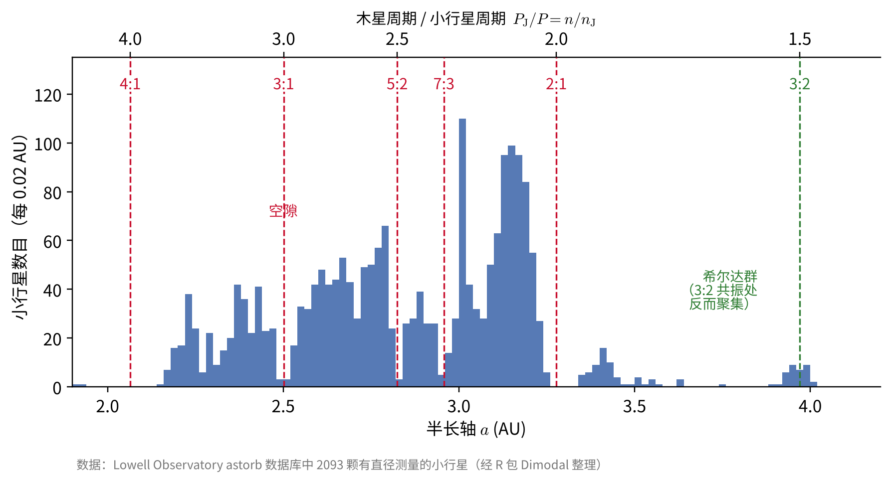
</div>

用本节的语言，这是一个**受迫振动的共振**问题。下面分三步说明：固有频率是什么，外力的频率是什么，以及共振时发生了什么。

**固有频率：圆轨道附近的径向小振动。** 在“中心力场”一章中，质量为 $m$、角动量为 $L$ 的质点在有效势

$$
\begin{equation}
U_{\text{eff}}(r)=-\frac{GMm}{r}+\frac{L^2}{2mr^2}
\end{equation}
$$

中作径向运动，圆轨道 $r_0$ 是 $U_{\text{eff}}$ 的极小点。按“稳定平衡附近的微小振动”一节的方法，令 $r=r_0+x$，把 $U_{\text{eff}}$ 展开到二阶，得到径向小振动方程 $\ddot x+\kappa^2x=0$，其固有频率为

$$
\begin{equation}
\kappa^2=\frac1m\,U_{\text{eff}}''(r_0)=-\frac{2GM}{r_0^3}+\frac{3L^2}{m^2r_0^4}=\frac{GM}{r_0^3}=n^2,
\end{equation}
$$

其中用到了圆轨道条件 $L^2=GMm^2r_0$，$n=\sqrt{GM/r_0^3}$ 是轨道角频率，天文学中称为**平运动**（mean motion）。$\kappa$ 称为**本轮频率**（epicyclic frequency）。对开普勒势，$\kappa=n$ 恰好成立：径向振动一次的时间等于绕太阳转一圈的时间，这就是开普勒椭圆轨道封闭的原因。略偏心的轨道可以看作圆轨道加上一个频率为 $n$ 的径向小振动，振幅与偏心率成正比，$x\approx-ae\cos(nt)$。

**外力的频率。** 木星（平运动 $n_{\rm J}$）对小行星的引力随二者的相对位置而变化。从小行星看，木星每隔一个会合周期 $2\pi/(n-n_{\rm J})$ 回到同一相对位置，所以木星施加的径向扰动力是这个周期的周期函数。按傅里叶级数展开，它包含频率

$$
\begin{equation}
\gamma_k=k\,(n-n_{\rm J}),\qquad k=1,2,3,\ldots
\end{equation}
$$

的各个分量。于是小行星的径向运动满足一个受迫振动方程

$$
\begin{equation}
\ddot x+n^2x=\sum_k\frac{f_k}{m}\cos(\gamma_kt+\beta_k).
\end{equation}
$$

**共振条件。** 当某个外力频率等于固有频率，$\gamma_k=n$ 时发生共振，即

$$
\begin{equation}
\frac{n}{n_{\rm J}}=\frac{P_{\rm J}}{P}=\frac{k}{k-1}=\frac21,\ \frac32,\ \frac43,\ \ldots
\end{equation}
$$

这类共振称为**一阶共振**。若再考虑小行星和木星轨道本身的偏心率，外力中还会出现由轨道运动调制产生的组合频率，从而得到 $3{:}1$、$5{:}2$、$7{:}3$ 等**高阶共振**。这类外力正比于偏心率的若干次方，因此较弱，但物理本质相同。由开普勒第三定律 $n\propto a^{-3/2}$，共振位置为

$$
\begin{equation}
a_{\text{res}}=a_{\rm J}\left(\frac{n_{\rm J}}{n}\right)^{2/3},\qquad a_{\rm J}=5.20\ \text{AU},
\end{equation}
$$

给出 $3{:}1$ 共振在 2.50 AU，$5{:}2$ 在 2.82 AU，$7{:}3$ 在 2.96 AU，$2{:}1$ 在 3.28 AU，与图中空隙的位置一一对应。

**共振时发生了什么。** “共振”一节指出，共振时振幅随时间线性增长，直到非谐项等被忽略的效应开始起作用。对小行星来说，径向振幅就是偏心率：处在共振位置的小行星，木星的引力每次都在轨道的同一位置“推”它一下，效果不断累积，偏心率逐渐增大。偏心率增大以后，振动频率开始依赖于振幅（这与“微小振动近似的适用范围”一节中非谐振动的频率依赖振幅是同一类效应），线性理论失效，必须求解非线性运动方程。数值计算表明，在 $3{:}1$ 共振处运动是**混沌**的：偏心率会间歇性地跃升到 0.3 以上，使小行星的近日点进入火星轨道以内，随后被火星或地球的近距离交会抛出，于是形成空隙 [24]。这一机制也是许多陨石被送到地球附近的途径。

需要注意的是，共振并不总是意味着被清除。在 $3{:}2$ 共振处（约 3.97 AU）反而聚集着一群小行星，称为**希尔达群**（Hildas）。在这里，共振把相位锁定，使小行星与木星的会合总是发生在小行星的近日点附近，也就是它离木星轨道最远的时候，共振反而起到了保护作用。冥王星与海王星的 $3{:}2$ 共振也是同一类情形：二者会合时冥王星总在远日点附近，所以尽管冥王星的近日点在海王星轨道以内，二者从不会靠近。线性理论只告诉我们“共振处响应很大”，至于结果是清除还是保护，取决于非线性动力学。同样的机制还造成了土星环中的卡西尼缝：其内边缘恰好位于与土卫一（Mimas）$2{:}1$ 共振的位置。更系统的讨论见 [13] 中关于共振的章节。

图中数据取自 Lowell 天文台的 astorb 小行星轨道数据库 [25]（该数据库由 NASA 与 Lowell 天文台资助），选取了其中 2093 颗有直径测量的小行星，经 R 软件包 Dimodal 整理。

“相位锁定”在与木星一起转动的参照系中看得最清楚。下面的动画中木星静止在右侧。左图是 $3{:}2$ 共振的小行星：它在这个参照系中描出一个封闭的“三角形”，每次会合（红星）都发生在近日点，离木星约 2 AU。右图是一颗不共振的小行星：会合时它离木星的距离不断变化，迟早会在远日点附近与木星会合，受到强烈的近距离摄动。（动画只画开普勒轨道，用来说明几何关系；真实的共振小行星还会在木星引力作用下围绕这一构型来回摆动。）

<div style="text-align:center">
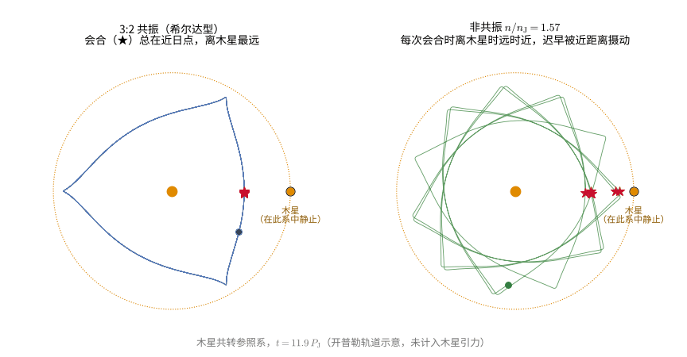
</div>

<!-- 原 PDF 第 3 页 -->

## 阻尼振动

实际系统总存在耗散。再考虑与速度成正比的摩擦力（这是低速时黏性阻力的常用模型）

$$
\begin{equation}
f_{\mathrm{fr}}=-\eta\dot x.
\end{equation}
$$

（这里把摩擦系数记为 $\eta$，以免与振动的初相位 $\alpha$ 混淆。）运动方程为

$$
\begin{equation}
m\ddot x=-kx-\eta\dot x,
\end{equation}
$$

即

$$
\begin{equation}
\ddot x+2\lambda\dot x+\omega_0^2x=0,
\qquad
\lambda=\frac{\eta}{2m},
\qquad
\omega_0^2=\frac{k}{m}.
\end{equation}
$$

$\lambda$ 称为阻尼系数，$\omega_0$ 是无阻尼时的固有频率。这是常系数线性方程，设

$$
\begin{equation}
x=e^{rt},
\end{equation}
$$

得到特征方程

$$
\begin{equation}
r^2+2\lambda r+\omega_0^2=0,
\end{equation}
$$

其根为

$$
\begin{equation}
r_{1,2}=-\lambda\pm\sqrt{\lambda^2-\omega_0^2},
\end{equation}
$$

故（$r_1\neq r_2$ 时）一般解为

$$
\begin{equation}
x=C_1e^{r_1t}+C_2e^{r_2t}.
\end{equation}
$$

根号内的符号决定了运动的性质，即摩擦与恢复力谁更强：

### 欠阻尼：$\lambda<\omega_0$

两根为共轭复数 $r_{1,2}=-\lambda\pm i\omega_d$，可写成

$$
\begin{equation}
x=ae^{-\lambda t}\cos(\omega_d t+\alpha),
\qquad
\omega_d=\sqrt{\omega_0^2-\lambda^2}.
\end{equation}
$$

振幅指数衰减，称为阻尼振动。注意阻尼振动的频率 $\omega_d$ 略低于 $\omega_0$。

### 过阻尼：$\lambda>\omega_0$

$$
\begin{equation}
x=C_1\exp\left[\left(-\lambda-\sqrt{\lambda^2-\omega_0^2}\right)t\right]
+C_2\exp\left[\left(-\lambda+\sqrt{\lambda^2-\omega_0^2}\right)t\right].
\end{equation}
$$

运动指数衰减，但不是周期运动，称为非周期阻尼。摩擦太强时，质点像在黏稠的液体里一样缓慢“爬”回平衡位置，衰减最慢的分支是 $r_+=-\lambda+\sqrt{\lambda^2-\omega_0^2}$，摩擦越大反而回得越慢。

### 临界阻尼：$\lambda=\omega_0$

两根重合，$r_1=r_2=-\lambda$，$e^{rt}$ 只给出一个独立解，另一个独立解是 $te^{-\lambda t}$，故

$$
\begin{equation}
x=(C_1+C_2t)e^{-\lambda t}.
\end{equation}
$$

临界阻尼是不发生振荡的情形中回到平衡位置最快的一种，所以电表指针、汽车减震器、门的缓冲装置等常按接近临界阻尼来设计。

下面两张图把三种情形放在一起比较。第一张是相同初始条件下 $x(t)$ 的对比。第二张的（a）画出特征根 $r_{1,2}$ 随 $\lambda$ 增大在复平面上的移动：欠阻尼时两根沿半径为 $\omega_0$ 的圆弧移动，实部 $-\lambda$ 给出衰减、虚部 $\pm\omega_d$ 给出振荡；临界阻尼时两根在 $-\omega_0$ 处相遇；过阻尼时两根沿实轴分开，其中 $r_+$ 反而向原点靠近，所以摩擦越大，回到平衡位置越慢。把 $r$ 看作“复频率”的观点在后面黑洞铃宕的例子中还会用到。（b）是同样三种情形在相空间中的轨迹。

<div style="text-align:center">
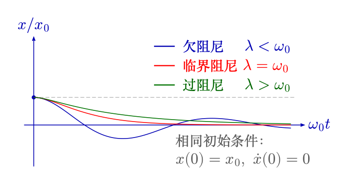
</div>

<div style="text-align:center">
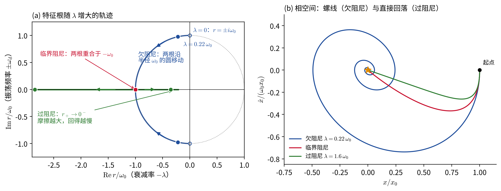
</div>

### 能量耗散

摩擦使机械能不守恒。由

$$
\begin{equation}
m\ddot x+kx=-\eta\dot x
\end{equation}
$$

两边乘以 $\dot x$ 可得

$$
\begin{equation}
\frac{d}{dt}\left(\frac12m\dot x^2+\frac12kx^2\right)
=-\eta\dot x^2\neq0.
\end{equation}
$$

机械能通过摩擦耗散并转化为热能。在弱阻尼 $\lambda\ll\omega_0$ 时，一个周期内能量几乎不变，长期平均有 $E\propto e^{-2\lambda t}$。常用无量纲的品质因数

$$
\begin{equation}
Q=\frac{\omega_0}{2\lambda}
\end{equation}
$$

来描述阻尼的强弱：一个周期内损失的能量比例约为 $2\pi/Q$，$Q$ 越大，系统“振得越久”。

<details class="derivation">
<summary>推导：弱阻尼下能量的指数衰减，以及“每周期损失约 2π/Q”</summary>

由上式，$\dot E=-\eta\dot x^2=-2m\lambda\dot x^2$。弱阻尼时，一个周期内运动近似为 $x\approx a\cos(\omega_0t+\alpha)$，振幅 $a$ 几乎不变，于是

$$
\begin{equation*}
\langle\dot x^2\rangle=\frac12a^2\omega_0^2,\qquad E=\frac12m\omega_0^2a^2
\quad\Longrightarrow\quad
\langle\dot E\rangle=-2m\lambda\cdot\frac12a^2\omega_0^2=-2\lambda E .
\end{equation*}
$$

所以 $E\propto e^{-2\lambda t}$，振幅 $a\propto e^{-\lambda t}$，与欠阻尼解一致。一个周期 $T=2\pi/\omega_0$ 内损失的能量比例为

$$
\begin{equation*}
\frac{|\Delta E|}{E}\approx2\lambda T=\frac{4\pi\lambda}{\omega_0}=\frac{2\pi}{Q},
\end{equation*}
$$

即 $Q\approx2\pi\times\dfrac{\text{储存的能量}}{\text{每周期损失的能量}}$；振幅每个周期衰减为原来的 $e^{-\lambda T}=e^{-\pi/Q}$。$Q$ 的这两种理解方式在后面的天体物理例子中都会用到。

</details>

### 有阻尼的强迫振动

把前两节结合起来：方程 $\ddot x+2\lambda\dot x+\omega_0^2x=\dfrac fm\cos(\gamma t+\beta)$ 的齐次解按 $e^{-\lambda t}$ 衰减（称为暂态），足够长时间后只剩下与外力同频率的稳态解，其振幅为

$$
\begin{equation}
b=\frac{f/m}{\sqrt{(\omega_0^2-\gamma^2)^2+4\lambda^2\gamma^2}}.
\end{equation}
$$

在 $\gamma=\omega_0$ 附近，$b$ 有一个高度约 $f/(2m\lambda\omega_0)$ 的峰，不再发散。这说明上一节共振时振幅线性增长不会无限继续：摩擦吸收能量的速率随振幅的平方增大，最终与外力输入功率平衡。峰的宽度约为 $2\lambda$，即 $Q$ 越大，共振峰越尖锐。详见 [1, §25–26]。

<details class="derivation">
<summary>推导：复振幅法求稳态解，以及相位滞后与共振宽度</summary>

外力写成 $\dfrac fm\cos\gamma t=\operatorname{Re}\Bigl[\dfrac fm e^{i\gamma t}\Bigr]$。方程是实系数线性的，可以先求复方程的解再取实部。令 $x=\operatorname{Re}\bigl[B\,e^{i\gamma t}\bigr]$，代入得

$$
\begin{equation*}
\left(\omega_0^2-\gamma^2+2i\lambda\gamma\right)B=\frac fm
\quad\Longrightarrow\quad
B=b\,e^{-i\delta},\qquad
b=\frac{f/m}{\sqrt{(\omega_0^2-\gamma^2)^2+4\lambda^2\gamma^2}},\qquad
\tan\delta=\frac{2\lambda\gamma}{\omega_0^2-\gamma^2},
\end{equation*}
$$

稳态解为 $x=b\cos(\gamma t-\delta)$（这里外力的初相位取为零）。相位滞后 $\delta$ 从低频时的 $0$（跟随外力），经过共振时的 $\pi/2$，增大到高频时的 $\pi$（与外力反相）。共振时位移滞后 $\pi/2$，意味着**速度与外力同相**，外力始终做正功，这是共振时吸收功率最大的原因。

在共振附近用 $\omega_0^2-\gamma^2\approx2\omega_0(\omega_0-\gamma)$，

$$
\begin{equation*}
b\approx\frac{f/(2m\omega_0)}{\sqrt{(\omega_0-\gamma)^2+\lambda^2}},
\end{equation*}
$$

峰高为 $f/(2m\lambda\omega_0)=Q\cdot\dfrac{f}{m\omega_0^2}$，即静态位移 $f/(m\omega_0^2)$ 的 $Q$ 倍。$b^2$（正比于能量）是一个洛伦兹线型，在 $|\omega_0-\gamma|=\lambda$ 处降到峰值的一半，所以能量共振峰的半高全宽为

$$
\begin{equation*}
\Delta\gamma=2\lambda=\frac{\omega_0}{Q}.
\end{equation*}
$$

自由振动衰减的快慢（$\lambda$）和共振峰的宽度（$2\lambda$）是同一件事的两面：一个“振得越久”的系统，对频率的选择也越挑剔。

</details>

<div style="text-align:center">
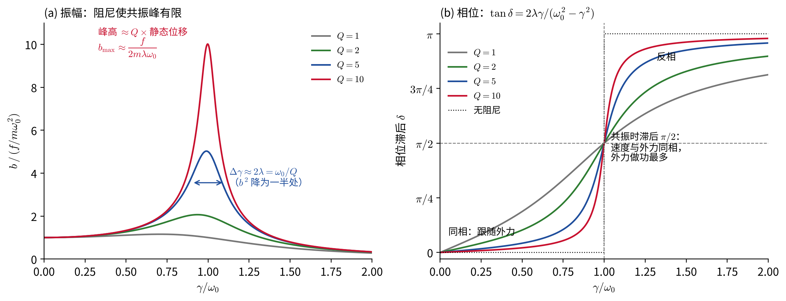
</div>

振幅较大时，还要考虑“微小振动近似的适用范围”一节中的非谐项。以 $\ddot x+2\lambda\dot x+\omega_0^2x+\beta x^3=\dfrac fm\cos\gamma t$ 为例，固有频率随振幅变化，$\omega(a)\approx\omega_0+\dfrac{3\beta a^2}{8\omega_0}$，于是共振峰沿这条“骨架线”向一侧弯曲（$\beta>0$ 时弯向高频）。外力足够强时，同一个 $\gamma$ 对应三个稳态振幅，其中中间一个不稳定，缓慢扫频时振幅会突然跳跃，并出现滞后（升频和降频时跳跃的位置不同）。这也说明，非线性会使系统偏离共振，从而限制振幅的增长，这与柯克伍德空隙一节中“振动频率开始依赖于振幅”是同一类效应 [1, §29]。

<details class="derivation">
<summary>推导：谐波平衡法给出的振幅–频率关系</summary>

设稳态解近似为 $x=a\cos(\gamma t-\delta)$。利用 $\cos^3\theta=\tfrac34\cos\theta+\tfrac14\cos3\theta$，略去三倍频项，

$$
\begin{equation*}
\beta x^3\approx\frac34\beta a^2\,x ,
\end{equation*}
$$

即非线性项的作用相当于把 $\omega_0^2$ 换成依赖振幅的 $\omega_0^2+\tfrac34\beta a^2$。代入上面线性方程的结果，得到 $a$ 的隐式方程

$$
\begin{equation*}
a^2\left[\left(\omega_0^2+\tfrac34\beta a^2-\gamma^2\right)^2+4\lambda^2\gamma^2\right]=\left(\frac fm\right)^2 .
\end{equation*}
$$

这是 $a^2$ 的三次方程，所以对给定的 $\gamma$ 可能有一个或三个正根。令 $f\to0$、$\lambda\to0$，振幅不为零的解只能落在 $\gamma^2=\omega_0^2+\tfrac34\beta a^2$ 上，这就是图中的骨架线，与 Lindstedt 方法得到的 $\omega(a)$ 一致。

</details>

<div style="text-align:center">
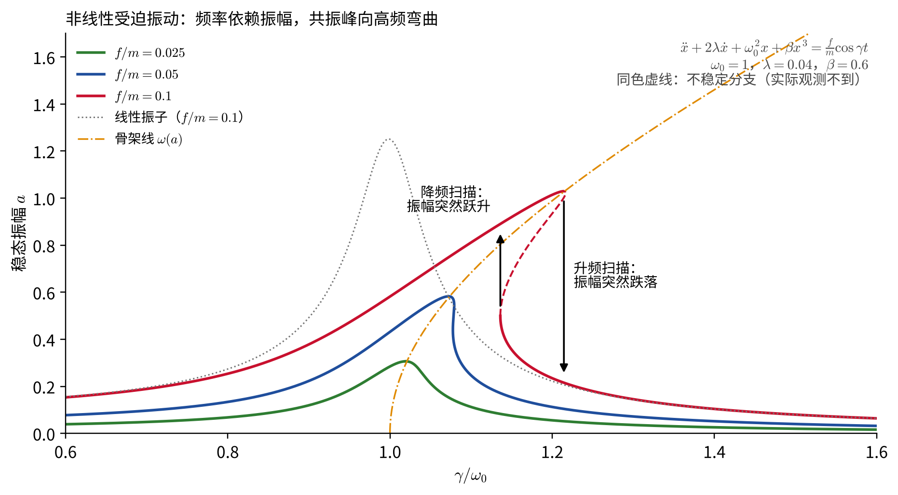
</div>

### 天体物理应用

下面三个例子分别对应本节的三部分内容：欠阻尼振动与品质因数；三种阻尼情形之间的转变；有阻尼的强迫振动。

#### 例 1：黑洞铃宕：一个很差的铃铛

两个黑洞并合以后，新形成的黑洞起初形状不规则，随后迅速“静下来”，变成一个稳定的黑洞。这一过程中黑洞向外辐射引力波，探测器记录到的信号是一个衰减的正弦波

$$
\begin{equation}
h(t)=h_0\,e^{-t/\tau}\cos(2\pi ft+\varphi_0),
\end{equation}
$$

称为**铃宕**（ringdown），因为它像被敲响的铃铛的余音。它与欠阻尼解 $x=ae^{-\lambda t}\cos(\omega_dt+\alpha)$ 的形式完全相同，对应关系为 $\lambda=1/\tau$、$\omega_d=2\pi f$。把特征根 $r=-\lambda\pm i\omega_d$ 看作一个**复频率**，实部描述振荡，虚部描述衰减；黑洞受扰后的这类衰减振荡称为**准正规模**（quasinormal modes）。

对于不转动的黑洞，衰减最慢的主模式的复频率为 [23]

$$
\begin{equation}
\omega=\left(0.3737-0.0890\,i\right)\frac{c^3}{GM},
\end{equation}
$$

即

$$
\begin{equation}
f\approx12\ \text{kHz}\times\frac{M_\odot}{M},\;
\tau\approx55\ \mu\text{s}\times\frac{M}{M_\odot},\;
Q=\frac{\omega_d}{2\lambda}=\pi f\tau\approx2.1 .
\end{equation}
$$

有三点值得注意。

- **频率反比于质量。** 黑洞只有一个特征尺度 $GM/c^2$，相应的特征时间是 $GM/c^3$（对 $M_\odot$ 约为 $4.9\ \mu$s），所以 $f\propto1/M$、$\tau\propto M$，就像大钟的音调比小铃低。这也可以从量纲分析直接看出。
- **$Q$ 只有 2 到 3。** 音叉的 $Q$ 可达 $10^3$ 以上，而黑洞只振两三下就停了。$Q\approx3$ 时，振幅每个周期衰减为原来的 $e^{-\pi/Q}\approx1/3$，“弱阻尼”的近似已不成立。这里的“阻尼”并不是摩擦，而是振动能量以引力波的形式辐射到无穷远，或者落入视界。黑洞是一个辐射效率极高、因而 $Q$ 极低的“铃铛”。
- **由音调和余音长短可以“听”出黑洞的质量和自旋。** 转动黑洞的 $f$ 和 $Q$ 还依赖于自旋 $\chi$。测出 $f$ 和 $\tau$ 两个数，就能反推出黑洞的质量 $M$ 和自旋 $\chi$ 这两个量；若能测到不止一个模式，还可以检验它们是否都由同一组 $(M,\chi)$ 决定，这是对广义相对论中“黑洞无毛”性质的检验，称为**黑洞谱学** [28, 29]。

**例子：GW150914。** 2015 年 LIGO 首次探测到的引力波事件中，并合后的黑洞质量约 $62\,M_\odot$，自旋 $\chi\approx0.67$，距离对应红移 $z\approx0.09$ [26]。由转动黑洞的准正规模频率可算得，在地球上观测到的铃宕频率 $f\approx250$ Hz，衰减时间 $\tau\approx4$ ms，$Q\approx3$；并合后的数据与这一主模式相符 [27]。若换成星系中心 $10^6\,M_\odot$ 的黑洞，频率按 $1/M$ 降到约 $10^{-2}$ Hz 量级，衰减时间约一分钟。这恰好落在空间引力波探测器 LISA 的频段内，见下图（b）。

<div style="text-align:center">
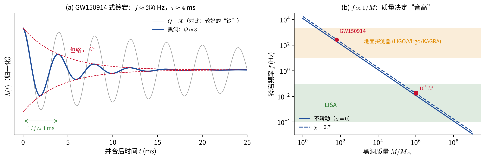
</div>

#### 例 2：膨胀宇宙中的“哈勃摩擦”

宇宙学中经常遇到一个在空间中处处相同、只随时间变化的场 $\phi(t)$，例如驱动暴胀的“暴胀子”，或者作为暗物质候选者的“轴子”。对力学来说，$\phi(t)$ 就是一个广义坐标。宇宙在膨胀，物理体积按标度因子 $a(t)$ 的三次方增长，单位“坐标体积”中场的拉格朗日量为（取 $\hbar=c=1$，$m$ 为场的质量参数）

$$
\begin{equation}
L=a^3(t)\left(\frac12\dot\phi^2-\frac12m^2\phi^2\right).
\end{equation}
$$

由欧拉－拉格朗日方程 $\dfrac{d}{dt}\left(a^3\dot\phi\right)+a^3m^2\phi=0$，得

$$
\begin{equation}
\ddot\phi+3H\dot\phi+m^2\phi=0,\qquad H\equiv\frac{\dot a}{a}.
\end{equation}
$$

这正是阻尼振动方程，对应关系为 $\omega_0=m$、$\lambda=\tfrac32H$。阻尼并非来自摩擦，而是来自宇宙膨胀：$L$ 通过 $a^3(t)$ 显含时间，因此能量不守恒。$H$ 称为哈勃参数，这一项俗称**哈勃摩擦**。

与本节不同的是，阻尼系数随时间变化。在辐射为主的早期宇宙中 $a\propto t^{1/2}$，$H=1/(2t)$ 随时间减小，于是系统依次经历本节的几种情形：

- **早期 $\tfrac32H\gg m$：过阻尼。** 场像在极黏稠的液体中，几乎不动，被“冻结”在初始值 $\phi_i$ 上。这时 $\phi$ 的能量密度 $\rho_\phi\approx\frac12m^2\phi_i^2$ 不随时间变化，表现得像真空能。
- **$\tfrac32H\approx m$：临界阻尼附近。** 场开始向平衡点 $\phi=0$ 滚落。
- **后期 $\tfrac32H\ll m$：欠阻尼。** 场以频率 $m$ 振荡，振幅逐渐衰减。

这个方程恰好可以严格求解，满足 $\phi(0)=\phi_i$、$\dot\phi(0)=0$ 的解为 $\phi=\phi_i\,\Gamma(\tfrac54)\,(mt/2)^{-1/4}J_{1/4}(mt)$，其中 $J_{1/4}$ 是贝塞尔函数，见下图（a）。

<details class="derivation">
<summary>验证：贝塞尔函数解，以及晚期振幅的衰减规律</summary>

$a\propto t^{1/2}$ 时 $H=1/(2t)$，方程为

$$
\begin{equation*}
\ddot\phi+\frac{3}{2t}\dot\phi+m^2\phi=0 .
\end{equation*}
$$

令 $z=mt$，它属于 $y''+\dfrac{1-2p}{z}y'+y=0$ 型的方程，其通解为 $y=z^{p}\bigl[C_1J_p(z)+C_2J_{-p}(z)\bigr]$（把 $y=z^pw$ 代入即得 $w$ 的 $p$ 阶贝塞尔方程）。这里 $1-2p=\tfrac32$，$p=-\tfrac14$，所以

$$
\begin{equation*}
\phi=(mt)^{-1/4}\bigl[C_1J_{1/4}(mt)+C_2J_{-1/4}(mt)\bigr].
\end{equation*}
$$

$z\to0$ 时 $J_\nu(z)\approx(z/2)^\nu/\Gamma(\nu+1)$，所以 $z^{-1/4}J_{1/4}(z)\to$ 常数，而 $z^{-1/4}J_{-1/4}(z)\propto z^{-1/2}$ 发散。初始值有限要求 $C_2=0$，再由 $\phi(0)=\phi_i$ 定出 $C_1$，即得正文的解。$z^{-1/4}J_{1/4}(z)$ 是 $z$ 的偶函数（幂级数只含 $z^{2k}$），所以 $\dot\phi(0)=0$ 自动满足。

晚期 $mt\gg1$ 时，$J_{1/4}(z)\approx\sqrt{2/(\pi z)}\cos(z-3\pi/8)$，于是

$$
\begin{equation*}
\phi\propto t^{-3/4}\cos\left(mt-\frac{3\pi}{8}\right),\qquad t^{-3/4}\propto a^{-3/2},
\end{equation*}
$$

与下面用能量方法得到的 $\phi_{\max}\propto a^{-3/2}$ 一致。

</details>

欠阻尼阶段的能量衰减可以用“能量耗散”一节的方法求出。定义能量密度 $\rho_\phi=\frac12\dot\phi^2+\frac12m^2\phi^2$，方程两边乘以 $\dot\phi$ 得

$$
\begin{equation}
\frac{d\rho_\phi}{dt}=-3H\dot\phi^2 .
\end{equation}
$$

当 $H\ll m$ 时，一个振动周期内 $H$ 几乎不变，对一个周期取平均，动能与势能的平均值相等，于是 $\langle\dot\phi^2\rangle=\rho_\phi$，故

$$
\begin{equation}
\frac{d\rho_\phi}{dt}=-3H\rho_\phi=-3\frac{\dot a}{a}\rho_\phi
\quad\Longrightarrow\quad
\rho_\phi\propto a^{-3},\qquad \phi_{\max}\propto a^{-3/2}.
\end{equation}
$$

<details class="derivation">
<summary>推导：为什么周期平均后动能等于势能（位力定理）</summary>

把方程 $\ddot\phi+3H\dot\phi+m^2\phi=0$ 乘以 $\phi$，并利用 $\phi\ddot\phi=\dfrac{d}{dt}(\phi\dot\phi)-\dot\phi^2$，得

$$
\begin{equation*}
\frac{d}{dt}(\phi\dot\phi)-\dot\phi^2+m^2\phi^2+3H\phi\dot\phi=0 .
\end{equation*}
$$

对一个振动周期取平均。第一项是全导数，平均后只剩边界值之差，在 $H\ll m$ 时相对于其余各项是小量；最后一项 $3H\phi\dot\phi=\tfrac32H\dfrac{d}{dt}\phi^2$ 平均后同样很小。于是

$$
\begin{equation*}
\langle\dot\phi^2\rangle=m^2\langle\phi^2\rangle
\quad\Longrightarrow\quad
\left\langle\tfrac12\dot\phi^2\right\rangle=\left\langle\tfrac12m^2\phi^2\right\rangle=\frac12\rho_\phi ,
\end{equation*}
$$

即 $\langle\dot\phi^2\rangle=\rho_\phi$。这与谐振子中动能和势能的周期平均相等是同一个结论，正文中“能量耗散”一节的推导也用了它。

</details>

这与本节的 $E\propto e^{-2\lambda t}$ 是同一个结论：把常数 $\lambda$ 换成缓变的 $\tfrac32H$，就是 $E\propto\exp(-3\int H\,dt)=a^{-3}$。能量密度按 $a^{-3}$ 下降，恰好与非相对论性物质被膨胀稀释的方式相同：粒子数守恒，只是体积变大了。

这个“过阻尼 → 欠阻尼”的转变有两个重要应用。

- **轴子暗物质。** 早期宇宙中轴子场被冻结在某个随机的初始值上；当宇宙冷却到 $H$ 降到与轴子质量 $m$ 相当时，场开始振荡。此后它的能量密度按 $a^{-3}$ 下降，表现得和冷暗物质一样。这称为“错位机制”（misalignment mechanism）[30–33]。
- **暴胀。** 暴胀子在平坦的势能 $V(\phi)$ 上运动时处于过阻尼状态，方程近似为 $3H\dot\phi\approx-V'(\phi)$，即“在黏稠液体中缓慢爬行”的慢滚运动。暴胀结束时，场进入欠阻尼阶段，在势能极小点附近振荡，并通过“参数共振”一节介绍的预加热机制把能量转移给其他粒子 [34]。

原初引力波在膨胀宇宙中满足同一类方程：波长大于哈勃半径时被冻结，进入哈勃半径以后边振荡边衰减。

<div style="text-align:center">
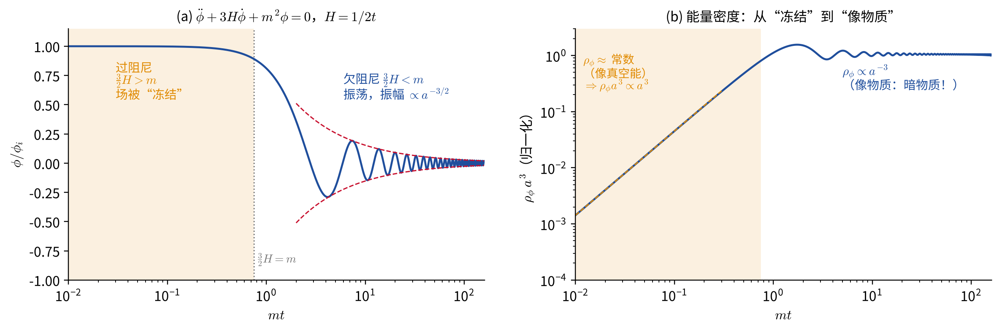
</div>

#### 例 3：木卫一的受迫偏心率与潮汐加热

木卫一（Io）是太阳系中火山活动最剧烈的天体，它的能量来源是有阻尼的强迫振动。

**拉普拉斯共振。** 木星的三颗伽利略卫星木卫一、木卫二（Europa）、木卫三（Ganymede）的公转周期分别为 1.769 d、3.551 d、7.155 d，接近 $1:2:4$，平运动严格满足 $n_{\rm I}-3n_{\rm E}+2n_{\rm G}=0$，称为**拉普拉斯共振**。其中木卫一与木卫二处于 $2:1$ 共振：木卫二每绕木星一圈，木卫一恰好绕两圈，二者的会合总是发生在木卫一轨道的同一位置附近（木卫一的近木点）。于是木卫二每次都在同一位置“推”木卫一一下，这就是作用在木卫一径向振动上的周期性外力。

**偏心率矢量满足有阻尼的强迫振动方程。** 前面看到，偏心轨道相当于圆轨道加上一个径向小振动，偏心率 $e$ 是这个振动的振幅，近木点方向 $\varpi$ 是它的相位。为了看清楚振幅和相位如何缓慢演化，回到方程 $\ddot x+2\lambda\dot x+\omega_0^2x=\dfrac fm\cos\gamma t$，在近共振 $\gamma\approx\omega_0$、弱阻尼 $\lambda\ll\omega_0$ 的条件下，令

$$
\begin{equation}
x=\operatorname{Re}\!\left[A(t)\,e^{i\gamma t}\right],
\end{equation}
$$

其中复振幅 $A=|A|e^{i\alpha}$ 同时记录了振幅和相位，并且随时间缓慢变化（$|\ddot A|\ll\gamma|\dot A|$）。代入方程，略去 $\ddot A$ 和 $\lambda\dot A$，并用 $\omega_0^2-\gamma^2\approx2\gamma(\omega_0-\gamma)$，得到一阶方程

$$
\begin{equation}
\dot A=\bigl[i(\omega_0-\gamma)-\lambda\bigr]A-\frac{if}{2m\gamma}.
\end{equation}
$$

它的通解是

$$
\begin{equation}
A(t)=A_{\rm f}+\bigl(A_0-A_{\rm f}\bigr)e^{[i(\omega_0-\gamma)-\lambda]t},
\qquad
|A_{\rm f}|=\frac{f/(2m\gamma)}{\sqrt{(\omega_0-\gamma)^2+\lambda^2}} .
\end{equation}
$$

第二项是自由振动，它一边绕 $A_{\rm f}$ 转一边按 $e^{-\lambda t}$ 衰减；第一项 $A_{\rm f}$ 是稳态的受迫振动，其大小正是“有阻尼的强迫振动”中的振幅 $b$ 在共振附近的近似。在复平面上，$A(t)$ 沿一条螺线收缩到不动点 $A_{\rm f}$，见下图（b）和（c）。

<details class="derivation">
<summary>推导：慢变复振幅方程</summary>

把外力写成 $\dfrac fm\cos\gamma t=\operatorname{Re}\Bigl[\dfrac fm e^{i\gamma t}\Bigr]$，考虑复方程 $\ddot z+2\lambda\dot z+\omega_0^2z=\dfrac fm e^{i\gamma t}$，它的实部就是原方程。令 $z=A(t)e^{i\gamma t}$，则

$$
\begin{equation*}
\dot z=\bigl(\dot A+i\gamma A\bigr)e^{i\gamma t},\qquad
\ddot z=\bigl(\ddot A+2i\gamma\dot A-\gamma^2A\bigr)e^{i\gamma t}.
\end{equation*}
$$

代入并约去 $e^{i\gamma t}$：

$$
\begin{equation*}
\ddot A+2i\gamma\dot A+2\lambda\dot A+\bigl(\omega_0^2-\gamma^2+2i\lambda\gamma\bigr)A=\frac fm .
\end{equation*}
$$

$A$ 变化很慢：$\dot A\sim(\omega_0-\gamma)A$ 或 $\lambda A$，都远小于 $\gamma A$，所以 $\ddot A$ 和 $\lambda\dot A$ 都比 $\gamma\dot A$ 小一阶，可以略去。再用 $\omega_0^2-\gamma^2\approx2\gamma(\omega_0-\gamma)$，两边除以 $2i\gamma$，就得到正文的方程

$$
\begin{equation*}
\dot A=\bigl[i(\omega_0-\gamma)-\lambda\bigr]A-\frac{if}{2m\gamma}.
\end{equation*}
$$

令 $\dot A=0$ 得不动点 $A_{\rm f}=\dfrac{if/(2m\gamma)}{i(\omega_0-\gamma)-\lambda}$；$A-A_{\rm f}$ 满足齐次方程，按 $e^{[i(\omega_0-\gamma)-\lambda]t}$ 演化，即正文的通解。这里的方法（把快振荡因子 $e^{i\gamma t}$ 分离出去，只追踪缓慢变化的振幅和相位）与“参数共振”一节的慢变振幅法、以及天体力学中对轨道根数的长期摄动处理，是同一个思想。

</details>

下面的动画演示这一过程：复振幅 $A$ 一边绕受迫解 $A_{\rm f}$ 旋转一边向它收缩，$|A|$ 的起伏（自由部分）逐渐衰减，最后只剩由外力维持的 $|A_{\rm f}|$。

<div style="text-align:center">
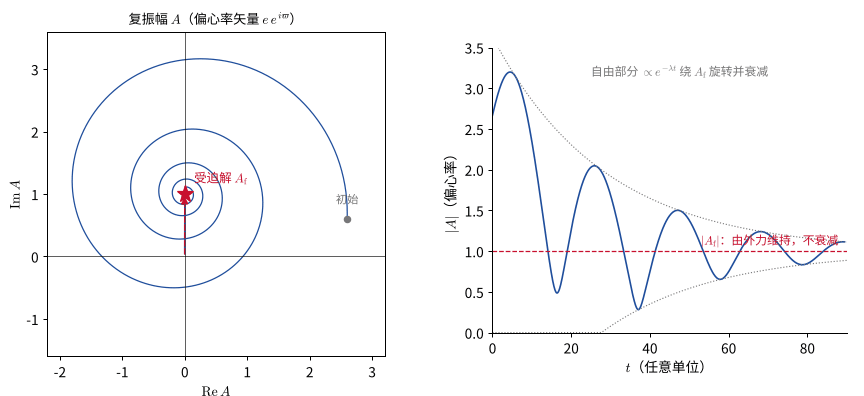
</div>

天体力学中，木卫一的**偏心率矢量** $z=e\,e^{i\varpi}$ 在共振附近满足形式完全相同的方程 [13]：木卫二的周期性摄动提供外力，木卫一内部的潮汐摩擦提供阻尼。因此：

- 木卫一偏心率中的“自由部分”早已被潮汐阻尼耗散掉了（所需时间远短于太阳系的年龄）。如果没有木卫二，木卫一的轨道早已变成正圆。
- 留下来的是由木卫二维持的**受迫偏心率** $e_{\rm f}\approx0.0041$，它不会衰减。

**潮汐加热。** 偏心轨道上木卫一与木星的距离周期性变化，木星在木卫一上引起的潮汐隆起随之周期性地伸缩，内部摩擦把这部分机械能转化为热能。对同步自转的卫星，潮汐耗散功率为 [35]

$$
\begin{equation}
\dot E=\frac{21}{2}\,\frac{k_2}{Q}\,\frac{GM_{\rm J}^2R^5n}{a^6}\,e^2 ,
\end{equation}
$$

其中 $R$、$a$、$n$ 分别为木卫一的半径、轨道半长轴和平运动，$k_2$ 描述卫星受潮汐力作用时的形变程度。$Q$ 正是本节定义的品质因数，用来描述木卫一内部对周期性潮汐形变的耗散：$Q$ 越小，耗散越强。代入 $M_{\rm J}=1.90\times10^{27}$ kg、$R=1.82\times10^6$ m、$a=4.22\times10^8$ m、$n=4.11\times10^{-5}\ \text{s}^{-1}$、$e=0.0041$，以及由轨道观测定出的 $k_2/Q\approx0.015$ [36]，得到

$$
\begin{equation}
\dot E\approx1\times10^{14}\ \text{W},
\end{equation}
$$

平均到木卫一表面约为 $2\ \text{W/m}^2$，是地球平均地热流（约 $0.09\ \text{W/m}^2$）的二十多倍，与观测到的热流相符。注意 $\dot E\propto e^2$，而 $e$ 由受迫振动维持：这正是“有阻尼的强迫振动”一节所说的稳态，外力的输入功率等于阻尼的耗散功率。这部分能量最终来自木星的自转，通过木星上的潮汐和轨道共振传递给木卫一。

1979 年 3 月初，Peale、Cassen 和 Reynolds 发表论文，根据上述机制预言木卫一内部可能已经熔化、表面应当有火山活动 [35]；几天后，旅行者 1 号飞掠木卫一，拍到了正在喷发的火山羽流。

<div style="text-align:center">
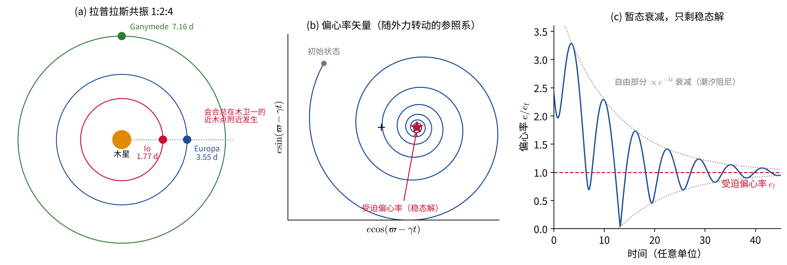
</div>

<!-- 原 PDF 第 4 页 -->

## 多自由度系统的简谐振动

上面讨论的都是一个自由度。实际系统，如分子、晶格、耦合摆，往往有多个自由度，各自由度之间有耦合，运动方程是联立的。下面表明：在小振动近似下，总可以找到适当的坐标组合，使系统分解为若干彼此独立的谐振子。

考虑一般的 $s$ 自由度保守系统

$$
\begin{equation}
L=\frac12a_{ij}(q)\dot q_i\dot q_j-U(q),
\qquad i,j=1,2,\ldots,s,
\end{equation}
$$

其中（重复指标表示求和）

$$
\begin{equation}
a_{ij}=a_{ji}.
\end{equation}
$$

系统在平衡位置 $q_{i0}$ 附近运动。令

$$
\begin{equation}
x_i=q_i-q_{i0},
\end{equation}
$$

并在平衡点附近展开势能（平衡条件使一阶项消失，常数项 $U(q_0)$ 可以略去）：

$$
\begin{equation}
U(q)=U(q_0)+\frac12k_{ij}x_ix_j+\cdots,
\;
\left.\frac{\partial U}{\partial q_i}\right|_{q_0}=0,
\;
k_{ij}=\left.\frac{\partial^2U}{\partial q_i\partial q_j}\right|_{q_0}.
\end{equation}
$$

动能已经是速度的二次型，$\dot x$ 本身是小量，因此质量矩阵只需取平衡点处的值 $m_{ij}=a_{ij}(q_0)$。在线性近似下

$$
\begin{equation}
L=\frac12m_{ij}\dot x_i\dot x_j-\frac12k_{ij}x_ix_j,
\end{equation}
$$

运动方程为

$$
\begin{equation}
\sum_jm_{ij}\ddot x_j+\sum_jk_{ij}x_j=0,
\end{equation}
$$

或用矩阵表示为

$$
\begin{equation}
\mathbf m\,\ddot{\mathbf x}+\mathbf k\,\mathbf x=0.
\end{equation}
$$

假设方程存在形如

$$
\begin{equation}
x_j(t)=A_je^{i\omega t}
\end{equation}
$$

的解（所有自由度以同一频率振动，物理解取其实部），代入得到

$$
\begin{equation}
\sum_j(k_{ij}-\omega^2m_{ij})A_j=0.
\end{equation}
$$

这是关于 $A_j$ 的齐次线性方程组，非零解存在的条件是系数行列式为零：

$$
\begin{equation}
\det(k_{ij}-\omega^2m_{ij})=0.
\end{equation}
$$

这是久期方程（secular equation）或特征方程，是关于 $\omega^2$ 的 $s$ 阶方程，具有 $s$ 个正实根

$$
\begin{equation}
\omega_\alpha^2,
\qquad \alpha=1,2,\ldots,s.
\end{equation}
$$

$\omega_\alpha$ 称为系统的特征频率或本征频率。

为什么根是实数且为正？$m_{ij}$ 来自动能，是正定对称矩阵，$k_{ij}$ 是实对称矩阵，所以这是一个广义的实对称本征值问题，$\omega^2$ 必为实数。取实本征矢 $A$，用 $A_i$ 缩并上面的方程得

$$
\begin{equation}
\omega^2=\frac{k_{ij}A_iA_j}{m_{ij}A_iA_j},
\end{equation}
$$

分母恒正，所以 $\omega^2>0$ 当且仅当 $k_{ij}$ 正定，即平衡点是势能的极小值点。若某个 $\omega_\alpha^2$ 为负，则相应解含指数增长或衰减因子，表明平衡点不稳定。若 $\omega_\alpha=0$，则对应沿该方向势能无变化，常见于系统存在连续对称性时（如分子的整体平动和转动）。

每个 $\omega_\alpha$ 都有相应的本征矢量 $A^{(\alpha)}$，系统可按本征频率作简谐振动。不同频率的本征矢量关于质量矩阵“正交”，$m_{ij}A_i^{(\alpha)}A_j^{(\beta)}=0$（$\omega_\alpha\neq\omega_\beta$）。以本征矢量为基底，可以找到正则坐标 $\Theta_1,\ldots,\Theta_s$，它们是 $x_1,\ldots,x_s$ 的线性函数，使

$$
\begin{equation}
L=\sum_{\alpha=1}^{s}\frac12m_\alpha
\left(\dot\Theta_\alpha^2-\omega_\alpha^2\Theta_\alpha^2\right),
\end{equation}
$$

其中 $m_\alpha$ 取决于本征矢量的归一化方式（取 $m_{ij}A_i^{(\alpha)}A_j^{(\alpha)}=1$ 时 $m_\alpha=1$）。于是

$$
\begin{equation}
\ddot\Theta_\alpha+\omega_\alpha^2\Theta_\alpha=0.
\end{equation}
$$

即通过同一线性变换，可以同时将 $m_{ij}$ 与 $k_{ij}$ 对角化，系统分解为彼此独立的振动模式，即**简正振动**（normal modes）。一般运动是这些简正模的线性叠加，而各模式的振幅和相位由初始条件决定。

<details class="derivation">
<summary>推导：本征矢的正交性，以及如何同时对角化质量矩阵与劲度矩阵</summary>

**正交性。** 设 $\mathbf kA^{(\alpha)}=\omega_\alpha^2\mathbf mA^{(\alpha)}$，$\mathbf kA^{(\beta)}=\omega_\beta^2\mathbf mA^{(\beta)}$。第一式左乘 $A^{(\beta)\mathsf T}$，第二式左乘 $A^{(\alpha)\mathsf T}$，再相减；由于 $\mathbf k$、$\mathbf m$ 都是对称矩阵，两式左边相等，于是

$$
\begin{equation*}
0=\bigl(\omega_\alpha^2-\omega_\beta^2\bigr)\,A^{(\beta)\mathsf T}\mathbf mA^{(\alpha)} .
\end{equation*}
$$

$\omega_\alpha\neq\omega_\beta$ 时 $A^{(\beta)\mathsf T}\mathbf mA^{(\alpha)}=0$。若有简并的频率，可以在相应子空间中按“$\mathbf m$ 内积”做施密特正交化。

**同时对角化。** $\mathbf m$ 正定，所以存在正定对称的平方根 $\mathbf m^{1/2}$。令 $\mathbf y=\mathbf m^{1/2}\mathbf x$，则

$$
\begin{equation*}
L=\frac12\dot{\mathbf y}^{\mathsf T}\dot{\mathbf y}-\frac12\mathbf y^{\mathsf T}\mathbf K\mathbf y,\qquad
\mathbf K=\mathbf m^{-1/2}\,\mathbf k\,\mathbf m^{-1/2}.
\end{equation*}
$$

动能已经是单位矩阵。$\mathbf K$ 是实对称矩阵，可以用一个正交矩阵 $\mathbf O$ 对角化：$\mathbf O^{\mathsf T}\mathbf K\mathbf O=\operatorname{diag}(\omega_1^2,\ldots,\omega_s^2)$。再令 $\boldsymbol\Theta=\mathbf O^{\mathsf T}\mathbf y$；正交变换不改变 $\dot{\mathbf y}^{\mathsf T}\dot{\mathbf y}$，于是

$$
\begin{equation*}
L=\sum_\alpha\frac12\left(\dot\Theta_\alpha^2-\omega_\alpha^2\Theta_\alpha^2\right).
\end{equation*}
$$

总的变换是 $\mathbf x=\mathbf m^{-1/2}\mathbf O\,\boldsymbol\Theta$，矩阵 $\mathbf m^{-1/2}\mathbf O$ 的各列正是满足 $A^{(\alpha)\mathsf T}\mathbf mA^{(\alpha)}=1$ 的本征矢。$\det(\mathbf K-\omega^2)=\det(\mathbf m)^{-1}\det(\mathbf k-\omega^2\mathbf m)$，所以 $\omega_\alpha^2$ 正是久期方程的根。

</details>

### 例：两个耦合振子

两个质量均为 $m$ 的质点分别被劲度系数为 $k$ 的弹簧拴在墙上，两质点之间又用劲度系数为 $\kappa$ 的弹簧相连，则

$$
\begin{equation}
L=\frac12m(\dot x_1^2+\dot x_2^2)-\frac12k(x_1^2+x_2^2)-\frac12\kappa(x_1-x_2)^2.
\end{equation}
$$

久期方程为

$$
\begin{equation}
\det\begin{pmatrix}
k+\kappa-m\omega^2 & -\kappa\\
-\kappa & k+\kappa-m\omega^2
\end{pmatrix}=0,
\end{equation}
$$

解得

$$
\begin{equation}
\omega_1^2=\frac km,\quad A^{(1)}\propto(1,1);
\qquad
\omega_2^2=\frac{k+2\kappa}{m},\quad A^{(2)}\propto(1,-1).
\end{equation}
$$

物理上，$\omega_1$ 是两个质点同相运动，中间的弹簧不发生形变，因此不受 $\kappa$ 影响；$\omega_2$ 是反相运动，中间的弹簧被拉伸得最多，频率最高。正则坐标为 $\Theta_\pm=(x_1\pm x_2)/\sqrt2$，在这组坐标下两个振子完全解耦：

$$
\begin{equation}
L=\frac12m(\dot\Theta_+^2+\dot\Theta_-^2)-\frac12k\Theta_+^2-\frac12(k+2\kappa)\Theta_-^2.
\end{equation}
$$

若在弱耦合 $\kappa\ll k$ 时只拨动其中一个质点，则相当于同时激发了两个频率相近的简正模，其叠加产生拍，能量就在两个质点之间周期性地来回转移。

<details class="derivation">
<summary>推导：弱耦合振子之间的能量转移</summary>

取初始条件 $x_1(0)=a$，$x_2(0)=0$，初速度为零。则 $\Theta_\pm(0)=a/\sqrt2$，$\dot\Theta_\pm(0)=0$，两个简正模各自独立振动：

$$
\begin{equation*}
\Theta_+=\frac{a}{\sqrt2}\cos\omega_1t,\qquad \Theta_-=\frac{a}{\sqrt2}\cos\omega_2t .
\end{equation*}
$$

变换回原坐标，记 $\bar\omega=\tfrac12(\omega_1+\omega_2)$，$\Delta\omega=\omega_2-\omega_1$：

$$
\begin{align*}
x_1&=\frac{\Theta_++\Theta_-}{\sqrt2}=\frac a2\bigl(\cos\omega_1t+\cos\omega_2t\bigr)=a\cos\frac{\Delta\omega\,t}{2}\cos\bar\omega t,\\
x_2&=\frac{\Theta_+-\Theta_-}{\sqrt2}=\frac a2\bigl(\cos\omega_1t-\cos\omega_2t\bigr)=a\sin\frac{\Delta\omega\,t}{2}\sin\bar\omega t .
\end{align*}
$$

每个质点都以 $\bar\omega$ 快速振动，振幅按 $\Delta\omega/2$ 缓慢调制。弱耦合时每个质点的能量近似为

$$
\begin{equation*}
E_1\approx E\cos^2\frac{\Delta\omega\,t}{2},\qquad E_2\approx E\sin^2\frac{\Delta\omega\,t}{2}.
\end{equation*}
$$

$t=\pi/\Delta\omega$ 时能量全部转移到质点 2，$t=2\pi/\Delta\omega$ 时又全部回到质点 1。$\kappa\ll k$ 时 $\omega_2\approx\omega_1(1+\kappa/k)$，$\Delta\omega\approx\omega_1\kappa/k$：耦合越弱，能量转移越慢，但最终仍会完全转移。

</details>

下面的动画演示 $\kappa=0.08\,k$ 的情形：只拨动左边的质点，能量逐渐全部转移到右边，再转移回来。

<div style="text-align:center">
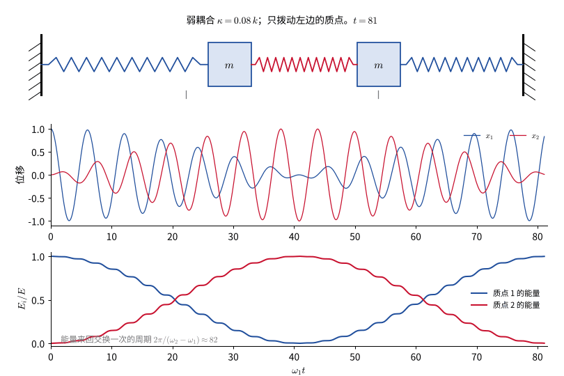
</div>

简正模的概念贯穿物理学。把 $s\to\infty$，即得到晶格振动（声子）的经典图像；量子化后，每个简正模是一个独立的量子谐振子，$E=\sum_\alpha(n_\alpha+\tfrac12)\hbar\omega_\alpha$。小振动理论的更完整论述见 [1, §23–24]、[2, 第 6 章] 和 [3, §23]。

<div style="text-align:center">
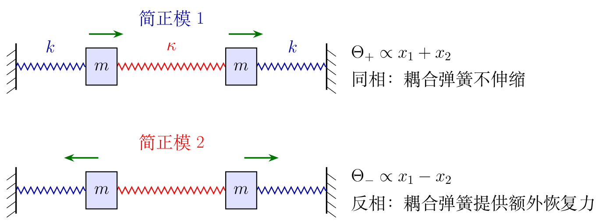
</div>

两个简正模的运动见下面的动画。为了看清频率之比，这里取 $\kappa=\tfrac58k$，使 $\omega_2=1.5\,\omega_1$：同一段时间内模 1 振动 2 次，模 2 振动 3 次。

<div style="text-align:center">
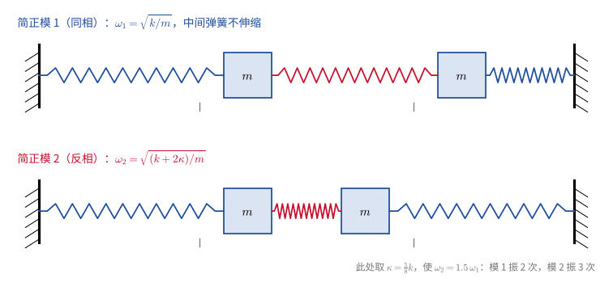
</div>

<!-- 原 PDF 第 5 页 -->

## 参数共振（Parameter Resonance）

“强迫振动”中的外力是以非齐次项（源项）的形式进入方程的。还有一类更微妙的外界作用：它不是直接推动系统，而是**周期性地调制系统本身的参数**，例如周期性改变摆长或弹簧的劲度系数。小孩荡秋千时在每个周期内两次下蹲、两次站起（升降重心），就是在以约二倍于秋千固有频率的频率调制摆长，使摆幅越荡越大，这就是参数共振的典型例子。

此时运动方程是

$$
\begin{equation}
\frac{d^2x}{dt^2}+\omega^2(t)x=0.
\end{equation}
$$

这个方程是齐次的，$x=0$ 总是它的解，因此不存在“强迫”；问题的核心是 $x=0$ 这个平衡位置是否稳定。

下面的动画是一个摆长按 $l=l_0(1+0.05\cos2\omega_0t)$ 变化的单摆，相当于荡秋千的人在最低点站起、在最高点蹲下。摆长只变化 $\pm5\%$，但调制频率是固有频率的两倍、相位又恰好合适，摆幅便从 $3^\circ$ 指数增长。

<div style="text-align:center">
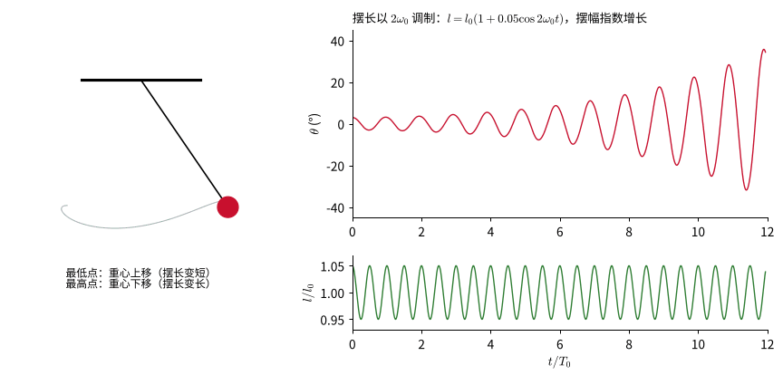
</div>

设 $\omega(t)$ 是频率为 $\gamma$、周期为

$$
\begin{equation}
T=\frac{2\pi}{\gamma}
\end{equation}
$$

的周期函数：

$$
\begin{equation}
\omega(t+T)=\omega(t).
\end{equation}
$$

由于方程在 $t\to t+T$ 下不变，若 $x(t)$ 是解，则 $x(t+T)$ 也是解。取两个独立解 $x_1,x_2$，则 $x_1(t+T),x_2(t+T)$ 必为 $x_1(t),x_2(t)$ 的线性组合。可以选择一组新的基解（相当于对角化“平移一个周期”这一线性变换），使

$$
\begin{equation}
x_1(t+T)=\mu_1x_1(t),
\qquad
x_2(t+T)=\mu_2x_2(t).
\end{equation}
$$

$\mu_{1,2}$ 称为 Floquet 乘子。满足上式的函数可写成 Floquet 形式 [6]

$$
\begin{equation}
x_1(t)=\mu_1^{t/T}\Pi_1(t),
\qquad
x_2(t)=\mu_2^{t/T}\Pi_2(t),
\end{equation}
$$

其中 $\Pi_1,\Pi_2$ 是周期为 $T$ 的函数。这个结论的直观含义是：每过一个周期，解被放大（或缩小）一个固定的倍数 $\mu$，而在周期内的形状不变。

由

$$
\begin{equation}
\ddot x_1+\omega^2(t)x_1=0,
\qquad
\ddot x_2+\omega^2(t)x_2=0
\end{equation}
$$

两式分别乘以 $x_2,x_1$ 后相减，得 $\dfrac{d}{dt}(\dot x_1x_2-\dot x_2x_1)=0$，即 Wronskian 为常数：

$$
\begin{equation}
\dot x_1x_2-\dot x_2x_1=\text{常数}.
\end{equation}
$$

在 $t\to t+T$ 下，左边变为原来的 $\mu_1\mu_2$ 倍，而常数不变，这要求

$$
\begin{equation}
\mu_1\mu_2=1.
\end{equation}
$$

方程是实的，所以实数解对应两种情形：

1. $\mu_1=\mu_2^*$，于是 $|\mu_1|=|\mu_2|=1$，解保持有界；
2. $\mu_1,\mu_2$ 为实数且互为倒数，其中一个模大于 1，另一个模小于 1，解含指数增长与衰减分支。

第二种情形意味着平衡位置 $x=0$ 不稳定：任意小扰动都随时间指数增长，这就是参数共振。

一个等价而便于数值判断的说法是：设 $x_1,x_2$ 为初始条件分别取 $(x,\dot x)=(1,0),(0,1)$ 的两个解，则 $\mu$ 满足 $\mu^2-\Delta\mu+1=0$，其中 $\Delta=x_1(T)+\dot x_2(T)$ 是“平移一个周期”这一变换矩阵的迹。当 $|\Delta|<2$ 时 $\mu$ 是模为 1 的共轭复数，解稳定；当 $|\Delta|>2$ 时 $\mu$ 为实，解不稳定 [3, §25]。

<details class="derivation">
<summary>推导：单值矩阵与 Floquet 乘子；不稳定区为何出现在 γ ≈ 2ω₀/n</summary>

任意解由初值 $(x(0),\dot x(0))$ 线性决定。用上面两个基本解组成矩阵

$$
\begin{equation*}
\Phi(t)=\begin{pmatrix}x_1(t)&x_2(t)\\ \dot x_1(t)&\dot x_2(t)\end{pmatrix},\qquad
\begin{pmatrix}x(t)\\ \dot x(t)\end{pmatrix}=\Phi(t)\begin{pmatrix}x(0)\\ \dot x(0)\end{pmatrix},\qquad\Phi(0)=\mathbf 1 .
\end{equation*}
$$

“平移一个周期”的变换就是 $M=\Phi(T)$，称为**单值矩阵**（monodromy matrix）。Floquet 解是 $M$ 的本征矢，乘子 $\mu$ 是本征值：

$$
\begin{equation*}
\det(M-\mu\mathbf 1)=\mu^2-(\operatorname{tr}M)\,\mu+\det M=0 .
\end{equation*}
$$

$\det M=x_1(T)\dot x_2(T)-x_2(T)\dot x_1(T)$ 正是 $t=T$ 时的 Wronskian，它守恒且初值为 $1$，所以 $\det M=1$，方程化为 $\mu^2-\Delta\mu+1=0$，$\Delta=\operatorname{tr}M$。由 $\mu=\tfrac12\Delta\pm\sqrt{\tfrac14\Delta^2-1}$ 即得正文的判据。（$\det M=1$ 是刘维尔定理的体现：相空间面积守恒。有阻尼 $2\lambda\dot x$ 时 Wronskian $\propto e^{-2\lambda t}$，$\det M=e^{-2\lambda T}$，相空间面积收缩。）

**不稳定区的位置。** $h=0$ 时 $x_1=\cos\omega_0t$，$x_2=\sin(\omega_0t)/\omega_0$，于是 $\Delta=2\cos\omega_0T$，$\mu=e^{\pm i\omega_0T}$。只有在 $|\Delta|=2$，即 $\omega_0T=n\pi$ 时，小的调制才能把 $\mu$ 推离单位圆，使 $|\Delta|>2$。由 $T=2\pi/\gamma$ 得

$$
\begin{equation*}
\gamma=\frac{2\omega_0}{n},\qquad n=1,2,3,\ldots
\end{equation*}
$$

这就是下面“摩擦的影响与高阶共振”一节中各个共振的位置。$n=1$ 时 $\mu\approx-1$：每过一个调制周期，振动恰好反号，即振动本身的周期是调制周期的两倍。

</details>

<!-- 原 PDF 第 6 页 -->

### 一个典型例子：Mathieu 方程

例如取

$$
\begin{equation}
\omega^2(t)=\omega_0^2(1+h\cos\gamma t),
\qquad
h\ll1,
\qquad
h>0.
\end{equation}
$$

后续分析将表明，当

$$
\begin{equation}
\gamma\approx2\omega_0
\end{equation}
$$

时参数共振最强烈。这与秋千的经验一致：调制频率是固有频率的两倍。令

$$
\begin{equation}
\gamma=2\omega_0+\varepsilon,
\qquad
|\varepsilon|\ll\omega_0,
\end{equation}
$$

运动方程为 Mathieu 方程 [7]：

$$
\begin{equation}
\ddot x+\omega_0^2
\left[1+h\cos(2\omega_0+\varepsilon)t\right]x=0.
\end{equation}
$$

下面用慢变振幅法求不稳定区的范围。令 $\Omega=\omega_0+\varepsilon/2$，设解为

$$
\begin{equation}
x=a(t)\cos\left(\omega_0+\frac\varepsilon2\right)t
+b(t)\sin\left(\omega_0+\frac\varepsilon2\right)t,
\end{equation}
$$

其中 $a(t),b(t)$ 是相对于 $\cos\omega_0t,\sin\omega_0t$ 随时间缓慢变化的函数，所以可略去 $\ddot a,\ddot b$。代入方程，并用 $\cos2\Omega t\cos\Omega t=\tfrac12(\cos3\Omega t+\cos\Omega t)$、$\cos2\Omega t\sin\Omega t=\tfrac12(\sin3\Omega t-\sin\Omega t)$ 化简；频率为 $3\Omega$ 的项与 $x$ 的基频不匹配，不能持续放大，略去。再令 $\cos\Omega t$ 和 $\sin\Omega t$ 的系数分别为零，并用 $\omega_0^2-\Omega^2\approx-\omega_0\varepsilon$，得到

$$
\begin{align}
\dot a&=-\frac12\left(\varepsilon+\frac{h\omega_0}{2}\right)b,\\
\dot b&=\frac12\left(\varepsilon-\frac{h\omega_0}{2}\right)a.
\end{align}
$$

<details class="derivation">
<summary>推导：慢变振幅方程的完整代入</summary>

记 $\Omega=\omega_0+\varepsilon/2$，则调制频率 $\gamma=2\Omega$。对 $x=a\cos\Omega t+b\sin\Omega t$ 求两次导数，略去 $\ddot a$、$\ddot b$：

$$
\begin{equation*}
\ddot x\approx-2\Omega\dot a\sin\Omega t+2\Omega\dot b\cos\Omega t-\Omega^2\bigl(a\cos\Omega t+b\sin\Omega t\bigr).
\end{equation*}
$$

调制项为

$$
\begin{equation*}
h\cos2\Omega t\,\bigl(a\cos\Omega t+b\sin\Omega t\bigr)=\frac{ha}{2}\bigl(\cos\Omega t+\cos3\Omega t\bigr)+\frac{hb}{2}\bigl(\sin3\Omega t-\sin\Omega t\bigr).
\end{equation*}
$$

把 $\ddot x+\omega_0^2(1+h\cos2\Omega t)x=0$ 中 $\cos\Omega t$ 和 $\sin\Omega t$ 的系数分别令为零（$3\Omega$ 项略去）：

$$
\begin{align*}
\cos\Omega t:&\quad 2\Omega\dot b+\bigl(\omega_0^2-\Omega^2\bigr)a+\frac{h\omega_0^2}{2}a=0,\\
\sin\Omega t:&\quad -2\Omega\dot a+\bigl(\omega_0^2-\Omega^2\bigr)b-\frac{h\omega_0^2}{2}b=0 .
\end{align*}
$$

用 $\Omega\approx\omega_0$、$\omega_0^2-\Omega^2\approx-\omega_0\varepsilon$，两式除以 $2\omega_0$，即得上面的 $\dot a$、$\dot b$ 方程。

**为什么可以略去 $\ddot a$、$\ddot b$？** 下面会看到 $a,b\propto e^{st}$，$s\lesssim h\omega_0/4\ll\omega_0$，所以 $\ddot a\sim s\dot a\ll\Omega\dot a$。这与上面木卫一例子中略去 $\ddot A$ 的理由相同。

**增长解的相位。** $\varepsilon=0$ 时方程为 $\dot a=-\tfrac{h\omega_0}{4}b$，$\dot b=-\tfrac{h\omega_0}{4}a$，增长解满足 $b=-a$，即

$$
\begin{equation*}
x\propto e^{st}\bigl(\cos\omega_0t-\sin\omega_0t\bigr)=\sqrt2\,e^{st}\cos\left(\omega_0t+\frac\pi4\right),
\end{equation*}
$$

振动的相位相对于调制是**锁定**的。这就像荡秋千：必须在合适的时刻站起和蹲下，节奏不对反而会使摆幅减小（$b=a$ 的解按 $e^{-st}$ 衰减）。

</details>

这是 $a,b$ 的常系数线性方程组，设 $a,b\propto e^{st}$，其增长率满足

$$
\begin{equation}
s^2=\frac14\left[\left(\frac{h\omega_0}{2}\right)^2-\varepsilon^2\right].
\end{equation}
$$

当

$$
\begin{equation}
-\frac{h\omega_0}{2}<\varepsilon<\frac{h\omega_0}{2}
\end{equation}
$$

时，$s$ 为实数，$a(t),b(t)$ 含 $e^{st}$ 型增长因子，发生参数共振；区域之外 $s$ 为虚数，解有界。最大增长率发生在 $\varepsilon=0$（调制频率恰为 $2\omega_0$），$s_{\max}=h\omega_0/4$。可以看到，不稳定区的宽度正比于调制幅度 $h$。对应的 Floquet 乘子是 $\mu_{1,2}=e^{\pm sT}$。

这一结果与标准形式的 Mathieu 方程 $y''+(A-2q\cos2z)y=0$ 的第一个不稳定区一致：令 $z=\gamma t/2$，则 $A=4\omega_0^2/\gamma^2$，$|q|\approx h/2$，第一个不稳定区为 $|A-1|<|q|$，在 $\gamma=2\omega_0+\varepsilon$ 附近化为 $|\varepsilon|<h\omega_0/2$，与上式相同 [5]。

### 摩擦的影响与高阶共振

计入摩擦（阻尼系数 $\lambda$）后，解多了因子 $e^{-\lambda t}$，只有 $s>\lambda$ 时才不稳定。于是不稳定区变窄为

$$
\begin{equation}
|\varepsilon|<\sqrt{\left(\frac{h\omega_0}{2}\right)^2-4\lambda^2},
\end{equation}
$$

在 $\varepsilon=0$ 处出现共振的**阈值** $h>4\lambda/\omega_0$：调制幅度必须大到足以抵消摩擦的耗散。这与强迫共振不同，那里无论外力多弱，共振时振幅总会增长。另外，参数共振不只出现在 $\gamma\approx2\omega_0$，还出现在 $\gamma\approx2\omega_0/n$（$n=1,2,\ldots$）附近，但 $n$ 越大，不稳定区越窄，宽度正比于 $h^n$ [1, §27]。

把所有不稳定区画在“调制频率–调制幅度”平面上，就得到 Mathieu 方程的稳定图（Ince–Strutt 图）。下图由数值计算单值矩阵的迹 $\Delta$ 得到：红色区域是无阻尼时的不稳定区，从 $\gamma=2\omega_0/n$ 处的横轴伸出一串“舌头”；$n=1$ 的舌头与慢变振幅法给出的边界 $|\varepsilon|<h\omega_0/2$（虚线）在 $h$ 较小时吻合。蓝线是有阻尼 $\lambda=0.05\,\omega_0$ 时的不稳定区边界：主共振出现阈值 $h>4\lambda/\omega_0$，较窄的高阶舌头需要大得多的调制幅度才会失稳。

<div style="text-align:center">
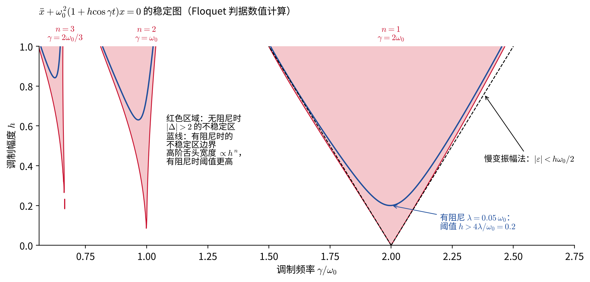
</div>

### 参数共振在宇宙学中的应用

参数共振在宇宙学中有重要应用。暴胀结束后，暴胀子场围绕势能极小值振荡，$\phi(t)\simeq\Phi\cos mt$。若它通过 $\tfrac12g^2\phi^2\chi^2$ 与另一个标量场 $\chi$ 耦合，则 $\chi$ 的傅里叶分量 $\chi_k$ 满足（忽略宇宙膨胀）

$$
\begin{equation}
\ddot\chi_k+\left(k^2+g^2\Phi^2\cos^2mt\right)\chi_k=0.
\end{equation}
$$

利用 $\cos^2mt=\tfrac12(1+\cos2mt)$，这正是调制频率 $\gamma=2m$ 的 Mathieu 方程。落在不稳定区内的模式 $\chi_k$ 指数增长，在量子场论中对应于粒子数的指数增长，也就是暴胀子的能量被急剧转化为 $\chi$ 粒子，这一机制称为**预加热**（preheating）[8, 9]；教科书见 [10]。

<div style="text-align:center">
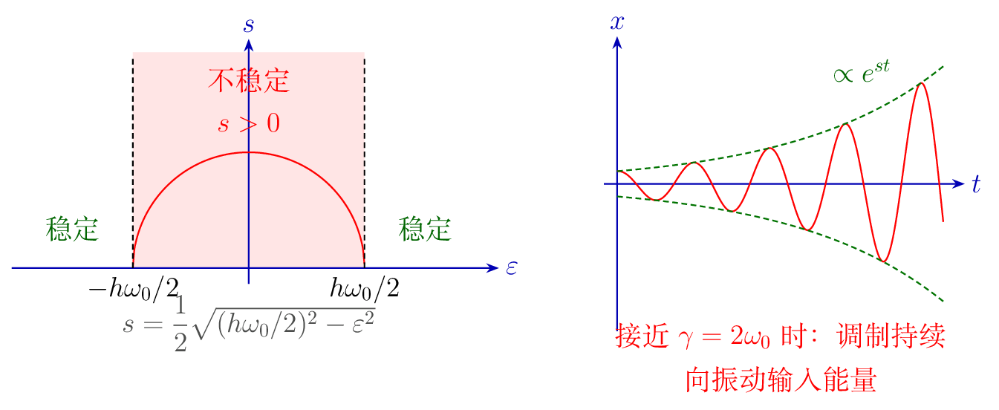
</div>

讲义给出的延伸阅读包括：

- Landau 与 Lifshitz 的力学教材 [1]；
- Mukhanov, *Physical Foundations of Cosmology* [10]；
- Kofman, Linde, Starobinsky, “Towards the Theory of Reheating after Inflation,” *Physical Review D* **56**, 3258 [9]。

<!-- 原 PDF 第 7 页 -->

## 天体摄动

前面的小振动是围绕一个平衡点的运动。天体力学中最重要的微扰问题是另一类：围绕一个**可解的轨道**（开普勒椭圆）的小偏离。本节先回顾两体问题，再说明如何处理第三个天体和其他修正。

在两体问题中，有心力场拉格朗日量为

$$
\begin{equation}
L=\frac12m_1\vec v_1^{2}
+\frac12m_2\vec v_2^{2}
-V(|\vec x_1-\vec x_2|).
\end{equation}
$$

经过质心分离（见“中心力场”一章），可等效为约化质量

$$
\begin{equation}
\mu=\frac{m_1m_2}{m_1+m_2}
\end{equation}
$$

的单粒子运动：

$$
\begin{equation}
L=\frac12\mu\dot{\vec x}^{2}-V(|\vec x|),
\qquad
\vec x=\vec x_1-\vec x_2.
\end{equation}
$$

再利用角动量守恒，在平面极坐标中

$$
\begin{equation}
L=\frac12\mu(\dot r^2+r^2\dot\varphi^2)-V(r),
\qquad
J=\frac{\partial L}{\partial\dot\varphi}=\mu r^2\dot\varphi.
\end{equation}
$$

$\varphi$ 是循环坐标，$J$ 守恒。于是径向运动可由消去 $\varphi$ 后的有效拉格朗日量（Routh 函数 $L-J\dot\varphi$）描述：

$$
\begin{equation}
\widetilde L=\frac12\mu\dot r^2-\frac{J^2}{2\mu r^2}-V(r).
\end{equation}
$$

（注意离心势前面是负号：对 $r$ 的欧拉-拉格朗日方程给出 $\mu\ddot r=J^2/(\mu r^3)-V'(r)$，其中第一项是向外的“离心力”。原讲义此处离心项符号写作 $+$，这里已更正；不能简单地把 $J$ 代入 $L$。）能量为

$$
\begin{equation}
E=\frac12\mu\dot r^2+\frac{J^2}{2\mu r^2}+V(r),
\end{equation}
$$

其中

$$
\begin{equation}
V_{\mathrm{eff}}(r)=\frac{J^2}{2\mu r^2}+V(r)
\end{equation}
$$

是有效势，$\widetilde L=\frac12\mu\dot r^2-V_{\mathrm{eff}}(r)$。

### 三体问题与摄动处理

对三体问题，通常不存在解析解。但在许多情况下，其中一个天体对另外两个的影响很小，可将它的影响当作微扰处理，例如修正

$$
\begin{equation}
V(r)\longrightarrow V(r)+\delta V(r)
\end{equation}
$$

或加入时间依赖修正 $V_{\mathrm{eff}}(r,t)$；这与在运动方程中加入修正项等价。具体地，设第三个天体（质量 $m'$、相对中心天体的位矢为 $\vec r'$）对天体 $m$（相对中心天体质量 $M$ 的位矢为 $\vec r$）产生摄动，则相对运动方程为

$$
\begin{equation}
\ddot{\vec r}=-\frac{G(M+m)}{r^3}\vec r
+Gm'\left(\frac{\vec r'-\vec r}{|\vec r'-\vec r|^3}-\frac{\vec r'}{r'^3}\right).
\end{equation}
$$

第一项是未受扰的开普勒加速度，第二项是摄动加速度。其中 $\vec r'-\vec r$ 项是第三体对 $m$ 的直接引力，$\vec r'$ 项是第三体对中心天体的引力（中心天体因此被加速，在以它为原点的非惯性系中表现为一个惯性力）。两项相互抵消了主要部分，剩下的只是引力在两处的**差**，当 $r\ll r'$ 时，其量级为

$$
\begin{equation}
|\delta\ddot{\vec r}|\sim\frac{Gm'r}{r'^3}.
\end{equation}
$$

这与“中心力场”一章中的潮汐力具有相同的来源。例如太阳对月球绕地运动的摄动，与地球对月球的主引力之比约为 $10^{-2}$，确为小量，但它仍足以显著改变月球轨道，因此月球理论是天体力学史上最困难的问题之一。

<details class="derivation">
<summary>推导：摄动加速度的潮汐展开</summary>

$r\ll r'$ 时，把直接项对 $\vec r/r'$ 展开。记 $\hat n=\vec r'/r'$，

$$
\begin{equation*}
|\vec r'-\vec r|^{-3}=r'^{-3}\left(1-\frac{2\hat n\cdot\vec r}{r'}+\frac{r^2}{r'^2}\right)^{-3/2}\approx r'^{-3}\left(1+\frac{3\,\hat n\cdot\vec r}{r'}\right),
\end{equation*}
$$

于是

$$
\begin{equation*}
\frac{\vec r'-\vec r}{|\vec r'-\vec r|^3}\approx\frac{\vec r'}{r'^3}-\frac{\vec r}{r'^3}+\frac{3(\hat n\cdot\vec r)\,\hat n}{r'^3}+O\!\left(\frac{r^2}{r'^4}\right).
\end{equation*}
$$

第一项正好被间接项 $-\vec r'/r'^3$ 抵消，剩下

$$
\begin{equation*}
\delta\ddot{\vec r}\approx\frac{Gm'}{r'^3}\Bigl[3(\hat n\cdot\vec r)\,\hat n-\vec r\Bigr].
\end{equation*}
$$

这就是潮汐加速度：沿 $\hat n$ 方向为 $+2Gm'r/r'^3$（向外拉伸），垂直方向为 $-Gm'r/r'^3$（向内压缩）。它与主引力之比为

$$
\begin{equation*}
\frac{|\delta\ddot{\vec r}|}{GM/r^2}\sim\frac{m'}{M}\left(\frac{r}{r'}\right)^3 .
\end{equation*}
$$

太阳摄动月球时，$m'/M\approx3.3\times10^5$（太阳与地球的质量比），$r/r'\approx2.6\times10^{-3}$，比值约为 $6\times10^{-3}$，计入因子 2 后约为 $10^{-2}$，与正文的估计一致。虽然太阳对月球的引力本身比地球对月球的引力还大约一倍，真正扰动月球绕地运动的只是这个小得多的“差”。

</details>

在 $N$ 体问题中，例如太阳、地球和其他天体组成的系统，地球所受引力中太阳贡献最大，而其他行星或卫星（月球）的影响较小，可作为微扰作数值计算。摄动论的经典教材见 [13]，牛顿轨道动力学与受摄二体问题（密切轨道根数）见 [14]。

天体力学中描述摄动的标准语言是**密切轨道**（osculating orbit）：在任一时刻，用天体此刻的位置和速度可以唯一确定一个开普勒椭圆，它就是摄动在这一时刻突然消失后天体将要走的轨道，相应的半长轴、偏心率、近心点方向等称为密切轨道根数。没有摄动时这些根数是常数；有摄动时它们随时间缓慢变化，包括随会合周期起伏的“短周期项”和长期积累的“长期项”。下面的动画中，橙色虚线是每一时刻的密切椭圆，右侧是密切偏心率和近心点经度的变化。为了便于观察，摄动天体的质量取得很大。

<div style="text-align:center">
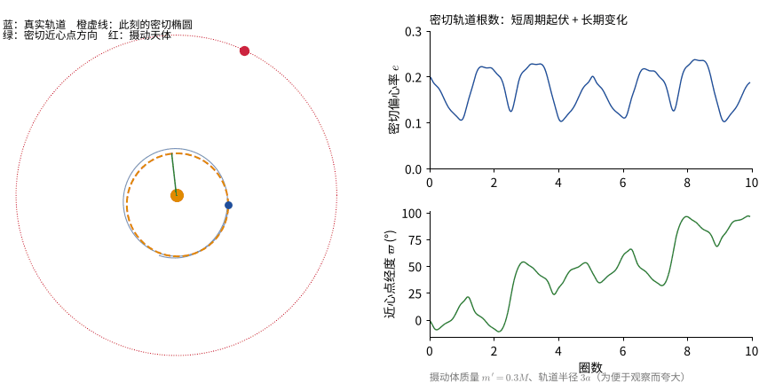
</div>

<div style="text-align:center">
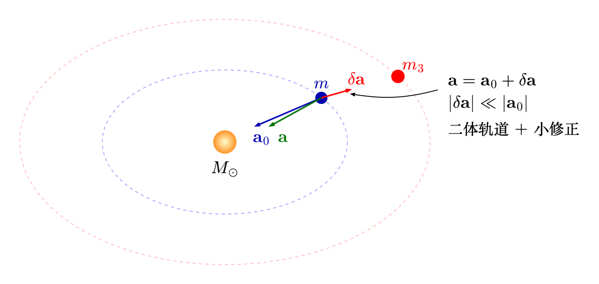
</div>

参考书：Poisson 与 Will, *Gravity* [14]。

<!-- 原 PDF 第 8 页 -->

## 水星近日点进动

在牛顿引力中，如果太阳和行星之间只有平方反比力，那么行星轨道是封闭的椭圆，近日点固定不动（伯特朗定理，见“中心力场”一章）。任何对 $1/r$ 势的偏离，哪怕很小，都会使近日点缓慢转动，这称为**进动**。

水星近日点进动的故事是微扰论最著名的一个例子。1859 年，勒维耶（Le Verrier）发现，把其他行星的牛顿引力摄动都计入后，水星近日点的观测进动速率仍比理论值快约每百年几十角秒 [15]（后经 Newcomb 等修订为约 $43''$/百年）。当时曾有人猜想存在一颗未知行星（“祝融星” Vulcan），但始终没有发现。1915 年，爱因斯坦用刚刚完成的广义相对论算出了这个值，不需任何调节参数 [16]。

水星轨道不仅受到其他天体的牛顿引力摄动，还受到引力理论本身的修正：牛顿引力在低速、弱场下非常精确，但当速度接近光速或观测精度足够高时，需要考虑相对论修正。粗略地，观测到的水星近日点总进动约为 $5600''$/百年（相对于惯性参考系的春分点），其中约 $5026''$ 来自地球自转轴的岁差（参考系效应），约 $532''$ 来自其他行星的牛顿引力摄动，剩余约 $43''$ 则只能由广义相对论解释 [17, 19]。（这里的数值是量级概括，精确值见 [19, 20]。）

水星近日点进动除了其他行星的影响，在观测精度达到一定水平后还必须考虑广义相对论修正。

### 轨道方程（Binet 方程）

为方便讨论，重新推导轨道方程。下面取单位质量约定 $\mu=1$，因此 $J$ 和 $E$ 分别是单位质量的角动量和能量。由角动量守恒

$$
\begin{equation}
r^2\frac{d\varphi}{dt}=J,
\qquad
\frac{d\varphi}{dt}=\frac{J}{r^2}.
\end{equation}
$$

能量为

$$
\begin{equation}
E=\frac12\left(\frac{dr}{dt}\right)^2
+\frac{J^2}{2r^2}+V(r),
\end{equation}
$$

所以

$$
\begin{equation}
\frac12\left(\frac{dr}{dt}\right)^2
=E-V(r)-\frac{J^2}{2r^2}.
\end{equation}
$$

我们想要的是轨道形状 $r(\varphi)$ 而不是 $r(t)$，所以用角动量守恒把时间变量换成角度变量：

$$
\begin{equation}
\frac{dr}{dt}=\frac{d\varphi}{dt}\frac{dr}{d\varphi}
=\frac{J}{r^2}\frac{dr}{d\varphi}=-J\frac{d}{d\varphi}\left(\frac1r\right),
\end{equation}
$$

代入得到

$$
\begin{equation}
\left[\frac{d}{d\varphi}\left(\frac1r\right)\right]^2
=\frac{2E}{J^2}-\frac{2V(r)}{J^2}-\frac1{r^2}.
\end{equation}
$$

这是一个含有积分常数 $E$ 的一阶方程。两边再对 $\varphi$ 求导，就消去了 $E$，得到二阶线性化的方程：

$$
\begin{equation}
2\frac{d}{d\varphi}\left(\frac1r\right)
\frac{d^2}{d\varphi^2}\left(\frac1r\right)
=-\frac{d}{d(1/r)}
\left[\frac{2V(r)}{J^2}+\frac1{r^2}\right]
\frac{d}{d\varphi}\left(\frac1r\right).
\end{equation}
$$

两边约去公因子 $\dfrac{d}{d\varphi}(1/r)$（这排除了圆轨道这一平凡解），并令

$$
\begin{equation}
u=\frac1r,
\end{equation}
$$

则得到 Binet 方程：

$$
\begin{equation}
\frac{d^2u}{d\varphi^2}
=-\frac{d}{du}\left[\frac{V(1/u)}{J^2}+\frac12u^2\right].
\end{equation}
$$

选 $u=1/r$ 为变量的好处是：对牛顿势，方程变成常系数线性方程。对牛顿势

$$
\begin{equation}
V(r)=-\frac{GM}{r},
\qquad
V(1/u)=-GMu,
\end{equation}
$$

有

$$
\begin{equation}
\frac{d^2u}{d\varphi^2}=\frac{GM}{J^2}-u,
\end{equation}
$$

这是一个“平移了的”谐振子方程，其通解为 $u=\dfrac{GM}{J^2}\,(1+e\cos\varphi)$，即开普勒椭圆（$p=J^2/GM$）。这里最重要的观察是：$u$ 作为 $\varphi$ 的函数，其振荡频率恰好等于 1，即 $u$ 每转过 $2\pi$ 的角度就完整地振荡一次，所以近日点（$u$ 的极大值）每圈都回到同一方向，轨道封闭。**进动的本质，就是对这个谐振子的频率的微小偏离：$u(\varphi)$ 的振荡频率不再恰好为 1。**

<!-- 原 PDF 第 9 页 -->

### 广义相对论修正

定义无量纲量（这里取 $c=1$，即 $\tilde u=GM/(c^2r)$）

$$
\begin{equation}
\tilde u=GMu,
\end{equation}
$$

则牛顿轨道方程为

$$
\begin{equation}
\frac{d^2\tilde u}{d\varphi^2}+\tilde u
=\left(\frac{GM}{J}\right)^2.
\end{equation}
$$

广义相对论的最低阶修正可以从史瓦西时空中的类时测地线得到。设 $\tau$ 为固有时，$J=r^2d\varphi/d\tau$ 和 $\mathcal E$ 分别是单位质量的角动量与能量（均为运动常数），取 $c=1$，则

$$
\begin{equation}
\left(\frac{dr}{d\tau}\right)^2=\mathcal E^2-\left(1-\frac{2GM}{r}\right)\left(1+\frac{J^2}{r^2}\right).
\end{equation}
$$

与牛顿情形的能量方程相比较，可见等效势多了一项 $-GMJ^2/r^3$：

$$
\begin{equation}
V_{\mathrm{eff}}(r)=-\frac{GM}{r}+\frac{J^2}{2r^2}-\frac{GMJ^2}{r^3}.
\end{equation}
$$

同样用 $dr/d\tau=-J\,du/d\varphi$ 换元，

$$
\begin{equation}
\left(\frac{du}{d\varphi}\right)^2=\frac{\mathcal E^2-1}{J^2}+\frac{2GM}{J^2}u-u^2+2GMu^3,
\end{equation}
$$

再对 $\varphi$ 求导并约去 $du/d\varphi$，得到

$$
\begin{equation}
\frac{d^2u}{d\varphi^2}+u=\frac{GM}{J^2}+3GMu^2.
\end{equation}
$$

乘以 $GM$，即

$$
\begin{equation}
\frac{d^2\tilde u}{d\varphi^2}+\tilde u
=\left(\frac{GM}{J}\right)^2+3\tilde u^2,
\end{equation}
$$

其中 $3\tilde u^2$ 是修正项，对应 $\delta V(r)\propto -J^2GM/r^3$（相对于牛顿势是一个吸引的 $1/r^3$ 修正，这里取 $c=1$；恢复光速后 $\delta V=-GMJ^2/(c^2r^3)$）。推导细节见 [17, 第 8 章] 和 [18, §5.4]。

<details class="derivation">
<summary>推导：从史瓦西度规得到轨道方程</summary>

取 $c=1$，史瓦西时空赤道面（$\theta=\pi/2$）上的线元为

$$
\begin{equation*}
d\tau^2=\left(1-\frac{2GM}{r}\right)dt^2-\left(1-\frac{2GM}{r}\right)^{-1}dr^2-r^2d\varphi^2 .
\end{equation*}
$$

类时测地线可由拉格朗日量 $\mathcal L=\tfrac12g_{\mu\nu}\dot x^\mu\dot x^\nu$（点表示对 $\tau$ 求导）得到。$t$ 和 $\varphi$ 是循环坐标，对应两个守恒量：

$$
\begin{equation*}
\mathcal E=\left(1-\frac{2GM}{r}\right)\dot t,\qquad J=r^2\dot\varphi .
\end{equation*}
$$

$\mathcal E$ 是单位质量的能量（含静能），$J$ 是单位质量的角动量。再用四速度的归一化条件（即线元本身除以 $d\tau^2$）：

$$
\begin{equation*}
\left(1-\frac{2GM}{r}\right)\dot t^2-\left(1-\frac{2GM}{r}\right)^{-1}\dot r^2-r^2\dot\varphi^2=1 .
\end{equation*}
$$

代入 $\dot t$、$\dot\varphi$，两边乘以 $1-2GM/r$，即得正文的径向方程

$$
\begin{equation*}
\dot r^2=\mathcal E^2-\left(1-\frac{2GM}{r}\right)\left(1+\frac{J^2}{r^2}\right)
=\mathcal E^2-1+\frac{2GM}{r}-\frac{J^2}{r^2}+\frac{2GMJ^2}{r^3}.
\end{equation*}
$$

写成 $\tfrac12\dot r^2+V_{\rm eff}(r)=\tfrac12(\mathcal E^2-1)$，即得正文的 $V_{\rm eff}$。前三项与牛顿情形完全相同（$\tfrac12(\mathcal E^2-1)\approx\mathcal E-1$ 是牛顿能量），相对论的效应全部集中在最后的 $1/r^3$ 项。再令 $u=1/r$，$\dot r=-J\,du/d\varphi$，对 $\varphi$ 求导一次，即得正文的轨道方程。

注意 $\tau$ 是固有时，而 $\varphi$ 是坐标角。不过轨道形状 $u(\varphi)$ 与时间参数的选取无关，所以近日点进动角是一个与“用谁的钟计时”无关的几何量。

</details>

下面估计这个修正项的大小。开普勒问题的零阶轨道为

$$
\begin{equation}
r=\frac{p}{1+e\cos\varphi},
\qquad
p=\frac{J^2}{GM},
\end{equation}
$$

所以

$$
\begin{equation}
\tilde u^{(0)}
=\left(\frac{GM}{J}\right)^2(1+e\cos\varphi).
\end{equation}
$$

（这里用上标 $(0)$ 表示零阶，原讲义记为 $\tilde u_1$。）

在近日点 $r_p$ 与远日点 $r_a$，径向速度为零。由能量守恒，

$$
\begin{equation}
\frac12r_p^2\dot\varphi_p^{2}-\frac{GM}{r_p}
=\frac12r_a^2\dot\varphi_a^{2}-\frac{GM}{r_a},
\end{equation}
$$

以及 $J=r^2\dot\varphi$，得到

$$
\begin{equation}
GM=\frac{J^2}{2}\frac{r_a+r_p}{r_ar_p}.
\end{equation}
$$

椭圆半长轴为 $a$、半焦距为 $c$（偏心率 $e=c/a$），

$$
\begin{equation}
r_p=a-c,
\qquad
r_a=a+c,
\qquad
r_a+r_p=2a,
\qquad
r_ar_p=a^2(1-e^2).
\end{equation}
$$

故

$$
\begin{equation}
J^2=a(1-e^2)GM.
\end{equation}
$$

对水星，讲义列出

$$
\begin{equation}
a=5.79\times10^{10}\ \mathrm m,
\qquad
e=0.2056,
\qquad
T=0.24\ \text{年},
\end{equation}
$$

$$
\begin{equation}
GM_\odot=1.475\times10^3\ \mathrm m.
\end{equation}
$$

这里使用的是几何化单位（$c=1$），即 $GM_\odot/c^2\approx1.475\ \mathrm{km}$（太阳的引力半径的一半），所以 $GM_\odot$ 的量纲是长度。从而

$$
\begin{equation}
\left(\frac{GM_\odot}{J}\right)^2
=\frac{GM_\odot}{a(1-e^2)}
\simeq2.66\times10^{-8}.
\end{equation}
$$

最低阶有

$$
\begin{equation}
\tilde u\sim\frac{GM_\odot}{R_{\mathrm{Mercury}}}
\sim2.55\times10^{-8},
\end{equation}
$$

而修正项 $3\tilde u^2\sim1.95\times10^{-15}$，相对于 $\tilde u$ 只有约 $10^{-7}$，确为很小的微扰。这个微扰极小，但它的效应是**累积**的：每圈使近日点转过一个小角度，经过上千圈就变成可测的量。

将零阶轨道代入修正项（即前面提到的“一阶修正由零阶解给出”）：

$$
\begin{align}
3\left[\tilde u^{(0)}\right]^2
&=3\left(\frac{GM}{J}\right)^4
\left(1+2e\cos\varphi+e^2\cos^2\varphi\right)\\
&=3\left(\frac{GM}{J}\right)^4
+6e\left(\frac{GM}{J}\right)^4\cos\varphi
+O(e^2).
\end{align}
$$

三项的作用不同。常数项只改变轨道尺度，不改变封闭性；$e^2\cos^2\varphi=\tfrac12e^2(1+\cos2\varphi)$ 含常数项和倍频项，同样不会引起共振；只有 $\cos\varphi$ 项，其频率恰好等于方程左边谐振子的固有频率（1），产生共振，即久期项，从而引起进动。由于只有 $\cos\varphi$ 项起作用，下面的结果对任意偏心率都成立，不局限于小 $e$。

<!-- 原 PDF 第 10 页 -->

### 求解与进动角

于是将解分为

$$
\begin{equation}
\tilde u=\tilde u^{(0)}+\tilde u^{(1)},
\end{equation}
$$

其中零阶项满足

$$
\begin{equation}
\frac{d^2\tilde u^{(0)}}{d\varphi^2}+\tilde u^{(0)}
=\left(\frac{GM}{J}\right)^2,
\end{equation}
$$

一阶修正满足（只保留共振项）

$$
\begin{equation}
\frac{d^2\tilde u^{(1)}}{d\varphi^2}+\tilde u^{(1)}
=6\left(\frac{GM}{J}\right)^4e\cos\varphi.
\end{equation}
$$

这是一个共振驱动的谐振子，与上面“强迫振动”中共振解的结构完全相同。用试探解 $\tilde u^{(1)}=B\varphi\sin\varphi$，利用 $(\varphi\sin\varphi)''=2\cos\varphi-\varphi\sin\varphi$，得共振型特解

$$
\begin{equation}
\tilde u^{(1)}
=3\left(\frac{GM}{J}\right)^4e\,\varphi\sin\varphi.
\end{equation}
$$

因此

$$
\begin{align}
\tilde u
&=\left(\frac{GM}{J}\right)^2
\left[1+e\cos\varphi
+3\left(\frac{GM}{J}\right)^2e\,\varphi\sin\varphi\right]\\
&\simeq\left(\frac{GM}{J}\right)^2
\left\{1+e\cos\left(\left[1-3\left(\frac{GM}{J}\right)^2\right]\varphi\right)\right\}.
\end{align}
$$

第二个等号是关键的一步：久期项 $\varphi\sin\varphi$ 随 $\varphi$ 无限增长，看上去会使微扰论失效；但把它与 $\cos\varphi$ 合起来看，用 $\cos[(1-\delta)\varphi]\simeq\cos\varphi+\delta\varphi\sin\varphi$（$\delta=3(GM/J)^2$）可以把它们重新求和（resum）成一个**频率略有改变的余弦**。这是处理久期项的标准办法，也称为 Poincaré–Lindstedt 方法 [11, 12]：久期项不是物理上的发散，而是在提示我们“真实的频率不是零阶频率，而是被微扰移动了”。

下图用数值解验证这一点（为了看清楚，把 $(GM/J)^2$ 放大到 $0.005$）。（a）中一阶朴素解的振幅随圈数增长，逐渐偏离精确解；（b）中重新求和后的 $\cos[(1-3(GM/J)^2)\varphi]$ 则在很多圈之后仍与精确解同步，而牛顿解的相位越来越超前。这和本章开头 Duffing 方程的图是同一回事，只是自变量从 $t$ 换成了 $\varphi$。

<div style="text-align:center">
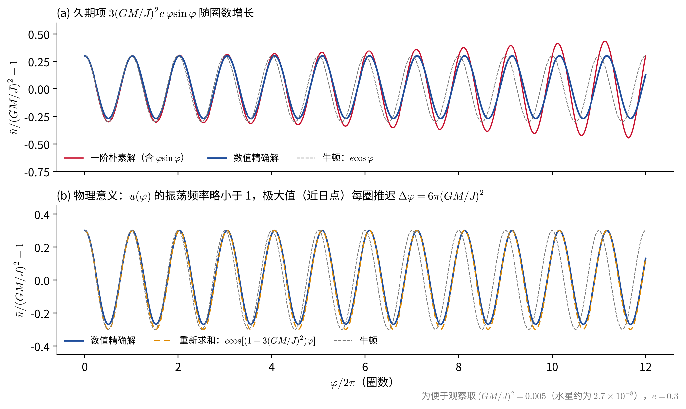
</div>

行星从近日点出发，经过

$$
\begin{equation}
\left[1-3\left(\frac{GM}{J}\right)^2\right]\varphi_n=2n\pi
\end{equation}
$$

后重新回到近日点（$u$ 重新达到极大值）。因此

$$
\begin{equation}
\varphi_n
=\frac{2n\pi}{1-3(GM/J)^2}
\simeq2n\pi\left[1+3\left(\frac{GM}{J}\right)^2\right].
\end{equation}
$$

每圈进动角为

$$
\begin{equation}
\Delta\varphi=\varphi_{n+1}-\varphi_n-2\pi
=6\pi\left(\frac{GM}{J}\right)^2.
\end{equation}
$$

结果为正，说明近日点沿行星公转方向前移。恢复光速并用 $J^2=a(1-e^2)GM$，就是常见的形式

$$
\begin{equation}
\Delta\varphi=\frac{6\pi GM}{c^2a(1-e^2)}.
\end{equation}
$$

把修正放大约 $4\times10^5$ 倍后，轨道的进动就可以直接看到：每绕一圈，近日点（红点）前移一个小角度，轨道逐渐描出一朵“玫瑰花”。

<div style="text-align:center">
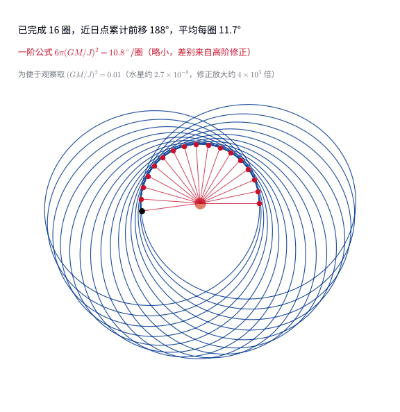
</div>

### 与一般摄动公式的核对

对于一个小的附加势 $\delta V(r)$，在零阶开普勒轨道上取平均，可以得到一般的一阶进动公式（单位质量）[1, §15 习题]：

$$
\begin{equation}
\Delta\varphi=\frac{\partial}{\partial J}\left(\frac{2}{J}\int_0^{\pi}r^2\,\delta V\,d\varphi\right).
\end{equation}
$$

对 $\delta V=\beta/r^3$（把 $\beta$ 视为常数），用 $r=p/(1+e\cos\varphi)$ 和 $p=J^2/GM$，积分得 $\int_0^\pi r^2\delta V\,d\varphi=\pi\beta GM/J^2$，于是 $\Delta\varphi=-6\pi\beta GM/J^4$。再代入 $\beta=-GMJ^2$ 就得到 $6\pi(GM/J)^2$，与上面的结果一致。读者可以对 $\delta V=\beta/r^2$ 或其他势验证类似的公式。

<details class="derivation">
<summary>推导：一般的一阶进动公式</summary>

单位质量下，由能量守恒 $\tfrac12\dot r^2+\dfrac{J^2}{2r^2}+V(r)=E$ 和 $\dot\varphi=J/r^2$，从近日点到远日点再回到近日点，转过的角度为

$$
\begin{equation*}
\Phi=2\int_{r_{\min}}^{r_{\max}}\frac{J\,dr}{r^2\sqrt{2(E-V)-J^2/r^2}}
=-2\frac{\partial}{\partial J}\int_{r_{\min}}^{r_{\max}}\sqrt{2(E-V)-\frac{J^2}{r^2}}\;dr ,
\end{equation*}
$$

其中对 $J$ 求偏导时保持 $E$ 不变。积分上下限也依赖 $J$，但被积函数在两端为零，所以不产生额外的项。

令 $V=V_0+\delta V$，$V_0=-GM/r$，把根号对 $\delta V$ 展开到一阶：

$$
\begin{equation*}
\sqrt{2(E-V_0)-\frac{J^2}{r^2}-2\delta V}\approx\sqrt{2(E-V_0)-\frac{J^2}{r^2}}-\frac{\delta V}{\sqrt{2(E-V_0)-J^2/r^2}} .
\end{equation*}
$$

第一项给出开普勒问题的 $\Phi_0=2\pi$。在第二项中，$\sqrt{2(E-V_0)-J^2/r^2}=|\dot r|$ 是零阶轨道上的径向速度，所以 $dr/|\dot r|=dt=r^2d\varphi/J$，积分可以改为沿零阶轨道对 $\varphi$ 从 $0$ 到 $\pi$ 积分：

$$
\begin{equation*}
\Delta\varphi=\Phi-2\pi=2\frac{\partial}{\partial J}\int_{r_{\min}}^{r_{\max}}\frac{\delta V\,dr}{|\dot r|}
=\frac{\partial}{\partial J}\left(\frac2J\int_0^\pi r^2\,\delta V\,d\varphi\right).
\end{equation*}
$$

这就是正文的公式。它的含义是：进动角由微扰势沿零阶轨道的（加权）平均决定，即“一阶修正由零阶解给出”。

对 $\delta V=\beta/r^3$：$r^2\delta V=\beta/r=\beta(1+e\cos\varphi)/p$，$\int_0^\pi(1+e\cos\varphi)\,d\varphi=\pi$，偏心率恰好消掉，所以结果对任意 $e$ 都成立，与前面“只有 $\cos\varphi$ 项起作用”的结论一致。

</details>

### 数值结果

对水星，按上面的输入数据 $a,e,GM_\odot$ 直接代入，得 $\Delta\varphi\simeq0.1034''$/圈；讲义给出

$$
\begin{equation}
\Delta\varphi\simeq0.103769''/\text{圈}
\simeq43.1''/\text{百年}.
\end{equation}
$$

两者相差约 $0.4\%$，来源于输入常数的取舍。水星每百年绕太阳约 $100/0.24\simeq416$ 圈，乘以每圈进动量，得 $\simeq43''$/百年。目前常引用的精确理论值为 $42.98''$/百年 [19, 20]。

<details class="derivation">
<summary>动手算：用几行 Python 计算各行星的相对论进动</summary>

```python
import math

GM_c2 = 1.4766e3                     # GM_sun / c^2，单位 m
planets = {                          # 半长轴 a [m]、偏心率 e、公转周期 T [年]
    "水星": (5.791e10, 0.2056, 0.2408),
    "金星": (1.0821e11, 0.00677, 0.6152),
    "地球": (1.4960e11, 0.01671, 1.0000),
}
for name, (a, e, T) in planets.items():
    dphi = 6 * math.pi * GM_c2 / (a * (1 - e**2))     # 每圈，弧度
    per_orbit = math.degrees(dphi) * 3600              # 每圈，角秒
    print(f"{name}: 每圈 {per_orbit:.4f}″，每百年 {100/T:.0f} 圈，"
          f"合 {per_orbit * 100 / T:.2f}″/百年")
```

输出为

```text
水星: 每圈 0.1035″，每百年 415 圈，合 42.99″/百年
金星: 每圈 0.0531″，每百年 163 圈，合 8.62″/百年
地球: 每圈 0.0384″，每百年 100 圈，合 3.84″/百年
```

金星一行可用来核对下表的说明：每圈约 $0.053''$、每百年约 $163$ 圈。读者可以改用其他天体的参数，例如小行星伊卡洛斯（Icarus）或双脉冲星 PSR J0737−3039（把 $GM_\odot$ 换成两颗中子星的总质量），体会进动量如何依赖于 $a$ 和 $e$。

</details>

<div style="text-align:center">
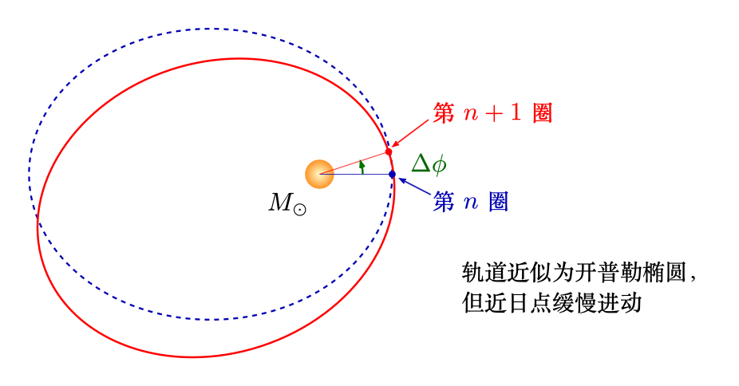
</div>

讲义引述：爱因斯坦在给埃伦菲斯特（Ehrenfest）的信中写道，方程给出了水星近日点的正确数值，使他非常高兴。广义相对论不仅能解释水星近日点进动，也能解释其他行星的进动（相关史料见 [21]）。

### 部分行星轨道百年进动理论值与观测值

| 行星 | 半长轴 $a/(10^6\,\mathrm{km})$ | 偏心率 $e$ | $6\pi GM/L$ | 圈/百年 | $\theta_{\mathrm{GR}}$/百年 | $\theta_{\mathrm{obs}}$/百年 |
|---|---:|---:|---:|---:|---:|---:|
| 水星 | 57.91 | 0.205615 | $0.1038''$ | 416 | $43.03''$ | $43.11''\pm0.45''$ |
| 金星 | 108.21 | 0.006820 | $0.058''$ | 149 | $8.6''$ | $8.4''\pm4.8''$ |
| 地球 | 149.60 | 0.016750 | $0.038''$ | 100 | $3.8''$ | $5.0''\pm1.2''$ |
| 火星 | - | 0.093312 | - | 53 | $1.35''$ | - |
| 木星 | - | 0.048332 | - | 8.4 | $0.06''$ | - |
| Icarus | 161.0 | 0.827 | $0.115''$ | 89 | $10.3''$ | $9.8''\pm0.8''$ |

资料来源：广义相对论讲义。表中的结构和数据与 Weinberg [17] 第 8 章中列出的对照表类似，建议读者对照原书核对。

表头中的 $L$ 指轨道的半通径（semi-latus rectum）$L=a(1-e^2)$，所以第四列就是上面推出的 $6\pi GM/(c^2a(1-e^2))$，$\theta_{\mathrm{GR}}$ 等于第四列与第五列的乘积。

表中有两点需要读者注意：

- 金星一行：用 $a$、$e$ 按公式计算得每圈约 $0.053''$，而金星的公转周期约 $0.615$ 年，每百年约 $162$ 圈，二者乘积为 $8.6''$/百年，与表中的 $\theta_{\mathrm{GR}}$ 吻合；但表中 $0.058''$ 与“$149$ 圈”两项与此不一致（二者的乘积碰巧也约等于 $8.6''$）。这两个数字可能是原资料的笔误，使用前建议核对原始来源。
- 其余行的数值按同样方法核对：水星约 $0.1035''\times415\simeq43''$，地球约 $0.038''\times100\simeq3.8''$，火星约 $1.35''$，木星约 $0.06''$，Icarus 约 $0.11''\times89\simeq10''$，均与表中数值基本一致。

### 延伸：从水星到强场

近日点进动的 $6\pi GM/(c^2p)$ 只是后牛顿展开的**最低阶**。对更强的场、更大的速度，需要计入更高阶的后牛顿修正以及中心天体自旋（克尔时空）的效应。例如在极端质量比旋近（extreme mass-ratio inspiral, EMRI）中，一个质量为 $m$ 的小天体绕质量为 $M\gg m$ 的黑洞运动，需要在黑洞背景上把 $m/M$ 当作小参数作微扰展开（引力自力理论），而 $m$ 自身的引力场对轨道的反作用引起的缓慢演化，正是在“水星式”的轨道进动之上再叠加的下一级微扰；小天体要绕行 $10^4$ 至 $10^5$ 圈，微小的进动误差会累积成可观的相位误差，这就是上面“微扰效应是累积的”这一特点在引力波波形建模中的体现。综述见 [22]。

<!-- 原 PDF 第 11 页 -->

## 作业

本章作业是对正文方法的直接应用。第 1 题可以先写出 $V'(x)=0$ 求平衡点，再将 $V$ 在平衡点附近展开到二阶，对照“稳定平衡附近的微小振动”一节的做法；第 2 题是两个耦合谐振子，建议先写出矩阵 $\mathbf m,\mathbf k$ 和久期方程，或者直接考察 $x\pm y$ 这样的线性组合，对照“多自由度系统的简谐振动”一节中的例子；第 3 题则要把“中心力场”一章的结果与简谐振动联系起来：该势在三个方向上是相互独立的谐振子，可利用角动量守恒把运动限制在二维平面，并考虑轨道是否闭合。

1. 考虑一维运动系统的有效势能

   $$
   \begin{equation}
   V(x)=-\frac{\alpha}{x}+\frac{\beta}{x^2},
   \qquad \alpha>0,\ \beta>0,
   \end{equation}
   $$

   且运动范围 $x>0$。

   1. 若系统在平衡点作微小振动，平衡点坐标 $x_E$ 为多少？
   2. 令 $\bar x=x-x_E$，求平衡点附近的有效势 $V_{\mathrm{eff}}(\bar x)$。

   <details class="derivation">
   <summary>提示</summary>

   由 $V'(x_E)=0$ 求出 $x_E$，再计算 $V''(x_E)$ 并确认它为正（稳定平衡）。展开式中的常数项 $V(x_E)$ 可以保留，它不影响运动方程。这个势与开普勒问题的有效势形式相同（$\alpha\leftrightarrow GMm$，$\beta\leftrightarrow L^2/2m$）。按柯克伍德空隙一节的结论，小振动频率应当等于圆轨道的角频率，可以用这一点检查结果。

   </details>

2. 考虑二自由度系统的拉格朗日量

   $$
   \begin{equation}
   L=\frac12(\dot x^2+\dot y^2)
   -\frac12\omega^2(x^2+y^2)+\alpha xy,
   \qquad \alpha>0.
   \end{equation}
   $$

   求系统的运动方程，并尝试求解。

   <details class="derivation">
   <summary>提示</summary>

   写成矩阵形式时 $\mathbf m=\mathbf 1$，$\mathbf k=\begin{pmatrix}\omega^2&-\alpha\\-\alpha&\omega^2\end{pmatrix}$（注意 $+\alpha xy$ 前的符号）。试试 $\xi=(x+y)/\sqrt2$、$\eta=(x-y)/\sqrt2$。再想一想：当 $\alpha$ 与 $\omega^2$ 的大小关系变化时，两个简正模是否都稳定？

   </details>

3. 求质点在有心力场

   $$
   \begin{equation}
   U=\frac12kr^2
   \end{equation}
   $$

   中的运动轨道。$\vec r$ 是三维空间矢量。（提示：利用球对称性将运动限制在二维平面。）

   <details class="derivation">
   <summary>提示</summary>

   在运动平面内用直角坐标，$x$、$y$ 方向是两个频率相同、彼此独立的谐振子。两个同频率简谐振动的合成是什么曲线？与开普勒问题对比：轨道是否封闭？力心位于椭圆的中心还是焦点？这与伯特朗定理（“中心力场”一章）有什么关系？

   </details>

## 参考文献与延伸阅读

以下按本章内容分类。方括号中的编号对应正文中的引用；章节号以所列版本为准，不同版本可能略有出入。

**小振动、强迫振动、阻尼振动与多自由度系统**

1. L. D. Landau, E. M. Lifshitz, *Mechanics*, 3rd ed. (Butterworth-Heinemann, 1976). 第五章“小振动”：§21 一维自由振动，§22 强迫振动，§23–24 多自由度系统与分子振动，§25–26 阻尼与有摩擦的强迫振动，§27 参数共振，§28 非谐振动；§15 开普勒问题（含摄动引起进动的习题）。
2. H. Goldstein, C. Poole, J. Safko, *Classical Mechanics*, 3rd ed. (Addison-Wesley, 2002). 第 6 章“Oscillations”（小振动、本征值方程、正则坐标、强迫振动与耗散）；第 3 章“The Central Force Problem”。
3. V. I. Arnold, *Mathematical Methods of Classical Mechanics*, 2nd ed. (Springer, 1989). 第 5 章“Oscillations”：§23 小振动，§25 参数共振（Floquet 理论与单值矩阵判据）。

**参数共振、Floquet 理论与 Mathieu 方程**

4. E. T. Whittaker, G. N. Watson, *A Course of Modern Analysis*, 4th ed. (Cambridge University Press, 1927). 第 19 章“Mathieu functions”。
5. NIST *Digital Library of Mathematical Functions*, 第 28 章 “Mathieu Functions and Hill's Equation”, <https://dlmf.nist.gov/28>.
6. G. Floquet, “Sur les équations différentielles linéaires à coefficients périodiques,” *Ann. Sci. École Norm. Sup.* **12**, 47 (1883).
7. É. Mathieu, “Mémoire sur le mouvement vibratoire d'une membrane de forme elliptique,” *J. Math. Pures Appl.* **13**, 137 (1868).
8. L. Kofman, A. Linde, A. A. Starobinsky, “Reheating after Inflation,” *Phys. Rev. Lett.* **73**, 3195 (1994), arXiv:hep-th/9405187.
9. L. Kofman, A. Linde, A. A. Starobinsky, “Towards the Theory of Reheating after Inflation,” *Phys. Rev. D* **56**, 3258 (1997), arXiv:hep-ph/9704452.
10. V. Mukhanov, *Physical Foundations of Cosmology* (Cambridge University Press, 2005).

**微扰方法（久期项、Poincaré–Lindstedt 方法）**

11. C. M. Bender, S. A. Orszag, *Advanced Mathematical Methods for Scientists and Engineers* (Springer, 1999). 关于摄动级数、久期项与多尺度分析的章节。
12. A. H. Nayfeh, *Perturbation Methods* (Wiley, 1973).

**天体摄动**

13. C. D. Murray, S. F. Dermott, *Solar System Dynamics* (Cambridge University Press, 1999). 关于摄动函数与长期摄动理论的章节。
14. E. Poisson, C. M. Will, *Gravity: Newtonian, Post-Newtonian, Relativistic* (Cambridge University Press, 2014). 关于牛顿轨道动力学与受摄二体问题的章节。
15. U. J. Le Verrier, “Lettre de M. Le Verrier à M. Faye sur la théorie de Mercure et sur le mouvement du périhélie de cette planète,” *C. R. Acad. Sci. Paris* **49**, 379 (1859).

**水星近日点进动与广义相对论**

16. A. Einstein, “Erklärung der Perihelbewegung des Merkur aus der allgemeinen Relativitätstheorie,” *Sitzungsber. Preuss. Akad. Wiss.* 831 (1915).
17. S. Weinberg, *Gravitation and Cosmology* (Wiley, 1972). 第 8 章。
18. S. M. Carroll, *Spacetime and Geometry: An Introduction to General Relativity* (Addison-Wesley, 2004). §5.4（史瓦西测地线与近日点进动）。
19. G. M. Clemence, “The Relativity Effect in Planetary Motions,” *Rev. Mod. Phys.* **19**, 361 (1947).
20. C. M. Will, “The Confrontation between General Relativity and Experiment,” *Living Rev. Relativity* **17**, 4 (2014), arXiv:1403.7377.
21. A. Pais, *“Subtle is the Lord…”: The Science and the Life of Albert Einstein* (Oxford University Press, 1982). 关于广义相对论的建立与水星进动的章节。

**强场与黑洞微扰**

22. L. Barack, A. Pound, “Self-force and radiation reaction in general relativity,” *Rep. Prog. Phys.* **82**, 016904 (2019), arXiv:1805.10385.
23. K. D. Kokkotas, B. G. Schmidt, “Quasi-Normal Modes of Stars and Black Holes,” *Living Rev. Relativity* **2**, 2 (1999), arXiv:gr-qc/9909058.

**天体物理应用（柯克伍德空隙、黑洞铃宕、哈勃摩擦、木卫一）**

24. J. Wisdom, “The origin of the Kirkwood gaps: A mapping for asteroidal motion near the 3/1 commensurability,” *Astron. J.* **87**, 577 (1982).
25. N. Moskovitz *et al.*, “The astorb database at Lowell Observatory,” *Astronomy and Computing* **41**, 100661 (2022). 小行星轨道数据来源；数据库由 NASA 与 Lowell Observatory 资助。
26. B. P. Abbott *et al.* (LIGO Scientific and Virgo Collaborations), “Observation of Gravitational Waves from a Binary Black Hole Merger,” *Phys. Rev. Lett.* **116**, 061102 (2016), arXiv:1602.03837.
27. B. P. Abbott *et al.* (LIGO Scientific and Virgo Collaborations), “Tests of General Relativity with GW150914,” *Phys. Rev. Lett.* **116**, 221101 (2016), arXiv:1602.03841.
28. E. Berti, V. Cardoso, C. M. Will, “Gravitational-wave spectroscopy of massive black holes with the space interferometer LISA,” *Phys. Rev. D* **73**, 064030 (2006), arXiv:gr-qc/0512160. 文中转动黑洞准正规模频率与 $Q$ 的拟合公式取自此文。
29. E. Berti, V. Cardoso, A. O. Starinets, “Quasinormal modes of black holes and black branes,” *Class. Quantum Grav.* **26**, 163001 (2009), arXiv:0905.2975.
30. J. Preskill, M. B. Wise, F. Wilczek, “Cosmology of the invisible axion,” *Phys. Lett. B* **120**, 127 (1983).
31. L. F. Abbott, P. Sikivie, “A cosmological bound on the invisible axion,” *Phys. Lett. B* **120**, 133 (1983).
32. M. Dine, W. Fischler, “The not-so-harmless axion,” *Phys. Lett. B* **120**, 137 (1983).
33. D. J. E. Marsh, “Axion cosmology,” *Phys. Rep.* **643**, 1 (2016), arXiv:1510.07633.
34. D. Baumann, *Cosmology* (Cambridge University Press, 2022). 关于暴胀、慢滚与再加热的章节。
35. S. J. Peale, P. Cassen, R. T. Reynolds, “Melting of Io by tidal dissipation,” *Science* **203**, 892 (1979).
36. V. Lainey, J.-E. Arlot, Ö. Karatekin, T. Van Hoolst, “Strong tidal dissipation in Io and Jupiter from astrometric observations,” *Nature* **459**, 957 (2009).
