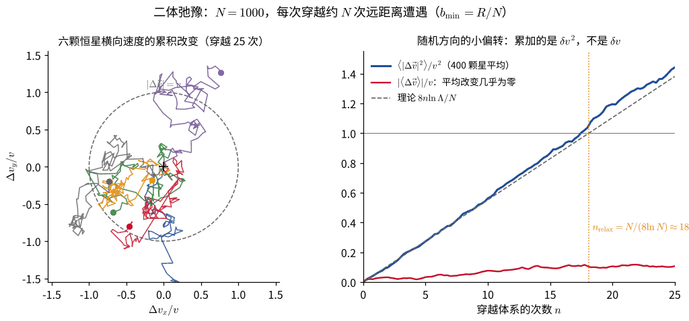
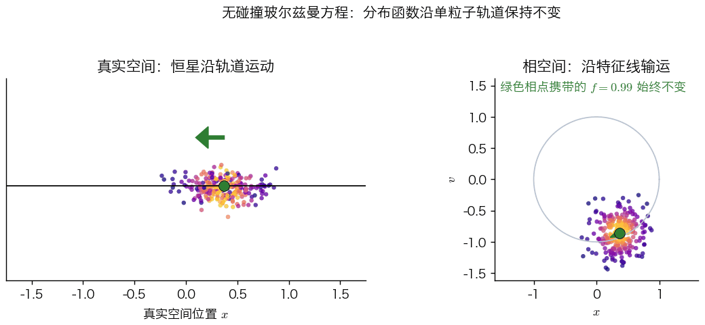
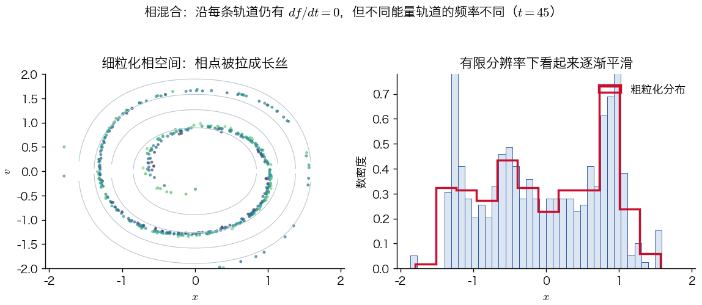
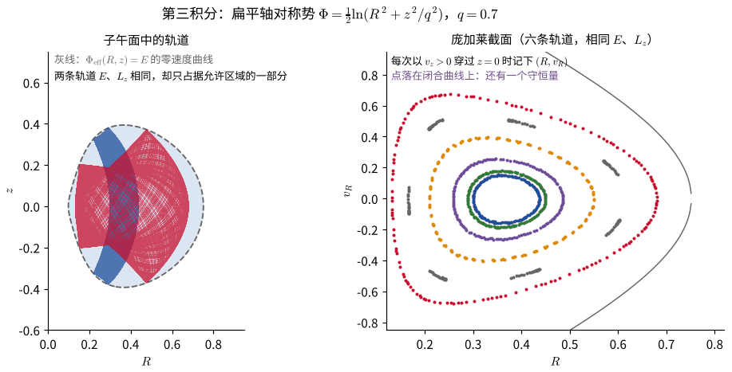
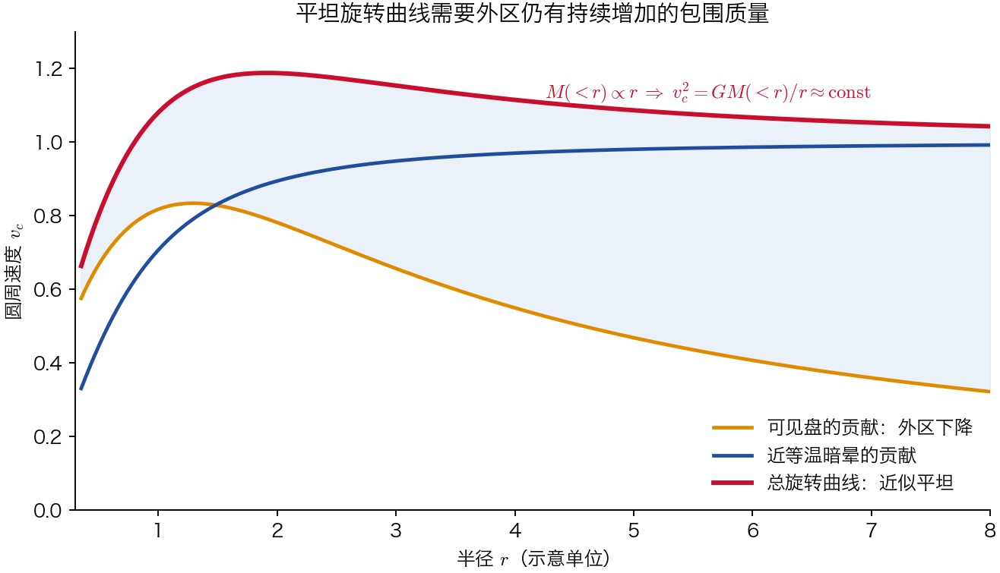
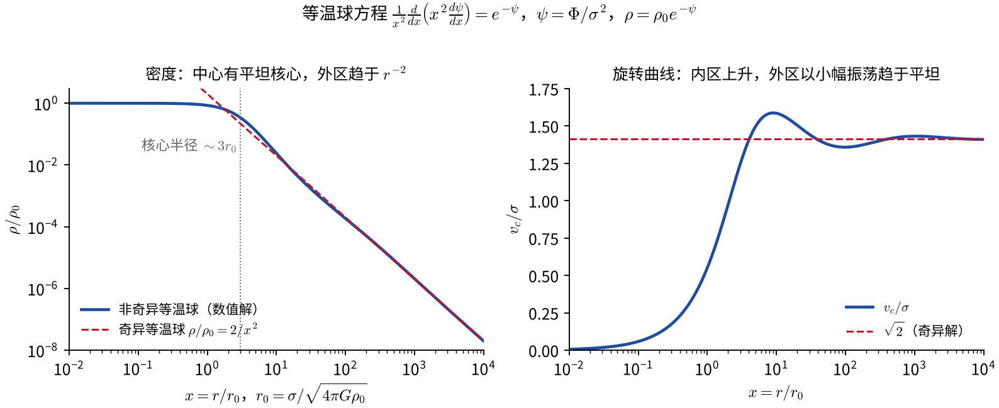
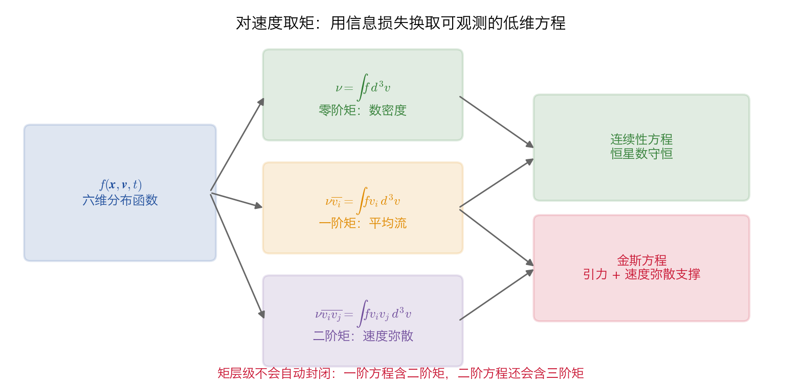
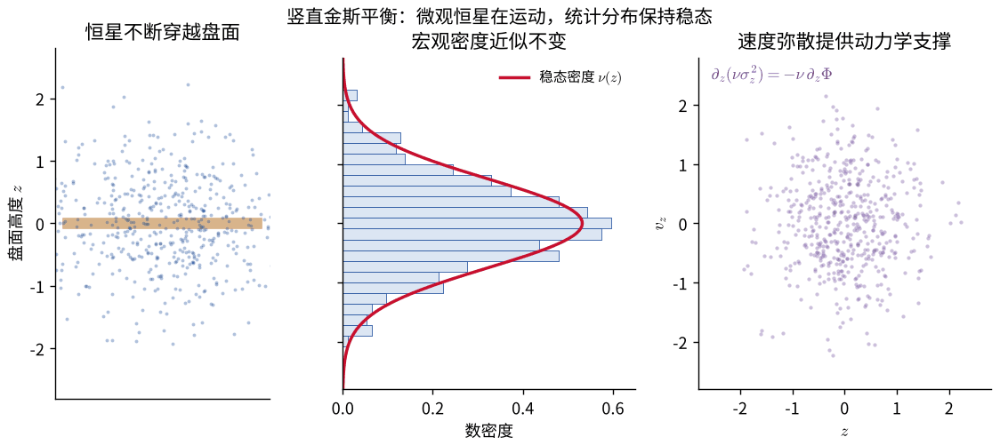
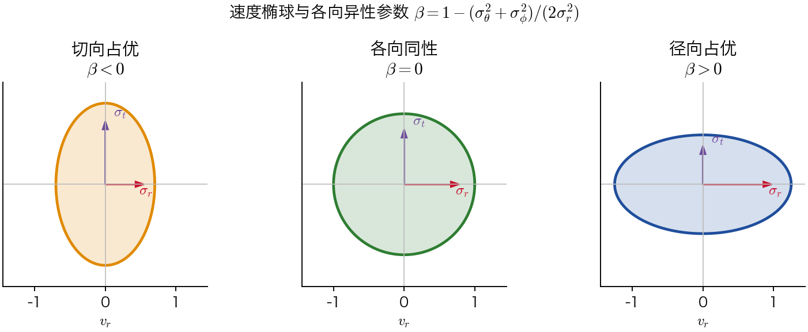
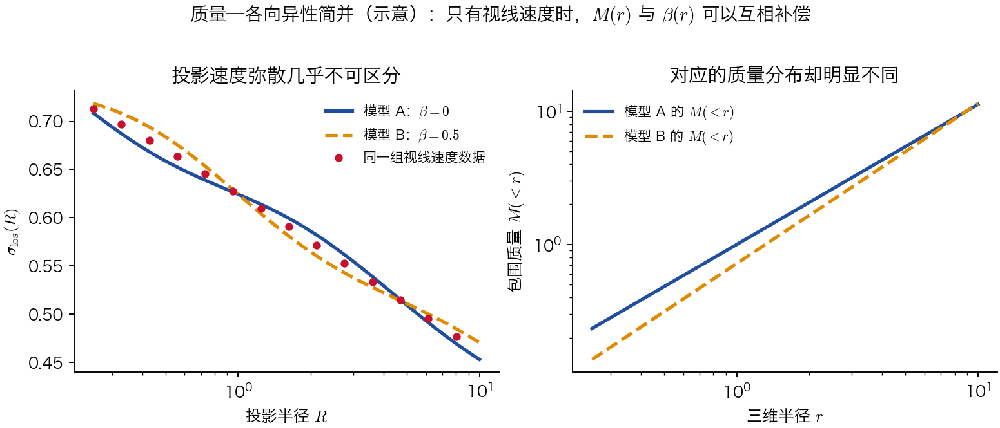

# 无碰撞粒子体系

> 阅读提示：文中蓝色边框的“推导”“例”“提示”等块默认折叠，点击标题展开；打印或导出 PDF 时会自动展开。动画（GIF）在 PDF 中显示第一帧，即总览画面。

<!-- 原 PDF 第 1 页 -->

## 玻尔兹曼方程（Boltzmann Equation）

### 无碰撞情形（Collisionless）

“无碰撞”并不是说恒星之间没有引力作用，而是说单次近距离二体遭遇对长期演化的累积影响，可以在所研究的时间尺度内忽略。每颗恒星仍受到整个体系产生的平滑平均引力场作用。若系统的动力学时间为 $t_{\mathrm{dyn}}$、二体弛豫时间为 $t_{\mathrm{rel}}$，无碰撞近似要求研究时间远短于 $t_{\mathrm{rel}}$；对含有 $N$ 个质量相近粒子的系统，数量级上有

$$
\begin{equation}
t_{\mathrm{rel}}\sim
\frac{0.1N}{\ln\Lambda}\,t_{\mathrm{dyn}},
\end{equation}
$$

其中 $\ln\Lambda$ 是库仑对数。星系和暗物质晕通常满足 $t_{\mathrm{rel}}$ 远大于宇宙年龄，因而可视为无碰撞体系；致密星团的弛豫时间可能较短，此时必须进一步考虑二体弛豫、蒸发等碰撞效应。

估算：为什么星系可以视为无碰撞体系

这个弛豫时间可以用一个简单的估算得到 [1, 5]。设体系半径为 $R$、恒星典型速度为 $v$，一颗恒星以碰撞参数 $b$ 掠过另一颗质量为 $m$ 的恒星时，获得的横向速度改变约为（类比“中心力场”一章散射问题中的小角度偏转，即冲量近似）

$$
\begin{equation*}
\delta v\simeq\frac{2Gm}{bv}.
\end{equation*}
$$

各次遭遇的横向速度改变方向随机，因此是 $\delta v^2$ 而不是 $\delta v$ 在累加。穿越体系一次，碰撞参数介于 $b$ 与 $b+db$ 之间的遭遇次数约为 $N\cdot2\pi b\,db/(\pi R^2)$，故

$$
\begin{equation*}
\Delta v^2\simeq\int_{b_{\min}}^{R}\left(\frac{2Gm}{bv}\right)^2\frac{2Nb\,db}{R^2}
=8N\left(\frac{Gm}{Rv}\right)^2\ln\Lambda,
\qquad
\Lambda=\frac{R}{b_{\min}}.
\end{equation*}
$$

对位力平衡的体系有 $v^2\simeq GNm/R$，于是每穿越一次，

$$
\begin{equation*}
\frac{\Delta v^2}{v^2}\simeq\frac{8\ln\Lambda}{N}.
\end{equation*}
$$

要使累积的速度改变与 $v$ 本身相当，需要穿越约 $N/(8\ln\Lambda)$ 次，这就得到上面的 $t_{\rm rel}$ 公式。积分下限 $b_{\min}$ 取为使偏转角达到 $90^\circ$ 的碰撞参数 $b_{90}\simeq2Gm/v^2$（更近的遭遇已不能用小角度近似），于是 $\Lambda=R/b_{90}=Rv^2/(2Gm)\simeq N/2$（用了 $v^2\simeq GNm/R$），所以通常取 $\ln\Lambda\approx\ln N$。代入典型数值：

- 星系：$N\sim10^{11}$，$t_{\rm dyn}\sim10^8$ 年，得 $t_{\rm rel}\sim10^{16}$–$10^{17}$ 年，远大于宇宙年龄（约 $1.4\times10^{10}$ 年），因此是无碰撞体系；
- 球状星团：$N\sim10^5$，$t_{\rm dyn}\sim10^6$ 年，得 $t_{\rm rel}\sim10^9$ 年，短于星团年龄，二体弛豫必须考虑。

这个估算的物理要点是：恒星越多，单个恒星的引力越“微不足道”，平均场越平滑，体系反而越接近无碰撞。

下面的动画按上面的估算直接做数值实验：$N=1000$，每次穿越体系，一颗恒星经历约 $N$ 次碰撞参数随机分布的遭遇，每次得到一个方向随机的小速度改变。单颗恒星的速度改变像随机游走（左）；对 400 颗恒星平均，$\langle|\Delta\vec v|^2\rangle$ 随穿越次数线性增长，斜率与 $8\ln\Lambda/N$ 相符，而平均改变 $\langle\Delta\vec v\rangle$ 始终接近零（右）。

这一近似把由约 $6N$ 个粒子坐标描述的多体问题，转化为六维单粒子相空间中的统计问题。我们不再追踪每一颗恒星，而是研究相空间中恒星数如何连续地输运。

设想有大量恒星在一种平滑势 $\Phi(\vec x,t)$ 的作用下运动。天文学家关心这些恒星的分布函数

$$
\begin{equation}
f(\vec x,\vec v,t),
\end{equation}
$$

即系统的分布函数或相空间密度。量

$$
\begin{equation}
f(\vec x,\vec v,t)\,d^3\vec x\,d^3\vec v
\end{equation}
$$

表示位置处于以 $\vec x$ 为中心的小体积 $d^3\vec x$ 内、同时速度处于以 $\vec v$ 为中心的小范围 $d^3\vec v$ 内的恒星数。

若 $f$ 按恒星数归一化，则总恒星数和空间数密度分别为

$$
\begin{equation}
N=\int f\,d^3\vec x\,d^3\vec v,
\qquad
\nu(\vec x,t)=\int f\,d^3\vec v.
\end{equation}
$$

若所有粒子的质量均为 $m$，质量密度为 $\rho=m\nu$。对自引力体系，势函数并不是任意给定的，而应与分布函数共同满足泊松方程

$$
\begin{equation}
\nabla^2\Phi=4\pi G\rho,
\qquad
\rho(\vec x,t)=m\int f(\vec x,\vec v,t)\,d^3\vec v.
\end{equation}
$$

无碰撞玻尔兹曼方程与泊松方程联立后，才构成封闭的 Vlasov–Poisson 系统；若 $\Phi$ 是已知的外势，则只需求解前者。

如果已知每颗恒星的初始坐标和初始速度，则由牛顿定律可以计算它们以后任意时刻的位置和速度。因此，只要给定 $f(\vec x,\vec v,t_0)$，原则上就可以计算任意时刻的 $f(\vec x,\vec v,t)$；所需的只是 $f(\vec x,\vec v,t_0)$ 中的信息。

推导：从六维连续性方程得到无碰撞玻尔兹曼方程

为此，考虑恒星沿各自轨道运动所产生的相空间点流。相空间坐标为

$$
\begin{equation*}
(\vec x,\vec v)\equiv\vec w=(w_1,w_2,\ldots,w_6),
\end{equation*}
$$

是一个六维向量；相空间流速为

$$
\begin{equation*}
\dot{\vec w}=(\dot{\vec x},\dot{\vec v})
=(\vec v,-\nabla\Phi(\vec x,t)).
\end{equation*}
$$

恒星密度 $f(\vec w,t)$ 满足连续性方程，类似于通常流体中密度 $\rho(\vec x,t)$ 所满足的连续性方程：

$$
\begin{equation*}
\frac{\partial f}{\partial t}
+\sum_{\alpha=1}^{6}
\frac{\partial(f\dot w_\alpha)}{\partial w_\alpha}=0
.
\end{equation*}
$$

对相空间内某个体积积分，可以看到其物理意义：第一项描述这一体积内恒星数增加的速率；第二项由散度定理可知，描述恒星流穿出该体积的速率。

由于 $x_i$ 与 $v_i$ 相互独立，并且

$$
\begin{equation*}
\sum_{\alpha=1}^{6}\frac{\partial\dot w_\alpha}{\partial w_\alpha}
=\sum_{i=1}^{3}\left(
\frac{\partial v_i}{\partial x_i}
+\frac{\partial\dot v_i}{\partial v_i}
\right)
=-\sum_{i=1}^{3}\frac{\partial}{\partial v_i}
\left(\frac{\partial\Phi}{\partial x_i}\right)=0,
\end{equation*}
$$

连续性方程化为

$$
\begin{equation*}
\frac{\partial f}{\partial t}
+\sum_{\alpha=1}^{6}\dot w_\alpha
\frac{\partial f}{\partial w_\alpha}=0
,
\end{equation*}
$$

或者写成向量形式

$$
\begin{equation*}
\frac{\partial f}{\partial t}
+\vec v\cdot\nabla_{\vec x}f
-\nabla_{\vec x}\Phi\cdot
\frac{\partial f}{\partial\vec v}=0
.
\end{equation*}
$$

因此无碰撞分布函数满足

$$
\begin{equation}
\frac{\partial f}{\partial t}
+\vec v\cdot\nabla_{\vec x}f
-\nabla_{\vec x}\Phi\cdot
\frac{\partial f}{\partial\vec v}=0.
\end{equation}
$$

这就是**无碰撞玻尔兹曼方程**，也称 **Vlasov 方程**。

在恒星动力学中，金斯在 1915 年已把这类方程用于恒星运动 [4]；在等离子体物理中，弗拉索夫在 1938 年独立地将其用于带电粒子的集体运动 [6]，因此两种名称都很常见（关于命名的讨论见 [7]）。两种情形的共同点是：长程力（引力或库仑力）由大量粒子共同产生，单个粒子主要感受到平滑的平均场。

方程中的三项有直接的运动学解释：$\partial f/\partial t$ 是固定相空间位置处的显含时间变化；$\vec v\cdot\nabla_{\vec x}f$ 表示恒星在真实空间中的平流；最后一项表示引力加速度使恒星在速度空间中移动。与普通气体的玻尔兹曼方程相比，这里右端没有碰撞积分，因而分布的变化完全来自相空间输运。

<!-- 原 PDF 第 2 页 -->

沿相空间轨道的全导数为

$$
\begin{equation}
\frac{df}{dt}
=\frac{\partial f}{\partial t}
+\sum_{\alpha=1}^{6}\dot w_\alpha
\frac{\partial f}{\partial w_\alpha},
\end{equation}
$$

所以无碰撞玻尔兹曼方程等价于

$$
\begin{equation}
\frac{df}{dt}=0.
\end{equation}
$$

动画中的绿色相点代表一小团随轨道一起运动的相空间流体元。它的位置和速度不断改变，但携带的细粒化分布函数值保持不变；这就是 $df/dt=0$ 的拉格朗日式理解。

对一般哈密顿系统，取

$$
\begin{equation}
\vec w=(\vec q,\vec p),
\end{equation}
$$

则

$$
\begin{equation}
\frac{\partial}{\partial\vec q}\cdot(f\dot{\vec q})
+\frac{\partial}{\partial\vec p}\cdot(f\dot{\vec p})
=\frac{\partial f}{\partial\vec q}\cdot\frac{\partial H}{\partial\vec p}
-\frac{\partial f}{\partial\vec p}\cdot\frac{\partial H}{\partial\vec q}
=[f,H].
\end{equation}
$$

因此

$$
\begin{equation}
\frac{df}{dt}=\frac{\partial f}{\partial t}+[f,H]
,
\qquad
H=\frac12v^2+\Phi(\vec x,t).
\end{equation}
$$

如果观测者以速度 $\dot{\vec w}$ 随某颗恒星一起在相空间中运动，那么 $df/dt=0$ 表明他所看到的相点密度不变：在一颗给定恒星的相点周围，相空间密度始终不变。这是相空间流不可压缩的直接后果：前面的推导正是用了相空间速度场的散度为零，才把连续性方程化为 $df/dt=0$。

这一结论与上一章的刘维尔定理密切相关，但二者并不完全相同。刘维尔定理对 $N$ 个恒星组成的整个体系在 $6N$ 维相空间中严格成立；而无碰撞玻尔兹曼方程描述的是单个恒星的 $6$ 维相空间。从前者过渡到后者，需要假设每颗恒星只感受到平滑的平均势 $\Phi$，忽略恒星之间的关联，也就是忽略二体遭遇。正因为如此，无碰撞玻尔兹曼方程是一个近似方程，其适用范围正是前面由 $t_{\rm rel}$ 给出的时间尺度。

进阶：从 N 体刘维尔方程到 Vlasov 方程

设 $N$ 颗质量为 $m$ 的恒星，$N$ 体分布函数 $f^{(N)}(\vec w_1,\ldots,\vec w_N,t)$ 满足 $6N$ 维相空间中的刘维尔方程，哈密顿量（单位质量）为

$$
\begin{equation*}
H_N=\sum_a\frac12v_a^2+\sum_{a<b}\varphi(\vec x_a-\vec x_b),
\qquad
\varphi(\vec x)=-\frac{Gm}{|\vec x|}.
\end{equation*}
$$

定义单粒子分布 $f^{(1)}(\vec w_1)=N\int f^{(N)}\,d\vec w_2\cdots d\vec w_N$ 和两粒子分布 $f^{(2)}(\vec w_1,\vec w_2)=N(N-1)\int f^{(N)}\,d\vec w_3\cdots d\vec w_N$。对刘维尔方程积掉 $\vec w_2,\ldots,\vec w_N$，含其他粒子位置、速度导数的项都化为边界项而消失，剩下

$$
\begin{equation*}
\frac{\partial f^{(1)}}{\partial t}+\vec v_1\cdot\frac{\partial f^{(1)}}{\partial\vec x_1}
-\int\frac{\partial\varphi(\vec x_1-\vec x_2)}{\partial\vec x_1}\cdot\frac{\partial f^{(2)}(\vec w_1,\vec w_2)}{\partial\vec v_1}\,d\vec w_2=0 .
\end{equation*}
$$

这是 BBGKY 层级的第一个方程：单粒子分布的演化依赖两粒子分布。把两粒子分布写成无关联部分与关联部分之和，$f^{(2)}=f^{(1)}(\vec w_1)f^{(1)}(\vec w_2)+g(\vec w_1,\vec w_2)$。无关联部分给出平均场 $\Phi(\vec x)=\int\varphi(\vec x-\vec x')f^{(1)}(\vec w')\,d\vec w'$，方程变为

$$
\begin{equation*}
\frac{\partial f^{(1)}}{\partial t}+\vec v\cdot\nabla_{\vec x}f^{(1)}-\nabla_{\vec x}\Phi\cdot\frac{\partial f^{(1)}}{\partial\vec v}
=\int\frac{\partial\varphi}{\partial\vec x_1}\cdot\frac{\partial g}{\partial\vec v_1}\,d\vec w_2 .
\end{equation*}
$$

右端由两粒子关联 $g$ 产生，正是碰撞项；在引力系统中它主要来自近距离遭遇，其累积效应的时间尺度就是 $t_{\rm rel}$。略去右端，得到无碰撞玻尔兹曼方程。

这里守恒的是**细粒化分布函数**：沿每条精确轨道，$f$ 的取值保持不变。但不同轨道通常具有不同频率，原先紧邻的一团相点会被不断拉伸和卷绕，形成越来越细的丝状结构。这一过程称为相混合（phase mixing）。有限分辨率观测得到的是经过局部平均的粗粒化分布，它可以逐渐趋于平滑，看起来像发生了“弛豫”，却不违背 $df/dt=0$。若体系的势本身在剧烈地随时间变化（例如星系形成或并合的早期），恒星的能量也会迅速改变，粗粒化分布可以在几个动力学时间内趋于准平衡，这称为剧烈弛豫（violent relaxation）[8]。

相混合不是粒子之间的碰撞：它来自轨道频率随能量而异。若所有轨道都具有同一频率，例如理想简谐振子，相点云只会整体旋转而不会不断卷绕。

相混合的快慢可以直接估计。能量相差 $\Delta E$ 的两条轨道，频率相差 $\Delta\omega\simeq(d\omega/dE)\,\Delta E$，相位差随时间线性增长：

$$
\begin{equation}
\Delta\theta(t)\simeq\frac{d\omega}{dE}\,\Delta E\,t .
\end{equation}
$$

一团能量范围为 $\Delta E$ 的相点在时间 $t$ 内大约卷绕 $\Delta\omega\,t/2\pi$ 圈，丝状结构的宽度按 $1/t$ 变细。经过 $t_{\rm mix}\sim2\pi/\Delta\omega$ 的若干倍（通常是若干到几十个动力学时间，远短于 $t_{\rm rel}$）之后，粗粒化分布在每条轨道上已经均匀，只依赖于标记轨道的运动积分（这里是 $E$）。这正是下面金斯定理所说的稳态分布的形式。

上述讨论采用笛卡尔坐标，并把 $f$ 定义为单位相空间体积中的恒星数。若采用另一组相空间坐标 $\vec w'$，并把单位 $d^6\vec w'$ 中的恒星数记为 $\tilde f(\vec w')$，则同一体积元中的恒星数应满足

$$
\begin{equation}
\tilde f(\vec w')\,d^6\vec w'=f(\vec x,\vec v)\,d^6\vec w.
\end{equation}
$$

一般而言 $d^6\vec w'\neq d^6\vec w$，所以 $\tilde f$ 与 $f$ 在对应点上的取值不同；但若变换是正则变换，则由刘维尔定理

$$
\begin{equation}
d^6\vec w'=d^6\vec w,
\end{equation}
$$

从而

$$
\begin{equation}
\tilde f(\vec w')=f\bigl(\vec x(\vec w'),\vec v(\vec w')\bigr).
\end{equation}
$$

因此，在任意正则坐标系中，分布函数与相空间密度等同。

这一区分在曲线坐标中尤其重要。例如在柱坐标中，单位质量粒子的正则动量满足 $p_R=v_R$、$p_z=v_z$，但 $p_\phi=R v_\phi$。因此 $(R,\phi,z,p_R,p_\phi,p_z)$ 是正则变量，而 $(R,\phi,z,v_R,v_\phi,v_z)$ 并不是一组正则变量；把方程改写成物理速度分量时，会出现离心项和坐标曲率项，不能只把笛卡尔坐标符号机械地替换掉。

### 一些坐标系中的方程

推导：从正则动量得到柱坐标中的几何项

在柱坐标 $(R,\phi,z)$ 中，单位质量哈密顿量为

$$
\begin{equation*}
H=\frac12\left(p_R^2+\frac{p_\phi^2}{R^2}+p_z^2\right)+\Phi,
\end{equation*}
$$

$df/dt=0$ 说的是 $f$ 沿轨道取值不变，这一陈述与坐标选取无关。把 $f$ 看成 $(R,\phi,z,v_R,v_\phi,v_z,t)$ 的函数，

$$
\begin{equation*}
\frac{df}{dt}=\frac{\partial f}{\partial t}+\dot R\frac{\partial f}{\partial R}+\dot\phi\frac{\partial f}{\partial\phi}+\dot z\frac{\partial f}{\partial z}
+\dot v_R\frac{\partial f}{\partial v_R}+\dot v_\phi\frac{\partial f}{\partial v_\phi}+\dot v_z\frac{\partial f}{\partial v_z},
\end{equation*}
$$

只需由哈密顿方程写出六个变化率：$\dot R=v_R$，$\dot\phi=v_\phi/R$，$\dot z=v_z$，以及下面推出的 $\dot v_R,\dot v_\phi,\dot v_z$。写成速度分量 $(v_R,v_\phi,v_z)$ 后，无碰撞方程为

$$
\begin{align*}
&\frac{\partial f}{\partial t}
+v_R\frac{\partial f}{\partial R}
+\frac{v_\phi}{R}\frac{\partial f}{\partial\phi}
+v_z\frac{\partial f}{\partial z}\\
&\quad+\left(\frac{v_\phi^2}{R}-\frac{\partial\Phi}{\partial R}\right)
\frac{\partial f}{\partial v_R}
-\frac1R\left(v_Rv_\phi+\frac{\partial\Phi}{\partial\phi}\right)
\frac{\partial f}{\partial v_\phi}
-\frac{\partial\Phi}{\partial z}
\frac{\partial f}{\partial v_z}=0
.
\end{align*}
$$

柱坐标方程中多出来的几何项可以直接从守恒量理解。在轴对称势中，$p_\phi=Rv_\phi$ 守恒，因此

$$
\begin{equation*}
\frac{dv_\phi}{dt}=\frac{d}{dt}\left(\frac{p_\phi}{R}\right)
=-\frac{p_\phi}{R^2}\dot R=-\frac{v_Rv_\phi}{R},
\end{equation*}
$$

这就是 $\partial f/\partial v_\phi$ 前的 $-v_Rv_\phi/R$ 项：恒星向外运动时，为保持角动量不变，其方位角速度必须减小。同理，由 $\dot p_R=-\partial H/\partial R=p_\phi^2/R^3-\partial\Phi/\partial R$ 可得 $\dot v_R=v_\phi^2/R-\partial\Phi/\partial R$，其中 $v_\phi^2/R$ 正是离心项。

公式表：球坐标中的完整无碰撞玻尔兹曼方程

在球坐标 $(r,\theta,\phi)$ 中，

$$
\begin{equation*}
H=\frac12\left(
p_r^2+\frac{p_\theta^2}{r^2}
+\frac{p_\phi^2}{r^2\sin^2\theta}
\right)+\Phi.
\end{equation*}
$$

由相应的哈密顿方程可以写出各速度分量的变化率，从而得到球坐标下的无碰撞玻尔兹曼方程 [1]：

$$
\begin{equation*}
\begin{aligned}
&\frac{\partial f}{\partial t}
+v_r\frac{\partial f}{\partial r}
+\frac{v_\theta}{r}\frac{\partial f}{\partial\theta}
+\frac{v_\phi}{r\sin\theta}\frac{\partial f}{\partial\phi}\\
&\quad+\left(\frac{v_\theta^2+v_\phi^2}{r}-\frac{\partial\Phi}{\partial r}\right)\frac{\partial f}{\partial v_r}
+\frac1r\left(v_\phi^2\cot\theta-v_rv_\theta-\frac{\partial\Phi}{\partial\theta}\right)\frac{\partial f}{\partial v_\theta}\\
&\quad-\frac1r\left(v_rv_\phi+v_\theta v_\phi\cot\theta+\frac{1}{\sin\theta}\frac{\partial\Phi}{\partial\phi}\right)\frac{\partial f}{\partial v_\phi}=0.
\end{aligned}
\end{equation*}
$$

其中 $(v_\theta^2+v_\phi^2)/r$ 是离心项，含 $\cot\theta$ 的项来自球坐标基矢随 $\theta$ 的转动。实际计算时，从正则变量推导再换成物理速度分量，通常比直接猜测几何项更可靠。

### 稳态分布与金斯定理

若势函数不显含时间，而且体系已经达到稳态，则 $\partial f/\partial t=0$。设 $I_a(\vec x,\vec v)$ 是单粒子轨道的运动积分，即 $dI_a/dt=0$，那么任意函数

$$
\begin{equation}
f=F(I_1,I_2,\ldots)
\end{equation}
$$

都自动满足稳态无碰撞玻尔兹曼方程，因为

$$
\begin{equation}
\frac{df}{dt}
=\sum_a\frac{\partial F}{\partial I_a}\frac{dI_a}{dt}=0.
\end{equation}
$$

这就是金斯定理最常用的方向。它把“求一个六维偏微分方程的解”转化为“寻找轨道运动积分并构造它们的函数”。例如在球对称势中，常取 $f=f(E,L)$；若速度分布各向同性，则进一步简化为 $f=f(E)$。在轴对称势中，能量 $E$ 和轴向角动量 $L_z$ 是常用积分，但一般还可能需要第三积分。

需要注意，写出某个 $F(I_a)$ 只保证它形式上满足稳态方程；物理上还必须要求 $f\ge0$、可归一化，并且在自引力问题中与它所产生的密度和势自洽。

反过来，若 $f$ 是稳态解，则 $df/dt=0$ 意味着 $f$ 沿每条轨道取常数，也就是说 $f$ 本身就是一个运动积分。所以稳态分布函数**必定**是运动积分的函数，这是金斯定理的另一个方向。若势中几乎所有轨道都是规则轨道，还可以进一步证明 $f$ 只需依赖于至多三个“孤立”运动积分（强金斯定理，见 [1] 第 4 章）。

这个看似形式的结论有可观测的后果。在轴对称星系中，若分布函数只依赖 $E$ 和 $L_z$，则子午面内两个方向的速度弥散必须相等，$\sigma_R=\sigma_z$（证明见下面的折叠块）。但太阳附近老年盘星的 $\sigma_R$ 约为 $\sigma_z$ 的 1.5–2 倍。所以多数恒星轨道还必须遵守第三个运动积分。它一般没有解析表达式，却可以在数值轨道中直接“看到”：

左图中两条轨道的 $E$、$L_z$ 完全相同，零速度曲线围出的允许区域也相同，但每条轨道只占据其中一部分；右图的庞加莱截面上，每条轨道的穿越点都落在一条闭合曲线上，而不是散布在整个允许区域。这说明存在第三个守恒量。第三积分在什么条件下存在、何时被混沌破坏，见“KAM 定理”一章 5.1 节的 Hénon–Heiles 系统。

证明：f(E, L_z) 意味着 σ_R = σ_z

在轴对称势中，

$$
\begin{equation*}
E=\frac12\left(v_R^2+v_\phi^2+v_z^2\right)+\Phi(R,z),
\qquad
L_z=Rv_\phi .
\end{equation*}
$$

在给定位置，$f(E,L_z)$ 对 $v_R$ 和 $v_z$ 的依赖只通过 $v_R^2+v_z^2$。因此 $(v_R,v_z)$ 平面内的速度分布是各向同性的：

$$
\begin{equation*}
\overline{v_R}=\overline{v_z}=0,
\qquad
\overline{v_Rv_z}=0,
\qquad
\overline{v_R^2}=\overline{v_z^2},
\quad\text{即}\quad\sigma_R=\sigma_z .
\end{equation*}
$$

$v_\phi$ 方向则可以不同，因为 $L_z$ 区分了顺转和逆转。观测到 $\sigma_R\neq\sigma_z$，就说明 $f$ 还依赖其他运动积分。

### 例：等温球与平坦旋转曲线

推导：从等温分布函数得到平坦旋转曲线

金斯定理最简单的应用是取分布函数只依赖能量 $E=\frac12v^2+\Phi$，并取指数形式

$$
\begin{equation*}
f(E)=\frac{\nu_0}{(2\pi\sigma^2)^{3/2}}\exp\left(-\frac{E}{\sigma^2}\right).
\end{equation*}
$$

对速度积分得到

$$
\begin{equation*}
\nu(\vec x)=\nu_0\,e^{-\Phi(\vec x)/\sigma^2},
\end{equation*}
$$

而每一点的速度分布都是弥散为 $\sigma$ 的麦克斯韦分布。它与理想气体的等温大气形式完全相同，故称为**等温球**。但物理来源不同：气体的麦克斯韦分布由频繁碰撞建立，这里则只是金斯定理允许的一个稳态解。

对自引力体系，还要求 $\rho=m\nu$ 与 $\Phi$ 满足泊松方程。在球对称情形，泊松方程为 $\frac{1}{r^2}\frac{d}{dr}\left(r^2\frac{d\Phi}{dr}\right)=4\pi G\rho$。试探 $\Phi=2\sigma^2\ln r$：$r^2\,d\Phi/dr=2\sigma^2r$，左边等于 $2\sigma^2/r^2$，于是 $\rho=\sigma^2/(2\pi Gr^2)$。另一方面，$\nu\propto e^{-\Phi/\sigma^2}=r^{-2}$，与 $\rho\propto r^{-2}$ 一致。所以

$$
\begin{equation*}
\rho(r)=\frac{\sigma^2}{2\pi Gr^2},
\qquad
\Phi(r)=2\sigma^2\ln r+\text{常数}
\end{equation*}
$$

是一个特解，称为奇异等温球。其包含的质量为 $M(<r)=2\sigma^2r/G$，因而圆轨道速度

$$
\begin{equation*}
v_c^2=\frac{GM(<r)}{r}=2\sigma^2
\end{equation*}
$$

与半径无关。

等温球给出 $\rho\propto r^{-2}$、$M(<r)\propto r$，所以圆周速度在外区保持常数。观测发现许多旋涡星系外区的旋转曲线近似平坦，而可见物质的密度下降得远比 $r^{-2}$ 快，这正是暗物质晕的主要证据之一；等温球给出了平坦旋转曲线的最简单动力学模型。由于其总质量发散，实际建模时还需要截断（如 King 模型）或改用其他密度轮廓。

图中曲线只用于说明不同质量成分如何叠加，并不是对某一具体星系的拟合。关键关系是：外区若有 $M(<r)\propto r$，就会得到近似平坦的 $v_c(r)$。

奇异等温球只是等温分布的一个特解。若要求中心密度有限，令 $\psi=\Phi/\sigma^2$、$\rho=\rho_0e^{-\psi}$、$x=r/r_0$（$r_0=\sigma/\sqrt{4\pi G\rho_0}$），泊松方程化为无量纲的等温球方程 $\frac{1}{x^2}\frac{d}{dx}\left(x^2\frac{d\psi}{dx}\right)=e^{-\psi}$，取 $\psi(0)=\psi'(0)=0$ 数值积分即得下图。中心是密度近似为常数的核心，外区迅速趋于奇异解 $\rho\propto r^{-2}$；旋转曲线在内区上升，越过核心后以逐渐衰减的小幅振荡趋于平坦值 $\sqrt2\,\sigma$。

<!-- 原 PDF 第 3 页 -->

## 金斯方程（Jeans Equation）

分布函数 $f$ 是七个变量的函数，要求得到无碰撞玻尔兹曼方程的精确解通常非常困难。不过，有时对方程作速度积分可以得到有价值的结果。

这种做法称为取速度矩。零阶矩给出恒星数守恒，一阶矩给出动量平衡；它们与流体力学的连续性方程和欧拉方程形式相似。不同之处在于，恒星体系中的“压强”来自轨道速度弥散，而不是粒子频繁碰撞所建立的局域热平衡。

图中的箭头也提醒我们：取矩会丢失信息。金斯方程可以直接联系观测量和引力场，却一般不能反推出唯一的六维分布函数。

推导：取零阶矩和一阶矩得到连续性方程与金斯方程

先对无碰撞方程

$$
\begin{equation*}
\frac{\partial f}{\partial t}
+v_i\frac{\partial f}{\partial x_i}
-\frac{\partial\Phi}{\partial x_i}
\frac{\partial f}{\partial v_i}=0
\end{equation*}
$$

进行速度积分。边界上 $f=0$，于是

$$
\begin{equation*}
\frac{\partial}{\partial t}\int f\,d^3\vec v
+\frac{\partial}{\partial x_i}\int v_i f\,d^3\vec v=0.
\end{equation*}
$$

定义恒星的空间密度 $\nu(\vec x)$ 与平均速度 $\overline{v_i}(\vec x)$：

$$
\begin{equation*}
\nu\equiv\int f\,d^3\vec v,
\qquad
\overline{v_i}\equiv\frac1\nu\int f v_i\,d^3\vec v.
\end{equation*}
$$

则得到连续性方程

$$
\begin{equation*}
\frac{\partial\nu}{\partial t}
+\frac{\partial(\nu\overline{v_i})}{\partial x_i}=0
.
\end{equation*}
$$

再将无碰撞方程乘以 $v_j$ 并对速度积分：

$$
\begin{equation*}
\frac{\partial}{\partial t}\int f v_j\,d^3\vec v
+\frac{\partial}{\partial x_i}\int v_iv_jf\,d^3\vec v
-\frac{\partial\Phi}{\partial x_i}
\int v_j\frac{\partial f}{\partial v_i}\,d^3\vec v=0.
\end{equation*}
$$

分部积分给出

$$
\begin{equation*}
\int v_j\frac{\partial f}{\partial v_i}\,d^3\vec v
=-\delta_{ij}\int f\,d^3\vec v
=-\delta_{ij}\nu.
\end{equation*}
$$

因此

$$
\begin{equation*}
\frac{\partial(\nu\overline{v_j})}{\partial t}
+\frac{\partial(\nu\overline{v_iv_j})}{\partial x_i}
+\nu\frac{\partial\Phi}{\partial x_j}=0
\end{equation*}
$$

是金斯方程的一种形式，其中

$$
\begin{equation*}
\overline{v_iv_j}
\equiv\frac1\nu\int v_iv_j f\,d^3\vec v.
\end{equation*}
$$

结合连续性方程，并定义速度弥散张量

$$
\begin{equation*}
\sigma_{ij}^2
\equiv\overline{(v_i-\overline{v_i})(v_j-\overline{v_j})}
=\overline{v_iv_j}-\overline{v_i}\,\overline{v_j},
\end{equation*}
$$

把 $\partial_t(\nu\overline{v_j})=\nu\,\partial_t\overline{v_j}+\overline{v_j}\,\partial_t\nu$ 和 $\nu\overline{v_iv_j}=\nu\sigma_{ij}^2+\nu\overline{v_i}\,\overline{v_j}$ 代入上面的金斯方程，展开为

$$
\begin{equation*}
\nu\frac{\partial\overline{v_j}}{\partial t}
+\overline{v_j}\left[\frac{\partial\nu}{\partial t}+\frac{\partial(\nu\overline{v_i})}{\partial x_i}\right]
+\nu\overline{v_i}\frac{\partial\overline{v_j}}{\partial x_i}
+\frac{\partial(\nu\sigma_{ij}^2)}{\partial x_i}
+\nu\frac{\partial\Phi}{\partial x_j}=0 .
\end{equation*}
$$

方括号由连续性方程为零，移项即得

$$
\begin{equation*}
\nu\frac{\partial\overline{v_j}}{\partial t}
+\nu\overline{v_i}\frac{\partial\overline{v_j}}{\partial x_i}
=-\nu\frac{\partial\Phi}{\partial x_j}
-\frac{\partial(\nu\sigma_{ij}^2)}{\partial x_i}
.
\end{equation*}
$$

最终的笛卡尔形式为

$$
\begin{equation}
\nu\frac{\partial\overline{v_j}}{\partial t}
+\nu\overline{v_i}\frac{\partial\overline{v_j}}{\partial x_i}
=-\nu\frac{\partial\Phi}{\partial x_j}
-\frac{\partial(\nu\sigma_{ij}^2)}{\partial x_i}.
\end{equation}
$$

右端第一项是单位体积恒星受到的引力，第二项是速度弥散张量的散度，作用类似于各向异性的压强梯度。左端则是平均流速的局域变化和对流变化。因此金斯方程表达的是：平均运动的加速度由引力与随机运动产生的动力学支撑共同决定。

不过，取矩并没有免费消除全部未知量。零阶方程含一阶矩，一阶方程含二阶矩；若继续推导二阶矩方程，又会出现三阶矩。这构成一个无限的矩层级。仅凭金斯方程一般不能唯一确定分布函数，必须额外采用对称性、稳态、速度各向同性或给定各向异性等封闭假设，而且得到的矩解还不一定对应处处非负的真实分布函数。

进阶：由金斯方程得到张量位力定理

把金斯方程 $\partial_t(\nu\overline{v_j})+\partial_i(\nu\overline{v_iv_j})+\nu\,\partial_j\Phi=0$ 乘以 $m x_k$ 并对全空间积分，记 $\rho=m\nu$。第二项分部积分得 $-\int\rho\,\overline{v_kv_j}\,d^3x$，于是

$$
\begin{equation*}
\frac{d}{dt}\int\rho\,x_k\overline{v_j}\,d^3x=2K_{jk}+W_{jk},
\end{equation*}
$$

其中

$$
\begin{equation*}
K_{jk}=\frac12\int\rho\,\overline{v_jv_k}\,d^3x,
\qquad
W_{jk}=-\int\rho\,x_j\frac{\partial\Phi}{\partial x_k}\,d^3x .
\end{equation*}
$$

对自引力体系 $W_{jk}$ 是对称的（钱德拉塞卡势能张量），对 $j,k$ 对称化后左边为 $\frac12\,d^2I_{jk}/dt^2$，$I_{jk}=\int\rho\,x_jx_k\,d^3x$。稳态时

$$
\begin{equation*}
2K_{jk}+W_{jk}=0 .
\end{equation*}
$$

取迹得 $2K+W=0$，即“最小作用量原理”一章位力定理在 $k=-1$ 时的 $2\overline T=-\overline U$。张量形式包含更多信息：$K_{jk}$ 既包括有序转动，也包括随机运动 $\frac12\int\rho\,\sigma_{jk}^2\,d^3x$。扁平体系的 $W_{xx}/W_{zz}$ 大于 1，必须由更大的 $K_{xx}$ 来平衡，而这既可以来自转动，也可以来自各向异性的速度弥散。观测发现大质量椭圆星系转得很慢 [10]，它们的扁平主要来自速度弥散的各向异性，而不是转动。

<!-- 原 PDF 第 4 页 -->

### 柱坐标下的金斯方程

推导：轴对称柱坐标中的三条金斯方程

为简单起见，假设所研究系统具有轴对称性，

$$
\begin{equation*}
\frac{\partial f}{\partial\phi}=0.
\end{equation*}
$$

柱坐标形式的无碰撞方程化为

$$
\begin{equation*}
\frac{\partial f}{\partial t}
+v_R\frac{\partial f}{\partial R}
+v_z\frac{\partial f}{\partial z}
+\left(\frac{v_\phi^2}{R}-\frac{\partial\Phi}{\partial R}\right)
\frac{\partial f}{\partial v_R}
-\frac{v_Rv_\phi}{R}\frac{\partial f}{\partial v_\phi}
-\frac{\partial\Phi}{\partial z}\frac{\partial f}{\partial v_z}=0.
\end{equation*}
$$

对上式作速度积分得到连续性方程

$$
\begin{equation*}
\frac{\partial\nu}{\partial t}
+\frac1R\frac{\partial(R\nu\overline{v_R})}{\partial R}
+\frac{\partial(\nu\overline{v_z})}{\partial z}=0
.
\end{equation*}
$$

再分别乘以 $v_R,v_\phi,v_z$ 并对所有速度积分，可得轴对称柱坐标金斯方程：

$$
\begin{equation*}
\frac{\partial(\nu\overline{v_R})}{\partial t}
+\frac{\partial(\nu\overline{v_R^2})}{\partial R}
+\frac{\partial(\nu\overline{v_Rv_z})}{\partial z}
+\nu\left(
\frac{\overline{v_R^2}-\overline{v_\phi^2}}{R}
+\frac{\partial\Phi}{\partial R}
\right)=0
,
\end{equation*}
$$

$$
\begin{equation*}
\frac{\partial(\nu\overline{v_\phi})}{\partial t}
+\frac{\partial(\nu\overline{v_Rv_\phi})}{\partial R}
+\frac{\partial(\nu\overline{v_\phi v_z})}{\partial z}
+\frac{2\nu}{R}\overline{v_Rv_\phi}=0
,
\end{equation*}
$$

以及

$$
\begin{equation*}
\frac{\partial(\nu\overline{v_z})}{\partial t}
+\frac{\partial(\nu\overline{v_Rv_z})}{\partial R}
+\frac{\partial(\nu\overline{v_z^2})}{\partial z}
+\frac{\nu}{R}\overline{v_Rv_z}
+\nu\frac{\partial\Phi}{\partial z}=0
.
\end{equation*}
$$

以径向方程为例说明各项的来源。把柱坐标方程乘以 $v_R$，对 $dv_R\,dv_\phi\,dv_z$ 积分：前三项直接给出 $\partial_t(\nu\overline{v_R})$、$\partial_R(\nu\overline{v_R^2})$、$\partial_z(\nu\overline{v_Rv_z})$；含 $\partial f/\partial v_R$ 的项分部积分后给出 $-\nu\bigl(\overline{v_\phi^2}/R-\partial_R\Phi\bigr)$；含 $\partial f/\partial v_\phi$ 的项 $-\int(v_R^2v_\phi/R)\,\partial f/\partial v_\phi$ 分部积分后给出 $+\nu\overline{v_R^2}/R$；含 $\partial f/\partial v_z$ 的项积分为零。合起来就是径向方程，其中 $(\overline{v_R^2}-\overline{v_\phi^2})/R$ 一项正是坐标的几何效应。

这三式分别描述径向、方位角和竖直方向的动量平衡。径向方程中的 $\overline{v_\phi^2}/R$ 体现旋转和方位角随机运动提供的离心支撑；竖直方程常用于由恒星的竖直速度弥散推断盘面附近的引力场和质量密度。使用这些方程从观测反推势函数时，必须明确稳态、轴对称和速度椭球方向等假设。

### 例：非对称漂移

径向金斯方程有一个直接的观测检验。对稳态、轴对称、无径向平均流的盘，在盘面附近 $\overline{v_R^2}=\sigma_R^2$、$\overline{v_\phi^2}=\overline{v_\phi}^2+\sigma_\phi^2$，并记圆轨道速度 $v_c^2=R\,\partial\Phi/\partial R$，径向方程化为

$$
\begin{equation}
v_c^2-\overline{v_\phi}^2
=\sigma_R^2\left[\frac{\sigma_\phi^2}{\sigma_R^2}-1-\frac{\partial\ln(\nu\sigma_R^2)}{\partial\ln R}-\frac{R}{\nu\sigma_R^2}\frac{\partial(\nu\overline{v_Rv_z})}{\partial z}\right].
\end{equation}
$$

对指数盘，密度随 $R$ 下降，方括号通常为正，所以恒星的平均转速 $\overline{v_\phi}$ **小于** $v_c$。物理上，随机运动的“压强”分担了一部分径向支撑，恒星不必转得那么快就能平衡引力。由于 $v_c+\overline{v_\phi}\approx2v_c$，滞后速度近似为

$$
\begin{equation}
v_a\equiv v_c-\overline{v_\phi}\approx\frac{\sigma_R^2}{2v_c}\left[\frac{\sigma_\phi^2}{\sigma_R^2}-1-\frac{\partial\ln(\nu\sigma_R^2)}{\partial\ln R}\right],
\end{equation}
$$

正比于 $\sigma_R^2$。观测上，太阳附近的年轻恒星几乎跟随圆轨道运动，而速度弥散大的老年恒星落后得多，滞后与 $\sigma_R^2$ 大致成正比（斯特龙根关系），这正是上式的预言。

推导：由径向金斯方程得到非对称漂移公式

稳态、$\overline{v_R}=0$ 时，径向金斯方程为

$$
\begin{equation*}
\frac{\partial(\nu\sigma_R^2)}{\partial R}+\frac{\partial(\nu\overline{v_Rv_z})}{\partial z}+\nu\left(\frac{\sigma_R^2-\overline{v_\phi}^2-\sigma_\phi^2}{R}+\frac{\partial\Phi}{\partial R}\right)=0 .
\end{equation*}
$$

两边乘以 $R/\nu$，用 $R\,\partial\Phi/\partial R=v_c^2$ 和 $\frac{R}{\nu}\frac{\partial(\nu\sigma_R^2)}{\partial R}=\sigma_R^2\frac{\partial\ln(\nu\sigma_R^2)}{\partial\ln R}$，移项即得正文的公式。

### 例：太阳附近银盘的面密度

竖直方向的金斯方程有一个经典应用。在银盘中面附近，若体系稳态、并忽略 $\overline{v_Rv_z}$ 的交叉项，则上式化为一维形式

$$
\begin{equation}
\frac{\partial(\nu\sigma_z^2)}{\partial z}=-\nu\frac{\partial\Phi}{\partial z}.
\end{equation}
$$

对薄盘，柱坐标泊松方程中的径向项为 $\frac1R\frac{\partial}{\partial R}\left(R\frac{\partial\Phi}{\partial R}\right)=\frac1R\frac{d v_c^2}{dR}$，对平坦旋转曲线恰好为零，于是 $\partial^2\Phi/\partial z^2\simeq4\pi G\rho$。从 $-z$ 积分到 $z$ 并利用对称性，得到

$$
\begin{equation}
\Sigma(|z'|<z)=\frac{1}{2\pi G}\frac{\partial\Phi}{\partial z}
=-\frac{1}{2\pi G\,\nu}\frac{\partial(\nu\sigma_z^2)}{\partial z}.
\end{equation}
$$

因此只要测量一类示踪恒星的数密度 $\nu(z)$ 和竖直速度弥散 $\sigma_z(z)$，就能求出盘面上方一定高度以内的总面密度，而无需知道这些质量是否发光。用这种方法得到太阳附近 $|z|<1.1$ kpc 内的总面密度约为 $70\,M_\odot\,\mathrm{pc}^{-2}$ [9]，与恒星和气体的面密度相比较，便可约束局部暗物质的含量。这一思路可以追溯到奥尔特（J. H. Oort）在 1932 年的工作，因此常称为“奥尔特问题”。

动画采用谐和近似来表现盘面附近的竖直运动。单颗恒星不断上下振荡，但稳态相位分布使宏观的 $\nu(z)$ 与 $\sigma_z$ 保持不变。

### 球对称稳态体系

球对称、无整体流动的稳态体系提供了最常用的金斯方程例子。此时各方向的平均速度为零。定义径向速度弥散 $\sigma_r^2=\overline{v_r^2}$ 和速度各向异性参数

$$
\begin{equation}
\beta(r)=1-
\frac{\sigma_\theta^2+\sigma_\phi^2}{2\sigma_r^2},
\end{equation}
$$

其中 $\beta=0$ 表示各向同性，$\beta>0$ 表示径向轨道占优，$\beta<0$ 表示切向轨道占优。

速度椭球的长轴表示哪一类随机运动更强。$\beta$ 并不测量体系整体是否旋转，而是比较径向与切向速度弥散。

径向金斯方程可写成

$$
\begin{equation}
\frac{d(\nu\sigma_r^2)}{dr}
+\frac{2\beta}{r}\nu\sigma_r^2
=-\nu\frac{d\Phi}{dr}.
\end{equation}
$$

推导：从球对称金斯方程得到包围质量估计式

若引力由球内质量 $M(<r)$ 产生，即 $d\Phi/dr=GM(<r)/r^2$，把径向金斯方程除以 $\nu$，再用

$$
\begin{equation*}
\frac{r}{\nu}\frac{d(\nu\sigma_r^2)}{dr}
=\sigma_r^2\left(
\frac{d\ln\nu}{d\ln r}
+\frac{d\ln\sigma_r^2}{d\ln r}
\right),
\end{equation*}
$$

即可把引力加速度解成密度斜率、速度弥散斜率与各向异性的组合。

结果为

$$
\begin{equation}
M(<r)=-\frac{r\sigma_r^2}{G}
\left(
\frac{d\ln\nu}{d\ln r}
+\frac{d\ln\sigma_r^2}{d\ln r}
+2\beta
\right).
\end{equation}
$$

这条关系说明，恒星数密度和速度弥散的空间变化可以用来测量不可见的引力质量，因此广泛用于星系、球状星团和暗物质晕研究。但观测通常只能得到视线方向的速度分量，不同的 $M(r)$ 与 $\beta(r)$ 组合可能产生相似的投影速度弥散，这就是著名的“质量－各向异性简并”。

图中是示意模型而不是数据拟合。它强调：仅测得 $\sigma_{\rm los}(R)$ 时，增加包围质量和改变轨道各向异性可能产生相互补偿的效果；自行运动、高阶速度矩或独立质量信息可以帮助打破这一简并。

作为检验，把前面的奇异等温球代入：$\beta=0$，$\sigma_r=\sigma$ 为常数，$\nu\propto r^{-2}$，于是括号内为 $-2$，得到 $M(<r)=2\sigma^2r/G$，与直接由泊松方程得到的结果一致。这说明金斯方程与金斯定理给出的分布函数在矩的层次上是相容的。

金斯方程描述的是无碰撞体系的动力学矩方程，不应与讨论均匀介质引力不稳定性的“金斯不稳定性”混为一谈；两者虽然都以 James Jeans 命名，但解决的是不同问题。

## 小结

本章的逻辑可以概括为一条逐级约化的链条：

1. 哈密顿力学的刘维尔定理：$N$ 体系统在 $6N$ 维相空间中的相体积严格守恒；
2. 忽略二体关联（$t\ll t_{\rm rel}$），得到单粒子 $6$ 维相空间中的无碰撞玻尔兹曼方程 $df/dt=0$；
3. 稳态时，金斯定理把求解偏微分方程转化为寻找运动积分；
4. 对速度取矩得到金斯方程，它直接联系可观测的密度和速度弥散，并由此测量引力质量。

每一步都以信息的损失换取可解性，同时也引入了需要检验的假设（无碰撞、稳态、对称性、封闭关系）。理解这些假设的适用范围，与掌握方程本身同样重要。

## 概念检查

1. “无碰撞”是否意味着恒星之间没有引力？

不是。每颗恒星仍受到整个体系产生的平均引力场。被忽略的是单次近距离二体遭遇及其长期累积效应；判断标准是研究时间是否远短于二体弛豫时间。

2. df/dt=0 是否意味着固定位置处的分布函数不随时间变化？

不意味着。$df/dt$ 是沿相空间轨道的全导数；固定相空间坐标处的偏导数 $\partial f/\partial t$ 可以非零。它与真实空间流体中“流体元密度不变”并不等于“实验室固定点密度不变”完全类似。

3. 相混合为什么不违背细粒化分布函数守恒？

相点云被拉伸和卷绕时，每个流体元携带的 $f$ 不变，但结构的尺度越来越细。有限分辨率只能看到局部平均，因此粗粒化分布可以变平滑，而细粒化分布仍满足 $df/dt=0$。

4. 任意运动积分的函数都能作为物理稳态分布函数吗？

它一定形式上满足稳态无碰撞方程，但还必须处处非负、能够归一化，并在自引力体系中与自身产生的密度和势满足泊松方程。形式解不一定是物理解。

5. 金斯方程为什么不能唯一决定六维分布函数？

因为取速度矩丢失了信息，而且矩方程形成不封闭的层级：一阶矩方程含二阶矩，二阶矩方程还会含三阶矩。必须另外给出对称性、稳态或各向异性等封闭假设。

6. 平坦旋转曲线意味着密度本身为常数吗？

不意味着。球对称近似下，$v_c$ 为常数意味着 $M(<r)\propto r$，进一步意味着密度大致按 $r^{-2}$ 下降。密度在下降，但球壳体积随半径增大，使包围质量仍近似线性增长。

7. β 大于零表示星系整体向外膨胀吗？

不是。$\beta>0$ 表示径向随机速度弥散大于切向速度弥散，描述的是轨道各向异性，并不等价于非零的平均径向流速。

8. 为什么只测视线速度会产生质量—各向异性简并？

观测把三维速度分布投影到一维视线方向。较大的引力质量与更偏切向或径向的轨道组合，可能给出相近的投影速度弥散，因此同一组 $\sigma_{\rm los}(R)$ 不一定对应唯一的 $M(r)$。

## 作业

### 1. 弛豫时间的尺度比较

取 $\ln\Lambda\simeq\ln N$，分别估算含 $10^6$ 颗恒星、动力学时间为 $10^5$ 年的致密星团，以及含 $10^{11}$ 颗恒星、动力学时间为 $10^8$ 年的星系的二体弛豫时间。判断两者在 $10^{10}$ 年尺度上能否视为无碰撞体系。

提示

直接代入 $t_{\rm rel}\sim0.1N t_{\rm dyn}/\ln N$，重点比较结果与研究时间，而不是只比较粒子数。

### 2. 特征线与相混合

考虑一维简谐势 $\Phi=x^2/2$。证明相空间轨道是圆，并说明任意初始分布为何只会刚性旋转。再解释为什么加入很小的四次项后会出现相混合。

提示

简谐势中所有能量轨道的频率相同；加入非谐项后，频率开始依赖振幅或能量，相邻轨道的相位差会随时间累积。

### 3. 等温球的质量发散

由 $\rho=\sigma^2/(2\pi Gr^2)$ 计算半径 $r$ 内的质量，并说明为什么奇异等温球既在中心奇异，又在大半径具有发散的总质量。

提示

计算 $M(<r)=4\pi\int_0^r\rho(r')r'^2dr'$。中心处密度发散，但体积元中的 $r'^2$ 使有限半径内的质量仍有限；大半径处积分则随 $r$ 线性增长。

### 4. 球对称质量估计

设示踪恒星满足 $\nu\propto r^{-\gamma}$、$\sigma_r$ 为常数、$\beta$ 为常数。利用球对称金斯方程求 $M(<r)$，并比较 $\beta=0$ 与 $\beta=1/2$ 时的结果。

提示

代入 $d\ln\nu/d\ln r=-\gamma$ 与 $d\ln\sigma_r^2/d\ln r=0$。在同样的 $\nu$ 和 $\sigma_r$ 下，改变 $\beta$ 会直接改变推断出的包围质量。

### 5. 奥尔特问题的数值估算

设太阳附近某类示踪恒星的竖直分布为 $\nu(z)\propto e^{-|z|/h}$，竖直速度弥散 $\sigma_z$ 与高度无关。利用正文中的竖直金斯方程求 $\Sigma(|z'|<z)$，并代入 $\sigma_z=20$ km/s、$h=300$ pc 估算其数值（以 $M_\odot\,\mathrm{pc}^{-2}$ 为单位），与正文给出的约 $70\,M_\odot\,\mathrm{pc}^{-2}$ 比较。

提示

$d\ln\nu/dz=-1/h$（$z>0$），所以 $\Sigma=\sigma_z^2/(2\pi Gh)$，与 $z$ 无关。取 $G\approx4.30\times10^{-3}\,\mathrm{pc}\,M_\odot^{-1}(\mathrm{km/s})^2$，结果约为 $50\,M_\odot\,\mathrm{pc}^{-2}$。想一想，$\Sigma$ 与 $z$ 无关这一结论在什么条件下才合理。

### 6. 第三积分的必要性

证明：在轴对称势中，若分布函数只依赖 $E$ 和 $L_z$，则处处有 $\sigma_R=\sigma_z$，且 $\overline{v_Rv_z}=0$。由此说明，太阳附近观测到 $\sigma_R\neq\sigma_z$ 意味着什么。

提示

写出 $E$ 和 $L_z$ 用 $(v_R,v_\phi,v_z)$ 表示的形式，注意 $f$ 对 $v_R$、$v_z$ 的依赖只通过 $v_R^2+v_z^2$。可与正文金斯定理一节的折叠块对照。

### 7. 非对称漂移

利用正文中的非对称漂移公式，取 $v_c=220$ km/s、$\sigma_R=40$ km/s、$\sigma_\phi^2/\sigma_R^2=1/2$，并设 $\nu$ 和 $\sigma_R^2$ 都按 $e^{-R/R_d}$ 随半径下降（$R_d=2.5$ kpc），忽略交叉项，估算太阳处（$R=8$ kpc）这类恒星的滞后速度 $v_a$。

提示

此时 $\partial\ln(\nu\sigma_R^2)/\partial\ln R=-2R/R_d$，方括号约为 $0.5-1+6.4=5.9$，$v_a\approx\sigma_R^2\times5.9/(2v_c)\approx20$ km/s。$\sigma_\phi^2/\sigma_R^2=1/2$ 是平坦旋转曲线下本轮近似给出的值。

## 参考文献与延伸阅读

1. J. Binney and S. Tremaine, *Galactic Dynamics*, 2nd ed., Princeton University Press, 2008。第 4 章是无碰撞玻尔兹曼方程、金斯定理和金斯方程的标准参考，亦系统讨论弛豫时间、相混合及不同对称性下的恒星动力学。
2. L. Ciotti, *Introduction to Stellar Dynamics*, Cambridge University Press, 2021，[DOI: 10.1017/9780511736117](https://doi.org/10.1017/9780511736117)。第 9–13 章依次讨论无碰撞玻尔兹曼方程、金斯定理、金斯方程和动力学建模，适合作为进一步学习材料。
3. J. Bovy, *Dynamics and Astrophysics of Galaxies*, Princeton University Press, 2026；开放版中的[金斯方程](https://galaxiesbook.org/chapters/I-04.-Equilibria-of-Collisionless-Stellar-Systems_4-The-Jeans-equations.html)、[金斯定理](https://galaxiesbook.org/chapters/I-04.-Equilibria-of-Collisionless-Stellar-Systems_5-The-Jeans-theorem.html)和[轴对称盘的金斯方程](https://galaxiesbook.org/chapters/II-04.-Equilibria-of-Galactic-Disks_1-The-axisymmetric-Jeans-equations-and-the-asymmetric-drift.html)可在线阅读，并给出从基本方程到观测应用的完整推导。
4. J. H. Jeans, “On the Theory of Star-Streaming and the Structure of the Universe,” *Monthly Notices of the Royal Astronomical Society* **76**, 70–84 (1915)，[NASA ADS 原文](https://adsabs.harvard.edu/pdf/1915MNRAS..76...70J)。这是将玻尔兹曼型输运方程用于恒星体系的早期原始文献。

5. S. Chandrasekhar, *Principles of Stellar Dynamics*, University of Chicago Press, 1942（Dover 重印，1960）。系统讨论二体弛豫时间和动力学摩擦的经典著作。
6. A. A. Vlasov, “On Vibration Properties of Electron Gas,” *Zh. Eksp. Teor. Fiz.* **8**, 291 (1938)；英译见 *Soviet Physics Uspekhi* **10**, 721–733 (1968)。等离子体中无碰撞动理学方程的原始文献。
7. M. Hénon, “Vlasov Equation?,” *Astronomy and Astrophysics* **114**, 211–212 (1982)，[NASA ADS](https://ui.adsabs.harvard.edu/abs/1982A%26A...114..211H)。讨论该方程的命名与历史。
8. D. Lynden-Bell, “Statistical Mechanics of Violent Relaxation in Stellar Systems,” *Monthly Notices of the Royal Astronomical Society* **136**, 101–121 (1967)，[DOI: 10.1093/mnras/136.1.101](https://doi.org/10.1093/mnras/136.1.101)。提出剧烈弛豫与粗粒化分布函数的统计描述。
9. K. Kuijken and G. Gilmore, “The Galactic Disk Surface Mass Density and the Galactic Force Field at 1.1 Kiloparsecs,” *The Astrophysical Journal* **367**, L9–L13 (1991)，[NASA ADS](https://ui.adsabs.harvard.edu/abs/1991ApJ...367L...9K)。利用竖直金斯方程测量太阳附近银盘面密度的代表性工作。
10. G. Illingworth, “Rotation in 13 Elliptical Galaxies,” *The Astrophysical Journal* **218**, L43–L47 (1977)，[NASA ADS](https://ui.adsabs.harvard.edu/abs/1977ApJ...218L..43I)。发现大质量椭圆星系转动很慢，说明其扁平主要来自速度弥散的各向异性。
