

> 阅读提示：文中蓝色边框的“推导”“例”“提示”等块默认折叠，点击标题展开；打印或导出 PDF 时会自动展开。

<!-- 1 -->

# 最小作用量原理
> The Principle of Least Action

<!-- 2 -->

## 广义坐标和运动方程
> Generalised Coordinates & Equation of Motion

### 广义坐标

这一章中我们主要关注质点（particle）。质点是力学中的基本概念之一，是指那些在描述其运动时可以忽略其大小的物体。可以想象，并不是所有的系统都能当作质点来处理。在后续的章节中，我们将考虑大小不能忽略的刚体运动。

能否忽略其大小依赖于具体问题。例如，研究行星围绕恒星的轨道运动，行星和恒星的距离远远大于它们自身的尺度，则可以将行星和恒星都视为质点；但如果考虑的是行星或恒星自身的转动，则不能视为质点。同时，这也和所关注的精度有关。当实验上或者观测上已经能够达到某个精度，以至于星体自身的状态带来的影响都能被测量，那也需要超出质点的处理方法。经验上的一个粗略判据是：只要物体自身的转动、形变对我们所关心的物理量（轨道、能量等）的影响远小于测量精度，就可以把它当作质点处理。这是一种建模上的近似，而不是物体本身的属性——同一个物体，在不同的问题里可能被当作质点，也可能必须被当作有形状、有转动的刚体或连续介质。

质点在空间中的位置由径矢 $\vec r$（radius vector）确定（有时也用黑体符号来表示 $\mathbf{r}$）。分量用**笛卡尔坐标** $x,y,z$ 表示：

$$
\begin{equation}
\vec r=(r_1,r_2,r_3)=(x,y,z),\quad \text{即} \quad r_1=x,\quad r_2=y,\quad r_3=z.
% \label{eq:position-cartesian}
\end{equation}
$$

径矢 $\vec r$ 对时间的导数称为质点的速度（velocity）：

$$
\begin{equation}
\dot{\vec r}\equiv \vec v=\frac{d\vec r}{dt},
\qquad
\vec v=(v_x,v_y,v_z)=\left(\frac{dx}{dt},\frac{dy}{dt},\frac{dz}{dt}\right).
% \label{eq:velocity-definition}
\end{equation}
$$

径矢 $\vec r$ 对时间的二阶导数称为质点的加速度（acceleration）：

$$
\begin{equation}
\ddot{\vec r}\equiv \vec a=\frac{d^2\vec r}{dt^2}=\frac{d\vec v}{dt},
\qquad
\vec a=(a_x,a_y,a_z)=\left(\frac{d^2x}{dt^2},\frac{d^2y}{dt^2},\frac{d^2z}{dt^2}\right).
% \label{eq:acceleration-definition}
\end{equation}
$$

单个质点在空间中的位置描述只需要一个位矢 $\vec r_1=(x_1,y_1,z_1)$，即 3 个坐标。$N$ 个质点则需要 $N$ 个位矢 $\vec r_1,\vec r_2,\ldots,\vec r_N$，即 $3N$ 个坐标。

**自由度**（degrees of freedom）：唯一地确定系统位置所需独立变量的数目。$N$ 个质点组成的系统的自由度为 $3N$。

二维与三维坐标的示意：一个质点在三维空间可用 $(x,y,z)$ 表示；两个质点可用 $(x_1,y_1,z_1)$ 与 $(x_2,y_2,z_2)$ 表示，也可引入相对坐标与组合坐标，例如

$$
\begin{equation}
\vec r=(x_1-x_2,\,y_1-y_2,\,z_1-z_2),
\qquad
\vec R=(x_1+x_2,\,y_1+y_2,\,z_1+z_2).
% \label{eq:two-particle-relative-coordinates}
\end{equation}
$$

二维椭圆轨道也可用直角坐标 $(x,y)$ 或极坐标 $(r,\theta)$ 描述。哪一种坐标更方便，取决于问题本身的对称性：椭圆轨道的运动方程在极坐标 $(r,\theta)$ 下会比在直角坐标 $(x,y)$ 下简单得多，因为有心力问题天然具有旋转对称性。这正是后面要强调的一点——好的坐标选取能让物理规律的形式变得简单。

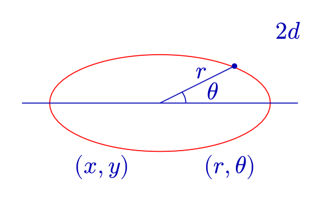

描述自由度的独立变量不一定是质点的笛卡尔坐标，可以根据问题的情况选择其他更方便的坐标。之后我们将会看到，坐标的选取和系统的性质有关，比如转动不变、球对称等。

**广义坐标**：对于 $s$ 个自由度的系统，可以完全刻画其位置的任意 $s$ 个变量

$$
\begin{equation}
q_1,q_2,\ldots,q_s
% \label{eq:generalized-coordinates}
\end{equation}
$$

称为该系统的广义坐标。

**广义速度**（generalized velocities）：广义坐标的一阶时间导数 $\dot q_i$。

需要强调的是，广义坐标 $q_i$ 不一定具有长度的量纲：它可以是角度（如摆角 $\theta$）、面积、甚至是某个无量纲的比例参数，只要 $s$ 个 $q_i$ 能够唯一确定系统的位形（configuration）即可。相应地，广义速度 $\dot q_i$ 和广义动量（后面会定义）的量纲也会随之改变，不再一定是通常意义下的“速度”和“动量”。

### 运动方程

当给定广义坐标的数值后，系统的力学状态并没有确定下来，因为我们并不能预测下一时刻系统的位置或状态。

对于给定的广义坐标，系统的速度可以是任意值。那么在下一个无穷小时间间隔 $dt$ 后，

$$
\begin{equation}
q_i(t+dt)=q_i(t)+\dot q_i(t)\,dt,
% \label{eq:coordinate-infinitesimal-step}
\end{equation}
$$

系统的位置会依 $\dot q_i(t)$ 的不同而不同。

**经验表明**，同时给定系统所有广义坐标和速度，就可以确定系统的状态，其后的运动也能够被计算。从数学上讲，如果在某时刻给定了 $q_i$ 和 $\dot q_i$，那么 $\ddot q_i$ 也完全确定。这里需要强调，数学本身是没法告诉我们这个结论的，因为微分方程本身的形式无法确定。这个经验来源于观测和实验，并由此总结出牛顿第二定律，而它恰好是二阶微分方程。二阶微分方程的完全求解需要初始时刻的位置和速度。

加速度与坐标、速度的关系式称为运动方程，即关于 $q(t)$ 的二阶微分方程：

$$
\begin{equation}
f(q,\dot q,\ddot q)=0.
% \label{eq:equation-of-motion-general}
\end{equation}
$$

求解此方程可得到 $q(t)$，进而确定系统的运动轨迹。这里的关键在于：运动方程是一个二阶微分方程，求解它需要两组初始条件——初始位置 $q(t_0)$ 和初始速度 $\dot q(t_0)$——这与前面“经验表明，同时给定坐标和速度就能确定系统状态”的说法完全一致。

牛顿第二定律写作

$$
\begin{equation}
m\frac{d^2\vec r}{dt^2}=\vec F(\vec r,\dot{\vec r}).
% \label{eq:newton-second-law}
\end{equation}
$$

其优点是简单、直观；缺点是有些情况下力的形式不容易确定，不易推广到复杂系统（多自由度），并且对称性不明显，不利于直接识别守恒定律。由此引出理论力学中的最小作用量原理。

下面我们换一个完全不同的出发点来重新表述力学：不再问“质点受到什么力”，而是问“质点从初始位置到末位置，走的是哪一条特殊的路径”。这个新的出发点就是最小作用量原理。

<!--  -->

## 最小作用量原理
> The Principle of Least Action

每一个力学系统都可以用一个确定的函数所表征：

$$
\begin{equation}
L(q_1,q_2,\ldots,q_s,\dot q_1,\dot q_2,\ldots,\dot q_s,t),
% \label{eq:lagrangian-general-form}
\end{equation}
$$

或简记为

$$
\begin{equation}
L(q,\dot q,t), \quad q = (q_1,q_2,...,q_s),\quad \dot q =(\dot q_1,\dot q_2,...,\dot q_s),
% \label{eq:lagrangian-shorthand}
\end{equation}
$$

称为**拉格朗日量（Lagrangian）**或者简称为**拉氏量**。

拉氏量 $L$ 可以先理解为一个“待确定”的函数——我们暂时不知道它具体的表达式，只知道它由广义坐标、广义速度和时间构成。后面会看到，对自由质点而言 $L=\frac12mv^2$（即动能），而对一般的保守系统 $L=T-V$（动能减势能）。之所以先讲最小作用量原理再给出 $L$ 的具体形式，是为了强调这个原理本身的普适性：只要知道了系统的 $L$，接下来的推导对任何力学系统都是一样的。

并且系统的运动还要满足以下条件：假设在时刻 $t=t_1$ 和 $t=t_2$，系统的位置由两组坐标 $q(t_1)$ 和 $q(t_2)$ 确定 (固定初态和末态的位置)，那么系统在这两个位置之间的运动使得积分

$$
\begin{equation}
S=\int_{t_1}^{t_2}L(q,\dot q,t)\,dt
% \label{eq:action-integral}
\end{equation}
$$

取最小值（更准确地说，取极值）。$S$ 称为**作用量(action)**。

这里“取极值”而不是严格意义上的“取最小值”，是因为最小作用量原理这个名字是历史遗留（源自莫佩尔蒂 Maupertuis 在 18 世纪提出的最小作用量思想），更准确的说法应该是**平稳作用量原理**（principle of stationary action）：真实路径使 $S$ 关于任意微小变化的一阶变化为零，可能是极小值，也可能是鞍点。物理系统实际选择的正是这样一条“平稳”路径。

真实路径什么时候确实是“最小”？下面的动画以谐振子为例，固定两个端点，把真实路径加上一个形如 $\varepsilon\sin(\pi t/t_2)$ 的扰动，画出作用量随 $\varepsilon$ 的变化。时间间隔较短时（上排），任何扰动都使 $S$ 增大，真实路径是最小值；时间间隔超过半个振动周期后（下排），这个扰动反而使 $S$ 减小，真实路径只是一个鞍点，但一阶变化仍然为零，运动方程照样成立。定量的分析见后文[“泛函导数”](#泛函导数)一节的进阶折叠块。

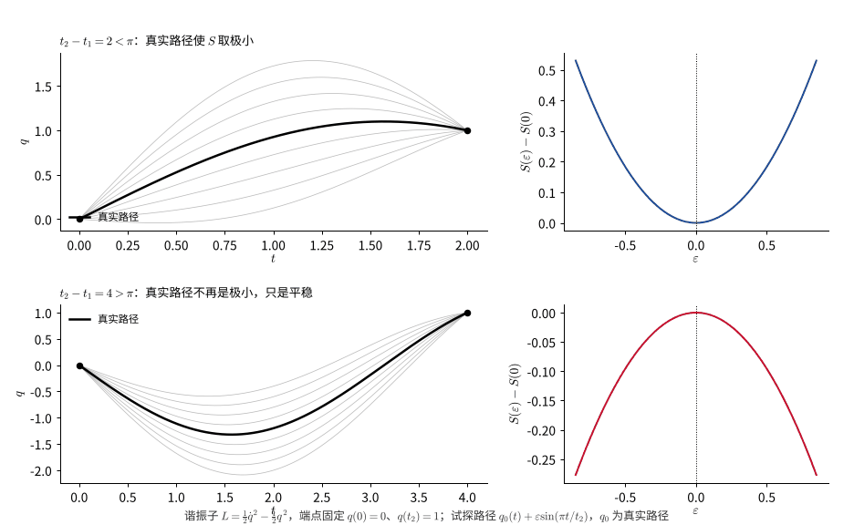

$L$ 也称拉格朗日函数，只包含 $q$ 与 $\dot q$，因为系统的力学状态完全由坐标和速度确定。

设 $q(t)$ 是使 $S$ 取最小值的函数，那么用任意函数 <!-- 图 -->

$$
\begin{equation}
q(t)+\delta q(t)
% \label{eq:varied-trajectory}
\end{equation}
$$

代替 $q(t)$，都会使 $S$ 增大（极值情形下，一阶变化为零）。$\delta q(t)$ 称为变分，它也是一个函数。函数 $\delta q(t)$ 在 $t_1$ 到 $t_2$ 的整个时间内都是小量，一般情况下其高阶幂次可以忽略；由于端点 $q(t_1)$ 和 $q(t_2)$ 固定，故端点处的变分为0，直观上可以把 $\delta q(t)$ 想象成把真实轨迹 $q(t)$ 稍微“掰弯”一点点得到的邻近轨迹与原轨迹之间的差，如下图所示；端点固定意味着所有这些“邻近轨迹”都必须和真实轨迹一样从同一个初始点出发、到达同一个终点。

$$
\begin{equation}
\delta q(t_1)=\delta q(t_2)=0.
% \label{eq:variation-boundary-condition}
\end{equation}
$$

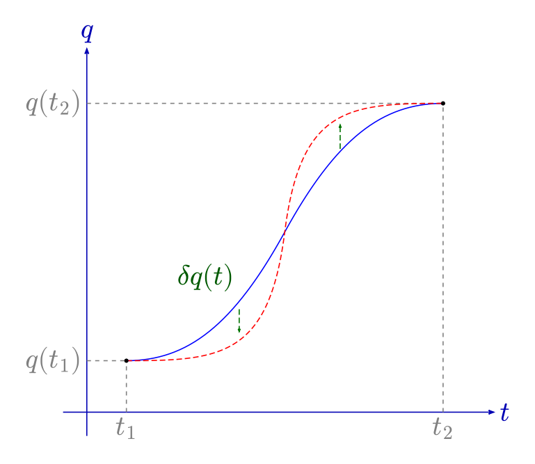

$S$ 的增量为

$$
\begin{align*}
\delta S
&=\int_{t_1}^{t_2}L(q+\delta q,\dot q+\delta\dot q,t)\,dt
-\int_{t_1}^{t_2}L(q,\dot q,t)\,dt  \\
&=\int_{t_1}^{t_2}\left[ L(q+\delta q,\dot q+\delta\dot q,t) - L(q,\dot q,t)\right]\,dt \\
&=\int_{t_1}^{t_2}\delta L(q,\dot q,t)\,dt = \delta \int_{t_1}^{t_2} L(q,\dot q,t)\,dt
\end{align*}
$$

因此最小作用量原理可写为

$$
\begin{equation}
{\delta S=\delta\int_{t_1}^{t_2}L(q,\dot q,t)\,dt=0}.
% \label{eq:least-action-principle}
\end{equation}
$$

可以类比函数泰勒展开的操作，只保留一阶变分项，上述最小作用量原理可写成

$$
\begin{equation}
\delta S=
\int_{t_1}^{t_2}\left(\frac{\partial L}{\partial q}\,\delta q
+\frac{\partial L}{\partial\dot q}\,\delta\dot q\right)dt=0.
% \label{eq:first-variation-of-action}
\end{equation}
$$
注意 $\delta q$ 和 $\delta\dot q$ 并不是独立的函数，所以不能得出 $\dfrac{\partial L}{\partial q}=0$ 和 $\dfrac{\partial L}{\partial\dot q}=0$ 的结论。在下一节中，我们将从此方程出发推导欧拉–拉格朗日运动方程。

从上面的推导中可以发现，$L$ 的选择有一定的自由度：多个不同的 $L$ 可能给出相同的运动方程。比如，若两个拉氏量只相差某个坐标和时间的函数 $f(q,t)$ 对时间的全导数，

$$
\begin{equation}
L'(q,\dot q,t)=L(q,\dot q,t)+\frac{d}{dt}f(q,t),
% \label{eq:lagrangian-gauge-transformation}
\end{equation}
$$

则

$$
\begin{equation}
S'=S+f(q(t_2),t_2)-f(q(t_1),t_1).
% \label{eq:action-gauge-shift}
\end{equation}
$$

对固定端点的变分，
$$
\begin{equation}
\delta f(q(t_2),t_2)=\dfrac{\partial f}{\partial q}\delta q(t_2)=0,\;\;
\delta f(q(t_1),t_1)=\dfrac{\partial f}{\partial q}\delta q(t_1)=0,
% \label{eq:endpoint-variation-vanish}
\end{equation}
$$

因而

$$
\begin{equation}
\delta S'=\delta S.
% \label{eq:action-variation-invariance}
\end{equation}
$$
所以由 $\delta S'=\delta S=0$ 推导得到的运动方程不会改变。

这个结论非常重要：它说明拉氏量 $L$ 并不是唯一的——给 $L$ 加上任意一个形如 $\frac{d}{dt}f(q,t)$ 的“全导数项”，运动方程完全不变。这种不确定性有点类似电动力学中的规范（gauge）自由度：物理可观测量（运动方程、轨迹）不依赖于这一自由度的具体选取。

<!-- 5 -->

### 如何构造拉氏量 $L$？

先选定参考系，再选择广义坐标 $q_i$ 与广义速度 $\dot q_i$，从而构造 $L(q_i,\dot q_i,t)$。

1. 一般来说，运动规律在不同的参考系下具有不同的形式。如果任意选择参考系，则可能使确定非常简单现象的规律在形式上变得复杂。

   对于任意参考系，空间和时间通常是非均匀的，空间也是各向异性的。即使物体不受外力，也不可能保持静止，力学现象的描述十分复杂。

   **惯性参考系**比较特殊：空间是均匀和各向同性的，时间是均匀的；自由物体静止或者保持匀速直线运动。

2. 比如惯性参考系下自由运动的质点，我们可以得到一些关于 $L$ 的结论。

   时间和空间的均匀性意味着 $L$ 函数不显含时间 $t$ 和位置 $\vec r$；空间的各向同性意味着 $L$ 只能是速度大小平方 $\vec v\cdot\vec v$ 的函数：

$$
\begin{equation}
   L=L(v^2).
% \label{eq:lagrangian-depends-on-v-squared}
\end{equation}
$$

3. 构造 $L$ 时需要考虑系统的对称性。两个不同的惯性系 $K$ 和 $K'$ 中，若 $K'$ 相对 $K$ 以速度 $\vec V$ 运动，则在牛顿时空观 $t=t'$ 下，坐标变换为

$$
\begin{equation}
   \vec r=\vec r'+\vec Vt,
% \label{eq:galilean-transformation}
\end{equation}
$$

   这是伽利略变换。相应地

$$
\begin{equation}
   L'=L(v'^2),\qquad L=L(v^2).
% \label{eq:galilean-invariance-lagrangian}
\end{equation}
$$

   **伽利略相对性原理**：力学运动方程在伽利略变换下具有不变性（更广义地对应相对论）。

换句话说，物理定律的形式不应该依赖于我们选取哪一个惯性系作为参照——这正是相对性原理的核心思想（在狭义相对论中，伽利略变换会被洛伦兹变换取代，但“不同惯性系中物理定律形式相同”这一原则保留了下来）。

4. 力学系统的 $L$ 乘以一个任意常数，不会改变运动方程。这似乎带来一种不确定性：各个孤立系统可以乘以不同的常数。为消除这种不确定性，只允许所有力学系统乘以同一常数。

综合以上四点：均匀各向同性的时空、伽利略相对性原理、以及 $L$ 的整体归一化，几乎完全确定了自由质点拉氏量的形式，只剩下一个待定的比例常数——下面就来求出这个常数。

<!-- 6 -->

### 自由质点的拉格朗日函数

设 $L=L(v^2)$。利用伽利略相对性原理来确定这一依赖关系。

惯性系 $K$ 以无穷小速度 $\vec\varepsilon$ 相对另一惯性系 $K'$ 运动，则有

$$
\begin{equation}
\vec v'=\vec v+\vec\varepsilon.
% \label{eq:infinitesimal-velocity-boost}
\end{equation}
$$

拉氏量 $L(v^2)$ 经过伽利略变换后得到 $L'$。由于在所有惯性系中运动方程的形式相同，如果 $L'$ 与 $L(v^2)$ 存在差异，只能相差某个关于时间和坐标的函数的全导数：

$$
\begin{equation}
L'=L(v'^2)=L(v^2+2\vec v\cdot\vec\varepsilon+\varepsilon^2).
% \label{eq:lagrangian-boosted-expansion}
\end{equation}
$$

$\vec\varepsilon$ 是无穷小量，故可忽略高阶项，只保留一阶项：

$$
\begin{equation}
L'=L(v^2)+2\frac{\partial L}{\partial v^2}\,\vec v\cdot\vec\varepsilon.
% \label{eq:lagrangian-first-order-expansion}
\end{equation}
$$

由于 $\vec v=d\vec r/dt$ 是全导数项，只有当 $\partial L/\partial v^2$ 不依赖于速度，即为常数时，上式第二项才是全导数。因此

$$
\begin{equation}
\frac{\partial L}{\partial v^2}=\text{常数},
% \label{eq:partial-L-v2-constant}
\end{equation}
$$

于是可取

$$
\begin{equation}
{L=\frac12 mv^2},
% \label{eq:free-particle-lagrangian}
\end{equation}
$$

其中 $m$ 为常数（质量）。

这个结果值得停下来体会一下：我们没有假设任何关于“力”的概念，仅仅从时空的对称性（均匀性、各向同性）和伽利略相对性原理出发，就推导出了自由质点的拉氏量正比于速度平方——而这恰好就是我们熟悉的动能 $T=\frac12mv^2$。比例系数 $m$（质量）在这里是作为一个待定常数出现的，不同的质点可以有不同的 $m$。

验证：若 $\vec v'=\vec v+\vec V$，其中$\vec V$为常数，则

$$
\begin{align}
L'&=\frac12 mv'^2
=\frac m2(\vec v+\vec V)^2\\
&=\frac12mv^2+m\vec v\cdot\vec V+\frac12mV^2\\
&=L+\frac{d}{dt}\left(m\vec r\cdot\vec V+\frac12mV^2t\right).
\end{align}
$$

全导数项 $\dfrac{d}{dt}f(\vec r,t)$ 不改变运动方程。

对于多粒子自由运动，设粒子的质量为 $m_a$、速度为 $\vec v_a$，则可选取拉氏量

$$
\begin{equation}
L=\sum_a\frac12m_av_a^2.
% \label{eq:multiparticle-free-lagrangian}
\end{equation}
$$

在不同坐标系中，单粒子的自由拉氏量可写为

$$
\begin{equation}
L=\frac12m(v_x^2+v_y^2+v_z^2)
=\frac12m(\dot x^2+\dot y^2+\dot z^2)
=\frac12m\frac{dl^2}{dt^2}.
% \label{eq:lagrangian-line-element}
\end{equation}
$$

线元在直角坐标、柱坐标和球坐标中分别为

$$
\begin{equation}
dl^2=dx^2+dy^2+dz^2
=dr^2+r^2d\varphi^2+dz^2
=dr^2+r^2d\theta^2+r^2\sin^2\theta\,d\varphi^2.
% \label{eq:line-element-coordinates}
\end{equation}
$$

因此

$$
\begin{equation}
L_{\text{柱}}=\frac12m(\dot r^2+r^2\dot\varphi^2+\dot z^2),
% \label{eq:lagrangian-cylindrical}
\end{equation}
$$

$$
\begin{equation}
L_{\text{球}}=\frac12m(\dot r^2+r^2\dot\theta^2+r^2\sin^2\theta\,\dot\varphi^2).
% \label{eq:lagrangian-spherical}
\end{equation}
$$

一般形式为

$$
\begin{equation}
{L=T-V},
% \label{eq:lagrangian-T-minus-V}
\end{equation}
$$

其中 $T$ 为动能，$V$ 为势能。

<!--  -->
后面会看到，$L=T-V$ 这个形式并不是凭空假设的，而是可以由“已知运动方程反推拉氏量”得到的（见后文“反过来，若已知运动方程……”一段），并且它在几乎所有常见的保守力学系统中都成立。

## 变分法
> Variational Method / Calculus of Variation

函数（function）与泛函（functional）的区别：

$$
\begin{equation}
x\longmapsto f(x),
\qquad
f(x)\longmapsto G[f(x)].
% \label{eq:function-vs-functional}
\end{equation}
$$

函数把变量映射为数；泛函把函数映射为数。打个比方：函数 $f(x)$ 好比一台机器，输入一个数字，输出一个数字；泛函 $G[f(x)]$ 则像是一台“更高级”的机器，输入的是一整条曲线（函数），输出的仍然是一个数字。作用量 $S[q(t)]$ 正是这样一个泛函：输入一整条可能的运动轨迹 $q(t)$，输出这条轨迹对应的作用量数值。变分法要解决的问题，就是如何在所有可能的“输入曲线”中，找到使泛函取极值的那一条。

### 最速下降曲线

考虑从 $A(0,0)$ 到 $B(x_1,y_1)$ 的最速下降曲线<!-- 图 -->。这里取 $y$ 轴竖直向下，$y$ 越大位置越低，质点从 $A$ 静止释放。

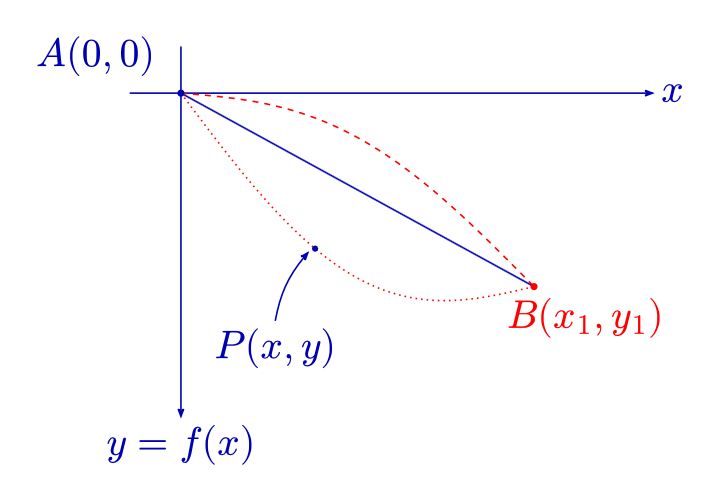

在曲线上任意一点 $P(x,y)$ 处，$s(t)$ 表示从 $A$ 点到 $P$ 点的弧长。由能量守恒（动能等于减少的重力势能），

$$
\begin{equation}
\frac12m\left(\frac{ds}{dt}\right)^2=mgy.
% \label{eq:brachistochrone-energy-conservation}
\end{equation}
$$

设轨迹为 $y=f(x)$，则

$$
\begin{equation}
\sqrt{1+y'^2}\,\frac{dx}{dt}=\sqrt{2gy},
% \label{eq:brachistochrone-speed-relation}
\end{equation}
$$

从而

$$
\begin{equation}
dt=\sqrt{\frac{1+y'^2}{2gy}}\,dx.
% \label{eq:brachistochrone-dt}
\end{equation}
$$

故从 $A$ 滑到 $B$ 的时间为

$$
\begin{equation}
T[f(x)]=\int_A^B dt
=\int_0^{x_1}\sqrt{\frac{1+[f'(x)]^2}{2g f(x)}}\,dx.
% \label{eq:brachistochrone-time-functional}
\end{equation}
$$

$T$ 是关于函数 $f(x)$ 的泛函。图中画出了连接 $A$、$B$ 的直线和若干弯曲路径，表示不同候选函数。

最速降线问题是变分法历史上最著名的问题之一，由约翰·伯努利（Johann Bernoulli）于 1696 年提出并向学界公开征解，牛顿、莱布尼茨、雅各布·伯努利等人都给出了各自的解法，这一问题也被认为是变分法这门学科的起点。直觉上容易误以为最快的路径是直线（两点间最短），但下面的推导会说明真正的答案是一条摆线（cycloid）——沿着这条路径下滑虽然距离更长，但由于中间段下降得更快、速度更大，总时间反而最短。

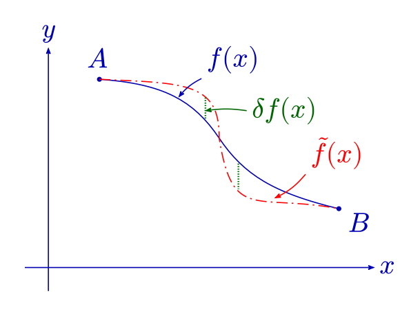

考虑微小变化

$$
\begin{equation}
f(x)\longrightarrow \tilde f(x)=f(x)+\delta f(x),
\qquad
\delta f(x)=\tilde f(x)-f(x).
% \label{eq:functional-variation-definition}
\end{equation}
$$

对应地

$$
\begin{equation}
T[f(x)]\longrightarrow T[\tilde f(x)],
% \label{eq:functional-value-under-variation}
\end{equation}
$$

泛函的变分为

$$
\begin{equation}
\delta T=T[\tilde f(x)]-T[f(x)]
=T[f(x)+\delta f(x)]-T[f(x)].
% \label{eq:functional-variation-deltaT}
\end{equation}
$$

问题是：$\delta T$ 和 $\delta f(x)$ 的关系如何表示？

在简单情况下，若 $T[f(x)]=C$，则 $\delta T=0$；若

$$
\begin{equation}
T[f(x)]=\int f(x)\,dx,
% \label{eq:functional-example-integral}
\end{equation}
$$

则

$$
\begin{equation}
\delta T=\int\delta f(x)\,dx.
% \label{eq:functional-variation-example-result}
\end{equation}
$$

<!-- 第 8 页 -->

### 变分的运算规则

一般情况可按下列规则处理。

1. 线性：

$$
\begin{equation}
   \delta\bigl(af_1(x)+bf_2(x)\bigr)
   =a\,\delta f_1(x)+b\,\delta f_2(x).
% \label{eq:variation-linearity}
\end{equation}
$$

2. 乘积：

$$
\begin{equation}
   \delta(f_1f_2)=(\delta f_1)f_2+f_1\delta f_2.
% \label{eq:variation-product-rule}
\end{equation}
$$

   这是因为

   $$
   \begin{align}
   \tilde f_1\tilde f_2-f_1f_2
   &=(f_1+\delta f_1)(f_2+\delta f_2)-f_1f_2\\
   &=(\delta f_1)f_2+f_1\delta f_2+(\delta f_1)(\delta f_2),
   \end{align}
   $$

   一阶变分中略去二阶小量 $(\delta f_1)(\delta f_2)$。由此也有

$$
\begin{equation}
   \delta(f^m)=mf^{m-1}\delta f.
% \label{eq:variation-power-rule}
\end{equation}
$$

3. 变分和微分可交换顺序：（这一条规则说明“先变分再求导”和“先求导再变分”是等价的操作，接下来的推导会反复用到它。）

$$
\begin{equation}
   \delta(\dot f)=\frac{d}{dt}(\delta f),
   \qquad
   \delta(df)=d(\delta f).
% \label{eq:variation-derivative-commute}
\end{equation}
$$

   因为

$$
\begin{equation}
   \tilde f(t)=f(t)+\delta f(t),
   \qquad
   \dot{\tilde f}(t)=\dot f(t)+\frac{d}{dt}\delta f(t),
% \label{eq:variation-time-derivative-setup}
\end{equation}
$$

   所以

$$
\begin{equation}
   \delta(\dot f(t))=\dot{\tilde f}(t)-\dot f(t)=\frac{d}{dt}\delta f(t).
% \label{eq:variation-derivative-result}
\end{equation}
$$

练习：试证明

$$
\begin{equation}
\delta(\dot f^{2})=2\dot f\,\delta\dot f
=2\dot f\,\frac{d}{dt}(\delta f).
% \label{eq:variation-fdot-squared}
\end{equation}
$$

提示

直接使用上面的乘积法则 $\delta(f_1f_2)=(\delta f_1)f_2+f_1\delta f_2$，取 $f_1=f_2=\dot f$，得到 $\delta(\dot f^2)=2\dot f\,\delta\dot f$；再用变分与微分可交换，$\delta\dot f=\frac{d}{dt}\delta f$。

考虑如下简单作用量

$$
\begin{equation}
S=\int_{t_1}^{t_2}\dot f(t)^2\,dt,
% \label{eq:example-action-fdot-squared}
\end{equation}
$$

则

$$
\begin{align}
\delta S
=2\int_{t_1}^{t_2}\dot f\,\frac{d}{dt}(\delta f)\,dt
=2\int_{t_1}^{t_2}\dot f\,d(\delta f)
=2\dot f\,\delta f\bigg|_{t_1}^{t_2}
-2\int_{t_1}^{t_2}\ddot f\,\delta f\,dt.
\end{align}
$$

对于固定边界条件的变分，

$$
\begin{equation}
\delta f(t_1)=\delta f(t_2)=0,
% \label{eq:fixed-boundary-variation}
\end{equation}
$$

故

$$
\begin{equation}
\delta S=-2\int_{t_1}^{t_2}\ddot f\,\delta f\,dt.
% \label{eq:variation-result-fdot-squared-action}
\end{equation}
$$

### 泛函导数

定义一阶泛函导数 $\delta S/\delta f(t)$，使

$$
\begin{equation}
\delta S[f]=\int dt\,\frac{\delta S}{\delta f(t)}\,\delta f(t).
% \label{eq:functional-derivative-definition}
\end{equation}
$$

令 $\tilde f=f+\varepsilon\delta f$，则泛函可展开为

$$
\begin{equation}
S[f+\varepsilon\delta f]
=S[f]
+\varepsilon\,\delta S[f]
+\frac{\varepsilon^2}{2}\,\delta^2S[f]
+\cdots,
% \label{eq:functional-taylor-expansion}
\end{equation}
$$

其中 $\varepsilon^n$ 项的系数给出 $n$ 阶变分 $\delta^nS[f]$。

例 1：

$$
\begin{equation}
S[f]=\int f^2(t)\,dt,
% \label{eq:example1-functional}
\end{equation}
$$

则

$$
\begin{equation}
\delta S=2\int f(t)\delta f(t)\,dt,
\qquad
\frac{\delta S}{\delta f}=2f.
% \label{eq:example1-functional-derivative}
\end{equation}
$$

例 2：

$$
\begin{equation}
S[f]=\int \dot f^{2}(t)\,dt,
% \label{eq:example2-functional}
\end{equation}
$$

在固定端点下

$$
\begin{equation}
\frac{\delta S}{\delta f}=-2\ddot f(t).
% \label{eq:example2-functional-derivative}
\end{equation}
$$

<!--  9  -->

### 变分与多元函数微分的类比

泛函的一阶变分可以与多元函数 $F=F(x_1,x_2,\ldots,x_n)$ 的一阶微分

$$
\begin{equation}
dF=\sum_{k=1}^n\frac{\partial F}{\partial x_k}\,dx_k
% \label{eq:multivariable-differential}
\end{equation}
$$

对比：

$$
\begin{equation}
\delta S=\int dt\,\frac{\delta S}{\delta f(t)}\,\delta f(t).
% \label{eq:functional-derivative-comparison}
\end{equation}
$$

泛函导数 $\delta S/\delta f(t)$ 与普通多元函数的偏导数 $\partial F/\partial x_k$ 是完全类似的概念，只是把“对第 $k$ 个变量 $x_k$ 求偏导”换成了“对连续参数 $t$ 标记的每一个自由度 $f(t)$ 求偏导”，求和 $\sum_k$ 相应地换成积分 $\int dt$。

同样，高阶泛函导数可写为

$$
\begin{equation}
\delta^2S[f]
=\int dt_1\int dt_2\,
\frac{\delta^2S}{\delta f(t_1)\delta f(t_2)}
\,\delta f(t_1)\delta f(t_2),
% \label{eq:second-order-functional-derivative}
\end{equation}
$$

以及

$$
\begin{equation}
\delta^nS[f]
=\int dt_1\cdots\int dt_n\,
\frac{\delta^nS}{\delta f(t_1)\cdots\delta f(t_n)}
\,\delta f(t_1)\cdots\delta f(t_n).
% \label{eq:nth-order-functional-derivative}
\end{equation}
$$

例如

$$
\begin{equation}
S[f]=\int f^2(t)\,dt,
% \label{eq:example-functional-second-derivative-setup}
\end{equation}
$$

则

$$
\begin{equation}
\frac{\delta S}{\delta f}=2f,
\qquad
\frac{\delta^2S}{\delta f(t_1)\,\delta f(t_2)}=2\,\delta(t_1-t_2).
% \label{eq:example-functional-second-derivative-result}
\end{equation}
$$

进阶：二阶变分与“最小”作用量的条件

一阶变分为零只说明真实路径是平稳点；它是不是极小，要看二阶变分的符号，就像多元函数要看海森矩阵是否正定。

以谐振子 $L=\frac12m\dot q^2-\frac12kq^2$ 为例，$\omega=\sqrt{k/m}$。拉氏量是二次的，所以展开到二阶是精确的：对满足 $\eta(t_1)=\eta(t_2)=0$ 的任意 $\eta$，

$$
\begin{equation*}
S[q+\varepsilon\eta]-S[q]=\frac{\varepsilon^2}{2}\,\delta^2S,\qquad
\delta^2S=\int_{t_1}^{t_2}\left(m\dot\eta^2-k\eta^2\right)dt .
\end{equation*}
$$

记 $\tau=t_2-t_1$，把 $\eta$ 展开为傅里叶正弦级数 $\eta=\sum_{n\geq1}b_n\sin\bigl(n\pi(t-t_1)/\tau\bigr)$，利用正交性，

$$
\begin{equation*}
\delta^2S=\frac{m\tau}{2}\sum_{n\geq1}b_n^2\left[\left(\frac{n\pi}{\tau}\right)^2-\omega^2\right].
\end{equation*}
$$

- 若 $\tau<\pi/\omega$（不到半个周期），每一项都为正，$\delta^2S>0$，真实路径确实使作用量取**极小**。
- 若 $\tau>\pi/\omega$，至少 $n=1$ 这一项为负，沿这个方向 $S$ 减小，真实路径只是**鞍点**。

动画中 $m=k=1$，扰动正是 $n=1$ 的模式：$\tau=2$ 时 $\delta^2S=\frac{2}{2}\bigl[(\pi/2)^2-1\bigr]\approx1.47$，$\varepsilon=0.5$ 时 $S$ 增加约 $0.18$；$\tau=4$ 时 $\delta^2S\approx-0.77$，$S$ 减少约 $0.10$，与图中一致。

临界时间 $\tau=\pi/\omega$ 有清楚的物理意义：从同一点出发、初速度不同的所有谐振子轨道，经过半个周期后又汇聚到同一点（平衡位置）。这样的点称为起点的**共轭点**（动力学焦点）。一般地，只要两端点之间不含共轭点，真实路径就是作用量的极小值；越过共轭点后就不再是极小。所以“最小作用量原理”中的“最小”只在足够短的时间内成立，严格的表述是“平稳作用量”。

### 欧拉–拉格朗日方程
> Euler-Lagrange Equation

令

$$
\begin{equation*}
S[f]
=\int_{t_1}^{t_2}dt\,
L(f,\dot f,t),
\end{equation*}
$$

则

$$
\begin{equation}
S[f+\varepsilon\delta f]
=\int_{t_1}^{t_2}dt\,
L(f+\varepsilon\delta f,\dot f+\varepsilon\delta\dot f,t).
% \label{eq:action-lagrangian-setup}
\end{equation}
$$

其一阶变分为

$$
\begin{align}
\delta S
&=\int_{t_1}^{t_2}dt\left(
\frac{\partial L}{\partial f}\delta f
+\frac{\partial L}{\partial\dot f}\delta\dot f
\right)\\
&=\int_{t_1}^{t_2}dt\left[
\frac{\partial L}{\partial f}\delta f
+\frac{d}{dt}\left(\frac{\partial L}{\partial\dot f}\delta f\right)
-\delta f\frac{d}{dt}\left(\frac{\partial L}{\partial\dot f}\right)
\right]\\
&=\frac{\partial L}{\partial\dot f}\delta f\bigg|_{t_1}^{t_2}
+\int_{t_1}^{t_2}dt\,\delta f\left[
\frac{\partial L}{\partial f}
-\frac{d}{dt}\left(\frac{\partial L}{\partial\dot f}\right)
\right].
\end{align}
$$

固定端点使边界项为零。由 $\delta S=0$ 且 $\delta f$ 任意，得到

$$
\begin{equation}
{
\frac{\delta S}{\delta f}
=\frac{\partial L}{\partial f}
-\frac{d}{dt}\left(\frac{\partial L}{\partial\dot f}\right)=0
}
% \label{eq:euler-lagrange-equation}
\end{equation}
$$

这就是欧拉–拉格朗日方程（Euler-Lagrange equation）。

值得强调的是，这一路推导中用到的关键技巧是**分部积分**：把 $\delta\dot f$ 中的时间导数“转移”到 $\partial L/\partial \dot f$ 上，代价是多出一个边界项 $\dfrac{\partial L}{\partial \dot f}\delta f\Big|_{t_1}^{t_2}$；正是因为固定端点条件 $\delta f(t_1)=\delta f(t_2)=0$，这个边界项才恰好消失，$\delta S$ 只剩下一个 $\delta f$ 乘以方括号的积分；再由 $\delta f$ 的任意性，方括号本身必须为零。这是变分法中处理边值问题的标准套路，后面推导角动量守恒、诺特定理时还会反复用到类似的技巧。

<!-- 第 10 页 -->

### 一维例子与能量

例：一维谐振子

$$
\begin{equation}
L=\frac12m\dot x^2-\frac12kx^2.
% \label{eq:harmonic-oscillator-lagrangian}
\end{equation}
$$

有

$$
\begin{equation}
\frac{\partial L}{\partial x}=-kx,
\qquad
\frac{\partial L}{\partial\dot x}=m\dot x,
% \label{eq:harmonic-oscillator-partials}
\end{equation}
$$

所以

$$
\begin{equation}
\frac{\delta S}{\delta x}=-kx-m\ddot x.
% \label{eq:harmonic-oscillator-functional-derivative}
\end{equation}
$$

由最小作用量原理 $\delta S/\delta x=0$，得到

$$
\begin{equation}
 m\ddot x+kx=0.
% \label{eq:harmonic-oscillator-eom}
\end{equation}
$$

这正是我们熟悉的简谐振动方程，解为 $x(t)=A\cos(\omega t+\phi)$，其中角频率 $\omega=\sqrt{k/m}$。这个例子说明：即便完全不谈“弹性力”这个矢量概念，只要写出正确的拉氏量 $L=\frac12m\dot x^2-\frac12kx^2$（动能减势能），欧拉–拉格朗日方程也能自动给出正确的牛顿方程。

更一般地，

$$
\begin{equation}
L=\frac12m\dot x^2-V(x),
% \label{eq:particle-in-potential-lagrangian}
\end{equation}
$$

则

$$
\begin{equation}
\frac{\partial L}{\partial x}=-V'(x),
\qquad
\frac{\partial L}{\partial\dot x}=m\dot x,
% \label{eq:particle-in-potential-partials}
\end{equation}
$$

从而

$$
\begin{equation}
-V'(x)-m\ddot x=0
\quad\Longrightarrow\quad
m\ddot x=-V'(x)=F(x),
% \label{eq:newton-second-law-from-EL}
\end{equation}
$$

即牛顿第二定律。

上面的推导展示了“由 $L$ 得到运动方程”的正向过程；反过来，若已知运动方程，也可以构造作用量。由运动方程 $m\ddot x+V'(x)=0$ 写出

$$
\begin{equation}
\delta S=\int\bigl(m\ddot x+V'(x)\bigr)\delta x(t)\,dt
% \label{eq:inverse-problem-action-variation}
\end{equation}
$$

并分部积分，得

$$
\begin{align}
\delta S
&=\int\left(m\frac{d\dot x}{dt}+\frac{\partial V}{\partial x}\right)\delta x\,dt\\
&=\int\left(\frac{\partial V}{\partial x}\delta x-m\dot x\,\delta\dot x\right)dt.
\end{align}
$$

于是可识别出

$$
\begin{equation}
\frac{\partial L}{\partial x}=\frac{\partial V}{\partial x},
\qquad
\frac{\partial L}{\partial\dot x}=-m\dot x,
% \label{eq:inverse-problem-lagrangian-identification}
\end{equation}
$$

即

$$
\begin{equation}
-L=\frac12m\dot x^2-V(x).
% \label{eq:inverse-problem-negative-lagrangian}
\end{equation}
$$

拉氏量整体乘以 $-1$ 不改变运动方程。通常约定

$$
\begin{equation}
{L=T-V},
% \label{eq:lagrangian-T-minus-V-general}
\end{equation}
$$

其中 $T$ 为动能，$V$ 为势能。

若直接对 $L=L(t,f(t),\dot f(t))$ 求时间导数，

$$
\begin{align}
\frac{dL}{dt}
&=\frac{\partial L}{\partial t}
+\frac{\partial L}{\partial f}\dot f
+\frac{\partial L}{\partial\dot f}\ddot f\\
&=\frac{\partial L}{\partial t}
+\frac{d}{dt}\left(\frac{\partial L}{\partial\dot f}\right)\dot f
+\frac{\partial L}{\partial\dot f}\ddot f\\
&=\frac{\partial L}{\partial t}
+\frac{d}{dt}\left(\frac{\partial L}{\partial\dot f}\dot f\right),
\end{align}
$$

其中使用了欧拉–拉格朗日方程。若 $L$ 不显含 $t$，则 $\partial L/\partial t=0$，所以上述方程移项即可得到

$$
\begin{equation}
\frac{d}{dt}\left(\frac{\partial L}{\partial\dot f}\dot f-L\right)=0.
% \label{eq:hamiltonian-conservation-derivation}
\end{equation}
$$

因此

$$
\begin{equation}
{H=\frac{\partial L}{\partial\dot f}\dot f-L=\text{常数}},
% \label{eq:hamiltonian-definition}
\end{equation}
$$

$H$ 称为 Hamiltonian（哈密顿量）；对于常见的系统 $L=T-V$，它就是能量

$$
\begin{equation}
H=T+V.
% \label{eq:hamiltonian-energy}
\end{equation}
$$

哈密顿量 $H$ 在这里是作为“一个守恒量”自然浮现出来的，它由拉氏量通过 $H=\dot f\,\partial L/\partial \dot f-L$ 这一操作（称为勒让德变换，Legendre transformation）得到。这一构造会在本课程后面[“哈密顿力学”](哈密顿力学.md)一章中被系统地发展为一套独立于拉格朗日力学的表述方式，这里先记住这个雏形。$H$ 等于 $T+V$ 的条件，见后文[“时间平移不变性与能量守恒”](#时间平移不变性与能量守恒)一节的思考题。

<!-- 11 -->

### 多粒子与一般坐标系

$N$ 个具有相互作用的粒子组，在直角坐标系中的拉格朗日量可以写成

$$
\begin{equation}
L=\sum_a\frac12m_a\vec v_a^{2}
-V(\vec x_1,\vec x_2,\ldots,\vec x_N,t).
% \label{eq:multiparticle-interacting-lagrangian}
\end{equation}
$$

第一项为动能，第二项为势能。如果 $V$ 不显含时间，即

$$
\begin{equation}
V=V(\vec x_1,\vec x_2,\ldots,\vec x_N),
% \label{eq:time-independent-potential}
\end{equation}
$$

则系统是保守系统，能量守恒，并有

$$
\begin{equation}
m_a\frac{d\vec v_a}{dt}
=-\frac{\partial V(\vec x_1,\vec x_2,\ldots,\vec x_N)}{\partial\vec x_a}.
% \label{eq:newton-eq-multiparticle-potential}
\end{equation}
$$

在一般坐标系下，

$$
\begin{equation}
L=\sum_{a,b}\frac12k_{ab}(q)\dot q_a\dot q_b
-V(q_1,q_2,\ldots,q_N).
% \label{eq:general-coordinate-lagrangian}
\end{equation}
$$

欧拉–拉格朗日方程给出

$$
\begin{equation}
\frac{d}{dt}\left(\frac{\partial L}{\partial\dot q_i}\right)
=\frac{\partial L}{\partial q_i}
=-\frac{\partial V}{\partial q_i}
+\sum_{a,b}\frac12\frac{\partial k_{ab}}{\partial q_i}\dot q_a\dot q_b.
% \label{eq:general-coordinate-euler-lagrange}
\end{equation}
$$

另一方面，

$$
\begin{align}
\frac{\partial L}{\partial\dot q_i}
&=\sum_{a,b}\frac12k_{ab}
\frac{\partial(\dot q_a\dot q_b)}{\partial\dot q_i}\\
&=\sum_{a,b}\frac12k_{ab}
\left(\dot q_b\delta_{ai}+\dot q_a\delta_{bi}\right)\\
&=\sum_b\frac12k_{ib}\dot q_b
+\sum_a\frac12k_{ai}\dot q_a.
\end{align}
$$

这里 $a,b$ 都是哑指标，可以任意换名。若 $k_{ab}$ 关于 $(a,b)$ 对称，即 $k_{ia}=k_{ai}$，则

$$
\begin{equation}
\frac{\partial L}{\partial\dot q_i}=\sum_a k_{ia}\dot q_a,
% \label{eq:generalized-momentum-symmetric-metric}
\end{equation}
$$

并有

$$
\begin{equation}
\frac{d}{dt}\left(\sum_a k_{ia}\dot q_a\right)
=-\frac{\partial V}{\partial q_i}
+\sum_{a,b}\frac12\frac{\partial k_{ab}}{\partial q_i}\dot q_a\dot q_b.
% \label{eq:general-coordinate-eom-metric}
\end{equation}
$$

若 $k_{ia}=m_i\delta_{ia}$（广义坐标就是笛卡尔坐标，$k_{ab}$ 是常数对角矩阵），则方程退化为

$$
\begin{equation}
m_i\ddot q_i=-\frac{\partial V}{\partial q_i},
% \label{eq:newton-eom-diagonal-metric}
\end{equation}
$$

即牛顿第二定律。一般情形下，$k_{ab}(q)$ 可以理解为“位形空间”上的一个度规（metric）：它决定了在广义坐标下如何度量“动能”的大小，这个观点在后续学习黎曼几何、广义相对论时会非常有用。

<!-- 12 -->

### 应用欧拉–拉格朗日方程

#### 平面上两点之间的最短距离

问：平面上任意两点 $A,B$ 之间的哪条曲线距离最短？

记曲线方程为 $y=f(x)$，则曲线长度为

$$
\begin{equation}
S=\int dx\,\sqrt{1+[f'(x)]^2}.
% \label{eq:arc-length-functional}
\end{equation}
$$

取

$$
\begin{equation}
L=\sqrt{1+[f'(x)]^2}.
% \label{eq:shortest-path-lagrangian}
\end{equation}
$$

因为

$$
\begin{equation}
\frac{\partial L}{\partial f}=0,
\qquad
\frac{\partial L}{\partial f'}
=\frac{f'(x)}{\sqrt{1+[f'(x)]^2}},
% \label{eq:shortest-path-partials}
\end{equation}
$$

欧拉–拉格朗日方程给出

$$
\begin{equation}
\frac{d}{dx}\left(
\frac{f'(x)}{\sqrt{1+[f'(x)]^2}}
\right)=0.
% \label{eq:shortest-path-euler-lagrange}
\end{equation}
$$

展开可得

$$
\begin{equation}
\frac{f''(x)}{\left[1+[f'(x)]^2\right]^{3/2}}=0,
% \label{eq:shortest-path-expanded-eom}
\end{equation}
$$

故

$$
\begin{equation}
f''(x)=0
\quad\Longrightarrow\quad
f(x)=ax+b.
% \label{eq:shortest-path-solution}
\end{equation}
$$

所以平面上两点之间直线最短。这个结论虽然显而易见，但推导过程本身很有启发性：它把一个几何问题（两点间最短路径）转化为了一个变分问题，并用与力学完全相同的欧拉–拉格朗日方程求解。事实上，“两点间距离最短的曲线”这一概念可以推广到弯曲空间（测地线，geodesic），是广义相对论中描述自由粒子运动轨迹的核心概念。

#### 最速下降曲线

下降时间泛函为

$$
\begin{equation}
T=\int dx\,\frac{\sqrt{1+[f'(x)]^2}}{\sqrt{2gf(x)}},
% \label{eq:brachistochrone-time-functional-general}
\end{equation}
$$

即

$$
\begin{equation}
L(f,f')=\frac{\sqrt{1+(f')^2}}{\sqrt{2gf}}.
% \label{eq:brachistochrone-lagrangian}
\end{equation}
$$

由于 $L(f,f')$ 不显含 $x$，有 Beltrami 恒等式

$$
\begin{equation}
\frac{\partial L}{\partial f'}f'-L=\text{常数}.
% \label{eq:beltrami-identity}
\end{equation}
$$

推导：Beltrami 恒等式

沿着满足欧拉–拉格朗日方程的曲线对 $x$ 求全导数：

$$
\begin{align*}
\frac{d}{dx}\left(\frac{\partial L}{\partial f'}f'-L\right)
&=f'\frac{d}{dx}\frac{\partial L}{\partial f'}+\frac{\partial L}{\partial f'}f''
-\frac{\partial L}{\partial x}-\frac{\partial L}{\partial f}f'-\frac{\partial L}{\partial f'}f''\\
&=f'\left[\frac{d}{dx}\frac{\partial L}{\partial f'}-\frac{\partial L}{\partial f}\right]-\frac{\partial L}{\partial x}
=-\frac{\partial L}{\partial x}.
\end{align*}
$$

$L$ 不显含 $x$ 时右边为零。这与前面“$L$ 不显含 $t$ 时 $H$ 守恒”是完全相同的计算，只是“时间”换成了自变量 $x$。所以 Beltrami 恒等式就是这个变分问题的“能量守恒”，它把二阶的欧拉–拉格朗日方程降为一阶方程。

代入得

$$
\begin{equation}
\frac{f'}{\sqrt{2gf}\sqrt{1+(f')^2}}\,f'
-\frac{\sqrt{1+(f')^2}}{\sqrt{2gf}}
=-\frac{1}{\sqrt{2gf}\sqrt{1+(f')^2}}
=\text{常数}.
% \label{eq:brachistochrone-beltrami-substitution}
\end{equation}
$$

因此

$$
\begin{equation}
{f\left[1+(f')^2\right]=\text{常数}}.
% \label{eq:brachistochrone-first-integral}
\end{equation}
$$

其参数解为

$$
\begin{equation}
y(\theta)=a(1-\cos\theta),
\qquad
x(\theta)=a(\theta-\sin\theta),
% \label{eq:cycloid-parametric-solution}
\end{equation}
$$

即摆线（旋轮线、cycloid）。

推导：由 f(1+f′²) = 常数 解出摆线，并求下滑时间

把常数记为 $2a$。令 $f'=\cot(\theta/2)$，则 $1+f'^2=1/\sin^2(\theta/2)$，

$$
\begin{equation*}
y=f=2a\sin^2\frac\theta2=a(1-\cos\theta).
\end{equation*}
$$

再由 $dx=df/f'$：

$$
\begin{equation*}
dx=\frac{a\sin\theta\,d\theta}{\cot(\theta/2)}=2a\sin^2\frac\theta2\,d\theta=a(1-\cos\theta)\,d\theta ,
\qquad x=a(\theta-\sin\theta),
\end{equation*}
$$

积分常数由 $\theta=0$ 时在 $A(0,0)$ 定出。这正是半径为 $a$ 的圆沿 $x$ 轴（在其下方）滚动时，圆周上一点画出的轨迹。参数 $a$ 和终点的 $\theta_1$ 由 $B(x_1,y_1)$ 决定：$y_1/x_1=(1-\cos\theta_1)/(\theta_1-\sin\theta_1)$。

**下滑时间。** $ds=\sqrt{dx^2+dy^2}=2a\sin(\theta/2)\,d\theta$，$v=\sqrt{2gy}=2\sqrt{ga}\sin(\theta/2)$，所以 $dt=ds/v=\sqrt{a/g}\,d\theta$，

$$
\begin{equation*}
T_{AB}=\theta_1\sqrt{a/g} .
\end{equation*}
$$

若 $B$ 恰好是摆线的最低点（$\theta_1=\pi$），$T_{AB}=\pi\sqrt{a/g}$。

下面的动画让四颗小球同时从 $A$ 静止释放，沿不同轨道无摩擦地滑到同一点 $B$（取摆线的最低点，$x_1=\pi a$，$y_1=2a$）。直线最短，却最慢；摆线先陡降、尽早获得速度，最先到达（$\pi\sqrt{a/g}\approx3.14\sqrt{a/g}$）；比摆线下凹得更深的曲线也比摆线慢，说明“越陡越好”同样不对。

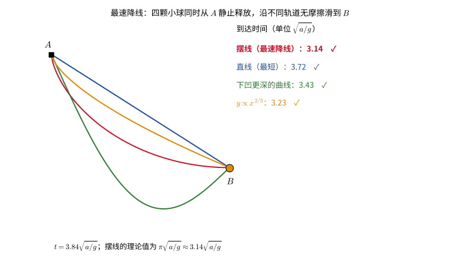

有趣的是，摆线还有一个性质：不论质点从摆线上哪一点出发（只要是静止释放），滑到最低点所需的时间都相同，这被称为**等时性**（isochronism），惠更斯（Huygens）曾利用这一性质设计摆线摆钟。

证明：摆线的等时性

沿用上面的参数式（$y$ 轴向下），最低点在 $\theta=\pi$。从最低点量起的弧长为

$$
\begin{equation*}
s=\int_\theta^\pi 2a\sin\frac{\theta'}{2}\,d\theta'=4a\cos\frac\theta2 ,
\end{equation*}
$$

而质点高出最低点的高度为

$$
\begin{equation*}
h=2a-y=a(1+\cos\theta)=2a\cos^2\frac\theta2=\frac{s^2}{8a}.
\end{equation*}
$$

以弧长 $s$ 为广义坐标，$L=\frac12m\dot s^2-\frac{mg}{8a}s^2$，这是一个**严格的**谐振子：

$$
\begin{equation*}
\ddot s=-\frac{g}{4a}\,s,\qquad s(t)=s_0\cos\left(\sqrt{\frac{g}{4a}}\,t\right).
\end{equation*}
$$

周期 $4\pi\sqrt{a/g}$ 与振幅 $s_0$ 无关，从任何位置静止释放，到达最低点的时间都是四分之一周期 $\pi\sqrt{a/g}$，与上面最速降线的下滑时间相同。普通单摆的势能 $\propto1-\cos\phi$ 只在小角度时近似为二次，周期随振幅增大而变长；摆线则把“势能是弧长的二次函数”做成了精确的。用后面“力学相似性”一节的语言，这就是 $k=2$ 时 $t'/t=1$。

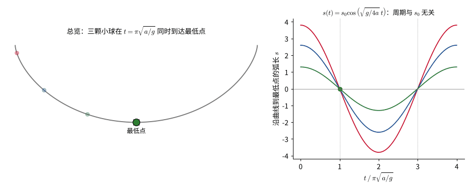

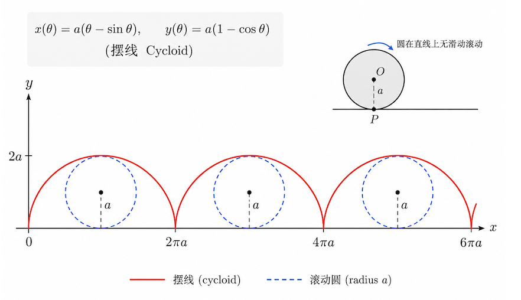

> **拓展阅读：费马原理与引力透镜。** 约翰·伯努利当年是把最速降线看成光在分层介质中的折射来求解的。光学中的费马原理与最小作用量原理形式相同：光走传播时间取驻值的路径。沿着这条线索，可以得到斯涅尔定律、大气折射、星光掠过太阳时的偏折角 $4GM/(c^2b)$，以及引力透镜：透镜所成的像恰好是光的到达时间的驻点，其中有极小，也有鞍点。详见拓展材料[《费马原理与引力透镜》](费马原理与引力透镜.md)。

<!-- 13 -->

## 对称性和守恒定律
> Symmetry & Conservation Law

本节要说明的核心思想是：力学系统的每一种连续对称性，都对应着一个守恒量。具体来说：时间平移对称性对应能量守恒，空间平移对称性对应动量守恒，空间转动对称性对应角动量守恒。牛顿力学里，这三条守恒律看起来是三条互不相关的“巧合”结论；而在拉格朗日力学的框架下，它们可以用完全统一的方式（诺特定理）推导出来——这正是分析力学相比矢量力学的一大优势。

在前面的讨论中，我们已经接触到：当 $L$ 不显含时间时，系统的能量守恒。将相关推导集中写为

$$
\begin{equation}
\frac{dL}{dt}
=\frac{\partial L}{\partial t}
+\frac{\partial L}{\partial f}\dot f
+\frac{\partial L}{\partial\dot f}\ddot f.
% \label{eq:total-time-derivative-of-L}
\end{equation}
$$

利用欧拉–拉格朗日方程

$$
\begin{equation}
\frac{d}{dt}\left(\frac{\partial L}{\partial\dot f}\right)
-\frac{\partial L}{\partial f}=0,
% \label{eq:euler-lagrange-equation-reformulated}
\end{equation}
$$

可得

$$
\begin{equation}
\frac{dL}{dt}
=\frac{\partial L}{\partial t}
+\frac{d}{dt}\left(\frac{\partial L}{\partial\dot f}\dot f\right).
% \label{eq:dL-dt-using-euler-lagrange}
\end{equation}
$$

若 $L$ 不显含 $t$，即 $\partial L/\partial t=0$，则

$$
\begin{equation}
\frac{d}{dt}\left(\frac{\partial L}{\partial\dot f}\dot f-L\right)=0,
% \label{eq:energy-conservation-derivation}
\end{equation}
$$

所以

$$
\begin{equation}
\frac{\partial L}{\partial\dot f}\dot f-L=\text{常数}=H.
% \label{eq:hamiltonian-constant-of-motion}
\end{equation}
$$

$H$ 是 Hamiltonian；对通常的力学系统，它就是能量 $H=T+V$。

更一般地，从欧拉–拉格朗日方程

$$
\begin{equation}
\frac{d}{dt}\left(\frac{\partial L}{\partial\dot q_i}\right)
-\frac{\partial L}{\partial q_i}=0
% \label{eq:euler-lagrange-general-form}
\end{equation}
$$

可知，当

$$
\begin{equation}
\frac{\partial L}{\partial q_i}=0
% \label{eq:cyclic-coordinate-condition}
\end{equation}
$$

时，

$$
\begin{equation}
\frac{d}{dt}\left(\frac{\partial L}{\partial\dot q_i}\right)=0.
% \label{eq:cyclic-coordinate-momentum-conservation}
\end{equation}
$$

此时 $q_i$ 称为**循环坐标**（cyclic coordinate），而

$$
\begin{equation}
p_i=\frac{\partial L}{\partial\dot q_i}
% \label{eq:generalized-momentum-definition}
\end{equation}
$$

是相应的广义动量，并且守恒。“循环坐标”这个名字来自最典型的例子，即角坐标：例如中心力场中的方位角 $\varphi$ 不出现在拉氏量中，$\varphi$ 可以像角度一样“循环”变化而不影响动力学，对应的角动量守恒。

### 时间平移不变性与能量守恒

如果系统的 $L$ 不显含时间，则在

$$
\begin{equation}
t\longrightarrow t+t_0
% \label{eq:time-translation-transformation}
\end{equation}
$$

的平移变换下 $L$ 不变。即 $L$ 具有时间平移不变性，

$$
\begin{equation}
\frac{\partial L}{\partial t}=0
\quad\Longrightarrow\quad
H=\sum_i\frac{\partial L}{\partial\dot q_i}\dot q_i-L,
\qquad
\frac{dH}{dt}=0.
% \label{eq:time-translation-energy-conservation}
\end{equation}
$$

例：

$$
\begin{equation}
L=\sum_i\frac12m_i\dot{\vec x}_i^{2}
-V(\vec x_1,\vec x_2,\ldots,\vec x_N)=T-V,
% \label{eq:example-lagrangian-time-translation}
\end{equation}
$$

则

$$
\begin{equation}
E=T+V=H
=\sum_i\frac12m_i\dot{\vec x}_i^{2}
+V(\vec x_1,\vec x_2,\ldots,\vec x_N).
% \label{eq:example-energy-conservation-result}
\end{equation}
$$

思考：如果 $T$ 不是关于 $\dot{\vec x}_i$（或广义速度 $\dot q_i$）的二次齐次函数，$E$ 和 $H$ 是否相等？

提示与例子

回到 $H$ 的定义 $H=\sum_i \dot q_i\,\partial L/\partial\dot q_i-L$。若 $V$ 不依赖速度，且 $T$ 是 $\dot q_i$ 的二次齐次函数，则由欧拉齐次函数定理（见[“位力定理”](#位力定理维里定理)一节的折叠块）$\sum_i\dot q_i\,\partial T/\partial \dot q_i=2T$，从而 $H=2T-(T-V)=T+V=E$。否则，只要 $\partial L/\partial t=0$，$H$ 仍然守恒，但它不再等于系统的总能量 $E$。

**例：转动直杆上的小珠。** 光滑直杆在水平面内以恒定角速度 $\omega$ 转动，小珠沿杆滑动，以到转轴的距离 $r$ 为广义坐标：

$$
\begin{equation*}
L=T=\frac12m\left(\dot r^2+\omega^2r^2\right),
\qquad
H=\dot r\frac{\partial L}{\partial\dot r}-L=\frac12m\dot r^2-\frac12m\omega^2r^2 .
\end{equation*}
$$

$T$ 中含有与速度无关的项 $\frac12m\omega^2r^2$，不是 $\dot r$ 的二次齐次函数。$H$ 守恒，而能量 $E=T$ 随着小珠外滑不断增大，增加的能量来自维持杆匀速转动的外力矩所做的功。同类的情况还有转动参照系中的运动（[“中心力场”](中心力场.md)一章的雅可比积分）以及约束随时间变化的系统。

<!-- 14 -->

### 空间平移不变性与动量守恒

如果拉氏量 $L$ 在坐标平移变换下不变，

$$
\begin{equation}
\vec x_i\longrightarrow\vec x_i+\vec x_0,
% \label{eq:spatial-translation-transformation}
\end{equation}
$$

其中 $\vec x_0$ 为常数，则

$$
\begin{equation}
\frac{\partial L}{\partial\vec x_i}=0
\quad\Longrightarrow\quad
\frac{d}{dt}\left(\frac{\partial L}{\partial\dot{\vec x}_i}\right)=0,
% \label{eq:spatial-translation-momentum-conservation}
\end{equation}
$$

即动量守恒。这一结论可以看作牛顿第三定律（作用力与反作用力）在拉格朗日力学中的对应：系统整体的平移不变性，等价于内部各部分之间的相互作用力两两抵消。

如果所有 $\vec x_i$ 同时平移都不改变 $L$，则

$$
\begin{equation}
\frac{d}{dt}\left(\sum_i\frac{\partial L}{\partial\dot{\vec x}_i}\right)=0,
% \label{eq:total-momentum-conservation}
\end{equation}
$$

即总动量守恒。

以上讨论对一般坐标系也成立，包括直角坐标系、柱坐标系和球坐标系。例如，自由粒子的拉氏量可写成

$$
\begin{equation}
L=\frac12m(\dot x^2+\dot y^2+\dot z^2)
=\frac12m(\dot r^2+r^2\dot\varphi^2+\dot z^2)
=\frac12m(\dot r^2+r^2\dot\theta^2+r^2\sin^2\theta\,\dot\varphi^2).
% \label{eq:free-particle-lagrangian-coordinate-systems}
\end{equation}
$$

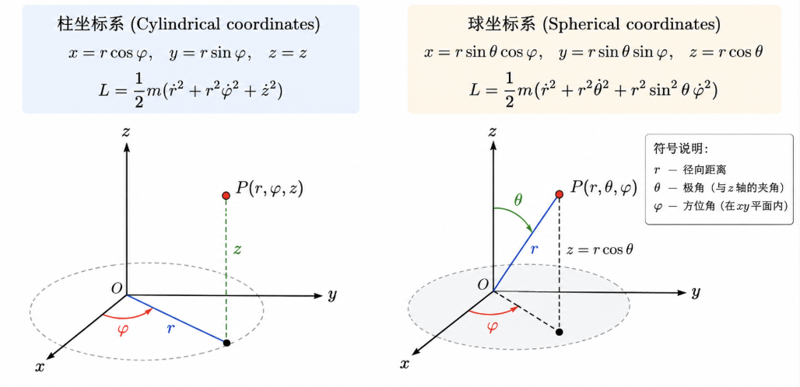

在柱坐标中，

$$
\begin{equation}
\frac{\partial L}{\partial z}=0
\quad\Longrightarrow\quad
\frac{d}{dt}(m\dot z)=0,
% \label{eq:cylindrical-z-momentum-conservation}
\end{equation}
$$

$$
\begin{equation}
\frac{\partial L}{\partial\varphi}=0
\quad\Longrightarrow\quad
\frac{d}{dt}(mr^2\dot\varphi)=0.
% \label{eq:cylindrical-angular-momentum-conservation}
\end{equation}
$$

在球坐标中，

$$
\begin{equation}
\frac{\partial L}{\partial\varphi}=0
\quad\Longrightarrow\quad
\frac{d}{dt}(mr^2\sin^2\theta\,\dot\varphi)=0.
% \label{eq:spherical-angular-momentum-conservation}
\end{equation}
$$

如果系统的势能函数依赖于坐标，例如

$$
\begin{equation}
L=\frac12m(\dot x^2+\dot y^2+\dot z^2)-mgz,
% \label{eq:lagrangian-gravity-potential}
\end{equation}
$$

则 $\partial L/\partial z\neq0$，$z$ 方向动量不守恒。

又如

$$
\begin{equation}
L=\frac12m(\dot x^2+\dot y^2+\dot z^2)
-\frac{1}{\sqrt{x^2+y^2+z^2}},
% \label{eq:lagrangian-coulomb-potential}
\end{equation}
$$

此时 $\partial L/\partial x_i\neq0$，各分量动量不守恒。

对比这两个反例可以体会“对称性 $\Rightarrow$ 守恒律”这一判据的实用之处：不需要真正求解运动方程，只需要检查拉氏量在某个变换下是否不变，就能立刻判断相应的量是否守恒。

#### 质心

封闭系统的动量对于不同惯性参考系具有不同的值。如果 $K'$ 相对 $K$ 以速度 $\vec V$ 运动，则质点在两个参考系中的速度满足

$$
\begin{equation}
\vec v_a=\vec v'_a+\vec V.
% \label{eq:velocity-transformation-frames}
\end{equation}
$$

总动量满足

$$
\begin{equation}
\vec p=\sum_a m_a\vec v_a
=\sum_a m_a\vec v'_a+\vec V\sum_a m_a
=\vec p'+\vec V\sum_a m_a.
% \label{eq:total-momentum-transformation}
\end{equation}
$$

总可以选择 $\vec V$ 使 $\vec p'=0$，这个参考系相对 $K$ 的速度为

$$
\begin{equation}
\vec V=\frac{\vec p}{\sum_a m_a}
=\frac{\sum_a m_a\vec v_a}{\sum_a m_a}.
% \label{eq:center-of-momentum-velocity}
\end{equation}
$$

定义质心位置

$$
\begin{equation}
\vec R=\frac{\sum_a m_a\vec r_a}{\sum_a m_a},
% \label{eq:center-of-mass-definition}
\end{equation}
$$

则系统整体运动速度为

$$
\begin{equation}
\dot{\vec R}=\vec V.
% \label{eq:center-of-mass-velocity}
\end{equation}
$$

封闭系统总动量守恒，所以

$$
\begin{equation}
\frac{d\vec p}{dt}=0
\quad\Longrightarrow\quad
\dot{\vec V}=0.
% \label{eq:center-of-mass-uniform-motion}
\end{equation}
$$

即系统的质心作匀速直线运动。这个结论在处理多体问题时非常有用：可以先把参考系换到质心系（此时 $\vec p'=0$），把“系统整体的平动”和“系统内部的相对运动”分离开，这也是后面两体问题、开普勒问题中约化质量方法的出发点。从诺特定理的角度看，质心的匀速运动对应伽利略变换下的不变性，见[“诺特定理”](#诺特定理连续对称性)一节的进阶折叠块。

<!-- 15 页 -->

### 空间转动不变性与角动量守恒

为简单起见，考虑直角坐标系中的转动不变性，即空间各向同性。

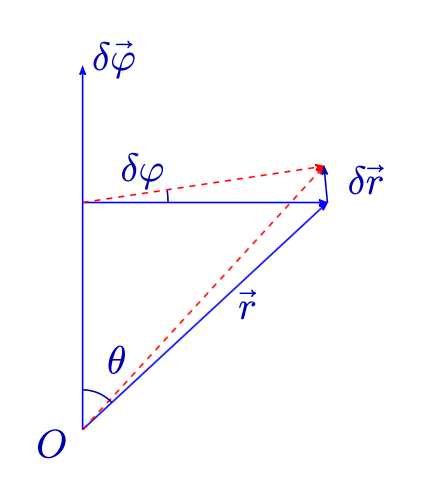

引入无穷小转动 $\delta\vec\varphi$，其大小为转角 $\delta\varphi$，方向沿转轴（右手定则）。设 $\vec r$ 与转轴的夹角为 $\theta$，则径矢 $\vec r$ 端点的线位移满足

$$
\begin{equation}
|\delta\vec r|=r\sin\theta\,\delta\varphi.
% \label{eq:infinitesimal-rotation-displacement-magnitude}
\end{equation}
$$

位移矢量的方向垂直于 $\vec r$ 和 $\delta\vec\varphi$ 所在平面，因此

$$
\begin{equation}
\delta\vec r=\delta\vec\varphi\times\vec r.
% \label{eq:infinitesimal-rotation-displacement-vector}
\end{equation}
$$

所有质点的速度也改变为

$$
\begin{equation}
\delta\vec v=\delta\vec\varphi\times\vec v.
% \label{eq:infinitesimal-rotation-velocity-vector}
\end{equation}
$$

如果 $L$ 具有转动不变性，则

$$
\begin{equation}
\delta L
=\sum_a\left(
\frac{\partial L}{\partial\vec r_a}\cdot\delta\vec r_a
+\frac{\partial L}{\partial\vec v_a}\cdot\delta\vec v_a
\right)=0.
% \label{eq:rotational-invariance-condition}
\end{equation}
$$

令

$$
\begin{equation}
\vec p_a=\frac{\partial L}{\partial\vec v_a},
% \label{eq:momentum-definition-rotation-section}
\end{equation}
$$

并利用欧拉–拉格朗日方程 $\partial L/\partial\vec r_a=\dot{\vec p}_a$，得

$$
\begin{align}
\delta L
&=\sum_a\left(
\dot{\vec p}_a\cdot\delta\vec r_a
+\vec p_a\cdot\delta\vec v_a
\right)\\
&=\sum_a\left[
\dot{\vec p}_a\cdot(\delta\vec\varphi\times\vec r_a)
+\vec p_a\cdot(\delta\vec\varphi\times\vec v_a)
\right]\\
&=\delta\vec\varphi\cdot
\sum_a\left(\vec r_a\times\dot{\vec p}_a
+\vec v_a\times\vec p_a\right)\\
&=\delta\vec\varphi\cdot\frac{d}{dt}
\left(\sum_a\vec r_a\times\vec p_a\right)=0.
\end{align}
$$

由于 $\delta\vec\varphi$ 任意，故

$$
\begin{equation}
\frac{d}{dt}\left(\sum_a\vec r_a\times\vec p_a\right)=0.
% \label{eq:angular-momentum-conservation-derivation}
\end{equation}
$$

定义角动量

$$
\begin{equation}
{\vec L=\sum_a\vec r_a\times\vec p_a},
% \label{eq:angular-momentum-definition}
\end{equation}
$$

于是空间转动不变性意味着角动量守恒：

$$
\begin{equation}
\frac{d\vec L}{dt}=0.
% \label{eq:angular-momentum-conservation}
\end{equation}
$$

至此我们已经用完全平行的方式推导出了三条守恒律：时间平移 $\to$ 能量守恒，空间平移 $\to$ 动量守恒，空间转动 $\to$ 角动量守恒。它们的推导结构其实完全一样：先写出对称变换下拉氏量不变的条件，再用欧拉–拉格朗日方程把这个条件改写成某个量对时间的全导数为零。这正是诺特定理要总结的普遍规律。下面的折叠块先通过一个具体例子（柱坐标下角动量的分量）练习角动量的计算，诺特定理的一般证明见后文。

例：柱坐标中的角动量（两种算法）

**题目。** 设质量为 $m$ 的质点在三维空间中运动，其柱坐标为 $(r,\varphi,z)$。利用柱坐标及其时间导数，求质点相对于坐标原点的角动量在直角坐标基底中的分量 $M_x,M_y,M_z$，以及角动量的大小 $M=|\mathbf M|$；同时给出角动量在柱坐标单位基矢下的表达式。

**符号约定**

这里采用固定的右手直角坐标系，质量 $m$ 为常数，动量为 $\mathbf p=m\mathbf v$。柱坐标中的 $r$ 是质点到 $z$ 轴的距离，不是到原点的距离。用 $\mathbf R$ 表示位置矢量，则

$$
\begin{equation*}
x=r\cos\varphi,\qquad y=r\sin\varphi,\qquad R=|\mathbf R|=\sqrt{r^2+z^2}.
% \label{eq:cylindrical-coordinate-definitions}
\end{equation*}
$$

上方的点表示对时间求导，例如 $\dot r=dr/dt$。以下柱坐标基矢的表达式适用于 $r>0$；在轴线上，方位角及径向、方位向基矢不唯一，应使用直角坐标定义或沿具体轨迹取极限。

角动量的定义为

$$
\begin{equation*}
{\mathbf M=\mathbf R\times\mathbf p=m\mathbf R\times\mathbf v.}
% \label{eq:angular-momentum-vector-definition}
\end{equation*}
$$

“用柱坐标表示角动量”可以指两件事：用 $(r,\varphi,z)$ 表示直角坐标分量 $M_x,M_y,M_z$，或者求柱坐标单位基矢下的分量 $M_r,M_\varphi,M_z$。下面分别推导。

**方法一：先变换位置和动量，再在直角坐标基底中做叉乘**

**位置矢量**

由坐标变换关系，位置矢量为

$$
\begin{equation*}
\mathbf R=x\mathbf e_x+y\mathbf e_y+z\mathbf e_z
=r\cos\varphi\,\mathbf e_x+r\sin\varphi\,\mathbf e_y+z\mathbf e_z.
% \label{eq:position-vector-cartesian-basis}
\end{equation*}
$$

**速度与动量**

直角坐标单位基矢不随时间变化，因此只需对各坐标求导。注意 $r$ 和 $\varphi$ 都可能随时间变化，利用乘积法则与链式法则，有

$$
\begin{align*}
\dot x&=\frac{d}{dt}(r\cos\varphi)
=\dot r\cos\varphi-r\dot\varphi\sin\varphi,\\
\dot y&=\frac{d}{dt}(r\sin\varphi)
=\dot r\sin\varphi+r\dot\varphi\cos\varphi.
\end{align*}
$$

所以

$$
\begin{equation*}
\mathbf p=m\left[
(\dot r\cos\varphi-r\dot\varphi\sin\varphi)\mathbf e_x
+(\dot r\sin\varphi+r\dot\varphi\cos\varphi)\mathbf e_y
+\dot z\,\mathbf e_z
\right].
% \label{eq:momentum-cartesian-from-cylindrical}
\end{equation*}
$$

对应的直角坐标动量分量为

$$
\begin{align*}
p_x&=m(\dot r\cos\varphi-r\dot\varphi\sin\varphi),\\
p_y&=m(\dot r\sin\varphi+r\dot\varphi\cos\varphi),\\
p_z&=m\dot z.
\end{align*}
$$

**直接计算叉乘**

$$
\begin{equation*}
\mathbf M=
\begin{vmatrix}
\mathbf e_x&\mathbf e_y&\mathbf e_z\\
r\cos\varphi&r\sin\varphi&z\\
m(\dot r\cos\varphi-r\dot\varphi\sin\varphi)&m(\dot r\sin\varphi+r\dot\varphi\cos\varphi)&m\dot z
\end{vmatrix}.
\end{equation*}
$$

按第一行展开，得到

$$
\begin{equation*}
M_x=yp_z-zp_y,\qquad M_y=zp_x-xp_z,\qquad M_z=xp_y-yp_x.
% \label{eq:angular-momentum-cross-product-components}
\end{equation*}
$$

对于 $x$ 分量，

$$
\begin{align*}
M_x&=(r\sin\varphi)m\dot z-zm(\dot r\sin\varphi+r\dot\varphi\cos\varphi)\\
&=mr\dot z\sin\varphi-mz\dot r\sin\varphi-mrz\dot\varphi\cos\varphi\\
&=m(r\dot z-z\dot r)\sin\varphi-mrz\dot\varphi\cos\varphi.
\end{align*}
$$

对于 $y$ 分量，

$$
\begin{align*}
M_y&=zm(\dot r\cos\varphi-r\dot\varphi\sin\varphi)-(r\cos\varphi)m\dot z\\
&=mz\dot r\cos\varphi-mrz\dot\varphi\sin\varphi-mr\dot z\cos\varphi\\
&=m(z\dot r-r\dot z)\cos\varphi-mrz\dot\varphi\sin\varphi.
\end{align*}
$$

对于 $z$ 分量，

$$
\begin{align*}
M_z&=(r\cos\varphi)m(\dot r\sin\varphi+r\dot\varphi\cos\varphi) -(r\sin\varphi)m(\dot r\cos\varphi-r\dot\varphi\sin\varphi)\\
&=mr\dot r\cos\varphi\sin\varphi+mr^2\dot\varphi\cos^2\varphi -mr\dot r\sin\varphi\cos\varphi+mr^2\dot\varphi\sin^2\varphi\\
&=mr^2\dot\varphi.
\end{align*}
$$

其中含 $\dot r$ 的两项抵消，并使用了 $\cos^2\varphi+\sin^2\varphi=1$。

因此，用柱坐标表示的直角坐标角动量分量为

$$
\begin{align*}
M_x&=m(r\dot z-z\dot r)\sin\varphi-mrz\dot\varphi\cos\varphi,\\
M_y&=m(z\dot r-r\dot z)\cos\varphi-mrz\dot\varphi\sin\varphi,\\
M_z&=mr^2\dot\varphi.
\end{align*}
$$

这一方法直接从直角坐标中的叉乘定义出发，不需要预先求出柱坐标基底中的角动量分量。

**方法二：在柱坐标单位基矢下计算**

**柱坐标基矢及其时间导数**

柱坐标的正交单位基矢为

$$
\begin{align*}
\mathbf e_r&=\cos\varphi\,\mathbf e_x+\sin\varphi\,\mathbf e_y,\\
\mathbf e_\varphi&=-\sin\varphi\,\mathbf e_x+\cos\varphi\,\mathbf e_y,\\
\mathbf e_z&=\mathbf e_z.
\end{align*}
$$

其中 $\mathbf e_r$ 沿远离 $z$ 轴的方向，$\mathbf e_\varphi$ 沿方位角增大的方向。前两个基矢随 $\varphi$ 变化，因此

$$
\begin{equation*}
\dot{\mathbf e}_r=\dot\varphi\,\mathbf e_\varphi,\qquad
\dot{\mathbf e}_\varphi=-\dot\varphi\,\mathbf e_r,\qquad
\dot{\mathbf e}_z=0.
% \label{eq:cylindrical-basis-derivatives}
\end{equation*}
$$

**位置与速度**

位置矢量为

$$
\begin{equation*}
\mathbf R=r\mathbf e_r+z\mathbf e_z.
% \label{eq:position-cylindrical-basis}
\end{equation*}
$$

求时间导数时必须同时对系数和基矢求导：

$$
\begin{align*}
\mathbf v&=\frac{d}{dt}(r\mathbf e_r+z\mathbf e_z)\\
&=\dot r\,\mathbf e_r+r\dot{\mathbf e}_r+\dot z\,\mathbf e_z\\
&=\dot r\,\mathbf e_r+r\dot\varphi\,\mathbf e_\varphi+\dot z\,\mathbf e_z.
\end{align*}
$$

方位向速度分量是 $r\dot\varphi$，而不是 $\dot\varphi$。

**展开叉乘**

右手正交单位基矢满足

$$
\begin{equation*}
\mathbf e_r\times\mathbf e_\varphi=\mathbf e_z,\qquad
\mathbf e_\varphi\times\mathbf e_z=\mathbf e_r,\qquad
\mathbf e_z\times\mathbf e_r=\mathbf e_\varphi.
% \label{eq:cylindrical-basis-cross-products}
\end{equation*}
$$

交换叉乘顺序会改变符号，相同基矢的叉乘为零。因此

$$
\begin{align*}
\frac{\mathbf M}{m}
&=(r\mathbf e_r+z\mathbf e_z)\times
(\dot r\mathbf e_r+r\dot\varphi\mathbf e_\varphi+\dot z\mathbf e_z)\\
&=r\dot r\,\mathbf e_r\times\mathbf e_r
+r^2\dot\varphi\,\mathbf e_r\times\mathbf e_\varphi
+r\dot z\,\mathbf e_r\times\mathbf e_z\\
&\quad+z\dot r\,\mathbf e_z\times\mathbf e_r
+rz\dot\varphi\,\mathbf e_z\times\mathbf e_\varphi
+z\dot z\,\mathbf e_z\times\mathbf e_z\\
&=r^2\dot\varphi\,\mathbf e_z-r\dot z\,\mathbf e_\varphi
+z\dot r\,\mathbf e_\varphi-rz\dot\varphi\,\mathbf e_r.
\end{align*}
$$

合并同方向的项，得到

$$
\begin{equation*}
{\mathbf M=-mrz\dot\varphi\,\mathbf e_r
+m(z\dot r-r\dot z)\mathbf e_\varphi
+mr^2\dot\varphi\,\mathbf e_z.}
% \label{eq:angular-momentum-cylindrical-basis-result}
\end{equation*}
$$

即柱坐标单位基矢下的角动量分量为

$$
\begin{equation*}
{M_r=-mrz\dot\varphi,\qquad
M_\varphi=m(z\dot r-r\dot z),\qquad
M_z=mr^2\dot\varphi.}
% \label{eq:angular-momentum-cylindrical-components}
\end{equation*}
$$

**转换为直角坐标分量**

把基矢关系代入 $\mathbf M=M_r\mathbf e_r+M_\varphi\mathbf e_\varphi+M_z\mathbf e_z$，可得

$$
\begin{equation*}
M_x=M_r\cos\varphi-M_\varphi\sin\varphi,\qquad
M_y=M_r\sin\varphi+M_\varphi\cos\varphi.
% \label{eq:cylindrical-to-cartesian-conversion}
\end{equation*}
$$

于是

$$
\begin{align*}
M_x&=-mrz\dot\varphi\cos\varphi-m(z\dot r-r\dot z)\sin\varphi,\\
M_y&=-mrz\dot\varphi\sin\varphi+m(z\dot r-r\dot z)\cos\varphi.
\end{align*}
$$

这与方法一完全一致。两种方法计算的是同一个角动量矢量，只是中间采用的基底不同。

**角动量的大小**

由于柱坐标单位基矢彼此正交，角动量大小的平方为

$$
\begin{align*}
M^2&=M_r^2+M_\varphi^2+M_z^2\\
&=m^2r^2z^2\dot\varphi^2+m^2(z\dot r-r\dot z)^2+m^2r^4\dot\varphi^2\\
&=m^2\left[r^2(r^2+z^2)\dot\varphi^2+(r\dot z-z\dot r)^2\right].
\end{align*}
$$

因此

$$
\begin{equation*}
{M=m\sqrt{r^2(r^2+z^2)\dot\varphi^2+(r\dot z-z\dot r)^2}.}
% \label{eq:angular-momentum-magnitude}
\end{equation*}
$$

也可以直接使用叉乘模长恒等式：

$$
\begin{equation*}
M^2=m^2\left[R^2v^2-(\mathbf R\cdot\mathbf v)^2\right].
% \label{eq:angular-momentum-magnitude-identity}
\end{equation*}
$$

代入

$$
\begin{equation*}
R^2=r^2+z^2,\qquad
v^2=\dot r^2+r^2\dot\varphi^2+\dot z^2,\qquad
\mathbf R\cdot\mathbf v=r\dot r+z\dot z,
% \label{eq:angular-momentum-magnitude-substitutions}
\end{equation*}
$$

得到

$$
\begin{align*}
\frac{M^2}{m^2}
&=(r^2+z^2)(\dot r^2+r^2\dot\varphi^2+\dot z^2)-(r\dot r+z\dot z)^2\\
&=r^2(r^2+z^2)\dot\varphi^2+z^2\dot r^2+r^2\dot z^2-2rz\dot r\dot z\\
&=r^2(r^2+z^2)\dot\varphi^2+(r\dot z-z\dot r)^2.
\end{align*}
$$

**守恒量的个数。** 例如，对三维自由粒子 $L=\frac12m(\dot x^2+\dot y^2+\dot z^2)$，

表面上可列出守恒量 $E$、$\vec p$、$\vec L$，共 $1+3+3=7$ 个，但它们是否独立？对自由粒子有

$$
\begin{equation}
E=\frac{p^2}{2m}.
% \label{eq:free-particle-energy}
\end{equation}
$$

具有 $s$ 个自由度的封闭力学系统，状态变量为 $(q_i,\dot q_i)$，$i=1,\ldots,s$。若存在关于这些变量的函数，其值在运动过程中保持恒定，并且仅由初始条件决定，这样的函数称为**运动积分**。

这里要区分两个容易混淆的概念：“守恒量”（conserved quantity）通常指像能量、动量、角动量这样有明确物理意义、来自某种对称性的量；而“运动积分”（integral of motion）是更广的数学概念，指任何在运动过程中保持不变的相空间函数——两者经常但不总是重合。下面这个结论说明，运动积分的数目是有限的、由自由度数目严格决定的，这也解释了前面例子里 $E,\vec p,\vec L$ 一共 7 个守恒量为什么不可能都相互独立。

<!-- 16 页 -->

### 独立运动积分的数目

独立的运动积分数目为

$$
\begin{equation}
2s-1.
% \label{eq:number-of-independent-integrals}
\end{equation}
$$

原因如下：运动方程中包含 $2s$ 个任意常数，因为有 $s$ 个二阶微分方程。对于封闭系统，运动方程不显含时间，可以任意选择过程的初始时刻；总可以将方程解中的任意常数之一选作时间的可加常数 $t_0$。因此可写

$$
\begin{equation}
q_i=q_i(t+t_0,C_1,C_2,\ldots,C_{2s-1}),
% \label{eq:motion-integral-solution-form-q}
\end{equation}
$$

$$
\begin{equation}
\dot q_i=\dot q_i(t+t_0,C_1,C_2,\ldots,C_{2s-1}).
% \label{eq:motion-integral-solution-form-qdot}
\end{equation}
$$

消去 $t+t_0$，将 $2s-1$ 个任意常数 $C_1,C_2,\ldots,C_{2s-1}$ 表示为 $q_i,\dot q_i$ 的函数，这些函数就是运动积分。

对三维自由粒子，

$$
\begin{equation}
L=\frac12m(\dot x^2+\dot y^2+\dot z^2),
\qquad s=3,
% \label{eq:free-particle-lagrangian-3d}
\end{equation}
$$

所以独立运动积分数目为

$$
\begin{equation}
2s-1=5.
% \label{eq:free-particle-integrals-count}
\end{equation}
$$

取初始位置 $\vec r_0=(x_0,y_0,z_0)$、初始动量 $\vec p_0=m(v_{x0},v_{y0},v_{z0})$，则

$$
\begin{equation}
\vec r=\vec r_0+\frac{\vec p_0}{m}(t-t_0).
% \label{eq:free-particle-trajectory}
\end{equation}
$$

守恒量包括

$$
\begin{equation}
E=\frac{\vec p_0^{2}}{2m},
\qquad
\vec L=\vec r\times\vec p=\vec r\times\vec p_0.
% \label{eq:free-particle-conserved-quantities}
\end{equation}
$$

由于

$$
\begin{equation}
\vec L\cdot\vec p_0=0,
% \label{eq:angular-momentum-momentum-orthogonality}
\end{equation}
$$

且 $E$ 由 $\vec p_0$ 决定，故可从 $\vec p_0$ 的 3 个分量和 $\vec L$ 的 2 个独立分量中取得 5 个独立运动积分。

思考：

$$
\begin{equation}
L=\frac12m(\dot x^2+\dot y^2+\dot z^2)
-V\!\left(\sqrt{x^2+y^2+z^2}\right)
% \label{eq:central-potential-lagrangian-exercise}
\end{equation}
$$

有几个运动积分？

思考题解答：中心势中的运动积分

$s=3$，至多 $2s-1=5$ 个独立运动积分。中心势破坏了空间平移不变性，动量不再守恒；但时间平移和空间转动不变性仍在，所以能量 $E$ 和角动量 $\vec L$ 的三个分量守恒，它们彼此独立，共 **4 个**（$\vec L$ 守恒使运动限制在过原点的平面内）。

对一般的 $V(r)$，没有第 5 个（单值、光滑的）运动积分：轨道不封闭，呈花瓣形，经过足够长的时间会稠密地填满近心距与远心距两个同心圆之间的环形区域。只有两种中心势例外，所有有界轨道都封闭（伯特兰定理），并多出一个运动积分，共 **5 个**：

- 开普勒势 $V\propto-1/r$：拉普拉斯–龙格–楞次矢量；
- 各向同性谐振子 $V\propto r^2$：对称张量 $A_{ij}=p_ip_j/m+kx_ix_j$。

详见[“中心力场”](中心力场.md)一章。

<!-- 第 17 页 -->

## 诺特定理：连续对称性
> Noether's Theorem

前面的对称变换可以概括在更一般的诺特定理中。诺特定理由德国数学家埃米·诺特（Emmy Noether）于 1918 年证明，被公认为理论物理中最深刻、最优美的结果之一。它的意义在于把“对称性”和“守恒律”这两个原本看起来分属不同范畴的概念（前者是几何/代数的，后者是动力学的）严格地统一了起来，并且这一证明的结构与坐标系、拉氏量的具体形式无关，因此可以直接推广到场论（例如电荷守恒对应于带电场的整体相位对称性，即 $U(1)$ 对称性）。前面几节分别推导的能量、动量、角动量守恒，都可以看作是诺特定理在时间平移、空间平移、空间转动这三种特定对称性下的特例。

对于一个由拉格朗日量

$$
\begin{equation}
L(q,\dot q,t),
\qquad
q=(q_1,q_2,\ldots,q_s)
% \label{eq:lagrangian-noether-setup}
\end{equation}
$$

所描述的经典力学系统，对系统的广义坐标作一个由连续参数 $\xi$ 刻画的变换：

$$
\begin{equation}
q_i\longrightarrow q_i'=\tilde q_i(q,\xi),
\qquad
\tilde q_i(q,0)=q_i,
\qquad i=1,\ldots,s.
% \label{eq:noether-transformation-definition}
\end{equation}
$$

如果在此变换下系统的拉氏量不变，

$$
\begin{equation}
L(q,\dot q,t)
\longrightarrow
L(q',\dot q',t)=L(q,\dot q,t),
% \label{eq:noether-invariance-condition}
\end{equation}
$$

则此变换是该系统的一个对称性；与这个对称性相对应，必然存在一个守恒物理量。这就是诺特定理。

用文字概括：只要能找到一族连续变换（用一个连续参数 $\xi$ 标记，$\xi=0$ 对应不变换），使得拉氏量在这族变换下保持不变，就一定能构造出一个守恒量。下面的证明会具体给出这个守恒量的表达式。

### 证明

由不变性，

$$
\begin{equation}
0=\frac{d}{d\xi}L(\tilde q,\dot{\tilde q},t)\bigg|_{\xi=0}
=\sum_i\left[
\frac{\partial L}{\partial q_i}
\frac{\partial\tilde q_i}{\partial\xi}
+\frac{\partial L}{\partial\dot q_i}
\frac{\partial\dot{\tilde q}_i}{\partial\xi}
\right]_{\xi=0}.
% \label{eq:noether-proof-derivative}
\end{equation}
$$

利用运动方程

$$
\begin{equation}
\frac{\partial L}{\partial q_i}
=\frac{d}{dt}\left(\frac{\partial L}{\partial\dot q_i}\right),
% \label{eq:noether-euler-lagrange-used}
\end{equation}
$$

以及

$$
\begin{equation}
\frac{\partial\dot{\tilde q}_i}{\partial\xi}
=\frac{d}{dt}\left(\frac{\partial\tilde q_i}{\partial\xi}\right),
% \label{eq:noether-derivative-commute}
\end{equation}
$$

可得

$$
\begin{equation}
0=\frac{d}{dt}\left[
\sum_i\frac{\partial L}{\partial\dot q_i}
\frac{\partial\tilde q_i}{\partial\xi}
\right]_{\xi=0}.
% \label{eq:noether-total-derivative-zero}
\end{equation}
$$

因此

$$
\begin{equation}
{
Q=\left.
\sum_i\frac{\partial L}{\partial\dot q_i}
\frac{\partial\tilde q_i}{\partial\xi}
\right|_{\xi=0}
},
\qquad
\frac{dQ}{dt}=0,
% \label{eq:noether-conserved-charge}
\end{equation}
$$

$Q$ 就是守恒物理量。

可以看到，这个证明的每一步都只用到了两个基本工具：欧拉–拉格朗日方程，以及对参数 $\xi$ 求导与对时间求导可以交换次序（与“变分与微分可交换”是同一回事）——这与我们在角动量守恒一节看到的推导思路完全一致，只是这里把“空间转动”换成了任意的连续对称变换 $\xi$，从而具有更普遍的适用性。

例如，若

$$
\begin{equation}
q_i\longrightarrow\tilde q_i=q_i+\xi,
\qquad
\frac{\partial\tilde q_i}{\partial\xi}=1,
% \label{eq:noether-translation-example}
\end{equation}
$$

则

$$
\begin{equation}
Q=\frac{\partial L}{\partial\dot q_i},
% \label{eq:noether-momentum-result}
\end{equation}
$$

即广义动量守恒。

又如时间平移

$$
\begin{equation}
t\longrightarrow\tilde t=t+\xi.
% \label{eq:noether-time-translation-example}
\end{equation}
$$

前文已经讨论过，当 $\partial L/\partial t=0$ 时，

$$
\begin{equation}
\frac{d}{dt}\left(\sum_i\dot q_i\frac{\partial L}{\partial\dot q_i}-L\right)=0,
% \label{eq:noether-energy-conservation-derivation}
\end{equation}
$$

对应的守恒量为

$$
\begin{equation}
Q=H=\sum_i\dot q_i\frac{\partial L}{\partial\dot q_i}-L.
% \label{eq:noether-hamiltonian-result}
\end{equation}
$$

进阶：拉氏量相差全导数时的诺特定理，以及伽利略变换

前面要求变换下 $L$ 严格不变。但我们知道，$L$ 加上一个全导数不改变运动方程，所以只要求

$$
\begin{equation*}
\frac{d}{d\xi}L(\tilde q,\dot{\tilde q},t)\bigg|_{\xi=0}=\frac{d\Lambda}{dt}
\end{equation*}
$$

（$\Lambda(q,t)$ 是某个函数）就够了。重复正文的证明，左边仍等于 $\frac{d}{dt}\sum_i p_i\,\partial\tilde q_i/\partial\xi$，于是守恒量变为

$$
\begin{equation*}
Q=\sum_i\frac{\partial L}{\partial\dot q_i}\frac{\partial\tilde q_i}{\partial\xi}\bigg|_{\xi=0}-\Lambda .
\end{equation*}
$$

**时间平移。** 令 $\tilde q(t)=q(t+\xi)$，则 $\partial\tilde q_i/\partial\xi=\dot q_i$；$L$ 不显含 $t$ 时 $dL/d\xi=dL/dt$，即 $\Lambda=L$。代入得 $Q=\sum_i\dot q_ip_i-L=H$。这样能量守恒也纳入了同一个公式。

**伽利略变换。** 对封闭系统作 $\vec r_a\to\vec r_a+\vec\xi\,t$，速度变为 $\vec v_a+\vec\xi$。相互作用势只依赖相对位置，不变；动能的一阶变化为

$$
\begin{equation*}
\delta L=\vec\xi\cdot\sum_am_a\vec v_a=\frac{d}{dt}\left(\vec\xi\cdot\sum_am_a\vec r_a\right),
\end{equation*}
$$

恰好是全导数，$\vec\Lambda=\sum_am_a\vec r_a=M\vec R$（$M$ 为总质量）。又 $\partial\tilde{\vec r}_a/\partial\vec\xi=t$，所以守恒量为

$$
\begin{equation*}
\vec Q=t\sum_a\vec p_a-M\vec R=\vec P\,t-M\vec R .
\end{equation*}
$$

$\vec Q$ 守恒即 $\vec R(t)=\vec R(0)+(\vec P/M)\,t$：质心作匀速直线运动。这就是前面[“质心”](#质心)一节的结论，它对应的对称性是伽利略相对性原理。至此，一个封闭系统的十个经典守恒量（能量 1 个、动量 3 个、角动量 3 个、质心运动 3 个）分别对应时间平移、空间平移、空间转动和伽利略变换这十个参数的对称群。

<!-- 18 页 -->

## 力学相似性与尺度变换
> Mechanical Similarity & Scale Transformation

由于拉格朗日函数乘以任意常数不会改变运动方程，有时可以在不求解方程的情况下得到系统的一些特性。这一节介绍的“力学相似性”方法体现了理论力学的一个重要思路：即使不能（或不想）精确求解运动方程，仅凭拉氏量的某种标度（scaling）性质，也能得到运动量之间满足的定量关系。这类似于量纲分析，但更精细——它不仅给出量纲上的关系，还能给出精确的幂次。

例如，考虑系统的势能函数是坐标的齐次函数：

$$
\begin{equation}
U(\alpha\vec r_1,\alpha\vec r_2,\ldots,\alpha\vec r_N)
=\alpha^kU(\vec r_1,\vec r_2,\ldots,\vec r_N),
% \label{eq:homogeneous-potential-definition}
\end{equation}
$$

其中 $\alpha$ 是任意常数，$k$ 是该函数的齐次次数。

引入变换，使所有坐标变为 $\alpha$ 倍、时间变为 $\beta$ 倍：

$$
\begin{equation}
\vec r_i\longrightarrow\alpha\vec r_i,
\qquad
t\longrightarrow\beta t.
% \label{eq:mechanical-similarity-scaling}
\end{equation}
$$

这时速度变为原来的 $\alpha/\beta$ 倍，动能变为原来的 $\alpha^2/\beta^2$ 倍，势能变为原来的 $\alpha^k$ 倍。如果 $\alpha$ 与 $\beta$ 满足

$$
\begin{equation}
\frac{\alpha^2}{\beta^2}=\alpha^k,
% \label{eq:mechanical-similarity-condition}
\end{equation}
$$

即

$$
\begin{equation}
{\beta=\alpha^{1-k/2}},
% \label{eq:mechanical-similarity-beta-relation}
\end{equation}
$$

则变换结果只是使拉格朗日函数乘以常数 $\alpha^k$，运动方程保持不变。（回忆前面提到过，拉氏量整体乘以任意常数不改变运动方程，所以这个标度变换把一个解变成了另一个几何相似的解。）

所有质点的坐标改变相同倍数，意味着变换前后的轨迹在几何上相似、尺寸不同。如果 $U$ 是 $k$ 次齐次函数，则由运动方程可得到一系列几何上相似的不同轨迹，并且不同轨迹上对应点的运动时间之比满足

$$
\begin{equation}
{
\frac{t'}{t}=\left(\frac{l'}{l}\right)^{1-k/2}
}.
% \label{eq:mechanical-similarity-time-ratio}
\end{equation}
$$

$l$ 是轨迹的线度。除时间外，相应时刻不同运动轨迹上的其他力学量之比也具有幂次关系：

$$
\begin{equation}
\frac{E'}{E}=\left(\frac{l'}{l}\right)^k,
\qquad
\frac{v'}{v}=\left(\frac{l'}{l}\right)^{k/2},
% \label{eq:mechanical-similarity-energy-velocity-ratio}
\end{equation}
$$

$$
\begin{equation}
\frac{|\vec L'|}{|\vec L|}
=\left(\frac{l'}{l}\right)^{1+k/2}.
% \label{eq:mechanical-similarity-angular-momentum-ratio}
\end{equation}
$$

若 $k=2$，则 $U\propto r^2$（谐振子），

$$
\begin{equation}
\frac{t'}{t}=1,
% \label{eq:mechanical-similarity-harmonic-oscillator}
\end{equation}
$$

振动周期与振幅无关。

若 $k=1$，则 $U\propto r$（重力场中的自由落体），

$$
\begin{equation}
\frac{t'}{t}=\sqrt{\frac{l'}{l}},
\qquad
l\propto t^2.
% \label{eq:mechanical-similarity-free-fall}
\end{equation}
$$

若 $k=-1$，则 $U\propto1/r$（引力或库仑势），

$$
\begin{equation}
\frac{t'}{t}=\left(\frac{l'}{l}\right)^{3/2},
% \label{eq:mechanical-similarity-kepler-time-ratio}
\end{equation}
$$

因此

$$
\begin{equation}
{\frac{T^2}{R^3}=\text{常数}},
% \label{eq:keplers-third-law}
\end{equation}
$$

即开普勒第三定律。

这是一个很好的例子，说明“力学相似性”方法的威力：不需要真正求解开普勒问题的运动方程（这需要用到第二章中心力场的完整理论），仅凭引力势 $U\propto 1/r$ 是 $k=-1$ 次齐次函数这一点，就能立刻得到周期的平方正比于轨道半长轴的三次方这一开普勒第三定律。

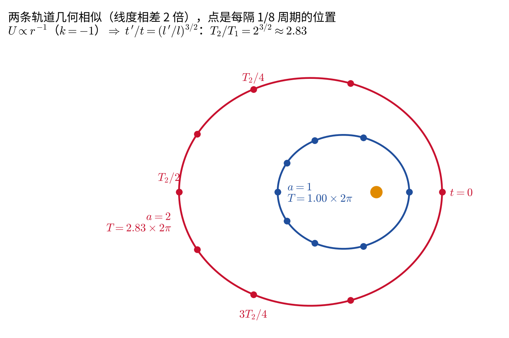

<!-- 19 页 -->

## 位力定理（维里定理）
> Virial Theorem

考虑一个多粒子力学系统，并且它在有限空间中运动，例如太阳系内行星运动、星系中恒星的运动等。维里定理把系统的时间平均动能和时间平均势能联系起来，在天体物理中有重要的应用：例如通过观测星系团中星系的运动速度，结合维里定理反推星系团的总质量，正是历史上发现暗物质存在的重要证据之一（Zwicky, 1933）。

由于动能是速度的二次函数，有

$$
\begin{equation}
\sum_a\frac{\partial T}{\partial\vec v_a}\cdot\vec v_a
=2T
=\sum_a\vec p_a\cdot\vec v_a.
% \label{eq:virial-kinetic-energy-euler-relation}
\end{equation}
$$

又因为

$$
\begin{equation}
\sum_a\vec p_a\cdot\vec v_a
=\frac{d}{dt}\left(\sum_a\vec p_a\cdot\vec r_a\right)
-\sum_a\dot{\vec p}_a\cdot\vec r_a,
% \label{eq:virial-momentum-identity}
\end{equation}
$$

所以

$$
\begin{equation}
2T=\frac{d}{dt}\left(\sum_a\vec p_a\cdot\vec r_a\right)
-\sum_a\dot{\vec p}_a\cdot\vec r_a.
% \label{eq:virial-2T-relation}
\end{equation}
$$

将上式对时间求平均。定义

$$
\begin{equation}
\overline f=\lim_{\tau\to\infty}\frac1\tau\int_0^\tau f(t)\,dt.
% \label{eq:time-average-definition}
\end{equation}
$$

如果 $f(t)$ 是某个有界函数 $F(t)$ 对时间的全导数，则 $f(t)$ 的时间平均等于零：

$$
\begin{equation}
\overline f
=\lim_{\tau\to\infty}\frac1\tau\int_0^\tau\frac{dF}{dt}\,dt
=\lim_{\tau\to\infty}\frac{F(\tau)-F(0)}{\tau}=0.
% \label{eq:time-average-total-derivative-zero}
\end{equation}
$$

取

$$
\begin{equation}
F(t)=\sum_a\vec p_a\cdot\vec r_a.
% \label{eq:virial-F-definition}
\end{equation}
$$

由于系统在有限范围内运动，$\vec r_a$ 有界；相应地 $\vec p_a$ 有界，故 $F(t)$ 有界。于是全导数项的时间平均为零，并由 $\dot{\vec p}_a=-\partial U/\partial\vec r_a$ 得

$$
\begin{equation}
2\overline T
=\sum_a\overline{\vec r_a\cdot\frac{\partial U}{\partial\vec r_a}}.
% \label{eq:virial-theorem-intermediate}
\end{equation}
$$

如果势能 $U$ 是所有 $\vec r_a$ 的 $k$ 次齐次函数，则由欧拉齐次函数定理

$$
\begin{equation}
\sum_a\vec r_a\cdot\frac{\partial U}{\partial\vec r_a}=kU.
% \label{eq:euler-homogeneous-function-theorem}
\end{equation}
$$

证明：欧拉齐次函数定理

对 $U(\alpha\vec r_1,\ldots,\alpha\vec r_N)=\alpha^kU(\vec r_1,\ldots,\vec r_N)$ 两边对 $\alpha$ 求导，再令 $\alpha=1$：

$$
\begin{equation*}
\sum_a\vec r_a\cdot\frac{\partial U}{\partial\vec r_a}\bigg|_{\alpha\vec r}=k\alpha^{k-1}U
\quad\xrightarrow{\ \alpha=1\ }\quad
\sum_a\vec r_a\cdot\frac{\partial U}{\partial\vec r_a}=kU .
\end{equation*}
$$

本节开头的 $\sum_a\vec v_a\cdot\partial T/\partial\vec v_a=2T$ 是同一个定理用于速度的二次齐次函数 $T$（$k=2$）。例如 $U=-\alpha/r$ 时 $\vec r\cdot\nabla U=\alpha/r=-U$，$k=-1$。

因此位力定理为

$$
\begin{equation}
{2\overline T=k\overline U}.
% \label{eq:virial-theorem}
\end{equation}
$$

由于

$$
\begin{equation}
\overline T+\overline U=\overline E=E,
% \label{eq:virial-energy-conservation-average}
\end{equation}
$$

所以

$$
\begin{equation}
{
\overline U=\frac{2}{k+2}E,
\qquad
\overline T=\frac{k}{k+2}E
}.
% \label{eq:virial-theorem-energy-partition}
\end{equation}
$$

当 $k=2$ 时，

$$
\begin{equation}
\overline T=\overline U=\frac12E,
% \label{eq:virial-harmonic-oscillator-case}
\end{equation}
$$

对应谐振子。

当 $k=-1$ 时，

$$
\begin{equation}
\overline T=-\frac12\overline U=-E,
% \label{eq:virial-coulomb-case}
\end{equation}
$$

对应牛顿引力势或库仑势。由于 $T>0$，有界运动要求 $E<0$；只有总能量为负时运动才有界。

下图以一条偏心率较大的开普勒轨道为例：动能和势能都随时间剧烈变化，但它们的累积时间平均很快趋于 $\overline T=-E$、$\overline U=2E$。

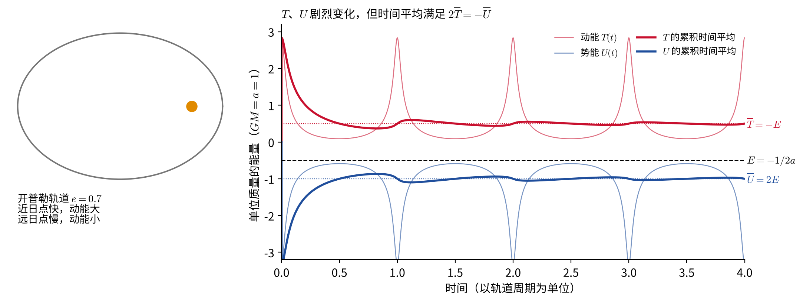

这与开普勒问题中椭圆轨道（束缚态，$E<0$）与双曲线轨道（非束缚态，$E>0$）的分类是一致的，会在下一章中心力场问题中看到更完整的对应关系。

延伸阅读：用位力定理“称”星系团，以及自引力系统的负热容

**星系团的质量。** 设星系团总质量为 $M$、尺度为 $R$，处于稳定状态。位力定理 $2\overline T=-\overline U$ 给出量级估计

$$
\begin{equation*}
M\langle v^2\rangle\sim\frac{GM^2}{R}
\quad\Longrightarrow\quad
M\sim\frac{\langle v^2\rangle R}{G}.
\end{equation*}
$$

$\langle v^2\rangle$ 可以由星系谱线的多普勒位移测出（视向速度弥散 $\sigma$，$\langle v^2\rangle\approx3\sigma^2$），$R$ 由图像测出。对后发星系团，$\sigma\approx1000$ km/s、$R\sim1$ Mpc，得到 $M\sim10^{15}$ 个太阳质量，远大于星系发光部分所能提供的质量。茨维基在 1933 年正是这样提出了“看不见的物质”，即今天所说的暗物质。

**负热容。** 对引力系统 $\overline T=-E$。系统通过辐射损失能量时，$E$ 变得更负，平均动能反而**增大**：系统越“冷却”（失去能量）越“热”（粒子运动越快）。恒星在辐射中收缩、中心温度升高，最终点燃核聚变，靠的就是这一点。一个日常的例子是低轨道卫星：大气阻力使它损失能量，轨道降低，速度却变得更快。

<!-- 20 页 -->

## 作业

本章作业的目的是巩固最小作用量原理与变分法的计算技巧（第 1、2 题）、欧拉–拉格朗日方程的推导与应用（第 3、7 题），以及对称性与守恒律、维里定理的物理理解（第 4、5、6 题）。每道题后面有折叠的提示，建议先独立尝试，再展开查看，并对照正文中相应的例子检查。

1. 简述最小作用量原理。

   

   
提示

   要点：拉氏量 $L(q,\dot q,t)$、作用量 $S=\int L\,dt$、端点固定的变分、$\delta S=0$。再说明为什么更准确的名字是“平稳作用量原理”（见正文关于二阶变分的进阶折叠块），以及 $L$ 加全导数项不改变运动方程。

   

2. 变分法是理论力学中非常重要的数学工具。试计算如下作用量对广义坐标的泛函变分和一阶泛函导数：

   a. 
   $$
     \begin{equation}
      S=\int_{t_1}^{t_2}q^2(t)\,dt;
      % \label{eq:homework-functional-q-squared}
     \end{equation}
   $$

   b. 
   $$
     \begin{equation}
      S=\int_{t_1}^{t_2}\left[q(t)+\dot q(t)\right]dt.
      % \label{eq:homework-functional-q-plus-qdot}
     \end{equation}
   $$

   

   
提示

   a 与正文[“泛函导数”](#泛函导数)一节的例 1 相同。b 中 $\dot q$ 这一项是全导数，对照正文“拉氏量加全导数项”一段，想一想它对固定端点的变分有没有贡献；最后的泛函导数非常简单。

   

3. 试推导出欧拉–拉格朗日方程，并写出一维谐振子的拉格朗日量和计算其运动方程。

   

   
提示

   推导的关键一步是分部积分，并用固定端点条件去掉边界项；谐振子的例子见[“一维例子与能量”](#一维例子与能量)一节。

   

4. 试推导出球坐标系下的角动量分量的具体形式。

   

   
提示

   仿照正文柱坐标的例子，两种方法都可以。用球坐标单位基矢时，$\vec r=r\hat e_r$，$\vec v=\dot r\hat e_r+r\dot\theta\hat e_\theta+r\sin\theta\,\dot\varphi\hat e_\varphi$，叉乘后只剩 $\hat e_\theta$、$\hat e_\varphi$ 两个分量（为什么没有 $\hat e_r$ 分量？）。最后检验直角分量 $L_z=mr^2\sin^2\theta\,\dot\varphi$ 与正文中由 $\partial L/\partial\varphi=0$ 得到的守恒量一致。

   

5. 简述诺特定理，列出 3 个对称性和相应守恒量。

   

   
提示

   时间平移、空间平移、空间转动分别对应能量、动量、角动量。可以再想一想伽利略变换对应什么（见[“诺特定理”](#诺特定理连续对称性)一节的进阶折叠块）。

   

6. 简述维里定理，并写出牛顿引力势下平均动能和势能的关系。

   

   
提示

   注意定理成立的条件：运动有界，取足够长时间的平均。引力势 $k=-1$，结果与正文的开普勒轨道数值例子（图）对照。

   

7. 一般坐标系下，具有如下形式的拉格朗日量
   $$
     \begin{equation}
     L=\sum_{a,b}\frac12 k_{ab}(q)\dot q_a\dot q_b-V(q_1,q_2,\ldots,q_N).
     % \label{eq:homework-general-coordinate-lagrangian}
     \end{equation}
   $$

   其中 $k_{ab}(q)$ 是关于广义坐标的函数。求出广义坐标 $q_a$ 的欧拉–拉格朗日方程。将结论用到采用柱坐标和球坐标表示的系统，写出各广义坐标相应的运动方程。

   

   
提示

   一般形式见[“多粒子与一般坐标系”](#多粒子与一般坐标系)一节。柱坐标 $(r,\varphi,z)$ 中 $k=\mathrm{diag}(m,\,mr^2,\,m)$，球坐标 $(r,\theta,\varphi)$ 中 $k=\mathrm{diag}(m,\,mr^2,\,mr^2\sin^2\theta)$。注意 $\partial k_{ab}/\partial q_i$ 项给出离心力等熟悉的项，例如柱坐标中 $m\ddot r-mr\dot\varphi^2=-\partial V/\partial r$。

   

## 参考文献与延伸阅读

- L. D. Landau, E. M. Lifshitz, *Mechanics* (Course of Theoretical Physics, Vol. 1), 3rd ed., Butterworth-Heinemann, 1976，第 1–2 章。本章“自由质点的拉格朗日函数”“独立运动积分的数目”“力学相似性”“位力定理”的处理均沿用该书。中译本：朗道、栗弗席兹，《力学》，高等教育出版社。
- H. Goldstein, C. Poole, J. Safko, *Classical Mechanics*, 3rd ed., Addison-Wesley, 2002，第 1–2 章（达朗贝尔原理、哈密顿原理、变分法与守恒律）。
- J. R. Taylor, *Classical Mechanics*, University Science Books, 2005，第 6–7 章（变分法、拉格朗日方程）。
- R. P. Feynman, R. B. Leighton, M. Sands, *The Feynman Lectures on Physics*, Vol. II, Addison-Wesley, 1964，第 19 章 “The Principle of Least Action”。
- E. Noether, “Invariante Variationsprobleme”, *Nachrichten von der Gesellschaft der Wissenschaften zu Göttingen, Math.-Phys. Klasse*, 1918, 235–257。诺特定理的原始论文。
- F. Zwicky, “Die Rotverschiebung von extragalaktischen Nebeln”, *Helvetica Physica Acta* **6**, 110–127 (1933)。用位力定理估计后发星系团质量。
