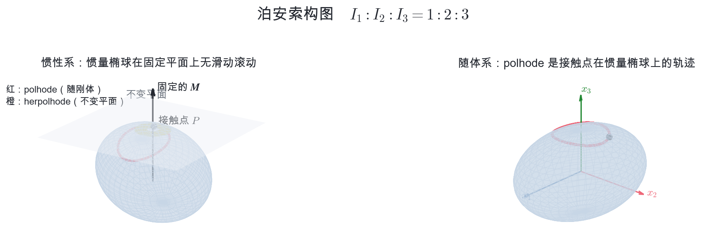
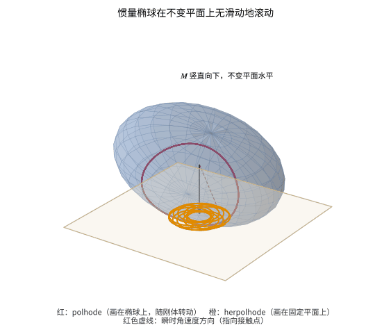

# 泊安索构图

**——[“刚体运动”](刚体运动.md)的延伸阅读**

> 本文是[“刚体运动”](刚体运动.md)一章中[“非对称刚体的自由转动”](刚体运动.md#非对称刚体的自由转动)一节的补充材料，暂不并入正文。符号沿用该章的约定：
>
> - 随体（刚体）坐标轴为主轴 $x_1,x_2,x_3$，主转动惯量 $I_1<I_2<I_3$；
> - $\boldsymbol\Omega$ 为角速度，$\boldsymbol M$ 为角动量，在主轴系中 $M_i=I_i\Omega_i$；$E$ 为转动能；
> - 全文讨论**无外力矩**的自由转动，并在质心静止的惯性系中观察，所以刚体的质心 $O$ 不动。
>
> 只需要用到正文的三个结果：$2E=\sum_i I_i\Omega_i^2$、$\boldsymbol M$ 在惯性系中守恒、$E$ 守恒。不需要解欧拉方程。

## 一句话版本

> **自由刚体怎样转动？想象一个与刚体固连的椭球，它在一张固定不动的平面上只滚不滑。刚体就跟着这个椭球一起动。**

这个椭球叫**惯量椭球**，这张平面叫**不变平面**。整个图像由泊安索（L. Poinsot）在 1834 年提出 [1]，称为**泊安索构图**。本文的任务就是说明这句话里的每个词是什么意思，以及它为什么成立。

## 为什么需要这个图像

正文已经用两种方式描述过自由刚体：

1. **欧拉方程**，给出 $\Omega_1,\Omega_2,\Omega_3$ 随时间的变化；
2. **能量椭球与角动量球面的交线**，给出 $\boldsymbol M$ 相对刚体的轨迹。

两者都是“坐在刚体上看”的结果：$\Omega_i$ 和 $M_i$ 都是随体主轴上的分量。可是实验中我们站在实验室里，看到的是刚体在空间中翻滚。要从 $\Omega_i(t)$ 得到刚体在空间中的取向，还得再积分一次欧拉角的方程，结果是椭圆函数，很难直接想象。

泊安索构图绕开了这一步。它不解任何微分方程，只用两条守恒律，就把“刚体在空间中怎么动”变成一幅可以在脑中转动的几何图。

## 三个角色

### 角色一：惯量椭球

在随体系中取坐标 $\boldsymbol\xi=(\xi_1,\xi_2,\xi_3)$，定义曲面

$$
\begin{equation}
I_1\xi_1^2+I_2\xi_2^2+I_3\xi_3^2=1 .
\end{equation}
$$

这是一个中心在质心 $O$、三条轴沿主轴的椭球，三条半轴长为

$$
\begin{equation}
a_i=\frac{1}{\sqrt{I_i}},\qquad a_1>a_2>a_3 .
\end{equation}
$$

注意这里的反比关系：**转动惯量越大的方向，椭球越短。** 以 $I_1:I_2:I_3=1:2:3$ 为例，半轴之比为 $1:0.71:0.58$。

惯量椭球被“画”在刚体上，随刚体一起转动。知道了椭球的取向，就知道了刚体的取向。它容易和另外两样东西混淆：

| | 所在空间 | 半轴 | 是否随刚体转动 |
| --- | --- | --- | --- |
| 刚体的外形 | 真实空间 | 由形状决定 | 是 |
| **惯量椭球**（本文） | 真实空间（随体坐标 $\boldsymbol\xi$） | $1/\sqrt{I_i}$ | 是 |
| 正文中的能量椭球 | 角动量 $\boldsymbol M$ 空间 | $\sqrt{2EI_i}$ | 画在随体系的 $\boldsymbol M$ 空间中 |

惯量椭球大致“像”刚体的外形（长的方向都长），但它是由 $I_i$ 定义的抽象曲面，并不是刚体的表面；它与能量椭球的长短轴恰好相反。

### 角色二：不变平面

角动量 $\boldsymbol M$ 在惯性系中是一个固定的矢量。取一张垂直于 $\boldsymbol M$ 的平面，让它到质心 $O$ 的距离为

$$
\begin{equation}
d=\frac{\sqrt{2E}}{M}.
\end{equation}
$$

$E$ 和 $M$ 都守恒，所以这张平面在空间中固定不动，称为**不变平面**。它不是真实存在的桌面，只是一个几何参照物。

### 角色三：接触点

把角速度按 $\sqrt{2E}$ 缩小，得到随体系中的一个点

$$
\begin{equation}
\boldsymbol\xi_P=\frac{\boldsymbol\Omega}{\sqrt{2E}} .
\end{equation}
$$

也就是说，从质心出发沿瞬时转轴方向走 $|\boldsymbol\Omega|/\sqrt{2E}$ 的距离，到达点 $P$。下面会看到，$P$ 正是惯量椭球与不变平面的接触点。

## 四步搭起构图

下面每一步都只有一两行计算。

**第一步：$P$ 在惯量椭球上。** 把 $\boldsymbol\xi_P$ 代入椭球方程：

$$
\begin{equation}
\sum_i I_i\xi_{P,i}^2=\frac{1}{2E}\sum_i I_i\Omega_i^2=\frac{2E}{2E}=1 .
\end{equation}
$$

这只是能量的表达式 $2E=\sum_iI_i\Omega_i^2$ 换了一种写法：**瞬时转轴穿出惯量椭球的地方就是 $P$。**

**第二步：椭球在 $P$ 点的法线沿 $\boldsymbol M$。** 曲面 $F(\boldsymbol\xi)=\sum_iI_i\xi_i^2=1$ 的法向是 $F$ 的梯度：

$$
\begin{equation}
\left.\boldsymbol\nabla_{\!\xi}F\right|_P
=2\,(I_1\xi_{P,1},\,I_2\xi_{P,2},\,I_3\xi_{P,3})
=\frac{2\boldsymbol M}{\sqrt{2E}} .
\end{equation}
$$

所以椭球在 $P$ 点的切平面垂直于 $\boldsymbol M$。由于 $\boldsymbol M$ 在空间中方向不变，这张切平面的**朝向**永远不变。

**第三步：切平面到质心的距离不变。** 质心到切平面的距离等于 $\overrightarrow{OP}$ 在法向 $\boldsymbol M/M$ 上的投影：

$$
\begin{equation}
\boldsymbol\xi_P\cdot\frac{\boldsymbol M}{M}
=\frac{\boldsymbol\Omega\cdot\boldsymbol M}{\sqrt{2E}\,M}
=\frac{2E}{\sqrt{2E}\,M}
=\frac{\sqrt{2E}}{M}=d ,
\end{equation}
$$

其中用到 $\boldsymbol\Omega\cdot\boldsymbol M=\sum_iI_i\Omega_i^2=2E$。朝向固定、到固定点 $O$ 的距离也固定，这张切平面就是角色二中的不变平面。**惯量椭球始终与不变平面相切。**

**第四步：接触点没有滑动。** $P$ 位于过质心的瞬时转轴上，而转轴上的刚体点瞬时速度为零：

$$
\begin{equation}
\boldsymbol v_P=\boldsymbol\Omega\times\overrightarrow{OP}=0 .
\end{equation}
$$

椭球上与平面接触的那个点相对平面瞬时静止，这正是“只滚不滑”的含义，与正文[“纯滚动与瞬时转轴”](刚体运动.md#例纯滚动与瞬时转轴)中车轮的例子是同一回事。

四步合起来就是泊安索的结论：

> **无外力矩时，刚体的运动等价于：与它固连的惯量椭球，中心固定在离不变平面 $d=\sqrt{2E}/M$ 处，在不变平面上无滑动地滚动。**

上图左侧是惯性系中的样子：浅色平面是不变平面，$\boldsymbol M$ 垂直于它，椭球在 $P$ 点与平面相切。右侧是随体系中的同一个椭球，三条主轴固定不动。（图中把 $\boldsymbol M$ 画成向上，平面在椭球上方；下面的动画把 $\boldsymbol M$ 画成向下，平面像桌面一样托着椭球。两种画法等价。）

补充：这种“滚动”和球在桌面上滚有一点不同

普通的球在桌面上纯滚动时，角速度平行于桌面。这里的角速度 $\boldsymbol\Omega$ 沿 $\overrightarrow{OP}$ 方向，它有一个垂直于平面的分量

$$
\begin{equation*}
\boldsymbol\Omega\cdot\frac{\boldsymbol M}{M}=\frac{2E}{M},
\end{equation*}
$$

而且这个分量是常量。所以椭球在滚动的同时，还绕接触点处的法线匀速“拧转”。接触点没有滑动，但椭球并不像车轮那样只向前滚。

## 两条轨迹：polhode 与 herpolhode

椭球滚动时，接触点 $P$ 不断变化。它留下两条痕迹，可以想象成椭球表面涂了墨水：

- 椭球上被墨水蹭掉的那条线，画在**椭球**上，随刚体一起转动，称为 **polhode**（本体极迹）；
- 平面上留下的那条墨迹，画在**不变平面**上，在空间中固定，称为 **herpolhode**（空间极迹）。

它们是同一个接触点在两个参考系中的轨迹：polhode 是随体系中 $\boldsymbol\Omega/\sqrt{2E}$ 的轨迹，herpolhode 是惯性系中同一矢量的轨迹。

动画按 $I_1:I_2:I_3=1:2:3$ 数值积分欧拉方程得到。红色曲线是 polhode，随椭球一起转动；橙色曲线是 herpolhode，逐渐画在平面上；红色虚线是瞬时转轴，始终指向接触点。

### polhode：一条闭合曲线

$P$ 点同时满足两个条件：它在惯量椭球上（能量守恒），并且 $M^2=\sum_iI_i^2\Omega_i^2$ 守恒。用 $\boldsymbol\xi$ 写出来，polhode 是两个椭球面的交线：

$$
\begin{equation}
\sum_i I_i\xi_i^2=1,
\qquad
\sum_i I_i^2\xi_i^2=\frac{M^2}{2E}=\frac{1}{d^2}.
\end{equation}
$$

它与正文中“能量椭球与角动量球面的交线”是同一条曲线换了坐标：$M_i=\sqrt{2E}\,I_i\xi_i$，只是沿三条主轴各拉伸了一个倍数。因此正文中关于交线的结论全部适用：

- polhode 是闭合曲线，$P$ 沿着它周期性地绕圈；
- 在 $x_1$ 轴（椭球最长轴）和 $x_3$ 轴（椭球最短轴）的端点附近，polhode 是围绕端点的小圈；
- 经过 $x_2$ 轴端点的 polhode 是两条交叉的分离线。

### herpolhode：夹在两个圆之间、一般不闭合

设 $P$ 到 $\boldsymbol M$ 轴与平面交点的距离为 $\rho$。由勾股定理，

$$
\begin{equation}
\rho^2=|\boldsymbol\xi_P|^2-d^2=\frac{\Omega^2}{2E}-\frac{2E}{M^2}.
\end{equation}
$$

$P$ 沿 polhode 绕一圈，$|\boldsymbol\Omega|$ 在最大值与最小值之间往复一次，所以 herpolhode 夹在两个同心圆之间。polhode 每走完一圈，herpolhode 绕中心转过一个固定的角度；这个角度一般不是 $2\pi$ 的有理数倍，所以 herpolhode 一般**不闭合**，会逐渐填满两圆之间的环带。

这带来一个重要的结论：**$\boldsymbol\Omega$ 相对刚体的运动是周期的，但刚体在空间中的运动一般不是周期的**，而是由两个不可公约的频率叠加成的准周期运动。

## 用构图读出物理

### 绕主轴的匀速转动

如果 $\boldsymbol\Omega$ 恰好沿某条主轴，$P$ 就是椭球的一个顶点。顶点处的切平面本来就垂直于这条轴，于是椭球用顶点“立”在平面上，原地绕这条轴匀速自旋。polhode 和 herpolhode 都缩成一个点。这就是三种定轴转动。

此时质心到平面的距离等于相应的半轴，$d=a_i$。一般情形下 $d$ 介于最短与最长半轴之间：

$$
\begin{equation}
a_3\le d\le a_1
\quad\Longleftrightarrow\quad
2EI_1\le M^2\le 2EI_3 ,
\end{equation}
$$

与正文中交线存在的条件相同。

### 中间轴为什么不稳定

把椭球从顶点稍稍推歪一点，看 $P$ 沿哪条 polhode 走：

- **最长轴 $x_1$ 或最短轴 $x_3$ 的顶点附近**，polhode 是绕顶点的小圈。$P$ 只在顶点周围打转，椭球只是轻微晃动，转动是稳定的。
- **中间轴 $x_2$ 的顶点附近**，polhode 是交叉的分离线。$P$ 一旦偏离，就沿着分离线附近的大回路走到椭球另一侧的 $-x_2$ 顶点附近，再走回来。椭球随之翻了个身。

这就是[“中间轴定理与贾尼别科夫效应”](刚体运动.md#中间轴定理与贾尼别科夫效应)的几何解释。整个过程中不变平面和 $\boldsymbol M$ 纹丝不动，翻转的只是椭球（刚体）相对它们的取向。

### 对称陀螺：两个圆锥

当 $I_1=I_2$ 时，惯量椭球是绕 $x_3$ 轴的回转椭球。这时 polhode 是椭球上绕 $x_3$ 轴的圆，herpolhode 是平面上绕 $\boldsymbol M$ 轴的圆。从质心向这两个圆连线，得到两个圆锥：

- 以 polhode 为底的圆锥固定在刚体上，就是正文中的**本体锥**；
- 以 herpolhode 为底的圆锥固定在空间中，就是**空间锥**。

椭球在平面上滚动，等价于本体锥在空间锥上滚动。正文[“欧拉方程”](刚体运动.md#欧拉方程)一节中自由对称陀螺的图像，正是泊安索构图的特例。对非对称刚体，两个锥不再是圆锥，但“本体锥在空间锥上无滑动滚动”的说法仍然成立。

### 球陀螺

当 $I_1=I_2=I_3$ 时，惯量椭球是球，任何一点处的法线都过球心，所以 $\boldsymbol\Omega\parallel\boldsymbol M$。球在平面上原地自旋，刚体绕固定轴匀速转动。

## 三种等价的描述

| | 欧拉方程 | 能量椭球与角动量球面的交线 | 泊安索构图 |
| --- | --- | --- | --- |
| 研究对象 | $\Omega_i(t)$ | $\boldsymbol M$ 相对刚体的轨迹 | 惯量椭球相对空间的运动 |
| 所在参考系 | 随体系 | 随体系 | 随体系与惯性系同时出现 |
| 用到的守恒量 | 包含在方程中 | $E$、$M^2$ | $E$、$\boldsymbol M$（大小和方向） |
| 擅长回答 | 定量的时间演化 | 稳定性、轨道拓扑 | 刚体在空间中怎样运动 |

三者描述的是同一个运动。前两种只用到 $\boldsymbol M$ 的大小守恒；泊安索构图还用到了 $\boldsymbol M$ 的**方向**在空间中不变，所以能够给出惯性系中的图像。

## 常见误解

1. **“刚体真的在一张平面上滚。”** 不是。不变平面和惯量椭球都是几何构造，刚体在空中自由转动，什么也没有碰到。
2. **“惯量椭球就是刚体的形状。”** 不是。它由三个主转动惯量决定，任何形状的刚体都有一个惯量椭球。
3. **“polhode 闭合，所以刚体的运动是周期的。”** 不对。polhode 闭合只说明 $\boldsymbol\Omega$ 相对刚体周期变化；herpolhode 一般不闭合，刚体在空间中的取向一般不会精确复原。
4. **“无滑动就是像车轮那样滚。”** 不完全是。椭球还绕接触点的法线以恒定角速度 $2E/M$ 拧转。

## 小结

1. 惯量椭球 $\sum_iI_i\xi_i^2=1$ 固连在刚体上，半轴为 $1/\sqrt{I_i}$。
2. 瞬时转轴与惯量椭球的交点 $P$ 处，椭球的切平面垂直于 $\boldsymbol M$，到质心的距离恒为 $\sqrt{2E}/M$，因此是空间中的固定平面。
3. $P$ 点瞬时静止，所以惯量椭球在不变平面上无滑动地滚动。
4. $P$ 在椭球上的轨迹 polhode 是闭合曲线；在平面上的轨迹 herpolhode 夹在两个同心圆之间，一般不闭合。
5. polhode 在最长轴和最短轴顶点附近是小圈，在中间轴顶点处是交叉线，由此直接看出中间轴转动不稳定。
6. 对称陀螺的本体锥与空间锥是泊安索构图的特例。

## 参考文献与延伸阅读

1. L. Poinsot, *Théorie nouvelle de la rotation des corps*, Bachelier, Paris, 1834。泊安索构图的原始来源，即[“刚体运动”](刚体运动.md)一章参考文献 [9]。
2. H. Goldstein, C. Poole and J. Safko, *Classical Mechanics*, 3rd ed., Chapter 5, Pearson。对惯量椭球、不变平面和两条极迹有完整的教科书讨论。
3. L. D. Landau and E. M. Lifshitz, *Mechanics*, 3rd ed., “Motion of a Rigid Body,” Butterworth-Heinemann。用能量椭球与角动量球面的交线讨论非对称陀螺的自由转动，可与本文的 polhode 对照。

<!-- 本文的两幅图由 `figures/four/` 下的 Python 脚本数值积分欧拉方程生成，脚本中验证了接触点始终落在不变平面上、切平面法向与 $\boldsymbol M$ 平行。-->
