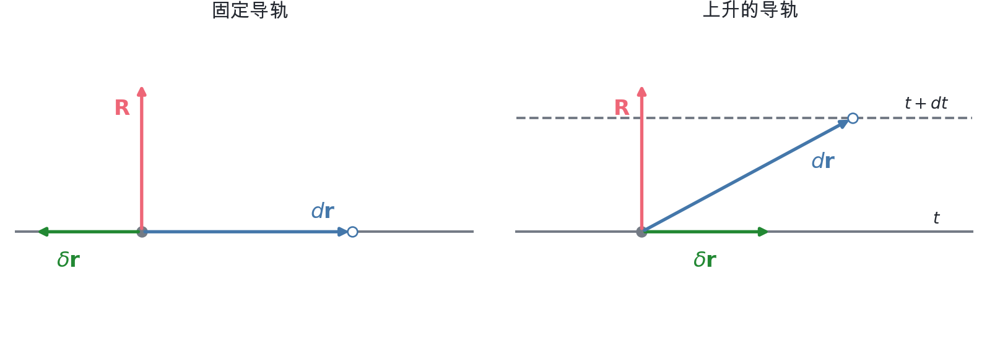

> **参考书**
- 力学, 朗道，栗弗席兹，高等教育出版社
- 理论力学, 刘川，北京大学出版社
- 经典力学, 高显，科学出版社
- Classical Mechanics, Taylor, University Science Books
- Classical Mechanics, Goldstein, 高等教育出版社
- Classical Mechanics, Kibble, Berkshire, 世界图书出版公司
- Analytical Mechanics, Fasano, Marmi, 牛津大学出版社
- Mathematical Methods of Classical Mechanics, Arnold, 世界图书出版公司

> **考核方式**
- 平时作业 50%，及时提交
- 期末考试 50%，闭卷考试

> **声明**
- 讲义还在完善中，参考和引用等未必符合规范
- 讲义请勿传播，如有必要，采用 [CC BY-NC-SA 4.0](https://creativecommons.org/licenses/by-nc-sa/4.0/deed.zh-hans) 许可：在注明出处、非商业使用、以相同方式共享的前提下，可以转载和改编；引用的图片与资料版权归原作者所有

 

# 绪论

**本章安排（4 学时）**　先用切向投影求摆角的运动方程，再从虚功出发推到同一结果。第二次课把单摆推广到多质点系统，特别留意从式（30）到式（41）时，哪些虚位移可以独立取值。牛顿三定律作为复习，火箭的动量收支和虚功充分性的证明可留到课后。

> 为什么学习完牛顿力学，还需要学习理论力学？

以固定悬点的平面单摆为例。用直角坐标写牛顿方程，摆球的位置要用两个分量表示，受力图上还要画出绳的张力。若只关心摆角怎样随时间变化，可以沿圆弧的切线写运动方程。张力沿绳方向，在切线上没有分量。绳长固定且绳始终绷紧时，一个摆角就足以确定摆球的位置。

拉格朗日力学把这个做法推广到有多个自由度的系统。在理想完整约束下，先选取能独立变化的广义坐标，再用动能和广义力写出运动方程。若主动力来自势能，只需写出拉格朗日量（简称拉氏量）$L=T-V$。对于单摆，摆角就是这样的广义坐标。

## 力学与理论力学

**力学**：研究物质机械运动规律的科学。——《中国大百科全书》

> Mechanics: a branch of physical science that deals with energy and forces and their effect on bodies. — Merriam-Webster Dictionary

**理论力学**（Theoretical Mechanics）：静力学、运动学、动力学。（20 世纪 50 年代由苏联引入。）

### 经典力学

经典力学（Classical Mechanics），有时也译作古典力学，包括：

- 牛顿力学（Newtonian mechanics，1687），代表作《自然哲学的数学原理》。以力为核心，也称矢量力学。
- 拉格朗日力学（Lagrangian mechanics，1788）。
- 哈密顿力学（Hamiltonian mechanics，1834-1835）。

拉格朗日力学和哈密顿力学合称分析力学（analytical mechanics）。前者用广义坐标和广义速度描述运动，后者用广义坐标和共轭动量描述运动。有时仅从拉氏量的形式就能看出一个守恒量。例如，若拉氏量含有某个转角的变化率，却不含转角本身，相应的共轭动量就守恒。

这套方法也用于经典场论和电动力学。后面的专题还会讨论力学中的作用量原理与几何光学中费马原理的联系。哈密顿量则会在量子力学和量子场论中再次出现。

### 课程内容

本课程共 64 学时，分 32 次课，每次 2 学时。课堂练习和数值演示计入各章学时。

| 主章 | 学时 | 课堂问题 |
|---|---:|---|
| [绪论](绪论.md) | 4 | 单摆的张力怎样消去 |
| [最小作用量原理](最小作用量原理.md) | 10 | 从路径变分到守恒量 |
| [中心力场](中心力场.md) | 12 | 从两个质点到轨道与截面 |
| [微扰和摄动理论](微扰和摄动理论.md) | 10 | 小量、时间尺度与共振 |
| [刚体运动](刚体运动.md) | 8 | 从体轴分量判断转动稳定性 |
| [哈密顿力学](哈密顿力学.md) | 12 | 用相轨道描述运动 |
| [无碰撞粒子体系](无碰撞粒子体系.md) | 8 | 由恒星速度估计引力质量 |

### 专题选读

学完相应主章后，可以从感兴趣的问题进入。轨道确定、泊安索构图和辛积分各有一段在课堂使用，具体位置见对应主章。

- 轨道与观测　[卫星轨道与轨道确定](卫星轨道与轨道确定.md)、[脉冲星三体系统与层级三体问题](脉冲星三体系统与层级三体问题.md)。
- 刚体与航天器　[泊安索构图](泊安索构图.md)、[欧拉角与航天器姿态控制](欧拉角与航天器姿态控制.md)、[自转轨道耦合与潮汐锁定](草稿_自转轨道耦合与潮汐锁定.md)。
- 光学与强引力　[费马原理与引力透镜](费马原理与引力透镜.md)、[球对称黑洞中的粒子运动](球对称黑洞中的粒子运动.md)。
- 长期轨道与稳定性　[辛几何与哈密顿力学](辛几何与哈密顿力学.md)、[动力学系统与混沌](动力学系统与混沌.md)、[KAM定理](KAM定理.md)。
- 尺度、振动与场　[力学相似性的更多应用](力学相似性的更多应用.md)、[从振子链到连续介质](从振子链到连续介质.md)、[对称性自发破缺](对称性自发破缺.md)、[量子谐振子与经典极限](量子谐振子与经典极限.md)。
- 从相空间继续读　[从哈密顿力学到统计力学](从哈密顿力学到统计力学.md)、[哈密顿约束与自由度](哈密顿约束与自由度.md)。

> 牛顿力学概要

## 牛顿三定律的表述

### 第一定律
**惯性参考系**：存在一类参考系，其中不受外力的质点保持静止或匀速直线运动。
> 《墨经》：力，形之所以奋也。力是物体运动发生变化的原因。

### 第二定律

$$
\mathbf{F} = \frac{d\mathbf{p}}{dt},\qquad \mathbf{p} = m\mathbf{v}. \tag{1}
$$

以下在惯性系中讨论，$\mathbf F$ 表示合外力。当 $m$ 为常数时，式（1）给出 $\mathbf{F}=m\ddot{\mathbf{r}}$。相对论力学仍用动量形式，此时 $\mathbf p=\gamma m\mathbf v$。

对火箭这样的变质量系统，直接写 $\mathbf F=\dfrac{d(m\mathbf v)}{dt}$ 会漏掉喷出物带走的动量。取一小段时间，把这段时间内喷出的燃料和剩余火箭合在一起计算，系统包含的物质就固定了。设火箭质量的变化为 $dm<0$，则喷出物的质量为 $-dm$，相对惯性系的速度在一阶近似下为 $\mathbf v+\mathbf u$。把两部分的末动量相加，再减去初动量，保留一阶项，得到 $m\,d\mathbf v-\mathbf u\,dm=\mathbf F\,dt$。因此 $m\dot{\mathbf v}=\mathbf F+\mathbf u\,\dot m$，其中 $\mathbf u$ 是喷出物相对火箭的速度。

### 第三定律

$$
\mathbf{F}_{ij} = -\mathbf{F}_{ji}. \tag{2}
$$
作用力与反作用力大小相等，方向相反，分别作用在两个物体上。

## 单质点动力学：三大定理

### 动量定理
$$
\frac{d\mathbf p}{dt} = \mathbf F \tag{3}
$$
若 $\mathbf F=0$，动量守恒。

### 角动量定理
相对于惯性系中的同一固定原点，定义角动量 $\mathbf{L} = \mathbf{r}\times\mathbf{p}$ 和力矩 $\mathbf{N}=\mathbf{r}\times\mathbf F$。对角动量求时间导数，乘积法则中的第一项为 $\dot{\mathbf r}\times\mathbf p = \mathbf v\times m\mathbf v=0$，因而
$$
\frac{d\mathbf L}{dt} = \mathbf r \times \dot{\mathbf p} = \mathbf r\times \mathbf F = \mathbf N \tag{4}
$$
若 $\mathbf N=0$，角动量守恒。例如，在开普勒问题中取力心为原点，$\mathbf F\parallel \mathbf r$，力矩始终为零。角动量非零时，位置矢量始终垂直于这个固定的角动量矢量，轨道因此位于同一平面内。

### 动能定理
将常质量质点的运动方程与位移 $d\mathbf r=\mathbf v\,dt$ 点乘。左边的 $m\mathbf v\cdot d\mathbf v$ 正好是动能的微分，于是
$$
dT = \mathbf F\cdot d\mathbf r,\qquad T=\tfrac12 mv^2 \tag{5}
$$
若 $\mathbf F = -\nabla V(\mathbf r)$，力做的功只取决于起点和终点。在单连通区域内，对光滑力场也可以用 $\nabla\times\mathbf F=0$ 来判断它是否保守。这里的势能不显含时间，沿轨道有 $\mathbf F\cdot d\mathbf r=-dV$，故 $d(T+V)=0$，即
$$
E = T+V = \text{const} \tag{6}
$$

从运动方程出发，我们分别找到了动量、角动量和机械能守恒的条件。学到诺特定理时，还可以从作用量的对称性得到这些守恒律。它们依次对应空间平移、空间转动和时间平移。

## 多质点系统：牛顿力学处理约束系统

在质点系中，求和可以消去成对的内力。约束反力的消去还要看另一件事，即它们在约束允许的位移上是否做功。

### 约束与虚位移

考虑由 $N$ 个质点组成的系统，位置矢量 $\mathbf{r}_i$，$i=1,\dots,N$。系统受到 $k$ 个完整（holonomic）约束：

$$
f_\alpha(\mathbf{r}_1,\dots,\mathbf{r}_N,t)=0,\qquad \alpha=1,\dots,k \tag{7}
$$

取定时刻 $t$，让各质点的位置发生与约束相容的无穷小变化，这组变化称为**虚位移** $\delta\mathbf{r}_i$。计算虚位移时取 $\delta t=0$。实际位移 $d\mathbf{r}_i$ 则沿着运动轨迹取得，在这段时间内约束本身也可能发生变化。

在固定时刻对式（7）取一阶变分，得到
$$
\sum_{i=1}^N \nabla_{\mathbf{r}_i} f_\alpha \cdot \delta\mathbf{r}_i = 0,\qquad \alpha=1,\dots,k \tag{8}
$$

即使约束显含时间，$\partial f_\alpha/\partial t\, \delta t$ 这一项也因 $\delta t=0$ 而消失。

把作用在质点 $i$ 上的力分为主动力 $\mathbf{F}_i^{(a)}$ 和约束反力 $\mathbf{R}_i$。例如，对摆球而言，重力是主动力，绳的张力是约束反力。

若约束反力在每一组允许的虚位移上所做的总虚功都为零，就称约束为**理想约束**，即
$$
\sum_{i=1}^N \mathbf{R}_i \cdot \delta \mathbf{r}_i = 0 \tag{9}
$$

光滑曲面的支持力沿法线，虚位移在切平面内，所以支持力的虚功为零。对于连接两个质点的绷紧、不可伸长的轻绳，两端沿绳方向的虚位移分量相等，两端张力的虚功相互抵消。理想光滑铰链也满足式（9）。有滑动摩擦时，摩擦力沿切向，一般需要计入它的虚功。

图中小珠沿光滑水平导轨滑动。左图的导轨固定，右图的导轨以速度 $u$ 上升。在同一时刻比较两种允许的位置，虚位移在两图中都沿水平方向。经过 $dt$，右图小珠的实际位移多了竖直分量 $u\,dt$。若竖直支持力为 $R_y$，这一小段运动中它做功 $R_y u\,dt$，而它对任意虚位移的虚功仍为零。

### 内力与外力的分离
对质点系 $i=1,\dots,N$：
$$
m_i \ddot{\mathbf r}_i = \mathbf F_i^{(ext)} + \sum_{j\ne i} \mathbf F_{ij} \tag{10}
$$

**质心运动定理**。设各质点质量恒定，定义 $M=\sum_i m_i$，$\mathbf R_{cm}=\frac{1}{M}\sum_i m_i\mathbf r_i$。对式（10）中的 $i$ 求和。每一对内力都出现两次，由第三定律有 $\sum_{i\ne j}\mathbf F_{ij}=0$，于是
$$
M\ddot{\mathbf R}_{cm} = \sum_i \mathbf F_i^{(ext)} \equiv \mathbf F^{(ext)} \tag{11}
$$

外力的合力决定系统总动量 $\mathbf P = M\dot{\mathbf R}_{cm}$ 的变化率。即使各质点之间的作用力未知，只要知道合外力和质心的初始位置、初速度，就可以求出质心运动。

**总角动量定理**。一对内力对同一原点的合力矩为 $(\mathbf r_i-\mathbf r_j)\times\mathbf F_{ij}$。若内力满足第三定律的强形式，即 $\mathbf F_{ij}=-\mathbf F_{ji}$ 且 $\mathbf F_{ij}\parallel \mathbf r_i-\mathbf r_j$，这个叉积就为零。对所有质点求和，只剩下外力矩，
$$
\frac{d\mathbf L}{dt} = \mathbf N^{(ext)},\qquad \mathbf L=\sum_i \mathbf r_i\times \mathbf p_i \tag{12}
$$

**质点系的动能定理**。将各质点的动能定理相加，把每一对内力做的功合并，得到
$$
dT = \sum_i \mathbf F_i^{(ext)}\cdot d\mathbf r_i + \sum_{i<j}\mathbf F_{ij}\cdot d(\mathbf r_i-\mathbf r_j) \tag{13}
$$
内力可以改变系统的总动能。例如，弹簧收缩时可以同时加快两端质点的运动。对刚体，质点间距离固定，$d|\mathbf r_i-\mathbf r_j|=0$，故相对位移垂直于两质点的连线。若内力沿连线，就有 $\mathbf F_{ij}\cdot d(\mathbf r_i-\mathbf r_j)=0$。

### 光滑曲面上的约束反力

考虑一个质点被约束在曲面 $f(\mathbf r,t)=0$ 上运动，受主动力 $\mathbf F^{(a)}$ 和约束反力 $\mathbf R$：
$$
m\ddot{\mathbf r} = \mathbf F^{(a)} + \mathbf R \tag{14}
$$

曲面光滑时，反力沿曲面法向 $\nabla f$，大小还未知。根据所求的量，有两种写法。
1. 把 $\mathbf R=\lambda\nabla f$ 中的 $\lambda$ 当作待定乘子，与约束方程 $f=0$ 联立求解；
2. 或者显式参数化曲面，把运动方程投影到切平面上以消去 $\mathbf R$。

摆链中每增加一个独立的绳长约束，用乘子法就要多求一个乘子。若只需求运动，可以把每个质点的方程与它的虚位移点乘，再对质点求和。由式（9），所有约束反力的总虚功为零。用独立的广义坐标表示虚位移，便得到下面的方程，本章稍后给出推导。
$$
\sum_i(\mathbf F_i^{(a)}-m_i\ddot{\mathbf r}_i)\cdot\delta\mathbf r_i=0 \quad\longrightarrow\quad \frac{d}{dt}\frac{\partial T}{\partial\dot q_j}-\frac{\partial T}{\partial q_j}=Q_j \tag{15}
$$
这里 $T$ 是系统的总动能，$Q_j$ 是与广义坐标 $q_j$ 对应的广义力。若还要求约束反力，可以把求出的运动代回原来的牛顿方程。

## 非惯性参考系

设 $S'$ 是相对惯性系 $S$ 以角速度 $\boldsymbol\omega(t)$ 转动、原点加速度为 $\mathbf A_0$ 的参考系。用 $\mathbf r'$、$\mathbf v'$、$\mathbf a'$ 表示质点在 $S'$ 中的位置、速度和加速度。将惯性系中测得的加速度 $\mathbf a$ 分解，把参考系平动和转动产生的各项移到牛顿方程右边，得到
$$
m\mathbf a' = \mathbf F - m\mathbf A_0 - m\dot{\boldsymbol\omega}\times\mathbf r' - 2m\,\boldsymbol\omega\times\mathbf v' - m\,\boldsymbol\omega\times(\boldsymbol\omega\times\mathbf r') \tag{16}
$$

四个惯性力依次是：
- $-m\mathbf A_0$：平动惯性力
- $-m\dot{\boldsymbol\omega}\times\mathbf r'$：欧拉力（角加速度导致）
- $-2m\boldsymbol\omega\times\mathbf v'$：**科里奥利力**
- $-m\boldsymbol\omega\times(\boldsymbol\omega\times\mathbf r')$：**离心力**

式（16）的四项取决于参考系的运动。同一质点若改用惯性系描述，这四项就都消失。后面用到的达朗贝尔惯性力 $-m\ddot{\mathbf r}$ 来自动量方程移项，即使在惯性系中也可以这样写。

## 用广义坐标写运动方程

回到开头的单摆。选择摆角作为坐标后，列方程的过程有几处变化。

1. 摆球的虚位移沿圆弧的切线，张力的虚功为零。因此，求摆角随时间的变化，只需计算重力在这个方向上的作用。

2. 牛顿方程 $\mathbf F=m\ddot{\mathbf r}$ 在极坐标中同样成立。写成分量时，径向和切向单位矢量也要对时间求导。用拉格朗日方程 $\frac{d}{dt}\frac{\partial T}{\partial \dot q_j}-\frac{\partial T}{\partial q_j}=Q_j$，只需按所选坐标写出动能。例如，平面极坐标中的动能含有 $\tfrac12 mr^2\dot\theta^2$，对 $r$ 求偏导就给出径向方程中的 $mr\dot\theta^2$ 项。

3. 坐标的选择还可以显出对称性。例如，平面单摆的重力势能随摆角而变，重力对悬点有力矩。若质点只受指向原点的中心力，势能只与半径有关，拉氏量中不出现极角，绕原点的角动量就守恒。诺特定理将这个判断推广到作用量的连续对称性，在场论中还能由此求出守恒流。

> 虚功原理与达朗贝尔原理

先讨论系统能在哪些位形保持平衡，再看系统运动时，怎样用同一组虚位移写出动力学方程。

## 虚功原理（静力学）

### 陈述

设约束是双面的、理想的，且不显含时间。系统从静止出发，在给定位形保持平衡的条件是主动力在任意允许的虚位移上所做的总虚功为零，即

$$
\delta W = \sum_{i=1}^N \mathbf{F}_i^{(a)} \cdot \delta \mathbf{r}_i = 0 \tag{17}
$$

若主动力随时间变化，这个条件须在该位形持续成立。

### 推导

**必要性（平衡 $\Rightarrow \delta W=0$）**：

若系统平衡，则每个质点所受合力为零：
$$
\mathbf{F}_i^{(a)} + \mathbf{R}_i = 0,\qquad i=1,\dots,N \tag{18}
$$

用任意虚位移 $\delta\mathbf{r}_i$ 点乘并对 $i$ 求和：
$$
\sum_i \left(\mathbf{F}_i^{(a)} + \mathbf{R}_i\right)\cdot \delta\mathbf{r}_i = 0 \tag{19}
$$

利用**理想约束条件** $\sum_i \mathbf{R}_i\cdot\delta\mathbf{r}_i = 0$，立即得到
$$
\sum_i \mathbf{F}_i^{(a)}\cdot\delta\mathbf{r}_i = 0 \tag{20}
$$

**充分性（$\delta W=0 \Rightarrow$ 平衡）**：

考察系统从静止释放的时刻。由于约束不显含时间，沿实际轨迹对式（7）求两次时间导数，在初速度为零时只剩 $\sum_i\nabla_{\mathbf r_i}f_\alpha\cdot\ddot{\mathbf r}_i=0$。与式（8）比较可知，各质点的初加速度乘以同一个小量，就构成一组允许的虚位移。取 $d\mathbf r_i$ 表示短时间 $dt$ 内位移的最低阶项，即 $d\mathbf r_i=\tfrac12\ddot{\mathbf r}_i\,dt^2$。若有初加速度非零，下面的和等于 $\tfrac12\sum_i m_i|\ddot{\mathbf r}_i|^2dt^2$，因而
$$
\sum_i(\mathbf F_i^{(a)}+\mathbf R_i)\cdot d\mathbf r_i>0 .
$$
但对这组虚位移，理想约束给出 $\sum_i\mathbf R_i\cdot d\mathbf r_i=0$，假设又给出主动力的总虚功为零，与上式矛盾。因此初加速度全部为零。只要式（17）在该位形持续成立，静止就是运动方程的解。

### 广义坐标形式

设 $k$ 个完整约束在所讨论的位形附近相互独立，系统就有 $n=3N-k$ 个自由度。取广义坐标 $q_1,\dots,q_n$，则
$$
\mathbf{r}_i = \mathbf{r}_i(q_1,\dots,q_n,t) \tag{21}
$$

虚位移可表示为
$$
\delta\mathbf{r}_i = \sum_{j=1}^n \frac{\partial \mathbf{r}_i}{\partial q_j}\,\delta q_j \tag{22}
$$

代入虚功表达式：
$$
\delta W = \sum_i \mathbf{F}_i^{(a)}\cdot \sum_j \frac{\partial\mathbf{r}_i}{\partial q_j}\delta q_j = \sum_j \left(\sum_i \mathbf{F}_i^{(a)}\cdot\frac{\partial \mathbf{r}_i}{\partial q_j}\right)\delta q_j \equiv \sum_j Q_j\,\delta q_j \tag{23}
$$

其中 $Q_j \equiv \sum_i \mathbf{F}_i^{(a)}\cdot \dfrac{\partial \mathbf{r}_i}{\partial q_j}$ 称为**广义力**。由于 $q_j$ 相互独立，$\delta q_j$ 可任意取值，故平衡条件等价于

$$
Q_j = 0,\qquad j=1,\dots,n \tag{24}
$$

例如，检验第 $j$ 个方向时，让其余广义坐标都不变。此时虚功只剩 $Q_j\,\delta q_j$，它对任意 $\delta q_j$ 都为零，就要求 $Q_j=0$。

## 达朗贝尔原理（动力学）

### 从牛顿第二定律出发

对每个质点，牛顿第二定律：
$$
\mathbf{F}_i^{(a)} + \mathbf{R}_i = \dot{\mathbf{p}}_i = m_i \ddot{\mathbf{r}}_i \tag{25}
$$

移项：
$$
\mathbf{F}_i^{(a)} + \mathbf{R}_i - m_i\ddot{\mathbf{r}}_i = 0 \tag{26}
$$

定义**惯性力**（达朗贝尔力）
$$
\mathbf{F}_i^{*} \equiv -m_i \ddot{\mathbf{r}}_i \tag{27}
$$

则上式变为
$$
\mathbf{F}_i^{(a)} + \mathbf{R}_i + \mathbf{F}_i^{*} = 0 \tag{28}
$$

式（28）在形式上与静力学的力平衡方程相同。这里 $-m_i\ddot{\mathbf{r}}_i$ 记录了质点的加速度，质点本身仍按式（25）运动。现在可以沿用静力学中消去约束反力的做法。

### 达朗贝尔–拉格朗日方程

对上式两边点乘虚位移 $\delta\mathbf{r}_i$ 并对所有质点求和：
$$
\sum_i\left(\mathbf{F}_i^{(a)} + \mathbf{R}_i - m_i\ddot{\mathbf{r}}_i\right)\cdot\delta\mathbf{r}_i = 0 \tag{29}
$$

理想约束满足 $\sum_i \mathbf{R}_i\cdot\delta\mathbf{r}_i=0$，式（29）于是化为

$$
\sum_{i=1}^N \left(\mathbf{F}_i^{(a)} - m_i\ddot{\mathbf{r}}_i\right)\cdot \delta\mathbf{r}_i = 0 \tag{30}
$$

式（30）称为**达朗贝尔–拉格朗日方程**，也常称为达朗贝尔原理。它对每一组满足约束的虚位移都成立。

在静力平衡时，$\ddot{\mathbf{r}}_i=0$，式（30）化为 $\sum_i \mathbf{F}_i^{(a)}\cdot\delta\mathbf{r}_i=0$，即虚功原理。

### 由达朗贝尔原理导出拉格朗日方程

式（30）中各质点的虚位移还受式（8）约束。改用独立的 $\delta q_j$ 后，就能从同一个虚功等式中分别得到每个自由度的运动方程。

将 $\delta\mathbf{r}_i = \sum_j \dfrac{\partial \mathbf{r}_i}{\partial q_j}\delta q_j$ 代入达朗贝尔方程的两部分。

**主动力项**：
$$
\sum_i \mathbf{F}_i^{(a)}\cdot \delta\mathbf{r}_i = \sum_j Q_j\,\delta q_j \tag{31}
$$

**加速度项**（在式（30）中取负号）：
$$
\sum_i m_i \ddot{\mathbf{r}}_i \cdot \delta \mathbf{r}_i = \sum_j\left(\sum_i m_i\ddot{\mathbf{r}}_i\cdot \frac{\partial \mathbf{r}_i}{\partial q_j}\right)\delta q_j \tag{32}
$$

式（32）中的系数 $\displaystyle\sum_i m_i \ddot{\mathbf{r}}_i \cdot \frac{\partial \mathbf{r}_i}{\partial q_j}$ 含有加速度。为了把它写成动能的导数，先对速度与 $\partial\mathbf r_i/\partial q_j$ 的点积用乘积法则，再移项，得到

$$
m_i\ddot{\mathbf{r}}_i \cdot \frac{\partial \mathbf{r}_i}{\partial q_j} = \frac{d}{dt}\left(m_i \dot{\mathbf{r}}_i \cdot \frac{\partial \mathbf{r}_i}{\partial q_j}\right) - m_i \dot{\mathbf{r}}_i \cdot \frac{d}{dt}\left(\frac{\partial \mathbf{r}_i}{\partial q_j}\right) \tag{33}
$$

右边两项分别用到速度对广义速度和广义坐标的偏导数。

**(a)** 由 $\mathbf{v}_i = \dot{\mathbf{r}}_i = \sum_k \dfrac{\partial \mathbf{r}_i}{\partial q_k}\dot q_k + \dfrac{\partial \mathbf{r}_i}{\partial t}$，两边对 $\dot q_j$ 求偏导（把 $q,\dot q,t$ 视为独立变量）：
$$
\frac{\partial \mathbf{v}_i}{\partial \dot q_j} = \frac{\partial \mathbf{r}_i}{\partial q_j} \tag{34}
$$

**(b)** 再对 $q_j$ 求偏导，这次固定 $\dot q_k$ 和 $t$。对光滑的坐标变换，位置的混合偏导数可以交换次序，于是
$$
\frac{d}{dt}\left(\frac{\partial \mathbf{r}_i}{\partial q_j}\right) = \sum_k \frac{\partial^2 \mathbf{r}_i}{\partial q_k \partial q_j}\dot q_k + \frac{\partial^2 \mathbf{r}_i}{\partial t\,\partial q_j} = \frac{\partial}{\partial q_j}\left(\sum_k \frac{\partial \mathbf{r}_i}{\partial q_k}\dot q_k + \frac{\partial \mathbf{r}_i}{\partial t}\right) = \frac{\partial \mathbf{v}_i}{\partial q_j} \tag{35}
$$

将 (a)(b) 代入恒等式：
$$
m_i\ddot{\mathbf{r}}_i\cdot\frac{\partial \mathbf{r}_i}{\partial q_j} = \frac{d}{dt}\left(m_i\mathbf{v}_i\cdot\frac{\partial \mathbf{v}_i}{\partial \dot q_j}\right) - m_i \mathbf{v}_i\cdot \frac{\partial \mathbf{v}_i}{\partial q_j} \tag{36}
$$

对 $i$ 求和。系统动能 $T = \frac12\sum_i m_i v_i^2$ 中，每个 $v_i^2$ 都是 $\mathbf v_i$ 与自身的点积，对它求导就产生式（36）中的两类项：

$$
\sum_i m_i\mathbf{v}_i\cdot\frac{\partial \mathbf{v}_i}{\partial \dot q_j} = \frac{\partial}{\partial \dot q_j}\left(\frac12\sum_i m_i v_i^2\right) = \frac{\partial T}{\partial \dot q_j} \tag{37}
$$
$$
\sum_i m_i\mathbf{v}_i\cdot\frac{\partial \mathbf{v}_i}{\partial q_j} = \frac{\partial T}{\partial q_j} \tag{38}
$$

所以
$$
\sum_i m_i\ddot{\mathbf{r}}_i\cdot\frac{\partial \mathbf{r}_i}{\partial q_j} = \frac{d}{dt}\frac{\partial T}{\partial \dot q_j} - \frac{\partial T}{\partial q_j} \tag{39}
$$

把式（31）、（32）和（39）代回式（30），按同一个广义虚位移合并各项，得到
$$
\sum_j \left[Q_j - \left(\frac{d}{dt}\frac{\partial T}{\partial \dot q_j} - \frac{\partial T}{\partial q_j}\right)\right]\delta q_j = 0 \tag{40}
$$

由于广义坐标独立，$\delta q_j$ 任意，故每一项系数必须单独为零：

$$
\frac{d}{dt}\frac{\partial T}{\partial \dot q_j} - \frac{\partial T}{\partial q_j} = Q_j,\qquad j=1,\dots,n \tag{41}
$$

这就是**广义形式的拉格朗日方程**。若主动力可由势能导出，$\mathbf{F}_i^{(a)} = -\nabla_i V$，则
$$
Q_j = \sum_i \mathbf{F}_i^{(a)}\cdot\frac{\partial \mathbf{r}_i}{\partial q_j} = -\sum_i \nabla_i V \cdot \frac{\partial \mathbf{r}_i}{\partial q_j} = -\frac{\partial V}{\partial q_j} \tag{42}
$$

式（42）的最后一个等号用的是链式法则。由于 $V$ 不显含 $\dot q_j$，有 $\partial V/\partial \dot q_j=0$。令 $L=T-V$，便可以把式（41）中的动能项和势能项合写为

$$
\frac{d}{dt}\frac{\partial L}{\partial \dot q_j} - \frac{\partial L}{\partial q_j} = 0 \tag{43}
$$

## 两者关系小结

| | 虚功原理 | 达朗贝尔原理 |
|---|---|---|
| 适用范围 | 静力学（平衡） | 动力学（一般运动） |
| 核心方程 | $\sum_i \mathbf{F}_i^{(a)}\cdot\delta\mathbf{r}_i=0$ | $\sum_i(\mathbf{F}_i^{(a)}-m_i\ddot{\mathbf{r}}_i)\cdot\delta\mathbf{r}_i=0$ |
| 加速度项 | 静力平衡时 $\ddot{\mathbf r}_i=0$ | 保留各质点的加速度 |
| 所求的量 | 平衡位形或平衡所需的主动力 | 各广义坐标的运动方程 |

两式都用到了理想约束条件 $\sum_i \mathbf{R}_i\cdot\delta\mathbf{r}_i=0$。遇到新的约束，先写出允许的虚位移，再检查反力的总虚功。只有总虚功为零，才能在这两式中略去相应的反力。
