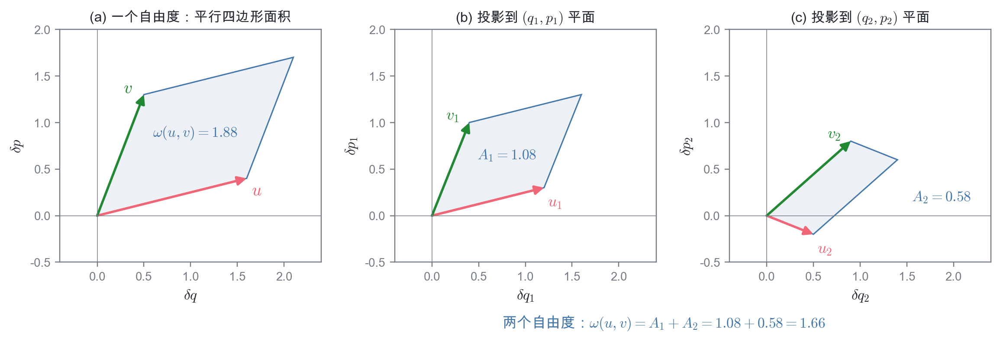
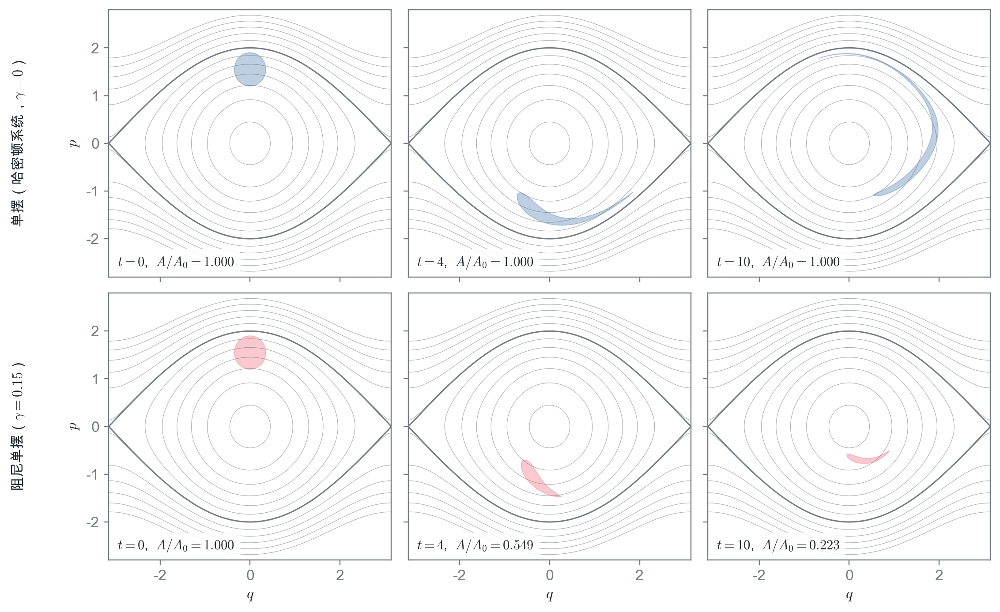
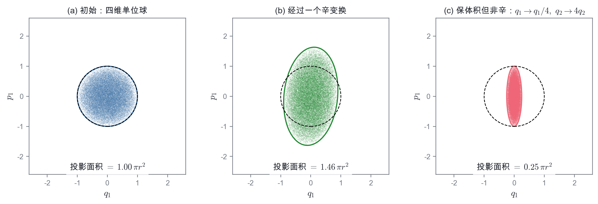
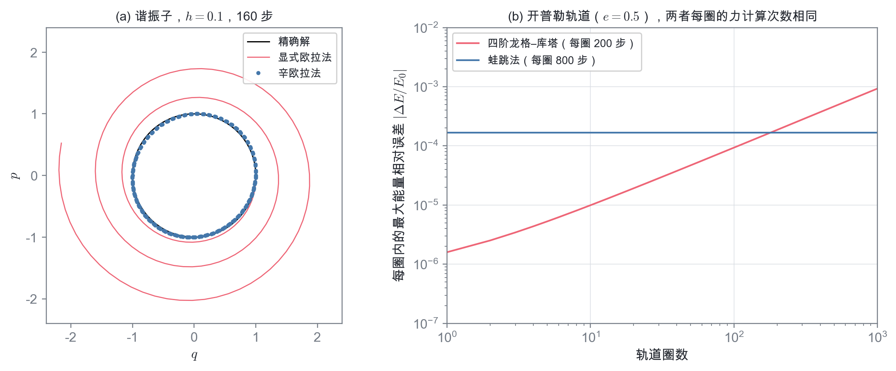

# 辛几何与哈密顿力学

**——相空间中的面积几何**

> 本章建立在[“哈密顿力学”](哈密顿力学.md)一章的基础上，用到其中正则方程的矩阵形式 $\dot z=J\nabla_zH$、泊松括号、正则变换的判据 $MJM^{\mathsf T}=J$、刘维尔定理、作用量变量与绝热不变量。本章只需要微积分（包括平面上的格林公式）和线性代数（矩阵、行列式、本征值），**不需要微分几何**。它可以看作“哈密顿力学”与[“KAM 定理”](KAM定理.md)、[“动力学系统与混沌”](动力学系统与混沌.md)两章之间的桥梁：后两章中反复出现的“保面积映射”“辛矩阵”“本征值成对出现”“迹判据”等结论，都将在这里得到统一的几何解释。
>
> 阅读提示：文中蓝色边框的“推导”“例”等块默认折叠，点击标题展开；打印或导出 PDF 时会自动展开。

在“哈密顿力学”一章里，一个反对称矩阵

$$
\begin{equation}
J=\begin{pmatrix}0&\mathbb 1_s\\-\mathbb 1_s&0\end{pmatrix}
\end{equation}
$$

出现了好几次：正则方程可以写成 $\dot z=J\nabla_zH$，泊松括号可以用它写出，正则变换的判据是 $MJM^{\mathsf T}=J$，刘维尔定理说哈密顿流不可压缩。这不是巧合。这些结论背后有一个共同的几何结构，研究这种结构的数学分支叫做**辛几何**（symplectic geometry）。

先问一个朴素的问题：相空间里有没有“距离”？在位形空间中，两点之间的距离 $\sqrt{\delta x^2+\delta y^2}$ 是再自然不过的概念，保持距离的变换（转动）是刚体运动的基础。但在相空间中，$\sqrt{\delta q^2+\delta p^2}$ 没有意义——$q$ 以米为单位，$p$ 以 $\mathrm{kg\cdot m/s}$ 为单位，两者根本不能相加。另一方面，乘积 $\delta q\,\delta p$ 却有确定的量纲：$\mathrm{J\cdot s}$，即**作用量**的量纲。所以相空间天然能够度量的不是长度，而是 $(q,p)$ 平面上的**面积**。

> 辛几何就是“相空间中的面积几何”：欧氏几何研究保持长度的变换，辛几何研究保持（有向）面积的变换。

本章的逻辑是：先用矩阵语言回顾哈密顿方程，看清 $J$ 的几何作用；定义相空间中的“辛积”，它度量的是有向面积；证明哈密顿演化保持辛积，由此回到刘维尔定理，并得到庞加莱积分不变量、非挤压定理和本征值的配对；用这一观点重新理解正则变换和作用量；看辛结构在数值计算中的威力——辛积分器；最后简要展望现代辛几何。

“辛”这个名字有一段小故事。外尔（H. Weyl）在 1939 年的《典型群》中研究保持 $J$ 的矩阵群，这个群原来被称为“线复形群”（line complex group）。为了避免与复数（complex）混淆，外尔把拉丁词根 com-plexus（编织在一起）换成了意思相同的希腊词根 sym-plektikos，造出了 symplectic 一词。中文译名“辛”通常认为出自华罗庚，取其读音与 sym- 相近。

## 哈密顿方程的矩阵形式（回顾）

把 $s$ 个自由度的正则变量合写成 $2s$ 维矢量

$$
\begin{equation}
z=(q_1,\ldots,q_s,\,p_1,\ldots,p_s)^{\mathsf T},
\end{equation}
$$

哈密顿方程 $\dot q_i=\partial H/\partial p_i$，$\dot p_i=-\partial H/\partial q_i$ 就是

$$
\begin{equation}
\dot z=J\,\nabla_zH .
\end{equation}
$$

矩阵 $J$ 有几个简单而重要的性质，下面会反复用到：

$$
\begin{equation}
J^{\mathsf T}=-J,\qquad J^2=-\mathbb 1,\qquad J^{\mathsf T}J=\mathbb 1,\qquad \det J=1 .
\end{equation}
$$

### $J$ 的几何作用：把梯度转 $90^\circ$

一个自由度时，$\nabla H=(\partial H/\partial q,\ \partial H/\partial p)$，而

$$
\begin{equation}
J\nabla H=\begin{pmatrix}0&1\\-1&0\end{pmatrix}\begin{pmatrix}\partial H/\partial q\\ \partial H/\partial p\end{pmatrix}
=\begin{pmatrix}\partial H/\partial p\\ -\partial H/\partial q\end{pmatrix}.
\end{equation}
$$

这正是把梯度矢量**顺时针旋转 $90^\circ$**。梯度垂直于等能线，转过 $90^\circ$ 后就沿着等能线。所以相点总是沿着 $H=$ 常数的曲线运动，能量守恒在几何上一目了然：

$$
\begin{equation}
\frac{dH}{dt}=\nabla H\cdot\dot z=(\nabla H)^{\mathsf T}J\,\nabla H=0 ,
\end{equation}
$$

最后一步用到了 $J$ 的反对称性（对任意矢量 $a$，$a^{\mathsf T}Ja$ 等于它自己的转置 $a^{\mathsf T}J^{\mathsf T}a=-a^{\mathsf T}Ja$，所以为零）。

对比一下**梯度流** $\dot z=-\nabla H$：它描述的是在极黏稠的介质中的运动（例如小球在蜂蜜里沿着碗壁滑下），相点沿着能量下降最快的方向运动，最终停在能量最低点。哈密顿流与梯度流用的是同一个函数 $H$，差别只在于前面乘的是 $J$ 还是 $-\mathbb 1$。一个保守，一个耗散——全部区别都在这个矩阵里。

**例：单摆。** 取 $H=\frac12p^2-\cos q$（单位已无量纲化）。等能线就是图 2 中的灰色曲线：$H<1$ 的闭合曲线是摆动，$H>1$ 的波浪形曲线是转动，$H=1$ 的粗线是分界线。哈密顿方程只是让相点沿着这些曲线走。

### 泊松括号

在同样的记号下，“哈密顿力学”中的泊松括号可以写成

$$
\begin{equation}
[f,g]=\frac{\partial f}{\partial q_i}\frac{\partial g}{\partial p_i}-\frac{\partial f}{\partial p_i}\frac{\partial g}{\partial q_i}
=(\nabla f)^{\mathsf T}J\,\nabla g ,
\end{equation}
$$

于是 $df/dt=\nabla f\cdot\dot z=(\nabla f)^{\mathsf T}J\nabla H=[f,H]$（$f$ 不显含时间）。泊松括号的反对称性 $[f,g]=-[g,f]$，正是 $J$ 的反对称性。

## 辛积：相空间中的有向面积

### 定义

设 $u$ 和 $v$ 是相空间中的两个小位移（例如从一个相点指向两个相邻相点的矢量）。定义它们的**辛积**

$$
\begin{equation}
\omega(u,v)\equiv u^{\mathsf T}J\,v=\sum_{i=1}^{s}\bigl(u_{q_i}v_{p_i}-u_{p_i}v_{q_i}\bigr),
\end{equation}
$$

其中 $u_{q_i}$、$u_{p_i}$ 表示 $u$ 的 $q_i$ 分量和 $p_i$ 分量。

**一个自由度。** 此时

$$
\begin{equation}
\omega(u,v)=u_qv_p-u_pv_q=\det\begin{pmatrix}u_q&v_q\\u_p&v_p\end{pmatrix},
\end{equation}
$$

就是 $u$、$v$ 张成的平行四边形的**有向面积**（图 1a）：从 $u$ 逆时针转到 $v$ 时为正，顺时针时为负。

**多个自由度。** 求和中的第 $i$ 项是 $u$、$v$ 投影到 $(q_i,p_i)$ 平面上之后张成的有向面积 $A_i$，所以

$$
\begin{equation}
\omega(u,v)=A_1+A_2+\cdots+A_s ,
\end{equation}
$$

即**各个共轭平面上投影面积之和**（图 1b、1c）。

注意，辛积只计算 $(q_1,p_1)$、$(q_2,p_2)$ 等**共轭平面**上的面积，不计算 $(q_1,q_2)$ 或 $(q_1,p_2)$ 平面上的面积。这与量纲的考虑一致：只有 $q_ip_i$ 一定具有作用量的量纲，而 $q_1q_2$、$q_1p_2$ 一般没有确定的物理意义。

### 与欧氏内积的对比

辛积与我们熟悉的内积 $u\cdot v=u^{\mathsf T}v$ 形式上只差一个 $J$，性质却截然不同：

| | 欧氏几何（位形空间） | 辛几何（相空间） |
| --- | --- | --- |
| 基本运算 | 内积 $u\cdot v=u^{\mathsf T}v$ | 辛积 $\omega(u,v)=u^{\mathsf T}Jv$ |
| 对称性 | 对称：$u\cdot v=v\cdot u$ | 反对称：$\omega(u,v)=-\omega(v,u)$ |
| 矢量与自身 | $u\cdot u=\lvert u\rvert^2>0$，给出长度 | $\omega(u,u)=0$，没有“长度” |
| 几何意义 | 长度、角度 | 有向面积（共轭平面投影面积之和） |
| 保持它的线性变换 | 正交矩阵：$R^{\mathsf T}R=\mathbb 1$ | 辛矩阵：$M^{\mathsf T}JM=J$ |
| 物理中的例子 | 刚体的转动 | 正则变换、哈密顿演化 |

表中倒数第二行最值得注意。正交矩阵是保持内积的矩阵：$(Ru)\cdot(Rv)=u^{\mathsf T}R^{\mathsf T}Rv=u\cdot v$。同样地，

$$
\begin{equation}
\omega(Mu,Mv)=u^{\mathsf T}M^{\mathsf T}JM\,v=\omega(u,v)
\quad\Longleftrightarrow\quad
M^{\mathsf T}JM=J .
\end{equation}
$$

所以“哈密顿力学”中的正则变换判据 $M^{\mathsf T}JM=J$ 有一个简单的几何含义：**正则变换就是保持辛积（有向面积）的变换**，正如转动是保持长度的变换。

辛积还有一个性质：它是**非退化**的。若对所有 $v$ 都有 $\omega(u,v)=0$，则 $u^{\mathsf T}J=0$，由于 $J$ 可逆，只能 $u=0$。也就是说，任何一个非零的相空间位移，总能找到另一个位移与它张成非零的面积。

### 哈密顿方程的辛形式

利用辛积，哈密顿方程可以改写成一个不依赖于具体坐标的形式：对任意矢量 $u$，

$$
\begin{equation}
\omega(\dot z,u)=\nabla H\cdot u .
\end{equation}
$$

推导：从 ż = J∇H 得到 ω(ż, u) = ∇H · u

代入 $\dot z=J\nabla H$，并利用 $J^{\mathsf T}J=\mathbb 1$：

$$
\begin{equation*}
\omega(\dot z,u)=\dot z^{\mathsf T}J\,u=(J\nabla H)^{\mathsf T}J\,u=(\nabla H)^{\mathsf T}J^{\mathsf T}J\,u=\nabla H\cdot u .
\end{equation*}
$$

反过来，若上式对所有 $u$ 成立，由辛积的非退化性，$\dot z$ 被唯一确定，就是 $J\nabla H$。

右边 $\nabla H\cdot u$ 是沿 $u$ 方向移动时能量的变化。这个式子说：**速度 $\dot z$ 是这样一个矢量，它与任意位移 $u$ 张成的面积，等于沿 $u$ 移动时能量的增量。** 作为对比，梯度流可以写成 $\dot z\cdot u=-\nabla H\cdot u$：把辛积换成内积（再改个符号），保守的力学就变成了耗散的流动。

由此可以看出，**哈密顿力学 = 一个能量函数 $H$ + 一个辛积 $\omega$**。函数 $H$ 因系统而异，而辛积在正则坐标下永远是同一个 $J$。

## 哈密顿演化保持辛积

### 相邻轨道与演化矩阵

考虑一条参考轨道 $z(t)$，以及从附近出发的另一条轨道 $z(t)+\delta z(t)$。只要偏差很小，就可以线性化：

$$
\begin{equation}
\delta\dot z=J\,S(t)\,\delta z,\qquad S_{ab}(t)=\left.\frac{\partial^2H}{\partial z_a\partial z_b}\right|_{z(t)} ,
\end{equation}
$$

$S$ 是 $H$ 的海森矩阵，它是**对称**矩阵。这是一个线性方程组，它的解可以写成

$$
\begin{equation}
\delta z(t)=M(t)\,\delta z(0),\qquad \dot M=JS\,M,\qquad M(0)=\mathbb 1 .
\end{equation}
$$

$M(t)$ 称为**演化矩阵**，它就是映射 $z(0)\mapsto z(t)$ 的雅可比矩阵 $M_{ab}=\partial z_a(t)/\partial z_b(0)$。

推导：线性化方程

把 $\dot z=J\nabla H(z)$ 应用于两条轨道并相减，对 $\delta z$ 展开到一阶：

$$
\begin{equation*}
\delta\dot z_a=J_{ab}\Bigl[\frac{\partial H}{\partial z_b}(z+\delta z)-\frac{\partial H}{\partial z_b}(z)\Bigr]
\approx J_{ab}\frac{\partial^2H}{\partial z_b\partial z_c}\,\delta z_c=(JS\,\delta z)_a .
\end{equation*}
$$

（重复指标求和。）由于方程是线性的，$\delta z(t)$ 线性地依赖于 $\delta z(0)$，比例矩阵 $M(t)$ 满足同一个方程。

### 定理：演化矩阵是辛矩阵

> **对任意哈密顿量 $H$ 和任意时刻 $t$，演化矩阵满足**
>
> $$
> \begin{equation}
> M(t)^{\mathsf T}J\,M(t)=J .
> \end{equation}
> $$

证明：MTJM 不随时间变化

对 $M^{\mathsf T}JM$ 求导，代入 $\dot M=JSM$ 和 $\dot M^{\mathsf T}=M^{\mathsf T}S^{\mathsf T}J^{\mathsf T}=-M^{\mathsf T}SJ$（用到 $S$ 对称、$J$ 反对称）：

$$
\begin{equation*}
\frac{d}{dt}\bigl(M^{\mathsf T}JM\bigr)=\dot M^{\mathsf T}JM+M^{\mathsf T}J\dot M
=-M^{\mathsf T}SJJM+M^{\mathsf T}JJSM
=M^{\mathsf T}SM-M^{\mathsf T}SM=0 ,
\end{equation*}
$$

这里用了 $J^2=-\mathbb 1$。所以 $M^{\mathsf T}JM$ 是常数，等于它在 $t=0$ 的值 $\mathbb 1^{\mathsf T}J\mathbb 1=J$。

注意证明只用到了两件事：$J$ 反对称且 $J^2=-\mathbb 1$，以及 $S$ 对称。后者来自二阶偏导可交换——这是 $\dot z$ 来自**一个**函数 $H$ 的梯度的结果。若再加一个不能写成 $J\nabla H$ 的力（例如摩擦），证明就失效了。

用辛积的语言说：$\omega(Mu,Mv)=\omega(u,v)$。设想从三个相邻的相点 $z$、$z+u$、$z+v$ 出发，它们张成一个小平行四边形。随着时间推移，这个平行四边形被拉伸、剪切、转动，**但它在各个共轭平面上的投影面积之和始终不变**。

“哈密顿力学”一章用无穷小生成函数证明了：哈密顿演化本身就是一个正则变换。这里用线性代数得到了同一结论的另一个证明：演化映射的雅可比矩阵处处是辛矩阵。

### 推论一：刘维尔定理

刘维尔定理（哈密顿演化保持相体积）已在[“哈密顿力学”](哈密顿力学.md#刘维尔定理)一章“刘维尔定理”一节中证明，这里不再重复，只指出它与辛条件的关系：对 $M^{\mathsf T}JM=J$ 两边取行列式，并利用 $M(0)=\mathbb 1$ 和 $\det M(t)$ 的连续性，得 $\det M(t)=1$，即演化映射的雅可比行列式为 1。所以**相体积守恒是辛积守恒的一个推论**。反过来并不成立：[推论三](#推论三辛比保体积更强非挤压定理)会说明，辛条件比保体积强得多。

图 2 用单摆直观地展示了相体积守恒。上排：一团初始条件（蓝色圆盘）在单摆的哈密顿流中演化。靠近分界线的相点转得慢，远离分界线的转得快，于是圆盘被剪切、拉成越来越细长的弯月形丝带，但面积始终精确地等于初始值。下排：加上阻尼（$\dot q=p$，$\dot p=-\sin q-\gamma p$）后，相空间速度场的散度为 $-\gamma$，由刘维尔公式（见[“哈密顿力学”](哈密顿力学.md#刘维尔定理)一章“刘维尔定理”一节的折叠推导），面积按 $e^{-\gamma t}$ 收缩（$e^{-0.6}=0.549$，$e^{-1.5}=0.223$），所有相点最终都落向原点。

这就是[“动力学系统与混沌”](动力学系统与混沌.md#相体积的演化保守与耗散)一章中保守系统与耗散系统的根本区别：**耗散系统可以有吸引子，哈密顿系统不能有**。

### 推论二：庞加莱积分不变量

在相空间中取一条由初始条件组成的**闭合曲线** $\gamma_0$，让曲线上的每一点都按哈密顿方程运动，得到 $t$ 时刻的闭合曲线 $\gamma_t$。则

$$
\begin{equation}
\oint_{\gamma_t}\sum_{i=1}^{s}p_i\,dq_i=\oint_{\gamma_0}\sum_{i=1}^{s}p_i\,dq_i .
\end{equation}
$$

这称为**庞加莱积分不变量**。

证明：只用分部积分

用参数 $\sigma\in[0,2\pi)$ 标记曲线上的点，曲线在 $t$ 时刻为 $q_i(\sigma,t)$、$p_i(\sigma,t)$，它们对 $\sigma$ 是周期的。记

$$
\begin{equation*}
\mathcal I(t)=\oint\sum_ip_i\,dq_i=\int_0^{2\pi}\sum_ip_i\frac{\partial q_i}{\partial\sigma}\,d\sigma .
\end{equation*}
$$

对时间求导（时间导数与 $\sigma$ 导数可交换）：

$$
\begin{equation*}
\frac{d\mathcal I}{dt}=\int_0^{2\pi}\sum_i\Bigl(\dot p_i\frac{\partial q_i}{\partial\sigma}+p_i\frac{\partial\dot q_i}{\partial\sigma}\Bigr)d\sigma .
\end{equation*}
$$

第二项对 $\sigma$ 分部积分。由于曲线闭合，边界项为零，得到 $-\int\dot q_i\,\partial p_i/\partial\sigma\,d\sigma$。再代入哈密顿方程：

$$
\begin{equation*}
\frac{d\mathcal I}{dt}=\int_0^{2\pi}\sum_i\Bigl(-\frac{\partial H}{\partial q_i}\frac{\partial q_i}{\partial\sigma}-\frac{\partial H}{\partial p_i}\frac{\partial p_i}{\partial\sigma}\Bigr)d\sigma
=-\int_0^{2\pi}\frac{\partial H}{\partial\sigma}\,d\sigma=0 .
\end{equation*}
$$

最后一步是因为 $H$ 沿闭合曲线绕一圈回到原值。即使 $H$ 显含时间，这一步也成立（$\sigma$ 导数是在固定时刻求的）。

若加上阻尼力 $-\gamma p_i$，被积函数多出一项 $-\gamma p_i\,\partial q_i/\partial\sigma$，得到 $d\mathcal I/dt=-\gamma\mathcal I$，于是 $\mathcal I\propto e^{-\gamma t}$，与图 2 下排一致。

它的几何意义由格林公式给出。一个自由度时，$\oint p\,dq$ 就是闭合曲线所围的面积（沿相点运动的方向，即在 $q$ 横轴、$p$ 纵轴的平面上顺时针绕行时取正号）。多个自由度时，把闭合曲线投影到每个 $(q_i,p_i)$ 平面上，$\oint p_i\,dq_i$ 是第 $i$ 个投影所围的有向面积，所以

$$
\begin{equation}
\oint_\gamma\sum_ip_i\,dq_i=\sum_i\bigl(\text{$\gamma$ 在 $(q_i,p_i)$ 平面上投影所围的有向面积}\bigr).
\end{equation}
$$

这正是“辛积 = 投影面积之和”在有限大小曲线上的版本。在[“KAM 定理”](KAM定理.md)中，作用量变量 $I_i=\frac1{2\pi}\oint_{\gamma_i}p_j\,dq_j$ 就是沿不变环面上的闭合回路计算这样的积分；庞加莱截面上的映射保持面积，也来源于此。

### 推论三：辛比“保体积”更强——非挤压定理

一个自由度时，相空间是二维的，“保持面积”与“保持体积”是同一回事：$2\times2$ 矩阵是辛矩阵当且仅当行列式为 1。

但从两个自由度开始，辛条件 $M^{\mathsf T}JM=J$ 比 $\det M=1$ **强得多**。例如变换

$$
\begin{equation}
Q_1=\tfrac14q_1,\qquad Q_2=4q_2,\qquad P_1=p_1,\qquad P_2=p_2
\end{equation}
$$

的雅可比行列式为 $\frac14\times4=1$，保持四维体积；但它把 $(q_1,p_1)$ 平面上的面积缩小为 $1/4$，$(q_2,p_2)$ 平面上的面积放大为 $4$ 倍，不是辛变换。用泊松括号检验也一样：$[Q_1,P_1]=\frac14\neq1$。

辛条件到底比保体积多约束了什么？一个漂亮的回答是**非挤压定理**。在四维相空间中取一个半径为 $r$ 的球（各方向上大小相同的一团初始条件），看它投影到 $(q_1,p_1)$ 平面上的面积（图 3）。

- 保体积但非辛的变换（图 3c）可以把投影压得任意小：只要把 $q_1$ 方向压扁，同时在 $q_2$ 方向拉长作为补偿。
- 辛变换（图 3b）可以把球扭曲成很扁的形状，投影甚至可以在某个方向上比原来更窄，但**投影面积永远不会小于 $\pi r^2$**。

对线性变换，这一结论可以用初等的线性代数证明。

证明：线性辛变换的非挤压性质

设 $M$ 是 $2s\times2s$ 辛矩阵，它的第 1 行和第 $s+1$ 行（分别给出 $Q_1$ 和 $P_1$）记为行矢量 $a^{\mathsf T}$ 和 $b^{\mathsf T}$。球 $\lvert z\rvert\le r$ 中的点 $z$ 映为 $Mz$，其 $(Q_1,P_1)$ 分量为 $(a\cdot z,\ b\cdot z)$。可以证明，这个投影是一个椭圆，面积为

$$
\begin{equation*}
\pi r^2\sqrt{\lvert a\rvert^2\lvert b\rvert^2-(a\cdot b)^2}.
\end{equation*}
$$

（在由 $a$、$b$ 张成的平面内取正交基即可算出。）

另一方面，$M$ 是辛矩阵意味着新变量的基本泊松括号 $[Q_1,P_1]=1$，用矩阵写就是 $a^{\mathsf T}Jb=1$。把 $a$ 分解为平行于 $b$ 的部分和垂直于 $b$ 的部分 $a_\perp$。由于 $Jb$ 与 $b$ 垂直（$b^{\mathsf T}Jb=0$）且 $\lvert Jb\rvert=\lvert b\rvert$，

$$
\begin{equation*}
1=a^{\mathsf T}Jb=a_\perp\cdot(Jb)\le\lvert a_\perp\rvert\,\lvert b\rvert ,
\qquad
\lvert a_\perp\rvert^2\lvert b\rvert^2=\lvert a\rvert^2\lvert b\rvert^2-(a\cdot b)^2 .
\end{equation*}
$$

所以投影面积 $\ge\pi r^2$。等号在 $a_\perp$ 与 $Jb$ 平行时成立，例如恒等变换。

1985 年，格罗莫夫（M. Gromov）证明了这一结论对**非线性**辛变换同样成立：

> **格罗莫夫非挤压定理**：若半径为 $r$ 的 $2s$ 维球能通过一个辛变换（正则变换）放进柱体 $\{q_1^2+p_1^2<R^2\}$ 之中，则必有 $r\le R$。

注意这个柱体在其余 $2s-2$ 个方向上是无限长的，体积是无穷大，体积守恒对它毫无约束。非挤压定理说的是：相空间中的一团点，不能通过任何哈密顿演化在某一对共轭变量 $(q_1,p_1)$ 上被“挤”得比初始更小。人们常把它看作经典力学中不确定性关系 $\Delta q\,\Delta p\gtrsim\hbar$ 的影子，也有人称之为“辛骆驼”（取“骆驼穿过针眼”的典故）。这个定理开启了**辛拓扑**这一现代数学分支。

### 推论四：本征值成对出现

若 $\mu$ 是辛矩阵 $M$ 的本征值，则 $1/\mu$ 也是；又因为 $M$ 是实矩阵，$\mu^*$ 和 $1/\mu^*$ 也是。

证明

由 $M^{\mathsf T}JM=J$ 得 $M^{-1}=J^{-1}M^{\mathsf T}J$，即 $M^{-1}$ 与 $M^{\mathsf T}$ 相似，二者有相同的本征值。而 $M^{\mathsf T}$ 与 $M$ 的本征值相同，所以 $M^{-1}$ 与 $M$ 的本征值相同。$M^{-1}$ 的本征值是 $M$ 的本征值的倒数，结论得证。

这个看似抽象的代数事实有很直接的物理后果。

**哈密顿系统不可能渐近稳定。** 若某个方向上的扰动按 $\lvert\mu\rvert<1$ 衰减，必然有另一个方向按 $1/\lvert\mu\rvert>1$ 增长。所以哈密顿系统的平衡点或周期轨道要么是“中心”型（所有 $\lvert\mu\rvert=1$），要么不稳定，不可能像阻尼振子那样把扰动全部吸收掉。

**二维映射的迹判据。** 对 $2\times2$ 辛矩阵，$\mu_1\mu_2=\det M=1$，本征值满足 $\mu^2-(\operatorname{tr}M)\mu+1=0$。于是

- $\lvert\operatorname{tr}M\rvert<2$：$\mu=e^{\pm i\alpha}$ 在单位圆上，扰动只是转圈，是**椭圆点**（稳定）；
- $\lvert\operatorname{tr}M\rvert>2$：$\mu$ 与 $1/\mu$ 为实数，一个方向增长、一个方向衰减，是**双曲点**（不稳定）。

这正是[“动力学系统与混沌”](动力学系统与混沌.md#映射的不动点)一章分析映射不动点时和“KAM 定理”思考题 1 中使用的判据。它也解释了[“微扰和摄动理论”](微扰和摄动理论.md)中参数共振的不稳定区：周期驱动振子一个周期的演化矩阵（弗洛凯矩阵）是辛矩阵，不稳定区就是 $\lvert\operatorname{tr}M\rvert>2$ 的区域。

**连续时间的版本。** 对线性化矩阵 $A=JS$，有 $A^{\mathsf T}=S^{\mathsf T}J^{\mathsf T}=-SJ=-J^{-1}(JS)J=-J^{-1}AJ$，即 $A^{\mathsf T}$ 与 $-A$ 相似，所以 $A$ 与 $-A$ 的本征值相同：本征值以 $\lambda,-\lambda,\lambda^*,-\lambda^*$ 成组出现（见[“动力学系统与混沌”](动力学系统与混沌.md#哈密顿系统的约束)一章“哈密顿系统的约束”一节）；李雅普诺夫指数也成对出现、总和为零（同章[“混沌的定义”](动力学系统与混沌.md#混沌的定义)一节）。

## 正则变换的几何意义

“哈密顿力学”一章给出了正则变换的判据：变换 $z\mapsto Z(z)$ 的雅可比矩阵 $M_{ab}=\partial Z_a/\partial z_b$ 满足 $M^{\mathsf T}JM=J$（等价于 $MJM^{\mathsf T}=J$，即新变量的基本泊松括号保持不变）。现在我们知道它的几何意义：

> **正则变换 = 在每一点都保持辛积（共轭平面上投影面积之和）的变换。**

一个自由度时，判据就是雅可比行列式等于 1。这给了我们一个检验正则变换的快捷方法：

| 变换 $(q,p)\mapsto(Q,P)$ | 雅可比行列式 | 是否正则 |
| --- | --- | --- |
| $Q=p,\ P=-q$（交换坐标与动量） | $1$ | ✓ |
| $Q=\lambda q,\ P=p/\lambda$（反向缩放） | $1$ | ✓ |
| $Q=\lambda q,\ P=p$（只缩放坐标） | $\lambda$ | ✗（除非 $\lambda=1$） |
| $Q=f(q),\ P=p/f'(q)$（点变换） | $1$ | ✓ |
| $Q=q,\ P=p-\tau V'(q)$（“踢”） | $1$ | ✓ |
| $Q=q+\tau T'(p),\ P=p$（“漂移”） | $1$ | ✓ |
| $Q=q^2,\ P=p$ | $2q$ | ✗ |

第一行说明，在哈密顿力学中坐标与动量的地位完全平等，可以互换（差一个负号）。第四行说明拉格朗日力学中的点变换 $Q=f(q)$ 只要配上相应的动量变换就是正则的。最后两行“踢”（kick）与“漂移”（drift）在后面的[“辛积分器”](#辛积分器让计算机也保持面积)一节中会成为辛积分器的基本构件：“踢”是在时间 $\tau$ 内只受力、不移动，“漂移”是只移动、不受力。

几个辛变换的复合仍是辛变换，因为 $(M_1M_2)^{\mathsf T}J(M_1M_2)=M_2^{\mathsf T}(M_1^{\mathsf T}JM_1)M_2=M_2^{\mathsf T}JM_2=J$；辛变换的逆也是辛变换。所以全体辛矩阵构成一个群，称为**辛群**，记为 $Sp(2s)$——这正是外尔起名时研究的那个群。哈密顿演化 $z(0)\mapsto z(t)$ 是辛群中一条连续的曲线。

**例：谐振子的作用量–角变量。** [“哈密顿力学”](哈密顿力学.md#例几个正则变换)一章“例：几个正则变换”一节已经构造了把谐振子哈密顿量化为 $H=\omega I$ 的正则变换，并验证了它满足基本泊松括号（那里的新变量 $(Q,P)$ 就是这里的角变量和作用量变量 $(\theta,I)$）。从本章的观点看，它的几何含义很简单：这个变换把相平面上的同心椭圆“拉直”成一条条水平线 $I=$ 常数，并且处处保持面积；一个自由度时，“基本泊松括号等于 1”与“雅可比行列式等于 1”是同一件事。它也是[“KAM 定理”](KAM定理.md)一章中作用量–角变量的原型。

## 面积就是作用量

### 作用量变量与绝热不变量

一个自由度的周期运动在相平面上画出一条闭合曲线。由格林公式，

$$
\begin{equation}
I=\frac1{2\pi}\oint p\,dq=\frac{\text{相轨道所围的面积}}{2\pi} .
\end{equation}
$$

对谐振子，相轨道是面积为 $2\pi E/\omega$ 的椭圆，所以 $I=E/\omega$（计算见[“哈密顿力学”](哈密顿力学.md#几何意义与谐振子例子)一章“几何意义与谐振子例子”一节）。

“哈密顿力学”一章证明了作用量是**绝热不变量**：若参数（例如谐振子的频率 $\omega$）变化得比运动周期慢得多，$I$ 近似保持不变。从面积的观点看，这几乎是显然的。设想同一能量的一群相点均匀地分布在相轨道上。参数缓慢变化时，相轨道的形状缓慢改变，这群相点始终近似地铺在一条新的闭合曲线上；而由庞加莱积分不变量，它们围成的面积严格不变。于是新相轨道所围的面积等于旧的，$I$ 不变。例如缓慢地缩短单摆的摆长、缓慢地增大谐振子的频率，能量都按 $E\propto\omega$ 增长。

天文中一个重要的例子是带电粒子在地磁场中的运动。粒子绕磁力线回旋，回旋运动的作用量正比于 $p_\perp^2/B$。由于磁场沿粒子路径缓慢变化，这个量近似守恒：粒子向两极运动时 $B$ 增大，$p_\perp$ 随之增大，由于能量守恒，平行于磁力线的速度减小，最终被“反射”回来。这就是磁镜效应，范艾伦辐射带中的粒子正是这样被地磁场长期束缚的。

多个自由度的可积系统中，每一对作用量–角变量对应不变环面上一条独立的闭合回路，$I_i$ 是相应的“面积”。“KAM 定理”一章讨论的，正是这些面积在扰动下能否保持下来。

### 面积与量子：相格

早期量子论的玻尔–索末菲量子化条件说，允许的周期运动满足

$$
\begin{equation}
\oint p\,dq=2\pi\hbar\left(n+\tfrac12\right),\qquad n=0,1,2,\ldots
\end{equation}
$$

（这里的 $\frac12$ 来自更精确的半经典理论，对谐振子正好正确。）对谐振子，$2\pi E/\omega=2\pi\hbar(n+\frac12)$，即 $E_n=(n+\frac12)\hbar\omega$，与量子力学的精确结果相同（参见[“量子谐振子与经典极限”](量子谐振子与经典极限.md)）。

换个角度看：相邻两个量子态的相轨道之间夹着面积 $2\pi\hbar=h$。所以**每个量子态大约占据相平面上面积为 $h$ 的一个“相格”**，$s$ 个自由度时占据体积 $h^s$。能量低于 $E$ 的量子态数目约为

$$
\begin{equation}
N(E)\approx\frac{\text{相空间中 }H<E\text{ 的区域的体积}}{(2\pi\hbar)^s} .
\end{equation}
$$

对谐振子，$N(E)\approx(2\pi E/\omega)/(2\pi\hbar)=E/(\hbar\omega)$，与精确计数一致。统计力学中用相空间体积除以 $h^s$ 来数状态，正是基于这一点；而刘维尔定理（哈密顿演化保持相体积）保证了这种计数在演化中不变。量子力学的不确定性关系与非挤压定理之间的相似性，也就不那么令人意外了：二者都在说，相空间中的“面积”是一种不能被随意压缩的资源。

## 辛积分器：让计算机也保持面积

天体力学中的许多问题——行星系统的长期稳定性、星团和星系的 $N$ 体演化、小行星和彗星轨道的长期统计——需要把轨道积分成千上万、乃至数十亿圈。这时，数值方法是否保持辛结构，比它的局部精度更重要。

### 显式欧拉法：面积不断膨胀

以谐振子 $H=\frac12(p^2+q^2)$ 为例（取 $m=\omega=1$）。最简单的数值方法是显式欧拉法，步长为 $h$：

$$
\begin{equation}
q_{n+1}=q_n+hp_n,\qquad p_{n+1}=p_n-hq_n
\quad\Longrightarrow\quad
M_{\rm E}=\begin{pmatrix}1&h\\-h&1\end{pmatrix},\qquad \det M_{\rm E}=1+h^2 .
\end{equation}
$$

每一步都把相面积放大 $1+h^2$ 倍。直接计算可得 $q_{n+1}^2+p_{n+1}^2=(1+h^2)(q_n^2+p_n^2)$：能量每步乘以 $1+h^2$，相点沿螺线向外跑（图 4a 红线）。取 $h=0.1$，160 步（约 2.5 个周期）后能量已增大到约 5 倍。

### 辛欧拉法：只改变更新顺序

把更新顺序稍作改变：先用旧的 $q$ 更新动量，再用**新的**动量更新坐标，

$$
\begin{equation}
p_{n+1}=p_n-hq_n,\qquad q_{n+1}=q_n+hp_{n+1}
\quad\Longrightarrow\quad
M_{\rm SE}=\begin{pmatrix}1-h^2&h\\-h&1\end{pmatrix},\qquad \det M_{\rm SE}=1 .
\end{equation}
$$

这个方法称为**辛欧拉法**。它为什么精确地保持面积？因为它是[“正则变换的几何意义”](#正则变换的几何意义)一节表中两个正则变换的复合：先“踢”一下（$q$ 不变，$p\to p-h\,\partial V/\partial q$），再“漂移”一下（$p$ 不变，$q\to q+h\,\partial T/\partial p$）。两者都是辛变换，复合也是辛变换。这一论证不限于谐振子：对任何形如 $H=T(p)+V(q)$ 的哈密顿量，辛欧拉法都是辛的。

图 4a 中的蓝点显示，辛欧拉法的相点始终停留在一个闭合曲线附近，不会向外螺旋。事实上，它**精确地**保持一个与 $H$ 稍有不同的量

$$
\begin{equation}
\tilde H=\frac12(p^2+q^2)-\frac h2\,qp ,
\end{equation}
$$

相点落在 $\tilde H=$ 常数这个略微倾斜的椭圆上。因此真实能量 $H$ 的误差始终是 $O(h)$ 量级的有界振荡，永远不会累积。

验证：辛欧拉法精确地保持 H̃ 

把 $p_{n+1}=p_n-hq_n$，$q_{n+1}=(1-h^2)q_n+hp_n$ 代入 $q^2+p^2-hqp$。为简洁，记 $q=q_n$，$p=p_n$：

$$
\begin{align*}
q_{n+1}^2&=(1-h^2)^2q^2+2h(1-h^2)qp+h^2p^2,\\
p_{n+1}^2&=p^2-2hqp+h^2q^2,\\
h\,q_{n+1}p_{n+1}&=h\bigl[(1-h^2)q+hp\bigr](p-hq)=h(1-h^2)qp-h^2(1-h^2)q^2+h^2p^2-h^3qp .
\end{align*}
$$

于是

$$
\begin{equation*}
q_{n+1}^2+p_{n+1}^2-h\,q_{n+1}p_{n+1}
=\bigl[(1-h^2)^2+h^2+h^2(1-h^2)\bigr]q^2+p^2+\bigl[2h(1-h^2)-2h-h(1-h^2)+h^3\bigr]qp .
\end{equation*}
$$

$q^2$ 的系数为 $1-2h^2+h^4+h^2+h^2-h^4=1$，$qp$ 的系数为 $2h-2h^3-2h-h+h^3+h^3=-h$。所以 $q_{n+1}^2+p_{n+1}^2-hq_{n+1}p_{n+1}=q^2+p^2-hqp$，即 $\tilde H$ 严格守恒。

### 蛙跳法

实际中最常用的辛积分器是**蛙跳法**（leapfrog，又称施特默–韦尔莱法），它把“踢”分成两半，对称地放在“漂移”两侧：

$$
\begin{align}
p_{n+1/2}&=p_n-\frac h2\,\nabla V(q_n),\\
q_{n+1}&=q_n+h\,\nabla T(p_{n+1/2}),\\
p_{n+1}&=p_{n+1/2}-\frac h2\,\nabla V(q_{n+1}).
\end{align}
$$

它有三个优点：（1）作为“踢–漂移–踢”的复合，它是辛的；（2）它是对称的，把 $h$ 换成 $-h$ 就得到逆映射，即**时间可逆**，并因此具有二阶精度；（3）上一步最后一次“踢”所用的力可以留给下一步的第一次“踢”，所以每步只需计算一次力。

对谐振子，蛙跳法的单步矩阵为

$$
\begin{equation}
M_{\rm LF}=\begin{pmatrix}1-\frac{h^2}2&h\\-h+\frac{h^3}4&1-\frac{h^2}2\end{pmatrix},\qquad
\det M_{\rm LF}=1,\qquad \operatorname{tr}M_{\rm LF}=2-h^2 .
\end{equation}
$$

由[“推论四：本征值成对出现”](#推论四本征值成对出现)一节的迹判据，$\lvert\operatorname{tr}M\rvert<2$ 要求 $h<2$（一般地 $\omega h<2$）：步长超过这个限度，数值解就从“椭圆点”变成“双曲点”而爆炸。这是辛积分器的稳定性条件，也是该节代数结论的一个直接应用。

这个方法有很长的历史。挪威物理学家施特默（C. Størmer）在 1907 年前后用它计算带电粒子在地磁场中的轨道，以解释极光；1967 年，韦尔莱（L. Verlet）把它用于分子动力学模拟。1980 年代，鲁斯（R. Ruth）和冯康分别独立地提出了系统构造辛差分格式的思想，开创了“辛算法”（几何数值积分）这一领域。

### 为什么辛积分器适合长期积分

图 4b 比较了四阶龙格–库塔法（RK4，经典的高精度方法，但不是辛的）和蛙跳法积分偏心率 $e=0.5$ 的开普勒轨道。为公平起见，两者每圈的力计算次数相同（RK4 每步算 4 次力，每圈 200 步；蛙跳法每步算 1 次力，每圈 800 步）。

- 开始时，RK4 的能量误差（约 $10^{-6}$）比蛙跳法（约 $10^{-4}$）小两个数量级——四阶方法的局部精度确实更高。
- 但 RK4 的误差随圈数**线性增长**：它不保持辛结构，每圈都让相面积（从而能量）系统地漂移一点，这些漂移一圈一圈地累积。约 200 圈后它就超过了蛙跳法，1000 圈后达到 $10^{-3}$。
- 蛙跳法的误差在每一圈内振荡（在近心点附近最大），但**从不增长**。

背后的原因叫做**向后误差分析**：辛积分器的数值解虽然不是原系统的精确解，却是**另一个哈密顿系统** $\tilde H=H+O(h^p)$ 的（几乎）精确解，正如辛欧拉法精确地保持 $\tilde H$。既然数值轨道在 $\tilde H$ 的等值面上，而 $\tilde H$ 与 $H$ 处处只差 $O(h^p)$，能量误差就被永远限制在这个范围内。贝内廷（G. Benettin）和乔吉利（A. Giorgilli）在 1994 年证明，这一结论在随 $1/h$ 指数增长的时间内都成立。非辛的方法则不对应任何哈密顿系统，它在相空间中引入了一点点人为的“耗散”或“反耗散”，长期必然累积。

从更一般的角度看：数值格式是否保持辛结构，决定了它产生的是一个“近似的哈密顿系统”还是一个“近似的耗散系统”。对后者，KAM 环面、共振岛、混沌海等哈密顿系统特有的相空间结构都会被慢慢抹掉。

### 应用与局限

辛积分器已经是天体力学和天体物理中长期积分的标准工具：

- **太阳系的长期演化。** 威兹德姆（J. Wisdom）和霍尔曼（M. Holman）在 1991 年提出了一种专门针对行星系统的辛映射：把哈密顿量分成“各行星绕太阳的开普勒运动”和“行星间的相互作用”两部分，前者精确求解（作为“漂移”），后者作为“踢”。由于行星间的相互作用很弱，它可以用很大的步长。萨斯曼（G. J. Sussman）和威兹德姆在 1992 年正是用这种方法把整个太阳系积分了 1 亿年，证实了其混沌性（见[“动力学系统与混沌”](动力学系统与混沌.md#太阳系的混沌与地质年代)一章“太阳系的混沌与地质年代”一节）。
- **星系与宇宙学 $N$ 体模拟**（例如广泛使用的 GADGET 程序）的时间推进核心就是蛙跳法。
- **分子动力学**模拟中的韦尔莱算法也是蛙跳法。

当然，辛积分器也有局限：

1. **步长必须固定**（或按特殊方式调整）。普通的自适应步长会破坏辛性。这在近距离交会（如[“动力学系统与混沌”](动力学系统与混沌.md)中的毕达哥拉斯三体问题）时是个麻烦，需要专门的处理方法。
2. 它保持的是 $\tilde H$ 而不是 $H$，能量并不严格守恒；而且可以证明，对一般的不可积系统，不存在既严格保辛又严格保能量的通用格式（Ge & Marsden, 1988）。
3. 能量误差有界，并不意味着轨道相位的误差有界：沿轨道方向的相位误差仍随时间线性增长。需要高精度星历（精确的行星位置）时，人们仍然使用高阶的非辛方法；辛方法的长处在于长期演化的**定性和统计**行为可靠。
4. 若系统本身不是哈密顿的——例如包含潮汐耗散或引力辐射反作用——辛结构本来就不存在，辛积分器的优势也随之减弱，常见的做法是把耗散部分作为一个小的附加步骤处理。

## 展望：现代辛几何（选读）

本节简要介绍辛几何在数学中的面貌，不作要求。

**微分形式的语言。** 在微分几何中，辛积写成一个“2-形式”$\omega=\sum_idq_i\wedge dp_i$，它把一对矢量映为一个数，正是本章的 $\omega(u,v)$。一般的相空间（例如约束系统的相空间）不一定能用整体的 $(q,p)$ 坐标描述，但只要它带有一个满足适当条件的 2-形式，就可以在上面做哈密顿力学，这样的空间称为**辛流形**。**达布定理**说，任何辛流形在局部总可以找到坐标，使 $\omega$ 化为标准形式 $\sum_idq_i\wedge dp_i$。这与黎曼几何截然不同：弯曲的曲面不能在局部化为平面（曲率是局部不变量），而所有辛流形在局部都一样。因此辛几何的问题都是**整体**的、拓扑性的，非挤压定理就是一例。

**起源于天文学。** 辛结构最早出现在天体力学中。拉格朗日在 1808 年前后研究行星轨道根数在其他行星摄动下的缓慢变化（常数变易法）时，引入了今天称为“拉格朗日括号”的量，它们在轨道演化中保持不变——这正是辛积守恒的最早形式。泊松括号随后由泊松在 1809 年引入。

**刚体与约化。** 自由刚体在本体坐标系中的角动量分量之间有非零的泊松括号（例如 $[M_1,M_2]=-M_3$，符号与空间坐标系中相反），并且 $\lvert\boldsymbol M\rvert^2$ 守恒。于是运动被限制在角动量空间中的一个球面上，而球面本身就是一个二维的辛流形，它的“辛积”就是球面上的面积。[“刚体运动”](刚体运动.md)中角动量轨迹是球面与能量椭球的交线这一图像，正是这个二维哈密顿系统的相图（同一运动在惯性系中的几何图像见[“泊安索构图”](泊安索构图.md)）。利用对称性降低相空间维数的一般方法称为**辛约化**，也是[“欧拉角与航天器姿态控制”](欧拉角与航天器姿态控制.md)等问题背后的几何结构。

**不动点定理。** “KAM 定理”中用到的庞加莱–伯克霍夫定理（保面积的扭转映射至少有两个不动点）是庞加莱生前最后提出的“几何定理”，由伯克霍夫在 1913 年证明。阿诺德把它推广为一个关于辛映射不动点数目的猜想（阿诺德猜想），对它的研究在 1980 年代催生了弗洛尔同调等深刻的数学工具。

**量子化。** 把经典力学的泊松括号换成量子力学的对易子（$[f,g]\to\frac1{i\hbar}[\hat f,\hat g]$），以及从辛流形出发系统地构造量子理论（几何量子化），都以辛结构为出发点。[“面积与量子：相格”](#面积与量子相格)一节的“相格”只是这一联系最浅显的一层。

## 小结

1. 相空间没有自然的“距离”，却有自然的“面积”：$\delta q\,\delta p$ 具有作用量的量纲。**辛积** $\omega(u,v)=u^{\mathsf T}Jv$ 度量两个相空间位移张成的有向面积，多自由度时是各个共轭平面 $(q_i,p_i)$ 上投影面积之和。
2. 哈密顿方程 $\dot z=J\nabla H$ 把能量梯度旋转 $90^\circ$，使相点沿等能面运动；它等价于 $\omega(\dot z,u)=\nabla H\cdot u$。哈密顿力学 = 能量函数 + 辛积。
3. 哈密顿演化的演化矩阵是**辛矩阵**：$M^{\mathsf T}JM=J$，即演化保持辛积。由此得到：
   - **刘维尔定理**（证明见“哈密顿力学”一章）：$\det M=1$，相体积守恒，没有吸引子；
   - **庞加莱积分不变量**：$\oint\sum p_idq_i$ 守恒；
   - **非挤压定理**：相空间中的一团点在任一共轭平面上的投影面积不能被压缩，辛比保体积强得多；
   - **本征值成对出现**：$\mu$ 与 $1/\mu$，哈密顿系统不能渐近稳定，二维映射的稳定性由 $\lvert\operatorname{tr}M\rvert<2$ 判定。
4. **正则变换就是辛变换**：一个自由度时即雅可比行列式为 1。辛变换的复合仍是辛变换，构成辛群。
5. **作用量就是相轨道所围的面积除以 $2\pi$**；面积守恒解释了绝热不变量，面积的量子化给出玻尔–索末菲条件，每个量子态占据面积 $h$。
6. **辛积分器**（辛欧拉法、蛙跳法、威兹德姆–霍尔曼映射）精确地保持辛结构，等价于精确求解一个邻近的哈密顿系统，因此能量误差长期有界，是长期轨道积分的标准工具。

### 与本课程其他章节的联系

| 本章内容 | 相关章节 |
| --- | --- |
| 正则方程的矩阵形式、泊松括号、正则变换判据、刘维尔定理 | [哈密顿力学](哈密顿力学.md) |
| 作用量变量、谐振子的作用量–角变量、绝热不变量 | [哈密顿力学](哈密顿力学.md) |
| 保面积映射、扭转映射、作用量与不变环面、庞加莱–伯克霍夫定理 | [KAM 定理](KAM定理.md) |
| 保守与耗散、无吸引子、本征值配对、迹判据、李雅普诺夫指数成对 | [动力学系统与混沌](动力学系统与混沌.md) |
| 参数共振与弗洛凯矩阵 | [微扰和摄动理论](微扰和摄动理论.md) |
| 相空间分布函数与刘维尔方程 | [无碰撞粒子体系](无碰撞粒子体系.md) |
| 玻尔–索末菲量子化与经典极限 | [量子谐振子与经典极限](量子谐振子与经典极限.md) |
| 刚体的角动量球面与约化 | [刚体运动](刚体运动.md)、[泊安索构图](泊安索构图.md)、[欧拉角与航天器姿态控制](欧拉角与航天器姿态控制.md) |
| 太阳系长期积分与混沌 | [动力学系统与混沌](动力学系统与混沌.md)、[KAM 定理](KAM定理.md) |

## 思考题

1. **辛矩阵的基本性质。** (a) 证明 $J$ 本身是辛矩阵；两个辛矩阵的乘积、辛矩阵的逆都是辛矩阵。(b) 证明 $2\times2$ 矩阵是辛矩阵当且仅当其行列式为 1。(c) 对正文中的变换 $Q_1=q_1/4$，$Q_2=4q_2$，$P_i=p_i$，写出 $4\times4$ 雅可比矩阵，直接验证 $\det M=1$ 但 $M^{\mathsf T}JM\neq J$，并计算所有基本泊松括号。(d) 如何修改 $P_1$、$P_2$ 的变换，使它成为正则变换？
2. **踢与漂移。** 对 $s$ 个自由度，证明“踢”$Q=q$，$P=p-\tau\nabla V(q)$ 的雅可比矩阵 $\begin{pmatrix}\mathbb 1&0\\-\tau\,\partial^2V&\mathbb 1\end{pmatrix}$ 是辛矩阵（提示：关键是 $V$ 的海森矩阵对称）。若把 $\nabla V$ 换成一个不能写成梯度的力 $\boldsymbol F(q)$，结论还成立吗？这与“保守力”有什么关系？
3. **庞加莱积分不变量。** (a) 对谐振子 $H=\frac12(p^2+q^2)$，取初始闭合曲线为以 $(q,p)=(2,0)$ 为圆心、半径为 $0.5$ 的圆，写出 $t$ 时刻曲线的方程，验证所围面积不变。(b) 对阻尼振子 $\ddot q+\gamma\dot q+q=0$，证明 $\oint p\,dq\propto e^{-\gamma t}$。
4. **线性非挤压。** (a) 对辛矩阵 $M=\operatorname{diag}(\varepsilon,1,1/\varepsilon,1)$（坐标顺序 $q_1,q_2,p_1,p_2$），求单位球在 $(Q_1,P_1)$ 平面上的投影，说明它在 $Q_1$ 方向可以任意窄，但面积不变。(b) 用 Python 生成一个随机的 $4\times4$ 对称矩阵 $S$，计算 $M=e^{JS}$（`scipy.linalg.expm`），验证 $M^{\mathsf T}JM=J$，并计算单位球投影到 $(Q_1,P_1)$ 平面的面积。重复多次，验证它总不小于 $\pi$。
5. **辛欧拉法与蛙跳法。** (a) 对谐振子，求辛欧拉法守恒的 $\tilde H$ 所对应椭圆的主轴方向与半轴长，估计能量 $H$ 的最大相对误差（应约为 $h/2$）。(b) 验证蛙跳法精确地保持 $\tilde H_{\rm LF}=\frac12p^2+\frac12(1-\frac{h^2}4)q^2$，并说明为什么当 $h>2$ 时这个“能量”不再是正定的，与迹判据联系起来。(c) 对开普勒轨道，蛙跳法的步长应该如何选取？为什么偏心率越大，固定步长的积分越困难？
6. **RK4 不是辛的。** 对谐振子，RK4 的单步矩阵是 $M=\mathbb 1+hA+\frac{(hA)^2}{2}+\frac{(hA)^3}{6}+\frac{(hA)^4}{24}$，$A=\begin{pmatrix}0&1\\-1&0\end{pmatrix}$。证明 $\det M=1-\frac{h^6}{72}+\frac{h^8}{576}$。由此估计取每周期 100 步时，积分 $10^6$ 个周期后能量的相对变化，说明 RK4 对这个问题是轻微“耗散”的。
7. **相格计数。** (a) 用玻尔–索末菲条件 $\oint p\,dq=2\pi\hbar(n+\frac12)$ 求谐振子的能级。(b) 一维无限深方势阱（宽度 $L$）中的粒子，相轨道是什么形状？用“每个态占据面积 $2\pi\hbar$”估计能量低于 $E$ 的态的数目，并与精确能级 $E_n=n^2\pi^2\hbar^2/(2mL^2)$ 比较。
8. **（选做）复现图 4b。** 用蛙跳法和 RK4 积分 $e=0.5$ 的开普勒轨道 1000 圈，复现正文的能量误差曲线。然后把蛙跳法改为自适应步长（例如步长正比于 $r^{3/2}$），观察能量误差是否仍然有界。

## 参考文献与延伸阅读

**教材与入门读物**

1. V. I. Arnol'd, *Mathematical Methods of Classical Mechanics*, 2nd ed. (Springer, 1989)，[DOI: 10.1007/978-1-4757-2063-1](https://doi.org/10.1007/978-1-4757-2063-1)。第 8–9 章用微分形式系统地讲述辛结构与哈密顿力学，是读完本章后最自然的下一步。
2. H. Goldstein, C. Poole, J. Safko, *Classical Mechanics*, 3rd ed. (Addison-Wesley, 2002)。第 9.4 节“正则变换的辛方法”用矩阵语言讨论辛条件，与本章的处理方式接近。
3. J. V. José, E. J. Saletan, *Classical Dynamics: A Contemporary Approach* (Cambridge, 1998)。从物理学家的角度介绍相空间几何、辛结构与哈密顿系统。
4. D. McDuff, “What is symplectic geometry?”, in *European Women in Mathematics: Proceedings of the 13th General Meeting* (World Scientific, 2010)。辛几何专家写的通俗介绍，包括非挤压定理的直观解释。
5. A. Cannas da Silva, *Lectures on Symplectic Geometry*, Lecture Notes in Mathematics **1764** (Springer, 2001)。面向数学系研究生的标准入门讲义，需要微分几何基础。
6. R. Abraham, J. E. Marsden, *Foundations of Mechanics*, 2nd ed. (Benjamin/Cummings, 1978)。辛几何观点下的力学经典专著，包括约化理论。

**历史与原始文献**

7. H. Weyl, *The Classical Groups: Their Invariants and Representations* (Princeton University Press, 1939)。“symplectic”一词的出处。
8. J.-L. Lagrange, “Mémoire sur la théorie des variations des éléments des planètes, et en particulier des variations des grands axes de leurs orbites” (1808)。拉格朗日括号的起源。
9. M. Gromov, “Pseudo holomorphic curves in symplectic manifolds,” *Invent. Math.* **82**, 307–347 (1985)。非挤压定理的原始证明。
10. M. A. de Gosson, “The symplectic camel and the uncertainty principle: The tip of an iceberg?” *Found. Phys.* **39**, 194–214 (2009)。非挤压定理与不确定性关系之间的联系。

**辛积分器**

11. L. Verlet, “Computer ‘experiments’ on classical fluids. I. Thermodynamical properties of Lennard-Jones molecules,” *Phys. Rev.* **159**, 98–103 (1967)。
12. R. D. Ruth, “A canonical integration technique,” *IEEE Trans. Nucl. Sci.* **30**, 2669–2671 (1983)。
13. 冯康，“On difference schemes and symplectic geometry,” in *Proceedings of the 1984 Beijing Symposium on Differential Geometry and Differential Equations* (Science Press, 1985), pp. 42–58；K. Feng, M. Qin, *Symplectic Geometric Algorithms for Hamiltonian Systems* (Springer, 2010)（中文版：冯康、秦孟兆，《哈密尔顿系统的辛几何算法》，浙江科学技术出版社，2003）。
14. Z. Ge, J. E. Marsden, “Lie–Poisson Hamilton–Jacobi theory and Lie–Poisson integrators,” *Phys. Lett. A* **133**, 134–139 (1988)。
15. G. Benettin, A. Giorgilli, “On the Hamiltonian interpolation of near-to-the-identity symplectic mappings with application to symplectic integration algorithms,” *J. Stat. Phys.* **74**, 1117–1143 (1994)。向后误差分析与能量误差的长期有界性。
16. E. Hairer, C. Lubich, G. Wanner, “Geometric numerical integration illustrated by the Störmer–Verlet method,” *Acta Numerica* **12**, 399–450 (2003)。以蛙跳法为线索的精彩综述，包括它的历史，强烈推荐。
17. E. Hairer, C. Lubich, G. Wanner, *Geometric Numerical Integration*, 2nd ed. (Springer, 2006)。该领域的标准专著。

**天文应用**

18. J. Wisdom, M. Holman, “Symplectic maps for the $n$-body problem,” *Astron. J.* **102**, 1528–1538 (1991)。
19. G. J. Sussman, J. Wisdom, “Chaotic evolution of the Solar System,” *Science* **257**, 56–62 (1992)。
20. V. Springel, “The cosmological simulation code GADGET-2,” *Mon. Not. R. Astron. Soc.* **364**, 1105–1134 (2005)。
