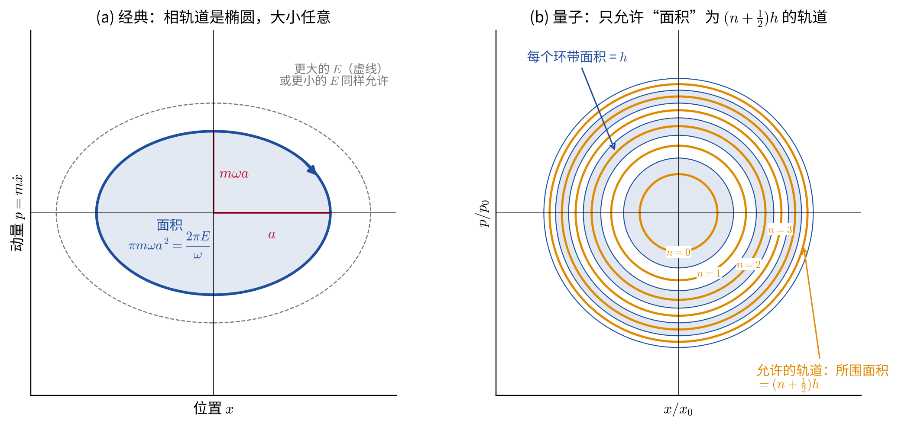
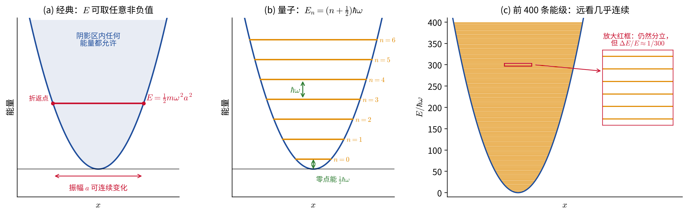
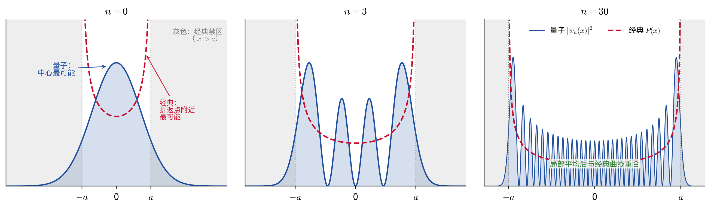

# 量子谐振子与经典极限

> 本文是[“微扰和摄动理论”](微扰和摄动理论.md)一章“稳定平衡附近的微小振动”中[“能量”](微扰和摄动理论.md#能量)一节的补充材料，面向尚未学习量子力学的读者。正文得到了经典谐振子的能量 $E=\frac12m\omega^2a^2$；这里讨论量子力学如何修改这一结论，以及为什么经典力学对应量子数 $n\gg1$ 的高激发态。

记号与正文一致：质量为 $m$ 的质点在平衡点附近作简谐振动，偏离平衡位置的位移为 $\bar x$（下文在不致混淆时简写为 $x$），固有角频率 $\omega=\sqrt{k/m}$，运动为 $\bar x=a\cos(\omega t+\alpha)$。

## 经典谐振子：能量连续可取

把解 $\bar x=a\cos(\omega t+\alpha)$ 代入能量表达式，动能与势能分别为

$$
\begin{equation}
T=\frac12m\dot{\bar x}^{2}=\frac12m\omega^2a^2\sin^2(\omega t+\alpha),
\qquad
U=\frac12k\bar x^2=\frac12m\omega^2a^2\cos^2(\omega t+\alpha),
\end{equation}
$$

二者此消彼长，但总和不随时间变化：

$$
\begin{equation}
E=T+U=\frac12m\dot{\bar x}^{2}+\frac12k\bar x^2
=\frac12m\omega^2a^2 .
\end{equation}
$$

所以能量与振幅平方成正比。振幅 $a$ 由初始条件决定，可以是任意非负实数：把弹簧多拉长 1 mm 或少拉 1 mm 都可以，因此**经典谐振子的能量可以取 $E\ge0$ 的任意值，是连续的**。在下文能级图的图（a）中，水平线 $E$ 与抛物线的两个交点 $x=\pm a$ 就是折返点；这条水平线可以画在任意高度。

## 相空间图像：能量对应椭圆的面积

为了把“经典”和“量子”放在同一张图里比较，换一个角度看同一个运动。以位置 $x$ 为横轴、动量 $p=m\dot x$ 为纵轴，系统每一时刻的状态 $(x,p)$ 是这个平面上的一个点，这个平面称为**相空间**（phase space，后面[“哈密顿力学”](哈密顿力学.md)一章会系统使用它）。能量守恒

$$
\begin{equation}
\frac{p^2}{2m}+\frac12m\omega^2x^2=E
\quad\Longleftrightarrow\quad
\frac{x^2}{a^2}+\frac{p^2}{(m\omega a)^2}=1
\end{equation}
$$

说明状态点沿一个椭圆运动，半轴分别为 $a$ 和 $m\omega a$，每个周期 $2\pi/\omega$ 转一圈。椭圆所围的面积为

$$
\begin{equation}
J\equiv\oint p\,dx=\pi a\cdot m\omega a=\frac{2\pi E}{\omega}.
\end{equation}
$$

这个量具有“动量 × 长度 = 能量 × 时间”的量纲，也就是**作用量**的量纲，单位 J·s。对谐振子来说，**能量 $E$ 与相轨道面积 $J$ 只差一个常数因子 $\omega/2\pi$**。经典力学允许任意大小的椭圆，即 $J$（从而 $E$）连续取值，如下图（a）。

## 量子力学：能量只能取分立值

20 世纪初，人们发现微观振子（例如分子中原子的振动）不服从上面的结论：分子只吸收或发射某些特定波长的光，说明它的振动能量只能取某些特定的值。普朗克（1900）在解释黑体辐射时首先引入了这一假设，后来玻尔和索末菲把它总结成一条规则：相轨道所围面积只能取普朗克常数 $h$ 的整数倍，$\oint p\,dx=nh$。更精确的半经典理论给出一个 $\frac12$ 的修正：**相轨道所围面积只能取 $h$ 的半整数倍**，

$$
\begin{equation}
\oint p\,dx=\left(n+\frac12\right)h,
\qquad n=0,1,2,\ldots,
\qquad h=6.626\times10^{-34}\ \text{J s}.
\end{equation}
$$

把 $\oint p\,dx=2\pi E/\omega$ 代入，并记 $\hbar\equiv h/2\pi=1.055\times10^{-34}\ \text{J s}$（约化普朗克常数），立即得到

$$
\begin{equation}
E_n=\left(n+\frac12\right)\hbar\omega,
\qquad n=0,1,2,\ldots
\end{equation}
$$

这就是量子谐振子的能级。上面的“面积规则”只是一个启发性的说法，严格结果要由量子力学的薛定谔方程给出；对谐振子而言，二者恰好完全一致。这里我们只需要接受它的几个直接推论（见下图）：

- **能级等间距。** 相邻能级之差 $E_{n+1}-E_n=\hbar\omega$ 与 $n$ 无关。振子吸收或放出能量时只能一份一份地进行，每份 $\hbar\omega$，称为一个**能量子**。量子数 $n$ 就是振子“装着”的能量子个数。
- **相空间被切成面积为 $h$ 的环带。** 图（b）中，相邻两条允许轨道之间、以及相邻两条环带边界之间所围的面积都是 $h$。可以粗略地说，每个量子态在相空间中“占据”一块面积为 $h$ 的格子，比 $h$ 更细的分辨在量子力学中没有意义。
- **最低能量不为零。** $n=0$ 的基态能量为 $E_0=\frac12\hbar\omega$，称为**零点能**。经典振子可以静止在平衡点（$x=0$，$p=0$），能量为零；量子振子不行。

零点能可以用量子力学的**不确定性关系**粗略理解：粒子的位置不确定度 $\Delta x$ 与动量不确定度 $\Delta p$ 满足 $\Delta x\,\Delta p\ge\hbar/2$，无法同时为零，也就不能“静止在原点”。估计能量时取 $p\sim\Delta p=\hbar/(2\Delta x)$、$x\sim\Delta x$，

$$
\begin{equation}
E(\Delta x)\approx\frac{\hbar^2}{8m\,\Delta x^2}+\frac12m\omega^2\Delta x^2 .
\end{equation}
$$

第一项（动能）要求 $\Delta x$ 大，第二项（势能）要求 $\Delta x$ 小。对 $\Delta x$ 求极小，得 $\Delta x^2=\hbar/(2m\omega)$，代回得 $E_{\min}=\frac12\hbar\omega$，恰好是零点能。

## 为什么日常生活中看不到能量的分立？

能量分立是否明显，取决于能级间隔 $\hbar\omega$ 与振子实际能量 $E$ 的比较。由 $E_n=(n+\frac12)\hbar\omega$，振子所处的量子数为

$$
\begin{equation}
n\approx\frac{E}{\hbar\omega}=\frac{J}{h},
\end{equation}
$$

即“相轨道面积里装了多少个 $h$”。

**宏观例子：弹簧振子。** 取 $m=0.1$ kg，振动频率 $f=1$ Hz（$\omega=2\pi\ \text{s}^{-1}$），振幅 $a=1$ cm，则

$$
\begin{equation}
E=\frac12m\omega^2a^2\approx2.0\times10^{-4}\ \text{J},
\qquad
\hbar\omega=hf\approx6.6\times10^{-34}\ \text{J},
\qquad
n\approx3\times10^{29}.
\end{equation}
$$

相邻能级的相对间隔为 $\Delta E/E\approx1/n\approx3\times10^{-30}$。由 $E\propto a^2$ 得 $\Delta a/a=\frac12\Delta E/E$，即从第 $n$ 个能级跳到第 $n+1$ 个，振幅只变化

$$
\begin{equation}
\Delta a\approx\frac{a}{2n}\approx2\times10^{-32}\ \text{m},
\end{equation}
$$

比质子的半径（约 $10^{-15}$ m）还小 17 个数量级。任何测量都不可能分辨这样的“台阶”，能量看起来就是连续的。

**微观例子：CO 分子的振动。** 一氧化碳分子中 C、O 两个原子之间的化学键像一根弹簧，振动的能级间隔 $\hbar\omega\approx0.27$ eV，对应吸收波长约 $4.7\ \mu\text{m}$ 的红外光（这正是红外天文观测中常见的 CO 振动谱带）。而室温下分子之间相互碰撞所能交换的典型能量只有 $k_BT\approx0.026$ eV，约为能级间隔的十分之一，不足以把分子“踢”上第一个台阶。所以室温下绝大多数 CO 分子都处在 $n=0$ 的基态，振动完全是量子的，经典的“振幅连续变化”图像在这里失效。

两个例子的差别不在于“宏观物体”和“微观物体”遵从不同的定律，而在于量子数 $n$ 的大小。宏观物体如果足够冷，也能进入 $n\sim1$ 的量子区：2021 年，LIGO 引力波探测器把四面 40 kg 反射镜的一种集体运动（等效质量约 10 kg）冷却到约 77 nK，平均量子数降到 $n\approx11$ [2]。

## 经典极限 $n\gg1$ 的三层含义

“经典力学对应 $n\gg1$ 的高激发态”这句话可以从三个角度理解。

**（1）能级的相对间隔趋于零。**

$$
\begin{equation}
\frac{E_{n+1}-E_n}{E_n}=\frac{1}{n+\frac12}\ \xrightarrow{\ n\to\infty\ }\ 0 .
\end{equation}
$$

能级的绝对间隔始终是 $\hbar\omega$，并不随 $n$ 变小；变小的是它相对于总能量的比例。上图（c）画出了前 400 条能级：远看已经像连续的色带，放大才看出仍是分立的。等价地说，固定能量 $E$ 而令 $\hbar\to0$，则 $n=E/\hbar\omega\to\infty$。所以“$n\gg1$”、“$J\gg h$”和“$\hbar\to0$”是同一个经典极限的不同说法：**当系统的作用量远大于普朗克常数时，量子效应可以忽略**（参见[“哈密顿力学”](哈密顿力学.md)一章[“与量子力学的联系”](哈密顿力学.md#与量子力学的联系)一节）。

**（2）辐射频率与经典振动频率一致（玻尔对应原理）。** 量子振子从能级 $n$ 跳到 $n-1$ 时放出一个光子，带走能量 $E_n-E_{n-1}$，光的角频率为

$$
\begin{equation}
\omega_{\text{光}}=\frac{E_n-E_{n-1}}{\hbar}=\omega .
\end{equation}
$$

这正是经典带电振子以频率 $\omega$ 振动时辐射电磁波的频率。谐振子的能级严格等间距，所以这一对应对所有 $n$ 都成立，这是它特殊的地方。一般系统的能级并不等间距，对应只在 $n\gg1$ 时成立。例如氢原子的能级为 $E_n=-13.6\ \text{eV}/n^2$，相邻能级的间隔 $E_n-E_{n-1}\approx27.2\ \text{eV}/n^3$ 随 $n$ 变化。可以验证，$n\gg1$ 时由它算出的光频率，恰好等于电子在同样能量的开普勒轨道上的经典公转角频率（参见[“中心力场”](中心力场.md)一章开普勒问题中周期与能量的关系）；而对 $n=2\to1$ 这样的低激发态，两者相差很大。

**（3）粒子位置的概率分布趋于经典分布。** 经典振子在各处停留的时间不同：经过平衡点时速度最大，一闪而过；在折返点附近速度趋于零，停留最久。若在随机时刻对振子“拍照”，在 $x$ 到 $x+dx$ 之间找到它的概率等于它在这一段停留的时间占半个周期的比例：

$$
\begin{equation}
P_{\text{经典}}(x)\,dx=\frac{dt}{\pi/\omega}=\frac{\omega}{\pi}\,\frac{dx}{|\dot x|}
=\frac{dx}{\pi\sqrt{a^2-x^2}},
\qquad |x|<a,
\end{equation}
$$

这里用了 $|\dot x|=\omega\sqrt{a^2-x^2}$，可以验证 $\int_{-a}^{a}P_{\text{经典}}\,dx=1$。这个分布在中心最小，在折返点 $x=\pm a$ 处发散；在 $|x|>a$ 的区域为零，因为那里 $E<U(x)$，动能为负，经典上不可能到达。

量子力学中，处于第 $n$ 个能级的粒子也有一个确定的位置概率分布，记为 $|\psi_n(x)|^2$（$\psi_n$ 称为**波函数**，其具体求法是量子力学课程的内容）。下图把它与相同能量下的经典分布 $P_{\text{经典}}$ 作比较（为比较方便，量子情形的 $a$ 取为 $E_n$ 对应的经典振幅 $\sqrt{(2n+1)\hbar/m\omega}$）：

- $n=0$：量子分布是一个以原点为中心的钟形曲线，**中心最可能**，与经典分布“中心最不可能、两端最可能”恰好相反。并且量子分布有一部分伸入了经典禁区 $|x|>a$。
- $n=3$：量子分布有 4 个峰，两侧的峰最高，已经隐约呈现经典分布“两边高、中间低”的趋势。
- $n=30$：量子分布快速振荡（共 31 个峰），但把这些振荡在一小段 $x$ 上平均后，就与经典曲线几乎重合；伸入禁区的部分也变得很窄。

$n$ 越大，振荡越密，任何有限分辨率的测量都只能看到平均后的结果，也就是经典分布。

最后补充一点。能量确定的量子态 $\psi_n$ 是**定态**，其概率分布不随时间变化，它对应的是经典振子“随机时刻拍照”的统计结果，而不是一个来回运动的小球。量子力学中，一个真正来回振动的宏观振子，对应的是许多相邻能级（$n$ 附近 $\sim\sqrt n$ 个能级）的叠加：其位置分布是一个窄的“波包”，它的中心严格按照经典规律 $\langle x\rangle=a\cos(\omega t+\alpha)$ 来回振动。当 $n\gg1$ 时，$\sqrt n\ll n$，能量的相对弥散 $\sim1/\sqrt n$ 可以忽略，我们看到的就是一个能量确定、按经典轨道运动的振子。

下表小结经典与量子谐振子的对比：

| | 经典谐振子 | 量子谐振子 | $n\gg1$ 时 |
|:--|:--|:--|:--|
| 能量 | $E=\frac12m\omega^2a^2$，连续 | $E_n=(n+\frac12)\hbar\omega$，分立 | $\Delta E/E\approx1/n\to0$，准连续 |
| 相轨道面积 $\oint p\,dx$ | 任意 | $(n+\frac12)h$ | $\gg h$，量子化不可察觉 |
| 最低能量 | $0$（静止于平衡点） | $\frac12\hbar\omega$（零点能） | 相对 $E$ 可忽略 |
| 辐射频率 | $\omega$ | $(E_n-E_{n-1})/\hbar=\omega$ | 一致（一般系统仅在此极限一致） |
| 位置分布 | $1/(\pi\sqrt{a^2-x^2})$，两端最大 | $\lvert\psi_n\rvert^2$，有 $n+1$ 个峰，可进入禁区 | 平均后趋于经典分布 |

更系统的讨论可在量子力学课程中学到，例如 [1, §2.3]。

## 参考文献与延伸阅读

1. D. J. Griffiths, D. F. Schroeter, *Introduction to Quantum Mechanics*, 3rd ed. (Cambridge University Press, 2018). §2.3 谐振子（能级、波函数及其与经典概率分布的比较）。
2. C. Whittle *et al.*, “Approaching the motional ground state of a 10-kg object,” *Science* **372**, 1333 (2021), arXiv:2102.12665.
